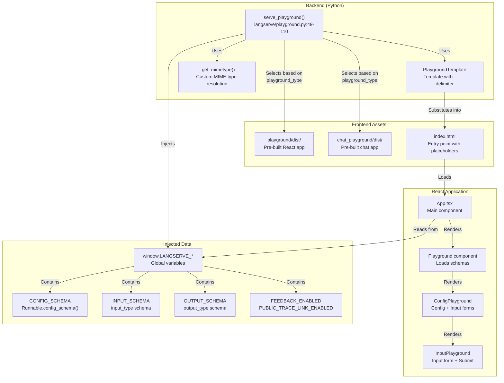
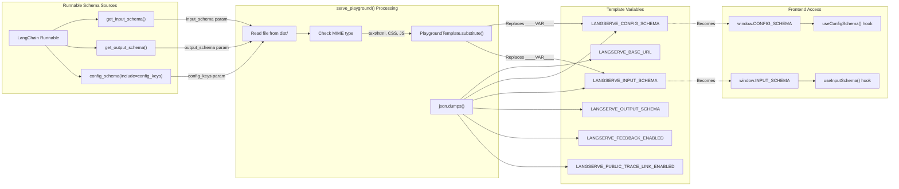
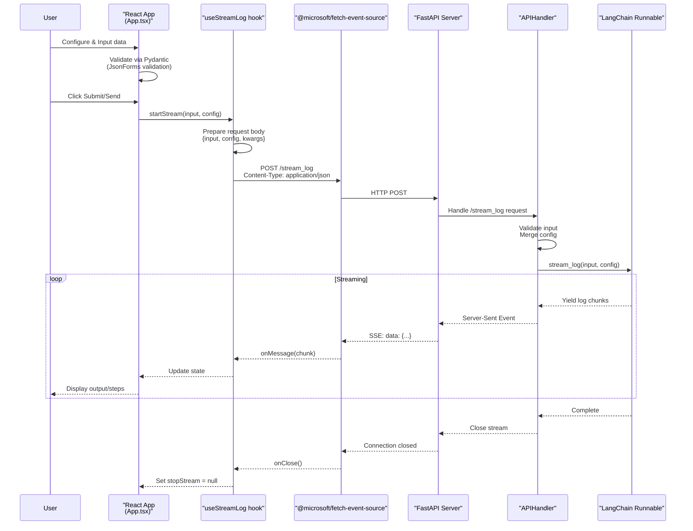
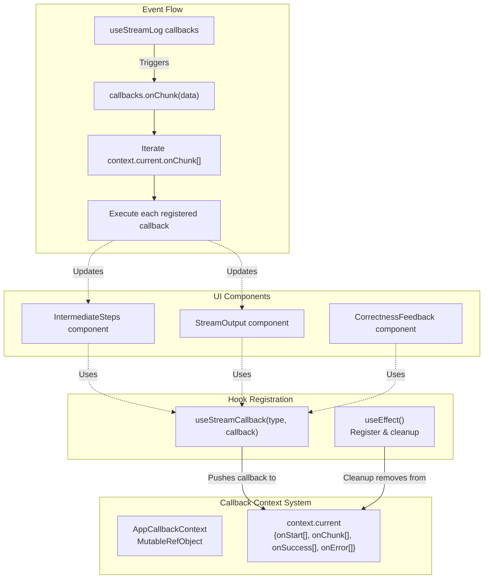
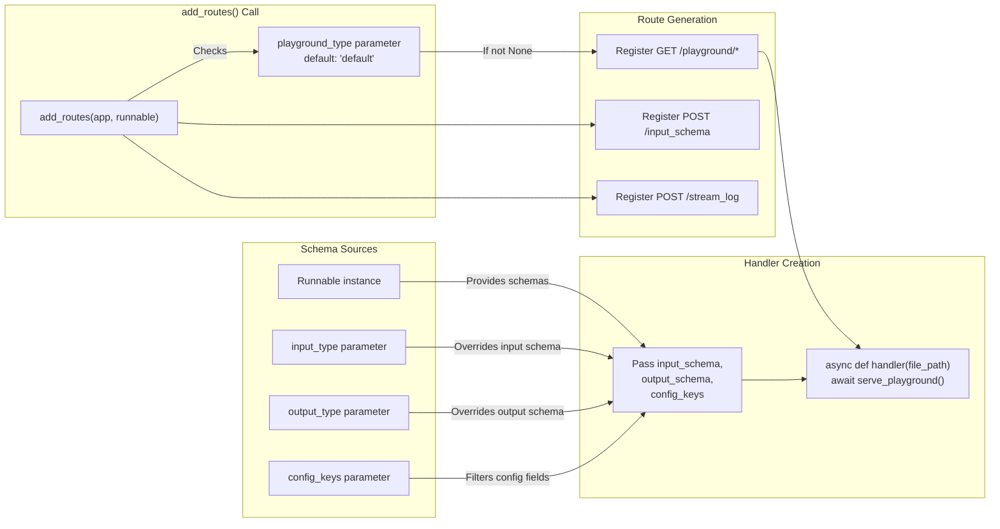

<!-- source: DeepWiki mcp.deepwiki.com · repo langchain-ai/langserve · page 3 Playground Interface · fetched 2026-10-26 -->

# Playground Interface

<details>
<summary>Relevant source files</summary>

The following files were used as context for generating this wiki page:

- [langserve/playground.py](langserve/playground.py)
- [langserve/playground/package.json](langserve/playground/package.json)
- [langserve/playground/src/App.css](langserve/playground/src/App.css)
- [langserve/playground/src/App.tsx](langserve/playground/src/App.tsx)
- [langserve/playground/src/useStreamCallback.tsx](langserve/playground/src/useStreamCallback.tsx)
- [langserve/playground/yarn.lock](langserve/playground/yarn.lock)
- [langserve/serialization.py](langserve/serialization.py)
- [tests/unit_tests/test_serialization.py](tests/unit_tests/test_serialization.py)

</details>


## Purpose and Scope

The Playground Interface provides interactive web-based user interfaces for testing and debugging LangServe applications. This system includes two playground implementations: a general-purpose form-based playground and a specialized chat interface. The playground automatically generates forms based on the input and configuration schemas exposed by LangChain Runnables, enabling developers and end users to test chains without writing client code.

This page covers the overall playground architecture, schema injection mechanism, and request flow. For details on the default playground UI and JsonForms integration, see [Standard Playground](#3.1). For chat-specific features and message history handling, see [Chat Playground](#3.2). For custom widgets and form rendering, see [UI Components & Schema Handling](#3.3).

## Architecture Overview

The playground system consists of two main components: a backend serving layer and frontend React applications. The backend injects schemas and configuration into pre-built HTML/JS assets, while the frontend provides interactive forms and streaming output display.

### Component Structure



**Sources:** [langserve/playground.py:49-110](), [langserve/playground/src/App.tsx:1-223]()

### File System Layout

| Path | Purpose |
|------|---------|
| `langserve/playground.py` | Backend serving logic and schema injection |
| `langserve/playground/dist/` | Built default playground assets |
| `langserve/chat_playground/dist/` | Built chat playground assets |
| `langserve/playground/src/App.tsx` | Main React application entry point |
| `langserve/playground/src/useSchemas.tsx` | Hooks for loading schemas from window |
| `langserve/playground/src/useStreamLog.tsx` | Streaming request management |
| `langserve/playground/src/useStreamCallback.tsx` | Callback event handling |

**Sources:** [langserve/playground.py:1-111](), [langserve/playground/package.json:1-60]()

## Schema Injection Mechanism

The backend dynamically injects schemas and configuration into the frontend by substituting template variables in HTML, CSS, and JavaScript files. This approach avoids the need for separate API calls to fetch schemas and enables the playground to work immediately on page load.

### Template Substitution System



**Sources:** [langserve/playground.py:49-110](), [langserve/playground.py:12-13]()

### Template Delimiter and Variable Names

The `PlaygroundTemplate` class uses a custom delimiter `____` to avoid conflicts with common JavaScript syntax. Template variables follow the pattern `____LANGSERVE_*____`:

```python
# Template delimiter definition
class PlaygroundTemplate(Template):
    delimiter = "____"
```

**Injected Variables:**

| Template Variable | Window Variable | Source |
|-------------------|-----------------|--------|
| `LANGSERVE_BASE_URL` | - | `base_url` parameter (path prefix) |
| `LANGSERVE_CONFIG_SCHEMA` | `window.CONFIG_SCHEMA` | `runnable.config_schema(include=config_keys)` |
| `LANGSERVE_INPUT_SCHEMA` | `window.INPUT_SCHEMA` | `input_schema.model_json_schema()` |
| `LANGSERVE_OUTPUT_SCHEMA` | `window.OUTPUT_SCHEMA` | `output_schema.model_json_schema()` |
| `LANGSERVE_FEEDBACK_ENABLED` | `window.FEEDBACK_ENABLED` | `feedback_enabled` parameter |
| `LANGSERVE_PUBLIC_TRACE_LINK_ENABLED` | `window.PUBLIC_TRACE_LINK_ENABLED` | `public_trace_link_enabled` parameter |

**Sources:** [langserve/playground.py:87-103]()

## Playground Types

LangServe provides two playground implementations selected via the `playground_type` parameter in `add_routes()`:

### Default Playground (`playground_type="default"`)

The default playground provides a general-purpose form-based interface using JsonForms for dynamic rendering. It consists of three main sections:

1. **Configuration Section** - Form for editing runnable configuration
2. **Input Section** - Form for providing input to the runnable
3. **Output Section** - Displays streamed output and intermediate steps

**Asset Location:** `langserve/playground/dist/`

**Main Components:**
- `ConfigPlayground` - Manages configuration state and input schema derivation
- `InputPlayground` - Manages input state and submission
- `SectionConfigure` - Renders configuration form
- `SectionInputs` - Renders input form
- `StreamOutput` - Displays streaming output
- `IntermediateSteps` - Shows callback events and agent steps

**Sources:** [langserve/playground/src/App.tsx:101-207](), [langserve/playground.py:61-64]()

### Chat Playground (`playground_type="chat"`)

The chat playground provides a specialized conversational interface optimized for chat-based applications. It displays message history in a conversation format and provides a simpler input mechanism.

**Asset Location:** `langserve/chat_playground/dist/`

**Key Features:**
- Message history display (human/AI alternating)
- Autosize textarea for input
- Simplified configuration (hidden or minimal)
- Optimized for chat message types

**Sources:** [langserve/playground.py:63-68]()

## Request Flow

The playground interacts with LangServe endpoints using the same HTTP APIs as regular clients. All requests go through the standard APIHandler processing pipeline.

### End-to-End Request Flow



**Sources:** [langserve/playground/src/App.tsx:128-130](), [langserve/playground/src/useStreamLog.tsx]()

### Callback Event Handling

The playground uses the `useStreamCallback` hook system to handle streaming events and update the UI:



**Sources:** [langserve/playground/src/useStreamCallback.tsx:1-79](), [langserve/playground/src/App.tsx:9-16]()

## Integration with LangServe Core

The playground is tightly integrated with LangServe's routing system and is automatically registered when `add_routes()` is called:

### Route Registration



**Sources:** [langserve/playground.py:49-58]()

### Playground Access Pattern

When `add_routes()` is called with a base path (e.g., `/my-chain`), the playground becomes accessible at:

- Default playground: `GET /my-chain/playground/`
- Chat playground: `GET /my-chain/playground/` (if `playground_type="chat"`)
- Static assets: `GET /my-chain/playground/{file_path}`

The playground uses the same API endpoints as programmatic clients:

| Playground Operation | HTTP Endpoint | Purpose |
|---------------------|---------------|---------|
| Initial schema load | Injected at page load | Avoid extra round-trip |
| Dynamic input schema | `POST /input_schema` | Schema dependent on config |
| Submit request | `POST /stream_log` | Stream execution with events |
| Feedback submission | `POST /feedback` | Send thumbs up/down (if enabled) |
| Public trace link | `GET /public_trace_link` | Get shareable trace URL (if enabled) |

**Sources:** [langserve/playground.py:49-110]()

## MIME Type Handling

The `serve_playground()` function includes custom MIME type resolution to handle file serving correctly across different platforms:

### Custom MIME Type Logic

The `_get_mimetype()` function provides explicit MIME type mappings for common web assets to work around platform-specific issues with Python's `mimetypes` module:

```python
# Explicit mappings for common web assets
if file_extension == "js":
    return "application/javascript"
elif file_extension == "css":
    return "text/css"
elif file_extension in ["htm", "html"]:
    return "text/html"
```

**Template substitution only occurs for these MIME types:**
- `text/html`
- `text/css`
- `application/javascript`

Other files (images, fonts, etc.) are served as-is without template processing.

**Sources:** [langserve/playground.py:16-46](), [langserve/playground.py:85-106]()

## Security Considerations

The playground serves static files with path traversal protection:

```python
# Ensure requested file is within the dist directory
base_dir = os.path.abspath(os.path.join(os.path.dirname(__file__), path_to_dist))
if base_dir != os.path.commonpath((base_dir, local_file_path)):
    return Response("Not Found", status_code=404)
```

This check ensures that file requests cannot access files outside the playground distribution directory, preventing directory traversal attacks.

**Sources:** [langserve/playground.py:79-82]()

---

