<!-- source: DeepWiki mcp.deepwiki.com · repo langchain-ai/langserve · page 3.1 Standard Playground · fetched 2026-10-26 -->

# Standard Playground

<details>
<summary>Relevant source files</summary>

The following files were used as context for generating this wiki page:

- [langserve/playground.py](langserve/playground.py)
- [langserve/playground/dist/index.html](langserve/playground/dist/index.html)
- [langserve/playground/package.json](langserve/playground/package.json)
- [langserve/playground/src/App.css](langserve/playground/src/App.css)
- [langserve/playground/src/App.tsx](langserve/playground/src/App.tsx)
- [langserve/playground/src/useStreamCallback.tsx](langserve/playground/src/useStreamCallback.tsx)
- [langserve/playground/yarn.lock](langserve/playground/yarn.lock)
- [langserve/serialization.py](langserve/serialization.py)
- [tests/unit_tests/test_serialization.py](tests/unit_tests/test_serialization.py)

</details>


The Standard Playground is the default web-based interface for testing LangChain runnables served through LangServe. It is one of two playground types (the other being the Chat Playground, documented in page 3.2). The Standard Playground provides a schema-driven UI that uses JsonForms to dynamically generate configuration and input forms based on the runnable's JSON schemas.

This playground is served from `langserve/playground/dist/` and is selected when `playground_type="default"` (the default) is passed to `add_routes()`.

Sources: [langserve/playground.py:61-69]()

## Architecture Overview

The Standard Playground consists of server-side serving logic (Python) and a pre-built React client application (TypeScript). The server uses `serve_playground()` from [langserve/playground.py:49-110]() to serve static assets from `langserve/playground/dist/` and inject runtime schemas via template substitution. The client uses React hooks and the JsonForms library to dynamically render forms based on JSON schemas.

### High-Level Data Flow

Title: Standard Playground Request/Response Flow

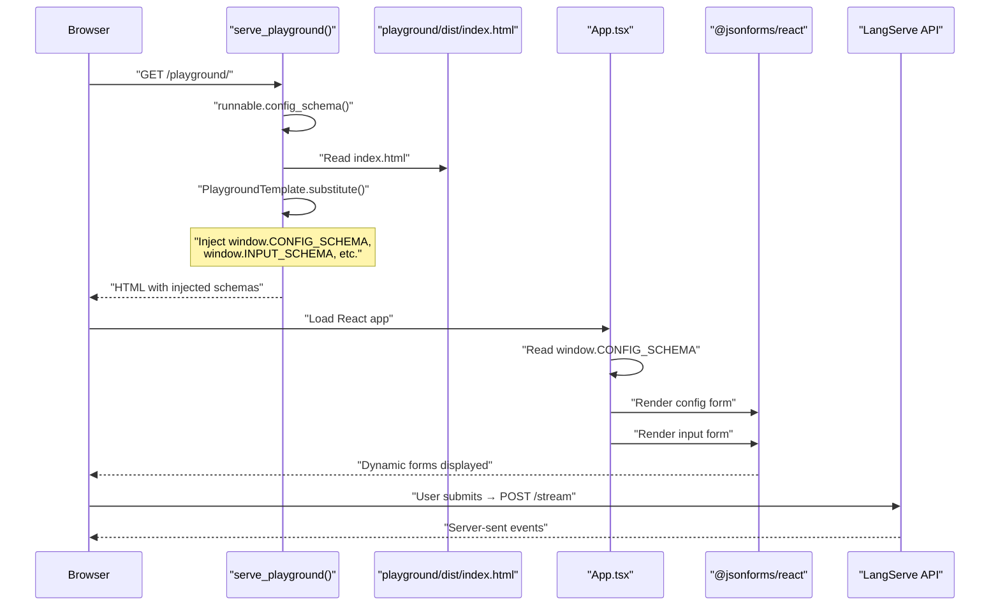

Sources: [langserve/playground.py:49-110](), [langserve/playground/dist/index.html:13-23](), [langserve/playground/src/App.tsx:1-222]()

## Server-Side Components

### serve_playground Function

The `serve_playground` function handles serving the playground interface and injecting runtime configuration. It performs several key operations:

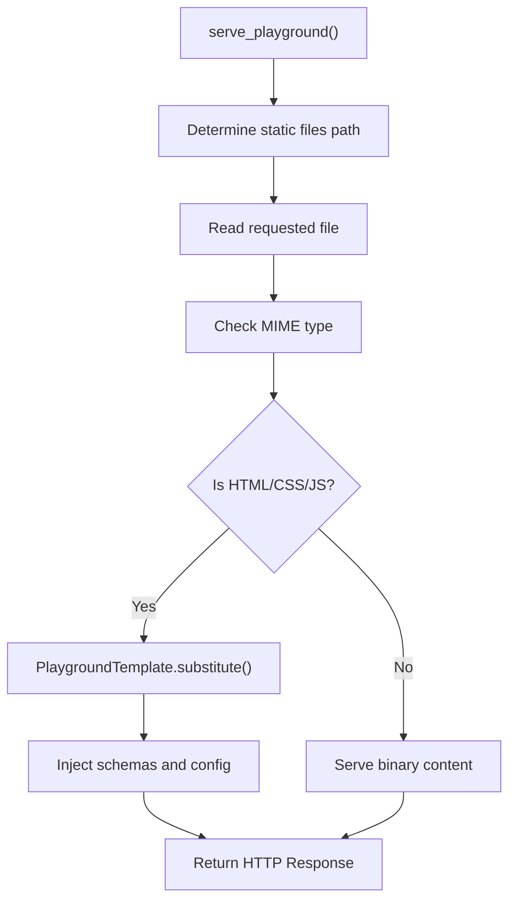

The function accepts these key parameters:

| Parameter | Description |
|-----------|-------------|
| `runnable` | The LangChain Runnable being served |
| `input_schema` | Pydantic model for input validation |
| `output_schema` | Pydantic model for output validation |  
| `config_keys` | Configuration keys supported by the runnable |
| `base_url` | Base URL for API endpoints |
| `playground_type` | Either "default" or "chat" |

Sources: [langserve/playground.py:49-110]()

### Schema Injection Process

The server uses `PlaygroundTemplate` (a custom `string.Template` subclass with delimiter `"____"`) to inject runtime schemas into static HTML/CSS/JS files. This happens at request time, allowing dynamic schema information to be embedded in the client without requiring a rebuild.

Title: Template Variable Substitution Process

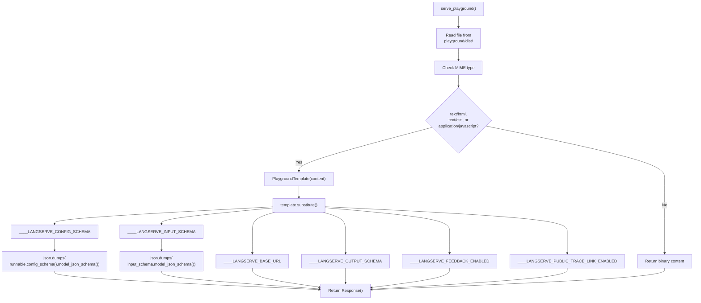

In `playground/dist/index.html`, these variables are assigned to the `window` object:

```html
<script>
  window.CONFIG_SCHEMA = ____LANGSERVE_CONFIG_SCHEMA;
  window.INPUT_SCHEMA = ____LANGSERVE_INPUT_SCHEMA;
  window.OUTPUT_SCHEMA = ____LANGSERVE_OUTPUT_SCHEMA;
  window.FEEDBACK_ENABLED = ____LANGSERVE_FEEDBACK_ENABLED;
  window.PUBLIC_TRACE_LINK_ENABLED = ____LANGSERVE_PUBLIC_TRACE_LINK_ENABLED;
</script>
```

Sources: [langserve/playground.py:12-13](), [langserve/playground.py:85-104](), [langserve/playground/dist/index.html:13-23]()

## Client-Side Components

The client application is a React TypeScript application built with Vite. It uses Material UI for UI components and JsonForms (`@jsonforms/react`, `@jsonforms/core`, `@jsonforms/material-renderers`) for automatic form generation from JSON schemas.

**Key Dependencies:**
- `@jsonforms/react` - Core JsonForms React integration
- `@jsonforms/material-renderers` - Material UI-based form renderers
- `@mui/material` - Material UI component library
- `@microsoft/fetch-event-source` - SSE client for streaming

Sources: [langserve/playground/package.json:13-35]()

### Component Hierarchy

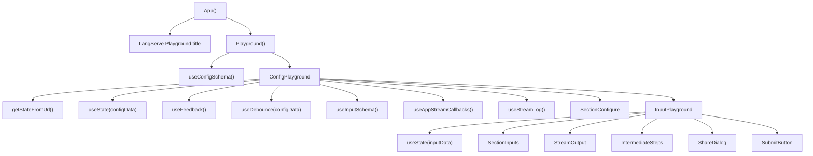

Sources: [langserve/playground/src/App.tsx:209-220](), [langserve/playground/src/App.tsx:101-189](), [langserve/playground/src/App.tsx:22-98]()

### Core Component Functions

| Component | File Location | Purpose | Key Props |
|-----------|---------------|---------|-----------|
| `App` | App.tsx:209-220 | Root component providing layout and theme | None |
| `Playground` | App.tsx:192-207 | Loads config schema and handles error states | None |
| `ConfigPlayground` | App.tsx:101-190 | Manages configuration state and input schema loading | `configSchema` |
| `InputPlayground` | App.tsx:22-99 | Handles input state and execution | `configSchema`, `inputSchema`, `configData`, `startStream`, `stopStream` |
| `SectionConfigure` | sections/SectionConfigure.tsx | Renders configuration form using JsonForms | `config`, `value`, `onChange` |
| `SectionInputs` | sections/SectionInputs.tsx | Renders input form using JsonForms | `input`, `value`, `onChange` |

**Component Responsibility:**
- `App` and `Playground`: Bootstrap the application and load initial schemas
- `ConfigPlayground`: Orchestrates config state, debouncing, and dynamic input schema loading
- `InputPlayground`: Manages input state, validation, and stream execution
- `SectionConfigure`/`SectionInputs`: Thin wrappers around JsonForms for form rendering

Sources: [langserve/playground/src/App.tsx:22-220]()

### Schema Management Hooks

The playground uses three key hooks for schema management:

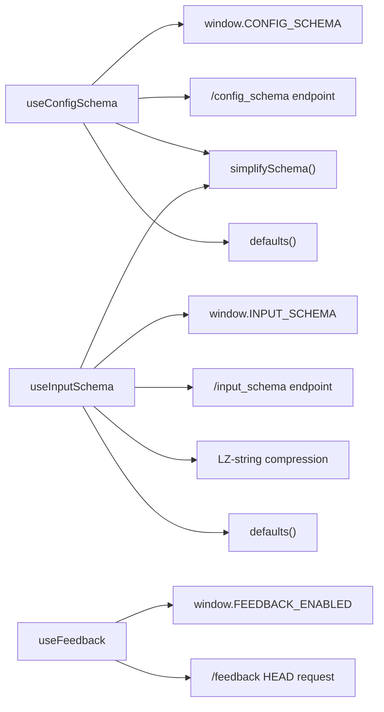

Each hook follows a pattern of checking for injected window variables first (for production), then falling back to API calls (for development).

Sources: [langserve/playground/src/useSchemas.tsx:37-56](), [langserve/playground/src/useSchemas.tsx:58-87](), [langserve/playground/src/useSchemas.tsx:24-35]()

## User Interface Layout

The Standard Playground UI is organized into vertically-stacked sections with a sticky action bar at the bottom (on mobile).

Title: Standard Playground UI Structure

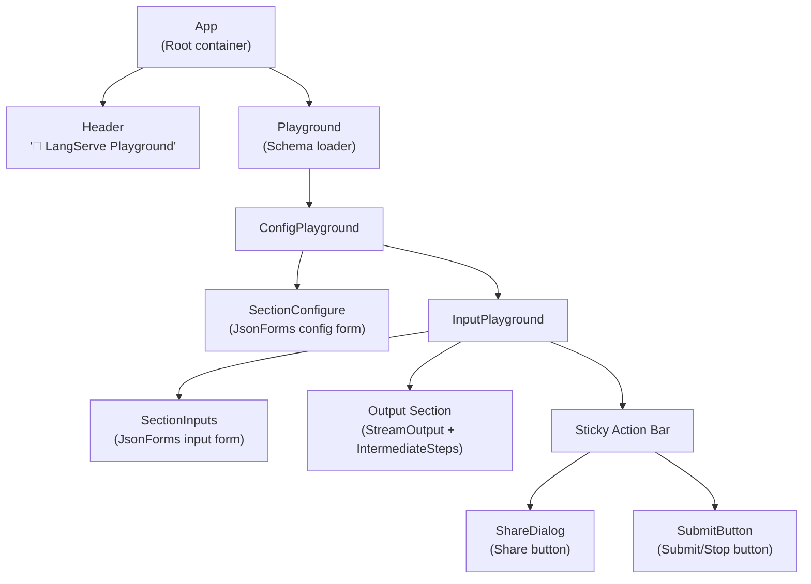

**Visual Layout:**
1. **Header**: Title "🦜 LangServe Playground"
2. **Configure Section**: JsonForms-rendered config fields (collapsible)
3. **Inputs Section**: JsonForms-rendered input fields
4. **Output Section**: Real-time streaming output and intermediate steps
5. **Action Bar**: Share and Submit buttons (sticky on mobile)

**Form Rendering:**
- Both config and input forms are rendered by JsonForms based on JSON schemas
- Forms support complex types: objects, arrays, enums, dates, files, etc.
- Custom renderers handle special types (e.g., chat messages)

Sources: [langserve/playground/src/App.tsx:209-220](), [langserve/playground/src/App.tsx:133-183]()

## Data Flow and State Management

### Configuration and Input Flow

The playground manages two primary data streams: configuration data and input data, with debouncing to prevent excessive API calls.

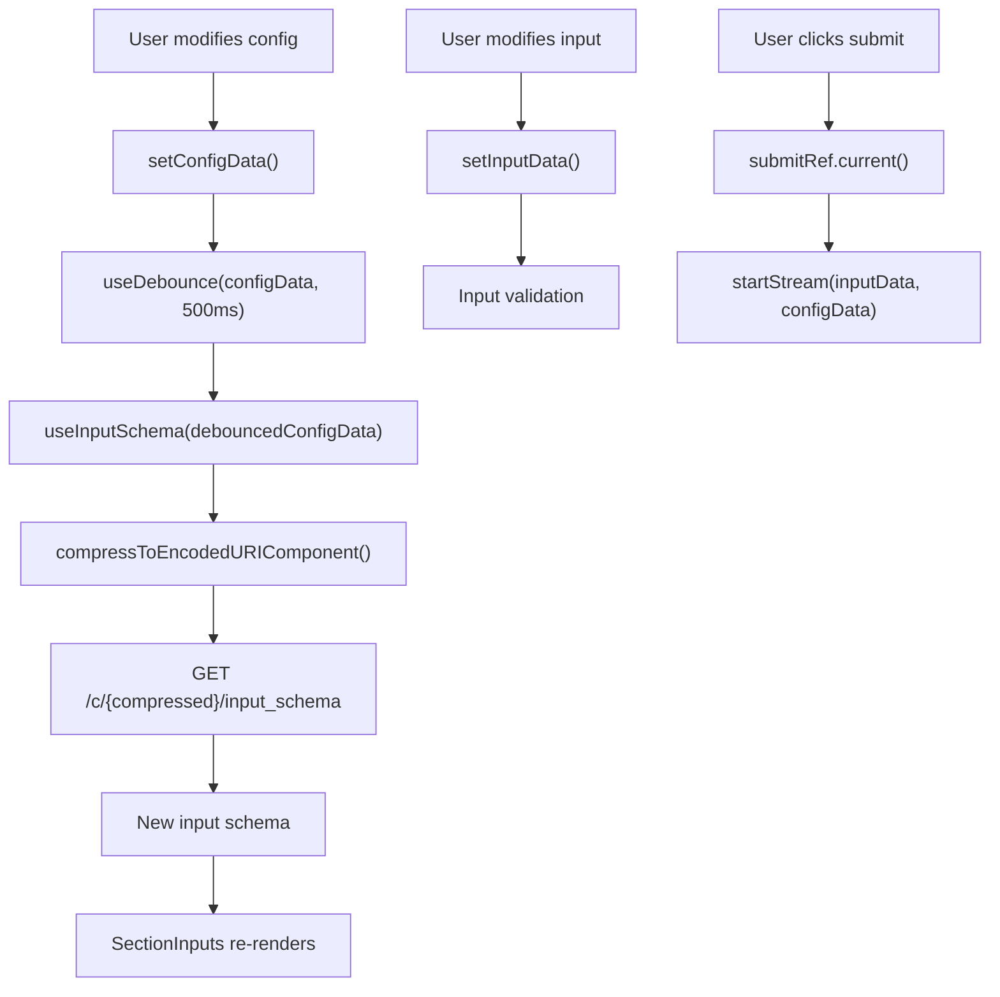

Sources: [langserve/playground/src/App.tsx:107-126](), [langserve/playground/src/App.tsx:33-52]()

### Stream Execution Flow

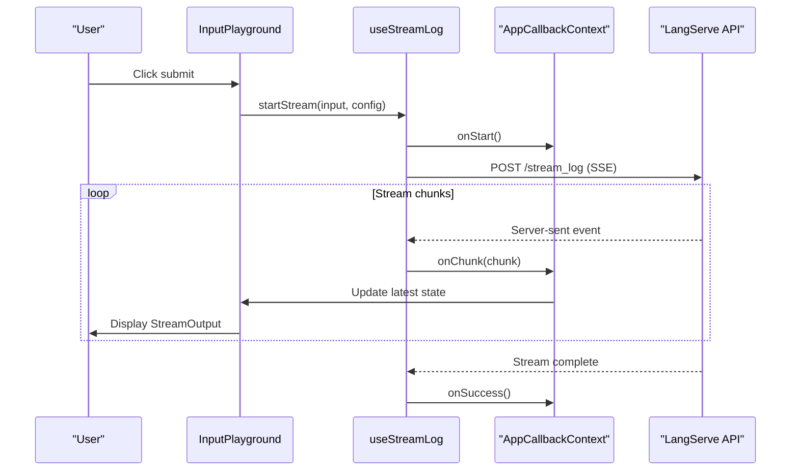

Sources: [langserve/playground/src/useStreamCallback.tsx:18-51](), [langserve/playground/src/App.tsx:128-129]()

### Error Handling

The playground includes comprehensive error handling at multiple levels:

| Error Type | Handler | Display Location |
|------------|---------|------------------|
| Config Schema Load | `configSchema.error` | Red error box |
| Input Schema Load | `inputSchema.error` | Red error box |
| Stream Execution | `onError` callback | Stream output area |
| Validation | `inputData.errors` | Form validation |

Sources: [langserve/playground/src/App.tsx:146-151](), [langserve/playground/src/App.tsx:196-203]()

## JsonForms Integration

The Standard Playground uses JsonForms to automatically generate form UI from JSON schemas. This eliminates the need for manual form coding and ensures the UI always matches the runnable's schema.

### JsonForms Architecture

Title: JsonForms Form Rendering Flow

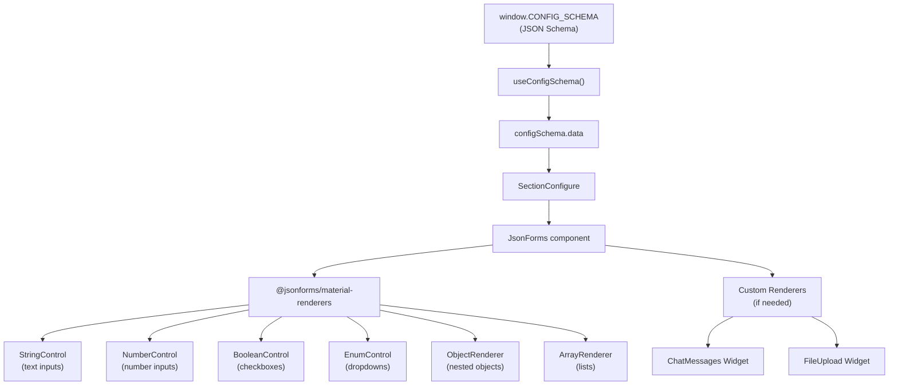

### How JsonForms Works

JsonForms uses a JSON schema to determine:
1. **Field types**: string, number, boolean, object, array, etc.
2. **Validation rules**: required, min/max, pattern, etc.
3. **UI hints**: from `extra` properties in Pydantic models (e.g., `widget` specification)

**Example Schema-to-UI mapping:**

| JSON Schema Type | JsonForms Renderer | UI Result |
|------------------|-------------------|-----------|
| `{"type": "string"}` | `StringControl` | Text input |
| `{"type": "number"}` | `NumberControl` | Number input |
| `{"type": "boolean"}` | `BooleanControl` | Checkbox |
| `{"type": "string", "enum": [...]}` | `EnumControl` | Dropdown select |
| `{"type": "object", "properties": {...}}` | `ObjectRenderer` | Nested fieldset |
| `{"type": "array", "items": {...}}` | `ArrayRenderer` | Add/remove list |

**Validation:**
JsonForms performs client-side validation based on the schema and provides immediate feedback via the `errors` array in component state.

Sources: [langserve/playground/package.json:16-19](), [langserve/playground/src/App.tsx:14](), [langserve/playground/src/App.tsx:15]()

## Streaming Implementation

The playground uses Server-Sent Events (SSE) with a centralized callback system for real-time streaming via the `/stream_log` endpoint.

### Callback Architecture

Title: Stream Callback Registration and Dispatch

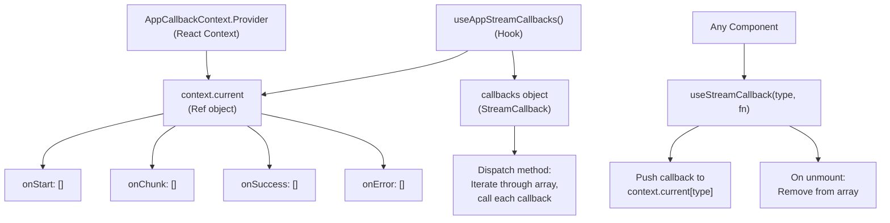

**Implementation Details:**

The `useAppStreamCallbacks()` hook (defined in [langserve/playground/src/useStreamCallback.tsx:18-51]()) creates a centralized registry where multiple UI components can register listeners for stream events:

```typescript
const context = useRef({
  onStart: [],
  onChunk: [],
  onSuccess: [],
  onError: []
});

const callbacks: StreamCallback = {
  onStart(...args) {
    for (const callback of context.current.onStart) {
      callback(...args);
    }
  },
  // Similar for onChunk, onSuccess, onError
};
```

Components use `useStreamCallback(type, callback)` to register handlers that automatically clean up on unmount.

Sources: [langserve/playground/src/useStreamCallback.tsx:18-51](), [langserve/playground/src/useStreamCallback.tsx:53-78]()

### Stream Event Processing

The `useStreamLog` hook (imported in `App.tsx`) processes streaming events and manages stream state. Components can listen for specific events using the `useStreamCallback` hook.

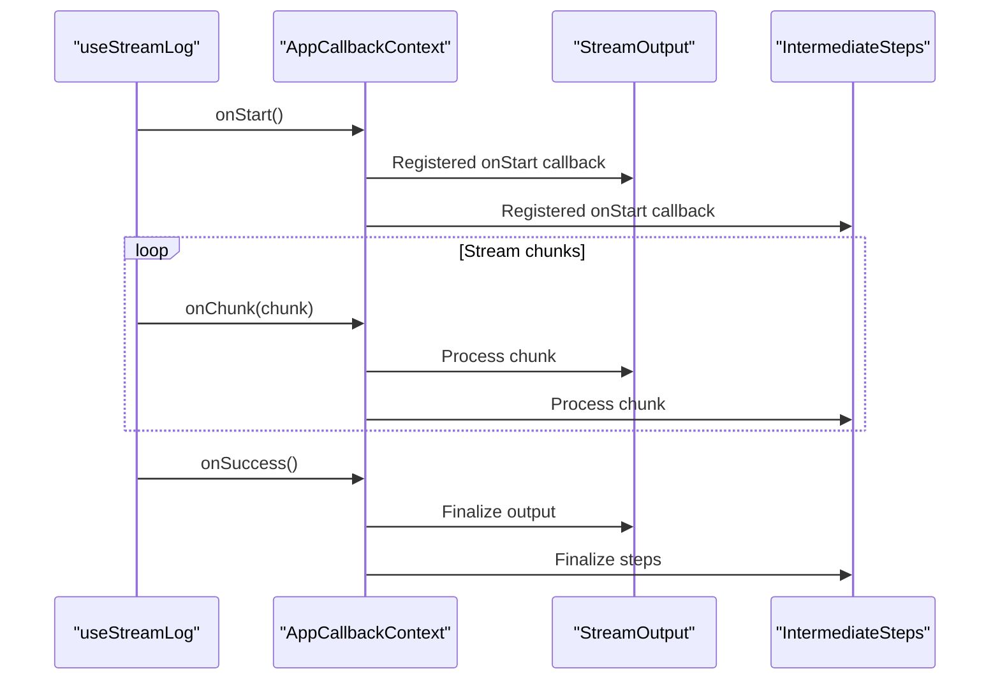

Sources: [langserve/playground/src/useStreamCallback.tsx:11-16](), [langserve/playground/src/App.tsx:8]()

## Configuration Sharing

### ShareDialog Component

The `ShareDialog` component enables users to generate shareable URLs containing their current configuration:

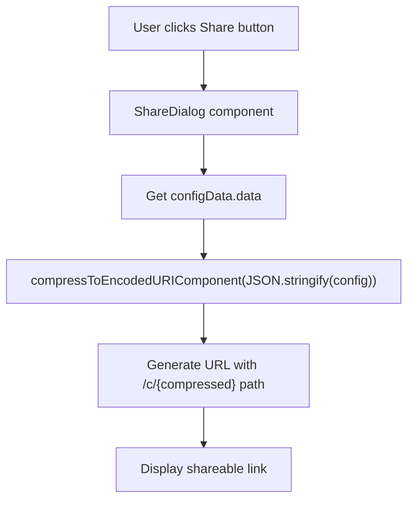

Sources: [langserve/playground/src/App.tsx:82-89]()

### URL State Management

Configurations can be shared via URL. The `getStateFromUrl()` utility extracts compressed configuration from URLs with the pattern `/c/{compressed_config}/`.

Title: Configuration URL Processing

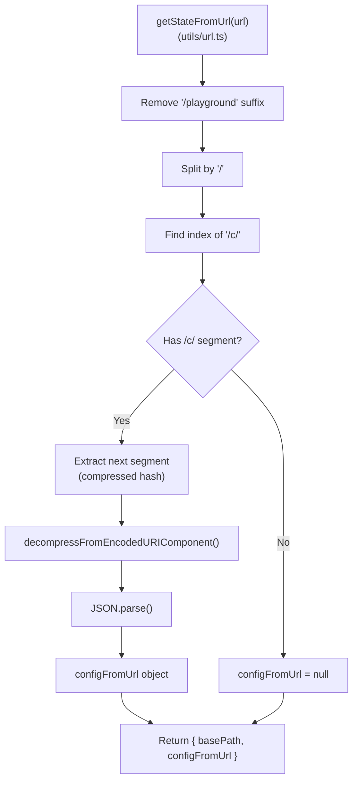

**Usage in ConfigPlayground:**

```typescript
// In ConfigPlayground component
const urlState = getStateFromUrl(window.location.href);
const [configData, setConfigData] = useState<ConfigValue>({
  data: urlState.configFromUrl ?? props.configSchema.defaults,
  errors: [],
  defaults: true,
});
```

When a user clicks "Share", the current config is compressed using `lz-string` and encoded in the URL, allowing others to load the same configuration by visiting the link.

Sources: [langserve/playground/src/utils/url.ts:3-25](), [langserve/playground/src/App.tsx:107-112]()

## Feature: Feedback and Trace Support

The Standard Playground can optionally display feedback buttons and trace links if enabled on the server side. These features:

1. Allow providing thumbs up/down feedback on outputs
2. Enable viewing the trace of a run (powered by LangSmith integration)
3. Support correcting or annotating outputs

This requires:
- `feedback_enabled=True` parameter when adding routes
- LangSmith integration properly configured

Sources: [langserve/schema.py:96-173](), [langserve/playground/src/App.tsx:168-175]()

## Integration with LangServe

### Route Registration

The Standard Playground is automatically registered when `add_routes()` creates endpoints for a runnable. The playground is served at `{path}/playground/` and can serve any file from `playground/dist/` (including nested paths for assets).

Title: Playground Route Registration and Static Asset Serving

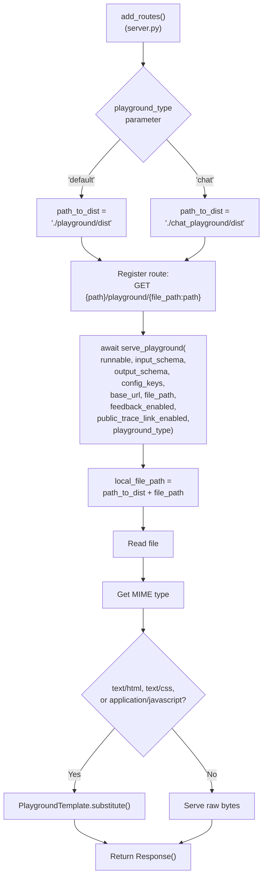

**Key Details:**
- The route handler accepts a `file_path:path` parameter to serve nested assets
- Default file is `index.html` if no `file_path` is provided
- Path validation prevents directory traversal attacks
- MIME type detection uses custom logic to handle JavaScript/CSS correctly

Sources: [langserve/server.py](), [langserve/playground.py:49-110]()

### Schema-Driven UI Generation

The playground leverages the runnable's schema introspection to generate forms dynamically.

Title: Schema Extraction and Form Generation

```mermaid
flowchart LR
    runnable["runnable<br/>(Runnable instance)"] --> config_schema_call["runnable.config_schema(<br/>include=config_keys)"]
    config_schema_call --> config_schema["Config Schema<br/>(Pydantic model)"]
    
    input_schema_param["input_schema<br/>(Parameter to add_routes)"] --> input_schema["Input Schema<br/>(Pydantic model)"]
    
    config_schema --> model_json_schema_config["model_json_schema()"]
    input_schema --> model_json_schema_input["model_json_schema()"]
    
    model_json_schema_config --> json_dumps_config["json.dumps()"]
    model_json_schema_input --> json_dumps_input["json.dumps()"]
    
    json_dumps_config --> LANGSERVE_CONFIG_SCHEMA["____LANGSERVE_CONFIG_SCHEMA"]
    json_dumps_input --> LANGSERVE_INPUT_SCHEMA["____LANGSERVE_INPUT_SCHEMA"]
    
    LANGSERVE_CONFIG_SCHEMA --> window_CONFIG_SCHEMA["window.CONFIG_SCHEMA"]
    LANGSERVE_INPUT_SCHEMA --> window_INPUT_SCHEMA["window.INPUT_SCHEMA"]
    
    window_CONFIG_SCHEMA --> JsonForms_Config["JsonForms<br/>(Config form)"]
    window_INPUT_SCHEMA --> JsonForms_Input["JsonForms<br/>(Input form)"]
```

**Schema Parameter Usage:**

| Parameter | Source | Injected As | Usage in Client |
|-----------|--------|-------------|-----------------|
| `config_keys` | `add_routes()` param | N/A | Filters config schema fields |
| Config schema | `runnable.config_schema()` | `window.CONFIG_SCHEMA` | `SectionConfigure` form |
| Input schema | `input_schema` param | `window.INPUT_SCHEMA` | `SectionInputs` form |
| Output schema | `output_schema` param | `window.OUTPUT_SCHEMA` | (Currently unused by playground) |

**JsonForms Capabilities:**
- Automatic layout for complex nested objects
- Array add/remove with configurable item schemas
- Built-in validation with error display
- Support for conditional schemas (oneOf, anyOf)
- Custom widget renderers via schema `extra` properties

Sources: [langserve/playground.py:49-58](), [langserve/playground.py:91-96]()

### API Endpoint Integration

The playground makes direct API calls to the same endpoints that external clients would use:

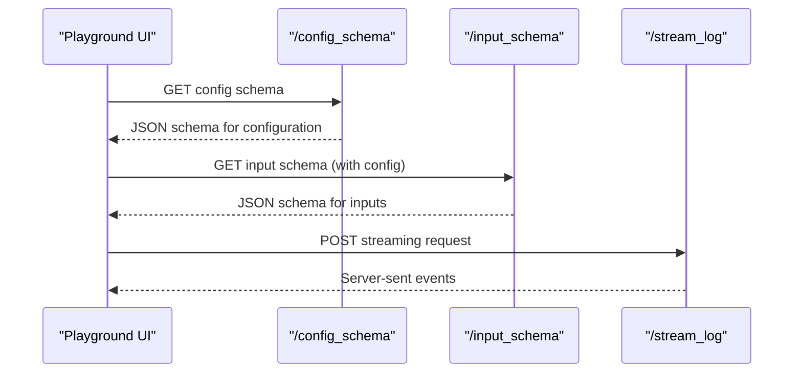

This ensures the playground behaves identically to programmatic API usage, providing an accurate testing environment.

Sources: [langserve/playground/src/useSchemas.tsx:37-56](), [langserve/playground/src/useSchemas.tsx:58-87]()

## Conclusion

The Standard Playground provides an intuitive interface for experimenting with LangChain runnables. By leveraging the schema information from the runnable, it dynamically generates appropriate UI elements for configuration and inputs, making it easy to test, debug, and share LangChain applications.

---

