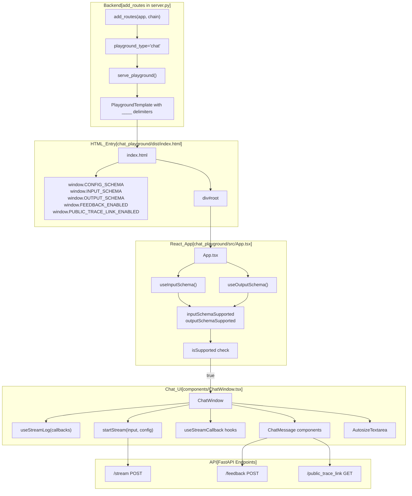
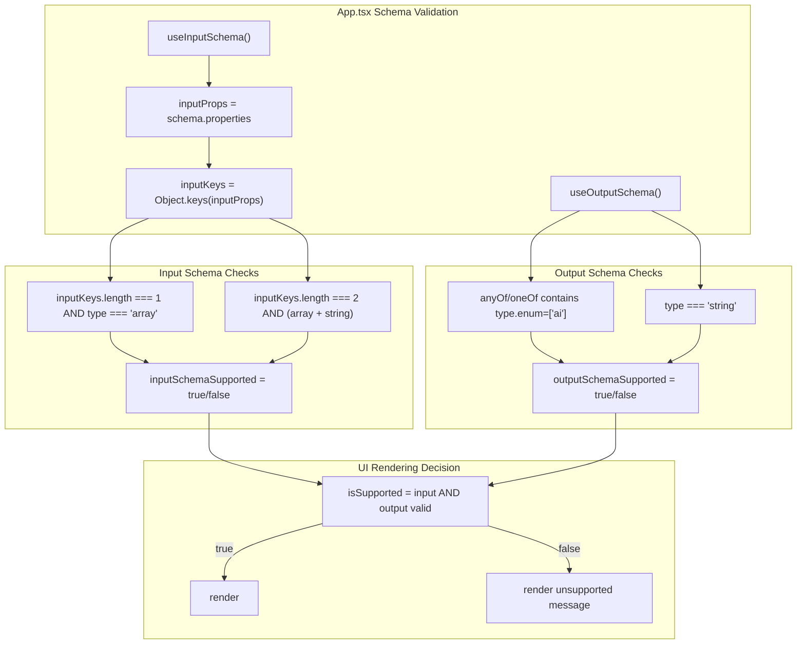
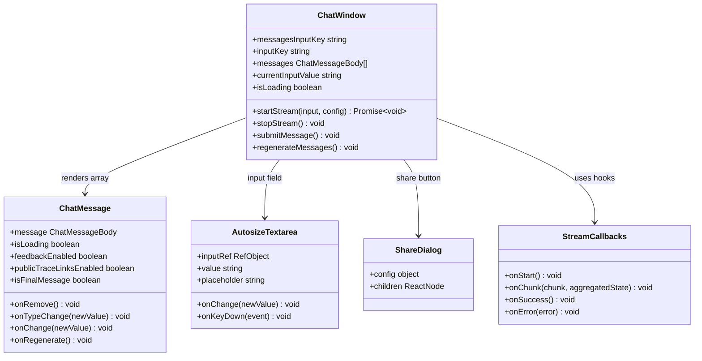
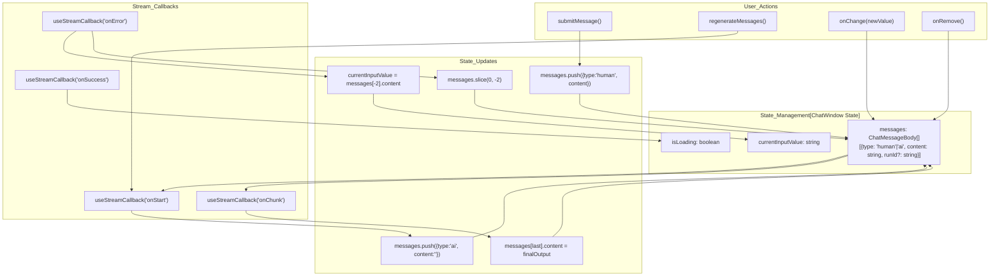
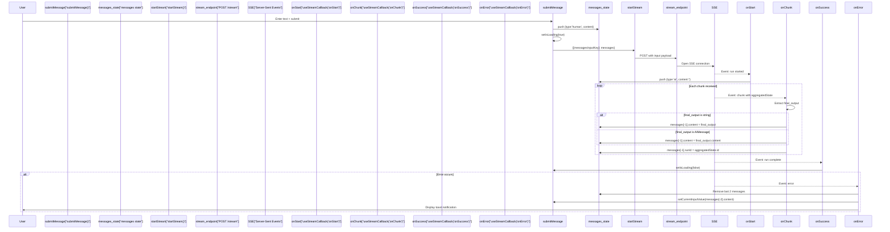
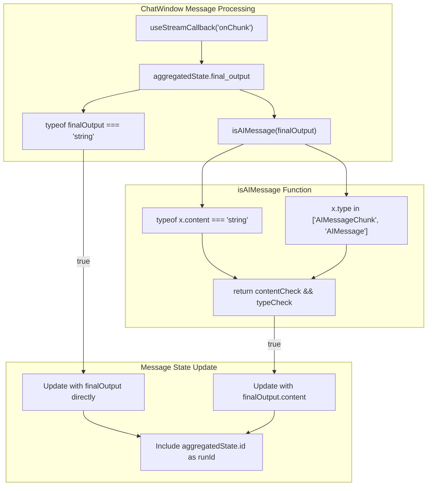
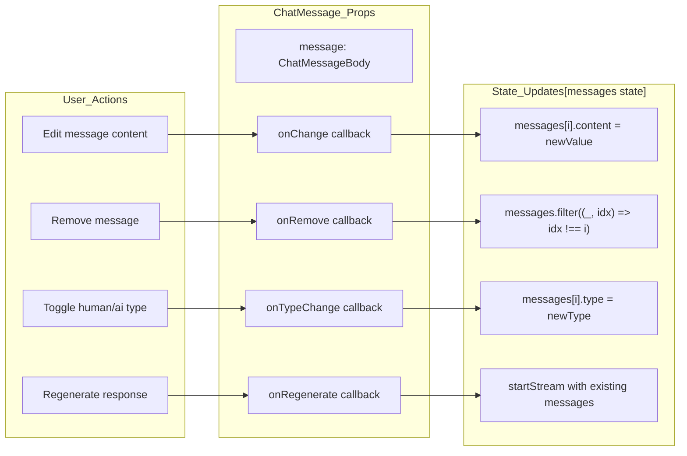
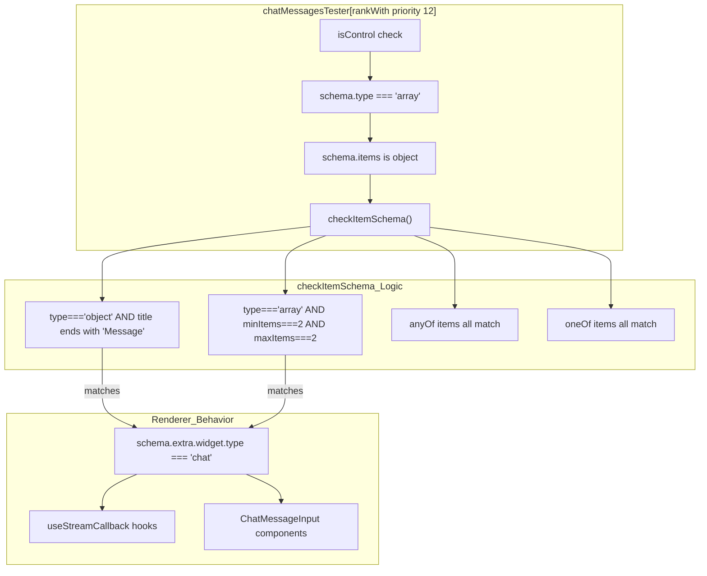

<!-- source: DeepWiki mcp.deepwiki.com · repo langchain-ai/langserve · page 3.2 Chat Playground · fetched 2026-10-26 -->

# Chat Playground

<details>
<summary>Relevant source files</summary>

The following files were used as context for generating this wiki page:

- [examples/chat_playground/server.py](examples/chat_playground/server.py)
- [langserve/chat_playground/dist/assets/index-53ad47d4.js](langserve/chat_playground/dist/assets/index-53ad47d4.js)
- [langserve/chat_playground/dist/index.html](langserve/chat_playground/dist/index.html)
- [langserve/chat_playground/src/App.tsx](langserve/chat_playground/src/App.tsx)
- [langserve/chat_playground/src/components/ChatWindow.tsx](langserve/chat_playground/src/components/ChatWindow.tsx)
- [langserve/playground/dist/assets/index-400979f0.js](langserve/playground/dist/assets/index-400979f0.js)
- [langserve/playground/src/components/ChatMessageTuplesControlRenderer.tsx](langserve/playground/src/components/ChatMessageTuplesControlRenderer.tsx)
- [langserve/playground/src/components/ChatMessagesControlRenderer.tsx](langserve/playground/src/components/ChatMessagesControlRenderer.tsx)
- [langserve/playground/src/utils/messages.ts](langserve/playground/src/utils/messages.ts)
- [langserve/playground/src/utils/path.ts](langserve/playground/src/utils/path.ts)
- [langserve/playground/src/utils/schema.ts](langserve/playground/src/utils/schema.ts)

</details>


The Chat Playground is a specialized conversational interface for LangServe that provides an optimized UI for testing chat-based LangChain Runnables. It serves a separate React application from the standard playground and automatically validates input/output schema compatibility for conversational workflows.

## System Architecture

Chat Playground Component Hierarchy


The chat playground is activated by setting `playground_type="chat"` in `add_routes()`, which triggers `serve_playground()` to serve the specialized React application from [langserve/chat_playground/dist/index.html:1-42](). The backend injects schemas and feature flags into the HTML via template substitution at lines 15, 20, 25, 30, and 35 using the `____LANGSERVE_*` placeholder pattern.

Sources:
- [langserve/chat_playground/dist/index.html:1-42]()
- [langserve/chat_playground/src/App.tsx:1-73]()
- [examples/chat_playground/server.py:42-51]()

## Schema Validation and Compatibility

The `App.tsx` component performs automatic schema validation to determine if a Runnable is compatible with the chat interface. The validation logic checks both input and output schemas against specific criteria.

Chat Schema Validation Logic


### Input Schema Requirements

The chat playground validates input schemas at [langserve/chat_playground/src/App.tsx:17-30]():

| Schema Pattern | Description | Example |
|---|---|---|
| Single key with array | `{ "messages": [...] }` | List of conversation messages |
| Two keys (array + string) | `{ "messages": [...], "input": "..." }` | Messages plus current input |

### Output Schema Requirements  

Output validation occurs at [langserve/chat_playground/src/App.tsx:31-35]():

| Output Type | Validation Check | Description |
|---|---|---|
| `AIMessage` | `anyOf/oneOf` contains `type.enum` with `"ai"` | LangChain AIMessage objects |
| String | `type === "string"` | Plain string responses |

Sources:
- [langserve/chat_playground/src/App.tsx:11-36]()
- [langserve/chat_playground/src/App.tsx:47-66]()

## Core Components

ChatWindow Component Architecture


### Key State Management

The `ChatWindow` component manages conversation state through several key properties defined at [langserve/chat_playground/src/components/ChatWindow.tsx:33-48]():

| Property | Type | Purpose |
|---|---|---|
| `messagesInputKey` | `string` | Key for message array in input schema |  
| `inputKey` | `string` | Key for string input (optional) |
| `messages` | `ChatMessageBody[]` | Current conversation history |
| `currentInputValue` | `string` | Text in input field |
| `isLoading` | `boolean` | Stream processing state |

Sources:
- [langserve/chat_playground/src/components/ChatWindow.tsx:33-48]()
- [langserve/chat_playground/src/components/ChatWindow.tsx:120-217]()

### Main Interface Elements

The Chat Playground interface consists of:

1. **Header Bar**: Contains the LangServe logo and share button
2. **Chat Area**: Displays the conversation history with human and AI messages
3. **Message Input**: An input field for typing and submitting messages
4. **Empty State**: Shown when no messages exist in the conversation
5. **Loading State**: Visual indicators during message processing

For chains with intermediate reasoning steps, these are also displayed within the message flow.

## Message History Handling

The Chat Playground manages conversation history through a client-side state array that maintains the complete message sequence. The state is managed entirely in the React application, with no server-side session storage by default.

Message State Flow in ChatWindow


### Client-Side Message Storage

The `messages` state array is defined at [langserve/chat_playground/src/components/ChatWindow.tsx:43]() as `ChatMessageBody[]`. Each entry contains:

| Property | Type | Required | Description |
|---|---|---|---|
| `type` | `"human" \| "ai"` | Yes | Message sender type |
| `content` | `string` | Yes | Message text content |
| `runId` | `string` | No | LangSmith trace ID for feedback/linking |

The complete message history is sent with each request, making the chain responsible for managing context windows and history truncation.

### Input Schema Mapping

The chat playground maps the message array to the chain's input schema using two keys determined by schema validation at [langserve/chat_playground/src/App.tsx:44-45]():

**Single Key Pattern** (`inputKey === undefined`)
```typescript
startStream({ [messagesInputKey]: newMessages }, {});
// Example: { "messages": [{type:"human", content:"Hello"}, ...] }
```

**Two Key Pattern** (messages + string input)
```typescript
startStream({
  [messagesInputKey]: newMessages.slice(0, -1),
  [inputKey]: newMessages[newMessages.length - 1].content
}, {});
// Example: { "messages": [...], "input": "Current question" }
```

This mapping occurs at [langserve/chat_playground/src/components/ChatWindow.tsx:62-69]() and [langserve/chat_playground/src/components/ChatWindow.tsx:78-84]().

Sources:
- [langserve/chat_playground/src/components/ChatWindow.tsx:33-48]()
- [langserve/chat_playground/src/components/ChatWindow.tsx:43]()
- [langserve/chat_playground/src/components/ChatWindow.tsx:49-86]()
- [langserve/chat_playground/src/App.tsx:44-45]()

## Streaming and Callback System

Streaming Callback Pipeline


### Stream Callback Hooks

The `ChatWindow` uses four `useStreamCallback` hooks to handle the streaming lifecycle:

| Hook | Location | Trigger | State Update |
|---|---|---|---|
| `useStreamCallback("onStart")` | [ChatWindow.tsx:88-93]() | Stream begins | Append empty AI message: `messages.push({type: "ai", content: ""})` |
| `useStreamCallback("onChunk")` | [ChatWindow.tsx:94-107]() | Each SSE chunk | Update AI message content from `aggregatedState.final_output` |
| `useStreamCallback("onSuccess")` | [ChatWindow.tsx:108-110]() | Stream completes | Set `isLoading = false` |
| `useStreamCallback("onError")` | [ChatWindow.tsx:111-118]() | Error occurs | Restore input, remove failed messages, show toast |

### Output Processing

The `onChunk` callback at [langserve/chat_playground/src/components/ChatWindow.tsx:94-107]() handles two output formats:

**String Output**
```typescript
if (typeof finalOutput === "string") {
  setMessages([...prevMessages.slice(0, -1),
    { type: "ai", content: finalOutput, runId: aggregatedState?.id }
  ]);
}
```

**AIMessage Output**
```typescript
else if (isAIMessage(finalOutput)) {
  setMessages([...prevMessages.slice(0, -1),
    { type: "ai", content: finalOutput.content, runId: aggregatedState?.id }
  ]);
}
```

The `isAIMessage()` type guard is defined at [langserve/chat_playground/src/components/ChatWindow.tsx:27-31]().

Sources:
- [langserve/chat_playground/src/components/ChatWindow.tsx:88-118]()
- [langserve/chat_playground/src/components/ChatWindow.tsx:27-31]()
- [langserve/chat_playground/src/components/ChatWindow.tsx:94-107]()
- [langserve/chat_playground/src/App.tsx:9-11]()

## Message Type Detection and Rendering

AIMessage Type Validation


### AIMessage Detection

The `isAIMessage()` function at [langserve/chat_playground/src/components/ChatWindow.tsx:27-31]() validates message objects:

```typescript
export function isAIMessage(x: unknown): x is AIMessage {
  return x != null &&
    typeof (x as AIMessage).content === "string" &&
    ["AIMessageChunk", "AIMessage"].includes((x as AIMessage).type);
}
```

### Message State Structure

The `ChatMessageBody` type used in state management:

| Property | Type | Description |
|---|---|---|
| `type` | `"human" \| "ai"` | Message sender type |
| `content` | `string` | Message text content |
| `runId` | `string` (optional) | Trace ID for feedback/linking |

Sources:
- [langserve/chat_playground/src/components/ChatWindow.tsx:20-31]()
- [langserve/chat_playground/src/components/ChatWindow.tsx:94-106]()

## Implementation Patterns

### Basic Chat Chain Setup

Example implementation from [examples/chat_playground/server.py:22-53]():

```python
# Define prompt template
prompt = ChatPromptTemplate.from_messages([
    ("system", "You are a helpful, professional assistant named Cob."),
    MessagesPlaceholder(variable_name="messages"),
])

chain = prompt | ChatAnthropic(model_name="claude-3-sonnet-20240229")

# Input schema for messages
class InputChat(BaseModel):
    messages: List[Union[HumanMessage, AIMessage, SystemMessage]] = Field(
        ...,
        description="The chat messages representing the current conversation.",
    )

# Enable chat playground
add_routes(
    app,
    chain.with_types(input_type=InputChat),
    enable_feedback_endpoint=True,
    enable_public_trace_link_endpoint=True,
    playground_type="chat",  # Key parameter
)
```

### Persistence with Message History

Example with backend persistence from [examples/chat_with_persistence/server.py:97-108]():

```python
# Chain with history persistence
chain_with_history = RunnableWithMessageHistory(
    chain,
    create_session_factory("chat_histories"),
    input_messages_key="human_input",
    history_messages_key="history",
).with_types(input_type=InputChat)

add_routes(app, chain_with_history)
```

### Configuration Options

| Parameter | Type | Purpose |
|---|---|---|
| `playground_type` | `"chat"` | Activates chat playground UI |
| `enable_feedback_endpoint` | `bool` | Enables feedback collection |
| `enable_public_trace_link_endpoint` | `bool` | Enables trace link sharing |

Sources:
- [examples/chat_playground/server.py:42-48]()
- [examples/chat_with_persistence/server.py:97-108]()
- [examples/chat_playground/legacy_input/server.py:45-51]()

## Chat-Specific Features

### Message Management Operations

The `ChatWindow` provides interactive message management capabilities by passing callbacks to individual `ChatMessage` components:

Message Editing and Control Flow


| Feature | Implementation | Code Location | Description |
|---|---|---|---|
| Edit Content | `onChange(newValue)` | [ChatWindow.tsx:163-171]() | Updates `messages[i].content` |
| Delete Message | `onRemove()` | [ChatWindow.tsx:151-153]() | Removes message and all subsequent messages |
| Change Type | `onTypeChange(newType)` | [ChatWindow.tsx:154-162]() | Toggles between "human" and "ai" |
| Regenerate | `onRegenerate()` | [ChatWindow.tsx:72-86]() | Re-runs chain with existing messages |

### Feedback and Tracing Integration

The chat playground integrates with LangServe's optional feedback and tracing features. Feature availability is controlled by backend configuration and queried via hooks at [langserve/chat_playground/src/components/ChatWindow.tsx:46-47]():

```typescript
const feedbackEnabled = useFeedback()
const publicTraceLinksEnabled = usePublicTraceLink();
```

These values are passed as props to each `ChatMessage` component at [langserve/chat_playground/src/components/ChatWindow.tsx:148-149](), enabling:

- **Feedback**: Thumbs up/down on AI responses (requires `enable_feedback_endpoint=True`)
- **Public Trace Links**: Shareable links to LangSmith traces (requires `enable_public_trace_link_endpoint=True`)

Both features require the `runId` field in the message state, which is populated from `aggregatedState.id` during streaming.

### Share Dialog

The `ShareDialog` component at [langserve/chat_playground/src/components/ChatWindow.tsx:128-136]() enables conversation sharing:

```typescript
<ShareDialog config={{}}>
  <button type="button" className="share-button">
    <span>Share</span>
  </button>
</ShareDialog>
```

The dialog generates shareable URLs that encode the current conversation configuration.

### Error Recovery

Error handling at [langserve/chat_playground/src/components/ChatWindow.tsx:111-118]() implements a recovery strategy:

```typescript
useStreamCallback("onError", (e) => {
  setIsLoading(false);
  toast(e.message + "\nCheck your backend logs for errors.", { hideProgressBar: true });
  setCurrentInputValue(messages[messages.length - 2]?.content);
  setMessages((prevMessages) => [...prevMessages.slice(0, -2)]);
});
```

**Recovery Steps:**
1. Set `isLoading = false` to unlock UI
2. Display error message via toast notification
3. Restore last human input to text field (`messages[-2].content`)
4. Remove failed message pair (last human + incomplete AI response)

Sources:
- [langserve/chat_playground/src/components/ChatWindow.tsx:46-48]()
- [langserve/chat_playground/src/components/ChatWindow.tsx:72-86]()
- [langserve/chat_playground/src/components/ChatWindow.tsx:111-118]()
- [langserve/chat_playground/src/components/ChatWindow.tsx:128-136]()
- [langserve/chat_playground/src/components/ChatWindow.tsx:141-174]()

## Chat Renderers in Standard Playground

While the Chat Playground provides a dedicated interface, the standard playground also supports chat-style input through custom JsonForms renderers.

### ChatMessagesControlRenderer

The `ChatMessagesControlRenderer` at [langserve/playground/src/components/ChatMessagesControlRenderer.tsx:67-172]() handles arrays of message objects with `type` and `content` fields.

Chat Message Renderer Schema Detection


**Tester Logic** ([ChatMessagesControlRenderer.tsx:33-65]()):
- Checks if `schema.type === "array"`
- Validates `schema.items` matches message object structure
- Looks for titles ending in "Message" or "MessageChunk"
- Supports `anyOf` and `oneOf` unions of message types

**Stream Integration** ([ChatMessagesControlRenderer.tsx:71-122]()):
The renderer uses four `useStreamCallback` hooks to automatically update messages during streaming:

| Callback | Condition | Action |
|---|---|---|
| `useEffect` on mount | `schema.extra.widget.type === "chat"` | Initialize with empty human message |
| `onStart` | Widget type is "chat" | Append empty AI message |
| `onChunk` | Widget type is "chat" | Update AI message content from `aggregatedState.final_output` |
| `onSuccess` | Widget type is "chat" | Append empty human message for next turn |
| `onError` | Any | Remove last AI message if present |

### ChatMessageTuplesControlRenderer

The `ChatMessageTuplesControlRenderer` at [langserve/playground/src/components/ChatMessageTuplesControlRenderer.tsx:48-161]() handles simpler tuple-based message arrays like `[["human text", "ai text"], ...]`.

**Tester Logic** ([ChatMessageTuplesControlRenderer.tsx:19-46]()):
- Requires `schema.extra.widget.type === "chat"` explicitly
- Validates tuple structure: `type === "array"`, `minItems === 2`, `maxItems === 2`
- Both tuple elements must be strings

**Path-Based Output Extraction** ([ChatMessageTuplesControlRenderer.tsx:52-74]()):
This renderer supports custom path extraction from output:

```typescript
const outputPath = getNormalizedJsonPath(widget.output ?? "");
let ai = traverseNaiveJsonPath(aggregatedState?.final_output, outputPath);
ai = getMessageContent(ai);
```

The `widget.input` and `widget.output` configuration allows mapping nested output fields to the chat interface.

### Widget Configuration

Both renderers check for the `extra.widget` schema extension defined at [langserve/playground/src/utils/schema.ts:3-10]():

```typescript
type JsonSchemaExtra = JsonSchema & {
  extra: {
    widget: {
      type: string;
      [key: string]: string | number | Array<string | number>;
    };
  };
};
```

Example schema with widget configuration:
```python
# Backend Python code
class MessageHistory(BaseModel):
    messages: List[Union[HumanMessage, AIMessage]] = Field(
        ...,
        json_schema_extra={"widget": {"type": "chat"}}
    )
```

Sources:
- [langserve/playground/src/components/ChatMessagesControlRenderer.tsx:1-172]()
- [langserve/playground/src/components/ChatMessageTuplesControlRenderer.tsx:1-161]()
- [langserve/playground/src/utils/schema.ts:1-28]()
- [langserve/playground/src/utils/path.ts:1-31]()
- [langserve/playground/src/utils/messages.ts:1-7]()

## Conclusion

The Chat Playground provides a specialized, user-friendly interface for testing and interacting with conversation-based LangChain applications. By detecting the appropriate message format and providing real-time streaming, it enables effective development and testing of chat-based applications built with LangServe.

For more general purpose testing of LangChain Runnables that don't fit the conversational pattern, refer to the [Standard Playground](3.1) instead.

---

