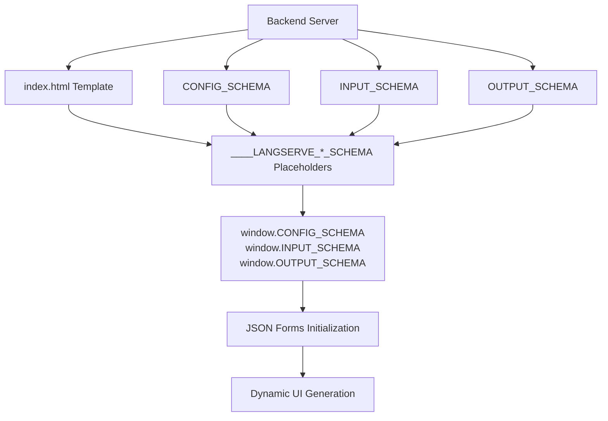
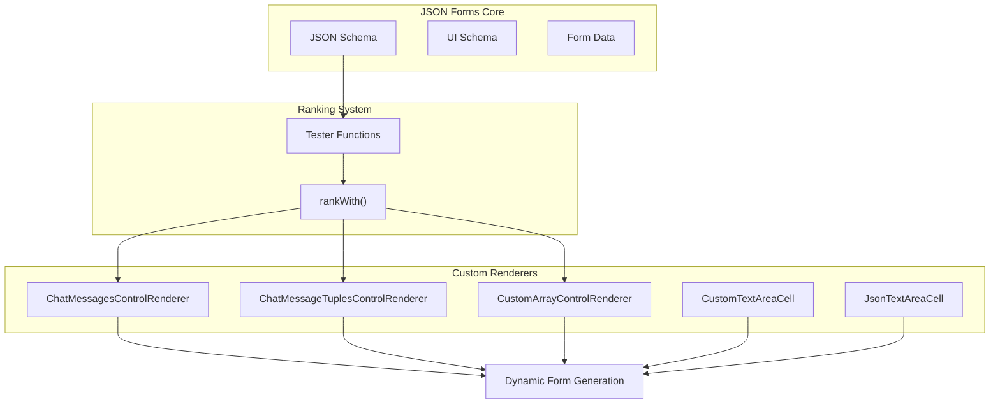
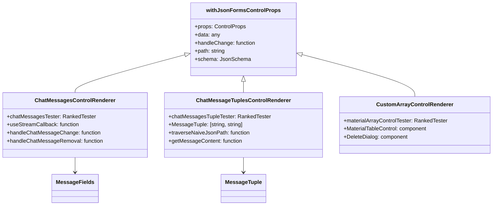
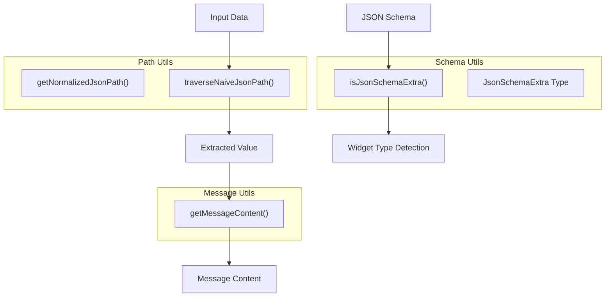
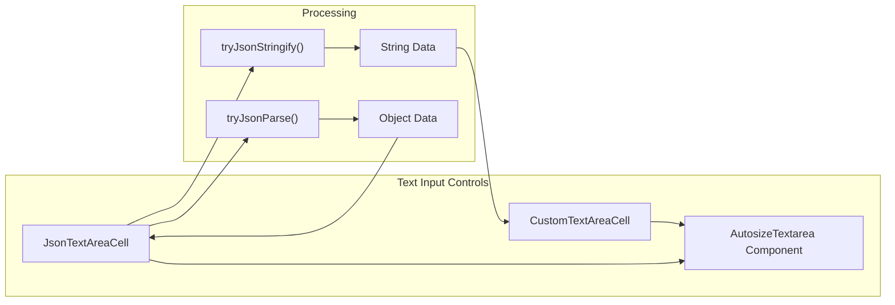
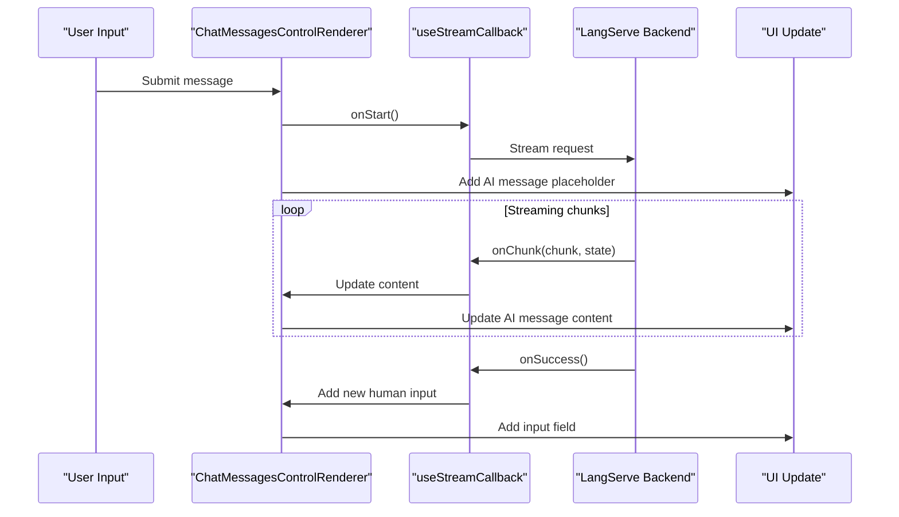
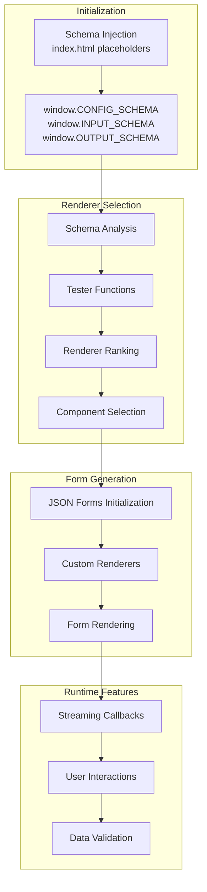

<!-- source: DeepWiki mcp.deepwiki.com · repo langchain-ai/langserve · page 3.3 UI Components & Schema Handling · fetched 2026-10-26 -->

# UI Components & Schema Handling

<details>
<summary>Relevant source files</summary>

The following files were used as context for generating this wiki page:

- [langserve/playground/dist/assets/index-400979f0.js](langserve/playground/dist/assets/index-400979f0.js)
- [langserve/playground/package.json](langserve/playground/package.json)
- [langserve/playground/src/App.css](langserve/playground/src/App.css)
- [langserve/playground/src/App.tsx](langserve/playground/src/App.tsx)
- [langserve/playground/src/components/ChatMessageTuplesControlRenderer.tsx](langserve/playground/src/components/ChatMessageTuplesControlRenderer.tsx)
- [langserve/playground/src/components/ChatMessagesControlRenderer.tsx](langserve/playground/src/components/ChatMessagesControlRenderer.tsx)
- [langserve/playground/src/useStreamCallback.tsx](langserve/playground/src/useStreamCallback.tsx)
- [langserve/playground/src/utils/messages.ts](langserve/playground/src/utils/messages.ts)
- [langserve/playground/src/utils/path.ts](langserve/playground/src/utils/path.ts)
- [langserve/playground/src/utils/schema.ts](langserve/playground/src/utils/schema.ts)
- [langserve/playground/yarn.lock](langserve/playground/yarn.lock)
- [libs/langserve-playground/.gitignore](libs/langserve-playground/.gitignore)
- [libs/langserve-playground/README.md](libs/langserve-playground/README.md)
- [libs/langserve-playground/package.json](libs/langserve-playground/package.json)
- [libs/langserve-playground/src/index.tsx](libs/langserve-playground/src/index.tsx)
- [libs/langserve-playground/tsconfig.json](libs/langserve-playground/tsconfig.json)
- [libs/langserve-playground/tsup.config.ts](libs/langserve-playground/tsup.config.ts)
- [libs/langserve-playground/yarn.lock](libs/langserve-playground/yarn.lock)

</details>


This document covers the technical implementation of custom UI components, JSON Forms integration, and dynamic schema processing within LangServe's playground interfaces. It focuses on how JSON schemas are transformed into interactive forms and how specialized components handle different data types, particularly chat messages.

For information about the standard playground interface and configuration management, see [Standard Playground](#3.1). For chat-specific playground features, see [Chat Playground](#3.2).

## Schema Injection System

The playground's schema-driven UI begins with the backend injecting JSON schemas directly into the HTML template. The system uses placeholder replacement to embed schemas into the frontend runtime.



The schema injection occurs in [langserve/playground/dist/index.html:13-23](), where placeholders are replaced with actual schema data:

| Placeholder | Window Property | Purpose |
|-------------|-----------------|----------|
| `____LANGSERVE_CONFIG_SCHEMA` | `window.CONFIG_SCHEMA` | Chain configuration schema |
| `____LANGSERVE_INPUT_SCHEMA` | `window.INPUT_SCHEMA` | Input validation schema |
| `____LANGSERVE_OUTPUT_SCHEMA` | `window.OUTPUT_SCHEMA` | Output format schema |

**Sources:** [langserve/playground/dist/index.html:13-23]()

## JSON Forms Integration Architecture

The playground uses JSON Forms as the foundation for dynamic form generation, enhanced with custom renderers for LangChain-specific data types.



The system uses a ranking mechanism to select appropriate renderers. For example, the chat messages renderer uses [langserve/playground/src/components/ChatMessagesControlRenderer.tsx:33-65]() to determine when to activate:

- Rank: 12 (high priority)
- Tests for array schemas with message-type items
- Checks for titles ending in "Message" or "MessageChunk"
- Supports both object messages and tuple messages

**Sources:** [langserve/playground/src/components/ChatMessagesControlRenderer.tsx:33-65](), [langserve/playground/src/components/ChatMessageTuplesControlRenderer.tsx:19-46]()

## Custom Renderer Architecture

The playground implements specialized renderers for different data patterns commonly used in LangChain applications.



### Chat Message Renderers

Two specialized renderers handle different chat message formats:

**ChatMessagesControlRenderer** [langserve/playground/src/components/ChatMessagesControlRenderer.tsx:67-172]():
- Handles structured message objects with `type` and `content` fields
- Integrates with streaming callbacks for real-time updates
- Supports adding/removing messages dynamically
- Auto-detects message schemas ending in "Message" or "MessageChunk"

**ChatMessageTuplesControlRenderer** [langserve/playground/src/components/ChatMessageTuplesControlRenderer.tsx:48-161]():
- Handles simple `[human, ai]` string tuple format
- Requires explicit `chat` widget type in schema `extra` field
- Supports streaming updates with path-based content extraction
- Uses `traverseNaiveJsonPath` for nested data access

**Sources:** [langserve/playground/src/components/ChatMessagesControlRenderer.tsx:67-172](), [langserve/playground/src/components/ChatMessageTuplesControlRenderer.tsx:48-161]()

## Schema Processing Utilities

The playground includes utility functions for handling JSON schemas and data traversal.



### Schema Validation

The `isJsonSchemaExtra` function [langserve/playground/src/utils/schema.ts:12-28]() validates schema objects for extended widget properties:

```typescript
type JsonSchemaExtra = JsonSchema & {
  extra: {
    widget: {
      type: string;
      [key: string]: string | number | Array<string | number>;
    };
  };
};
```

### Path Traversal

The path traversal system [langserve/playground/src/utils/path.ts:11-31]() enables navigation through nested JSON structures:
- `getNormalizedJsonPath`: Converts various path formats to array form
- `traverseNaiveJsonPath`: Safely navigates object/array paths
- Handles both string keys and numeric indices

**Sources:** [langserve/playground/src/utils/schema.ts:12-28](), [langserve/playground/src/utils/path.ts:5-31](), [langserve/playground/src/utils/messages.ts:1-7]()

## Custom Form Controls

The playground implements specialized form controls for different data input patterns.

### Text Area Controls

Two text area implementations handle different input scenarios:



**CustomTextAreaCell** [langserve/playground/src/components/CustomTextAreaCell.tsx:42-57]():
- Standard text input with auto-sizing
- Direct string handling
- Integrated with JSON Forms cell props

**JsonTextAreaCell** [langserve/playground/src/components/JsonTextAreaCell.tsx:58-75]():
- Handles JSON object input/output
- Automatic parsing and stringification
- Fallback to string representation on parse errors

### Array Controls

The `CustomArrayControlRenderer` [langserve/playground/src/components/CustomArrayControlRenderer.tsx:41-83]() provides enhanced array management:
- Table-based display for complex arrays
- Integrated delete confirmation dialogs
- Support for both object arrays and primitive arrays
- High-priority ranking (11) for array controls

**Sources:** [langserve/playground/src/components/CustomTextAreaCell.tsx:42-57](), [langserve/playground/src/components/JsonTextAreaCell.tsx:42-75](), [langserve/playground/src/components/CustomArrayControlRenderer.tsx:41-83]()

## Streaming Integration

Chat components integrate with the playground's streaming system to provide real-time updates during chain execution.



The streaming integration uses several callback hooks:

- `onStart`: Adds AI message placeholder [langserve/playground/src/components/ChatMessagesControlRenderer.tsx:84-88]()
- `onChunk`: Updates message content in real-time [langserve/playground/src/components/ChatMessagesControlRenderer.tsx:90-111]()
- `onSuccess`: Adds new human input field [langserve/playground/src/components/ChatMessagesControlRenderer.tsx:112-116]()
- `onError`: Removes failed AI messages [langserve/playground/src/components/ChatMessagesControlRenderer.tsx:118-122]()

**Sources:** [langserve/playground/src/components/ChatMessagesControlRenderer.tsx:84-122](), [langserve/playground/src/components/ChatMessageTuplesControlRenderer.tsx:52-91]()

## Dynamic UI Generation Flow

The complete UI generation process combines schemas, renderers, and streaming capabilities into a cohesive user experience.



The system prioritizes renderers based on their ranking scores:
- Chat message renderers: Rank 12
- Array controls: Rank 11  
- Standard text areas: Rank 2

This ensures that specialized components take precedence over generic ones when schema patterns match multiple renderers.

**Sources:** [langserve/playground/dist/index.html:13-23](), [langserve/playground/src/components/ChatMessagesControlRenderer.tsx:33-34](), [langserve/playground/src/components/CustomArrayControlRenderer.tsx:86-89](), [langserve/playground/src/components/CustomTextAreaCell.tsx:64]()

---

