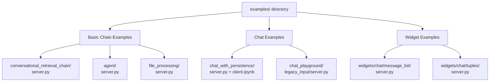
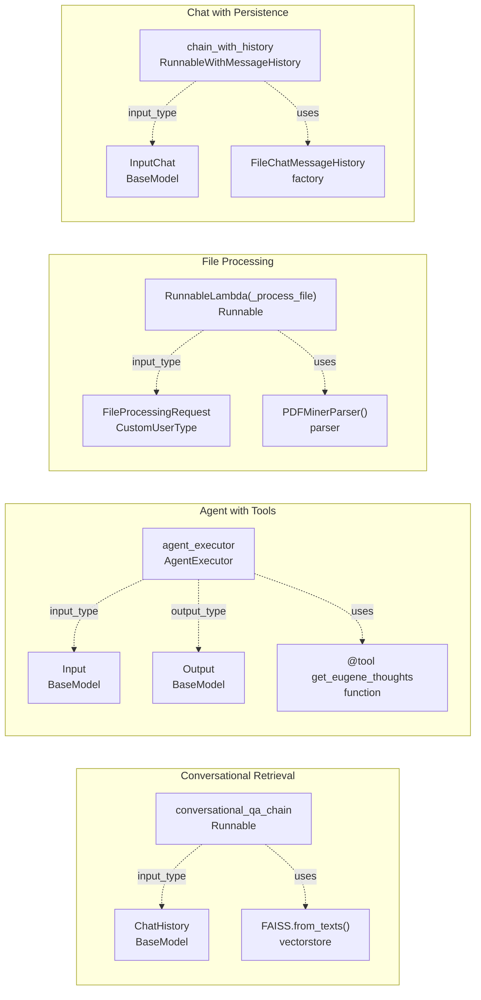
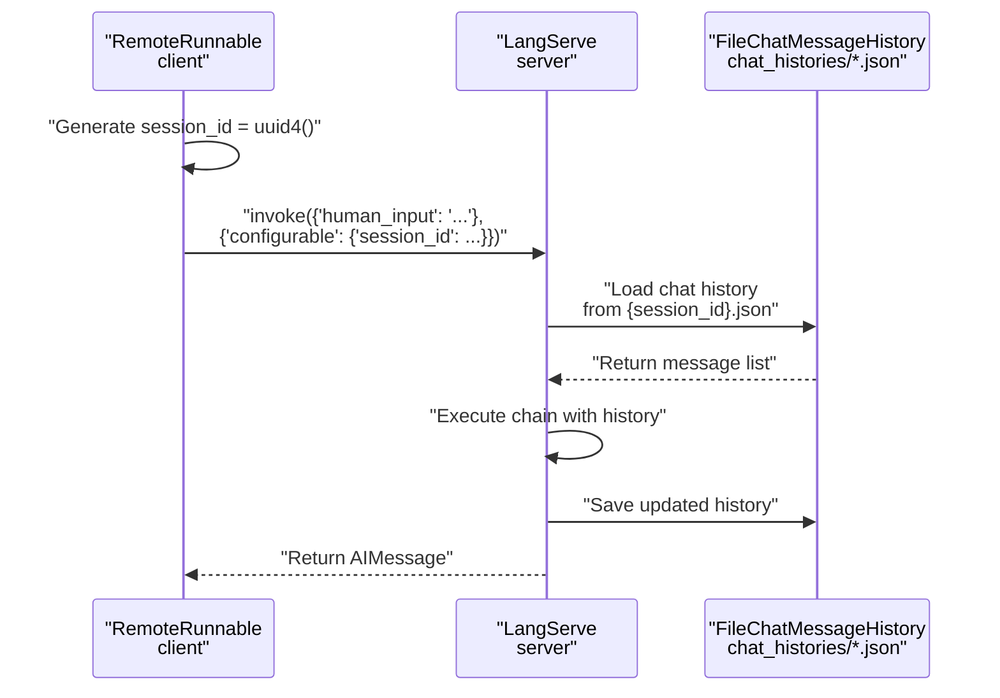

<!-- source: DeepWiki mcp.deepwiki.com · repo langchain-ai/langserve · page 4 Example Implementations · fetched 2026-10-26 -->

# Example Implementations

<details>
<summary>Relevant source files</summary>

The following files were used as context for generating this wiki page:

- [examples/agent/server.py](examples/agent/server.py)
- [examples/chat_playground/legacy_input/server.py](examples/chat_playground/legacy_input/server.py)
- [examples/chat_with_persistence/client.ipynb](examples/chat_with_persistence/client.ipynb)
- [examples/chat_with_persistence/server.py](examples/chat_with_persistence/server.py)
- [examples/conversational_retrieval_chain/server.py](examples/conversational_retrieval_chain/server.py)
- [examples/file_processing/server.py](examples/file_processing/server.py)
- [examples/widgets/chat/message_list/server.py](examples/widgets/chat/message_list/server.py)
- [examples/widgets/chat/tuples/server.py](examples/widgets/chat/tuples/server.py)

</details>


This document provides an overview of the example implementations included in the LangServe repository. These examples demonstrate practical usage patterns for deploying LangChain Runnables as REST APIs. Each example is a complete, runnable application that showcases specific features and integration patterns.

For detailed information about the server architecture that these examples use, see [Core Architecture](#2). For information about client-side interaction with these examples, see [Client Components](#2.2). For advanced customization techniques, see [Advanced Patterns](#4.3).

## Example Directory Structure

The examples are organized by use case in the `examples/` directory. Each example is a self-contained application with its own server file and dependencies.



**Sources:** [examples/conversational_retrieval_chain/server.py](), [examples/agent/server.py](), [examples/file_processing/server.py](), [examples/chat_with_persistence/server.py](), [examples/chat_playground/legacy_input/server.py](), [examples/widgets/chat/message_list/server.py](), [examples/widgets/chat/tuples/server.py]()

## Common Patterns Across Examples

All examples follow a consistent structure for creating a LangServe application:

| Pattern Element | Implementation | Example Location |
|----------------|----------------|------------------|
| FastAPI app creation | `app = FastAPI(title=..., version=..., description=...)` | [examples/conversational_retrieval_chain/server.py:97-101]() |
| Chain definition | LangChain Expression Language (LCEL) pipeline | [examples/conversational_retrieval_chain/server.py:92-94]() |
| Route registration | `add_routes(app, chain, ...)` | [examples/conversational_retrieval_chain/server.py:106]() |
| Type specification | `.with_types(input_type=..., output_type=...)` | [examples/conversational_retrieval_chain/server.py:95]() |
| Server execution | `uvicorn.run(app, host=..., port=...)` | [examples/conversational_retrieval_chain/server.py:111]() |

**Sources:** [examples/conversational_retrieval_chain/server.py:97-111](), [examples/agent/server.py:85-117](), [examples/file_processing/server.py:25-62]()

## Example Categories and Key Classes

The following diagram maps example categories to their key Pydantic models and runnable components:



**Sources:** [examples/conversational_retrieval_chain/server.py:82-95](), [examples/agent/server.py:83-112](), [examples/file_processing/server.py:34-56](), [examples/chat_with_persistence/server.py:82-102]()

## Input Schema Patterns

Examples demonstrate various input schema patterns using Pydantic models with custom widgets:

### Chat Widget with Tuple History

The `ChatHistory` model uses tuples to represent conversation history:

[examples/conversational_retrieval_chain/server.py:82-89]()

- Field: `chat_history: List[Tuple[str, str]]`
- Widget configuration: `extra={"widget": {"type": "chat", "input": "question"}}`
- Use case: Stateless chat where history is passed in each request

### Chat Widget with Message Objects

The `InputChat` model uses LangChain message objects:

[examples/widgets/chat/message_list/server.py:46-53]()

- Field: `messages: List[Union[HumanMessage, AIMessage, SystemMessage]]`
- Widget configuration: `extra={"widget": {"type": "chat", "input": "messages"}}`
- Use case: Rich message history with metadata

### File Upload Widget

The `FileProcessingRequest` model accepts base64-encoded files:

[examples/file_processing/server.py:34-39]()

- Field: `file: str`
- Widget configuration: `extra={"widget": {"type": "base64file"}}`
- Use case: PDF or binary file processing

**Sources:** [examples/conversational_retrieval_chain/server.py:82-89](), [examples/widgets/chat/message_list/server.py:46-53](), [examples/file_processing/server.py:34-39]()

## Chain Construction Patterns

Examples demonstrate different approaches to building LangChain pipelines:

```mermaid
graph TB
    subgraph "Conversational Retrieval Pattern"
        Inputs["_inputs<br/>RunnableMap"]
        Context["_context<br/>dict"]
        Prompt["ANSWER_PROMPT<br/>ChatPromptTemplate"]
        LLM1["ChatOpenAI()<br/>model"]
        Parser1["StrOutputParser()"]
        
        Inputs -->|pipe| Context
        Context -->|pipe| Prompt
        Prompt -->|pipe| LLM1
        LLM1 -->|pipe| Parser1
    end
    
    subgraph "Agent Pattern"
        AgentDict["dict with input<br/>and agent_scratchpad"]
        PromptTemplate["prompt<br/>ChatPromptTemplate"]
        LLMWithTools["llm_with_tools<br/>bound functions"]
        OutputParser["OpenAIFunctionsAgentOutputParser()"]
        
        AgentDict -->|pipe| PromptTemplate
        PromptTemplate -->|pipe| LLMWithTools
        LLMWithTools -->|pipe| OutputParser
    end
    
    subgraph "Simple Lambda Pattern"
        Lambda["RunnableLambda(_process_file)"]
    end
```



**Sources:** [examples/conversational_retrieval_chain/server.py:67-94](), [examples/agent/server.py:71-81](), [examples/file_processing/server.py:42-56]()

## Server Configuration Options

Examples showcase different `add_routes` configuration patterns:

| Example | Enabled Features | Path | Config Keys |
|---------|-----------------|------|-------------|
| Conversational Retrieval | `enable_feedback_endpoint=True` | `/` (default) | None specified |
| Agent | None specified | `/` (default) | None specified |
| File Processing | None specified | `/pdf` | `config_keys=["configurable"]` |
| Chat with Persistence | None specified | `/` (default) | None specified |
| Chat Playground | `enable_feedback_endpoint=True`<br/>`enable_public_trace_link_endpoint=True`<br/>`playground_type="chat"` | `/` (default) | None specified |

**Sources:** [examples/conversational_retrieval_chain/server.py:106](), [examples/agent/server.py:107-112](), [examples/file_processing/server.py:51-56](), [examples/chat_with_persistence/server.py:105-108](), [examples/chat_playground/legacy_input/server.py:45-51]()

## Specialized Components by Example

### Conversational Retrieval Chain Components

[examples/conversational_retrieval_chain/server.py:25-95]()

| Component | Purpose | Implementation |
|-----------|---------|----------------|
| `CONDENSE_QUESTION_PROMPT` | Reformulate follow-up questions | `PromptTemplate.from_template(_TEMPLATE)` |
| `ANSWER_PROMPT` | Generate answers from context | `ChatPromptTemplate.from_template(ANSWER_TEMPLATE)` |
| `_format_chat_history` | Convert tuples to string | Function at lines 52-59 |
| `_combine_documents` | Merge retrieved docs | Function at lines 44-49 |
| `vectorstore` | Retrieve relevant documents | `FAISS.from_texts(["harrison worked at kensho"], ...)` |

### Agent Components

[examples/agent/server.py:35-83]()

| Component | Purpose | Implementation |
|-----------|---------|----------------|
| `@tool get_eugene_thoughts` | Tool for querying knowledge base | Decorated function at lines 41-44 |
| `llm_with_tools` | LLM with bound functions | `llm.bind(functions=[...])` |
| `format_to_openai_functions` | Format scratchpad | Import from `langchain.agents.format_scratchpad` |
| `OpenAIFunctionsAgentOutputParser` | Parse agent output | Standard LangChain parser |
| `AgentExecutor` | Execute agent loop | `AgentExecutor(agent=agent, tools=tools)` |

### Chat Persistence Components

[examples/chat_with_persistence/server.py:26-102]()

| Component | Purpose | Implementation |
|-----------|---------|----------------|
| `_is_valid_identifier` | Validate session ID format | Function at lines 26-30 using regex |
| `create_session_factory` | Create session ID factory | Function at lines 33-60 |
| `get_chat_history` | Retrieve chat history by session | Nested function at lines 48-58 |
| `FileChatMessageHistory` | Store messages in JSON files | LangChain component with file path |
| `RunnableWithMessageHistory` | Wrap chain with history | Lines 97-102 with factory |

**Sources:** [examples/conversational_retrieval_chain/server.py:25-95](), [examples/agent/server.py:35-83](), [examples/chat_with_persistence/server.py:26-102]()

## Client Interaction Patterns

The chat with persistence example includes a client notebook demonstrating interaction patterns:

[examples/chat_with_persistence/client.ipynb:1-277]()

Key patterns demonstrated:

1. **Session Management**: Generate unique session IDs using `uuid.uuid4()`
2. **Remote Runnable**: Create client with `RemoteRunnable("http://localhost:8000/")`
3. **Invoke with Config**: Pass session ID via `{'configurable': {'session_id': session_id}}`
4. **Streaming**: Use `.stream()` method for token-by-token output



**Sources:** [examples/chat_with_persistence/client.ipynb:20-161]()

## Example Dependencies

Different examples require different external dependencies:

| Example | Required Packages | Purpose |
|---------|------------------|---------|
| Conversational Retrieval | `langchain`, `openai`, `faiss-cpu`, `tiktoken` | Embeddings and vector search |
| Agent | `langchain`, `openai`, `faiss-cpu` | LLM with function calling |
| File Processing | `langchain_community`, `pdfminer.six` (via PDFMinerParser) | PDF parsing |
| Chat with Persistence | `langchain_anthropic` | Claude model integration |
| Chat Playground | `langchain_anthropic` | Claude model integration |
| Widget Examples | `langchain_openai`, `langchain_community` | Various integrations |

**Sources:** [examples/conversational_retrieval_chain/server.py:8-9](), [examples/agent/server.py:1-19](), [examples/file_processing/server.py:1-14](), [examples/chat_with_persistence/server.py:1-23](), [examples/chat_playground/legacy_input/server.py:1-19](), [examples/widgets/chat/tuples/server.py:1-22]()

## Running Examples

All examples follow the same execution pattern:

1. Install required dependencies
2. Set necessary environment variables (e.g., `OPENAI_API_KEY`, `ANTHROPIC_API_KEY`)
3. Run the server: `python examples/<example_name>/server.py`
4. Access endpoints at `http://localhost:8000`
5. Visit playground at `http://localhost:8000/<path>/playground`

Each server file includes a standard entry point:

```python
if __name__ == "__main__":
    import uvicorn
    uvicorn.run(app, host="localhost", port=8000)
```

**Sources:** [examples/conversational_retrieval_chain/server.py:108-111](), [examples/agent/server.py:114-117](), [examples/file_processing/server.py:59-62](), [examples/chat_with_persistence/server.py:110-113]()

## Summary

The examples directory provides reference implementations for:

- **Basic Chains**: Conversational retrieval, agents with tools, file processing
- **Chat Applications**: Stateless and stateful chat implementations
- **Custom Widgets**: Chat, file upload, and custom UI components
- **Integration Patterns**: Vector stores, LLMs, tools, and persistence

Each example is production-ready with proper error handling, type definitions, and documentation. For detailed information about specific patterns, see:

- Basic chain examples: [Basic Chain Examples](#4.1)
- Chat implementations: [Chat Examples](#4.2)
- Advanced customization: [Advanced Patterns](#4.3)

---

