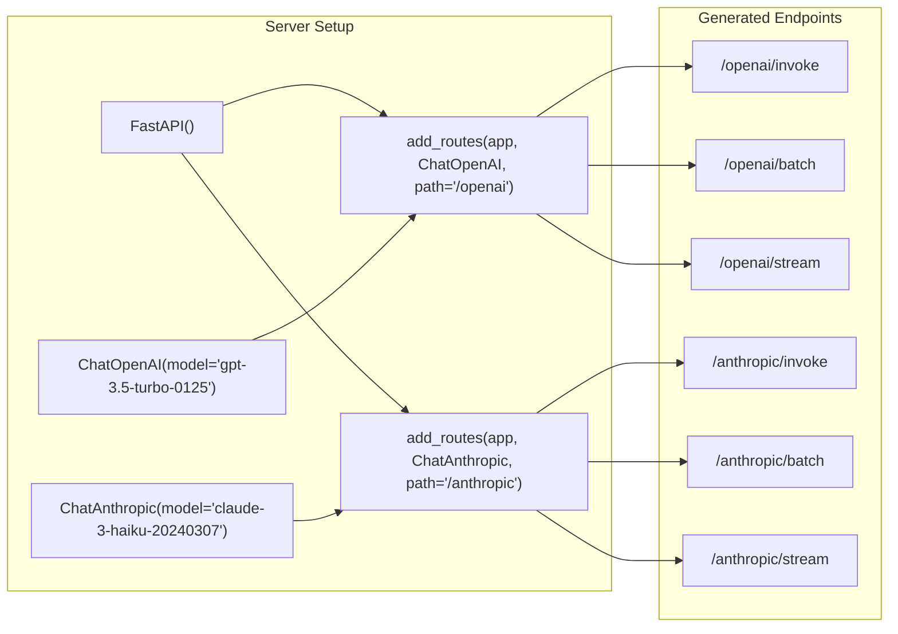
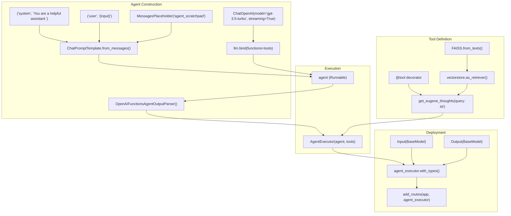
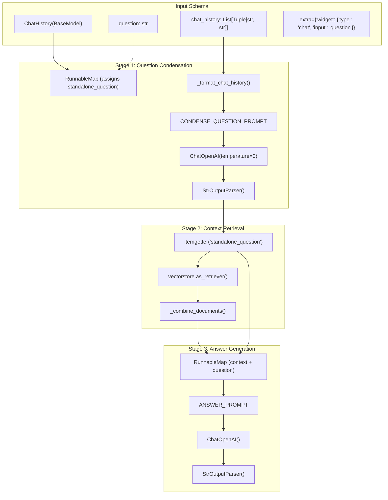
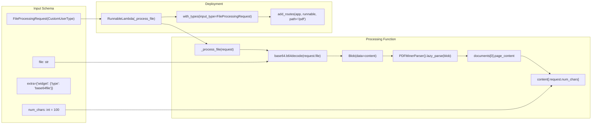
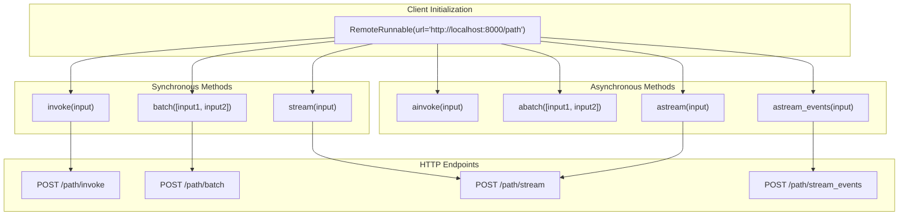

<!-- source: DeepWiki mcp.deepwiki.com · repo langchain-ai/langserve · page 4.1 Basic Chain Examples · fetched 2026-10-26 -->

# Basic Chain Examples

<details>
<summary>Relevant source files</summary>

The following files were used as context for generating this wiki page:

- [MIGRATION.md](MIGRATION.md)
- [README.md](README.md)
- [examples/agent/server.py](examples/agent/server.py)
- [examples/conversational_retrieval_chain/server.py](examples/conversational_retrieval_chain/server.py)
- [examples/file_processing/server.py](examples/file_processing/server.py)
- [examples/llm/server.py](examples/llm/server.py)
- [examples/retrieval/server.py](examples/retrieval/server.py)
- [examples/router/server.py](examples/router/server.py)

</details>


This page demonstrates fundamental patterns for deploying LangChain runnables using LangServe. The examples cover three core deployment scenarios: conversational retrieval chains, agents with tools, and file processing chains. These implementations illustrate the basic usage of `add_routes()` and client interaction patterns.

For chat implementations with message history persistence, see page 4.2. For advanced patterns including authentication, custom widgets, and per-request configuration, see page 4.3.

## Basic LLM Chain Deployment Pattern

The core deployment pattern uses `add_routes()` to expose LangChain runnables as REST endpoints. The simplest example deploys individual LLM models directly.

### Minimal LLM Deployment



The minimal deployment pattern shown in [examples/llm/server.py:1-31]() demonstrates:
- Creating a FastAPI application instance [examples/llm/server.py:10-14]()
- Adding multiple model endpoints with distinct paths [examples/llm/server.py:16-25]()
- Running the server with uvicorn [examples/llm/server.py:27-30]()

### Chain Deployment with LCEL

LangChain Expression Language (LCEL) chains can be deployed by composing runnables with the pipe operator:

| Component | Purpose | Example |
|-----------|---------|---------|
| `ChatPromptTemplate` | Define prompt structure | `ChatPromptTemplate.from_template("tell me a joke about {topic}")` |
| `ChatModel` | LLM for generation | `ChatAnthropic(model="claude-3-haiku-20240307")` |
| Pipe operator `\|` | Chain composition | `prompt \| model` |
| `add_routes()` | Expose as API | `add_routes(app, prompt \| model, path="/joke")` |

**Sources:** [examples/llm/server.py:1-31](), [README.md:154-191]()

## Agent Chain Implementation

Agent chains combine LLMs with tools through the `AgentExecutor` pattern. The agent example in [examples/agent/server.py:1-118]() demonstrates tool integration with retrieval.

### Agent Architecture



### Key Implementation Details

**Tool Creation** [examples/agent/server.py:41-47]()
- Tools defined with `@tool` decorator
- `get_eugene_thoughts` function wraps retriever invocation
- FAISS vectorstore initialized with sample documents [examples/agent/server.py:35-38]()

**Agent Prompt Structure** [examples/agent/server.py:49-60]()
- System message for agent role
- User input slot with `{input}` variable
- `MessagesPlaceholder` for `agent_scratchpad` enables tool use tracking
- Scratchpad placement after user input is critical for proper agent operation

**LLM Configuration** [examples/agent/server.py:67]()
- `streaming=True` enables token-level streaming via `/stream_events` endpoint
- Function binding attaches tools to LLM [examples/agent/server.py:69]()

**Agent Composition** [examples/agent/server.py:71-81]()
- LCEL chain: input preparation → prompt → LLM with tools → output parser
- `format_to_openai_functions()` formats intermediate steps [examples/agent/server.py:74-76]()
- `OpenAIFunctionsAgentOutputParser` extracts agent decisions

**Schema Definition** [examples/agent/server.py:94-100]()
- `Input` and `Output` models required for `AgentExecutor` (lacks default schemas)
- Applied via `with_types()` method [examples/agent/server.py:109]()

**Sources:** [examples/agent/server.py:1-118]()

## Conversational Retrieval Chain

Conversational retrieval chains process chat history to extract standalone questions, retrieve relevant documents, and generate context-aware answers. The implementation in [examples/conversational_retrieval_chain/server.py:1-112]() demonstrates a three-stage pipeline.

### Pipeline Architecture



### Implementation Components

**Input Schema with Chat Widget** [examples/conversational_retrieval_chain/server.py:82-90]()

The `ChatHistory` model defines the input structure and enables chat UI rendering:
- `chat_history` field stores conversation as list of tuples
- `question` field contains current user input
- `extra` dict configures playground widget with `type: "chat"` and `input: "question"`

**Chat History Formatting** [examples/conversational_retrieval_chain/server.py:52-59]()

`_format_chat_history()` converts tuple list to string format:
- Iterates over `(human, ai)` tuples
- Prefixes with "Human:" and "Assistant:"
- Joins with newlines for prompt injection

**Question Condensation Stage** [examples/conversational_retrieval_chain/server.py:67-74]()

Uses `RunnableMap` with `RunnablePassthrough.assign()`:
- Assigns formatted chat history to `chat_history` key
- Pipes through `CONDENSE_QUESTION_PROMPT` template [examples/conversational_retrieval_chain/server.py:25-32]()
- Generates standalone question via `ChatOpenAI` + `StrOutputParser`

**Context Retrieval Stage** [examples/conversational_retrieval_chain/server.py:75-78]()

Context assembly using `itemgetter`:
- Extracts `standalone_question` from previous stage
- Passes to FAISS retriever [examples/conversational_retrieval_chain/server.py:62-65]()
- Combines retrieved documents with `_combine_documents()` [examples/conversational_retrieval_chain/server.py:44-49]()

**Answer Generation Stage** [examples/conversational_retrieval_chain/server.py:92-94]()

Final chain composition:
- `ANSWER_PROMPT` template injects context and question [examples/conversational_retrieval_chain/server.py:34-39]()
- `ChatOpenAI()` generates answer
- `StrOutputParser()` extracts string output

**Deployment Configuration** [examples/conversational_retrieval_chain/server.py:95-106]()
- `with_types(input_type=ChatHistory)` applies custom schema
- `enable_feedback_endpoint=True` enables LangSmith feedback collection

**Sources:** [examples/conversational_retrieval_chain/server.py:1-112]()

## File Processing Chain

File processing chains handle binary file uploads through base64 encoding. The example in [examples/file_processing/server.py:1-63]() demonstrates PDF text extraction with a file upload widget.

### File Processing Architecture



### Implementation Details

**CustomUserType Schema** [examples/file_processing/server.py:34-40]()

`FileProcessingRequest` inherits from `CustomUserType` instead of `BaseModel`:
- Prevents server from decoding to dict (preserves Pydantic model)
- `file` field stores base64-encoded binary data
- `extra` dict specifies `base64file` widget type for playground UI
- `num_chars` parameter controls output truncation

**File Processing Function** [examples/file_processing/server.py:42-48]()

`_process_file()` implements the extraction logic:
- Decodes base64 string to bytes with `base64.b64decode()` [examples/file_processing/server.py:44]()
- Creates `Blob` object from binary content [examples/file_processing/server.py:45]()
- Parses PDF using `PDFMinerParser().lazy_parse()` [examples/file_processing/server.py:46]()
- Extracts page content from first document [examples/file_processing/server.py:47]()
- Returns truncated text based on `num_chars` [examples/file_processing/server.py:48]()

**Runnable Wrapping** [examples/file_processing/server.py:51-56]()

Deployment uses `RunnableLambda` to wrap the processing function:
- `RunnableLambda(_process_file)` creates runnable from plain function
- `with_types(input_type=FileProcessingRequest)` applies custom schema
- `config_keys=["configurable"]` enables configuration support
- `path="/pdf"` sets endpoint route

### File Upload Limitations

Current implementation has architectural constraints:
- Processing occurs in main process (no offloading to worker pool)
- Base64 encoding adds ~33% size overhead
- Blocking operations may impact server responsiveness under load

Alternative architectures for production:
- Dedicated upload endpoint with background task processing
- File reference uploads (S3 URLs) instead of inline content
- Multipart form data endpoints for larger files

**Sources:** [examples/file_processing/server.py:1-63](), [README.md:543-566]()

## Client Interaction Patterns

LangServe supports two client approaches: the `RemoteRunnable` SDK and direct HTTP requests. The SDK provides a consistent interface matching the LangChain `Runnable` protocol.

### RemoteRunnable Client Methods



### Method Reference Table

| Method | Mode | Return Type | Use Case |
|--------|------|-------------|----------|
| `invoke(input)` | Sync | Full output | Single request, blocking |
| `ainvoke(input)` | Async | Full output | Single request, non-blocking |
| `batch(inputs)` | Sync | List of outputs | Multiple inputs, blocking |
| `abatch(inputs)` | Async | List of outputs | Multiple inputs, non-blocking |
| `stream(input)` | Sync | Iterator | Token streaming, blocking |
| `astream(input)` | Async | Async iterator | Token streaming, non-blocking |
| `astream_events(input)` | Async | Async iterator | Event streaming with metadata |

### Client Usage Examples

**Basic Invocation**

```python
from langserve import RemoteRunnable

openai = RemoteRunnable("http://localhost:8000/openai/")
joke_chain = RemoteRunnable("http://localhost:8000/joke/")

# Synchronous invoke
result = joke_chain.invoke({"topic": "parrots"})

# Asynchronous invoke
result = await joke_chain.ainvoke({"topic": "parrots"})
```

**Streaming Responses**

```python
# Synchronous streaming
for chunk in openai.stream(prompt):
    print(chunk, end="", flush=True)

# Asynchronous streaming
async for msg in openai.astream(prompt):
    print(msg, end="", flush=True)
```

**Batch Processing**

```python
# Process multiple inputs
results = joke_chain.batch([
    {"topic": "parrots"}, 
    {"topic": "cats"}
])
```

**Direct HTTP Requests**

Clients can bypass the SDK and invoke endpoints directly:

```python
import requests

response = requests.post(
    "http://localhost:8000/joke/invoke",
    json={'input': {'topic': 'cats'}}
)
output = response.json()
```

```bash
curl --request POST 'http://localhost:8000/joke/invoke' \
    --header 'Content-Type: application/json' \
    --data-raw '{"input": {"topic": "cats"}}'
```

**Sources:** [README.md:228-306]()

## Common Deployment Patterns

### Standard Chain Deployment

The most common pattern involves creating a FastAPI app and adding routes for a LangChain runnable:

```python
app = FastAPI(title="LangChain Server", version="1.0")
add_routes(app, chain, enable_feedback_endpoint=True)
```

**Sources:** [examples/conversational_retrieval_chain/server.py:97-106]()

### Multiple Chain Endpoints

Applications can expose multiple chains at different paths:

```python
add_routes(app, chain1, path="/chain1")
add_routes(app, chain2, path="/chain2") 
```

**Sources:** [examples/passthrough_dict/server.py:65-81]()

### Schema Type Specification

Chains can specify custom input and output types for better API documentation and validation:

```python
chain.with_types(input_type=CustomInput, output_type=CustomOutput)
```

**Sources:** [examples/agent/server.py:109](), [examples/conversational_retrieval_chain/server.py:95]()

### Configuration and Feedback

Chains can be deployed with additional configuration options:

```python
add_routes(
    app, 
    chain,
    config_keys=["configurable"],
    enable_feedback_endpoint=True
)
```

**Sources:** [examples/conversational_retrieval_chain/server.py:106](), [examples/file_processing/server.py:54]()

---

