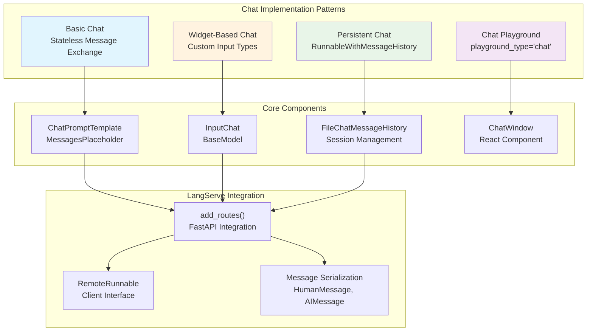
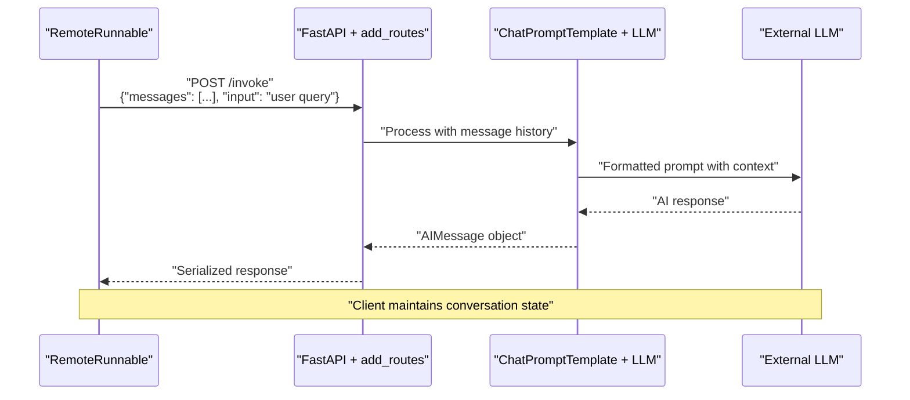
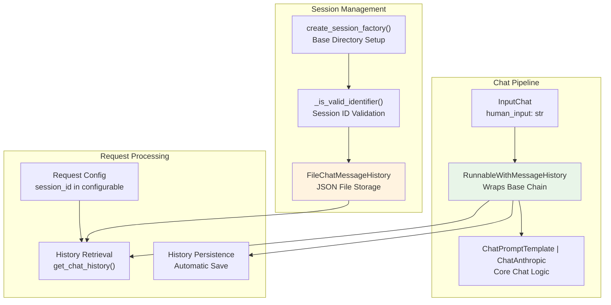
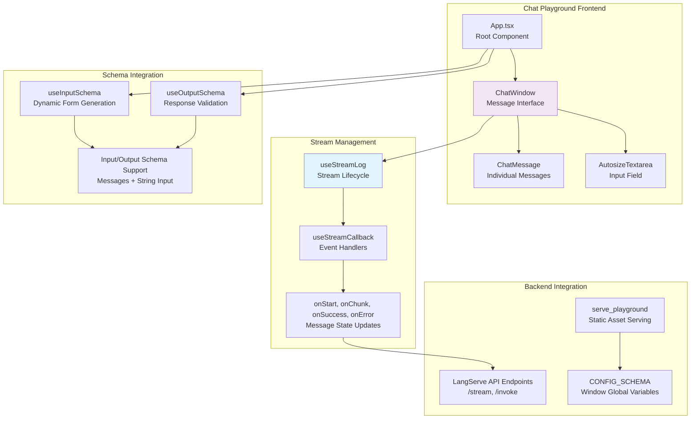

<!-- source: DeepWiki mcp.deepwiki.com · repo langchain-ai/langserve · page 4.2 Chat Examples · fetched 2026-10-26 -->

# Chat Examples

<details>
<summary>Relevant source files</summary>

The following files were used as context for generating this wiki page:

- [MIGRATION.md](MIGRATION.md)
- [README.md](README.md)
- [examples/chat_playground/legacy_input/server.py](examples/chat_playground/legacy_input/server.py)
- [examples/chat_with_persistence/client.ipynb](examples/chat_with_persistence/client.ipynb)
- [examples/chat_with_persistence/server.py](examples/chat_with_persistence/server.py)
- [examples/llm/server.py](examples/llm/server.py)
- [examples/retrieval/server.py](examples/retrieval/server.py)
- [examples/router/server.py](examples/router/server.py)
- [examples/widgets/chat/message_list/server.py](examples/widgets/chat/message_list/server.py)
- [examples/widgets/chat/tuples/server.py](examples/widgets/chat/tuples/server.py)

</details>


This document covers chat-specific implementations in LangServe, demonstrating various patterns for building conversational AI applications. It includes examples of basic chat interfaces, persistent chat history management, playground integration, and widget-based chat components.

For general LLM and chain examples, see [LLM Chain Examples](#4.1). For advanced configuration patterns, see [Configurable Chain Examples](#4.3).

## Overview of Chat Implementation Patterns

LangServe provides several patterns for implementing chat applications, each suited to different use cases and requirements. These patterns demonstrate how to handle message history, session management, and different UI interactions.



Sources: [examples/chat_playground/server.py:1-53](), [examples/chat_with_persistence/server.py:1-113](), [examples/widgets/chat/message_list/server.py:1-64](), [examples/widgets/chat/tuples/server.py:1-142]()

## Basic Chat Implementation

The simplest chat pattern involves stateless message exchange where the client manages conversation state. This approach passes the current conversation history with each request.



### Chat Prompt Structure

Basic chat implementations use `ChatPromptTemplate` with `MessagesPlaceholder` to handle conversation history:

- System message defines the assistant's personality
- `MessagesPlaceholder` inserts conversation history
- Human input field for current user query

The `InputChat` model defines the expected input schema with message history and current input fields.

Sources: [examples/chat_playground/server.py:22-40](), [examples/chat_playground/legacy_input/server.py:22-43]()

### Playground Integration

Basic chat examples can be configured to use the specialized chat playground interface by setting `playground_type="chat"` in `add_routes()`. This enables a conversational UI instead of the default form-based playground.

Additional features can be enabled including:
- `enable_feedback_endpoint=True` for user feedback collection
- `enable_public_trace_link_endpoint=True` for debugging and tracing

Sources: [examples/chat_playground/server.py:42-48](), [examples/chat_playground/legacy_input/server.py:45-51]()

## Chat with Persistence

Persistent chat implementations use `RunnableWithMessageHistory` to maintain conversation state on the server side, enabling multi-turn conversations across requests.



### Session Factory Implementation

The session factory pattern manages chat history persistence through file-based storage:

- Session ID validation using regular expressions for security
- Directory creation for chat history storage
- `FileChatMessageHistory` instances for individual sessions

The `create_session_factory()` function returns a closure that creates history instances based on session IDs.

Sources: [examples/chat_with_persistence/server.py:26-60]()

### RunnableWithMessageHistory Configuration

The `RunnableWithMessageHistory` wrapper integrates persistence with the base chat chain:

- `input_messages_key` specifies the input field name
- `history_messages_key` maps to `MessagesPlaceholder` variable
- Session factory provides history retrieval mechanism
- `.with_types()` applies custom input schema

Sources: [examples/chat_with_persistence/server.py:97-102]()

### Client Session Management

Client applications manage sessions by passing session IDs in the request configuration. The same session ID maintains conversation continuity across multiple requests.

Sessions persist chat history as JSON files containing serialized message objects with type information and content.

Sources: [examples/chat_with_persistence/client.ipynb:41-86]()

## Chat Playground Integration

The chat playground provides a specialized React-based interface for conversational AI testing, supporting real-time streaming and message management.



### Schema Compatibility Requirements

The chat playground validates input and output schemas to ensure compatibility:

**Input Schema Requirements:**
- Single key with array type (messages only)
- Two keys: one string, one array (input + messages)

**Output Schema Requirements:**
- AIMessage type in `anyOf` or `oneOf` schemas
- String type for simple text responses

Incompatible schemas display an error message directing users to the default playground.

Sources: [langserve/chat_playground/src/App.tsx:13-36]()

### Message State Management

The `ChatWindow` component manages conversation state through React hooks:

- `messages` array maintains conversation history
- `currentInputValue` tracks user input
- `isLoading` controls UI state during requests
- Stream callbacks update messages in real-time

Message submission constructs appropriate request payloads based on schema requirements (messages-only vs. messages + input).

Sources: [langserve/chat_playground/src/components/ChatWindow.tsx:41-70]()

## Widget-Based Chat Interfaces

Widget-based chat implementations use custom Pydantic field annotations to specify UI components in the playground interface.

### Chat Widget Types

#### Message List Widget
Defines chat interfaces using lists of `BaseMessage` objects:

```python
messages: List[Union[HumanMessage, AIMessage, SystemMessage]] = Field(
    ...,
    description="The chat messages representing the current conversation.",
    extra={"widget": {"type": "chat", "input": "messages"}},
)
```

#### Tuple-Based Chat Widget
Uses tuples for simpler chat history representation:

```python
chat_history: List[Tuple[str, str]] = Field(
    ...,
    examples=[[("a", "aa")]],
    extra={"widget": {"type": "chat", "input": "question", "output": "answer"}},
)
```

Sources: [examples/widgets/chat/message_list/server.py:49-53](), [examples/widgets/chat/tuples/server.py:46-50]()

### Message Formatting and Processing

Widget-based implementations often require message format conversion:

- Tuple format converts to `BaseMessage` objects
- History extraction from complex input structures
- Integration with `RunnableParallel` for structured responses

The `_format_to_messages()` function demonstrates conversion from tuple-based history to LangChain message objects.

Sources: [examples/widgets/chat/tuples/server.py:54-65]()

## Client Interaction Patterns

Chat implementations support various client interaction patterns through the `RemoteRunnable` interface.

### Synchronous Invocation
Standard request-response pattern for single exchanges:
- Session configuration passed in request config
- Complete conversation history in response

### Streaming Responses
Real-time response generation for improved user experience:
- Chunk-based content delivery
- Progressive message building
- Stream termination handling

### Batch Processing
Multiple conversation turns processed simultaneously:
- Efficient for conversation analysis
- Parallel session handling
- Bulk history operations

Sources: [examples/chat_with_persistence/client.ipynb:63-160]()

## Configuration and Deployment

Chat examples demonstrate various deployment configurations:

| Example Type | Persistence | Playground | CORS | Features |
|-------------|-------------|------------|------|----------|
| Basic Chat | Client-side | Chat UI | Optional | Simple stateless |
| Persistent Chat | File-based | Standard | No | Session management |
| Widget Chat | None | Form-based | Enabled | Custom UI widgets |
| Playground Chat | None | Chat UI | No | Feedback, tracing |

All chat implementations integrate with LangServe's standard deployment pattern using `add_routes()` and can be run with `uvicorn` for development and testing.

Sources: [examples/chat_playground/server.py:50-53](), [examples/chat_with_persistence/server.py:105-113](), [examples/widgets/chat/message_list/server.py:56-64]()

---

