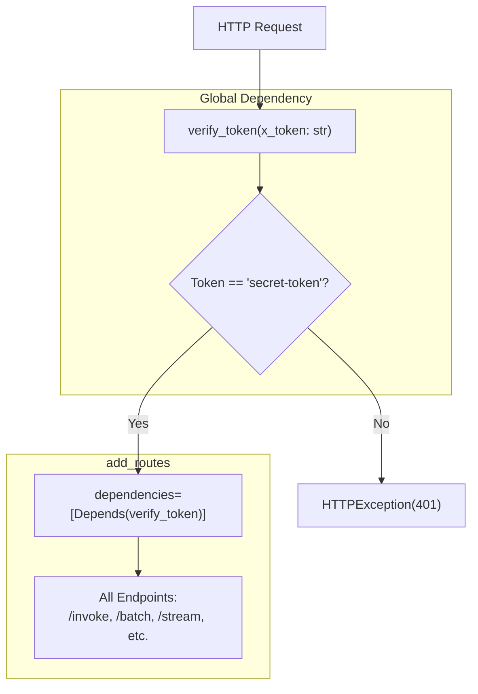
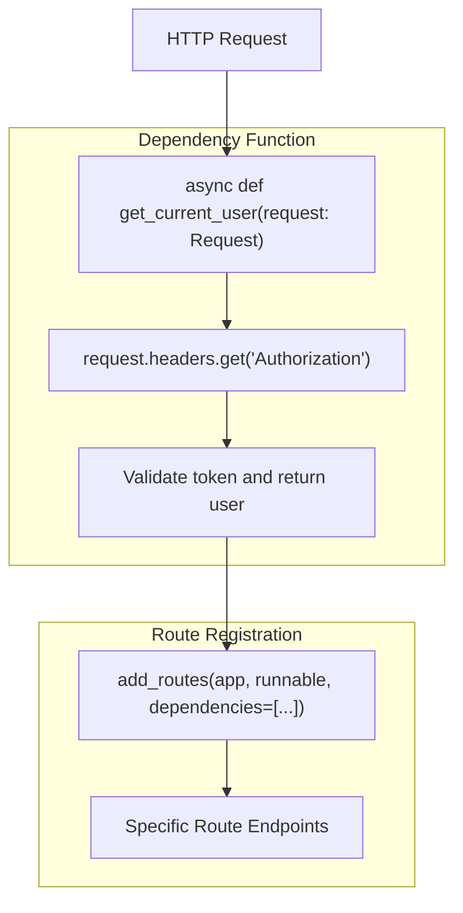
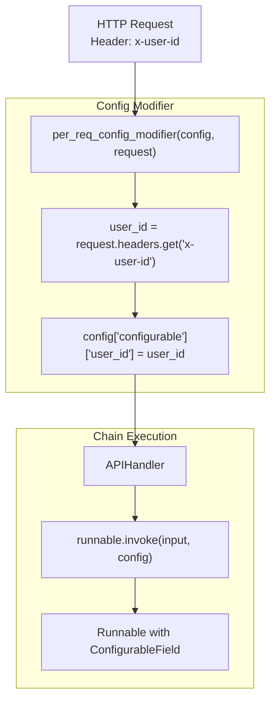
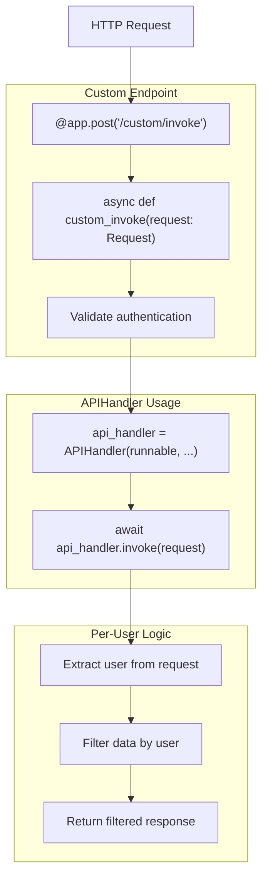
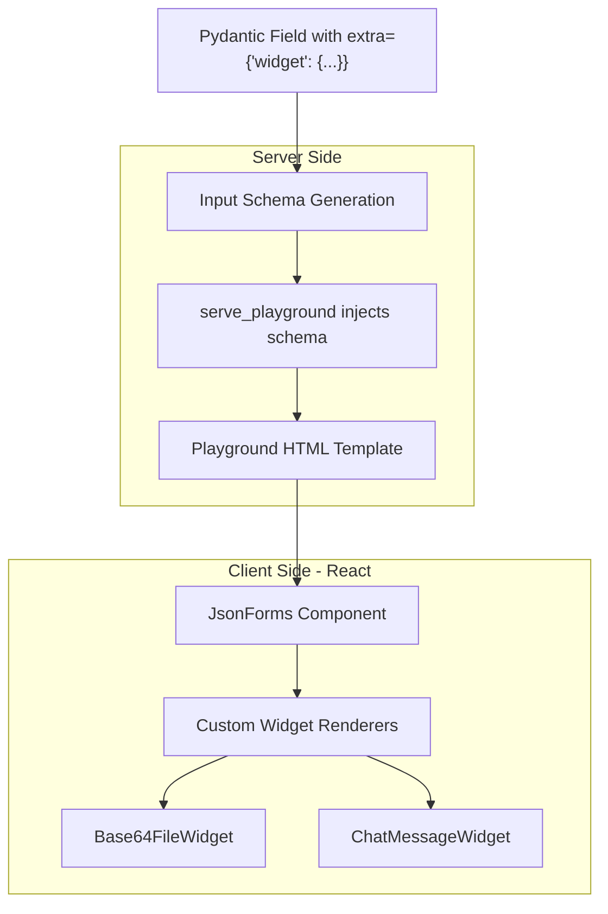
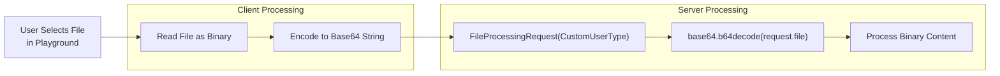
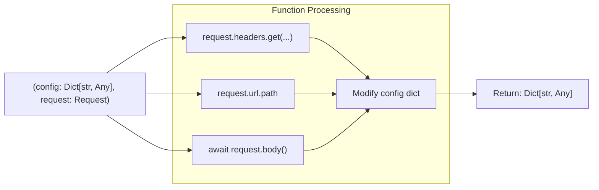
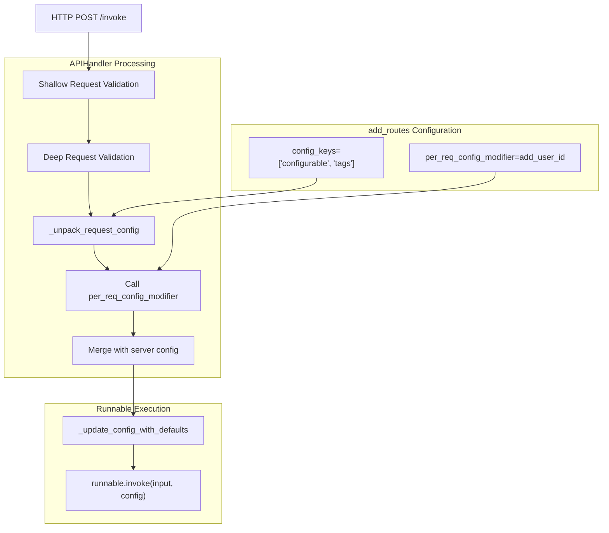
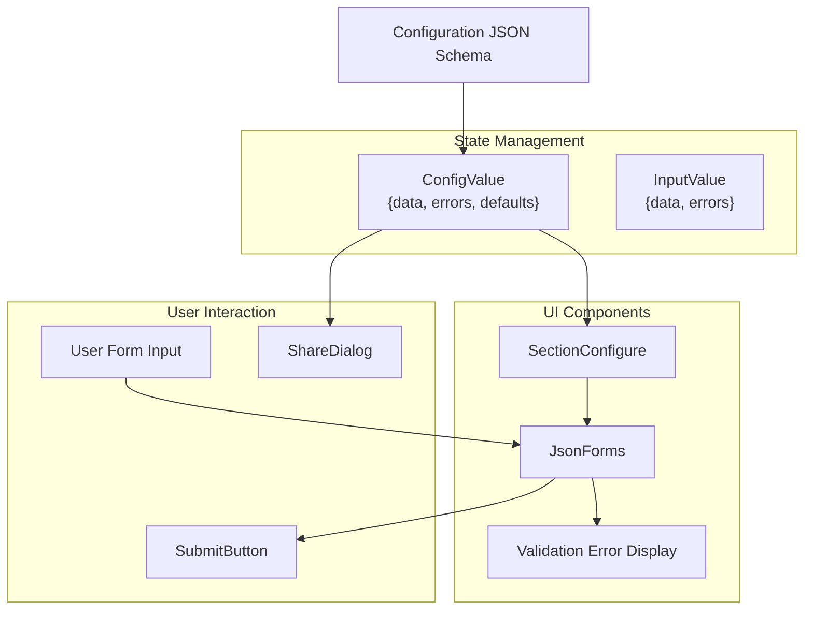
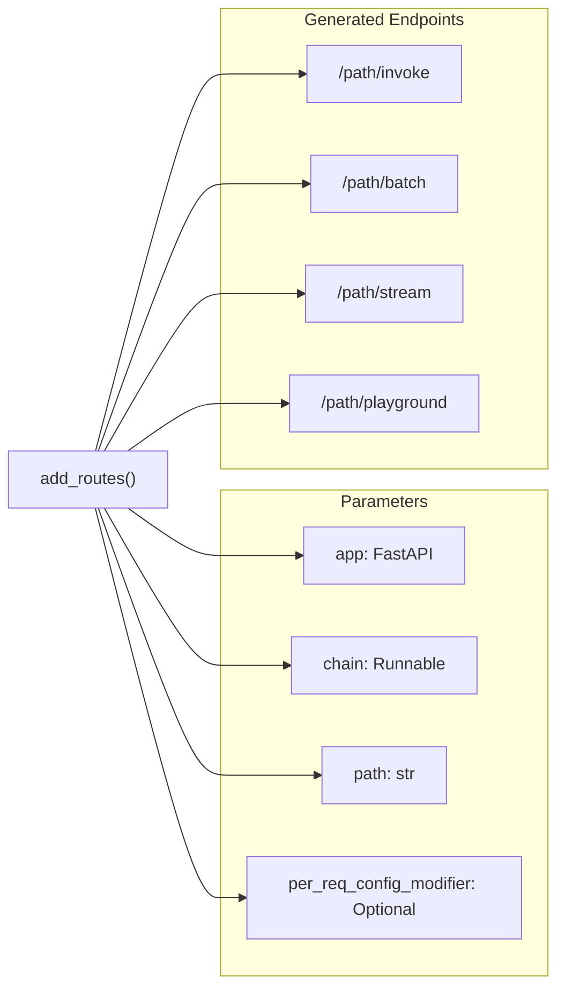

<!-- source: DeepWiki mcp.deepwiki.com · repo langchain-ai/langserve · page 4.3 Advanced Patterns · fetched 2026-10-26 -->

# Advanced Patterns

<details>
<summary>Relevant source files</summary>

The following files were used as context for generating this wiki page:

- [MIGRATION.md](MIGRATION.md)
- [README.md](README.md)
- [examples/agent/server.py](examples/agent/server.py)
- [examples/conversational_retrieval_chain/server.py](examples/conversational_retrieval_chain/server.py)
- [examples/file_processing/server.py](examples/file_processing/server.py)
- [examples/llm/server.py](examples/llm/server.py)
- [examples/retrieval/server.py](examples/retrieval/server.py)
- [examples/router/server.py](examples/router/server.py)
- [langserve/api_handler.py](langserve/api_handler.py)
- [langserve/server.py](langserve/server.py)
- [tests/unit_tests/test_server_client.py](tests/unit_tests/test_server_client.py)

</details>


This document covers advanced implementation patterns for LangServe applications, including authentication mechanisms, custom widgets for the playground UI, per-request configuration modification, file handling strategies, and deployment patterns for production environments.

For basic chain deployment patterns, see [Basic Chain Examples](#4.1). For chat-specific implementations, see [Chat Examples](#4.2).

## Overview

LangServe provides several extension points for implementing advanced functionality:

- **Authentication**: Multiple approaches for securing endpoints and implementing per-user logic
- **Custom Widgets**: Specialized UI components for the playground interface
- **Per-Request Configuration**: Dynamic configuration based on request context
- **File Handling**: Patterns for processing uploaded files
- **Deployment Strategies**: Production deployment patterns and scalability considerations

## Authentication Mechanisms

LangServe supports multiple authentication patterns using FastAPI's dependency injection system. Authentication can be implemented at different levels: global, per-route, or per-request.

### Authentication Approaches Comparison

| Approach | Scope | Per-User Logic | OpenAPI Integration | Implementation Complexity |
|----------|-------|----------------|---------------------|--------------------------|
| Global Dependencies | All endpoints | Limited | Yes | Low |
| Path Dependencies | Per-route | Limited | Yes | Low |
| Per-Request Config Modifier | Per-request | Full support | No | Medium |
| APIHandler | Complete control | Full support | Custom | High |

### Global Dependencies Pattern

Global dependencies apply authentication to all endpoints in the FastAPI application.



The `verify_token` function validates authentication for every request. If validation fails, an `HTTPException(401)` is raised before the runnable is invoked.

**Sources:** [README.md:512]()

### Path Dependencies Pattern

Path dependencies apply authentication to specific route groups using FastAPI's dependency injection.



**Sources:** [README.md:513]()

### Per-Request Config Modifier Pattern

The `per_req_config_modifier` enables per-user logic by modifying the runnable's configuration based on request metadata.



**Key Implementation Details:**
- The modifier function receives the `config` dict and `Request` object
- Only keys specified in `config_keys` parameter can be modified
- Supports both sync and async functions
- Can raise `HTTPException` for authentication failures

**Sources:** [langserve/server.py:248-268](), [langserve/api_handler.py:157-220]()

### APIHandler Pattern

The `APIHandler` approach provides complete control over endpoint implementation, allowing custom authentication logic per endpoint.



**Sources:** [README.md:142]()

## Custom Widgets for Playground

LangServe's playground UI supports custom widgets through Pydantic field annotations using the `extra` parameter. Widgets enhance the playground experience for specific data types.

### Widget System Architecture



**Sources:** [examples/file_processing/server.py:34-39](), [langserve/playground/serve.py:1-100]()

### Base64 File Upload Widget

The `base64file` widget enables file uploads in the playground, encoding files as base64 strings.

**Implementation Pattern:**

1. **Define Custom Input Type**: Inherit from `CustomUserType` (not `BaseModel`)
2. **Specify Widget**: Use `Field(..., extra={"widget": {"type": "base64file"}})`
3. **Process File**: Decode base64 content in the runnable



**Key Implementation:**

The input schema must inherit from `CustomUserType` instead of `BaseModel` to prevent automatic dictionary conversion:

```python
class FileProcessingRequest(CustomUserType):
    file: str = Field(..., extra={"widget": {"type": "base64file"}})
    num_chars: int = 100
```

**Sources:** [examples/file_processing/server.py:34-48]()

### Chat Message Widget

The `chat` widget provides a conversational interface in the playground, particularly useful for chat history inputs.

**Widget Configuration:**

```python
class ChatHistory(BaseModel):
    chat_history: List[Tuple[str, str]] = Field(
        ...,
        extra={"widget": {"type": "chat", "input": "question"}},
    )
    question: str
```

The `input` parameter specifies which field receives the latest user message.

**Sources:** [examples/conversational_retrieval_chain/server.py:82-89]()

### Available Widget Types

| Widget Type | Purpose | Field Type | Example Usage |
|------------|---------|------------|---------------|
| `base64file` | File upload | `str` | PDF processing, image upload |
| `chat` | Chat history | `List[Tuple[str, str]]` | Conversational chains |
| Default | Standard input | Any | General purpose |

## Per-Request Configuration

The `per_req_config_modifier` parameter in `add_routes` enables dynamic configuration based on request context. This is essential for implementing per-user logic, authentication, and request-specific behavior.

### Configuration Modifier Function Signature



### Implementation Constraints

**Allowed Modifications:**
- Only keys specified in `config_keys` parameter can be modified
- Common allowed keys: `"configurable"`, `"tags"`, `"metadata"`
- Cannot modify `"run_name"` (set by server)
- Cannot add `"callbacks"` (removed by client)

**Function Requirements:**
- Can be sync or async
- Must return `Dict[str, Any]`
- Can raise `HTTPException` for validation errors

**Sources:** [langserve/server.py:248-268](), [langserve/api_handler.py:157-220]()

### Common Use Cases

**1. User-Specific Configuration**

```python
async def add_user_id(config: Dict[str, Any], request: Request) -> Dict[str, Any]:
    user_id = request.headers.get("x-user-id")
    if not user_id:
        raise HTTPException(401, "Missing user ID")
    
    config.setdefault("configurable", {})
    config["configurable"]["user_id"] = user_id
    return config
```

**2. Dynamic API Key Injection**

Extract API keys from headers and inject into runnable configuration:

```python
def fetch_api_key_from_header(config: dict, request: Request) -> dict:
    api_key = request.headers.get("x-api-key")
    if api_key is None:
        raise HTTPException(status_code=401, detail="Missing API key")
    
    config["configurable"] = config.get("configurable", {})
    config["configurable"]["openai_api_key"] = api_key
    return config
```

**3. Request Context Metadata**

```python
async def add_request_metadata(config: Dict[str, Any], request: Request) -> Dict[str, Any]:
    config.setdefault("metadata", {})
    config["metadata"]["request_path"] = request.url.path
    config["metadata"]["client_host"] = request.client.host
    return config
```

**Sources:** [tests/unit_tests/test_server_client.py:174-193]()

### Config Modifier Integration Flow



**Sources:** [langserve/api_handler.py:157-220](), [langserve/api_handler.py:223-282]()

## Playground Configuration Interface

The LangServe playground automatically generates configuration UI based on the chain's configuration schema.

### Configuration Section Generation

The `SectionConfigure` component renders dynamic forms using JSON Forms:

| Component | Purpose | Schema Source |
|-----------|---------|---------------|
| `JsonForms` | Renders dynamic form fields | Chain configuration schema |
| `renderers` | Custom UI components for specific field types | [langserve/playground/src/renderers.tsx:73-93]() |
| `cells` | Individual input cell components | [langserve/playground/src/renderers.tsx:98-111]() |

### Configuration State Management  



**Sources:** [langserve/playground/src/sections/SectionConfigure.tsx:5-50](), [langserve/playground/src/components/SubmitButton.tsx:4-50](), [langserve/playground/src/components/ShareDialog.tsx:43-137]()

## Route Registration and Configuration

All configurable chain examples follow the same pattern for route registration using `add_routes`:

### Standard Route Registration



### Configuration Modifier Integration

For request-based configuration, the `per_req_config_modifier` parameter enables dynamic config modification:

| Parameter | Type | Purpose |
|-----------|------|---------|
| `config` | `Dict[str, Any]` | Current configuration dictionary |
| `req` | `Request` | FastAPI Request object |
| **Returns** | `Dict[str, Any]` | Modified configuration |

**Sources:** [examples/configurable_chain/server.py:95-119](), [examples/configurable_chain/server.py:62](), [examples/configurable_chain/server.py:83](), [examples/configurable_chain/server.py:114-119]()

---

