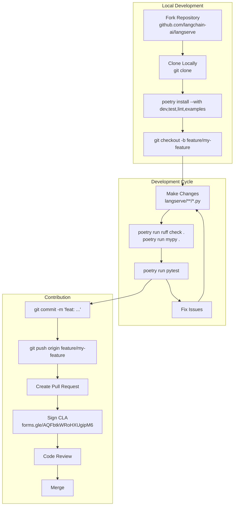
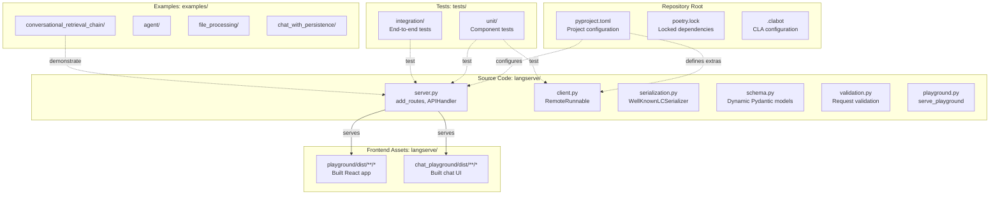
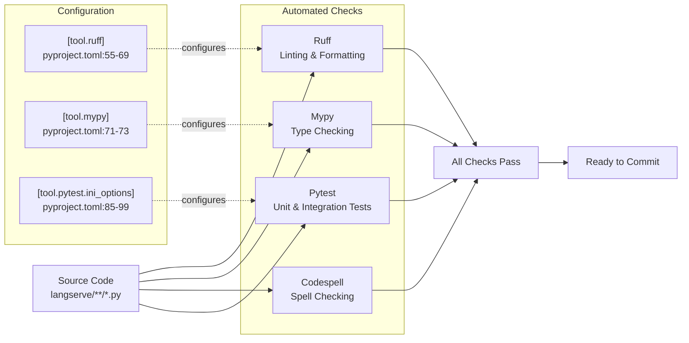
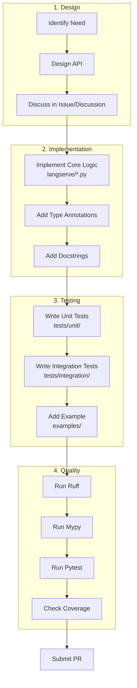
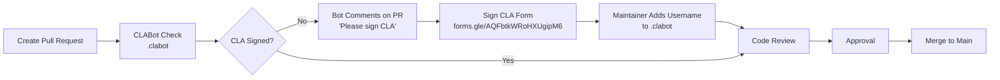

<!-- source: DeepWiki mcp.deepwiki.com · repo langchain-ai/langserve · page 5 Development Guide · fetched 2026-10-26 -->

# Development Guide

<details>
<summary>Relevant source files</summary>

The following files were used as context for generating this wiki page:

- [.clabot](.clabot)
- [poetry.lock](poetry.lock)
- [pyproject.toml](pyproject.toml)

</details>


This document provides guidance for developers who want to contribute to or extend LangServe. It covers setting up a development environment, understanding the project structure, following code quality standards, and submitting contributions.

For detailed information about specific aspects of development:
- Package structure and dependency management: see [Package Structure & Dependencies](#5.1)
- Testing infrastructure and CI/CD: see [Testing & CI/CD](#5.2)
- Contribution process and CLA requirements: see [Contributing](#5.3)

---

## Development Workflow Overview

LangServe uses a modern Python development workflow with Poetry for dependency management, strict code quality tools, and automated testing. The project is structured as a single Python package with optional extras for client-only, server-only, or full installations.

**Development Workflow Diagram**



Sources: [pyproject.toml:1-101](), [.clabot:1-5]()

---

## Setting Up Development Environment

### Prerequisites

1. Python 3.9 or higher
2. Poetry (Python package manager)
3. Git

### Installation Steps

```bash
# Clone the repository
git clone https://github.com/langchain-ai/langserve.git
cd langserve

# Install dependencies with all development groups
poetry install --with dev,test,lint,examples

# Activate the virtual environment
poetry shell
```

### Dependency Groups

The project organizes dependencies into several groups defined in `pyproject.toml`:

| Group | Purpose | Key Packages |
|-------|---------|-------------|
| `main` | Core runtime dependencies | `httpx`, `langchain-core`, `pydantic`, `orjson` |
| `dev` | Development tools | `jupyterlab`, `fastapi`, `sse-starlette` |
| `test` | Testing infrastructure | `pytest`, `pytest-asyncio`, `pytest-mock`, `pytest-cov` |
| `lint` | Code quality tools | `ruff`, `codespell` |
| `examples` | Running examples | `openai`, `uvicorn` |

### Optional Extras

LangServe can be installed with different extras depending on your use case:

- **`client`**: For consuming LangServe APIs (`fastapi` only)
- **`server`**: For hosting LangServe APIs (`sse-starlette`, `fastapi`)
- **`all`**: Both client and server capabilities

These are defined in `[tool.poetry.extras]` and are used by end users installing via `pip install langserve[server]`.

Sources: [pyproject.toml:12-53]()

---

## Project Structure

**LangServe Directory Layout**



### Key Source Files

| File | Primary Purpose | Key Exports |
|------|----------------|-------------|
| `langserve/server.py` | Server-side route generation | `add_routes`, `APIHandler` |
| `langserve/client.py` | Client SDK for remote execution | `RemoteRunnable` |
| `langserve/serialization.py` | LangChain object serialization | `WellKnownLCSerializer`, `WellKnownLCObject` |
| `langserve/schema.py` | Dynamic Pydantic model generation | `_resolve_model`, `_rename_pydantic_model` |
| `langserve/validation.py` | Request/response validation | `create_invoke_request_model` |
| `langserve/playground.py` | Playground UI serving | `serve_playground` |

### Built Assets

The repository includes pre-built frontend assets in `langserve/playground/dist/` and `langserve/chat_playground/dist/`. The source code for these UIs is excluded from the package distribution (see `exclude` in `pyproject.toml`), but the built assets are included (see `include`).

Sources: [pyproject.toml:1-10]()

---

## Code Quality Standards

LangServe enforces strict code quality standards to maintain consistency and catch errors early.

**Code Quality Pipeline**



### Ruff Configuration

Ruff is used for linting and code formatting. The configuration enables:

- **E**: pycodestyle errors
- **F**: pyflakes
- **I**: isort (import sorting)

Line length is set to 88 characters (Black-compatible). The configuration includes a temporary first-party package declaration for `langserve` to help with example imports.

```python
# Run ruff checks
poetry run ruff check .

# Auto-fix issues
poetry run ruff check --fix .
```

Sources: [pyproject.toml:55-69]()

### Mypy Configuration

Type checking is enforced with strict settings:

- `disallow_untyped_defs = True`: All functions must have type annotations
- `ignore_missing_imports = True`: Third-party packages without stubs are ignored

```python
# Run type checks
poetry run mypy .
```

Sources: [pyproject.toml:71-73]()

### Test Configuration

Pytest is configured with strict settings to catch issues early:

- `--strict-markers`: Undefined test markers cause errors
- `--strict-config`: Configuration warnings cause errors
- `--durations=5`: Show the 5 slowest tests
- `timeout = 5`: Global 5-second timeout per test
- `asyncio_mode = "auto"`: Automatic async test detection

```python
# Run all tests
poetry run pytest

# Run with coverage
poetry run pytest --cov=langserve

# Run specific test file
poetry run pytest tests/unit/test_server.py
```

Sources: [pyproject.toml:85-99]()

### Coverage Configuration

Code coverage analysis excludes test files themselves:

```toml
[tool.coverage.run]
omit = [
    "tests/*",
]
```

Sources: [pyproject.toml:75-78]()

---

## Making Changes

### Adding New Features

When adding features to LangServe, follow these patterns:

**Feature Development Flow**



### Common Development Tasks

| Task | Command | Notes |
|------|---------|-------|
| Install dev dependencies | `poetry install --with dev,test,lint` | Do this first |
| Run linter | `poetry run ruff check .` | Fix issues before committing |
| Auto-fix linting | `poetry run ruff check --fix .` | Automatic fixes |
| Type check | `poetry run mypy .` | Must pass with no errors |
| Run all tests | `poetry run pytest` | Should complete in <30s |
| Run tests with coverage | `poetry run pytest --cov=langserve` | Aim for high coverage |
| Run specific test | `poetry run pytest tests/unit/test_server.py::test_name` | For focused testing |
| Check spelling | `poetry run codespell` | Catches typos |

### Testing Your Changes

Every code change should include appropriate tests:

1. **Unit Tests**: Test individual functions/classes in isolation
   - Location: `tests/unit/`
   - Fast execution (<5s per test)
   - Mock external dependencies

2. **Integration Tests**: Test complete request/response cycles
   - Location: `tests/integration/`
   - Test actual HTTP endpoints
   - Use real FastAPI test client

3. **Examples**: Demonstrate real-world usage
   - Location: `examples/`
   - Should be runnable with `poetry run python`
   - Include README with instructions

Sources: [pyproject.toml:32-39](), [pyproject.toml:85-99]()

---

## Contribution Process

### Before Contributing

1. **Search Existing Issues**: Check if the feature/bug is already discussed
2. **Open an Issue**: For significant changes, discuss first in an issue
3. **Read Contributing Guidelines**: See [Contributing](#5.3) for detailed requirements

### Contributor License Agreement (CLA)

All contributors must sign the CLA before their code can be merged. The CLA bot will automatically check PRs and comment if a signature is required.

**CLA Process Flow**



The `.clabot` configuration file lists approved contributors by GitHub username:

```json
{
  "contributors": ["eyurtsev", "hwchase17", "nfcampos", ...],
  "message": "Thank you for your pull request..."
}
```

Sources: [.clabot:1-5]()

### Pull Request Checklist

Before submitting a PR, ensure:

- [ ] Code follows Ruff style guidelines (`poetry run ruff check .`)
- [ ] All functions have type annotations (`poetry run mypy .`)
- [ ] Tests pass (`poetry run pytest`)
- [ ] New features have tests
- [ ] Documentation is updated (if applicable)
- [ ] CLA is signed (if first-time contributor)
- [ ] Commit messages follow conventional commits format
- [ ] Branch is up-to-date with `main`

### Commit Message Format

Use conventional commit format for clear history:

```
<type>(<scope>): <description>

[optional body]

[optional footer]
```

Types:
- `feat`: New feature
- `fix`: Bug fix
- `docs`: Documentation changes
- `test`: Test additions/changes
- `refactor`: Code refactoring
- `chore`: Maintenance tasks

Example:
```
feat(server): add support for custom serializers

Allow users to provide custom serializers via add_routes parameter.

Closes #123
```

---

## Development Tools Reference

### Poetry Commands

```bash
# Install dependencies
poetry install                           # Core only
poetry install --with dev               # + development tools
poetry install --with dev,test,lint     # + testing and linting
poetry install --with dev,test,lint,examples  # All groups

# Add a new dependency
poetry add package-name                 # Runtime dependency
poetry add --group dev package-name     # Dev dependency

# Update dependencies
poetry update                           # Update all
poetry update package-name              # Update specific package

# Show dependency tree
poetry show --tree

# Build package
poetry build

# Publish package (maintainers only)
poetry publish
```

### Testing Commands

```bash
# Run all tests
poetry run pytest

# Run with verbose output
poetry run pytest -vv

# Run specific test file
poetry run pytest tests/unit/test_server.py

# Run specific test function
poetry run pytest tests/unit/test_server.py::test_add_routes

# Run tests matching pattern
poetry run pytest -k "test_invoke"

# Run with coverage report
poetry run pytest --cov=langserve --cov-report=html

# Watch mode (requires pytest-watch)
poetry run ptw

# Run with timeout enforcement
poetry run pytest --timeout=5
```

### Code Quality Commands

```bash
# Lint code
poetry run ruff check .

# Auto-fix linting issues
poetry run ruff check --fix .

# Type check
poetry run mypy .

# Spell check
poetry run codespell

# Run all quality checks
poetry run ruff check . && poetry run mypy . && poetry run codespell
```

Sources: [pyproject.toml:21-46](), [pyproject.toml:85-99]()

---

## Working with Examples

The `examples/` directory contains reference implementations demonstrating LangServe usage. These are helpful for:

- Testing changes in realistic scenarios
- Providing templates for users
- Documenting best practices

### Running Examples

```bash
# Install example dependencies
poetry install --with examples

# Run a specific example
cd examples/conversational_retrieval_chain
poetry run python server.py

# Access playground UI
open http://localhost:8000/playground/
```

### Example Structure

Each example typically includes:

- `server.py`: FastAPI application with `add_routes`
- `README.md`: Instructions and dependencies
- `requirements.txt` or similar: Additional dependencies
- `.env.example`: Environment variable template (if needed)

**Example Categories**

| Example | Purpose | Key Features |
|---------|---------|--------------|
| `conversational_retrieval_chain/` | RAG with conversation history | FAISS, OpenAI, message persistence |
| `agent/` | Tool-using agents | AgentExecutor, custom tools |
| `file_processing/` | File upload and processing | Base64 encoding, PDF parsing |
| `chat_with_persistence/` | Stateful chat | FileChatMessageHistory, session management |

Sources: [pyproject.toml:41-45]()

---

## Debugging Tips

### Enable Debug Logging

```python
import logging
logging.basicConfig(level=logging.DEBUG)
```

### Use FastAPI Test Client

For testing endpoints without running a server:

```python
from fastapi.testclient import TestClient
from langserve import add_routes

app = FastAPI()
add_routes(app, my_runnable, path="/my-path")

client = TestClient(app)
response = client.post("/my-path/invoke", json={"input": "test"})
```

### Inspect Pydantic Models

LangServe generates dynamic Pydantic models. To inspect them:

```python
from langserve.schema import _MODEL_REGISTRY

# View all generated models
print(_MODEL_REGISTRY.keys())

# Inspect a specific model
model = _MODEL_REGISTRY["some_hash"]
print(model.schema_json(indent=2))
```

### Test Serialization

To debug serialization issues:

```python
from langserve.serialization import WellKnownLCSerializer

serializer = WellKnownLCSerializer()

# Serialize and deserialize
data = serializer.dumpd(my_object)
print(f"Serialized: {data}")
restored = serializer.loadd(data)
print(f"Restored: {restored}")
```

---

## Next Steps

For more detailed information:

- **Package Structure & Dependencies**: See [Package Structure & Dependencies](#5.1) for detailed dependency management, extras configuration, and package distribution
- **Testing & CI/CD**: See [Testing & CI/CD](#5.2) for comprehensive testing strategies, CI/CD pipeline details, and test patterns
- **Contributing**: See [Contributing](#5.3) for full contribution guidelines, code review process, and project governance

Sources: [pyproject.toml:1-101](), [.clabot:1-5]()

---

