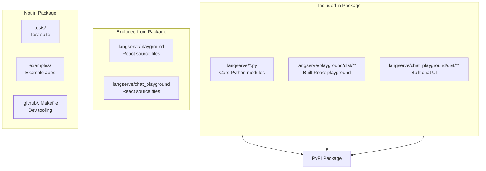
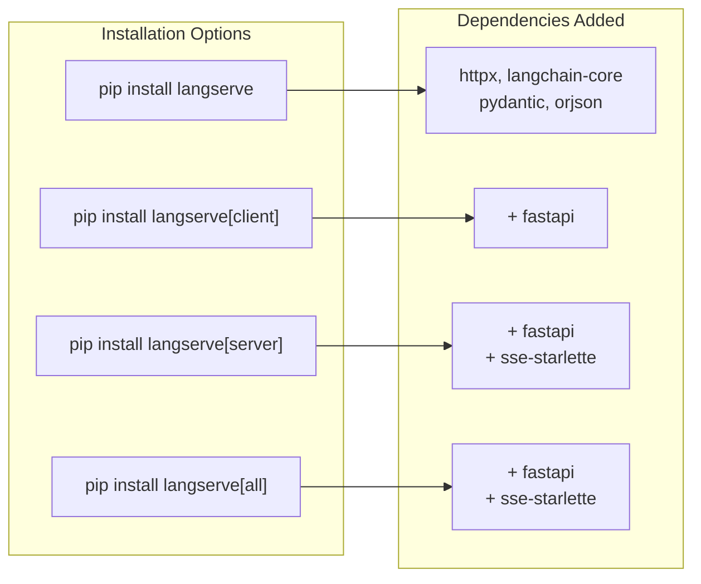
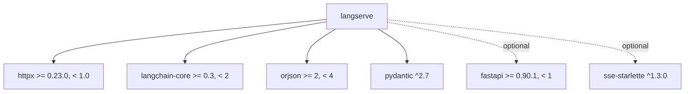
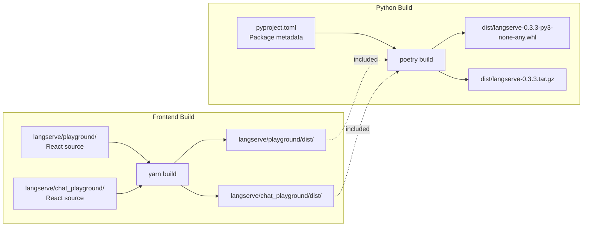
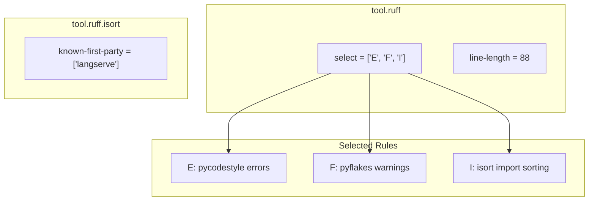
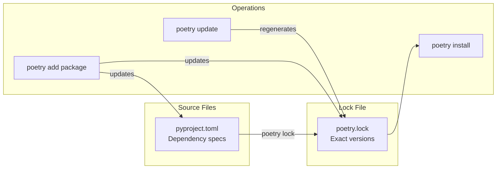
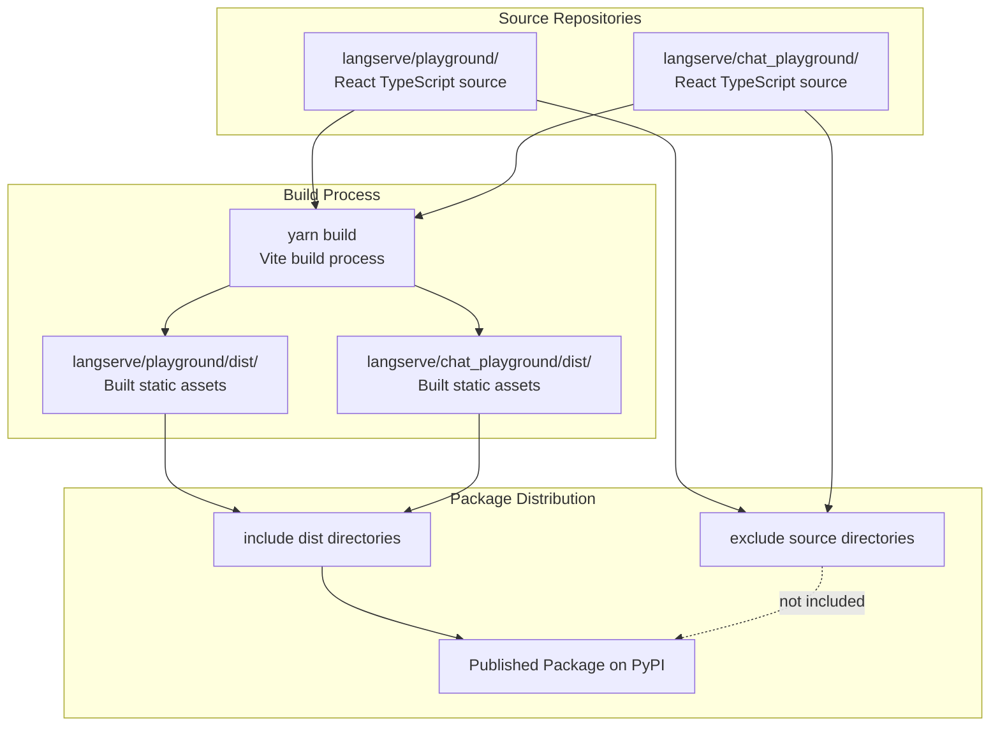
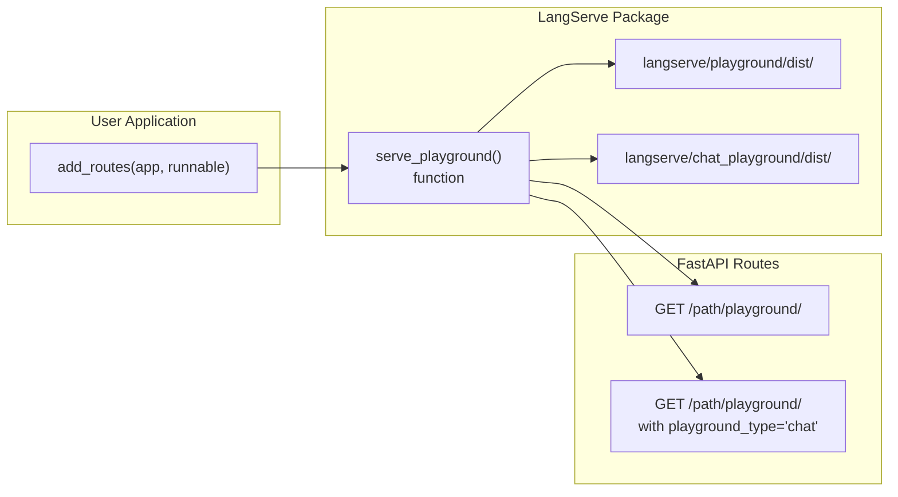
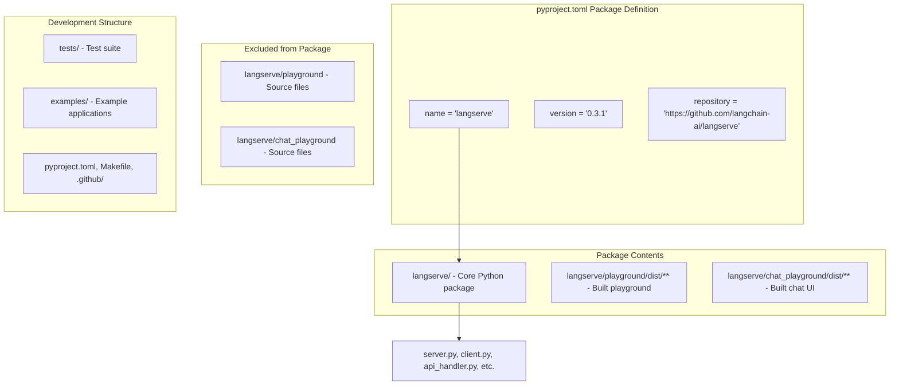

<!-- source: DeepWiki mcp.deepwiki.com · repo langchain-ai/langserve · page 5.1 Package Structure & Dependencies · fetched 2026-10-26 -->

# Package Structure & Dependencies

<details>
<summary>Relevant source files</summary>

The following files were used as context for generating this wiki page:

- [MIGRATION.md](MIGRATION.md)
- [README.md](README.md)
- [examples/llm/server.py](examples/llm/server.py)
- [examples/retrieval/server.py](examples/retrieval/server.py)
- [examples/router/server.py](examples/router/server.py)
- [poetry.lock](poetry.lock)
- [pyproject.toml](pyproject.toml)

</details>


This document explains the LangServe package structure, Poetry configuration, dependency management, and optional installation extras. It is intended for developers who want to understand how the package is organized and how dependencies are managed, whether for contribution or integration purposes.

## Package Metadata and Distribution

LangServe is distributed as a Python package via PyPI with the following metadata defined in [pyproject.toml:1-10]():

| Property | Value |
|----------|-------|
| Package Name | `langserve` |
| Current Version | `0.3.3` |
| Python Requirement | `^3.9` (Python 3.9+) |
| License | `LangServe` |
| Repository | https://github.com/langchain-ai/langserve |
| Build Backend | `poetry-core` |

The package uses Poetry for dependency management and `poetry-core.masonry.api` as the build backend.

Sources: [pyproject.toml:1-10](), [pyproject.toml:81-83]()

## Package Distribution Contents

LangServe uses a selective inclusion/exclusion strategy to control what gets distributed in the published package:

### Package Contents Structure



The key configuration in [pyproject.toml:9-10]():

```toml
exclude = ["langserve/playground,langserve/chat_playground"]
include = ["langserve/playground/dist/**/*", "langserve/chat_playground/dist/**/*"]
```

This ensures that:
- Only built playground assets (`dist/` folders) are included
- React source code is excluded from the distributed package
- Users get pre-built playground UIs without needing Node.js/Yarn
- Package size is minimized by excluding development artifacts

Sources: [pyproject.toml:9-10]()

## Optional Installation Extras

LangServe provides three optional installation extras defined in [pyproject.toml:47-53]() that allow users to install only the dependencies they need:

### Installation Extras Overview



### Extra Definitions

| Extra | Dependencies | Use Case |
|-------|-------------|----------|
| `client` | `fastapi` | Client-side usage with `RemoteRunnable` |
| `server` | `fastapi`, `sse-starlette` | Server deployment with `add_routes` |
| `all` | `fastapi`, `sse-starlette` | Both client and server functionality |

The extras are defined in [pyproject.toml:47-53]():

```toml
[tool.poetry.extras]
client = ["fastapi"]
server = ["sse-starlette", "fastapi"]
all = ["sse-starlette", "fastapi"]
```

**Note**: `fastapi` is marked as optional in the main dependencies section [pyproject.toml:15]() with `optional = true`, while `sse-starlette` is also optional [pyproject.toml:16](). These are only installed when the corresponding extra is requested.

Sources: [pyproject.toml:15-16](), [pyproject.toml:47-53](), [README.md:71-78]()

## Core Dependencies

LangServe's core dependencies are defined in [pyproject.toml:12-19]() and are always installed regardless of extras:

### Core Dependency Graph



### Dependency Purposes

| Dependency | Version Constraint | Purpose |
|------------|-------------------|---------|
| `httpx` | `>=0.23.0,<1.0` | HTTP client for `RemoteRunnable` |
| `langchain-core` | `>=0.3,<2` | LangChain Runnable interfaces and types |
| `orjson` | `>=2,<4` | Fast JSON serialization |
| `pydantic` | `^2.7` | Data validation and schema generation |
| `fastapi` | `>=0.90.1,<1` (optional) | Web framework for server |
| `sse-starlette` | `^1.3.0` (optional) | Server-sent events for streaming |

Sources: [pyproject.toml:12-19]()

## Development Dependency Groups

LangServe organizes development dependencies into separate Poetry groups defined in [pyproject.toml:21-46](). These are not installed in production but are used during development and testing.

### Dependency Group Structure

```mermaid
graph TD
    subgraph "Development Groups"
        DevGroup["[tool.poetry.group.dev]"]
        TypingGroup["[tool.poetry.group.typing]"]
        LintGroup["[tool.poetry.group.lint]"]
        TestGroup["[tool.poetry.group.test]"]
        ExamplesGroup["[tool.poetry.group.examples]"]
    end
    
    subgraph "Dev Group Dependencies"
        Dev1["jupyterlab ^3.6.1"]
        Dev2["fastapi >= 0.90.1"]
        Dev3["sse-starlette ^1.3.0"]
    end
    
    subgraph "Lint Group Dependencies"
        Lint1["ruff ^0.1.4"]
        Lint2["codespell ^2.2.0"]
    end
    
    subgraph "Test Group Dependencies"
        Test1["pytest ^7.2.1"]
        Test2["pytest-cov ^4.0.0"]
        Test3["pytest-asyncio ^0.21.1"]
        Test4["pytest-mock ^3.11.1"]
        Test5["pytest-socket ^0.6.0"]
        Test6["pytest-watch ^4.2.0"]
        Test7["pytest-timeout ^2.2.0"]
    end
    
    subgraph "Examples Group Dependencies"
        Ex1["openai ^0.28.0"]
        Ex2["uvicorn with standard extras"]
        Ex3["fastapi >= 0.90.1"]
        Ex4["sse-starlette ^1.3.0"]
    end
    
    DevGroup --> Dev1
    DevGroup --> Dev2
    DevGroup --> Dev3
    
    LintGroup --> Lint1
    LintGroup --> Lint2
    
    TestGroup --> Test1
    TestGroup --> Test2
    TestGroup --> Test3
    TestGroup --> Test4
    TestGroup --> Test5
    TestGroup --> Test6
    TestGroup --> Test7
    
    ExamplesGroup --> Ex1
    ExamplesGroup --> Ex2
    ExamplesGroup --> Ex3
    ExamplesGroup --> Ex4
```



### Group Purposes and Installation

| Group | Install Command | Purpose |
|-------|----------------|---------|
| `dev` | `poetry install --with dev` | Interactive development (JupyterLab) |
| `typing` | `poetry install --with typing` | Type checking (currently empty) |
| `lint` | `poetry install --with lint` | Code quality tools (ruff, codespell) |
| `test` | `poetry install --with test` | Testing framework and utilities |
| `examples` | `poetry install --with examples` | Running example applications |

**Installation Examples**:
```bash
# Install all groups
poetry install --with dev,lint,test,examples

# Install only test dependencies
poetry install --with test

# Install multiple specific groups
poetry install --with dev,lint
```

Sources: [pyproject.toml:21-46]()

## Build System Configuration

LangServe uses Poetry's build system with specific configuration for handling both Python code and frontend assets.

### Build System Definition

The build system is defined in [pyproject.toml:81-83]():

```toml
[build-system]
requires = ["poetry-core"]
build-backend = "poetry.core.masonry.api"
```

This configuration:
- Uses `poetry-core` as the only build requirement
- Delegates build operations to Poetry's masonry build backend
- Follows PEP 517/518 build standards for modern Python packaging

### Build Process Flow



The build process requires two phases:
1. **Frontend Build**: React playgrounds are built with `yarn build` to create `dist/` folders
2. **Package Build**: `poetry build` creates wheel and sdist, including the pre-built `dist/` folders but excluding source files

Sources: [pyproject.toml:9-10](), [pyproject.toml:81-83]()

## Tool Configurations

The [pyproject.toml]() file also contains configuration for various development tools used in the project.

### Ruff Configuration

Ruff is configured for linting and formatting in [pyproject.toml:55-69]():



Key settings:
- **Line Length**: 88 characters (Black-compatible)
- **Selected Rules**: Pycodestyle errors (E), Pyflakes (F), isort import sorting (I)
- **isort Configuration**: Treats `langserve` as first-party for proper import grouping

Sources: [pyproject.toml:55-69]()

### Pytest Configuration

Test configuration is defined in [pyproject.toml:85-100]():

| Setting | Value | Purpose |
|---------|-------|---------|
| `addopts` | `--strict-markers --strict-config --durations=5 -vv` | Strict validation, verbose output |
| `timeout` | `5` | Global 5-second timeout for all tests |
| `asyncio_mode` | `auto` | Automatic async test detection |
| `filterwarnings` | Ignore LangChain beta warnings | Clean test output |

Sources: [pyproject.toml:85-100]()

### MyPy Configuration

Type checking configuration in [pyproject.toml:71-73]():

```toml
[tool.mypy]
disallow_untyped_defs = "True"
ignore_missing_imports = "True"
```

This enforces type annotations on all functions while allowing imports without type stubs.

Sources: [pyproject.toml:71-73]()

### Coverage Configuration

Code coverage settings in [pyproject.toml:75-78]():

```toml
[tool.coverage.run]
omit = [
    "tests/*",
]
```

Tests are excluded from coverage reports since they are test code themselves.

Sources: [pyproject.toml:75-78]()

## Dependency Version Locking

LangServe uses [poetry.lock]() to lock all transitive dependency versions for reproducible builds. The lock file is automatically generated and updated by Poetry.

### Lock File Management



**Key Commands**:
- `poetry install` - Install exact versions from lock file
- `poetry lock` - Regenerate lock file from pyproject.toml
- `poetry update` - Update dependencies to latest compatible versions
- `poetry add <package>` - Add new dependency and update lock file

The lock file ensures that:
- All developers use identical dependency versions
- CI/CD builds are reproducible
- Deployment environments match development environments
- Transitive dependencies are explicitly tracked

Sources: [poetry.lock:1-2]()

## Frontend Asset Integration

LangServe includes two pre-built React-based playground interfaces that are bundled with the Python package. Understanding how these assets are managed is important for both users and contributors.

### Playground Asset Structure



### Asset Serving at Runtime

When users call `add_routes()`, the playground assets are served via FastAPI static file routes:



The playground assets are:
- **Self-contained**: No external dependencies at runtime
- **Pre-built**: Users don't need Node.js or frontend build tools
- **Static files**: Served directly by FastAPI's static file handling
- **Template-injected**: Schemas and configs are injected into HTML at runtime

Sources: [pyproject.toml:9-10]()

### Frontend Technology Stack

The playgrounds are built using modern web technologies (not included in package, but useful for contributors):

| Technology | Purpose |
|-----------|---------|
| React | UI framework |
| TypeScript | Type-safe JavaScript |
| Vite | Build tool and dev server |
| JsonForms | Dynamic form generation from JSON schemas |

Contributors working on playground features need Node.js and Yarn installed, but end users do not.

Sources: [pyproject.toml:9-10]()

## Project Structure and Configuration

The LangServe project structure is defined by `pyproject.toml` packaging configuration and development tooling:

### Package Structure



### Configuration Files Structure

| File | Purpose | Key Configurations |
|------|---------|-------------------|
| `pyproject.toml` | Package definition, dependencies, tools | Poetry config, ruff rules, pytest settings |
| `Makefile` | Development commands | Build, test, lint, format targets |
| `poetry.lock` | Locked dependency versions | Deterministic builds |
| `.github/workflows/` | CI/CD automation | Release workflows |

Sources: [pyproject.toml:1-11](), [pyproject.toml:55-100]()

## Development Environment Validation

After setup, validate your development environment with these commands:

### Environment Check Commands

```bash
# Verify Python and Poetry versions
python --version    # Should be 3.9+
poetry --version    # Should work

# Verify dependencies are installed
poetry show         # List installed packages
poetry check        # Validate pyproject.toml

# Run development workflow
make lint           # Should pass without errors
make test           # Should run test suite  
make build-playground  # Should build frontend
make build          # Should create package
```

### Common Development Tasks

| Task | Command | Expected Outcome |
|------|---------|------------------|
| Install deps | `poetry install --with dev,lint,test` | All groups installed |
| Run tests | `make test` | Tests pass with coverage |
| Format code | `make format` | Code auto-formatted |
| Check quality | `make lint` | No linting errors |
| Build package | `make build` | Wheel and sdist created |
| Spell check | `make spell_check` | No spelling errors |

Sources: [Makefile:52-64](), [pyproject.toml:85-100]()

## Troubleshooting Common Issues

### Poetry Installation Issues

If you encounter problems with Poetry:

1. Ensure you have the correct version (1.6.1+): `poetry --version`
2. If needed, update Poetry: `poetry self update`
3. Try recreating the virtual environment: `poetry env remove --all && poetry install`

### Test Failures

If tests are failing:

1. Make sure all dependencies are installed: `poetry install --with test,dev`
2. Check if the failure is consistent or intermittent
3. Look for log messages that might indicate the cause

### Frontend Development Issues

If you encounter issues with the playground development:

1. Verify Node.js and Yarn are installed and up-to-date
2. Check for JavaScript console errors in the browser
3. Ensure CORS is properly configured if accessing a separate LangServe instance

## Next Steps

After setting up your development environment, you may want to:

1. Explore the [Core Architecture](#2) to understand how LangServe components work together
2. Learn about the [Testing & CI/CD](#6.2) infrastructure
3. Review the [Example Implementations](#4) to understand common usage patterns

---

