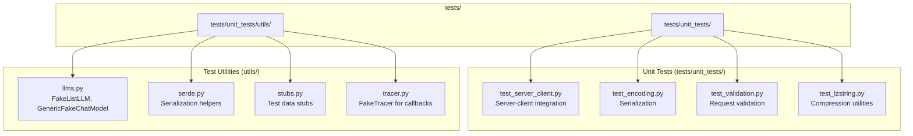
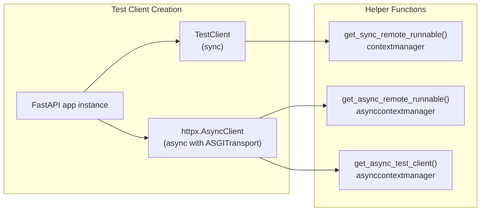
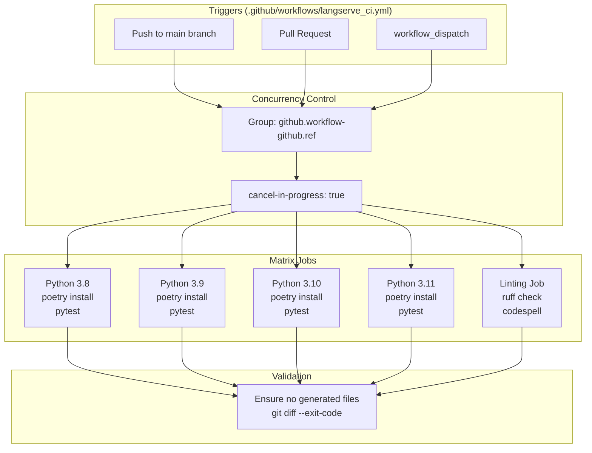
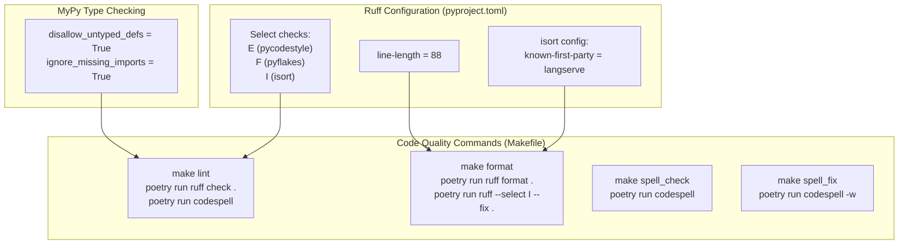
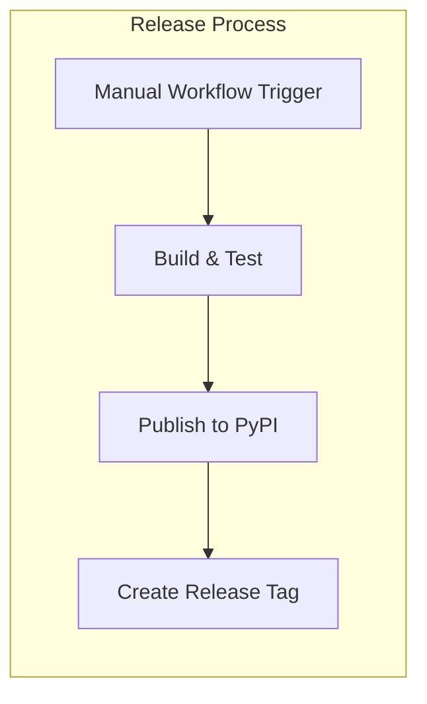
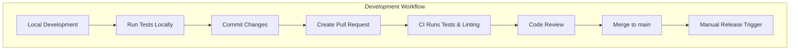

<!-- source: DeepWiki mcp.deepwiki.com · repo langchain-ai/langserve · page 5.2 Testing & CI/CD · fetched 2026-10-26 -->

# Testing & CI/CD

<details>
<summary>Relevant source files</summary>

The following files were used as context for generating this wiki page:

- [langserve/api_handler.py](langserve/api_handler.py)
- [langserve/server.py](langserve/server.py)
- [poetry.lock](poetry.lock)
- [pyproject.toml](pyproject.toml)
- [tests/unit_tests/test_server_client.py](tests/unit_tests/test_server_client.py)

</details>


This document details the testing infrastructure and CI/CD (Continuous Integration/Continuous Deployment) processes used in the LangServe project. It covers how tests are organized, how to run them locally, and how the automated CI/CD pipelines are configured.

## Testing Infrastructure

LangServe uses pytest as its primary testing framework with extensive configuration for async testing, socket control, and timeout management. Tests are organized into unit tests that verify individual components and integration tests that validate end-to-end functionality.

### Test Organization



Sources: [tests/unit_tests/test_server_client.py](), [tests/unit_tests/utils/]()

### Pytest Configuration

The pytest configuration is defined in `pyproject.toml` and includes several critical settings:

| Configuration | Value | Purpose |
|--------------|-------|---------|
| `strict-markers` | enabled | Raises errors on unknown test markers |
| `strict-config` | enabled | Raises errors on configuration parsing warnings |
| `durations` | 5 | Reports the 5 slowest tests |
| `timeout` | 5 seconds | Global timeout for all tests (prevents hanging) |
| `asyncio_mode` | auto | Automatically detects and runs async tests |
| `filterwarnings` | Ignore LangChain beta warnings | Suppresses known beta feature warnings |

Sources: [pyproject.toml:85-100]()

#### Global Test Timeout

All tests have a 5-second timeout enforced via `pytest-timeout`. This prevents tests from hanging indefinitely and provides fast feedback:

```python
# From pyproject.toml configuration
timeout = 5  # seconds
```

The comment in the configuration notes: "There should be a good reason for a test to take more than 5 seconds"

Sources: [pyproject.toml:93-95]()

#### Async Test Support

LangServe tests extensively use async/await patterns. The `asyncio_mode = "auto"` setting automatically handles async test functions:

```python
async def test_server_async(app: FastAPI) -> None:
    """Test the server directly via HTTP requests."""
    async with get_async_test_client(app, raise_app_exceptions=True) as async_client:
        response = await async_client.post("/invoke", json={"input": 1})
        assert response.json()["output"] == 2
```

Sources: [pyproject.toml:96](), [tests/unit_tests/test_server_client.py:312-318]()

### Test Framework and Dependencies

LangServe uses the following test dependencies, defined in the `test` dependency group:

- **pytest**: Core testing framework
- **pytest-cov**: Code coverage reporting
- **pytest-asyncio**: Async test support
- **pytest-mock**: Mocking and patching utilities
- **pytest-socket**: Network socket control
- **pytest-watch**: Watch mode for continuous testing
- **pytest-timeout**: Test timeout enforcement

Sources: [pyproject.toml:32-39]()

### Test Patterns and Fixtures

LangServe implements several key testing patterns for reliable server-client testing.

#### Test Client Patterns

The codebase uses FastAPI's `TestClient` for synchronous tests and `httpx.AsyncClient` for async tests:



Sources: [tests/unit_tests/test_server_client.py:208-224](), [tests/unit_tests/test_server_client.py:227-244](), [tests/unit_tests/test_server_client.py:246-265]()

**Synchronous Test Client:**
```python
@contextmanager
def get_sync_remote_runnable(
    server: FastAPI, *, path: Optional[str] = None, raise_server_exceptions: bool = True
) -> RemoteRunnable:
    """Get an sync client."""
    url = "http://localhost:9999"
    if path:
        url += path
    remote_runnable_client = RemoteRunnable(url=url)
    sync_client = TestClient(
        app=server, base_url=url, raise_server_exceptions=raise_server_exceptions
    )
    remote_runnable_client.sync_client = sync_client
    try:
        yield remote_runnable_client
    finally:
        sync_client.close()
```

Sources: [tests/unit_tests/test_server_client.py:208-224]()

**Asynchronous Test Client:**
```python
@asynccontextmanager
async def get_async_test_client(
    server: FastAPI, *, path: Optional[str] = None, raise_app_exceptions: bool = True
) -> AsyncClient:
    """Get an async client."""
    url = "http://localhost:9999"
    if path:
        url += path
    transport = httpx.ASGITransport(
        app=server,
        raise_app_exceptions=raise_app_exceptions,
    )
    async_client = AsyncClient(base_url=url, transport=transport)
    try:
        yield async_client
    finally:
        await async_client.aclose()
```

Sources: [tests/unit_tests/test_server_client.py:227-244]()

#### Pytest Fixtures

The test suite uses module-scoped and function-scoped fixtures for test setup:

| Fixture | Scope | Purpose |
|---------|-------|---------|
| `event_loop` | module | Provides event loop for async tests |
| `app` | function | Creates FastAPI app with test runnable |
| `app_for_config` | function | FastAPI app for config testing |
| `sync_remote_runnable` | function | Configured synchronous client |
| `async_remote_runnable` | function | Configured async client |

```python
@pytest.fixture()
def app() -> FastAPI:
    """A simple server that wraps a Runnable and exposes it as an API."""
    async def add_one_or_passthrough(x: Union[int, HumanMessage]) -> Union[int, HumanMessage]:
        if isinstance(x, int):
            return x + 1
        else:
            return x
    
    runnable_lambda = RunnableLambda(func=add_one_or_passthrough)
    app = FastAPI()
    try:
        add_routes(app, runnable_lambda, config_keys=["tags"], include_callback_events=True)
        yield app
    finally:
        del app
```

Sources: [tests/unit_tests/test_server_client.py:139-171]()

#### Test Utilities

The `tests/unit_tests/utils/` directory provides reusable test components:

**FakeTracer** - Mock tracer for callback testing:
```python
# Used to verify callbacks are properly captured and propagated
tracer = FakeTracer()
assert sync_remote_runnable.invoke(1, config={"callbacks": [tracer]}) == 2
assert len(tracer.runs) == 2  # Client and server runs
```

Sources: [tests/unit_tests/test_server_client.py:528-532](), [tests/unit_tests/utils/tracer.py]()

**FakeListLLM** - Deterministic LLM for testing:
```python
# Provides predictable responses for testing chains
from tests.unit_tests.utils.llms import FakeListLLM
```

Sources: [tests/unit_tests/utils/llms.py]()

### Running Tests Locally

Tests can be run locally using the commands defined in the Makefile:

```bash
# Run all tests
make test

# Run specific test file
make test TEST_FILE=tests/unit_tests/test_specific.py

# Run tests in watch mode (automatically reruns when files change)
make test_watch
```

Sources: [Makefile:19-23]()

### Test Coverage

Coverage is configured in `pyproject.toml` to omit the tests directory itself from coverage reports:

```toml
[tool.coverage.run]
omit = [
    "tests/*",
]
```

This ensures coverage metrics focus on the actual source code rather than test code.

Sources: [pyproject.toml:75-78]()

## Continuous Integration

LangServe uses GitHub Actions for continuous integration to automatically run tests and linting checks on code changes.

### CI Workflow Architecture



The CI workflow runs on:
- Pushes to the main branch
- Pull requests that change relevant files (Python, TOML, YAML, Markdown)
- Manual triggers through the GitHub UI (`workflow_dispatch`)

Sources: [.github/workflows/langserve_ci.yml]()

### Matrix Strategy

The CI uses a matrix strategy to test against multiple Python versions in parallel:

| Python Version | Use Case |
|---------------|----------|
| 3.8 | Minimum supported version |
| 3.9 | Common production version |
| 3.10 | Current stable version |
| 3.11 | Latest stable version |

This ensures compatibility across the full range of supported Python versions.

Sources: [.github/workflows/langserve_ci.yml]()

### CI Pipeline Steps

Each CI job follows this sequence:

1. **Checkout**: Clone repository code
2. **Python Setup**: Install specified Python version
3. **Poetry Setup**: Configure Poetry for dependency management
4. **Cache**: Restore cached dependencies (if available)
5. **Install**: Run `poetry install --with test,lint`
6. **Lint** (lint job only): Run `make lint` (ruff + codespell)
7. **Test**: Run `make test` (pytest with coverage)
8. **Clean Check**: Verify no uncommitted files created (`git diff --exit-code`)

The clean check ensures tests don't generate artifacts that should be version controlled or cleaned up.

Sources: [.github/workflows/langserve_ci.yml]()

### Concurrency Control

The CI workflow implements concurrency controls to prevent redundant builds:

```yaml
concurrency:
  group: ${{ github.workflow }}-${{ github.ref }}
  cancel-in-progress: true
```

This ensures that if multiple commits are pushed rapidly to the same branch, only the latest commit's tests will run. Any in-progress tests for outdated commits are automatically canceled, saving CI resources.

Sources: [.github/workflows/langserve_ci.yml]()

## Code Quality Tools

LangServe maintains code quality through several automated tools integrated into the development workflow and CI pipeline.

### Linting and Formatting



Sources: [pyproject.toml:55-73](), [Makefile:28-46]()

#### Ruff Configuration

Ruff is configured in `pyproject.toml` with the following settings:

```toml
[tool.ruff]
select = [
    "E",  # pycodestyle
    "F",  # pyflakes
    "I",  # isort
]
line-length = 88  # Same as Black
```

The isort configuration treats `langserve` as a first-party import, which is necessary because examples assume langserve is available as a third-party package.

Sources: [pyproject.toml:55-69]()

#### MyPy Type Checking

MyPy is configured with strict type checking:

```toml
[tool.mypy]
disallow_untyped_defs = "True"
ignore_missing_imports = "True"
```

This ensures all functions have type annotations and that missing type stubs from dependencies don't block type checking.

Sources: [pyproject.toml:71-73]()

#### Available Commands

These tools can be run locally using make commands:

```bash
# Run linters (ruff + codespell)
make lint

# Format code with ruff
make format

# Check for spelling errors
make spell_check

# Fix spelling errors automatically
make spell_fix
```

Sources: [Makefile:28-46]()

## Continuous Deployment



LangServe has a dedicated release workflow that:
1. Is manually triggered through GitHub UI
2. Runs the release process defined in a shared workflow file
3. Publishes the package to PyPI when successful

Sources: [.github/workflows/langserve_release.yml:1-14]()

## Development Workflow Integration

The testing and CI/CD systems are integrated into the overall development workflow to ensure code quality throughout the development process.



This integrated approach ensures:
1. Developers can verify tests pass locally before committing
2. All code changes are automatically tested on multiple Python versions
3. Code quality is maintained through automated linting
4. The release process is controlled and only triggered when needed

Sources: [.github/workflows/langserve_ci.yml](), [.github/workflows/langserve_release.yml]()

## Best Practices for Contributors

When contributing to LangServe, the following testing best practices should be followed:

1. **Write tests for new features**: All new functionality should have corresponding tests
2. **Run tests locally**: Use `make test` to verify tests pass before submitting PRs
3. **Follow code style**: Run `make format` to ensure code follows project style
4. **Check CI results**: Review CI feedback on pull requests
5. **Keep tests isolated**: Tests should not interfere with each other or leave artifacts

By following these practices and utilizing the testing infrastructure, contributors can help maintain the quality and reliability of the LangServe codebase.

---

