# Page: LangServe Overview

# LangServe Overview

<details>
<summary>Relevant source files</summary>

The following files were used as context for generating this wiki page:

- [MIGRATION.md](MIGRATION.md)
- [README.md](README.md)
- [examples/llm/server.py](examples/llm/server.py)
- [examples/retrieval/server.py](examples/retrieval/server.py)
- [examples/router/server.py](examples/router/server.py)
- [poetry.lock](poetry.lock)
- [pyproject.toml](pyproject.toml)

</details>


LangServe is a deployment framework for serving LangChain [runnables and chains](https://python.langchain.com/docs/expression_language/) as REST APIs. It integrates with FastAPI to automatically generate HTTP endpoints with schema validation, OpenAPI documentation, and interactive testing interfaces for LangChain applications built using the LangChain Expression Language (LCEL).

## Purpose and Scope

LangServe is designed for deploying **simple to moderately complex LangChain Runnables** built with LCEL. It excels at:

- Rapid deployment of LangChain chains as HTTP APIs
- Serving stateless or simple stateful applications (via `RunnableWithMessageHistory`)
- Providing a client SDK (`RemoteRunnable`) that mirrors the Runnable interface
- Auto-generating OpenAPI documentation and interactive playgrounds

**Important**: LangServe is designed for simpler LCEL-based applications. For complex agentic systems requiring advanced features like persistence, memory management, human-in-the-loop workflows, cron jobs, webhooks, or long-running tasks, use [LangGraph Platform](https://langchain-ai.github.io/langgraph/cloud/) instead. See [MIGRATION.md:1-223]() for migration guidance.

Sources:
- [README.md:1-56]()
- [MIGRATION.md:1-29]()
- [pyproject.toml:1-11]()

## Key Features

LangServe provides the following capabilities out-of-the-box:

| Feature | Description |
|---------|-------------|
| **Automatic Schema Inference** | Input/output schemas inferred from Runnable using `get_input_schema()` and `get_output_schema()` |
| **Request Validation** | Pydantic-based validation with dynamically generated models stored in `_MODEL_REGISTRY` |
| **Multiple Invocation Modes** | `/invoke`, `/batch`, `/stream`, `/stream_log`, `/stream_events` endpoints |
| **Streaming Support** | Server-Sent Events (SSE) via `sse-starlette` and `EventSourceResponse` |
| **Interactive Playground** | React-based UI at `/playground/` using JsonForms for dynamic form generation |
| **Chat Playground** | Specialized UI for conversational interfaces when `playground_type="chat"` |
| **Client SDK** | `RemoteRunnable` class that implements the Runnable interface for transparent remote execution |
| **Serialization** | `WellKnownLCSerializer` handles 22 LangChain types (messages, documents, agent actions, etc.) |
| **LangSmith Integration** | Optional tracing, feedback endpoints, and public trace sharing |
| **OpenAPI Documentation** | Auto-generated docs at `/docs` (requires Pydantic v2 or LangServe >= 0.3.0) |

Sources:
- [README.md:31-49]()
- [langserve/serialization.py:122-161]()
- [langserve/server.py:244-285]()

## When to Use LangServe vs LangGraph Platform

Use **LangServe** when:
- Deploying simple LCEL chains or retrieval systems
- Stateless applications or minimal state requirements
- Quick prototypes or demos
- Using LangChain primitives without complex control flow

Use **LangGraph Platform** when:
- Building agentic applications with complex orchestration
- Requiring persistence, memory, or conversation management
- Needing human-in-the-loop workflows or approval steps
- Handling long-running tasks or background processing
- Requiring cron jobs, webhooks, or double-texting handling
- Deploying production applications with high-load requirements

For migration guidance, see [MIGRATION.md:1-223]().

Sources:
- [MIGRATION.md:1-34]()
- [README.md:8-14]()
- [README.md:50-56]()

## Core Architecture

LangServe operates through a two-phase architecture: **generation-time** (when `add_routes()` is called) and **request-time** (when HTTP requests are processed). The system bridges client applications to LangChain Runnables via HTTP/SSE protocols.

### High-Level System Architecture

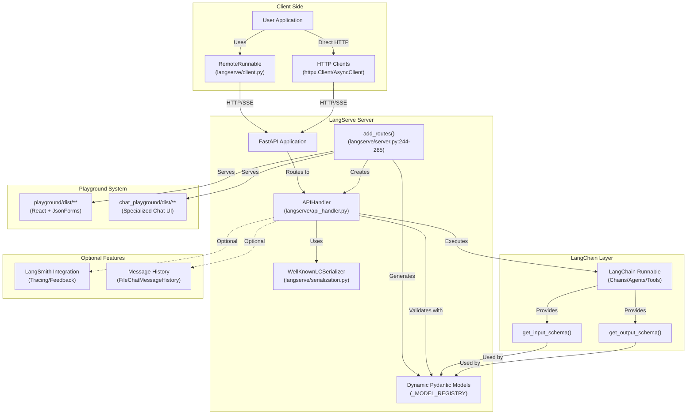

Sources:
- [langserve/server.py:244-285]()
- [langserve/api_handler.py:103-189]()
- [langserve/client.py:270-342]()
- [langserve/serialization.py:122-161]()

### Generation-Time vs Request-Time Processing

**Generation-Time** (when `add_routes()` is called):
1. Schema inference from Runnable using `get_input_schema()` and `get_output_schema()`
2. Namespace generation to prevent model collisions in `_MODEL_REGISTRY`
3. Dynamic Pydantic model creation for request/response types
4. `APIHandler` instantiation with the Runnable and configuration
5. FastAPI route registration for all enabled endpoints
6. Playground HTML template preparation with schema injection

**Request-Time** (when HTTP requests arrive):
1. Request payload validation using dynamically generated Pydantic models
2. Configuration processing via `_unpack_request_config()`
3. Runnable execution with validated input and config
4. Output serialization using `WellKnownLCSerializer`
5. Response formatting (JSON for `/invoke`, SSE for `/stream`)
6. Optional callback event processing via `load_events()`

Sources:
- [langserve/server.py:244-468]()
- [langserve/api_handler.py:507-629]()
- [langserve/validation.py:1-166]()

### Server Components

**Core Classes and Functions**

| Component | Location | Purpose |
|-----------|----------|---------|
| `add_routes()` | [langserve/server.py:244-285]() | Entry point for registering Runnable as FastAPI routes with playground |
| `APIHandler` | [langserve/api_handler.py:103-189]() | Processes requests, executes Runnable, formats responses |
| `WellKnownLCSerializer` | [langserve/serialization.py:122-161]() | Serializes/deserializes 22 LangChain object types |
| `_resolve_model()` | [langserve/validation.py:78-109]() | Wraps schemas in `RootModel` and checks `_MODEL_REGISTRY` |
| `_rename_pydantic_model()` | [langserve/validation.py:112-137]() | Adds namespace prefix to prevent collisions |
| `EventSourceResponse` | sse-starlette | Streams Server-Sent Events for `/stream` endpoints |
| `serve_playground()` | [langserve/server.py:378-444]() | Serves playground HTML with injected schemas |

**Global Registries**

- `_MODEL_REGISTRY`: Maps schema hashes to Pydantic models to avoid regeneration
- `_SEEN_NAMES`: Tracks model names to prevent namespace collisions
- `_APP_TO_PATHS`: Tracks registered paths per FastAPI app for collision detection

Sources:
- [langserve/server.py:244-468]()
- [langserve/api_handler.py:103-189]()
- [langserve/validation.py:1-166]()
- [langserve/serialization.py:122-161]()

### Client Components

**RemoteRunnable Class**

The `RemoteRunnable` class in [langserve/client.py:270-342]() implements the LangChain `Runnable` interface for transparent remote execution:

| Method | Description |
|--------|-------------|
| `invoke()` / `ainvoke()` | Synchronous/async single input execution via `POST /invoke` |
| `batch()` / `abatch()` | Batch execution via `POST /batch` |
| `stream()` / `astream()` | Streaming via `POST /stream` using SSE |
| `stream_log()` / `astream_log()` | Stream intermediate steps via `POST /stream_log` |
| `stream_events()` / `astream_events()` | Stream events via `POST /stream_events` |

**Request Preparation**

Before sending requests, `RemoteRunnable`:
1. Sanitizes config via `_prepare_config_for_server()` (removes callbacks, filters non-serializable)
2. Serializes input using `serializer.dumpd()`
3. Constructs request payload with `input`, `config`, and optional `kwargs`

**SSE Infrastructure**

- `connect_sse()` / `aconnect_sse()`: Establishes SSE connections in [langserve/client.py:105-168]()
- `EventSource`: Wraps httpx response for event iteration
- `SSEDecoder`: Parses Server-Sent Events from response stream

Sources:
- [langserve/client.py:270-582]()
- [langserve/client.py:105-168]()

## Request-Response Flow

### Invoke Request Flow

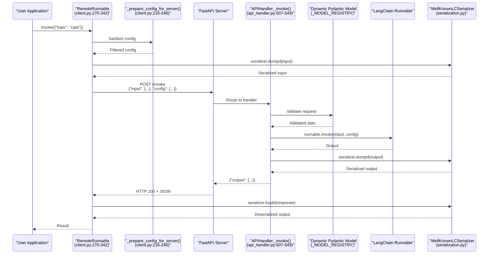

Sources:
- [langserve/client.py:341-394]()
- [langserve/api_handler.py:507-549]()
- [langserve/serialization.py:281-351]()

### Stream Request Flow

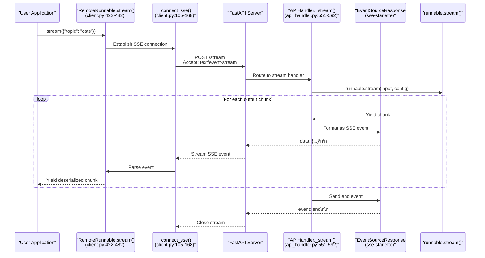

Sources:
- [langserve/client.py:422-482]()
- [langserve/api_handler.py:551-592]()
- [langserve/client.py:105-168]()

## Endpoints and Route Generation

When `add_routes(app, runnable, path="/mychain")` is called, LangServe registers multiple FastAPI routes. Endpoints can be selectively enabled/disabled via `enabled_endpoints` or `disabled_endpoints` parameters.

### Standard Endpoints

| Endpoint | Method | Handler | Description |
|----------|--------|---------|-------------|
| `/mychain/invoke` | POST | `APIHandler._invoke()` | Execute with single input, return output |
| `/mychain/batch` | POST | `APIHandler._batch()` | Execute with multiple inputs in parallel |
| `/mychain/stream` | POST | `APIHandler._stream()` | Stream output chunks via SSE |
| `/mychain/stream_log` | POST | `APIHandler._stream_log()` | Stream intermediate steps and outputs via SSE |
| `/mychain/stream_events` | POST | `APIHandler._stream_events()` | Stream events from execution via SSE |
| `/mychain/input_schema` | GET | Generated | Return JSON Schema for input validation |
| `/mychain/output_schema` | GET | Generated | Return JSON Schema for output format |
| `/mychain/config_schema` | GET | Generated | Return JSON Schema for config options |

### Playground Endpoints

| Endpoint | Method | Handler | Description |
|----------|--------|---------|-------------|
| `/mychain/playground/` | GET | `serve_playground()` | Interactive UI with schema injection |
| `/mychain/playground/index.html` | GET | Serve static | Default playground HTML |
| `/mychain/playground/...` | GET | Serve static | Playground assets from `playground/dist/` |

### Optional Endpoints

These require explicit enabling:

| Endpoint | Parameter | Handler | Description |
|----------|-----------|---------|-------------|
| `/mychain/c/{config_hash}` | `enable_feedback_endpoint=True` | `_config_hash()` | Shareable config URLs |
| `/mychain/feedback` | `enable_feedback_endpoint=True` | Feedback handler | Submit feedback to LangSmith |
| `/mychain/public_trace_link` | `enable_public_trace_link_endpoint=True` | Trace link handler | Generate public trace URLs |

Sources:
- [langserve/server.py:244-468]()
- [langserve/api_handler.py:507-768]()
- [README.md:308-336]()

## Basic Usage

### Server Example

```python
from fastapi import FastAPI
from langchain_openai import ChatOpenAI
from langchain.prompts import ChatPromptTemplate
from langserve import add_routes

app = FastAPI()

# Create a runnable chain
model = ChatOpenAI(model="gpt-3.5-turbo")
prompt = ChatPromptTemplate.from_template("Tell me a joke about {topic}")
chain = prompt | model

# Add routes for the chain
add_routes(app, chain, path="/joke")

if __name__ == "__main__":
    import uvicorn
    uvicorn.run(app, host="localhost", port=8000)
```

Sources:
- [examples/llm/server.py:1-30]()
- [README.md:154-190]()

### Client Example

```python
from langserve import RemoteRunnable

# Connect to the server
joke_chain = RemoteRunnable("http://localhost:8000/joke/")

# Invoke the runnable
result = joke_chain.invoke({"topic": "programming"})
print(result)

# Stream results
for chunk in joke_chain.stream({"topic": "programming"}):
    print(chunk, end="", flush=True)
```

Sources:
- [README.md:232-256]()

## Playground Interface

LangServe includes a built-in playground UI at `/playground/` for interactive testing:

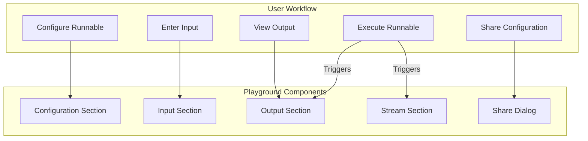

For chat applications, LangServe offers a specialized Chat Playground optimized for conversational interfaces.

Sources:
- [README.md:338-426]()
- [langserve/server.py:380-386]()

---

# Page: Core Architecture

# Core Architecture

<details>
<summary>Relevant source files</summary>

The following files were used as context for generating this wiki page:

- [langserve/api_handler.py](langserve/api_handler.py)
- [langserve/callbacks.py](langserve/callbacks.py)
- [langserve/client.py](langserve/client.py)
- [langserve/server.py](langserve/server.py)
- [langserve/server_sent_events.py](langserve/server_sent_events.py)
- [tests/unit_tests/test_callbacks.py](tests/unit_tests/test_callbacks.py)
- [tests/unit_tests/test_server_client.py](tests/unit_tests/test_server_client.py)
- [tests/unit_tests/utils/tracer.py](tests/unit_tests/utils/tracer.py)

</details>


This document provides a detailed technical overview of LangServe's core architecture, focusing on the fundamental components that enable serving LangChain runnables as REST APIs. The architecture consists of server-side route generation, client-side remote execution, request/response processing, and data serialization systems.

For information about the web-based playground interface, see [Playground Interface](#3). For practical implementation examples, see [Example Implementations](#4). For development setup and contribution guidelines, see [Development Guide](#5).

## System Overview

LangServe's architecture centers around three main components that work together to provide a complete client-server framework for LangChain runnables.

### Core Component Architecture

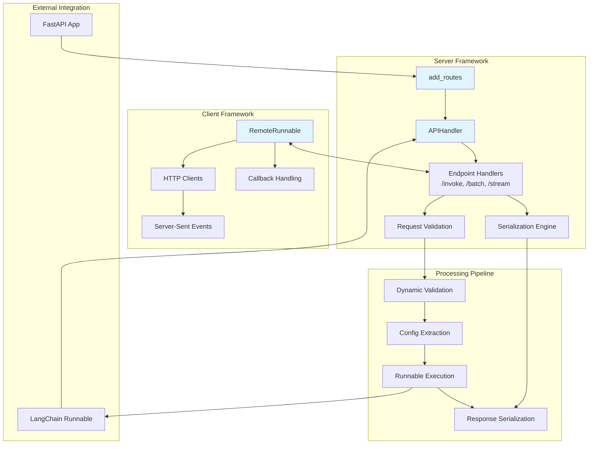

**Sources:** [langserve/server.py:248-268](), [langserve/api_handler.py:507-540](), [langserve/client.py:270-294]()

## Server-Client Interaction Flow

The following sequence diagram shows how requests flow through the LangServe architecture from client invocation to final response.

### Request Processing Sequence

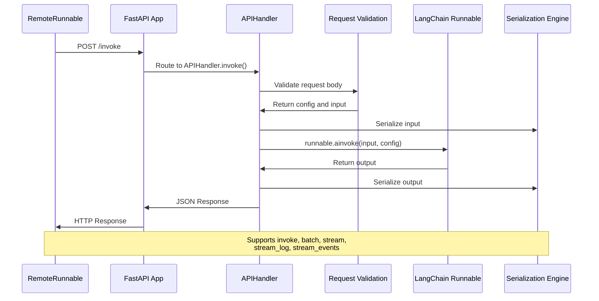

**Sources:** [langserve/api_handler.py:846-926](), [langserve/client.py:341-363](), [langserve/server.py:494-518]()

## Core Components

### Server Framework

The server framework is built around the `add_routes` function and `APIHandler` class, which automatically generate REST API endpoints for any LangChain runnable.

#### add_routes Function

The `add_routes` function serves as the primary entry point for integrating LangServe with FastAPI applications. It registers multiple HTTP endpoints for a given runnable.

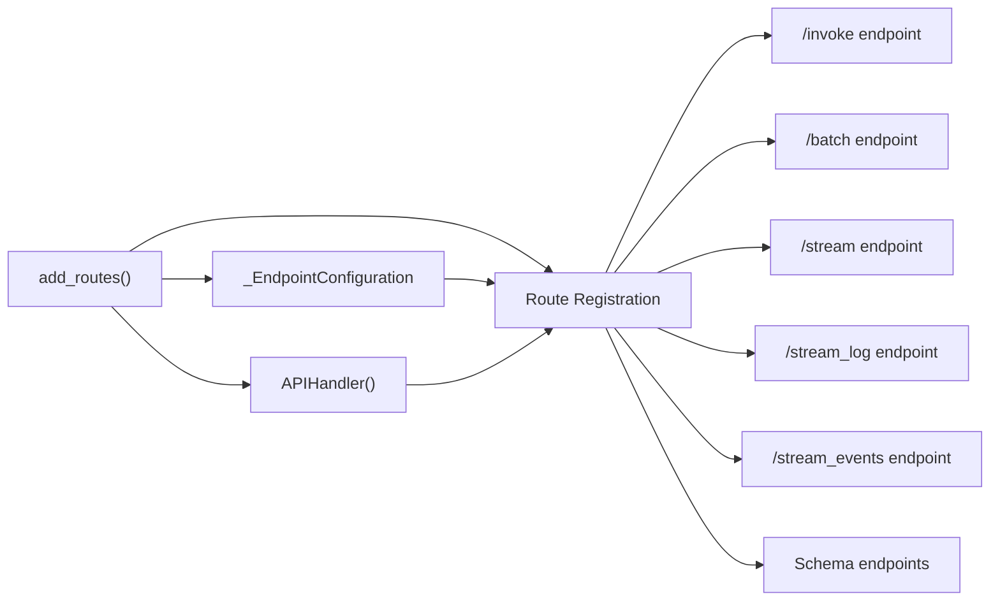

The function automatically creates these endpoints based on the runnable's capabilities:
- `/invoke` - Single request execution
- `/batch` - Multiple request execution  
- `/stream` - Real-time streaming output
- `/stream_log` - Intermediate step logging
- `/stream_events` - Event-based streaming
- `/input_schema`, `/output_schema`, `/config_schema` - Schema introspection

**Sources:** [langserve/server.py:248-390](), [langserve/server.py:494-748]()

#### APIHandler Class

The `APIHandler` class implements the core request processing logic for each endpoint. It handles request validation, configuration management, runnable execution, and response serialization.

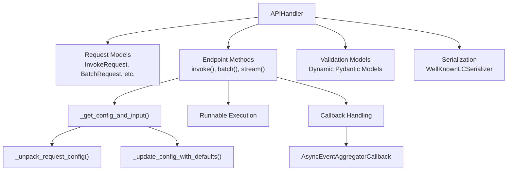

Key responsibilities include:
- Dynamic request/response model generation based on runnable schemas
- Configuration validation and merging
- Callback event aggregation for tracing
- Error handling and serialization

**Sources:** [langserve/api_handler.py:507-768](), [langserve/api_handler.py:805-845]()

### Client Framework

#### RemoteRunnable Class

The `RemoteRunnable` class provides a client-side proxy that implements the LangChain `Runnable` interface for remote execution. It maintains both sync and async HTTP clients for communicating with LangServe endpoints.

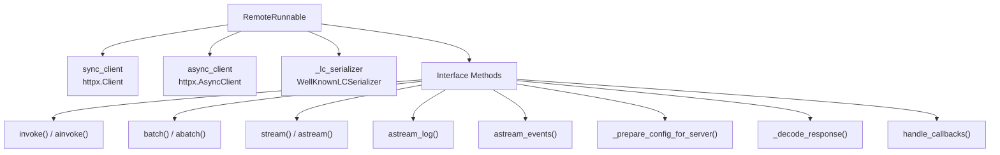

The client handles:
- HTTP client lifecycle management with automatic cleanup
- Request serialization and response deserialization  
- Server-sent event processing for streaming endpoints
- Callback event forwarding from server to client callbacks
- Configuration filtering to remove client-only settings

**Sources:** [langserve/client.py:270-340](), [langserve/client.py:520-677]()

## Request Validation and Serialization

LangServe implements a sophisticated validation system that dynamically creates Pydantic models based on runnable schemas and handles complex object serialization.

### Dynamic Model Creation

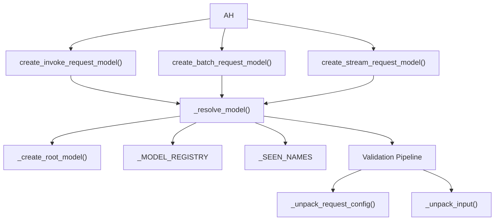

The validation system:
- Creates unique Pydantic models for each runnable's input/output schemas
- Maintains a global registry to avoid duplicate model creation
- Handles model name collisions through automatic renaming
- Supports both static types and dynamic schema resolution

**Sources:** [langserve/api_handler.py:339-381](), [langserve/validation.py:73-79](), [langserve/api_handler.py:285-305]()

### Serialization Engine

The serialization system handles conversion between Python objects and JSON for client-server communication.

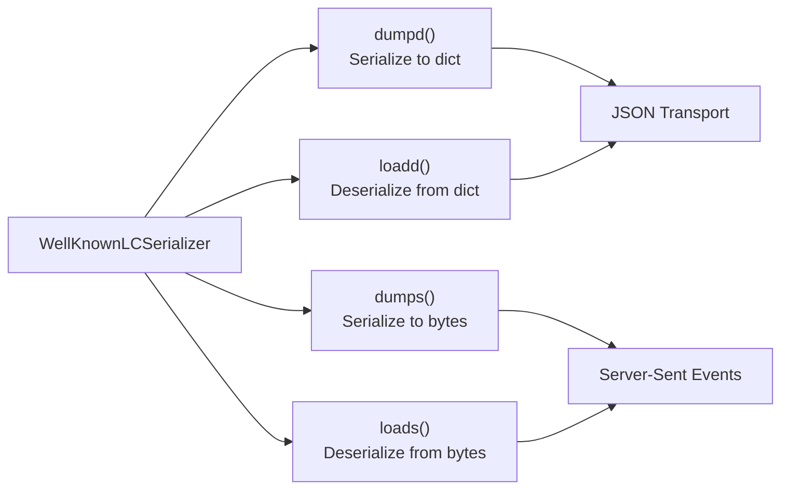

Key serialization features:
- Support for complex LangChain objects (messages, documents, etc.)
- Streaming-compatible byte serialization for real-time data
- Automatic handling of custom user types and Pydantic models
- Preservation of object metadata during round-trip serialization

**Sources:** [langserve/serialization.py:65-89](), [langserve/client.py:234-267]()

## Streaming and Real-time Processing

LangServe provides comprehensive streaming capabilities through Server-Sent Events (SSE) for real-time data processing.

### Streaming Architecture

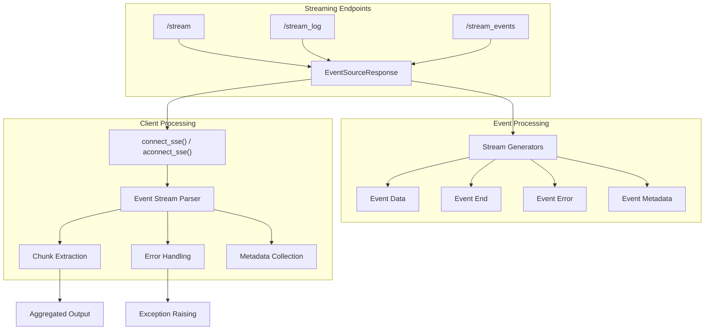

The streaming system supports:
- **Basic streaming** via `/stream` with chunk-by-chunk output
- **Detailed logging** via `/stream_log` with intermediate step visibility  
- **Event streaming** via `/stream_events` with fine-grained event filtering
- **Error propagation** through structured error events
- **Metadata transmission** for run IDs and feedback tokens

**Sources:** [langserve/api_handler.py:1089-1222](), [langserve/client.py:520-676](), [langserve/server_sent_events.py:50-89]()

## Configuration and Callback System

LangServe implements a sophisticated configuration management system that handles client-server config merging and callback event processing.

### Configuration Processing Pipeline

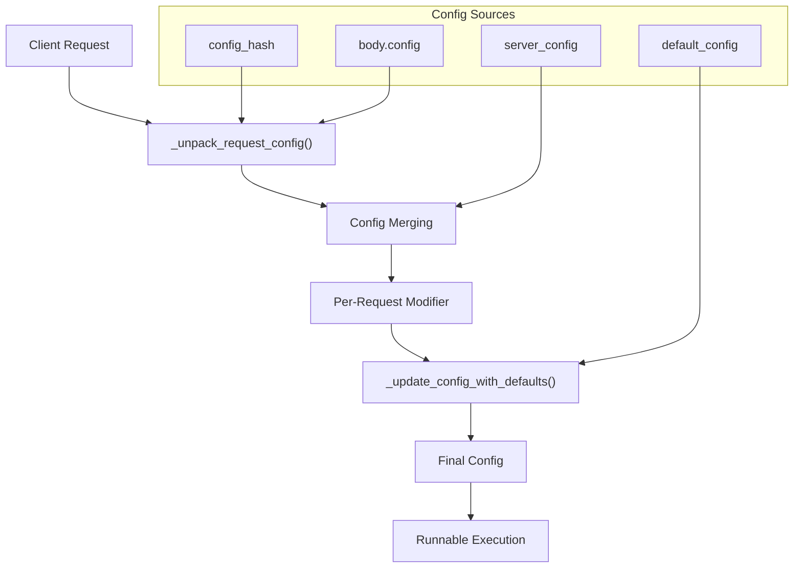

### Callback Event Processing

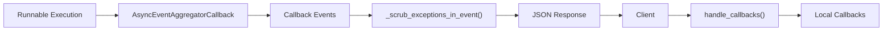

The system provides:
- **Multi-source config merging** with last-writer-wins semantics
- **Server-side config validation** against allowed `config_keys`
- **Per-request config modification** via custom modifier functions
- **Callback event aggregation** for distributed tracing
- **Exception scrubbing** to prevent sensitive data leakage

**Sources:** [langserve/api_handler.py:157-221](), [langserve/api_handler.py:223-282](), [langserve/callbacks.py:51-89]()

---

# Page: Server Components

# Server Components

<details>
<summary>Relevant source files</summary>

The following files were used as context for generating this wiki page:

- [MIGRATION.md](MIGRATION.md)
- [README.md](README.md)
- [examples/llm/server.py](examples/llm/server.py)
- [examples/retrieval/server.py](examples/retrieval/server.py)
- [examples/router/server.py](examples/router/server.py)
- [langserve/api_handler.py](langserve/api_handler.py)
- [langserve/server.py](langserve/server.py)
- [tests/unit_tests/test_server_client.py](tests/unit_tests/test_server_client.py)

</details>


This document covers the server-side components of LangServe that transform LangChain runnables into REST API endpoints. These components handle the core functionality of registering routes, processing requests, and managing endpoint configurations. For information about client-side interaction with these endpoints, see [Client Components](#2.2). For details about the validation and serialization systems used by these components, see [Request Validation & Serialization](#2.3).

## Overview

The server components form the backbone of LangServe's architecture, providing the mechanism to expose any LangChain runnable as a set of REST API endpoints. The system consists of two primary components: the `add_routes` function that serves as the public API entry point, and the `APIHandler` class that implements the actual endpoint logic.

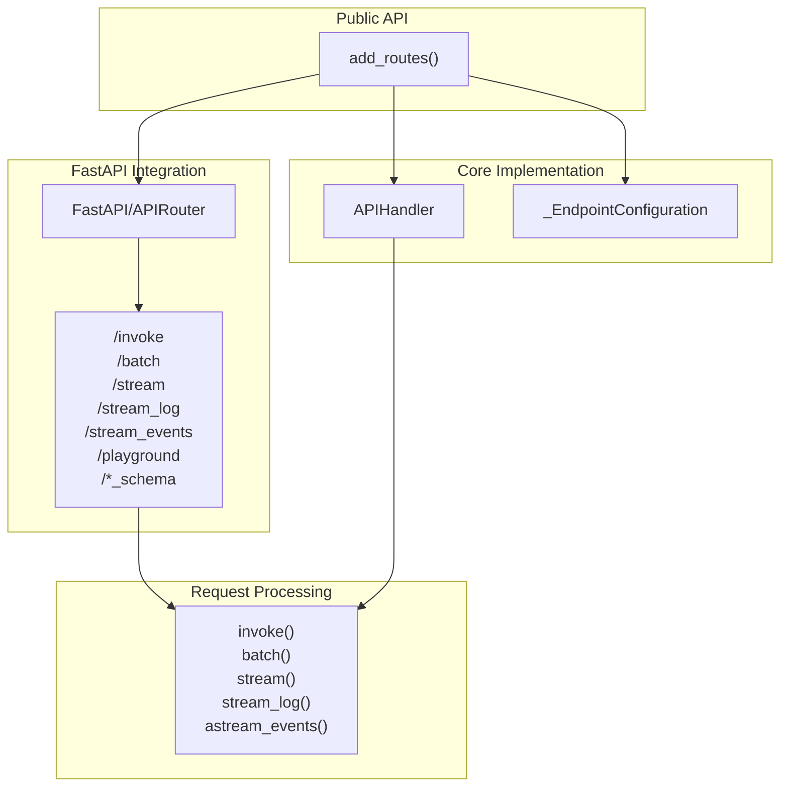

Sources: [langserve/server.py:1-780](), [langserve/api_handler.py:507-1271]()

## The add_routes Function

The `add_routes` function serves as the primary entry point for integrating LangChain runnables with FastAPI applications. It accepts a runnable and automatically generates all necessary API endpoints.

### Function Signature and Core Parameters

The function accepts a wide range of configuration options to control endpoint behavior:

| Parameter | Type | Purpose |
|-----------|------|---------|
| `app` | `Union[FastAPI, APIRouter]` | Target FastAPI application or router |
| `runnable` | `Runnable` | LangChain runnable to expose |
| `path` | `str` | Base path for all endpoints (default: `""`) |
| `config_keys` | `Sequence[str]` | Allowed configuration keys |
| `enabled_endpoints` | `Optional[Sequence[EndpointName]]` | Specific endpoints to enable |
| `disabled_endpoints` | `Optional[Sequence[EndpointName]]` | Specific endpoints to disable |

### Route Registration Process

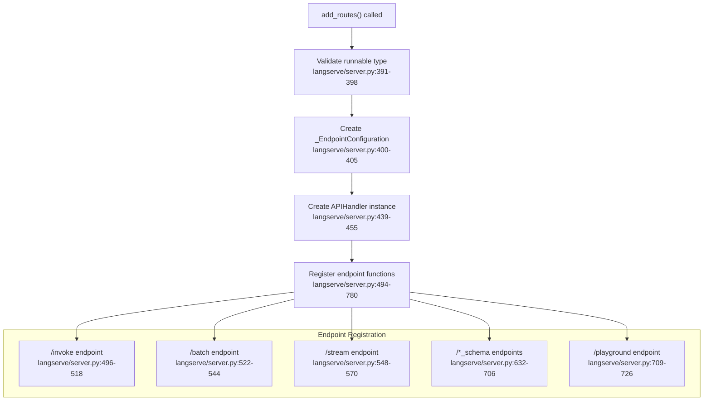

Sources: [langserve/server.py:248-780]()

### Path Management and Deduplication

The system maintains global registries to prevent duplicate paths and ensure unique model names:

- `_APP_TO_PATHS`: Tracks paths registered with each FastAPI app instance
- `_APP_SEEN`: Prevents duplicate app registration for global handlers
- Model registry in `api_handler.py` prevents naming conflicts

Sources: [langserve/server.py:44-51](), [langserve/server.py:184-201]()

## APIHandler Class

The `APIHandler` class implements the core logic for each API endpoint. It handles request validation, runnable execution, response serialization, and error handling.

### Initialization and Configuration

The `APIHandler` constructor accepts comprehensive configuration options:

```mermaid
classDiagram
    class APIHandler {
        -runnable: Runnable
        -path: str
        -base_url: str
        -run_name: str
        -config_keys: Sequence[str]
        -include_callback_events: bool
        -per_req_config_modifier: PerRequestConfigModifier
        -serializer: Serializer
        +invoke(request) Response
        +batch(request) Response
        +stream(request) EventSourceResponse
        +stream_log(request) EventSourceResponse
        +astream_events(request) EventSourceResponse
        +input_schema(request) Response
        +output_schema(request) Response
        +config_schema(request) Response
        +playground(request) Response
    }
    
    class _EndpointConfiguration {
        +is_invoke_enabled: bool
        +is_batch_enabled: bool
        +is_stream_enabled: bool
        +is_stream_log_enabled: bool
        +is_stream_events_enabled: bool
        +is_playground_enabled: bool
    }
    
    APIHandler --> "_EndpointConfiguration"
```

Sources: [langserve/api_handler.py:517-670]()

### Request Processing Flow

Each endpoint follows a consistent request processing pattern:

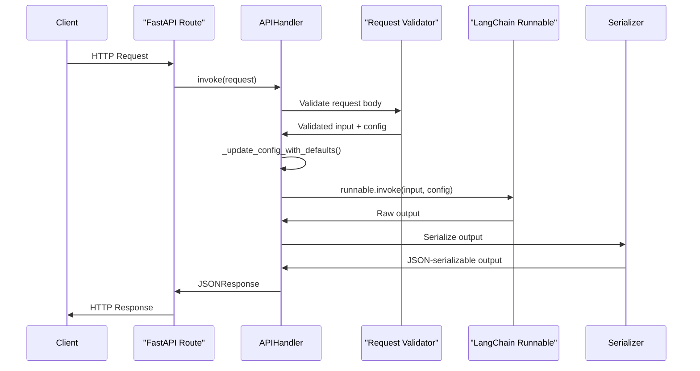

Sources: [langserve/api_handler.py:709-846]()

## Endpoint Configuration System

The `_EndpointConfiguration` class manages which endpoints are enabled or disabled for each runnable:

### Supported Endpoints

| Endpoint | Purpose | Implementation |
|----------|---------|----------------|
| `/invoke` | Single input execution | `APIHandler.invoke()` |
| `/batch` | Multiple input execution | `APIHandler.batch()` |
| `/stream` | Streaming output | `APIHandler.stream()` |
| `/stream_log` | Streaming intermediate logs | `APIHandler.stream_log()` |
| `/stream_events` | Streaming events (v1/v2) | `APIHandler.astream_events()` |
| `/input_schema` | Input JSON schema | `APIHandler.input_schema()` |
| `/output_schema` | Output JSON schema | `APIHandler.output_schema()` |
| `/config_schema` | Configuration schema | `APIHandler.config_schema()` |
| `/playground` | Interactive UI | `serve_playground()` |

### Configuration Hash Support

For configurable runnables, the system generates additional endpoints with configuration hashes:

- `/c/{config_hash}/invoke`
- `/c/{config_hash}/batch`
- `/c/{config_hash}/stream`
- etc.

These endpoints allow sharing pre-configured runnable instances via compressed configuration URLs.

Sources: [langserve/server.py:89-182](), [langserve/api_handler.py:93-106]()

## Integration with FastAPI

The server components seamlessly integrate with FastAPI's routing system:

### Route Registration Pattern

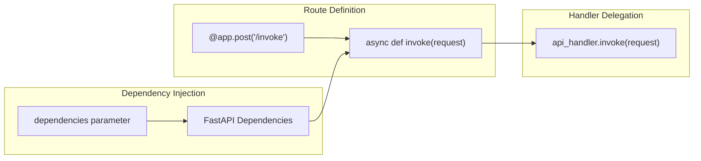

### Global App Handlers

The system registers startup event handlers that display the LangServe banner and available endpoints:

```python
@app.on_event("startup")
async def startup_event():
    # Display LangServe ASCII art and endpoint information
```

Sources: [langserve/server.py:203-243]()

## Error Handling and Validation

The server components implement comprehensive error handling:

### Request Validation

- Uses dynamic Pydantic models for input validation
- Translates `ValidationError` to `RequestValidationError` for proper HTTP status codes
- Supports custom input/output type annotations

### Runtime Error Handling

- Catches exceptions during runnable execution
- Converts to appropriate HTTP error responses
- Maintains error context for debugging

Sources: [langserve/api_handler.py:403-413](), [tests/unit_tests/test_server_client.py:351-411]()

## Configuration and Customization

### Per-Request Configuration Modification

The system supports dynamic configuration modification via the `per_req_config_modifier` parameter:

```python
async def modify_config(config: Dict[str, Any], request: Request) -> Dict[str, Any]:
    # Extract credentials from headers, modify config based on request
    return config
```

### Callback Event Integration

When `include_callback_events=True`, the system captures and returns callback events alongside responses, enabling client-side tracing and debugging.

Sources: [langserve/api_handler.py:108-113](), [langserve/api_handler.py:637-642]()

This server component architecture provides a robust, flexible foundation for exposing LangChain runnables as production-ready REST APIs with comprehensive configuration options and seamless FastAPI integration.

---

# Page: Client Components

# Client Components

<details>
<summary>Relevant source files</summary>

The following files were used as context for generating this wiki page:

- [MIGRATION.md](MIGRATION.md)
- [README.md](README.md)
- [examples/llm/server.py](examples/llm/server.py)
- [examples/retrieval/server.py](examples/retrieval/server.py)
- [examples/router/server.py](examples/router/server.py)
- [langserve/callbacks.py](langserve/callbacks.py)
- [langserve/client.py](langserve/client.py)
- [langserve/server_sent_events.py](langserve/server_sent_events.py)
- [tests/unit_tests/test_callbacks.py](tests/unit_tests/test_callbacks.py)
- [tests/unit_tests/utils/tracer.py](tests/unit_tests/utils/tracer.py)

</details>


This document covers the client-side components of LangServe, focusing on the `RemoteRunnable` class and related infrastructure that enables remote execution of LangChain runnables over HTTP. This page details how clients connect to and interact with LangServe servers, including synchronous and asynchronous operations, streaming, and configuration management.

For information about server-side components and endpoint generation, see [Server Components](#2.1). For details on data validation and serialization mechanisms, see [Request Validation & Serialization](#2.3).

## Core Client Architecture

The central client component in LangServe is the `RemoteRunnable` class, which implements the standard LangChain `Runnable` interface while transparently executing operations on a remote server via HTTP requests.

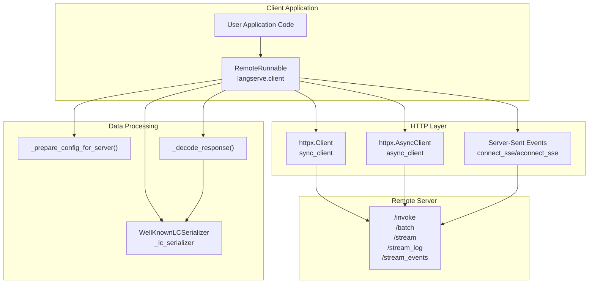

Sources: [langserve/client.py:270-340](), [langserve/client.py:341-400]()

## RemoteRunnable Implementation

The `RemoteRunnable` class provides a complete implementation of the `Runnable` interface that proxies all operations to a remote LangServe server. It maintains both synchronous and asynchronous HTTP clients and handles the complexities of remote execution transparently.

### Class Structure and Initialization

```mermaid
graph TD
    subgraph "RemoteRunnable Initialization"
        Constructor["__init__()"]
        URLConfig["url: str"]
        HTTPConfig["timeout, auth, headers,<br/>cookies, verify, cert"]
        ClientKwargs["client_kwargs: Dict"]
        ServerCallbacks["use_server_callback_events"]
        SerializerConfig["serializer: Serializer"]
    end
    
    subgraph "HTTP Clients"
        SyncHTTP["httpx.Client<br/>sync_client"]
        AsyncHTTP["httpx.AsyncClient<br/>async_client"]
        Finalizer["weakref.finalize()<br/>_close_clients"]
    end
    
    subgraph "Configuration"
        BaseURL["base_url normalization"]
        DefaultSerializer["WellKnownLCSerializer<br/>_lc_serializer"]
        CallbackFlag["_use_server_callback_events"]
    end
    
    Constructor --> URLConfig
    Constructor --> HTTPConfig
    Constructor --> ClientKwargs
    Constructor --> ServerCallbacks
    Constructor --> SerializerConfig
    
    Constructor --> SyncHTTP
    Constructor --> AsyncHTTP
    Constructor --> Finalizer
    
    URLConfig --> BaseURL
    SerializerConfig --> DefaultSerializer
    ServerCallbacks --> CallbackFlag
```

Sources: [langserve/client.py:281-340](), [langserve/client.py:336-340]()

### Core Operation Methods

The `RemoteRunnable` implements all standard `Runnable` methods by translating them to HTTP requests:

| Method | Endpoint | Description |
|--------|----------|-------------|
| `invoke()` / `ainvoke()` | `/invoke` | Single input execution |
| `batch()` / `abatch()` | `/batch` | Multiple input execution |
| `stream()` / `astream()` | `/stream` | Streaming output |
| `astream_log()` | `/stream_log` | Streaming intermediate logs |
| `astream_events()` | `/stream_events` | Streaming execution events |

```mermaid
sequenceDiagram
    participant App as "Application Code"
    participant RR as "RemoteRunnable"
    participant HTTP as "HTTP Client"
    participant Server as "LangServe Server"
    participant Serializer as "Serializer"
    
    App->>RR: invoke(input, config)
    RR->>Serializer: dumpd(input)
    RR->>RR: _prepare_config_for_server(config)
    RR->>HTTP: POST /invoke {input, config, kwargs}
    HTTP->>Server: HTTP Request
    Server-->>HTTP: HTTP Response
    HTTP-->>RR: Response JSON
    RR->>RR: _decode_response(response)
    RR->>Serializer: loadd(output)
    RR-->>App: Output
```

Sources: [langserve/client.py:341-370](), [langserve/client.py:372-400](), [langserve/client.py:402-456]()

## HTTP Client Management

The `RemoteRunnable` maintains separate HTTP clients for synchronous and asynchronous operations, with automatic cleanup handling through weak references.

### Client Lifecycle Management

```mermaid
graph TD
    subgraph "Client Creation"
        Init["RemoteRunnable.__init__()"]
        SyncCreate["httpx.Client creation"]
        AsyncCreate["httpx.AsyncClient creation"]
        WeakRefSetup["weakref.finalize setup"]
    end
    
    subgraph "Client Usage"
        SyncOps["Sync operations<br/>(invoke, batch, stream)"]
        AsyncOps["Async operations<br/>(ainvoke, abatch, astream)"]
        SharedConfig["Shared base_url, timeout,<br/>auth, headers, cookies"]
    end
    
    subgraph "Client Cleanup"
        GC["Garbage Collection"]
        Finalizer["_close_clients()"]
        SyncClose["sync_client.close()"]
        AsyncClose["async_client.aclose()"]
        ThreadPool["ThreadPoolExecutor<br/>(for async cleanup)"]
    end
    
    Init --> SyncCreate
    Init --> AsyncCreate
    Init --> WeakRefSetup
    
    SyncCreate --> SyncOps
    AsyncCreate --> AsyncOps
    SyncCreate --> SharedConfig
    AsyncCreate --> SharedConfig
    
    GC --> Finalizer
    Finalizer --> SyncClose
    Finalizer --> AsyncClose
    Finalizer --> ThreadPool
```

Sources: [langserve/client.py:315-334](), [langserve/client.py:193-212]()

## Request/Response Processing

Client requests undergo several transformation steps before being sent to the server, and responses are processed through deserialization and callback handling.

### Request Preparation Pipeline

```mermaid
graph LR
    subgraph "Input Processing"
        UserInput["User Input"]
        Serialization["_lc_serializer.dumpd()"]
        ConfigClean["_prepare_config_for_server()"]
        PayloadBuild["JSON Payload Assembly"]
    end
    
    subgraph "HTTP Request"
        HTTPPost["HTTP POST"]
        Endpoint["Server Endpoint"]
        Response["HTTP Response"]
    end
    
    subgraph "Response Processing"
        ResponseDecode["_decode_response()"]
        OutputDeser["serializer.loadd()"]
        CallbackHandle["handle_callbacks()"]
        FinalOutput["Final Output"]
    end
    
    UserInput --> Serialization
    UserInput --> ConfigClean
    Serialization --> PayloadBuild
    ConfigClean --> PayloadBuild
    PayloadBuild --> HTTPPost
    HTTPPost --> Endpoint
    Endpoint --> Response
    Response --> ResponseDecode
    ResponseDecode --> OutputDeser
    ResponseDecode --> CallbackHandle
    OutputDeser --> FinalOutput
    CallbackHandle --> FinalOutput
```

Sources: [langserve/client.py:82-120](), [langserve/client.py:234-268]()

### Configuration Filtering

The `_prepare_config_for_server()` function removes sensitive or client-specific information before sending configuration to the server:

- Removes `callbacks` (handled separately)
- Filters non-JSON-serializable objects from `configurable` field
- Preserves only server-relevant configuration keys

Sources: [langserve/client.py:82-120]()

## Streaming Support

LangServe clients support multiple streaming patterns using Server-Sent Events (SSE) for real-time communication with the server.

### Streaming Architecture

```mermaid
graph TD
    subgraph "Client Streaming Methods"
        StreamMethod["stream() / astream()"]
        StreamLogMethod["astream_log()"]
        StreamEventsMethod["astream_events()"]
    end
    
    subgraph "SSE Connection Management"
        ConnectSSE["connect_sse()<br/>(sync)"]
        AConnectSSE["aconnect_sse()<br/>(async)"]
        EventSource["EventSourceResponse"]
    end
    
    subgraph "Event Processing"
        EventLoop["Event Loop"]
        DataEvent["'data' events"]
        ErrorEvent["'error' events"]
        MetadataEvent["'metadata' events"]
        EndEvent["'end' events"]
    end
    
    subgraph "Output Generation"
        ChunkProcessing["Chunk Processing"]
        OutputAggregation["Output Aggregation"]
        CallbackTrigger["Callback Triggers"]
        YieldChunk["yield chunk"]
    end
    
    StreamMethod --> ConnectSSE
    StreamLogMethod --> AConnectSSE
    StreamEventsMethod --> AConnectSSE
    
    ConnectSSE --> EventSource
    AConnectSSE --> EventSource
    
    EventSource --> EventLoop
    EventLoop --> DataEvent
    EventLoop --> ErrorEvent
    EventLoop --> MetadataEvent
    EventLoop --> EndEvent
    
    DataEvent --> ChunkProcessing
    ChunkProcessing --> OutputAggregation
    ChunkProcessing --> CallbackTrigger
    ChunkProcessing --> YieldChunk
    
    ErrorEvent --> CallbackTrigger
    EndEvent --> CallbackTrigger
```

Sources: [langserve/client.py:520-598](), [langserve/client.py:599-698](), [langserve/client.py:699-798]()

### Event Stream Processing

The streaming implementation handles different event types and manages final output aggregation for callback purposes:

- **Data Events**: Contain actual output chunks that are yielded to the user
- **Error Events**: Trigger exception handling and callback error events
- **Metadata Events**: Ignored by the basic client but used by specialized implementations
- **End Events**: Signal stream completion and trigger final callbacks

Sources: [langserve/client.py:549-586](), [langserve/client.py:577-581]()

## Batch Processing and Error Handling

The client provides robust batch processing capabilities with proper error handling and callback management.

### Batch Request Processing

```mermaid
graph TD
    subgraph "Batch Input Processing"
        BatchInputs["List[Input]"]
        EmptyCheck["Empty Input Check"]
        ConfigHandling["Config List Handling"]
        SerializeBatch["Serialize Input List"]
    end
    
    subgraph "HTTP Batch Request"
        BatchEndpoint["/batch endpoint"]
        BatchPayload["inputs, config, kwargs"]
        BatchResponse["HTTP Response"]
    end
    
    subgraph "Batch Response Processing"
        ResponseDecode["_decode_response(is_batch=True)"]
        OutputList["List[Output]"]
        CallbackList["List[List[CallbackEventDict]]"]
        CallbackProcessing["Per-item Callback Handling"]
    end
    
    BatchInputs --> EmptyCheck
    EmptyCheck --> ConfigHandling
    ConfigHandling --> SerializeBatch
    SerializeBatch --> BatchEndpoint
    BatchEndpoint --> BatchPayload
    BatchPayload --> BatchResponse
    BatchResponse --> ResponseDecode
    ResponseDecode --> OutputList
    ResponseDecode --> CallbackList
    CallbackList --> CallbackProcessing
```

Sources: [langserve/client.py:402-456](), [langserve/client.py:458-519]()

### Error Handling and Exception Translation

The client includes comprehensive error handling with informative error messages:

- HTTP status errors are re-raised with additional context
- Request sanitization removes sensitive headers from error messages
- JSON decode errors in streaming are converted to HTTP exceptions
- Server-side errors in streams trigger proper exception handling

Sources: [langserve/client.py:157-181](), [langserve/client.py:214-232](), [langserve/client.py:134-155]()

## Integration Patterns

The `RemoteRunnable` is designed to integrate seamlessly with existing LangChain code patterns and can be composed with other runnables.

### Composition with Local Runnables

```mermaid
graph LR
    subgraph "Chain Composition Examples"
        LocalRunnable["Local Runnable"]
        RemoteChain["RemoteRunnable"]
        ComposedChain["Composed Chain"]
    end
    
    subgraph "Composition Patterns"
        Sequential["Sequential: local | remote"]
        Parallel["Parallel: {local, remote}"]
        Conditional["Conditional: local.branch(remote)"]
    end
    
    subgraph "Configuration Handling"
        ConfigMerge["Config Merging"]
        CallbackProp["Callback Propagation"]
        TraceInteg["Trace Integration"]
    end
    
    LocalRunnable --> Sequential
    RemoteChain --> Sequential
    Sequential --> ComposedChain
    
    LocalRunnable --> Parallel
    RemoteChain --> Parallel
    Parallel --> ComposedChain
    
    LocalRunnable --> Conditional
    RemoteChain --> Conditional
    Conditional --> ComposedChain
    
    ComposedChain --> ConfigMerge
    ComposedChain --> CallbackProp
    ComposedChain --> TraceInteg
```

Sources: [examples/llm/client.ipynb:206-227](), [tests/unit_tests/test_server_client.py:928-945](), [tests/unit_tests/test_server_client.py:1026-1073]()

This integration allows developers to mix local and remote execution seamlessly, with the `RemoteRunnable` appearing identical to local runnables from the application's perspective while providing the benefits of remote execution, scaling, and resource management.

Sources: [langserve/client.py:270-340](), [tests/unit_tests/test_server_client.py:518-582](), [examples/llm/client.ipynb:28](), [examples/passthrough_dict/client.ipynb:28]()

---

# Page: Request Validation & Serialization

# Request Validation & Serialization

<details>
<summary>Relevant source files</summary>

The following files were used as context for generating this wiki page:

- [langserve/api_handler.py](langserve/api_handler.py)
- [langserve/playground.py](langserve/playground.py)
- [langserve/serialization.py](langserve/serialization.py)
- [langserve/server.py](langserve/server.py)
- [langserve/validation.py](langserve/validation.py)
- [tests/unit_tests/test_serialization.py](tests/unit_tests/test_serialization.py)
- [tests/unit_tests/test_server_client.py](tests/unit_tests/test_server_client.py)
- [tests/unit_tests/test_validation.py](tests/unit_tests/test_validation.py)

</details>


## Purpose and Scope

This document explains LangServe's request validation and data serialization mechanisms. It covers how LangServe automatically generates type-safe Pydantic models from Runnable schemas, validates incoming HTTP requests against those models, and serializes complex LangChain objects for transmission over the network.

For information about how these validated requests are processed and executed by the server, see [Server Components](#2.1). For details on the client-side request preparation and response deserialization, see [Client Components](#2.2).

---

## Two-Phase Architecture

LangServe's validation and serialization system operates in two distinct phases:

**Generation-Time** (when `add_routes` is called):
- Infer schemas from the Runnable
- Create namespaced Pydantic models
- Register models in global registries
- Generate endpoint-specific request/response validators

**Request-Time** (when HTTP requests arrive):
- Perform shallow validation on request structure
- Execute deep validation with dynamic Pydantic models
- Unpack and merge configuration
- Serialize outputs using WellKnownLCSerializer

```mermaid
graph TB
    subgraph "Generation-Time (add_routes)"
        Runnable["Runnable Instance"]
        GetSchema["get_input_schema()<br/>get_output_schema()<br/>config_schema()"]
        ResolveModel["_resolve_model()<br/>Wrap in RootModel if needed"]
        HashSchema["_schema_json()<br/>Hash JSON schema"]
        CheckRegistry{"Model in<br/>_MODEL_REGISTRY?"}
        RenameModel["_rename_pydantic_model()<br/>Add namespace prefix"]
        RegisterModel["Store in _MODEL_REGISTRY<br/>Add to _SEEN_NAMES"]
        CreateModels["create_invoke_request_model()<br/>create_batch_request_model()<br/>create_invoke_response_model()<br/>etc."]
        APIHandler["APIHandler instance<br/>with validation models"]
    end
    
    subgraph "Request-Time (HTTP request)"
        HTTPRequest["HTTP POST /invoke"]
        ShallowValidate["InvokeRequestShallowValidator<br/>Basic structure check"]
        DeepValidate["Dynamic InvokeRequest Model<br/>Full type validation"]
        UnpackConfig["_unpack_request_config()<br/>Merge and filter config"]
        UnpackInput["_unpack_input()<br/>Extract input from model"]
        Execute["runnable.invoke()"]
        Serialize["serializer.dumpd()<br/>WellKnownLCSerializer"]
        Response["JSONResponse"]
    end
    
    Runnable --> GetSchema
    GetSchema --> ResolveModel
    ResolveModel --> HashSchema
    HashSchema --> CheckRegistry
    CheckRegistry -->|"Not found"| RenameModel
    CheckRegistry -->|"Found"| CreateModels
    RenameModel --> RegisterModel
    RegisterModel --> CreateModels
    CreateModels --> APIHandler
    
    HTTPRequest --> ShallowValidate
    ShallowValidate --> DeepValidate
    DeepValidate --> UnpackConfig
    UnpackConfig --> UnpackInput
    UnpackInput --> Execute
    Execute --> Serialize
    Serialize --> Response
    
    APIHandler -.->|"Uses models"| DeepValidate
```

**Sources:** [langserve/server.py:439-455](), [langserve/api_handler.py:339-362](), [langserve/validation.py:37-66]()

---

## Schema Inference

LangServe automatically infers schemas from Runnable instances using three methods provided by the LangChain Runnable interface:

| Method | Purpose | Returns |
|--------|---------|---------|
| `get_input_schema()` | Infer input type | Pydantic BaseModel class |
| `get_output_schema()` | Infer output type | Pydantic BaseModel class |
| `config_schema(include=...)` | Generate config schema | Pydantic BaseModel with specified keys |

These schemas are used to create the request and response validation models. The `config_keys` parameter in `add_routes` controls which configuration fields are exposed to clients (defaults to `["configurable"]`).

```mermaid
graph LR
    Runnable["Runnable<br/>(e.g. ChatPromptTemplate | ChatOpenAI)"]
    InputSchema["get_input_schema()"]
    OutputSchema["get_output_schema()"]
    ConfigSchema["config_schema(include=config_keys)"]
    
    InputType["Input Type<br/>(e.g. dict, BaseModel)"]
    OutputType["Output Type<br/>(e.g. AIMessage)"]
    ConfigType["Config Type<br/>(filtered RunnableConfig)"]
    
    ResolveInput["_resolve_model(input_type, 'Input', namespace)"]
    ResolveOutput["_resolve_model(output_type, 'Output', namespace)"]
    
    Runnable --> InputSchema
    Runnable --> OutputSchema
    Runnable --> ConfigSchema
    
    InputSchema --> InputType
    OutputSchema --> OutputType
    ConfigSchema --> ConfigType
    
    InputType --> ResolveInput
    OutputType --> ResolveOutput
    
    ResolveInput --> RequestModels["create_invoke_request_model()<br/>create_batch_request_model()<br/>create_stream_request_model()"]
    ConfigType --> RequestModels
    
    ResolveOutput --> ResponseModels["create_invoke_response_model()<br/>create_batch_response_model()"]
```

**Sources:** [langserve/api_handler.py:671-702](), [langserve/api_handler.py:339-362]()

---

## Dynamic Model Generation and Namespacing

To prevent Pydantic model name collisions when hosting multiple Runnables, LangServe implements a sophisticated model registry system with namespace prefixing.

### Model Registry System

Two global registries track all generated models:

- **`_MODEL_REGISTRY`**: Maps schema hashes to Pydantic models
- **`_SEEN_NAMES`**: Tracks all model names that have been used

```mermaid
graph TB
    InputType["Input Type or BaseModel"]
    ResolveModel["_resolve_model(type_, default_name, namespace)"]
    
    IsBaseModel{"isclass(type_)<br/>and issubclass<br/>(type_, BaseModel)?"}
    CreateRoot["_create_root_model(default_name, type_)"]
    UseDirectly["Use type_ directly"]
    
    HashModel["_schema_json(model)<br/>Hash JSON schema"]
    
    CheckSeen{"model.__name__<br/>in _SEEN_NAMES<br/>AND<br/>hash not in<br/>_MODEL_REGISTRY?"}
    
    RenameWithNamespace["_rename_pydantic_model(model, namespace)<br/>Prefix with namespace"]
    UseOriginal["Use original model"]
    
    CheckRegistry{"hash in<br/>_MODEL_REGISTRY?"}
    
    ReturnCached["Return _MODEL_REGISTRY[hash]"]
    RegisterNew["Add to _SEEN_NAMES<br/>Store in _MODEL_REGISTRY[hash]<br/>Return model"]
    
    InputType --> ResolveModel
    ResolveModel --> IsBaseModel
    IsBaseModel -->|"Yes"| UseDirectly
    IsBaseModel -->|"No"| CreateRoot
    
    UseDirectly --> HashModel
    CreateRoot --> HashModel
    
    HashModel --> CheckSeen
    CheckSeen -->|"Yes<br/>(name collision)"| RenameWithNamespace
    CheckSeen -->|"No"| UseOriginal
    
    RenameWithNamespace --> CheckRegistry
    UseOriginal --> CheckRegistry
    
    CheckRegistry -->|"Yes"| ReturnCached
    CheckRegistry -->|"No"| RegisterNew
```

### Namespace Generation

Namespaces are generated from the route path to ensure uniqueness:

- Path `/agent` → namespace prefix `agent_`
- Path `/chat/conversation` → namespace prefix `chat_conversation_`
- Non-alphanumeric characters are replaced with underscores

The `_rename_pydantic_model` function recursively prefixes model names and all nested model references.

**Sources:** [langserve/api_handler.py:308-332](), [langserve/api_handler.py:339-362](), [langserve/api_handler.py:365-380](), [langserve/api_handler.py:484-485]()

---

## Request and Response Model Creation

LangServe provides functions in `validation.py` that create Pydantic models for each endpoint type:

### Request Models

| Function | Endpoint | Fields |
|----------|----------|--------|
| `create_invoke_request_model()` | `/invoke` | `input`, `config`, `kwargs` |
| `create_batch_request_model()` | `/batch` | `inputs` (list), `config` (single or list), `kwargs` |
| `create_stream_request_model()` | `/stream` | `input`, `config`, `kwargs` |
| `create_stream_log_request_model()` | `/stream_log` | `input`, `config`, filter parameters |
| `create_stream_events_request_model()` | `/stream_events` | `input`, `config`, filter parameters |

### Response Models

| Function | Endpoint | Fields |
|----------|----------|--------|
| `create_invoke_response_model()` | `/invoke` | `output`, `metadata`, optional `callback_events` |
| `create_batch_response_model()` | `/batch` | `output` (list), `metadata`, optional `callback_events` |

All request models include a `config` field typed as the config schema from the Runnable. The `kwargs` field is currently ignored but reserved for future use.

```mermaid
graph TB
    subgraph "Invoke Request"
        InvokeReq["namespace + 'InvokeRequest'"]
        InvokeInput["input: input_type<br/>(from Runnable)"]
        InvokeConfig["config: config_schema<br/>(default_factory=dict)"]
        InvokeKwargs["kwargs: dict<br/>(default_factory=dict)"]
    end
    
    subgraph "Batch Request"
        BatchReq["namespace + 'BatchRequest'"]
        BatchInputs["inputs: List[input_type]"]
        BatchConfig["config: Union[config_schema,<br/>List[config_schema]]"]
        BatchKwargs["kwargs: dict"]
    end
    
    subgraph "Invoke Response"
        InvokeResp["namespace + 'InvokeResponse'"]
        InvokeOutput["output: output_type"]
        InvokeMetadata["metadata: InvokeResponseMetadata"]
        InvokeCallbacks["callback_events: List[CallbackEvent]<br/>(if include_callback_events=True)"]
    end
    
    subgraph "Batch Response"
        BatchResp["namespace + 'BatchResponse'"]
        BatchOutput["output: List[output_type]"]
        BatchMetadata["metadata: BatchResponseMetadata"]
        BatchCallbacks["callback_events: List[List[CallbackEvent]]<br/>(if include_callback_events=True)"]
    end
```

**Sources:** [langserve/validation.py:37-66](), [langserve/validation.py:99-128](), [langserve/validation.py:255-296](), [langserve/validation.py:299-346]()

---

## Request Validation Pipeline

Incoming HTTP requests pass through a two-stage validation pipeline designed to provide clear error messages while maintaining security.

### Stage 1: Shallow Validation

The first stage uses simple validators (`InvokeRequestShallowValidator`, `BatchRequestShallowValidator`) to check basic structure:

- **Invoke**: Requires `input` field (any type), optional `config` dict
- **Batch**: Requires `inputs` field (any type), optional `config` (dict or list of dicts)

This stage catches malformed JSON and missing required fields with minimal processing.

### Stage 2: Deep Validation

The second stage uses the dynamically generated, type-specific Pydantic models to perform full validation:

- Type checking against Runnable's input schema
- Validation of config structure and allowed keys
- Nested model validation for complex types
- Coercion and default value application

```mermaid
graph TB
    HTTPRequest["HTTP POST /invoke<br/>JSON body"]
    
    ShallowParse["Parse JSON"]
    ShallowValidate["InvokeRequestShallowValidator.model_validate()"]
    ShallowCheck{"Valid?"}
    Error422_1["HTTPException(422)<br/>Invalid JSON or missing fields"]
    
    DeepValidate["Dynamic InvokeRequest Model<br/>Full validation with input_type"]
    DeepCheck{"Valid?"}
    Error422_2["RequestValidationError<br/>→ HTTPException(422)<br/>Type mismatch or invalid input"]
    
    UnpackConfig["_unpack_request_config()<br/>Merge configs, filter by config_keys"]
    UnpackInput["_unpack_input()<br/>Extract from validated model"]
    
    ProcessRequest["Process validated request"]
    
    HTTPRequest --> ShallowParse
    ShallowParse --> ShallowValidate
    ShallowValidate --> ShallowCheck
    ShallowCheck -->|"No"| Error422_1
    ShallowCheck -->|"Yes"| DeepValidate
    DeepValidate --> DeepCheck
    DeepCheck -->|"No"| Error422_2
    DeepCheck -->|"Yes"| UnpackConfig
    UnpackConfig --> UnpackInput
    UnpackInput --> ProcessRequest
```

**Sources:** [langserve/validation.py:349-358](), [langserve/validation.py:360-366](), [langserve/api_handler.py:157-221](), [langserve/api_handler.py:403-412]()

---

## Configuration Unpacking and Merging

The `_unpack_request_config` function handles complex configuration merging with multiple sources and security constraints:

### Configuration Sources (Merge Order)

1. **Client configs**: Zero or more configs sent by the client (last-writer-wins)
2. **Server config**: Optional server-side config (overrides client)
3. **Per-request modifier**: Optional function to modify config based on request

### Configuration Filtering

Only keys specified in `config_keys` (default: `["configurable"]`) are allowed through. Attempting to use `configurable` when not in `config_keys` raises an HTTP 422 error.

### Config Hash Support

Configs can be sent as compressed strings (config hashes) for shareable playground URLs:

- Hash format: LZString-compressed JSON
- Decompressed and validated like regular configs
- Enables stateless configuration sharing

```mermaid
graph LR
    ClientConfigs["Client Configs<br/>(0 or more)"]
    ConfigHash["Config Hash<br/>(optional)"]
    ServerConfig["Server Config<br/>(optional)"]
    PerReqModifier["per_req_config_modifier<br/>(optional function)"]
    
    Decompress["LZString.decompressFromEncodedURIComponent()"]
    Validate["config_model.model_validate()"]
    MergeClient["merge_configs(*client_configs)"]
    FilterKeys["Project only config_keys"]
    MergeServer["merge_configs(filtered, server_config)"]
    ApplyModifier["modifier(config, request)"]
    
    FinalConfig["Final RunnableConfig"]
    
    ClientConfigs --> Validate
    ConfigHash --> Decompress
    Decompress --> Validate
    Validate --> MergeClient
    MergeClient --> FilterKeys
    FilterKeys --> MergeServer
    ServerConfig --> MergeServer
    MergeServer --> ApplyModifier
    PerReqModifier --> ApplyModifier
    ApplyModifier --> FinalConfig
```

**Sources:** [langserve/api_handler.py:157-221](), [langserve/api_handler.py:93-105]()

---

## Input Unpacking

After validation, inputs must be extracted from Pydantic models. The `_unpack_input` function handles this recursively:

- **RootModel**: Extract `.root` attribute
- **Serializable/CustomUserType**: Return as-is (these are LangChain objects)
- **Other BaseModel**: Convert to dict recursively (server-created validation models)

This ensures that user-defined Pydantic models are preserved while validation-only models are converted to plain dicts.

```mermaid
graph TB
    ValidatedModel["Validated Pydantic Model"]
    
    CheckRootModel{"isinstance<br/>(RootModel)?"}
    ExtractRoot["Extract model.root"]
    UseModel["model (BaseModel)"]
    
    CheckSerializable{"isinstance(Serializable)<br/>or isinstance<br/>(CustomUserType)?"}
    ReturnAsIs["Return model as-is<br/>(LangChain object)"]
    
    CheckBaseModel{"isinstance<br/>(BaseModel)?"}
    ConvertToDict["Recursively convert to dict:<br/>{field: _unpack_input(value)<br/>for field in model.model_fields}"]
    ReturnValue["Return value as-is"]
    
    ValidatedModel --> CheckRootModel
    CheckRootModel -->|"Yes"| ExtractRoot
    CheckRootModel -->|"No"| UseModel
    
    ExtractRoot --> CheckSerializable
    UseModel --> CheckSerializable
    
    CheckSerializable -->|"Yes"| ReturnAsIs
    CheckSerializable -->|"No"| CheckBaseModel
    
    CheckBaseModel -->|"Yes"| ConvertToDict
    CheckBaseModel -->|"No"| ReturnValue
```

**Sources:** [langserve/api_handler.py:285-305]()

---

## Serialization System

LangServe uses a custom serialization layer to handle complex LangChain objects that cannot be serialized by standard JSON encoders.

### WellKnownLCObject Discriminated Union

The `WellKnownLCObject` is a Pydantic RootModel containing a discriminated union of 22 LangChain types:

**Message Types:**
- `AIMessage`, `HumanMessage`, `ChatMessage`, `SystemMessage`, `FunctionMessage`, `ToolMessage`
- Chunk variants: `AIMessageChunk`, `HumanMessageChunk`, `ChatMessageChunk`, `SystemMessageChunk`, `FunctionMessageChunk`, `ToolMessageChunk`

**Other Types:**
- `Document`, `StringPromptValue`, `ChatPromptValueConcrete`
- `AgentAction`, `AgentFinish`, `AgentActionMessageLog`
- `ChatGeneration`, `Generation`, `ChatGenerationChunk`, `LLMResult`

The discriminator function `_get_type` uses the `type` field to determine which variant to validate against.

```mermaid
graph TB
    WellKnownLCObject["WellKnownLCObject<br/>(RootModel)"]
    
    Discriminator["Discriminator: _get_type(v)<br/>Returns v['type'] or v.type"]
    
    subgraph "Message Types (12)"
        AIMsg["AIMessage"]
        HumanMsg["HumanMessage"]
        ChatMsg["ChatMessage"]
        SystemMsg["SystemMessage"]
        FuncMsg["FunctionMessage"]
        ToolMsg["ToolMessage"]
        AIChunk["AIMessageChunk"]
        HumanChunk["HumanMessageChunk"]
        ChatChunk["ChatMessageChunk"]
        SystemChunk["SystemMessageChunk"]
        FuncChunk["FunctionMessageChunk"]
        ToolChunk["ToolMessageChunk"]
    end
    
    subgraph "Document & Prompt Types (3)"
        Doc["Document"]
        StrPrompt["StringPromptValue"]
        ChatPrompt["ChatPromptValueConcrete"]
    end
    
    subgraph "Agent Types (3)"
        AgentAct["AgentAction"]
        AgentFin["AgentFinish"]
        AgentActMsg["AgentActionMessageLog"]
    end
    
    subgraph "Generation Types (4)"
        ChatGen["ChatGeneration"]
        Gen["Generation"]
        ChatGenChunk["ChatGenerationChunk"]
        LLMRes["LLMResult"]
    end
    
    WellKnownLCObject --> Discriminator
    Discriminator --> AIMsg
    Discriminator --> HumanMsg
    Discriminator --> ChatMsg
    Discriminator --> SystemMsg
    Discriminator --> FuncMsg
    Discriminator --> ToolMsg
    Discriminator --> AIChunk
    Discriminator --> HumanChunk
    Discriminator --> ChatChunk
    Discriminator --> SystemChunk
    Discriminator --> FuncChunk
    Discriminator --> ToolChunk
    Discriminator --> Doc
    Discriminator --> StrPrompt
    Discriminator --> ChatPrompt
    Discriminator --> AgentAct
    Discriminator --> AgentFin
    Discriminator --> AgentActMsg
    Discriminator --> ChatGen
    Discriminator --> Gen
    Discriminator --> ChatGenChunk
    Discriminator --> LLMRes
```

**Sources:** [langserve/serialization.py:73-101](), [langserve/serialization.py:56-66]()

---

## WellKnownLCSerializer

The `WellKnownLCSerializer` class implements the `Serializer` abstract interface with four key methods:

| Method | Purpose | Implementation |
|--------|---------|----------------|
| `dumps(obj)` | Serialize to JSON bytes | Uses `orjson.dumps()` with custom `default` function |
| `loads(s)` | Deserialize from JSON bytes | Uses `orjson.loads()` then `loadd()` |
| `dumpd(obj)` | Serialize to Python dict/list | Calls `dumps()` then `orjson.loads()` |
| `loadd(obj)` | Deserialize from dict/list | Recursively validates with `WellKnownLCObject` |

### Encoding Process

The custom `default` function handles Pydantic models by calling `model_dump()`. The `orjson` library handles common types (UUID, datetime, Enum) automatically.

### Decoding Process

The `_decode_lc_objects` function recursively traverses the data structure:

1. For each dict, attempt to validate it as a `WellKnownLCObject`
2. If validation succeeds, extract the validated object (`.root`)
3. If validation fails, recursively decode nested dicts/lists
4. Return primitives unchanged

This enables transparent reconstruction of LangChain objects from JSON.

```mermaid
graph TB
    PythonObj["Python Object<br/>(with LangChain types)"]
    
    Dumps["serializer.dumps(obj)"]
    OrjsonDumps["orjson.dumps(obj, default=default)"]
    DefaultFunc["default(obj):<br/>if BaseModel: return obj.model_dump()<br/>else: super().default(obj)"]
    
    JSONBytes["JSON Bytes"]
    
    Loads["serializer.loads(bytes)"]
    OrjsonLoads["orjson.loads(bytes)"]
    
    PythonDict["Python Dict/List<br/>(primitives only)"]
    
    Loadd["serializer.loadd(dict)"]
    DecodeLCObjects["_decode_lc_objects(value):<br/>Recursively validate dicts<br/>as WellKnownLCObject"]
    
    TryValidate{"WellKnownLCObject<br/>.model_validate(dict)"}
    ExtractRoot["Extract validated.root"]
    RecurseDict["Recursively decode<br/>nested dicts/lists"]
    
    ReconstructedObj["Reconstructed Object<br/>(with LangChain types)"]
    
    PythonObj --> Dumps
    Dumps --> OrjsonDumps
    OrjsonDumps --> DefaultFunc
    DefaultFunc --> JSONBytes
    
    JSONBytes --> Loads
    Loads --> OrjsonLoads
    OrjsonLoads --> PythonDict
    PythonDict --> Loadd
    Loadd --> DecodeLCObjects
    DecodeLCObjects --> TryValidate
    TryValidate -->|"Success"| ExtractRoot
    TryValidate -->|"Failure"| RecurseDict
    ExtractRoot --> ReconstructedObj
    RecurseDict --> ReconstructedObj
```

**Sources:** [langserve/serialization.py:181-202](), [langserve/serialization.py:111-125](), [langserve/serialization.py:104-108]()

---

## Callback Event Serialization

Callback events require special handling because they may contain exceptions, UUIDs, and nested LangChain objects.

### Event Loading

The `load_events` function validates and transforms callback events:

1. Validate each event against `CallbackEvent` discriminated union
2. Recursively decode nested LangChain objects using `_decode_lc_objects`
3. For error events (type ends with `_error`), replace exceptions with `ServerSideException` wrapper

### CallbackEvent Types

The `CallbackEvent` discriminated union includes validators for:

- Chain events: `OnChainStart`, `OnChainEnd`, `OnChainError`
- LLM events: `OnLLMStart`, `OnLLMEnd`, `OnChatModelStart`
- Tool events: `OnToolStart`, `OnToolEnd`, `OnToolError`
- Retriever events: `OnRetrieverStart`, `OnRetrieverEnd`, `OnRetrieverError`

Each event type has specific fields (e.g., `serialized`, `inputs`, `outputs`, `error`) that are validated according to the event schema.

**Sources:** [langserve/serialization.py:210-257](), [langserve/validation.py:399-561](), [langserve/api_handler.py:383-400]()

---

## Response Encoding

After the Runnable produces output, the `APIHandler` encodes it for transmission:

### JSON Response Encoding

The `_json_encode_response` function handles both `InvokeBaseResponse` and `BatchBaseResponse`:

1. Convert Pydantic model to dict using `jsonable_encoder`
2. Collapse `root` fields from RootModel wrappers (artifact of validation)
3. Recursively collapse `root` in callback events
4. Return `JSONResponse` with cleaned structure

This ensures clients receive clean JSON without internal Pydantic structure artifacts.

### Root Field Collapsing

When the output type is wrapped in a `RootModel` (e.g., for primitive types like `int`), the validation creates a dict like `{"root": 42}`. The encoder automatically unwraps this:

- `{"output": {"root": 42}}` → `{"output": 42}`
- Batch outputs: each output in the list is unwrapped
- Callback events: each event dict is unwrapped

**Sources:** [langserve/api_handler.py:415-467]()

---

## Error Handling

### Validation Errors

Validation errors are translated to HTTP 422 responses using the `_with_validation_error_translation` context manager:

- Catches `ValidationError` from Pydantic
- Converts to `RequestValidationError` (FastAPI's exception type)
- FastAPI serializes this into a detailed 422 response with field-level errors

### Serialization Errors

If a LangChain object cannot be serialized:
- The `default` function in `orjson.dumps()` will raise `TypeError`
- This bubbles up as an HTTP 500 error
- The error is logged server-side

### Exception Scrubbing

Exceptions in callback events are scrubbed to prevent information leakage:

- Original exceptions are replaced with `{"status_code": 500, "message": "Internal Server Error"}`
- Client receives generic error without sensitive details
- Function: `_scrub_exceptions_in_event`

**Sources:** [langserve/api_handler.py:403-412](), [langserve/api_handler.py:383-400]()

---

## Custom Serializers

Users can provide custom serializers by implementing the `Serializer` abstract class and passing it to `add_routes`:

```python
class Serializer(abc.ABC):
    def dumpd(self, obj: Any) -> Any:
        """Convert to JSON-serializable dict"""
        
    def dumps(self, obj: Any) -> bytes:
        """Convert to JSON bytes"""
        
    def loadd(self, obj: Any) -> Any:
        """Convert dict to typed object"""
        
    def loads(self, s: bytes) -> Any:
        """Convert JSON bytes to typed object"""
```

Custom serializers enable:
- Support for additional LangChain types
- Custom encoding for domain-specific objects
- Alternative JSON libraries (e.g., `ujson`)
- Specialized compression or encryption

Pass to `add_routes` via the `serializer` parameter.

**Sources:** [langserve/serialization.py:159-178](), [langserve/server.py:267](), [langserve/api_handler.py:539]()

---

# Page: Streaming & Callbacks

# Streaming & Callbacks

<details>
<summary>Relevant source files</summary>

The following files were used as context for generating this wiki page:

- [langserve/api_handler.py](langserve/api_handler.py)
- [langserve/callbacks.py](langserve/callbacks.py)
- [langserve/client.py](langserve/client.py)
- [langserve/server.py](langserve/server.py)
- [langserve/server_sent_events.py](langserve/server_sent_events.py)
- [tests/unit_tests/test_callbacks.py](tests/unit_tests/test_callbacks.py)
- [tests/unit_tests/test_server_client.py](tests/unit_tests/test_server_client.py)
- [tests/unit_tests/utils/tracer.py](tests/unit_tests/utils/tracer.py)

</details>


This page documents LangServe's streaming and callback event system, which enables real-time output delivery and execution visibility for LangChain Runnables. The system uses Server-Sent Events (SSE) to stream data from server to client and includes mechanisms for capturing, transmitting, and replaying callback events.

## Overview

LangServe provides three streaming endpoints for different use cases:

| Endpoint | Return Type | Purpose | Use Case |
|----------|-------------|---------|----------|
| `/stream` | Output chunks | Stream final output | Simple streaming of results |
| `/stream_log` | `RunLogPatch` | Stream execution logs | Debug intermediate steps |
| `/stream_events` | `StreamEvent` | Stream granular events | Fine-grained execution monitoring |

All streaming endpoints use Server-Sent Events (SSE) for unidirectional server-to-client communication over HTTP. The callback system optionally captures execution events on the server and replays them on the client for tracing.

```mermaid
graph TB
    subgraph "Server: APIHandler"
        stream["stream()"]
        stream_log["stream_log()"]
        astream_events["astream_events()"]
        AsyncEventAggregatorCallback
    end
    
    subgraph "Protocol: SSE"
        EventSourceResponse
        SSEEncoder["SSE Format:<br/>event: data<br/>data: {...}"]
    end
    
    subgraph "Client: RemoteRunnable"
        astream_client["astream()"]
        astream_log_client["astream_log()"]
        astream_events_client["astream_events()"]
        handle_callbacks
        replace_uuids
    end
    
    stream -->|"EventSourceResponse"| EventSourceResponse
    stream_log -->|"EventSourceResponse"| EventSourceResponse
    astream_events -->|"EventSourceResponse"| EventSourceResponse
    AsyncEventAggregatorCallback -.->|"optional callback<br/>event capture"| stream
    AsyncEventAggregatorCallback -.->|"optional callback<br/>event capture"| stream_log
    
    EventSourceResponse -->|"SSE stream"| SSEEncoder
    SSEEncoder -->|"HTTP"| astream_client
    SSEEncoder -->|"HTTP"| astream_log_client
    SSEEncoder -->|"HTTP"| astream_events_client
    
    astream_client -->|"replay events"| handle_callbacks
    astream_log_client -->|"replay events"| handle_callbacks
    handle_callbacks -->|"generate new UUIDs"| replace_uuids
```

Sources: [langserve/server.py:546-628](), [langserve/api_handler.py:1-82](), [langserve/client.py:520-728]()

## Streaming Endpoints

### POST /stream

The `/stream` endpoint streams output chunks from `Runnable.astream()`. The server sends a metadata event with `run_id`, followed by data events containing output chunks, and terminates with an end event.

**Server Implementation:** [langserve/api_handler.py:844-921]()

The `APIHandler.stream()` method:
1. Validates the request using shallow and deep validators
2. Unpacks input and configuration
3. Optionally attaches `AsyncEventAggregatorCallback` if `include_callback_events=True`
4. Calls `runnable.astream()` and yields chunks as SSE
5. Returns `EventSourceResponse` with event stream

**Event Format:**
```
event: metadata
data: {"run_id": "..."}

event: data
data: <serialized chunk>

event: data
data: <serialized chunk>

event: end
```

**Client Implementation:** [langserve/client.py:520-597]()

The `RemoteRunnable.stream()` method connects via `connect_sse()`, deserializes chunks, and aggregates final output for the `on_chain_end` callback.

Sources: [langserve/api_handler.py:844-921](), [langserve/client.py:520-597](), [tests/unit_tests/test_server_client.py:335-345]()

### POST /stream_log

The `/stream_log` endpoint streams `RunLogPatch` objects from `Runnable.astream_log()`. This provides visibility into intermediate steps using JSON Patch operations.

**Server Implementation:** [langserve/api_handler.py:923-1002]()

The `APIHandler.stream_log()` method:
1. Validates request with `StreamLogParameters` (includes `include_names`, `include_types`, `include_tags`)
2. Applies `stream_log_name_allow_list` filtering if configured
3. Calls `runnable.astream_log()` with filter parameters
4. Serializes and streams `RunLogPatch` objects

**Event Format:**
```
event: data
data: {"ops": [{"op": "replace", "path": "", "value": {...}}]}

event: data
data: {"ops": [{"op": "add", "path": "/streamed_output/-", "value": ...}]}

event: end
```

**Client Implementation:** [langserve/client.py:599-697]()

The `RemoteRunnable.astream_log()` method deserializes patches and yields them to the caller.

Sources: [langserve/api_handler.py:923-1002](), [langserve/client.py:599-697](), [tests/unit_tests/test_server_client.py:747-817]()

### POST /stream_events

The `/stream_events` endpoint (added in LangChain 0.2.0) streams `StreamEvent` objects from `Runnable.astream_events()`. This provides the most granular visibility into execution.

**Server Implementation:** [langserve/api_handler.py:1004-1082]()

The `APIHandler.astream_events()` method:
1. Validates request with `StreamEventsParameters` (includes version, filters)
2. Applies `stream_log_name_allow_list` filtering
3. Calls `runnable.astream_events()` with configured version (`v1` or `v2`)
4. Serializes and streams events

**Event Format:**
```
event: data
data: {"event": "on_chain_start", "data": {...}, "run_id": "...", ...}

event: data
data: {"event": "on_chain_stream", "data": {...}, "run_id": "...", ...}

event: end
```

**Client Implementation:** [langserve/client.py:699-728]()

Sources: [langserve/api_handler.py:1004-1082](), [langserve/client.py:699-728](), [tests/unit_tests/test_server_client.py:413-472]()

### Endpoint Configuration

Streaming endpoints can be selectively enabled/disabled via `add_routes()`:

```python
add_routes(
    app, 
    runnable,
    enabled_endpoints=["invoke", "stream"],  # Only invoke and stream
)

add_routes(
    app,
    runnable, 
    disabled_endpoints=["stream_log"],  # All except stream_log
)
```

Sources: [langserve/server.py:248-390](), [langserve/server.py:546-628]()

## Server-Sent Events Protocol

LangServe uses Server-Sent Events (SSE) to stream data over HTTP. SSE provides unidirectional server-to-client communication over a persistent connection.

### SSE Message Format

Each SSE message consists of fields separated by newlines:

```
event: <event_type>
data: <payload>
id: <optional_id>
retry: <optional_retry_ms>

```

Example from `/stream` endpoint:
```
event: metadata
data: {"run_id": "abc-123"}

event: data
data: "Hello"

event: data  
data: " world"

event: end

```

Sources: [langserve/server_sent_events.py:9-14]()

### Server-Side: EventSourceResponse

The server uses `sse_starlette.EventSourceResponse` to send SSE. The `APIHandler` methods yield data that `EventSourceResponse` formats into SSE:

```python
async def stream(self, request: Request) -> EventSourceResponse:
    # ... validation and setup ...
    
    async def _stream():
        # Yield metadata event
        yield _create_metadata_event(run_id=config["run_id"])
        
        # Yield data events
        async for chunk in runnable.astream(input, config=config):
            yield {"data": serializer.dumps(chunk)}
        
        # Yield end event  
        yield {"event": "end"}
    
    return EventSourceResponse(_stream())
```

The `_create_metadata_event()` function generates metadata with `run_id` and optional feedback tokens: [langserve/api_handler.py:124-154]()

Sources: [langserve/api_handler.py:844-921](), [langserve/api_handler.py:124-154]()

### Client-Side: SSEDecoder and EventSource

The client uses `SSEDecoder` to parse SSE text into structured events, and `EventSource` to manage the connection:

**SSEDecoder:** [langserve/server_sent_events.py:16-74]()

The `SSEDecoder.decode()` method implements the SSE parsing spec:
1. Split lines by field name (event, data, id, retry)
2. Accumulate data lines
3. Return a `ServerSentEvent` dict when encountering empty line

**EventSource:** [langserve/server_sent_events.py:76-111]()

The `EventSource` class wraps an `httpx.Response` and provides `iter_sse()` / `aiter_sse()` methods that yield `ServerSentEvent` dicts.

**connect_sse / aconnect_sse:** [langserve/server_sent_events.py:113-138]()

Context managers that set required headers (`Accept: text/event-stream`, `Cache-Control: no-store`) and return an `EventSource`:

```python
with connect_sse(client, "POST", url, json=data) as event_source:
    for sse in event_source.iter_sse():
        if sse["event"] == "data":
            chunk = deserialize(sse["data"])
            yield chunk
```

Sources: [langserve/server_sent_events.py:16-138](), [langserve/client.py:545-596]()

### Error Handling

Streaming endpoints handle errors by sending an `error` event:

```
event: error
data: {"status_code": 500, "message": "Internal Server Error"}
```

The client raises `httpx.HTTPStatusError` when receiving error events: [langserve/client.py:214-231]()

Sources: [langserve/client.py:577-581](), [langserve/client.py:214-231](), [tests/unit_tests/test_server_client.py:820-843]()

## Callback Event System

When `include_callback_events=True` is configured in `add_routes()`, LangServe captures execution events on the server and transmits them to the client for replay.

### Server-Side Event Capture

**AsyncEventAggregatorCallback:** [langserve/callbacks.py:28-369]()

The `AsyncEventAggregatorCallback` extends `AsyncCallbackHandler` and aggregates all callback events into a list. Each LangChain event handler (`on_chain_start`, `on_llm_start`, etc.) creates a `CallbackEventDict` and appends it to `self.callback_events`.

```mermaid
graph TB
    subgraph "APIHandler.invoke()"
        validate_request["Validate Request"]
        create_callback["Create AsyncEventAggregatorCallback"]
        add_to_config["Add callback to config['callbacks']"]
        execute_runnable["runnable.ainvoke(input, config)"]
        extract_events["Extract callback.callback_events"]
        serialize_response["Serialize response with events"]
    end
    
    validate_request --> create_callback
    create_callback --> add_to_config
    add_to_config --> execute_runnable
    execute_runnable --> extract_events
    extract_events --> serialize_response
```

Implementation in `APIHandler.invoke()`: [langserve/api_handler.py:701-757]()

```python
if self._include_callback_events:
    callback = AsyncEventAggregatorCallback()
    _add_callbacks(config, [callback])

output = await runnable.ainvoke(input, config=config)

callback_events = (
    [_scrub_exceptions_in_event(event) for event in callback.callback_events]
    if self._include_callback_events
    else []
)

return InvokeResponse(output=output, callback_events=callback_events)
```

Sources: [langserve/callbacks.py:28-369](), [langserve/api_handler.py:701-757]()

### Captured Event Types

The callback system captures all LangChain event types:

| Event Type | Captured Data | When Fired |
|------------|---------------|------------|
| `on_chain_start` | `serialized`, `inputs`, `run_id`, `parent_run_id`, `tags`, `metadata` | Chain execution begins |
| `on_chain_end` | `outputs`, `run_id`, `parent_run_id`, `tags` | Chain execution completes |
| `on_chain_error` | `error`, `run_id`, `parent_run_id`, `tags` | Chain execution errors |
| `on_llm_start` | `serialized`, `prompts`, `run_id`, `parent_run_id`, `tags`, `metadata` | LLM generation begins |
| `on_llm_end` | `response`, `run_id`, `parent_run_id`, `tags` | LLM generation completes |
| `on_chat_model_start` | `serialized`, `messages`, `run_id`, `parent_run_id`, `tags`, `metadata` | Chat model begins |
| `on_tool_start` | `serialized`, `input_str`, `run_id`, `parent_run_id`, `tags`, `metadata` | Tool execution begins |
| `on_tool_end` | `output`, `run_id`, `parent_run_id`, `tags` | Tool execution completes |
| `on_tool_error` | `error`, `run_id`, `parent_run_id`, `tags` | Tool execution errors |
| `on_retriever_start` | `serialized`, `query`, `run_id`, `parent_run_id`, `tags`, `metadata` | Retriever search begins |
| `on_retriever_end` | `documents`, `run_id`, `parent_run_id`, `tags` | Retriever search completes |
| `on_agent_action` | `action`, `run_id`, `parent_run_id`, `tags` | Agent takes action |
| `on_agent_finish` | `finish`, `run_id`, `parent_run_id`, `tags` | Agent completes task |

Sources: [langserve/callbacks.py:49-369](), [langserve/callbacks.py:414-433]()

### Exception Scrubbing

The `_scrub_exceptions_in_event()` function removes exception objects from error events before transmission to prevent serialization issues:

```python
def _scrub_exceptions_in_event(event: CallbackEventDict) -> CallbackEventDict:
    if "error" not in event["type"]:
        return event
    
    if isinstance(event["error"], BaseException):
        event = event.copy()
        event["error"] = {"status_code": 500, "message": "Internal Server Error"}
    
    return event
```

Sources: [langserve/api_handler.py:383-400]()

## Integration Flow

The complete flow of data through the streaming and callback system:

```mermaid
graph TD
    subgraph "1. LangChain Execution"
        LCRunnable["LangChain Runnable"]
        CallbackManager["LangChain Callback Manager"]
        EventAggregator["AsyncEventAggregatorCallback"]
    end
    
    subgraph "2. Server Processing"
        APIHandler["APIHandler"]
        HandleCallbacks["handle_callbacks/ahandle_callbacks"]
        SSEEncoder["SSE Encoder"]
    end
    
    subgraph "3. Client Processing"
        FetchEventSource["fetchEventSource"]
        UseStreamLog["useStreamLog"]
        StateReducer["reducer (fast-json-patch)"]
        UICallbacks["StreamCallback handlers"]
        PlaygroundUI["Playground UI Components"]
    end
    
    LCRunnable -->|"executes"| CallbackManager
    CallbackManager -->|"calls handlers"| EventAggregator
    EventAggregator -->|"collects events"| APIHandler
    APIHandler -->|"processes events"| HandleCallbacks
    HandleCallbacks -->|"formats for SSE"| SSEEncoder
    SSEEncoder -->|"sends events"| FetchEventSource
    FetchEventSource -->|"parses events"| UseStreamLog
    UseStreamLog -->|"applies patches"| StateReducer
    StateReducer -->|"updates state"| UseStreamLog
    UseStreamLog -->|"triggers"| UICallbacks
    UICallbacks -->|"updates"| PlaygroundUI
```

Sources: [langserve/callbacks.py:436-492](), [langserve/playground/src/useStreamLog.tsx:64-94]()

## Practical Applications

### Streaming in the Playground

The LangServe Playground UI leverages the streaming system to provide:

1. Real-time token streaming for LLM outputs
2. Visibility into agent thought processes
3. Interactive updates of chat messages

The `useStreamLog` hook enables the Playground to update the UI as events occur, rather than waiting for the entire execution to complete.

### Debugging with Callbacks

Callbacks provide valuable insights for debugging:

1. Seeing the exact sequence of execution steps
2. Identifying which components are taking longer to execute
3. Examining inputs and outputs at each stage
4. Tracing error propagation through the system

Sources: [langserve/playground/src/useStreamLog.tsx:1-106](), [langserve/playground/src/types.tsx:1-9](), [langserve/callbacks.py:1-492]()

---

# Page: Playground Interface

# Playground Interface

<details>
<summary>Relevant source files</summary>

The following files were used as context for generating this wiki page:

- [langserve/playground.py](langserve/playground.py)
- [langserve/playground/package.json](langserve/playground/package.json)
- [langserve/playground/src/App.css](langserve/playground/src/App.css)
- [langserve/playground/src/App.tsx](langserve/playground/src/App.tsx)
- [langserve/playground/src/useStreamCallback.tsx](langserve/playground/src/useStreamCallback.tsx)
- [langserve/playground/yarn.lock](langserve/playground/yarn.lock)
- [langserve/serialization.py](langserve/serialization.py)
- [tests/unit_tests/test_serialization.py](tests/unit_tests/test_serialization.py)

</details>


## Purpose and Scope

The Playground Interface provides interactive web-based user interfaces for testing and debugging LangServe applications. This system includes two playground implementations: a general-purpose form-based playground and a specialized chat interface. The playground automatically generates forms based on the input and configuration schemas exposed by LangChain Runnables, enabling developers and end users to test chains without writing client code.

This page covers the overall playground architecture, schema injection mechanism, and request flow. For details on the default playground UI and JsonForms integration, see [Standard Playground](#3.1). For chat-specific features and message history handling, see [Chat Playground](#3.2). For custom widgets and form rendering, see [UI Components & Schema Handling](#3.3).

## Architecture Overview

The playground system consists of two main components: a backend serving layer and frontend React applications. The backend injects schemas and configuration into pre-built HTML/JS assets, while the frontend provides interactive forms and streaming output display.

### Component Structure

```mermaid
graph TB
    subgraph "Backend (Python)"
        ServePlayground["serve_playground()<br/>langserve/playground.py:49-110"]
        PlaygroundTemplate["PlaygroundTemplate<br/>Template with ____ delimiter"]
        GetMimetype["_get_mimetype()<br/>Custom MIME type resolution"]
    end
    
    subgraph "Frontend Assets"
        DefaultDist["playground/dist/<br/>Pre-built React app"]
        ChatDist["chat_playground/dist/<br/>Pre-built chat app"]
        IndexHTML["index.html<br/>Entry point with placeholders"]
    end
    
    subgraph "React Application"
        App["App.tsx<br/>Main component"]
        Playground["Playground component<br/>Loads schemas"]
        ConfigPlayground["ConfigPlayground<br/>Config + Input forms"]
        InputPlayground["InputPlayground<br/>Input form + Submit"]
    end
    
    subgraph "Injected Data"
        WindowVars["window.LANGSERVE_*<br/>Global variables"]
        ConfigSchema["CONFIG_SCHEMA<br/>Runnable.config_schema()"]
        InputSchema["INPUT_SCHEMA<br/>input_type schema"]
        OutputSchema["OUTPUT_SCHEMA<br/>output_type schema"]
        FeatureFlags["FEEDBACK_ENABLED<br/>PUBLIC_TRACE_LINK_ENABLED"]
    end
    
    ServePlayground -->|Selects based on<br/>playground_type| DefaultDist
    ServePlayground -->|Selects based on<br/>playground_type| ChatDist
    ServePlayground -->|Uses| PlaygroundTemplate
    ServePlayground -->|Uses| GetMimetype
    
    PlaygroundTemplate -->|Substitutes into| IndexHTML
    IndexHTML -->|Loads| App
    
    ServePlayground -->|Injects| WindowVars
    WindowVars -->|Contains| ConfigSchema
    WindowVars -->|Contains| InputSchema
    WindowVars -->|Contains| OutputSchema
    WindowVars -->|Contains| FeatureFlags
    
    App -->|Renders| Playground
    Playground -->|Renders| ConfigPlayground
    ConfigPlayground -->|Renders| InputPlayground
    
    App -->|Reads from| WindowVars
```

**Sources:** [langserve/playground.py:49-110](), [langserve/playground/src/App.tsx:1-223]()

### File System Layout

| Path | Purpose |
|------|---------|
| `langserve/playground.py` | Backend serving logic and schema injection |
| `langserve/playground/dist/` | Built default playground assets |
| `langserve/chat_playground/dist/` | Built chat playground assets |
| `langserve/playground/src/App.tsx` | Main React application entry point |
| `langserve/playground/src/useSchemas.tsx` | Hooks for loading schemas from window |
| `langserve/playground/src/useStreamLog.tsx` | Streaming request management |
| `langserve/playground/src/useStreamCallback.tsx` | Callback event handling |

**Sources:** [langserve/playground.py:1-111](), [langserve/playground/package.json:1-60]()

## Schema Injection Mechanism

The backend dynamically injects schemas and configuration into the frontend by substituting template variables in HTML, CSS, and JavaScript files. This approach avoids the need for separate API calls to fetch schemas and enables the playground to work immediately on page load.

### Template Substitution System

```mermaid
graph LR
    subgraph "Runnable Schema Sources"
        Runnable["LangChain Runnable"]
        GetInputSchema["get_input_schema()"]
        GetOutputSchema["get_output_schema()"]
        ConfigSchemaMethod["config_schema(include=config_keys)"]
    end
    
    subgraph "serve_playground() Processing"
        ReadFile["Read file from dist/"]
        CheckMime["Check MIME type"]
        ApplyTemplate["PlaygroundTemplate.substitute()"]
        SerializeJSON["json.dumps()"]
    end
    
    subgraph "Template Variables"
        BasePath["LANGSERVE_BASE_URL"]
        ConfigSchemaVar["LANGSERVE_CONFIG_SCHEMA"]
        InputSchemaVar["LANGSERVE_INPUT_SCHEMA"]
        OutputSchemaVar["LANGSERVE_OUTPUT_SCHEMA"]
        FeedbackVar["LANGSERVE_FEEDBACK_ENABLED"]
        TraceVar["LANGSERVE_PUBLIC_TRACE_LINK_ENABLED"]
    end
    
    subgraph "Frontend Access"
        WindowConfig["window.CONFIG_SCHEMA"]
        WindowInput["window.INPUT_SCHEMA"]
        UseConfigSchema["useConfigSchema() hook"]
        UseInputSchema["useInputSchema() hook"]
    end
    
    Runnable --> GetInputSchema
    Runnable --> GetOutputSchema
    Runnable --> ConfigSchemaMethod
    
    GetInputSchema -->|input_schema param| ReadFile
    GetOutputSchema -->|output_schema param| ReadFile
    ConfigSchemaMethod -->|config_keys param| ReadFile
    
    ReadFile --> CheckMime
    CheckMime -->|text/html, CSS, JS| ApplyTemplate
    
    SerializeJSON --> BasePath
    SerializeJSON --> ConfigSchemaVar
    SerializeJSON --> InputSchemaVar
    SerializeJSON --> OutputSchemaVar
    SerializeJSON --> FeedbackVar
    SerializeJSON --> TraceVar
    
    ApplyTemplate -->|Replaces ____VAR____| ConfigSchemaVar
    ApplyTemplate -->|Replaces ____VAR____| InputSchemaVar
    
    ConfigSchemaVar -.->|Becomes| WindowConfig
    InputSchemaVar -.->|Becomes| WindowInput
    
    WindowConfig --> UseConfigSchema
    WindowInput --> UseInputSchema
```

**Sources:** [langserve/playground.py:49-110](), [langserve/playground.py:12-13]()

### Template Delimiter and Variable Names

The `PlaygroundTemplate` class uses a custom delimiter `____` to avoid conflicts with common JavaScript syntax. Template variables follow the pattern `____LANGSERVE_*____`:

```python
# Template delimiter definition
class PlaygroundTemplate(Template):
    delimiter = "____"
```

**Injected Variables:**

| Template Variable | Window Variable | Source |
|-------------------|-----------------|--------|
| `LANGSERVE_BASE_URL` | - | `base_url` parameter (path prefix) |
| `LANGSERVE_CONFIG_SCHEMA` | `window.CONFIG_SCHEMA` | `runnable.config_schema(include=config_keys)` |
| `LANGSERVE_INPUT_SCHEMA` | `window.INPUT_SCHEMA` | `input_schema.model_json_schema()` |
| `LANGSERVE_OUTPUT_SCHEMA` | `window.OUTPUT_SCHEMA` | `output_schema.model_json_schema()` |
| `LANGSERVE_FEEDBACK_ENABLED` | `window.FEEDBACK_ENABLED` | `feedback_enabled` parameter |
| `LANGSERVE_PUBLIC_TRACE_LINK_ENABLED` | `window.PUBLIC_TRACE_LINK_ENABLED` | `public_trace_link_enabled` parameter |

**Sources:** [langserve/playground.py:87-103]()

## Playground Types

LangServe provides two playground implementations selected via the `playground_type` parameter in `add_routes()`:

### Default Playground (`playground_type="default"`)

The default playground provides a general-purpose form-based interface using JsonForms for dynamic rendering. It consists of three main sections:

1. **Configuration Section** - Form for editing runnable configuration
2. **Input Section** - Form for providing input to the runnable
3. **Output Section** - Displays streamed output and intermediate steps

**Asset Location:** `langserve/playground/dist/`

**Main Components:**
- `ConfigPlayground` - Manages configuration state and input schema derivation
- `InputPlayground` - Manages input state and submission
- `SectionConfigure` - Renders configuration form
- `SectionInputs` - Renders input form
- `StreamOutput` - Displays streaming output
- `IntermediateSteps` - Shows callback events and agent steps

**Sources:** [langserve/playground/src/App.tsx:101-207](), [langserve/playground.py:61-64]()

### Chat Playground (`playground_type="chat"`)

The chat playground provides a specialized conversational interface optimized for chat-based applications. It displays message history in a conversation format and provides a simpler input mechanism.

**Asset Location:** `langserve/chat_playground/dist/`

**Key Features:**
- Message history display (human/AI alternating)
- Autosize textarea for input
- Simplified configuration (hidden or minimal)
- Optimized for chat message types

**Sources:** [langserve/playground.py:63-68]()

## Request Flow

The playground interacts with LangServe endpoints using the same HTTP APIs as regular clients. All requests go through the standard APIHandler processing pipeline.

### End-to-End Request Flow

```mermaid
sequenceDiagram
    participant User
    participant ReactApp as "React App<br/>(App.tsx)"
    participant UseStreamLog as "useStreamLog hook"
    participant FetchESS as "@microsoft/fetch-event-source"
    participant FastAPI as "FastAPI Server"
    participant APIHandler as "APIHandler"
    participant Runnable as "LangChain Runnable"
    
    User->>ReactApp: Configure & Input data
    ReactApp->>ReactApp: Validate via Pydantic<br/>(JsonForms validation)
    User->>ReactApp: Click Submit/Send
    ReactApp->>UseStreamLog: startStream(input, config)
    
    UseStreamLog->>UseStreamLog: Prepare request body<br/>{input, config, kwargs}
    UseStreamLog->>FetchESS: POST /stream_log<br/>Content-Type: application/json
    
    FetchESS->>FastAPI: HTTP POST
    FastAPI->>APIHandler: Handle /stream_log request
    APIHandler->>APIHandler: Validate input<br/>Merge config
    APIHandler->>Runnable: stream_log(input, config)
    
    loop Streaming
        Runnable-->>APIHandler: Yield log chunks
        APIHandler-->>FastAPI: Server-Sent Event
        FastAPI-->>FetchESS: SSE: data: {...}
        FetchESS-->>UseStreamLog: onMessage(chunk)
        UseStreamLog-->>ReactApp: Update state
        ReactApp-->>User: Display output/steps
    end
    
    Runnable-->>APIHandler: Complete
    APIHandler-->>FastAPI: Close stream
    FastAPI-->>FetchESS: Connection closed
    FetchESS-->>UseStreamLog: onClose()
    UseStreamLog-->>ReactApp: Set stopStream = null
```

**Sources:** [langserve/playground/src/App.tsx:128-130](), [langserve/playground/src/useStreamLog.tsx]()

### Callback Event Handling

The playground uses the `useStreamCallback` hook system to handle streaming events and update the UI:

```mermaid
graph TB
    subgraph "Callback Context System"
        AppCallbackContext["AppCallbackContext<br/>MutableRefObject"]
        ContextRef["context.current<br/>{onStart[], onChunk[], onSuccess[], onError[]}"]
    end
    
    subgraph "Hook Registration"
        UseStreamCallback["useStreamCallback(type, callback)"]
        UseEffect["useEffect()<br/>Register & cleanup"]
    end
    
    subgraph "Event Flow"
        StreamLog["useStreamLog callbacks"]
        TriggerOnChunk["callbacks.onChunk(data)"]
        IterateCallbacks["Iterate context.current.onChunk[]"]
        ExecuteCallback["Execute each registered callback"]
    end
    
    subgraph "UI Components"
        IntermediateSteps["IntermediateSteps component"]
        StreamOutput["StreamOutput component"]
        FeedbackComponent["CorrectnessFeedback component"]
    end
    
    UseStreamCallback -->|Pushes callback to| ContextRef
    UseEffect -->|Cleanup removes from| ContextRef
    
    StreamLog -->|Triggers| TriggerOnChunk
    TriggerOnChunk --> IterateCallbacks
    IterateCallbacks --> ExecuteCallback
    
    IntermediateSteps -.->|Uses| UseStreamCallback
    StreamOutput -.->|Uses| UseStreamCallback
    FeedbackComponent -.->|Uses| UseStreamCallback
    
    ExecuteCallback -.->|Updates| IntermediateSteps
    ExecuteCallback -.->|Updates| StreamOutput
```

**Sources:** [langserve/playground/src/useStreamCallback.tsx:1-79](), [langserve/playground/src/App.tsx:9-16]()

## Integration with LangServe Core

The playground is tightly integrated with LangServe's routing system and is automatically registered when `add_routes()` is called:

### Route Registration

```mermaid
graph LR
    subgraph "add_routes() Call"
        AddRoutes["add_routes(app, runnable)"]
        PlaygroundEnabled["playground_type parameter<br/>default: 'default'"]
    end
    
    subgraph "Route Generation"
        RegisterPlayground["Register GET /playground/*"]
        RegisterInputSchema["Register POST /input_schema"]
        RegisterStream["Register POST /stream_log"]
    end
    
    subgraph "Handler Creation"
        PlaygroundHandler["async def handler(file_path)<br/>await serve_playground()"]
        PassSchemas["Pass input_schema,<br/>output_schema,<br/>config_keys"]
    end
    
    subgraph "Schema Sources"
        Runnable["Runnable instance"]
        InputType["input_type parameter"]
        OutputType["output_type parameter"]
        ConfigKeys["config_keys parameter"]
    end
    
    AddRoutes -->|Checks| PlaygroundEnabled
    PlaygroundEnabled -->|If not None| RegisterPlayground
    RegisterPlayground --> PlaygroundHandler
    
    AddRoutes --> RegisterInputSchema
    AddRoutes --> RegisterStream
    
    Runnable -->|Provides schemas| PassSchemas
    InputType -->|Overrides input schema| PassSchemas
    OutputType -->|Overrides output schema| PassSchemas
    ConfigKeys -->|Filters config fields| PassSchemas
    
    PassSchemas --> PlaygroundHandler
```

**Sources:** [langserve/playground.py:49-58]()

### Playground Access Pattern

When `add_routes()` is called with a base path (e.g., `/my-chain`), the playground becomes accessible at:

- Default playground: `GET /my-chain/playground/`
- Chat playground: `GET /my-chain/playground/` (if `playground_type="chat"`)
- Static assets: `GET /my-chain/playground/{file_path}`

The playground uses the same API endpoints as programmatic clients:

| Playground Operation | HTTP Endpoint | Purpose |
|---------------------|---------------|---------|
| Initial schema load | Injected at page load | Avoid extra round-trip |
| Dynamic input schema | `POST /input_schema` | Schema dependent on config |
| Submit request | `POST /stream_log` | Stream execution with events |
| Feedback submission | `POST /feedback` | Send thumbs up/down (if enabled) |
| Public trace link | `GET /public_trace_link` | Get shareable trace URL (if enabled) |

**Sources:** [langserve/playground.py:49-110]()

## MIME Type Handling

The `serve_playground()` function includes custom MIME type resolution to handle file serving correctly across different platforms:

### Custom MIME Type Logic

The `_get_mimetype()` function provides explicit MIME type mappings for common web assets to work around platform-specific issues with Python's `mimetypes` module:

```python
# Explicit mappings for common web assets
if file_extension == "js":
    return "application/javascript"
elif file_extension == "css":
    return "text/css"
elif file_extension in ["htm", "html"]:
    return "text/html"
```

**Template substitution only occurs for these MIME types:**
- `text/html`
- `text/css`
- `application/javascript`

Other files (images, fonts, etc.) are served as-is without template processing.

**Sources:** [langserve/playground.py:16-46](), [langserve/playground.py:85-106]()

## Security Considerations

The playground serves static files with path traversal protection:

```python
# Ensure requested file is within the dist directory
base_dir = os.path.abspath(os.path.join(os.path.dirname(__file__), path_to_dist))
if base_dir != os.path.commonpath((base_dir, local_file_path)):
    return Response("Not Found", status_code=404)
```

This check ensures that file requests cannot access files outside the playground distribution directory, preventing directory traversal attacks.

**Sources:** [langserve/playground.py:79-82]()

---

# Page: Standard Playground

# Standard Playground

<details>
<summary>Relevant source files</summary>

The following files were used as context for generating this wiki page:

- [langserve/playground.py](langserve/playground.py)
- [langserve/playground/dist/index.html](langserve/playground/dist/index.html)
- [langserve/playground/package.json](langserve/playground/package.json)
- [langserve/playground/src/App.css](langserve/playground/src/App.css)
- [langserve/playground/src/App.tsx](langserve/playground/src/App.tsx)
- [langserve/playground/src/useStreamCallback.tsx](langserve/playground/src/useStreamCallback.tsx)
- [langserve/playground/yarn.lock](langserve/playground/yarn.lock)
- [langserve/serialization.py](langserve/serialization.py)
- [tests/unit_tests/test_serialization.py](tests/unit_tests/test_serialization.py)

</details>


The Standard Playground is the default web-based interface for testing LangChain runnables served through LangServe. It is one of two playground types (the other being the Chat Playground, documented in page 3.2). The Standard Playground provides a schema-driven UI that uses JsonForms to dynamically generate configuration and input forms based on the runnable's JSON schemas.

This playground is served from `langserve/playground/dist/` and is selected when `playground_type="default"` (the default) is passed to `add_routes()`.

Sources: [langserve/playground.py:61-69]()

## Architecture Overview

The Standard Playground consists of server-side serving logic (Python) and a pre-built React client application (TypeScript). The server uses `serve_playground()` from [langserve/playground.py:49-110]() to serve static assets from `langserve/playground/dist/` and inject runtime schemas via template substitution. The client uses React hooks and the JsonForms library to dynamically render forms based on JSON schemas.

### High-Level Data Flow

Title: Standard Playground Request/Response Flow

```mermaid
sequenceDiagram
    participant Browser
    participant serve_playground as "serve_playground()"
    participant index_html as "playground/dist/index.html"
    participant App_tsx as "App.tsx"
    participant JsonForms as "@jsonforms/react"
    participant API as "LangServe API"
    
    Browser->>serve_playground: "GET /playground/"
    serve_playground->>serve_playground: "runnable.config_schema()"
    serve_playground->>index_html: "Read index.html"
    serve_playground->>serve_playground: "PlaygroundTemplate.substitute()"
    Note over serve_playground: "Inject window.CONFIG_SCHEMA,<br/>window.INPUT_SCHEMA, etc."
    serve_playground-->>Browser: "HTML with injected schemas"
    
    Browser->>App_tsx: "Load React app"
    App_tsx->>App_tsx: "Read window.CONFIG_SCHEMA"
    App_tsx->>JsonForms: "Render config form"
    App_tsx->>JsonForms: "Render input form"
    JsonForms-->>Browser: "Dynamic forms displayed"
    
    Browser->>API: "User submits → POST /stream"
    API-->>Browser: "Server-sent events"
```

Sources: [langserve/playground.py:49-110](), [langserve/playground/dist/index.html:13-23](), [langserve/playground/src/App.tsx:1-222]()

## Server-Side Components

### serve_playground Function

The `serve_playground` function handles serving the playground interface and injecting runtime configuration. It performs several key operations:

```mermaid
flowchart TD
    serve_playground["serve_playground()"] --> determine_path["Determine static files path"]
    determine_path --> read_file["Read requested file"] 
    read_file --> check_mimetype["Check MIME type"]
    
    check_mimetype --> is_template{"Is HTML/CSS/JS?"}
    is_template -->|Yes| template_substitution["PlaygroundTemplate.substitute()"]
    is_template -->|No| serve_binary["Serve binary content"]
    
    template_substitution --> inject_schemas["Inject schemas and config"]
    inject_schemas --> serve_response["Return HTTP Response"]
    serve_binary --> serve_response
```

The function accepts these key parameters:

| Parameter | Description |
|-----------|-------------|
| `runnable` | The LangChain Runnable being served |
| `input_schema` | Pydantic model for input validation |
| `output_schema` | Pydantic model for output validation |  
| `config_keys` | Configuration keys supported by the runnable |
| `base_url` | Base URL for API endpoints |
| `playground_type` | Either "default" or "chat" |

Sources: [langserve/playground.py:49-110]()

### Schema Injection Process

The server uses `PlaygroundTemplate` (a custom `string.Template` subclass with delimiter `"____"`) to inject runtime schemas into static HTML/CSS/JS files. This happens at request time, allowing dynamic schema information to be embedded in the client without requiring a rebuild.

Title: Template Variable Substitution Process

```mermaid
flowchart TD
    serve_playground["serve_playground()"] --> read_file["Read file from<br/>playground/dist/"]
    read_file --> check_mime["Check MIME type"]
    check_mime --> is_text{"text/html,<br/>text/css, or<br/>application/javascript?"}
    
    is_text -->|No| serve_binary["Return binary content"]
    is_text -->|Yes| create_template["PlaygroundTemplate(content)"]
    
    create_template --> substitute["template.substitute()"]
    
    substitute --> LANGSERVE_BASE_URL["____LANGSERVE_BASE_URL"]
    substitute --> LANGSERVE_CONFIG_SCHEMA["____LANGSERVE_CONFIG_SCHEMA"]
    substitute --> LANGSERVE_INPUT_SCHEMA["____LANGSERVE_INPUT_SCHEMA"]
    substitute --> LANGSERVE_OUTPUT_SCHEMA["____LANGSERVE_OUTPUT_SCHEMA"]
    substitute --> LANGSERVE_FEEDBACK_ENABLED["____LANGSERVE_FEEDBACK_ENABLED"]
    substitute --> LANGSERVE_PUBLIC_TRACE_LINK_ENABLED["____LANGSERVE_PUBLIC_TRACE_LINK_ENABLED"]
    
    LANGSERVE_CONFIG_SCHEMA --> json_dumps["json.dumps(<br/>runnable.config_schema().model_json_schema())"]
    LANGSERVE_INPUT_SCHEMA --> json_dumps2["json.dumps(<br/>input_schema.model_json_schema())"]
    
    json_dumps --> return_response["Return Response()"]
    json_dumps2 --> return_response
    LANGSERVE_BASE_URL --> return_response
    LANGSERVE_OUTPUT_SCHEMA --> return_response
    LANGSERVE_FEEDBACK_ENABLED --> return_response
    LANGSERVE_PUBLIC_TRACE_LINK_ENABLED --> return_response
    serve_binary --> return_response
```

In `playground/dist/index.html`, these variables are assigned to the `window` object:

```html
<script>
  window.CONFIG_SCHEMA = ____LANGSERVE_CONFIG_SCHEMA;
  window.INPUT_SCHEMA = ____LANGSERVE_INPUT_SCHEMA;
  window.OUTPUT_SCHEMA = ____LANGSERVE_OUTPUT_SCHEMA;
  window.FEEDBACK_ENABLED = ____LANGSERVE_FEEDBACK_ENABLED;
  window.PUBLIC_TRACE_LINK_ENABLED = ____LANGSERVE_PUBLIC_TRACE_LINK_ENABLED;
</script>
```

Sources: [langserve/playground.py:12-13](), [langserve/playground.py:85-104](), [langserve/playground/dist/index.html:13-23]()

## Client-Side Components

The client application is a React TypeScript application built with Vite. It uses Material UI for UI components and JsonForms (`@jsonforms/react`, `@jsonforms/core`, `@jsonforms/material-renderers`) for automatic form generation from JSON schemas.

**Key Dependencies:**
- `@jsonforms/react` - Core JsonForms React integration
- `@jsonforms/material-renderers` - Material UI-based form renderers
- `@mui/material` - Material UI component library
- `@microsoft/fetch-event-source` - SSE client for streaming

Sources: [langserve/playground/package.json:13-35]()

### Component Hierarchy

```mermaid
flowchart TD
    App["App()"] --> title["LangServe Playground title"]
    App --> Playground["Playground()"]
    
    Playground --> useConfigSchema["useConfigSchema()"]
    Playground --> ConfigPlayground["ConfigPlayground"]
    
    ConfigPlayground --> getStateFromUrl["getStateFromUrl()"]
    ConfigPlayground --> useState_config["useState(configData)"]
    ConfigPlayground --> useFeedback["useFeedback()"]
    ConfigPlayground --> useDebounce["useDebounce(configData)"]
    ConfigPlayground --> useInputSchema["useInputSchema()"]
    ConfigPlayground --> useAppStreamCallbacks["useAppStreamCallbacks()"]
    ConfigPlayground --> useStreamLog["useStreamLog()"]
    
    ConfigPlayground --> SectionConfigure["SectionConfigure"]
    ConfigPlayground --> InputPlayground["InputPlayground"]
    
    InputPlayground --> useState_input["useState(inputData)"]
    InputPlayground --> SectionInputs["SectionInputs"]
    InputPlayground --> StreamOutput["StreamOutput"]
    InputPlayground --> IntermediateSteps["IntermediateSteps"]  
    InputPlayground --> ShareDialog["ShareDialog"]
    InputPlayground --> SubmitButton["SubmitButton"]
```

Sources: [langserve/playground/src/App.tsx:209-220](), [langserve/playground/src/App.tsx:101-189](), [langserve/playground/src/App.tsx:22-98]()

### Core Component Functions

| Component | File Location | Purpose | Key Props |
|-----------|---------------|---------|-----------|
| `App` | App.tsx:209-220 | Root component providing layout and theme | None |
| `Playground` | App.tsx:192-207 | Loads config schema and handles error states | None |
| `ConfigPlayground` | App.tsx:101-190 | Manages configuration state and input schema loading | `configSchema` |
| `InputPlayground` | App.tsx:22-99 | Handles input state and execution | `configSchema`, `inputSchema`, `configData`, `startStream`, `stopStream` |
| `SectionConfigure` | sections/SectionConfigure.tsx | Renders configuration form using JsonForms | `config`, `value`, `onChange` |
| `SectionInputs` | sections/SectionInputs.tsx | Renders input form using JsonForms | `input`, `value`, `onChange` |

**Component Responsibility:**
- `App` and `Playground`: Bootstrap the application and load initial schemas
- `ConfigPlayground`: Orchestrates config state, debouncing, and dynamic input schema loading
- `InputPlayground`: Manages input state, validation, and stream execution
- `SectionConfigure`/`SectionInputs`: Thin wrappers around JsonForms for form rendering

Sources: [langserve/playground/src/App.tsx:22-220]()

### Schema Management Hooks

The playground uses three key hooks for schema management:

```mermaid
flowchart LR
    useConfigSchema --> window_CONFIG_SCHEMA["window.CONFIG_SCHEMA"]
    useConfigSchema --> fetch_config["/config_schema endpoint"]
    useConfigSchema --> simplifySchema["simplifySchema()"]
    useConfigSchema --> defaults_config["defaults()"]
    
    useInputSchema --> window_INPUT_SCHEMA["window.INPUT_SCHEMA"]
    useInputSchema --> fetch_input["/input_schema endpoint"]
    useInputSchema --> compressToEncodedURIComponent["LZ-string compression"]
    useInputSchema --> simplifySchema
    useInputSchema --> defaults_input["defaults()"]
    
    useFeedback --> window_FEEDBACK_ENABLED["window.FEEDBACK_ENABLED"]
    useFeedback --> fetch_feedback["/feedback HEAD request"]
```

Each hook follows a pattern of checking for injected window variables first (for production), then falling back to API calls (for development).

Sources: [langserve/playground/src/useSchemas.tsx:37-56](), [langserve/playground/src/useSchemas.tsx:58-87](), [langserve/playground/src/useSchemas.tsx:24-35]()

## User Interface Layout

The Standard Playground UI is organized into vertically-stacked sections with a sticky action bar at the bottom (on mobile).

Title: Standard Playground UI Structure

```mermaid
flowchart TD
    App["App<br/>(Root container)"] --> Header["Header<br/>'🦜 LangServe Playground'"]
    App --> Playground["Playground<br/>(Schema loader)"]
    
    Playground --> ConfigPlayground
    
    ConfigPlayground --> SectionConfigure["SectionConfigure<br/>(JsonForms config form)"]
    ConfigPlayground --> InputPlayground
    
    InputPlayground --> SectionInputs["SectionInputs<br/>(JsonForms input form)"]
    InputPlayground --> Output["Output Section<br/>(StreamOutput + IntermediateSteps)"]
    InputPlayground --> ActionBar["Sticky Action Bar"]
    
    ActionBar --> ShareDialog["ShareDialog<br/>(Share button)"]
    ActionBar --> SubmitButton["SubmitButton<br/>(Submit/Stop button)"]
```

**Visual Layout:**
1. **Header**: Title "🦜 LangServe Playground"
2. **Configure Section**: JsonForms-rendered config fields (collapsible)
3. **Inputs Section**: JsonForms-rendered input fields
4. **Output Section**: Real-time streaming output and intermediate steps
5. **Action Bar**: Share and Submit buttons (sticky on mobile)

**Form Rendering:**
- Both config and input forms are rendered by JsonForms based on JSON schemas
- Forms support complex types: objects, arrays, enums, dates, files, etc.
- Custom renderers handle special types (e.g., chat messages)

Sources: [langserve/playground/src/App.tsx:209-220](), [langserve/playground/src/App.tsx:133-183]()

## Data Flow and State Management

### Configuration and Input Flow

The playground manages two primary data streams: configuration data and input data, with debouncing to prevent excessive API calls.

```mermaid
flowchart TD
    user_config["User modifies config"] --> setConfigData["setConfigData()"]
    setConfigData --> useDebounce["useDebounce(configData, 500ms)"]
    useDebounce --> useInputSchema_call["useInputSchema(debouncedConfigData)"]
    
    useInputSchema_call --> compress["compressToEncodedURIComponent()"]
    compress --> api_call["GET /c/{compressed}/input_schema"]
    api_call --> input_schema["New input schema"]
    input_schema --> SectionInputs_rerender["SectionInputs re-renders"]
    
    user_input["User modifies input"] --> setInputData["setInputData()"]
    setInputData --> validation["Input validation"]
    
    user_submit["User clicks submit"] --> submitRef["submitRef.current()"]
    submitRef --> startStream["startStream(inputData, configData)"]
```

Sources: [langserve/playground/src/App.tsx:107-126](), [langserve/playground/src/App.tsx:33-52]()

### Stream Execution Flow

```mermaid
sequenceDiagram
    participant user as "User"
    participant InputPlayground
    participant useStreamLog 
    participant callbacks as "AppCallbackContext"
    participant api as "LangServe API"
    
    user->>InputPlayground: Click submit
    InputPlayground->>useStreamLog: startStream(input, config)
    useStreamLog->>callbacks: onStart()
    useStreamLog->>api: POST /stream_log (SSE)
    
    loop Stream chunks
        api-->>useStreamLog: Server-sent event
        useStreamLog->>callbacks: onChunk(chunk)
        callbacks->>InputPlayground: Update latest state
        InputPlayground->>user: Display StreamOutput
    end
    
    api-->>useStreamLog: Stream complete
    useStreamLog->>callbacks: onSuccess()
```

Sources: [langserve/playground/src/useStreamCallback.tsx:18-51](), [langserve/playground/src/App.tsx:128-129]()

### Error Handling

The playground includes comprehensive error handling at multiple levels:

| Error Type | Handler | Display Location |
|------------|---------|------------------|
| Config Schema Load | `configSchema.error` | Red error box |
| Input Schema Load | `inputSchema.error` | Red error box |
| Stream Execution | `onError` callback | Stream output area |
| Validation | `inputData.errors` | Form validation |

Sources: [langserve/playground/src/App.tsx:146-151](), [langserve/playground/src/App.tsx:196-203]()

## JsonForms Integration

The Standard Playground uses JsonForms to automatically generate form UI from JSON schemas. This eliminates the need for manual form coding and ensures the UI always matches the runnable's schema.

### JsonForms Architecture

Title: JsonForms Form Rendering Flow

```mermaid
flowchart TD
    window_CONFIG_SCHEMA["window.CONFIG_SCHEMA<br/>(JSON Schema)"] --> useConfigSchema["useConfigSchema()"]
    useConfigSchema --> configSchema["configSchema.data"]
    
    configSchema --> SectionConfigure["SectionConfigure"]
    SectionConfigure --> JsonForms_Config["JsonForms component"]
    
    JsonForms_Config --> MaterialRenderers["@jsonforms/material-renderers"]
    MaterialRenderers --> StringControl["StringControl<br/>(text inputs)"]
    MaterialRenderers --> NumberControl["NumberControl<br/>(number inputs)"]
    MaterialRenderers --> BooleanControl["BooleanControl<br/>(checkboxes)"]
    MaterialRenderers --> EnumControl["EnumControl<br/>(dropdowns)"]
    MaterialRenderers --> ObjectRenderer["ObjectRenderer<br/>(nested objects)"]
    MaterialRenderers --> ArrayRenderer["ArrayRenderer<br/>(lists)"]
    
    JsonForms_Config --> CustomRenderers["Custom Renderers<br/>(if needed)"]
    CustomRenderers --> ChatMessagesWidget["ChatMessages Widget"]
    CustomRenderers --> FileUploadWidget["FileUpload Widget"]
```

### How JsonForms Works

JsonForms uses a JSON schema to determine:
1. **Field types**: string, number, boolean, object, array, etc.
2. **Validation rules**: required, min/max, pattern, etc.
3. **UI hints**: from `extra` properties in Pydantic models (e.g., `widget` specification)

**Example Schema-to-UI mapping:**

| JSON Schema Type | JsonForms Renderer | UI Result |
|------------------|-------------------|-----------|
| `{"type": "string"}` | `StringControl` | Text input |
| `{"type": "number"}` | `NumberControl` | Number input |
| `{"type": "boolean"}` | `BooleanControl` | Checkbox |
| `{"type": "string", "enum": [...]}` | `EnumControl` | Dropdown select |
| `{"type": "object", "properties": {...}}` | `ObjectRenderer` | Nested fieldset |
| `{"type": "array", "items": {...}}` | `ArrayRenderer` | Add/remove list |

**Validation:**
JsonForms performs client-side validation based on the schema and provides immediate feedback via the `errors` array in component state.

Sources: [langserve/playground/package.json:16-19](), [langserve/playground/src/App.tsx:14](), [langserve/playground/src/App.tsx:15]()

## Streaming Implementation

The playground uses Server-Sent Events (SSE) with a centralized callback system for real-time streaming via the `/stream_log` endpoint.

### Callback Architecture

Title: Stream Callback Registration and Dispatch

```mermaid
flowchart TD
    useAppStreamCallbacks["useAppStreamCallbacks()<br/>(Hook)"] --> context_ref["context.current<br/>(Ref object)"]
    
    context_ref --> onStart_array["onStart: []"]
    context_ref --> onChunk_array["onChunk: []"]  
    context_ref --> onSuccess_array["onSuccess: []"]
    context_ref --> onError_array["onError: []"]
    
    useAppStreamCallbacks --> callbacks["callbacks object<br/>(StreamCallback)"]
    
    callbacks --> dispatch["Dispatch method:<br/>Iterate through array,<br/>call each callback"]
    
    AppCallbackContext["AppCallbackContext.Provider<br/>(React Context)"] --> context_ref
    
    Component["Any Component"] --> useStreamCallback["useStreamCallback(type, fn)"]
    useStreamCallback --> register["Push callback to<br/>context.current[type]"]
    useStreamCallback --> cleanup["On unmount:<br/>Remove from array"]
```

**Implementation Details:**

The `useAppStreamCallbacks()` hook (defined in [langserve/playground/src/useStreamCallback.tsx:18-51]()) creates a centralized registry where multiple UI components can register listeners for stream events:

```typescript
const context = useRef({
  onStart: [],
  onChunk: [],
  onSuccess: [],
  onError: []
});

const callbacks: StreamCallback = {
  onStart(...args) {
    for (const callback of context.current.onStart) {
      callback(...args);
    }
  },
  // Similar for onChunk, onSuccess, onError
};
```

Components use `useStreamCallback(type, callback)` to register handlers that automatically clean up on unmount.

Sources: [langserve/playground/src/useStreamCallback.tsx:18-51](), [langserve/playground/src/useStreamCallback.tsx:53-78]()

### Stream Event Processing

The `useStreamLog` hook (imported in `App.tsx`) processes streaming events and manages stream state. Components can listen for specific events using the `useStreamCallback` hook.

```mermaid
sequenceDiagram
    participant StreamLog as "useStreamLog"
    participant Context as "AppCallbackContext"
    participant Component1 as "StreamOutput"
    participant Component2 as "IntermediateSteps"
    
    StreamLog->>Context: onStart()
    Context->>Component1: Registered onStart callback
    Context->>Component2: Registered onStart callback
    
    loop Stream chunks
        StreamLog->>Context: onChunk(chunk)
        Context->>Component1: Process chunk
        Context->>Component2: Process chunk
    end
    
    StreamLog->>Context: onSuccess()
    Context->>Component1: Finalize output
    Context->>Component2: Finalize steps
```

Sources: [langserve/playground/src/useStreamCallback.tsx:11-16](), [langserve/playground/src/App.tsx:8]()

## Configuration Sharing

### ShareDialog Component

The `ShareDialog` component enables users to generate shareable URLs containing their current configuration:

```mermaid
flowchart TD
    user_click["User clicks Share button"] --> ShareDialog["ShareDialog component"]
    ShareDialog --> current_config["Get configData.data"]
    current_config --> compress["compressToEncodedURIComponent(JSON.stringify(config))"]
    compress --> generate_url["Generate URL with /c/{compressed} path"]
    generate_url --> display["Display shareable link"]
```

Sources: [langserve/playground/src/App.tsx:82-89]()

### URL State Management

Configurations can be shared via URL. The `getStateFromUrl()` utility extracts compressed configuration from URLs with the pattern `/c/{compressed_config}/`.

Title: Configuration URL Processing

```mermaid
flowchart TD
    getStateFromUrl["getStateFromUrl(url)<br/>(utils/url.ts)"] --> remove_suffix["Remove '/playground' suffix"]
    remove_suffix --> split_path["Split by '/'"]
    split_path --> find_c_index["Find index of '/c/'"]
    
    find_c_index --> has_c{"Has /c/ segment?"}
    
    has_c -->|Yes| extract_hash["Extract next segment<br/>(compressed hash)"]
    extract_hash --> decompress["decompressFromEncodedURIComponent()"]
    decompress --> parse_json["JSON.parse()"]
    parse_json --> configFromUrl["configFromUrl object"]
    
    has_c -->|No| no_config["configFromUrl = null"]
    
    configFromUrl --> return_object["Return { basePath, configFromUrl }"]
    no_config --> return_object
```

**Usage in ConfigPlayground:**

```typescript
// In ConfigPlayground component
const urlState = getStateFromUrl(window.location.href);
const [configData, setConfigData] = useState<ConfigValue>({
  data: urlState.configFromUrl ?? props.configSchema.defaults,
  errors: [],
  defaults: true,
});
```

When a user clicks "Share", the current config is compressed using `lz-string` and encoded in the URL, allowing others to load the same configuration by visiting the link.

Sources: [langserve/playground/src/utils/url.ts:3-25](), [langserve/playground/src/App.tsx:107-112]()

## Feature: Feedback and Trace Support

The Standard Playground can optionally display feedback buttons and trace links if enabled on the server side. These features:

1. Allow providing thumbs up/down feedback on outputs
2. Enable viewing the trace of a run (powered by LangSmith integration)
3. Support correcting or annotating outputs

This requires:
- `feedback_enabled=True` parameter when adding routes
- LangSmith integration properly configured

Sources: [langserve/schema.py:96-173](), [langserve/playground/src/App.tsx:168-175]()

## Integration with LangServe

### Route Registration

The Standard Playground is automatically registered when `add_routes()` creates endpoints for a runnable. The playground is served at `{path}/playground/` and can serve any file from `playground/dist/` (including nested paths for assets).

Title: Playground Route Registration and Static Asset Serving

```mermaid
flowchart TD
    add_routes["add_routes()<br/>(server.py)"] --> determine_type{"playground_type<br/>parameter"}
    
    determine_type -->|"'default'"| default_path["path_to_dist =<br/>'./playground/dist'"]
    determine_type -->|"'chat'"| chat_path["path_to_dist =<br/>'./chat_playground/dist'"]
    
    default_path --> register_route["Register route:<br/>GET {path}/playground/{file_path:path}"]
    chat_path --> register_route
    
    register_route --> serve_playground_call["await serve_playground(<br/>runnable, input_schema,<br/>output_schema, config_keys,<br/>base_url, file_path,<br/>feedback_enabled,<br/>public_trace_link_enabled,<br/>playground_type)"]
    
    serve_playground_call --> construct_path["local_file_path =<br/>path_to_dist + file_path"]
    construct_path --> read_file["Read file"]
    read_file --> check_mime["Get MIME type"]
    
    check_mime --> is_text{"text/html, text/css,<br/>or application/javascript?"}
    
    is_text -->|Yes| do_substitution["PlaygroundTemplate.substitute()"]
    is_text -->|No| serve_raw["Serve raw bytes"]
    
    do_substitution --> return_response["Return Response()"]
    serve_raw --> return_response
```

**Key Details:**
- The route handler accepts a `file_path:path` parameter to serve nested assets
- Default file is `index.html` if no `file_path` is provided
- Path validation prevents directory traversal attacks
- MIME type detection uses custom logic to handle JavaScript/CSS correctly

Sources: [langserve/server.py](), [langserve/playground.py:49-110]()

### Schema-Driven UI Generation

The playground leverages the runnable's schema introspection to generate forms dynamically.

Title: Schema Extraction and Form Generation

```mermaid
flowchart LR
    runnable["runnable<br/>(Runnable instance)"] --> config_schema_call["runnable.config_schema(<br/>include=config_keys)"]
    config_schema_call --> config_schema["Config Schema<br/>(Pydantic model)"]
    
    input_schema_param["input_schema<br/>(Parameter to add_routes)"] --> input_schema["Input Schema<br/>(Pydantic model)"]
    
    config_schema --> model_json_schema_config["model_json_schema()"]
    input_schema --> model_json_schema_input["model_json_schema()"]
    
    model_json_schema_config --> json_dumps_config["json.dumps()"]
    model_json_schema_input --> json_dumps_input["json.dumps()"]
    
    json_dumps_config --> LANGSERVE_CONFIG_SCHEMA["____LANGSERVE_CONFIG_SCHEMA"]
    json_dumps_input --> LANGSERVE_INPUT_SCHEMA["____LANGSERVE_INPUT_SCHEMA"]
    
    LANGSERVE_CONFIG_SCHEMA --> window_CONFIG_SCHEMA["window.CONFIG_SCHEMA"]
    LANGSERVE_INPUT_SCHEMA --> window_INPUT_SCHEMA["window.INPUT_SCHEMA"]
    
    window_CONFIG_SCHEMA --> JsonForms_Config["JsonForms<br/>(Config form)"]
    window_INPUT_SCHEMA --> JsonForms_Input["JsonForms<br/>(Input form)"]
```

**Schema Parameter Usage:**

| Parameter | Source | Injected As | Usage in Client |
|-----------|--------|-------------|-----------------|
| `config_keys` | `add_routes()` param | N/A | Filters config schema fields |
| Config schema | `runnable.config_schema()` | `window.CONFIG_SCHEMA` | `SectionConfigure` form |
| Input schema | `input_schema` param | `window.INPUT_SCHEMA` | `SectionInputs` form |
| Output schema | `output_schema` param | `window.OUTPUT_SCHEMA` | (Currently unused by playground) |

**JsonForms Capabilities:**
- Automatic layout for complex nested objects
- Array add/remove with configurable item schemas
- Built-in validation with error display
- Support for conditional schemas (oneOf, anyOf)
- Custom widget renderers via schema `extra` properties

Sources: [langserve/playground.py:49-58](), [langserve/playground.py:91-96]()

### API Endpoint Integration

The playground makes direct API calls to the same endpoints that external clients would use:

```mermaid
sequenceDiagram
    participant Playground as "Playground UI"
    participant ConfigEndpoint as "/config_schema"
    participant InputEndpoint as "/input_schema" 
    participant StreamEndpoint as "/stream_log"
    
    Playground->>ConfigEndpoint: GET config schema
    ConfigEndpoint-->>Playground: JSON schema for configuration
    
    Playground->>InputEndpoint: GET input schema (with config)
    InputEndpoint-->>Playground: JSON schema for inputs
    
    Playground->>StreamEndpoint: POST streaming request
    StreamEndpoint-->>Playground: Server-sent events
```

This ensures the playground behaves identically to programmatic API usage, providing an accurate testing environment.

Sources: [langserve/playground/src/useSchemas.tsx:37-56](), [langserve/playground/src/useSchemas.tsx:58-87]()

## Conclusion

The Standard Playground provides an intuitive interface for experimenting with LangChain runnables. By leveraging the schema information from the runnable, it dynamically generates appropriate UI elements for configuration and inputs, making it easy to test, debug, and share LangChain applications.

---

# Page: Chat Playground

# Chat Playground

<details>
<summary>Relevant source files</summary>

The following files were used as context for generating this wiki page:

- [examples/chat_playground/server.py](examples/chat_playground/server.py)
- [langserve/chat_playground/dist/assets/index-53ad47d4.js](langserve/chat_playground/dist/assets/index-53ad47d4.js)
- [langserve/chat_playground/dist/index.html](langserve/chat_playground/dist/index.html)
- [langserve/chat_playground/src/App.tsx](langserve/chat_playground/src/App.tsx)
- [langserve/chat_playground/src/components/ChatWindow.tsx](langserve/chat_playground/src/components/ChatWindow.tsx)
- [langserve/playground/dist/assets/index-400979f0.js](langserve/playground/dist/assets/index-400979f0.js)
- [langserve/playground/src/components/ChatMessageTuplesControlRenderer.tsx](langserve/playground/src/components/ChatMessageTuplesControlRenderer.tsx)
- [langserve/playground/src/components/ChatMessagesControlRenderer.tsx](langserve/playground/src/components/ChatMessagesControlRenderer.tsx)
- [langserve/playground/src/utils/messages.ts](langserve/playground/src/utils/messages.ts)
- [langserve/playground/src/utils/path.ts](langserve/playground/src/utils/path.ts)
- [langserve/playground/src/utils/schema.ts](langserve/playground/src/utils/schema.ts)

</details>


The Chat Playground is a specialized conversational interface for LangServe that provides an optimized UI for testing chat-based LangChain Runnables. It serves a separate React application from the standard playground and automatically validates input/output schema compatibility for conversational workflows.

## System Architecture

Chat Playground Component Hierarchy
```mermaid
flowchart TD
    subgraph "Backend[add_routes in server.py]"
        add_routes["add_routes(app, chain)"]
        playground_type["playground_type='chat'"]
        serve_playground["serve_playground()"]
        template_inject["PlaygroundTemplate with ____ delimiters"]
    end
    
    subgraph "HTML_Entry[chat_playground/dist/index.html]"
        html_file["index.html"]
        window_vars["window.CONFIG_SCHEMA<br/>window.INPUT_SCHEMA<br/>window.OUTPUT_SCHEMA<br/>window.FEEDBACK_ENABLED<br/>window.PUBLIC_TRACE_LINK_ENABLED"]
        react_root["div#root"]
    end
    
    subgraph "React_App[chat_playground/src/App.tsx]"
        App["App.tsx"]
        useInputSchema["useInputSchema()"]
        useOutputSchema["useOutputSchema()"]
        schema_validation["inputSchemaSupported<br/>outputSchemaSupported"]
        isSupported["isSupported check"]
    end
    
    subgraph "Chat_UI[components/ChatWindow.tsx]"
        ChatWindow["ChatWindow"]
        useStreamLog["useStreamLog(callbacks)"]
        startStream["startStream(input, config)"]
        useStreamCallback["useStreamCallback hooks"]
        ChatMessage["ChatMessage components"]
        AutosizeTextarea["AutosizeTextarea"]
    end
    
    subgraph "API[FastAPI Endpoints]"
        stream_endpoint["/stream POST"]
        feedback_endpoint["/feedback POST"]
        public_trace["/public_trace_link GET"]
    end
    
    add_routes --> playground_type
    playground_type --> serve_playground
    serve_playground --> template_inject
    template_inject --> html_file
    html_file --> window_vars
    html_file --> react_root
    react_root --> App
    
    App --> useInputSchema
    App --> useOutputSchema
    useInputSchema --> schema_validation
    useOutputSchema --> schema_validation
    schema_validation --> isSupported
    isSupported -->|true| ChatWindow
    
    ChatWindow --> useStreamLog
    ChatWindow --> startStream
    ChatWindow --> useStreamCallback
    ChatWindow --> ChatMessage
    ChatWindow --> AutosizeTextarea
    
    startStream --> stream_endpoint
    ChatMessage --> feedback_endpoint
    ChatMessage --> public_trace
```

The chat playground is activated by setting `playground_type="chat"` in `add_routes()`, which triggers `serve_playground()` to serve the specialized React application from [langserve/chat_playground/dist/index.html:1-42](). The backend injects schemas and feature flags into the HTML via template substitution at lines 15, 20, 25, 30, and 35 using the `____LANGSERVE_*` placeholder pattern.

Sources:
- [langserve/chat_playground/dist/index.html:1-42]()
- [langserve/chat_playground/src/App.tsx:1-73]()
- [examples/chat_playground/server.py:42-51]()

## Schema Validation and Compatibility

The `App.tsx` component performs automatic schema validation to determine if a Runnable is compatible with the chat interface. The validation logic checks both input and output schemas against specific criteria.

Chat Schema Validation Logic
```mermaid
flowchart TD
    subgraph "App.tsx Schema Validation"
        useInputSchema["useInputSchema()"]
        useOutputSchema["useOutputSchema()"]
        inputProps["inputProps = schema.properties"]
        inputKeys["inputKeys = Object.keys(inputProps)"]
    end
    
    subgraph "Input Schema Checks"
        single_key_check["inputKeys.length === 1 AND type === 'array'"]
        two_key_check["inputKeys.length === 2 AND (array + string)"]
        inputSchemaSupported["inputSchemaSupported = true/false"]
    end
    
    subgraph "Output Schema Checks"
        ai_message_check["anyOf/oneOf contains type.enum=['ai']"]
        string_check["type === 'string'"]
        outputSchemaSupported["outputSchemaSupported = true/false"]
    end
    
    subgraph "UI Rendering Decision"
        isSupported["isSupported = input AND output valid"]
        ChatWindow["render <ChatWindow>"]
        ErrorMessage["render unsupported message"]
    end
    
    useInputSchema --> inputProps
    inputProps --> inputKeys
    inputKeys --> single_key_check
    inputKeys --> two_key_check
    single_key_check --> inputSchemaSupported
    two_key_check --> inputSchemaSupported
    
    useOutputSchema --> ai_message_check
    useOutputSchema --> string_check
    ai_message_check --> outputSchemaSupported
    string_check --> outputSchemaSupported
    
    inputSchemaSupported --> isSupported
    outputSchemaSupported --> isSupported
    isSupported -->|true| ChatWindow
    isSupported -->|false| ErrorMessage
```

### Input Schema Requirements

The chat playground validates input schemas at [langserve/chat_playground/src/App.tsx:17-30]():

| Schema Pattern | Description | Example |
|---|---|---|
| Single key with array | `{ "messages": [...] }` | List of conversation messages |
| Two keys (array + string) | `{ "messages": [...], "input": "..." }` | Messages plus current input |

### Output Schema Requirements  

Output validation occurs at [langserve/chat_playground/src/App.tsx:31-35]():

| Output Type | Validation Check | Description |
|---|---|---|
| `AIMessage` | `anyOf/oneOf` contains `type.enum` with `"ai"` | LangChain AIMessage objects |
| String | `type === "string"` | Plain string responses |

Sources:
- [langserve/chat_playground/src/App.tsx:11-36]()
- [langserve/chat_playground/src/App.tsx:47-66]()

## Core Components

ChatWindow Component Architecture
```mermaid
classDiagram
    class ChatWindow {
        +startStream(input, config) Promise~void~
        +stopStream() void
        +messagesInputKey string
        +inputKey string
        +messages ChatMessageBody[]
        +currentInputValue string
        +isLoading boolean
        +submitMessage() void
        +regenerateMessages() void
    }
    
    class ChatMessage {
        +message ChatMessageBody
        +isLoading boolean
        +feedbackEnabled boolean
        +publicTraceLinksEnabled boolean
        +isFinalMessage boolean
        +onRemove() void
        +onTypeChange(newValue) void
        +onChange(newValue) void
        +onRegenerate() void
    }
    
    class AutosizeTextarea {
        +inputRef RefObject
        +value string
        +placeholder string
        +onChange(newValue) void
        +onKeyDown(event) void
    }
    
    class ShareDialog {
        +config object
        +children ReactNode
    }
    
    class StreamCallbacks {
        +onStart() void
        +onChunk(chunk, aggregatedState) void
        +onSuccess() void
        +onError(error) void
    }
    
    ChatWindow --> ChatMessage : renders array
    ChatWindow --> AutosizeTextarea : input field
    ChatWindow --> ShareDialog : share button
    ChatWindow --> StreamCallbacks : uses hooks
```

### Key State Management

The `ChatWindow` component manages conversation state through several key properties defined at [langserve/chat_playground/src/components/ChatWindow.tsx:33-48]():

| Property | Type | Purpose |
|---|---|---|
| `messagesInputKey` | `string` | Key for message array in input schema |  
| `inputKey` | `string` | Key for string input (optional) |
| `messages` | `ChatMessageBody[]` | Current conversation history |
| `currentInputValue` | `string` | Text in input field |
| `isLoading` | `boolean` | Stream processing state |

Sources:
- [langserve/chat_playground/src/components/ChatWindow.tsx:33-48]()
- [langserve/chat_playground/src/components/ChatWindow.tsx:120-217]()

### Main Interface Elements

The Chat Playground interface consists of:

1. **Header Bar**: Contains the LangServe logo and share button
2. **Chat Area**: Displays the conversation history with human and AI messages
3. **Message Input**: An input field for typing and submitting messages
4. **Empty State**: Shown when no messages exist in the conversation
5. **Loading State**: Visual indicators during message processing

For chains with intermediate reasoning steps, these are also displayed within the message flow.

## Message History Handling

The Chat Playground manages conversation history through a client-side state array that maintains the complete message sequence. The state is managed entirely in the React application, with no server-side session storage by default.

Message State Flow in ChatWindow
```mermaid
flowchart TD
    subgraph "State_Management[ChatWindow State]"
        messages_state["messages: ChatMessageBody[]<br/>[{type: 'human'|'ai', content: string, runId?: string}]"]
        currentInputValue["currentInputValue: string"]
        isLoading["isLoading: boolean"]
    end
    
    subgraph "User_Actions"
        submit["submitMessage()"]
        regenerate["regenerateMessages()"]
        edit["onChange(newValue)"]
        delete["onRemove()"]
    end
    
    subgraph "Stream_Callbacks"
        onStart["useStreamCallback('onStart')"]
        onChunk["useStreamCallback('onChunk')"]
        onSuccess["useStreamCallback('onSuccess')"]
        onError["useStreamCallback('onError')"]
    end
    
    subgraph "State_Updates"
        add_human["messages.push({type:'human', content})"]
        add_ai["messages.push({type:'ai', content:''})"]
        update_ai["messages[last].content = finalOutput"]
        restore_input["currentInputValue = messages[-2].content"]
        remove_failed["messages.slice(0, -2)"]
    end
    
    submit --> add_human
    add_human --> messages_state
    messages_state --> onStart
    onStart --> add_ai
    add_ai --> messages_state
    
    messages_state --> onChunk
    onChunk --> update_ai
    update_ai --> messages_state
    
    onSuccess --> isLoading
    
    onError --> restore_input
    onError --> remove_failed
    restore_input --> currentInputValue
    remove_failed --> messages_state
    
    edit --> messages_state
    delete --> messages_state
    regenerate --> onStart
```

### Client-Side Message Storage

The `messages` state array is defined at [langserve/chat_playground/src/components/ChatWindow.tsx:43]() as `ChatMessageBody[]`. Each entry contains:

| Property | Type | Required | Description |
|---|---|---|---|
| `type` | `"human" \| "ai"` | Yes | Message sender type |
| `content` | `string` | Yes | Message text content |
| `runId` | `string` | No | LangSmith trace ID for feedback/linking |

The complete message history is sent with each request, making the chain responsible for managing context windows and history truncation.

### Input Schema Mapping

The chat playground maps the message array to the chain's input schema using two keys determined by schema validation at [langserve/chat_playground/src/App.tsx:44-45]():

**Single Key Pattern** (`inputKey === undefined`)
```typescript
startStream({ [messagesInputKey]: newMessages }, {});
// Example: { "messages": [{type:"human", content:"Hello"}, ...] }
```

**Two Key Pattern** (messages + string input)
```typescript
startStream({
  [messagesInputKey]: newMessages.slice(0, -1),
  [inputKey]: newMessages[newMessages.length - 1].content
}, {});
// Example: { "messages": [...], "input": "Current question" }
```

This mapping occurs at [langserve/chat_playground/src/components/ChatWindow.tsx:62-69]() and [langserve/chat_playground/src/components/ChatWindow.tsx:78-84]().

Sources:
- [langserve/chat_playground/src/components/ChatWindow.tsx:33-48]()
- [langserve/chat_playground/src/components/ChatWindow.tsx:43]()
- [langserve/chat_playground/src/components/ChatWindow.tsx:49-86]()
- [langserve/chat_playground/src/App.tsx:44-45]()

## Streaming and Callback System

Streaming Callback Pipeline
```mermaid
sequenceDiagram
    participant User
    participant submitMessage["submitMessage()"]
    participant messages_state["messages state"]
    participant startStream["startStream()"]
    participant stream_endpoint["POST /stream"]
    participant SSE["Server-Sent Events"]
    
    participant onStart["useStreamCallback('onStart')"]
    participant onChunk["useStreamCallback('onChunk')"]
    participant onSuccess["useStreamCallback('onSuccess')"]
    participant onError["useStreamCallback('onError')"]
    
    User->>submitMessage: Enter text + submit
    submitMessage->>messages_state: push {type:'human', content}
    submitMessage->>submitMessage: setIsLoading(true)
    submitMessage->>startStream: {[messagesInputKey]: messages}
    
    startStream->>stream_endpoint: POST with input payload
    stream_endpoint->>SSE: Open SSE connection
    
    SSE-->>onStart: Event: run started
    onStart->>messages_state: push {type:'ai', content:''}
    
    loop Each chunk received
        SSE-->>onChunk: Event: chunk with aggregatedState
        onChunk->>onChunk: Extract final_output
        alt final_output is string
            onChunk->>messages_state: messages[-1].content = final_output
        else final_output is AIMessage
            onChunk->>messages_state: messages[-1].content = final_output.content
        end
        onChunk->>messages_state: messages[-1].runId = aggregatedState.id
    end
    
    SSE-->>onSuccess: Event: run complete
    onSuccess->>submitMessage: setIsLoading(false)
    
    alt Error occurs
        SSE-->>onError: Event: error
        onError->>messages_state: Remove last 2 messages
        onError->>submitMessage: setCurrentInputValue(messages[-2].content)
        onError->>User: Display toast notification
    end
```

### Stream Callback Hooks

The `ChatWindow` uses four `useStreamCallback` hooks to handle the streaming lifecycle:

| Hook | Location | Trigger | State Update |
|---|---|---|---|
| `useStreamCallback("onStart")` | [ChatWindow.tsx:88-93]() | Stream begins | Append empty AI message: `messages.push({type: "ai", content: ""})` |
| `useStreamCallback("onChunk")` | [ChatWindow.tsx:94-107]() | Each SSE chunk | Update AI message content from `aggregatedState.final_output` |
| `useStreamCallback("onSuccess")` | [ChatWindow.tsx:108-110]() | Stream completes | Set `isLoading = false` |
| `useStreamCallback("onError")` | [ChatWindow.tsx:111-118]() | Error occurs | Restore input, remove failed messages, show toast |

### Output Processing

The `onChunk` callback at [langserve/chat_playground/src/components/ChatWindow.tsx:94-107]() handles two output formats:

**String Output**
```typescript
if (typeof finalOutput === "string") {
  setMessages([...prevMessages.slice(0, -1),
    { type: "ai", content: finalOutput, runId: aggregatedState?.id }
  ]);
}
```

**AIMessage Output**
```typescript
else if (isAIMessage(finalOutput)) {
  setMessages([...prevMessages.slice(0, -1),
    { type: "ai", content: finalOutput.content, runId: aggregatedState?.id }
  ]);
}
```

The `isAIMessage()` type guard is defined at [langserve/chat_playground/src/components/ChatWindow.tsx:27-31]().

Sources:
- [langserve/chat_playground/src/components/ChatWindow.tsx:88-118]()
- [langserve/chat_playground/src/components/ChatWindow.tsx:27-31]()
- [langserve/chat_playground/src/components/ChatWindow.tsx:94-107]()
- [langserve/chat_playground/src/App.tsx:9-11]()

## Message Type Detection and Rendering

AIMessage Type Validation
```mermaid
flowchart TD
    subgraph "ChatWindow Message Processing"
        onChunkCallback["useStreamCallback('onChunk')"]
        finalOutput["aggregatedState.final_output"]
        isAIMessageCheck["isAIMessage(finalOutput)"]
        typeofCheck["typeof finalOutput === 'string'"]
    end
    
    subgraph "isAIMessage Function"
        contentCheck["typeof x.content === 'string'"]
        typeCheck["x.type in ['AIMessageChunk', 'AIMessage']"]
        isAIMessageResult["return contentCheck && typeCheck"]
    end
    
    subgraph "Message State Update"
        StringUpdate["Update with finalOutput directly"]
        AIMessageUpdate["Update with finalOutput.content"]
        AddRunId["Include aggregatedState.id as runId"]
    end
    
    onChunkCallback --> finalOutput
    finalOutput --> typeofCheck
    finalOutput --> isAIMessageCheck
    
    isAIMessageCheck --> contentCheck
    isAIMessageCheck --> typeCheck
    contentCheck --> isAIMessageResult
    typeCheck --> isAIMessageResult
    
    typeofCheck -->|true| StringUpdate
    isAIMessageResult -->|true| AIMessageUpdate
    StringUpdate --> AddRunId
    AIMessageUpdate --> AddRunId
```

### AIMessage Detection

The `isAIMessage()` function at [langserve/chat_playground/src/components/ChatWindow.tsx:27-31]() validates message objects:

```typescript
export function isAIMessage(x: unknown): x is AIMessage {
  return x != null &&
    typeof (x as AIMessage).content === "string" &&
    ["AIMessageChunk", "AIMessage"].includes((x as AIMessage).type);
}
```

### Message State Structure

The `ChatMessageBody` type used in state management:

| Property | Type | Description |
|---|---|---|
| `type` | `"human" \| "ai"` | Message sender type |
| `content` | `string` | Message text content |
| `runId` | `string` (optional) | Trace ID for feedback/linking |

Sources:
- [langserve/chat_playground/src/components/ChatWindow.tsx:20-31]()
- [langserve/chat_playground/src/components/ChatWindow.tsx:94-106]()

## Implementation Patterns

### Basic Chat Chain Setup

Example implementation from [examples/chat_playground/server.py:22-53]():

```python
# Define prompt template
prompt = ChatPromptTemplate.from_messages([
    ("system", "You are a helpful, professional assistant named Cob."),
    MessagesPlaceholder(variable_name="messages"),
])

chain = prompt | ChatAnthropic(model_name="claude-3-sonnet-20240229")

# Input schema for messages
class InputChat(BaseModel):
    messages: List[Union[HumanMessage, AIMessage, SystemMessage]] = Field(
        ...,
        description="The chat messages representing the current conversation.",
    )

# Enable chat playground
add_routes(
    app,
    chain.with_types(input_type=InputChat),
    enable_feedback_endpoint=True,
    enable_public_trace_link_endpoint=True,
    playground_type="chat",  # Key parameter
)
```

### Persistence with Message History

Example with backend persistence from [examples/chat_with_persistence/server.py:97-108]():

```python
# Chain with history persistence
chain_with_history = RunnableWithMessageHistory(
    chain,
    create_session_factory("chat_histories"),
    input_messages_key="human_input",
    history_messages_key="history",
).with_types(input_type=InputChat)

add_routes(app, chain_with_history)
```

### Configuration Options

| Parameter | Type | Purpose |
|---|---|---|
| `playground_type` | `"chat"` | Activates chat playground UI |
| `enable_feedback_endpoint` | `bool` | Enables feedback collection |
| `enable_public_trace_link_endpoint` | `bool` | Enables trace link sharing |

Sources:
- [examples/chat_playground/server.py:42-48]()
- [examples/chat_with_persistence/server.py:97-108]()
- [examples/chat_playground/legacy_input/server.py:45-51]()

## Chat-Specific Features

### Message Management Operations

The `ChatWindow` provides interactive message management capabilities by passing callbacks to individual `ChatMessage` components:

Message Editing and Control Flow
```mermaid
flowchart LR
    subgraph "ChatMessage_Props"
        message["message: ChatMessageBody"]
        onRemove["onRemove callback"]
        onChange["onChange callback"]
        onTypeChange["onTypeChange callback"]
        onRegenerate["onRegenerate callback"]
    end
    
    subgraph "User_Actions"
        edit_btn["Edit message content"]
        delete_btn["Remove message"]
        type_toggle["Toggle human/ai type"]
        regen_btn["Regenerate response"]
    end
    
    subgraph "State_Updates[messages state]"
        update_content["messages[i].content = newValue"]
        remove_msg["messages.filter((_, idx) => idx !== i)"]
        update_type["messages[i].type = newType"]
        resend["startStream with existing messages"]
    end
    
    edit_btn --> onChange
    delete_btn --> onRemove
    type_toggle --> onTypeChange
    regen_btn --> onRegenerate
    
    onChange --> update_content
    onRemove --> remove_msg
    onTypeChange --> update_type
    onRegenerate --> resend
```

| Feature | Implementation | Code Location | Description |
|---|---|---|---|
| Edit Content | `onChange(newValue)` | [ChatWindow.tsx:163-171]() | Updates `messages[i].content` |
| Delete Message | `onRemove()` | [ChatWindow.tsx:151-153]() | Removes message and all subsequent messages |
| Change Type | `onTypeChange(newType)` | [ChatWindow.tsx:154-162]() | Toggles between "human" and "ai" |
| Regenerate | `onRegenerate()` | [ChatWindow.tsx:72-86]() | Re-runs chain with existing messages |

### Feedback and Tracing Integration

The chat playground integrates with LangServe's optional feedback and tracing features. Feature availability is controlled by backend configuration and queried via hooks at [langserve/chat_playground/src/components/ChatWindow.tsx:46-47]():

```typescript
const feedbackEnabled = useFeedback()
const publicTraceLinksEnabled = usePublicTraceLink();
```

These values are passed as props to each `ChatMessage` component at [langserve/chat_playground/src/components/ChatWindow.tsx:148-149](), enabling:

- **Feedback**: Thumbs up/down on AI responses (requires `enable_feedback_endpoint=True`)
- **Public Trace Links**: Shareable links to LangSmith traces (requires `enable_public_trace_link_endpoint=True`)

Both features require the `runId` field in the message state, which is populated from `aggregatedState.id` during streaming.

### Share Dialog

The `ShareDialog` component at [langserve/chat_playground/src/components/ChatWindow.tsx:128-136]() enables conversation sharing:

```typescript
<ShareDialog config={{}}>
  <button type="button" className="share-button">
    <span>Share</span>
  </button>
</ShareDialog>
```

The dialog generates shareable URLs that encode the current conversation configuration.

### Error Recovery

Error handling at [langserve/chat_playground/src/components/ChatWindow.tsx:111-118]() implements a recovery strategy:

```typescript
useStreamCallback("onError", (e) => {
  setIsLoading(false);
  toast(e.message + "\nCheck your backend logs for errors.", { hideProgressBar: true });
  setCurrentInputValue(messages[messages.length - 2]?.content);
  setMessages((prevMessages) => [...prevMessages.slice(0, -2)]);
});
```

**Recovery Steps:**
1. Set `isLoading = false` to unlock UI
2. Display error message via toast notification
3. Restore last human input to text field (`messages[-2].content`)
4. Remove failed message pair (last human + incomplete AI response)

Sources:
- [langserve/chat_playground/src/components/ChatWindow.tsx:46-48]()
- [langserve/chat_playground/src/components/ChatWindow.tsx:72-86]()
- [langserve/chat_playground/src/components/ChatWindow.tsx:111-118]()
- [langserve/chat_playground/src/components/ChatWindow.tsx:128-136]()
- [langserve/chat_playground/src/components/ChatWindow.tsx:141-174]()

## Chat Renderers in Standard Playground

While the Chat Playground provides a dedicated interface, the standard playground also supports chat-style input through custom JsonForms renderers.

### ChatMessagesControlRenderer

The `ChatMessagesControlRenderer` at [langserve/playground/src/components/ChatMessagesControlRenderer.tsx:67-172]() handles arrays of message objects with `type` and `content` fields.

Chat Message Renderer Schema Detection
```mermaid
flowchart TD
    subgraph "chatMessagesTester[rankWith priority 12]"
        isControl["isControl check"]
        isArray["schema.type === 'array'"]
        hasItems["schema.items is object"]
        checkItems["checkItemSchema()"]
    end
    
    subgraph "checkItemSchema_Logic"
        objectMsg["type==='object' AND title ends with 'Message'"]
        tupleMsg["type==='array' AND minItems===2 AND maxItems===2"]
        anyOfCheck["anyOf items all match"]
        oneOfCheck["oneOf items all match"]
    end
    
    subgraph "Renderer_Behavior"
        widgetCheck["schema.extra.widget.type === 'chat'"]
        streamCallbacks["useStreamCallback hooks"]
        messageInput["ChatMessageInput components"]
    end
    
    isControl --> isArray
    isArray --> hasItems
    hasItems --> checkItems
    checkItems --> objectMsg
    checkItems --> tupleMsg
    checkItems --> anyOfCheck
    checkItems --> oneOfCheck
    
    objectMsg -->|matches| widgetCheck
    tupleMsg -->|matches| widgetCheck
    widgetCheck --> streamCallbacks
    widgetCheck --> messageInput
```

**Tester Logic** ([ChatMessagesControlRenderer.tsx:33-65]()):
- Checks if `schema.type === "array"`
- Validates `schema.items` matches message object structure
- Looks for titles ending in "Message" or "MessageChunk"
- Supports `anyOf` and `oneOf` unions of message types

**Stream Integration** ([ChatMessagesControlRenderer.tsx:71-122]()):
The renderer uses four `useStreamCallback` hooks to automatically update messages during streaming:

| Callback | Condition | Action |
|---|---|---|
| `useEffect` on mount | `schema.extra.widget.type === "chat"` | Initialize with empty human message |
| `onStart` | Widget type is "chat" | Append empty AI message |
| `onChunk` | Widget type is "chat" | Update AI message content from `aggregatedState.final_output` |
| `onSuccess` | Widget type is "chat" | Append empty human message for next turn |
| `onError` | Any | Remove last AI message if present |

### ChatMessageTuplesControlRenderer

The `ChatMessageTuplesControlRenderer` at [langserve/playground/src/components/ChatMessageTuplesControlRenderer.tsx:48-161]() handles simpler tuple-based message arrays like `[["human text", "ai text"], ...]`.

**Tester Logic** ([ChatMessageTuplesControlRenderer.tsx:19-46]()):
- Requires `schema.extra.widget.type === "chat"` explicitly
- Validates tuple structure: `type === "array"`, `minItems === 2`, `maxItems === 2`
- Both tuple elements must be strings

**Path-Based Output Extraction** ([ChatMessageTuplesControlRenderer.tsx:52-74]()):
This renderer supports custom path extraction from output:

```typescript
const outputPath = getNormalizedJsonPath(widget.output ?? "");
let ai = traverseNaiveJsonPath(aggregatedState?.final_output, outputPath);
ai = getMessageContent(ai);
```

The `widget.input` and `widget.output` configuration allows mapping nested output fields to the chat interface.

### Widget Configuration

Both renderers check for the `extra.widget` schema extension defined at [langserve/playground/src/utils/schema.ts:3-10]():

```typescript
type JsonSchemaExtra = JsonSchema & {
  extra: {
    widget: {
      type: string;
      [key: string]: string | number | Array<string | number>;
    };
  };
};
```

Example schema with widget configuration:
```python
# Backend Python code
class MessageHistory(BaseModel):
    messages: List[Union[HumanMessage, AIMessage]] = Field(
        ...,
        json_schema_extra={"widget": {"type": "chat"}}
    )
```

Sources:
- [langserve/playground/src/components/ChatMessagesControlRenderer.tsx:1-172]()
- [langserve/playground/src/components/ChatMessageTuplesControlRenderer.tsx:1-161]()
- [langserve/playground/src/utils/schema.ts:1-28]()
- [langserve/playground/src/utils/path.ts:1-31]()
- [langserve/playground/src/utils/messages.ts:1-7]()

## Conclusion

The Chat Playground provides a specialized, user-friendly interface for testing and interacting with conversation-based LangChain applications. By detecting the appropriate message format and providing real-time streaming, it enables effective development and testing of chat-based applications built with LangServe.

For more general purpose testing of LangChain Runnables that don't fit the conversational pattern, refer to the [Standard Playground](3.1) instead.

---

# Page: UI Components & Schema Handling

# UI Components & Schema Handling

<details>
<summary>Relevant source files</summary>

The following files were used as context for generating this wiki page:

- [langserve/playground/dist/assets/index-400979f0.js](langserve/playground/dist/assets/index-400979f0.js)
- [langserve/playground/package.json](langserve/playground/package.json)
- [langserve/playground/src/App.css](langserve/playground/src/App.css)
- [langserve/playground/src/App.tsx](langserve/playground/src/App.tsx)
- [langserve/playground/src/components/ChatMessageTuplesControlRenderer.tsx](langserve/playground/src/components/ChatMessageTuplesControlRenderer.tsx)
- [langserve/playground/src/components/ChatMessagesControlRenderer.tsx](langserve/playground/src/components/ChatMessagesControlRenderer.tsx)
- [langserve/playground/src/useStreamCallback.tsx](langserve/playground/src/useStreamCallback.tsx)
- [langserve/playground/src/utils/messages.ts](langserve/playground/src/utils/messages.ts)
- [langserve/playground/src/utils/path.ts](langserve/playground/src/utils/path.ts)
- [langserve/playground/src/utils/schema.ts](langserve/playground/src/utils/schema.ts)
- [langserve/playground/yarn.lock](langserve/playground/yarn.lock)
- [libs/langserve-playground/.gitignore](libs/langserve-playground/.gitignore)
- [libs/langserve-playground/README.md](libs/langserve-playground/README.md)
- [libs/langserve-playground/package.json](libs/langserve-playground/package.json)
- [libs/langserve-playground/src/index.tsx](libs/langserve-playground/src/index.tsx)
- [libs/langserve-playground/tsconfig.json](libs/langserve-playground/tsconfig.json)
- [libs/langserve-playground/tsup.config.ts](libs/langserve-playground/tsup.config.ts)
- [libs/langserve-playground/yarn.lock](libs/langserve-playground/yarn.lock)

</details>


This document covers the technical implementation of custom UI components, JSON Forms integration, and dynamic schema processing within LangServe's playground interfaces. It focuses on how JSON schemas are transformed into interactive forms and how specialized components handle different data types, particularly chat messages.

For information about the standard playground interface and configuration management, see [Standard Playground](#3.1). For chat-specific playground features, see [Chat Playground](#3.2).

## Schema Injection System

The playground's schema-driven UI begins with the backend injecting JSON schemas directly into the HTML template. The system uses placeholder replacement to embed schemas into the frontend runtime.

```mermaid
flowchart TD
    Backend["Backend Server"] --> HTML["index.html Template"]
    HTML --> Placeholders["____LANGSERVE_*_SCHEMA Placeholders"]
    Placeholders --> Runtime["window.CONFIG_SCHEMA<br/>window.INPUT_SCHEMA<br/>window.OUTPUT_SCHEMA"]
    Runtime --> JSONForms["JSON Forms Initialization"]
    JSONForms --> UIGeneration["Dynamic UI Generation"]
    
    Backend --> ConfigSchema["CONFIG_SCHEMA"]
    Backend --> InputSchema["INPUT_SCHEMA"] 
    Backend --> OutputSchema["OUTPUT_SCHEMA"]
    ConfigSchema --> Placeholders
    InputSchema --> Placeholders
    OutputSchema --> Placeholders
```

The schema injection occurs in [langserve/playground/dist/index.html:13-23](), where placeholders are replaced with actual schema data:

| Placeholder | Window Property | Purpose |
|-------------|-----------------|----------|
| `____LANGSERVE_CONFIG_SCHEMA` | `window.CONFIG_SCHEMA` | Chain configuration schema |
| `____LANGSERVE_INPUT_SCHEMA` | `window.INPUT_SCHEMA` | Input validation schema |
| `____LANGSERVE_OUTPUT_SCHEMA` | `window.OUTPUT_SCHEMA` | Output format schema |

**Sources:** [langserve/playground/dist/index.html:13-23]()

## JSON Forms Integration Architecture

The playground uses JSON Forms as the foundation for dynamic form generation, enhanced with custom renderers for LangChain-specific data types.

```mermaid
flowchart TD
    subgraph "JSON Forms Core"
        JSONSchema["JSON Schema"]
        UISchema["UI Schema"]
        FormData["Form Data"]
    end
    
    subgraph "Custom Renderers"
        ChatRenderer["ChatMessagesControlRenderer"]
        TupleRenderer["ChatMessageTuplesControlRenderer"]
        ArrayRenderer["CustomArrayControlRenderer"]
        TextAreaRenderer["CustomTextAreaCell"]
        JsonRenderer["JsonTextAreaCell"]
    end
    
    subgraph "Ranking System"
        Tester["Tester Functions"]
        RankWith["rankWith()"]
    end
    
    JSONSchema --> Tester
    Tester --> RankWith
    RankWith --> ChatRenderer
    RankWith --> TupleRenderer
    RankWith --> ArrayRenderer
    
    ChatRenderer --> FormGeneration["Dynamic Form Generation"]
    TupleRenderer --> FormGeneration
    ArrayRenderer --> FormGeneration
    TextAreaRenderer --> FormGeneration
    JsonRenderer --> FormGeneration
```

The system uses a ranking mechanism to select appropriate renderers. For example, the chat messages renderer uses [langserve/playground/src/components/ChatMessagesControlRenderer.tsx:33-65]() to determine when to activate:

- Rank: 12 (high priority)
- Tests for array schemas with message-type items
- Checks for titles ending in "Message" or "MessageChunk"
- Supports both object messages and tuple messages

**Sources:** [langserve/playground/src/components/ChatMessagesControlRenderer.tsx:33-65](), [langserve/playground/src/components/ChatMessageTuplesControlRenderer.tsx:19-46]()

## Custom Renderer Architecture

The playground implements specialized renderers for different data patterns commonly used in LangChain applications.

```mermaid
classDiagram
    class withJsonFormsControlProps {
        +props: ControlProps
        +data: any
        +handleChange: function
        +path: string
        +schema: JsonSchema
    }
    
    class ChatMessagesControlRenderer {
        +chatMessagesTester: RankedTester
        +useStreamCallback: function
        +handleChatMessageChange: function
        +handleChatMessageRemoval: function
    }
    
    class ChatMessageTuplesControlRenderer {
        +chatMessagesTupleTester: RankedTester
        +MessageTuple: [string, string]
        +traverseNaiveJsonPath: function
        +getMessageContent: function
    }
    
    class CustomArrayControlRenderer {
        +materialArrayControlTester: RankedTester
        +MaterialTableControl: component
        +DeleteDialog: component
    }
    
    withJsonFormsControlProps <|-- ChatMessagesControlRenderer
    withJsonFormsControlProps <|-- ChatMessageTuplesControlRenderer
    withJsonFormsControlProps <|-- CustomArrayControlRenderer
    
    ChatMessagesControlRenderer --> MessageFields
    ChatMessageTuplesControlRenderer --> MessageTuple
```

### Chat Message Renderers

Two specialized renderers handle different chat message formats:

**ChatMessagesControlRenderer** [langserve/playground/src/components/ChatMessagesControlRenderer.tsx:67-172]():
- Handles structured message objects with `type` and `content` fields
- Integrates with streaming callbacks for real-time updates
- Supports adding/removing messages dynamically
- Auto-detects message schemas ending in "Message" or "MessageChunk"

**ChatMessageTuplesControlRenderer** [langserve/playground/src/components/ChatMessageTuplesControlRenderer.tsx:48-161]():
- Handles simple `[human, ai]` string tuple format
- Requires explicit `chat` widget type in schema `extra` field
- Supports streaming updates with path-based content extraction
- Uses `traverseNaiveJsonPath` for nested data access

**Sources:** [langserve/playground/src/components/ChatMessagesControlRenderer.tsx:67-172](), [langserve/playground/src/components/ChatMessageTuplesControlRenderer.tsx:48-161]()

## Schema Processing Utilities

The playground includes utility functions for handling JSON schemas and data traversal.

```mermaid
flowchart TD
    subgraph "Schema Utils"
        isJsonSchemaExtra["isJsonSchemaExtra()"]
        JsonSchemaExtra["JsonSchemaExtra Type"]
    end
    
    subgraph "Path Utils"
        getNormalizedJsonPath["getNormalizedJsonPath()"]
        traverseNaiveJsonPath["traverseNaiveJsonPath()"]
    end
    
    subgraph "Message Utils"
        getMessageContent["getMessageContent()"]
    end
    
    InputData["Input Data"] --> traverseNaiveJsonPath
    traverseNaiveJsonPath --> ExtractedValue["Extracted Value"]
    ExtractedValue --> getMessageContent
    getMessageContent --> MessageContent["Message Content"]
    
    JsonSchema["JSON Schema"] --> isJsonSchemaExtra
    isJsonSchemaExtra --> WidgetDetection["Widget Type Detection"]
```

### Schema Validation

The `isJsonSchemaExtra` function [langserve/playground/src/utils/schema.ts:12-28]() validates schema objects for extended widget properties:

```typescript
type JsonSchemaExtra = JsonSchema & {
  extra: {
    widget: {
      type: string;
      [key: string]: string | number | Array<string | number>;
    };
  };
};
```

### Path Traversal

The path traversal system [langserve/playground/src/utils/path.ts:11-31]() enables navigation through nested JSON structures:
- `getNormalizedJsonPath`: Converts various path formats to array form
- `traverseNaiveJsonPath`: Safely navigates object/array paths
- Handles both string keys and numeric indices

**Sources:** [langserve/playground/src/utils/schema.ts:12-28](), [langserve/playground/src/utils/path.ts:5-31](), [langserve/playground/src/utils/messages.ts:1-7]()

## Custom Form Controls

The playground implements specialized form controls for different data input patterns.

### Text Area Controls

Two text area implementations handle different input scenarios:

```mermaid
flowchart LR
    subgraph "Text Input Controls"
        CustomTextAreaCell["CustomTextAreaCell"]
        JsonTextAreaCell["JsonTextAreaCell"]
        AutosizeTextarea["AutosizeTextarea Component"]
    end
    
    subgraph "Processing"
        StringData["String Data"]
        JSONParse["tryJsonParse()"]
        JSONStringify["tryJsonStringify()"]
        ObjectData["Object Data"]
    end
    
    CustomTextAreaCell --> AutosizeTextarea
    JsonTextAreaCell --> AutosizeTextarea
    JsonTextAreaCell --> JSONParse
    JsonTextAreaCell --> JSONStringify
    
    StringData --> CustomTextAreaCell
    ObjectData --> JsonTextAreaCell
    JSONParse --> ObjectData
    JSONStringify --> StringData
```

**CustomTextAreaCell** [langserve/playground/src/components/CustomTextAreaCell.tsx:42-57]():
- Standard text input with auto-sizing
- Direct string handling
- Integrated with JSON Forms cell props

**JsonTextAreaCell** [langserve/playground/src/components/JsonTextAreaCell.tsx:58-75]():
- Handles JSON object input/output
- Automatic parsing and stringification
- Fallback to string representation on parse errors

### Array Controls

The `CustomArrayControlRenderer` [langserve/playground/src/components/CustomArrayControlRenderer.tsx:41-83]() provides enhanced array management:
- Table-based display for complex arrays
- Integrated delete confirmation dialogs
- Support for both object arrays and primitive arrays
- High-priority ranking (11) for array controls

**Sources:** [langserve/playground/src/components/CustomTextAreaCell.tsx:42-57](), [langserve/playground/src/components/JsonTextAreaCell.tsx:42-75](), [langserve/playground/src/components/CustomArrayControlRenderer.tsx:41-83]()

## Streaming Integration

Chat components integrate with the playground's streaming system to provide real-time updates during chain execution.

```mermaid
sequenceDiagram
    participant User as "User Input"
    participant ChatRenderer as "ChatMessagesControlRenderer"
    participant StreamCallback as "useStreamCallback"
    participant Backend as "LangServe Backend"
    participant UI as "UI Update"
    
    User->>ChatRenderer: Submit message
    ChatRenderer->>StreamCallback: onStart()
    StreamCallback->>Backend: Stream request
    ChatRenderer->>UI: Add AI message placeholder
    
    loop Streaming chunks
        Backend->>StreamCallback: onChunk(chunk, state)
        StreamCallback->>ChatRenderer: Update content
        ChatRenderer->>UI: Update AI message content
    end
    
    Backend->>StreamCallback: onSuccess()
    StreamCallback->>ChatRenderer: Add new human input
    ChatRenderer->>UI: Add input field
```

The streaming integration uses several callback hooks:

- `onStart`: Adds AI message placeholder [langserve/playground/src/components/ChatMessagesControlRenderer.tsx:84-88]()
- `onChunk`: Updates message content in real-time [langserve/playground/src/components/ChatMessagesControlRenderer.tsx:90-111]()
- `onSuccess`: Adds new human input field [langserve/playground/src/components/ChatMessagesControlRenderer.tsx:112-116]()
- `onError`: Removes failed AI messages [langserve/playground/src/components/ChatMessagesControlRenderer.tsx:118-122]()

**Sources:** [langserve/playground/src/components/ChatMessagesControlRenderer.tsx:84-122](), [langserve/playground/src/components/ChatMessageTuplesControlRenderer.tsx:52-91]()

## Dynamic UI Generation Flow

The complete UI generation process combines schemas, renderers, and streaming capabilities into a cohesive user experience.

```mermaid
flowchart TD
    subgraph "Initialization"
        SchemaInjection["Schema Injection<br/>index.html placeholders"]
        WindowProps["window.CONFIG_SCHEMA<br/>window.INPUT_SCHEMA<br/>window.OUTPUT_SCHEMA"]
    end
    
    subgraph "Renderer Selection"
        SchemaAnalysis["Schema Analysis"]
        TesterExecution["Tester Functions"]
        RendererRanking["Renderer Ranking"]
        ComponentSelection["Component Selection"]
    end
    
    subgraph "Form Generation"
        JSONFormsInit["JSON Forms Initialization"]
        CustomRenderers["Custom Renderers"]
        FormRender["Form Rendering"]
    end
    
    subgraph "Runtime Features"
        StreamingCallbacks["Streaming Callbacks"]
        UserInteraction["User Interactions"]
        DataValidation["Data Validation"]
    end
    
    SchemaInjection --> WindowProps
    WindowProps --> SchemaAnalysis
    SchemaAnalysis --> TesterExecution
    TesterExecution --> RendererRanking
    RendererRanking --> ComponentSelection
    ComponentSelection --> JSONFormsInit
    JSONFormsInit --> CustomRenderers
    CustomRenderers --> FormRender
    FormRender --> StreamingCallbacks
    StreamingCallbacks --> UserInteraction
    UserInteraction --> DataValidation
```

The system prioritizes renderers based on their ranking scores:
- Chat message renderers: Rank 12
- Array controls: Rank 11  
- Standard text areas: Rank 2

This ensures that specialized components take precedence over generic ones when schema patterns match multiple renderers.

**Sources:** [langserve/playground/dist/index.html:13-23](), [langserve/playground/src/components/ChatMessagesControlRenderer.tsx:33-34](), [langserve/playground/src/components/CustomArrayControlRenderer.tsx:86-89](), [langserve/playground/src/components/CustomTextAreaCell.tsx:64]()

---

# Page: Example Implementations

# Example Implementations

<details>
<summary>Relevant source files</summary>

The following files were used as context for generating this wiki page:

- [examples/agent/server.py](examples/agent/server.py)
- [examples/chat_playground/legacy_input/server.py](examples/chat_playground/legacy_input/server.py)
- [examples/chat_with_persistence/client.ipynb](examples/chat_with_persistence/client.ipynb)
- [examples/chat_with_persistence/server.py](examples/chat_with_persistence/server.py)
- [examples/conversational_retrieval_chain/server.py](examples/conversational_retrieval_chain/server.py)
- [examples/file_processing/server.py](examples/file_processing/server.py)
- [examples/widgets/chat/message_list/server.py](examples/widgets/chat/message_list/server.py)
- [examples/widgets/chat/tuples/server.py](examples/widgets/chat/tuples/server.py)

</details>


This document provides an overview of the example implementations included in the LangServe repository. These examples demonstrate practical usage patterns for deploying LangChain Runnables as REST APIs. Each example is a complete, runnable application that showcases specific features and integration patterns.

For detailed information about the server architecture that these examples use, see [Core Architecture](#2). For information about client-side interaction with these examples, see [Client Components](#2.2). For advanced customization techniques, see [Advanced Patterns](#4.3).

## Example Directory Structure

The examples are organized by use case in the `examples/` directory. Each example is a self-contained application with its own server file and dependencies.

```mermaid
graph TB
    Examples["examples/ directory"]
    
    BasicChains["Basic Chain Examples"]
    ConvRetrieval["conversational_retrieval_chain/<br/>server.py"]
    Agent["agent/<br/>server.py"]
    FileProc["file_processing/<br/>server.py"]
    
    ChatExamples["Chat Examples"]
    ChatPersist["chat_with_persistence/<br/>server.py + client.ipynb"]
    ChatPlayground["chat_playground/<br/>legacy_input/server.py"]
    
    WidgetExamples["Widget Examples"]
    MessageList["widgets/chat/message_list/<br/>server.py"]
    Tuples["widgets/chat/tuples/<br/>server.py"]
    
    Examples --> BasicChains
    Examples --> ChatExamples
    Examples --> WidgetExamples
    
    BasicChains --> ConvRetrieval
    BasicChains --> Agent
    BasicChains --> FileProc
    
    ChatExamples --> ChatPersist
    ChatExamples --> ChatPlayground
    
    WidgetExamples --> MessageList
    WidgetExamples --> Tuples
```

**Sources:** [examples/conversational_retrieval_chain/server.py](), [examples/agent/server.py](), [examples/file_processing/server.py](), [examples/chat_with_persistence/server.py](), [examples/chat_playground/legacy_input/server.py](), [examples/widgets/chat/message_list/server.py](), [examples/widgets/chat/tuples/server.py]()

## Common Patterns Across Examples

All examples follow a consistent structure for creating a LangServe application:

| Pattern Element | Implementation | Example Location |
|----------------|----------------|------------------|
| FastAPI app creation | `app = FastAPI(title=..., version=..., description=...)` | [examples/conversational_retrieval_chain/server.py:97-101]() |
| Chain definition | LangChain Expression Language (LCEL) pipeline | [examples/conversational_retrieval_chain/server.py:92-94]() |
| Route registration | `add_routes(app, chain, ...)` | [examples/conversational_retrieval_chain/server.py:106]() |
| Type specification | `.with_types(input_type=..., output_type=...)` | [examples/conversational_retrieval_chain/server.py:95]() |
| Server execution | `uvicorn.run(app, host=..., port=...)` | [examples/conversational_retrieval_chain/server.py:111]() |

**Sources:** [examples/conversational_retrieval_chain/server.py:97-111](), [examples/agent/server.py:85-117](), [examples/file_processing/server.py:25-62]()

## Example Categories and Key Classes

The following diagram maps example categories to their key Pydantic models and runnable components:

```mermaid
graph LR
    subgraph "Conversational Retrieval"
        ConvRetChain["conversational_qa_chain<br/>Runnable"]
        ChatHistory["ChatHistory<br/>BaseModel"]
        FAISS["FAISS.from_texts()<br/>vectorstore"]
        ConvRetChain -.->|input_type| ChatHistory
        ConvRetChain -.->|uses| FAISS
    end
    
    subgraph "Agent with Tools"
        AgentExec["agent_executor<br/>AgentExecutor"]
        InputModel["Input<br/>BaseModel"]
        OutputModel["Output<br/>BaseModel"]
        GetEugeneThoughts["@tool get_eugene_thoughts<br/>function"]
        AgentExec -.->|input_type| InputModel
        AgentExec -.->|output_type| OutputModel
        AgentExec -.->|uses| GetEugeneThoughts
    end
    
    subgraph "File Processing"
        FileProcRunnable["RunnableLambda(_process_file)<br/>Runnable"]
        FileProcessingRequest["FileProcessingRequest<br/>CustomUserType"]
        PDFMinerParser["PDFMinerParser()<br/>parser"]
        FileProcRunnable -.->|input_type| FileProcessingRequest
        FileProcRunnable -.->|uses| PDFMinerParser
    end
    
    subgraph "Chat with Persistence"
        ChainWithHistory["chain_with_history<br/>RunnableWithMessageHistory"]
        InputChat["InputChat<br/>BaseModel"]
        FileChatMsgHistory["FileChatMessageHistory<br/>factory"]
        ChainWithHistory -.->|input_type| InputChat
        ChainWithHistory -.->|uses| FileChatMsgHistory
    end
```

**Sources:** [examples/conversational_retrieval_chain/server.py:82-95](), [examples/agent/server.py:83-112](), [examples/file_processing/server.py:34-56](), [examples/chat_with_persistence/server.py:82-102]()

## Input Schema Patterns

Examples demonstrate various input schema patterns using Pydantic models with custom widgets:

### Chat Widget with Tuple History

The `ChatHistory` model uses tuples to represent conversation history:

[examples/conversational_retrieval_chain/server.py:82-89]()

- Field: `chat_history: List[Tuple[str, str]]`
- Widget configuration: `extra={"widget": {"type": "chat", "input": "question"}}`
- Use case: Stateless chat where history is passed in each request

### Chat Widget with Message Objects

The `InputChat` model uses LangChain message objects:

[examples/widgets/chat/message_list/server.py:46-53]()

- Field: `messages: List[Union[HumanMessage, AIMessage, SystemMessage]]`
- Widget configuration: `extra={"widget": {"type": "chat", "input": "messages"}}`
- Use case: Rich message history with metadata

### File Upload Widget

The `FileProcessingRequest` model accepts base64-encoded files:

[examples/file_processing/server.py:34-39]()

- Field: `file: str`
- Widget configuration: `extra={"widget": {"type": "base64file"}}`
- Use case: PDF or binary file processing

**Sources:** [examples/conversational_retrieval_chain/server.py:82-89](), [examples/widgets/chat/message_list/server.py:46-53](), [examples/file_processing/server.py:34-39]()

## Chain Construction Patterns

Examples demonstrate different approaches to building LangChain pipelines:

```mermaid
graph TB
    subgraph "Conversational Retrieval Pattern"
        Inputs["_inputs<br/>RunnableMap"]
        Context["_context<br/>dict"]
        Prompt["ANSWER_PROMPT<br/>ChatPromptTemplate"]
        LLM1["ChatOpenAI()<br/>model"]
        Parser1["StrOutputParser()"]
        
        Inputs -->|pipe| Context
        Context -->|pipe| Prompt
        Prompt -->|pipe| LLM1
        LLM1 -->|pipe| Parser1
    end
    
    subgraph "Agent Pattern"
        AgentDict["dict with input<br/>and agent_scratchpad"]
        PromptTemplate["prompt<br/>ChatPromptTemplate"]
        LLMWithTools["llm_with_tools<br/>bound functions"]
        OutputParser["OpenAIFunctionsAgentOutputParser()"]
        
        AgentDict -->|pipe| PromptTemplate
        PromptTemplate -->|pipe| LLMWithTools
        LLMWithTools -->|pipe| OutputParser
    end
    
    subgraph "Simple Lambda Pattern"
        Lambda["RunnableLambda(_process_file)"]
    end
```

**Sources:** [examples/conversational_retrieval_chain/server.py:67-94](), [examples/agent/server.py:71-81](), [examples/file_processing/server.py:42-56]()

## Server Configuration Options

Examples showcase different `add_routes` configuration patterns:

| Example | Enabled Features | Path | Config Keys |
|---------|-----------------|------|-------------|
| Conversational Retrieval | `enable_feedback_endpoint=True` | `/` (default) | None specified |
| Agent | None specified | `/` (default) | None specified |
| File Processing | None specified | `/pdf` | `config_keys=["configurable"]` |
| Chat with Persistence | None specified | `/` (default) | None specified |
| Chat Playground | `enable_feedback_endpoint=True`<br/>`enable_public_trace_link_endpoint=True`<br/>`playground_type="chat"` | `/` (default) | None specified |

**Sources:** [examples/conversational_retrieval_chain/server.py:106](), [examples/agent/server.py:107-112](), [examples/file_processing/server.py:51-56](), [examples/chat_with_persistence/server.py:105-108](), [examples/chat_playground/legacy_input/server.py:45-51]()

## Specialized Components by Example

### Conversational Retrieval Chain Components

[examples/conversational_retrieval_chain/server.py:25-95]()

| Component | Purpose | Implementation |
|-----------|---------|----------------|
| `CONDENSE_QUESTION_PROMPT` | Reformulate follow-up questions | `PromptTemplate.from_template(_TEMPLATE)` |
| `ANSWER_PROMPT` | Generate answers from context | `ChatPromptTemplate.from_template(ANSWER_TEMPLATE)` |
| `_format_chat_history` | Convert tuples to string | Function at lines 52-59 |
| `_combine_documents` | Merge retrieved docs | Function at lines 44-49 |
| `vectorstore` | Retrieve relevant documents | `FAISS.from_texts(["harrison worked at kensho"], ...)` |

### Agent Components

[examples/agent/server.py:35-83]()

| Component | Purpose | Implementation |
|-----------|---------|----------------|
| `@tool get_eugene_thoughts` | Tool for querying knowledge base | Decorated function at lines 41-44 |
| `llm_with_tools` | LLM with bound functions | `llm.bind(functions=[...])` |
| `format_to_openai_functions` | Format scratchpad | Import from `langchain.agents.format_scratchpad` |
| `OpenAIFunctionsAgentOutputParser` | Parse agent output | Standard LangChain parser |
| `AgentExecutor` | Execute agent loop | `AgentExecutor(agent=agent, tools=tools)` |

### Chat Persistence Components

[examples/chat_with_persistence/server.py:26-102]()

| Component | Purpose | Implementation |
|-----------|---------|----------------|
| `_is_valid_identifier` | Validate session ID format | Function at lines 26-30 using regex |
| `create_session_factory` | Create session ID factory | Function at lines 33-60 |
| `get_chat_history` | Retrieve chat history by session | Nested function at lines 48-58 |
| `FileChatMessageHistory` | Store messages in JSON files | LangChain component with file path |
| `RunnableWithMessageHistory` | Wrap chain with history | Lines 97-102 with factory |

**Sources:** [examples/conversational_retrieval_chain/server.py:25-95](), [examples/agent/server.py:35-83](), [examples/chat_with_persistence/server.py:26-102]()

## Client Interaction Patterns

The chat with persistence example includes a client notebook demonstrating interaction patterns:

[examples/chat_with_persistence/client.ipynb:1-277]()

Key patterns demonstrated:

1. **Session Management**: Generate unique session IDs using `uuid.uuid4()`
2. **Remote Runnable**: Create client with `RemoteRunnable("http://localhost:8000/")`
3. **Invoke with Config**: Pass session ID via `{'configurable': {'session_id': session_id}}`
4. **Streaming**: Use `.stream()` method for token-by-token output

```mermaid
sequenceDiagram
    participant Client as "RemoteRunnable<br/>client"
    participant Server as "LangServe<br/>server"
    participant History as "FileChatMessageHistory<br/>chat_histories/*.json"
    
    Client->>Client: "Generate session_id = uuid4()"
    Client->>Server: "invoke({'human_input': '...'},<br/>{'configurable': {'session_id': ...}})"
    Server->>History: "Load chat history<br/>from {session_id}.json"
    History-->>Server: "Return message list"
    Server->>Server: "Execute chain with history"
    Server->>History: "Save updated history"
    Server-->>Client: "Return AIMessage"
```

**Sources:** [examples/chat_with_persistence/client.ipynb:20-161]()

## Example Dependencies

Different examples require different external dependencies:

| Example | Required Packages | Purpose |
|---------|------------------|---------|
| Conversational Retrieval | `langchain`, `openai`, `faiss-cpu`, `tiktoken` | Embeddings and vector search |
| Agent | `langchain`, `openai`, `faiss-cpu` | LLM with function calling |
| File Processing | `langchain_community`, `pdfminer.six` (via PDFMinerParser) | PDF parsing |
| Chat with Persistence | `langchain_anthropic` | Claude model integration |
| Chat Playground | `langchain_anthropic` | Claude model integration |
| Widget Examples | `langchain_openai`, `langchain_community` | Various integrations |

**Sources:** [examples/conversational_retrieval_chain/server.py:8-9](), [examples/agent/server.py:1-19](), [examples/file_processing/server.py:1-14](), [examples/chat_with_persistence/server.py:1-23](), [examples/chat_playground/legacy_input/server.py:1-19](), [examples/widgets/chat/tuples/server.py:1-22]()

## Running Examples

All examples follow the same execution pattern:

1. Install required dependencies
2. Set necessary environment variables (e.g., `OPENAI_API_KEY`, `ANTHROPIC_API_KEY`)
3. Run the server: `python examples/<example_name>/server.py`
4. Access endpoints at `http://localhost:8000`
5. Visit playground at `http://localhost:8000/<path>/playground`

Each server file includes a standard entry point:

```python
if __name__ == "__main__":
    import uvicorn
    uvicorn.run(app, host="localhost", port=8000)
```

**Sources:** [examples/conversational_retrieval_chain/server.py:108-111](), [examples/agent/server.py:114-117](), [examples/file_processing/server.py:59-62](), [examples/chat_with_persistence/server.py:110-113]()

## Summary

The examples directory provides reference implementations for:

- **Basic Chains**: Conversational retrieval, agents with tools, file processing
- **Chat Applications**: Stateless and stateful chat implementations
- **Custom Widgets**: Chat, file upload, and custom UI components
- **Integration Patterns**: Vector stores, LLMs, tools, and persistence

Each example is production-ready with proper error handling, type definitions, and documentation. For detailed information about specific patterns, see:

- Basic chain examples: [Basic Chain Examples](#4.1)
- Chat implementations: [Chat Examples](#4.2)
- Advanced customization: [Advanced Patterns](#4.3)

---

# Page: Basic Chain Examples

# Basic Chain Examples

<details>
<summary>Relevant source files</summary>

The following files were used as context for generating this wiki page:

- [MIGRATION.md](MIGRATION.md)
- [README.md](README.md)
- [examples/agent/server.py](examples/agent/server.py)
- [examples/conversational_retrieval_chain/server.py](examples/conversational_retrieval_chain/server.py)
- [examples/file_processing/server.py](examples/file_processing/server.py)
- [examples/llm/server.py](examples/llm/server.py)
- [examples/retrieval/server.py](examples/retrieval/server.py)
- [examples/router/server.py](examples/router/server.py)

</details>


This page demonstrates fundamental patterns for deploying LangChain runnables using LangServe. The examples cover three core deployment scenarios: conversational retrieval chains, agents with tools, and file processing chains. These implementations illustrate the basic usage of `add_routes()` and client interaction patterns.

For chat implementations with message history persistence, see page 4.2. For advanced patterns including authentication, custom widgets, and per-request configuration, see page 4.3.

## Basic LLM Chain Deployment Pattern

The core deployment pattern uses `add_routes()` to expose LangChain runnables as REST endpoints. The simplest example deploys individual LLM models directly.

### Minimal LLM Deployment

```mermaid
graph LR
    subgraph "Server Setup"
        FastAPIApp["FastAPI()"]
        ChatOpenAI["ChatOpenAI(model='gpt-3.5-turbo-0125')"]
        ChatAnthropic["ChatAnthropic(model='claude-3-haiku-20240307')"]
        AddRoutesOpenAI["add_routes(app, ChatOpenAI, path='/openai')"]
        AddRoutesAnthropic["add_routes(app, ChatAnthropic, path='/anthropic')"]
    end
    
    subgraph "Generated Endpoints"
        OpenAIInvoke["/openai/invoke"]
        OpenAIBatch["/openai/batch"]
        OpenAIStream["/openai/stream"]
        AnthropicInvoke["/anthropic/invoke"]
        AnthropicBatch["/anthropic/batch"]
        AnthropicStream["/anthropic/stream"]
    end
    
    FastAPIApp --> AddRoutesOpenAI
    FastAPIApp --> AddRoutesAnthropic
    ChatOpenAI --> AddRoutesOpenAI
    ChatAnthropic --> AddRoutesAnthropic
    AddRoutesOpenAI --> OpenAIInvoke
    AddRoutesOpenAI --> OpenAIBatch
    AddRoutesOpenAI --> OpenAIStream
    AddRoutesAnthropic --> AnthropicInvoke
    AddRoutesAnthropic --> AnthropicBatch
    AddRoutesAnthropic --> AnthropicStream
```

The minimal deployment pattern shown in [examples/llm/server.py:1-31]() demonstrates:
- Creating a FastAPI application instance [examples/llm/server.py:10-14]()
- Adding multiple model endpoints with distinct paths [examples/llm/server.py:16-25]()
- Running the server with uvicorn [examples/llm/server.py:27-30]()

### Chain Deployment with LCEL

LangChain Expression Language (LCEL) chains can be deployed by composing runnables with the pipe operator:

| Component | Purpose | Example |
|-----------|---------|---------|
| `ChatPromptTemplate` | Define prompt structure | `ChatPromptTemplate.from_template("tell me a joke about {topic}")` |
| `ChatModel` | LLM for generation | `ChatAnthropic(model="claude-3-haiku-20240307")` |
| Pipe operator `\|` | Chain composition | `prompt \| model` |
| `add_routes()` | Expose as API | `add_routes(app, prompt \| model, path="/joke")` |

**Sources:** [examples/llm/server.py:1-31](), [README.md:154-191]()

## Agent Chain Implementation

Agent chains combine LLMs with tools through the `AgentExecutor` pattern. The agent example in [examples/agent/server.py:1-118]() demonstrates tool integration with retrieval.

### Agent Architecture

```mermaid
graph TB
    subgraph "Tool Definition"
        ToolDecorator["@tool decorator"]
        GetEugeneThoughts["get_eugene_thoughts(query: str)"]
        FAISSVectorstore["FAISS.from_texts()"]
        Retriever["vectorstore.as_retriever()"]
    end
    
    subgraph "Agent Construction"
        ChatPromptTemplate["ChatPromptTemplate.from_messages()"]
        SystemMsg["('system', 'You are a helpful assistant.')"]
        UserMsg["('user', '{input}')"]
        Scratchpad["MessagesPlaceholder('agent_scratchpad')"]
        ChatOpenAI["ChatOpenAI(model='gpt-3.5-turbo', streaming=True)"]
        BindFunctions["llm.bind(functions=tools)"]
        OutputParser["OpenAIFunctionsAgentOutputParser()"]
    end
    
    subgraph "Execution"
        AgentRunnable["agent (Runnable)"]
        AgentExecutor["AgentExecutor(agent, tools)"]
    end
    
    subgraph "Deployment"
        InputModel["Input(BaseModel)"]
        OutputModel["Output(BaseModel)"]
        WithTypes["agent_executor.with_types()"]
        AddRoutes["add_routes(app, agent_executor)"]
    end
    
    ToolDecorator --> GetEugeneThoughts
    FAISSVectorstore --> Retriever
    Retriever --> GetEugeneThoughts
    
    SystemMsg --> ChatPromptTemplate
    UserMsg --> ChatPromptTemplate
    Scratchpad --> ChatPromptTemplate
    ChatOpenAI --> BindFunctions
    ChatPromptTemplate --> AgentRunnable
    BindFunctions --> AgentRunnable
    AgentRunnable --> OutputParser
    OutputParser --> AgentExecutor
    GetEugeneThoughts --> AgentExecutor
    
    AgentExecutor --> WithTypes
    InputModel --> WithTypes
    OutputModel --> WithTypes
    WithTypes --> AddRoutes
```

### Key Implementation Details

**Tool Creation** [examples/agent/server.py:41-47]()
- Tools defined with `@tool` decorator
- `get_eugene_thoughts` function wraps retriever invocation
- FAISS vectorstore initialized with sample documents [examples/agent/server.py:35-38]()

**Agent Prompt Structure** [examples/agent/server.py:49-60]()
- System message for agent role
- User input slot with `{input}` variable
- `MessagesPlaceholder` for `agent_scratchpad` enables tool use tracking
- Scratchpad placement after user input is critical for proper agent operation

**LLM Configuration** [examples/agent/server.py:67]()
- `streaming=True` enables token-level streaming via `/stream_events` endpoint
- Function binding attaches tools to LLM [examples/agent/server.py:69]()

**Agent Composition** [examples/agent/server.py:71-81]()
- LCEL chain: input preparation → prompt → LLM with tools → output parser
- `format_to_openai_functions()` formats intermediate steps [examples/agent/server.py:74-76]()
- `OpenAIFunctionsAgentOutputParser` extracts agent decisions

**Schema Definition** [examples/agent/server.py:94-100]()
- `Input` and `Output` models required for `AgentExecutor` (lacks default schemas)
- Applied via `with_types()` method [examples/agent/server.py:109]()

**Sources:** [examples/agent/server.py:1-118]()

## Conversational Retrieval Chain

Conversational retrieval chains process chat history to extract standalone questions, retrieve relevant documents, and generate context-aware answers. The implementation in [examples/conversational_retrieval_chain/server.py:1-112]() demonstrates a three-stage pipeline.

### Pipeline Architecture

```mermaid
graph TD
    subgraph "Input Schema"
        ChatHistory["ChatHistory(BaseModel)"]
        ChatHistoryField["chat_history: List[Tuple[str, str]]"]
        QuestionField["question: str"]
        WidgetConfig["extra={'widget': {'type': 'chat', 'input': 'question'}}"]
    end
    
    subgraph "Stage 1: Question Condensation"
        RunnableMap["RunnableMap (assigns standalone_question)"]
        FormatHistory["_format_chat_history()"]
        CondensePrompt["CONDENSE_QUESTION_PROMPT"]
        CondenseLLM["ChatOpenAI(temperature=0)"]
        StrParser1["StrOutputParser()"]
    end
    
    subgraph "Stage 2: Context Retrieval"
        ItemGetter["itemgetter('standalone_question')"]
        FAISSRetriever["vectorstore.as_retriever()"]
        CombineDocs["_combine_documents()"]
    end
    
    subgraph "Stage 3: Answer Generation"
        ContextMap["RunnableMap (context + question)"]
        AnswerPrompt["ANSWER_PROMPT"]
        AnswerLLM["ChatOpenAI()"]
        StrParser2["StrOutputParser()"]
    end
    
    ChatHistory --> RunnableMap
    ChatHistoryField --> FormatHistory
    QuestionField --> RunnableMap
    FormatHistory --> CondensePrompt
    CondensePrompt --> CondenseLLM
    CondenseLLM --> StrParser1
    StrParser1 --> ItemGetter
    ItemGetter --> FAISSRetriever
    FAISSRetriever --> CombineDocs
    CombineDocs --> ContextMap
    ItemGetter --> ContextMap
    ContextMap --> AnswerPrompt
    AnswerPrompt --> AnswerLLM
    AnswerLLM --> StrParser2
```

### Implementation Components

**Input Schema with Chat Widget** [examples/conversational_retrieval_chain/server.py:82-90]()

The `ChatHistory` model defines the input structure and enables chat UI rendering:
- `chat_history` field stores conversation as list of tuples
- `question` field contains current user input
- `extra` dict configures playground widget with `type: "chat"` and `input: "question"`

**Chat History Formatting** [examples/conversational_retrieval_chain/server.py:52-59]()

`_format_chat_history()` converts tuple list to string format:
- Iterates over `(human, ai)` tuples
- Prefixes with "Human:" and "Assistant:"
- Joins with newlines for prompt injection

**Question Condensation Stage** [examples/conversational_retrieval_chain/server.py:67-74]()

Uses `RunnableMap` with `RunnablePassthrough.assign()`:
- Assigns formatted chat history to `chat_history` key
- Pipes through `CONDENSE_QUESTION_PROMPT` template [examples/conversational_retrieval_chain/server.py:25-32]()
- Generates standalone question via `ChatOpenAI` + `StrOutputParser`

**Context Retrieval Stage** [examples/conversational_retrieval_chain/server.py:75-78]()

Context assembly using `itemgetter`:
- Extracts `standalone_question` from previous stage
- Passes to FAISS retriever [examples/conversational_retrieval_chain/server.py:62-65]()
- Combines retrieved documents with `_combine_documents()` [examples/conversational_retrieval_chain/server.py:44-49]()

**Answer Generation Stage** [examples/conversational_retrieval_chain/server.py:92-94]()

Final chain composition:
- `ANSWER_PROMPT` template injects context and question [examples/conversational_retrieval_chain/server.py:34-39]()
- `ChatOpenAI()` generates answer
- `StrOutputParser()` extracts string output

**Deployment Configuration** [examples/conversational_retrieval_chain/server.py:95-106]()
- `with_types(input_type=ChatHistory)` applies custom schema
- `enable_feedback_endpoint=True` enables LangSmith feedback collection

**Sources:** [examples/conversational_retrieval_chain/server.py:1-112]()

## File Processing Chain

File processing chains handle binary file uploads through base64 encoding. The example in [examples/file_processing/server.py:1-63]() demonstrates PDF text extraction with a file upload widget.

### File Processing Architecture

```mermaid
graph LR
    subgraph "Input Schema"
        FileProcessingRequest["FileProcessingRequest(CustomUserType)"]
        FileField["file: str"]
        WidgetExtra["extra={'widget': {'type': 'base64file'}}"]
        NumCharsField["num_chars: int = 100"]
    end
    
    subgraph "Processing Function"
        ProcessFile["_process_file(request)"]
        Base64Decode["base64.b64decode(request.file)"]
        BlobCreation["Blob(data=content)"]
        PDFMinerParser["PDFMinerParser().lazy_parse(blob)"]
        ExtractContent["documents[0].page_content"]
        TruncateOutput["content[:request.num_chars]"]
    end
    
    subgraph "Deployment"
        RunnableLambda["RunnableLambda(_process_file)"]
        WithTypes["with_types(input_type=FileProcessingRequest)"]
        AddRoutes["add_routes(app, runnable, path='/pdf')"]
    end
    
    FileProcessingRequest --> RunnableLambda
    FileField --> Base64Decode
    NumCharsField --> TruncateOutput
    
    RunnableLambda --> ProcessFile
    ProcessFile --> Base64Decode
    Base64Decode --> BlobCreation
    BlobCreation --> PDFMinerParser
    PDFMinerParser --> ExtractContent
    ExtractContent --> TruncateOutput
    
    RunnableLambda --> WithTypes
    WithTypes --> AddRoutes
```

### Implementation Details

**CustomUserType Schema** [examples/file_processing/server.py:34-40]()

`FileProcessingRequest` inherits from `CustomUserType` instead of `BaseModel`:
- Prevents server from decoding to dict (preserves Pydantic model)
- `file` field stores base64-encoded binary data
- `extra` dict specifies `base64file` widget type for playground UI
- `num_chars` parameter controls output truncation

**File Processing Function** [examples/file_processing/server.py:42-48]()

`_process_file()` implements the extraction logic:
- Decodes base64 string to bytes with `base64.b64decode()` [examples/file_processing/server.py:44]()
- Creates `Blob` object from binary content [examples/file_processing/server.py:45]()
- Parses PDF using `PDFMinerParser().lazy_parse()` [examples/file_processing/server.py:46]()
- Extracts page content from first document [examples/file_processing/server.py:47]()
- Returns truncated text based on `num_chars` [examples/file_processing/server.py:48]()

**Runnable Wrapping** [examples/file_processing/server.py:51-56]()

Deployment uses `RunnableLambda` to wrap the processing function:
- `RunnableLambda(_process_file)` creates runnable from plain function
- `with_types(input_type=FileProcessingRequest)` applies custom schema
- `config_keys=["configurable"]` enables configuration support
- `path="/pdf"` sets endpoint route

### File Upload Limitations

Current implementation has architectural constraints:
- Processing occurs in main process (no offloading to worker pool)
- Base64 encoding adds ~33% size overhead
- Blocking operations may impact server responsiveness under load

Alternative architectures for production:
- Dedicated upload endpoint with background task processing
- File reference uploads (S3 URLs) instead of inline content
- Multipart form data endpoints for larger files

**Sources:** [examples/file_processing/server.py:1-63](), [README.md:543-566]()

## Client Interaction Patterns

LangServe supports two client approaches: the `RemoteRunnable` SDK and direct HTTP requests. The SDK provides a consistent interface matching the LangChain `Runnable` protocol.

### RemoteRunnable Client Methods

```mermaid
graph TB
    subgraph "Client Initialization"
        RemoteRunnable["RemoteRunnable(url='http://localhost:8000/path')"]
    end
    
    subgraph "Synchronous Methods"
        Invoke["invoke(input)"]
        Batch["batch([input1, input2])"]
        Stream["stream(input)"]
    end
    
    subgraph "Asynchronous Methods"
        AInvoke["ainvoke(input)"]
        ABatch["abatch([input1, input2])"]
        AStream["astream(input)"]
        AStreamEvents["astream_events(input)"]
    end
    
    subgraph "HTTP Endpoints"
        InvokeEndpoint["POST /path/invoke"]
        BatchEndpoint["POST /path/batch"]
        StreamEndpoint["POST /path/stream"]
        StreamEventsEndpoint["POST /path/stream_events"]
    end
    
    RemoteRunnable --> Invoke
    RemoteRunnable --> Batch
    RemoteRunnable --> Stream
    RemoteRunnable --> AInvoke
    RemoteRunnable --> ABatch
    RemoteRunnable --> AStream
    RemoteRunnable --> AStreamEvents
    
    Invoke --> InvokeEndpoint
    Batch --> BatchEndpoint
    Stream --> StreamEndpoint
    AStream --> StreamEndpoint
    AStreamEvents --> StreamEventsEndpoint
```

### Method Reference Table

| Method | Mode | Return Type | Use Case |
|--------|------|-------------|----------|
| `invoke(input)` | Sync | Full output | Single request, blocking |
| `ainvoke(input)` | Async | Full output | Single request, non-blocking |
| `batch(inputs)` | Sync | List of outputs | Multiple inputs, blocking |
| `abatch(inputs)` | Async | List of outputs | Multiple inputs, non-blocking |
| `stream(input)` | Sync | Iterator | Token streaming, blocking |
| `astream(input)` | Async | Async iterator | Token streaming, non-blocking |
| `astream_events(input)` | Async | Async iterator | Event streaming with metadata |

### Client Usage Examples

**Basic Invocation**

```python
from langserve import RemoteRunnable

openai = RemoteRunnable("http://localhost:8000/openai/")
joke_chain = RemoteRunnable("http://localhost:8000/joke/")

# Synchronous invoke
result = joke_chain.invoke({"topic": "parrots"})

# Asynchronous invoke
result = await joke_chain.ainvoke({"topic": "parrots"})
```

**Streaming Responses**

```python
# Synchronous streaming
for chunk in openai.stream(prompt):
    print(chunk, end="", flush=True)

# Asynchronous streaming
async for msg in openai.astream(prompt):
    print(msg, end="", flush=True)
```

**Batch Processing**

```python
# Process multiple inputs
results = joke_chain.batch([
    {"topic": "parrots"}, 
    {"topic": "cats"}
])
```

**Direct HTTP Requests**

Clients can bypass the SDK and invoke endpoints directly:

```python
import requests

response = requests.post(
    "http://localhost:8000/joke/invoke",
    json={'input': {'topic': 'cats'}}
)
output = response.json()
```

```bash
curl --request POST 'http://localhost:8000/joke/invoke' \
    --header 'Content-Type: application/json' \
    --data-raw '{"input": {"topic": "cats"}}'
```

**Sources:** [README.md:228-306]()

## Common Deployment Patterns

### Standard Chain Deployment

The most common pattern involves creating a FastAPI app and adding routes for a LangChain runnable:

```python
app = FastAPI(title="LangChain Server", version="1.0")
add_routes(app, chain, enable_feedback_endpoint=True)
```

**Sources:** [examples/conversational_retrieval_chain/server.py:97-106]()

### Multiple Chain Endpoints

Applications can expose multiple chains at different paths:

```python
add_routes(app, chain1, path="/chain1")
add_routes(app, chain2, path="/chain2") 
```

**Sources:** [examples/passthrough_dict/server.py:65-81]()

### Schema Type Specification

Chains can specify custom input and output types for better API documentation and validation:

```python
chain.with_types(input_type=CustomInput, output_type=CustomOutput)
```

**Sources:** [examples/agent/server.py:109](), [examples/conversational_retrieval_chain/server.py:95]()

### Configuration and Feedback

Chains can be deployed with additional configuration options:

```python
add_routes(
    app, 
    chain,
    config_keys=["configurable"],
    enable_feedback_endpoint=True
)
```

**Sources:** [examples/conversational_retrieval_chain/server.py:106](), [examples/file_processing/server.py:54]()

---

# Page: Chat Examples

# Chat Examples

<details>
<summary>Relevant source files</summary>

The following files were used as context for generating this wiki page:

- [MIGRATION.md](MIGRATION.md)
- [README.md](README.md)
- [examples/chat_playground/legacy_input/server.py](examples/chat_playground/legacy_input/server.py)
- [examples/chat_with_persistence/client.ipynb](examples/chat_with_persistence/client.ipynb)
- [examples/chat_with_persistence/server.py](examples/chat_with_persistence/server.py)
- [examples/llm/server.py](examples/llm/server.py)
- [examples/retrieval/server.py](examples/retrieval/server.py)
- [examples/router/server.py](examples/router/server.py)
- [examples/widgets/chat/message_list/server.py](examples/widgets/chat/message_list/server.py)
- [examples/widgets/chat/tuples/server.py](examples/widgets/chat/tuples/server.py)

</details>


This document covers chat-specific implementations in LangServe, demonstrating various patterns for building conversational AI applications. It includes examples of basic chat interfaces, persistent chat history management, playground integration, and widget-based chat components.

For general LLM and chain examples, see [LLM Chain Examples](#4.1). For advanced configuration patterns, see [Configurable Chain Examples](#4.3).

## Overview of Chat Implementation Patterns

LangServe provides several patterns for implementing chat applications, each suited to different use cases and requirements. These patterns demonstrate how to handle message history, session management, and different UI interactions.

```mermaid
graph TB
    subgraph "Chat Implementation Patterns"
        BasicChat["Basic Chat<br/>Stateless Message Exchange"]
        PersistentChat["Persistent Chat<br/>RunnableWithMessageHistory"]
        PlaygroundChat["Chat Playground<br/>playground_type='chat'"]
        WidgetChat["Widget-Based Chat<br/>Custom Input Types"]
    end
    
    subgraph "Core Components"
        ChatPromptTemplate["ChatPromptTemplate<br/>MessagesPlaceholder"]
        InputChat["InputChat<br/>BaseModel"]
        MessageHistory["FileChatMessageHistory<br/>Session Management"]
        ChatWindow["ChatWindow<br/>React Component"]
    end
    
    subgraph "LangServe Integration"
        AddRoutes["add_routes()<br/>FastAPI Integration"]
        RemoteRunnable["RemoteRunnable<br/>Client Interface"]
        Serialization["Message Serialization<br/>HumanMessage, AIMessage"]
    end
    
    BasicChat --> ChatPromptTemplate
    PersistentChat --> MessageHistory
    PlaygroundChat --> ChatWindow
    WidgetChat --> InputChat
    
    ChatPromptTemplate --> AddRoutes
    InputChat --> AddRoutes
    MessageHistory --> AddRoutes
    
    AddRoutes --> RemoteRunnable
    AddRoutes --> Serialization
    
    style BasicChat fill:#e1f5fe
    style PersistentChat fill:#e8f5e8
    style PlaygroundChat fill:#f3e5f5
    style WidgetChat fill:#fff3e0
```

Sources: [examples/chat_playground/server.py:1-53](), [examples/chat_with_persistence/server.py:1-113](), [examples/widgets/chat/message_list/server.py:1-64](), [examples/widgets/chat/tuples/server.py:1-142]()

## Basic Chat Implementation

The simplest chat pattern involves stateless message exchange where the client manages conversation state. This approach passes the current conversation history with each request.

```mermaid
sequenceDiagram
    participant Client as "RemoteRunnable"
    participant Server as "FastAPI + add_routes"
    participant Chain as "ChatPromptTemplate + LLM"
    participant LLM as "External LLM"
    
    Client->>Server: "POST /invoke"<br/>{"messages": [...], "input": "user query"}
    Server->>Chain: "Process with message history"
    Chain->>LLM: "Formatted prompt with context"
    LLM-->>Chain: "AI response"
    Chain-->>Server: "AIMessage object"
    Server-->>Client: "Serialized response"
    
    Note over Client,LLM: "Client maintains conversation state"
```

### Chat Prompt Structure

Basic chat implementations use `ChatPromptTemplate` with `MessagesPlaceholder` to handle conversation history:

- System message defines the assistant's personality
- `MessagesPlaceholder` inserts conversation history
- Human input field for current user query

The `InputChat` model defines the expected input schema with message history and current input fields.

Sources: [examples/chat_playground/server.py:22-40](), [examples/chat_playground/legacy_input/server.py:22-43]()

### Playground Integration

Basic chat examples can be configured to use the specialized chat playground interface by setting `playground_type="chat"` in `add_routes()`. This enables a conversational UI instead of the default form-based playground.

Additional features can be enabled including:
- `enable_feedback_endpoint=True` for user feedback collection
- `enable_public_trace_link_endpoint=True` for debugging and tracing

Sources: [examples/chat_playground/server.py:42-48](), [examples/chat_playground/legacy_input/server.py:45-51]()

## Chat with Persistence

Persistent chat implementations use `RunnableWithMessageHistory` to maintain conversation state on the server side, enabling multi-turn conversations across requests.

```mermaid
graph TD
    subgraph "Session Management"
        SessionFactory["create_session_factory()<br/>Base Directory Setup"]
        SessionValidation["_is_valid_identifier()<br/>Session ID Validation"]
        FileHistory["FileChatMessageHistory<br/>JSON File Storage"]
    end
    
    subgraph "Chat Pipeline"
        InputChat["InputChat<br/>human_input: str"]
        ChainWithHistory["RunnableWithMessageHistory<br/>Wraps Base Chain"]
        BaseChain["ChatPromptTemplate | ChatAnthropic<br/>Core Chat Logic"]
    end
    
    subgraph "Request Processing"
        RequestConfig["Request Config<br/>session_id in configurable"]
        HistoryRetrieval["History Retrieval<br/>get_chat_history()"]
        HistoryPersistence["History Persistence<br/>Automatic Save"]
    end
    
    SessionFactory --> SessionValidation
    SessionValidation --> FileHistory
    FileHistory --> HistoryRetrieval
    
    InputChat --> ChainWithHistory
    ChainWithHistory --> BaseChain
    ChainWithHistory --> HistoryRetrieval
    ChainWithHistory --> HistoryPersistence
    
    RequestConfig --> HistoryRetrieval
    
    style ChainWithHistory fill:#e8f5e8
    style FileHistory fill:#fff3e0
```

### Session Factory Implementation

The session factory pattern manages chat history persistence through file-based storage:

- Session ID validation using regular expressions for security
- Directory creation for chat history storage
- `FileChatMessageHistory` instances for individual sessions

The `create_session_factory()` function returns a closure that creates history instances based on session IDs.

Sources: [examples/chat_with_persistence/server.py:26-60]()

### RunnableWithMessageHistory Configuration

The `RunnableWithMessageHistory` wrapper integrates persistence with the base chat chain:

- `input_messages_key` specifies the input field name
- `history_messages_key` maps to `MessagesPlaceholder` variable
- Session factory provides history retrieval mechanism
- `.with_types()` applies custom input schema

Sources: [examples/chat_with_persistence/server.py:97-102]()

### Client Session Management

Client applications manage sessions by passing session IDs in the request configuration. The same session ID maintains conversation continuity across multiple requests.

Sessions persist chat history as JSON files containing serialized message objects with type information and content.

Sources: [examples/chat_with_persistence/client.ipynb:41-86]()

## Chat Playground Integration

The chat playground provides a specialized React-based interface for conversational AI testing, supporting real-time streaming and message management.

```mermaid
graph TB
    subgraph "Chat Playground Frontend"
        App["App.tsx<br/>Root Component"]
        ChatWindow["ChatWindow<br/>Message Interface"]
        ChatMessage["ChatMessage<br/>Individual Messages"]
        AutosizeTextarea["AutosizeTextarea<br/>Input Field"]
    end
    
    subgraph "Stream Management"
        UseStreamLog["useStreamLog<br/>Stream Lifecycle"]
        UseStreamCallback["useStreamCallback<br/>Event Handlers"]
        StreamCallbacks["onStart, onChunk, onSuccess, onError<br/>Message State Updates"]
    end
    
    subgraph "Schema Integration"
        UseInputSchema["useInputSchema<br/>Dynamic Form Generation"]
        UseOutputSchema["useOutputSchema<br/>Response Validation"]
        SchemaValidation["Input/Output Schema Support<br/>Messages + String Input"]
    end
    
    subgraph "Backend Integration"
        ServePlayground["serve_playground<br/>Static Asset Serving"]
        LangServeAPI["LangServe API Endpoints<br/>/stream, /invoke"]
        ConfigSchema["CONFIG_SCHEMA<br/>Window Global Variables"]
    end
    
    App --> ChatWindow
    ChatWindow --> ChatMessage
    ChatWindow --> AutosizeTextarea
    
    ChatWindow --> UseStreamLog
    UseStreamLog --> UseStreamCallback
    UseStreamCallback --> StreamCallbacks
    
    App --> UseInputSchema
    App --> UseOutputSchema
    UseInputSchema --> SchemaValidation
    UseOutputSchema --> SchemaValidation
    
    ServePlayground --> ConfigSchema
    StreamCallbacks --> LangServeAPI
    
    style ChatWindow fill:#f3e5f5
    style UseStreamLog fill:#e1f5fe
```

### Schema Compatibility Requirements

The chat playground validates input and output schemas to ensure compatibility:

**Input Schema Requirements:**
- Single key with array type (messages only)
- Two keys: one string, one array (input + messages)

**Output Schema Requirements:**
- AIMessage type in `anyOf` or `oneOf` schemas
- String type for simple text responses

Incompatible schemas display an error message directing users to the default playground.

Sources: [langserve/chat_playground/src/App.tsx:13-36]()

### Message State Management

The `ChatWindow` component manages conversation state through React hooks:

- `messages` array maintains conversation history
- `currentInputValue` tracks user input
- `isLoading` controls UI state during requests
- Stream callbacks update messages in real-time

Message submission constructs appropriate request payloads based on schema requirements (messages-only vs. messages + input).

Sources: [langserve/chat_playground/src/components/ChatWindow.tsx:41-70]()

## Widget-Based Chat Interfaces

Widget-based chat implementations use custom Pydantic field annotations to specify UI components in the playground interface.

### Chat Widget Types

#### Message List Widget
Defines chat interfaces using lists of `BaseMessage` objects:

```python
messages: List[Union[HumanMessage, AIMessage, SystemMessage]] = Field(
    ...,
    description="The chat messages representing the current conversation.",
    extra={"widget": {"type": "chat", "input": "messages"}},
)
```

#### Tuple-Based Chat Widget
Uses tuples for simpler chat history representation:

```python
chat_history: List[Tuple[str, str]] = Field(
    ...,
    examples=[[("a", "aa")]],
    extra={"widget": {"type": "chat", "input": "question", "output": "answer"}},
)
```

Sources: [examples/widgets/chat/message_list/server.py:49-53](), [examples/widgets/chat/tuples/server.py:46-50]()

### Message Formatting and Processing

Widget-based implementations often require message format conversion:

- Tuple format converts to `BaseMessage` objects
- History extraction from complex input structures
- Integration with `RunnableParallel` for structured responses

The `_format_to_messages()` function demonstrates conversion from tuple-based history to LangChain message objects.

Sources: [examples/widgets/chat/tuples/server.py:54-65]()

## Client Interaction Patterns

Chat implementations support various client interaction patterns through the `RemoteRunnable` interface.

### Synchronous Invocation
Standard request-response pattern for single exchanges:
- Session configuration passed in request config
- Complete conversation history in response

### Streaming Responses
Real-time response generation for improved user experience:
- Chunk-based content delivery
- Progressive message building
- Stream termination handling

### Batch Processing
Multiple conversation turns processed simultaneously:
- Efficient for conversation analysis
- Parallel session handling
- Bulk history operations

Sources: [examples/chat_with_persistence/client.ipynb:63-160]()

## Configuration and Deployment

Chat examples demonstrate various deployment configurations:

| Example Type | Persistence | Playground | CORS | Features |
|-------------|-------------|------------|------|----------|
| Basic Chat | Client-side | Chat UI | Optional | Simple stateless |
| Persistent Chat | File-based | Standard | No | Session management |
| Widget Chat | None | Form-based | Enabled | Custom UI widgets |
| Playground Chat | None | Chat UI | No | Feedback, tracing |

All chat implementations integrate with LangServe's standard deployment pattern using `add_routes()` and can be run with `uvicorn` for development and testing.

Sources: [examples/chat_playground/server.py:50-53](), [examples/chat_with_persistence/server.py:105-113](), [examples/widgets/chat/message_list/server.py:56-64]()

---

# Page: Advanced Patterns

# Advanced Patterns

<details>
<summary>Relevant source files</summary>

The following files were used as context for generating this wiki page:

- [MIGRATION.md](MIGRATION.md)
- [README.md](README.md)
- [examples/agent/server.py](examples/agent/server.py)
- [examples/conversational_retrieval_chain/server.py](examples/conversational_retrieval_chain/server.py)
- [examples/file_processing/server.py](examples/file_processing/server.py)
- [examples/llm/server.py](examples/llm/server.py)
- [examples/retrieval/server.py](examples/retrieval/server.py)
- [examples/router/server.py](examples/router/server.py)
- [langserve/api_handler.py](langserve/api_handler.py)
- [langserve/server.py](langserve/server.py)
- [tests/unit_tests/test_server_client.py](tests/unit_tests/test_server_client.py)

</details>


This document covers advanced implementation patterns for LangServe applications, including authentication mechanisms, custom widgets for the playground UI, per-request configuration modification, file handling strategies, and deployment patterns for production environments.

For basic chain deployment patterns, see [Basic Chain Examples](#4.1). For chat-specific implementations, see [Chat Examples](#4.2).

## Overview

LangServe provides several extension points for implementing advanced functionality:

- **Authentication**: Multiple approaches for securing endpoints and implementing per-user logic
- **Custom Widgets**: Specialized UI components for the playground interface
- **Per-Request Configuration**: Dynamic configuration based on request context
- **File Handling**: Patterns for processing uploaded files
- **Deployment Strategies**: Production deployment patterns and scalability considerations

## Authentication Mechanisms

LangServe supports multiple authentication patterns using FastAPI's dependency injection system. Authentication can be implemented at different levels: global, per-route, or per-request.

### Authentication Approaches Comparison

| Approach | Scope | Per-User Logic | OpenAPI Integration | Implementation Complexity |
|----------|-------|----------------|---------------------|--------------------------|
| Global Dependencies | All endpoints | Limited | Yes | Low |
| Path Dependencies | Per-route | Limited | Yes | Low |
| Per-Request Config Modifier | Per-request | Full support | No | Medium |
| APIHandler | Complete control | Full support | Custom | High |

### Global Dependencies Pattern

Global dependencies apply authentication to all endpoints in the FastAPI application.

```mermaid
graph TD
    HTTPRequest["HTTP Request"]
    
    subgraph "Global Dependency"
        verify_token["verify_token(x_token: str)"]
        TokenCheck{"Token == 'secret-token'?"}
    end
    
    subgraph "add_routes"
        dependencies["dependencies=[Depends(verify_token)]"]
        AllEndpoints["All Endpoints:<br/>/invoke, /batch, /stream, etc."]
    end
    
    HTTPRequest --> verify_token
    verify_token --> TokenCheck
    TokenCheck -->|No| HTTPException401["HTTPException(401)"]
    TokenCheck -->|Yes| dependencies
    dependencies --> AllEndpoints
```

The `verify_token` function validates authentication for every request. If validation fails, an `HTTPException(401)` is raised before the runnable is invoked.

**Sources:** [README.md:512]()

### Path Dependencies Pattern

Path dependencies apply authentication to specific route groups using FastAPI's dependency injection.

```mermaid
graph TD
    HTTPRequest["HTTP Request"]
    
    subgraph "Dependency Function"
        get_current_user["async def get_current_user(request: Request)"]
        HeaderExtract["request.headers.get('Authorization')"]
        UserValidation["Validate token and return user"]
    end
    
    subgraph "Route Registration"
        add_routes["add_routes(app, runnable, dependencies=[...])"]
        SpecificEndpoints["Specific Route Endpoints"]
    end
    
    HTTPRequest --> get_current_user
    get_current_user --> HeaderExtract
    HeaderExtract --> UserValidation
    UserValidation --> add_routes
    add_routes --> SpecificEndpoints
```

**Sources:** [README.md:513]()

### Per-Request Config Modifier Pattern

The `per_req_config_modifier` enables per-user logic by modifying the runnable's configuration based on request metadata.

```mermaid
graph TD
    HTTPRequest["HTTP Request<br/>Header: x-user-id"]
    
    subgraph "Config Modifier"
        per_req_modifier["per_req_config_modifier(config, request)"]
        ExtractHeader["user_id = request.headers.get('x-user-id')"]
        ModifyConfig["config['configurable']['user_id'] = user_id"]
    end
    
    subgraph "Chain Execution"
        APIHandler["APIHandler"]
        RunnableExecution["runnable.invoke(input, config)"]
        ConfigurableRunnable["Runnable with ConfigurableField"]
    end
    
    HTTPRequest --> per_req_modifier
    per_req_modifier --> ExtractHeader
    ExtractHeader --> ModifyConfig
    ModifyConfig --> APIHandler
    APIHandler --> RunnableExecution
    RunnableExecution --> ConfigurableRunnable
```

**Key Implementation Details:**
- The modifier function receives the `config` dict and `Request` object
- Only keys specified in `config_keys` parameter can be modified
- Supports both sync and async functions
- Can raise `HTTPException` for authentication failures

**Sources:** [langserve/server.py:248-268](), [langserve/api_handler.py:157-220]()

### APIHandler Pattern

The `APIHandler` approach provides complete control over endpoint implementation, allowing custom authentication logic per endpoint.

```mermaid
graph TD
    HTTPRequest["HTTP Request"]
    
    subgraph "Custom Endpoint"
        custom_invoke["@app.post('/custom/invoke')"]
        auth_check["async def custom_invoke(request: Request)"]
        ValidateAuth["Validate authentication"]
    end
    
    subgraph "APIHandler Usage"
        APIHandler["api_handler = APIHandler(runnable, ...)"]
        invoke_method["await api_handler.invoke(request)"]
    end
    
    subgraph "Per-User Logic"
        UserContext["Extract user from request"]
        FilterData["Filter data by user"]
        Response["Return filtered response"]
    end
    
    HTTPRequest --> custom_invoke
    custom_invoke --> auth_check
    auth_check --> ValidateAuth
    ValidateAuth --> APIHandler
    APIHandler --> invoke_method
    invoke_method --> UserContext
    UserContext --> FilterData
    FilterData --> Response
```

**Sources:** [README.md:142]()

## Custom Widgets for Playground

LangServe's playground UI supports custom widgets through Pydantic field annotations using the `extra` parameter. Widgets enhance the playground experience for specific data types.

### Widget System Architecture

```mermaid
graph TD
    PydanticField["Pydantic Field with extra={'widget': {...}}"]
    
    subgraph "Server Side"
        InputSchema["Input Schema Generation"]
        SchemaInjection["serve_playground injects schema"]
        HTMLTemplate["Playground HTML Template"]
    end
    
    subgraph "Client Side - React"
        JsonForms["JsonForms Component"]
        WidgetRenderers["Custom Widget Renderers"]
        FileUploadWidget["Base64FileWidget"]
        ChatWidget["ChatMessageWidget"]
    end
    
    PydanticField --> InputSchema
    InputSchema --> SchemaInjection
    SchemaInjection --> HTMLTemplate
    HTMLTemplate --> JsonForms
    JsonForms --> WidgetRenderers
    WidgetRenderers --> FileUploadWidget
    WidgetRenderers --> ChatWidget
```

**Sources:** [examples/file_processing/server.py:34-39](), [langserve/playground/serve.py:1-100]()

### Base64 File Upload Widget

The `base64file` widget enables file uploads in the playground, encoding files as base64 strings.

**Implementation Pattern:**

1. **Define Custom Input Type**: Inherit from `CustomUserType` (not `BaseModel`)
2. **Specify Widget**: Use `Field(..., extra={"widget": {"type": "base64file"}})`
3. **Process File**: Decode base64 content in the runnable

```mermaid
graph LR
    UserUpload["User Selects File<br/>in Playground"]
    
    subgraph "Client Processing"
        ReadFile["Read File as Binary"]
        Base64Encode["Encode to Base64 String"]
    end
    
    subgraph "Server Processing"
        CustomUserType["FileProcessingRequest(CustomUserType)"]
        Base64Decode["base64.b64decode(request.file)"]
        ProcessFile["Process Binary Content"]
    end
    
    UserUpload --> ReadFile
    ReadFile --> Base64Encode
    Base64Encode --> CustomUserType
    CustomUserType --> Base64Decode
    Base64Decode --> ProcessFile
```

**Key Implementation:**

The input schema must inherit from `CustomUserType` instead of `BaseModel` to prevent automatic dictionary conversion:

```python
class FileProcessingRequest(CustomUserType):
    file: str = Field(..., extra={"widget": {"type": "base64file"}})
    num_chars: int = 100
```

**Sources:** [examples/file_processing/server.py:34-48]()

### Chat Message Widget

The `chat` widget provides a conversational interface in the playground, particularly useful for chat history inputs.

**Widget Configuration:**

```python
class ChatHistory(BaseModel):
    chat_history: List[Tuple[str, str]] = Field(
        ...,
        extra={"widget": {"type": "chat", "input": "question"}},
    )
    question: str
```

The `input` parameter specifies which field receives the latest user message.

**Sources:** [examples/conversational_retrieval_chain/server.py:82-89]()

### Available Widget Types

| Widget Type | Purpose | Field Type | Example Usage |
|------------|---------|------------|---------------|
| `base64file` | File upload | `str` | PDF processing, image upload |
| `chat` | Chat history | `List[Tuple[str, str]]` | Conversational chains |
| Default | Standard input | Any | General purpose |

## Per-Request Configuration

The `per_req_config_modifier` parameter in `add_routes` enables dynamic configuration based on request context. This is essential for implementing per-user logic, authentication, and request-specific behavior.

### Configuration Modifier Function Signature

```mermaid
graph LR
    InputParams["(config: Dict[str, Any], request: Request)"]
    
    subgraph "Function Processing"
        AccessHeaders["request.headers.get(...)"]
        AccessPath["request.url.path"]
        AccessBody["await request.body()"]
        ModifyConfig["Modify config dict"]
    end
    
    OutputConfig["Return: Dict[str, Any]"]
    
    InputParams --> AccessHeaders
    InputParams --> AccessPath
    InputParams --> AccessBody
    AccessHeaders --> ModifyConfig
    AccessPath --> ModifyConfig
    AccessBody --> ModifyConfig
    ModifyConfig --> OutputConfig
```

### Implementation Constraints

**Allowed Modifications:**
- Only keys specified in `config_keys` parameter can be modified
- Common allowed keys: `"configurable"`, `"tags"`, `"metadata"`
- Cannot modify `"run_name"` (set by server)
- Cannot add `"callbacks"` (removed by client)

**Function Requirements:**
- Can be sync or async
- Must return `Dict[str, Any]`
- Can raise `HTTPException` for validation errors

**Sources:** [langserve/server.py:248-268](), [langserve/api_handler.py:157-220]()

### Common Use Cases

**1. User-Specific Configuration**

```python
async def add_user_id(config: Dict[str, Any], request: Request) -> Dict[str, Any]:
    user_id = request.headers.get("x-user-id")
    if not user_id:
        raise HTTPException(401, "Missing user ID")
    
    config.setdefault("configurable", {})
    config["configurable"]["user_id"] = user_id
    return config
```

**2. Dynamic API Key Injection**

Extract API keys from headers and inject into runnable configuration:

```python
def fetch_api_key_from_header(config: dict, request: Request) -> dict:
    api_key = request.headers.get("x-api-key")
    if api_key is None:
        raise HTTPException(status_code=401, detail="Missing API key")
    
    config["configurable"] = config.get("configurable", {})
    config["configurable"]["openai_api_key"] = api_key
    return config
```

**3. Request Context Metadata**

```python
async def add_request_metadata(config: Dict[str, Any], request: Request) -> Dict[str, Any]:
    config.setdefault("metadata", {})
    config["metadata"]["request_path"] = request.url.path
    config["metadata"]["client_host"] = request.client.host
    return config
```

**Sources:** [tests/unit_tests/test_server_client.py:174-193]()

### Config Modifier Integration Flow

```mermaid
graph TD
    HTTPRequest["HTTP POST /invoke"]
    
    subgraph "add_routes Configuration"
        config_keys["config_keys=['configurable', 'tags']"]
        per_req_mod["per_req_config_modifier=add_user_id"]
    end
    
    subgraph "APIHandler Processing"
        ShallowValidation["Shallow Request Validation"]
        DeepValidation["Deep Request Validation"]
        UnpackConfig["_unpack_request_config"]
        CallModifier["Call per_req_config_modifier"]
        MergeConfigs["Merge with server config"]
    end
    
    subgraph "Runnable Execution"
        UpdateDefaults["_update_config_with_defaults"]
        InvokeRunnable["runnable.invoke(input, config)"]
    end
    
    HTTPRequest --> ShallowValidation
    ShallowValidation --> DeepValidation
    DeepValidation --> UnpackConfig
    UnpackConfig --> CallModifier
    CallModifier --> MergeConfigs
    MergeConfigs --> UpdateDefaults
    UpdateDefaults --> InvokeRunnable
    
    config_keys --> UnpackConfig
    per_req_mod --> CallModifier
```

**Sources:** [langserve/api_handler.py:157-220](), [langserve/api_handler.py:223-282]()

## Playground Configuration Interface

The LangServe playground automatically generates configuration UI based on the chain's configuration schema.

### Configuration Section Generation

The `SectionConfigure` component renders dynamic forms using JSON Forms:

| Component | Purpose | Schema Source |
|-----------|---------|---------------|
| `JsonForms` | Renders dynamic form fields | Chain configuration schema |
| `renderers` | Custom UI components for specific field types | [langserve/playground/src/renderers.tsx:73-93]() |
| `cells` | Individual input cell components | [langserve/playground/src/renderers.tsx:98-111]() |

### Configuration State Management  

```mermaid
graph TD
    ConfigSchema["Configuration JSON Schema"]
    
    subgraph "State Management"
        ConfigValue["ConfigValue<br/>{data, errors, defaults}"]
        InputValue["InputValue<br/>{data, errors}"]
    end
    
    subgraph "UI Components"
        SectionConfigure["SectionConfigure"]
        JsonForms["JsonForms"]
        ValidationErrors["Validation Error Display"]
    end
    
    subgraph "User Interaction"
        UserInput["User Form Input"]
        SubmitButton["SubmitButton"]
        ShareDialog["ShareDialog"]
    end
    
    ConfigSchema --> ConfigValue
    ConfigValue --> SectionConfigure
    SectionConfigure --> JsonForms
    JsonForms --> ValidationErrors
    
    UserInput --> JsonForms
    JsonForms --> SubmitButton
    ConfigValue --> ShareDialog
```

**Sources:** [langserve/playground/src/sections/SectionConfigure.tsx:5-50](), [langserve/playground/src/components/SubmitButton.tsx:4-50](), [langserve/playground/src/components/ShareDialog.tsx:43-137]()

## Route Registration and Configuration

All configurable chain examples follow the same pattern for route registration using `add_routes`:

### Standard Route Registration

```mermaid
graph LR
    addRoutes["add_routes()"]
    
    subgraph "Parameters"
        App["app: FastAPI"]
        Chain["chain: Runnable"]
        Path["path: str"]
        Modifier["per_req_config_modifier: Optional"]
    end
    
    subgraph "Generated Endpoints"
        InvokeEndpoint["/path/invoke"]
        BatchEndpoint["/path/batch"] 
        StreamEndpoint["/path/stream"]
        PlaygroundEndpoint["/path/playground"]
    end
    
    addRoutes --> App
    addRoutes --> Chain
    addRoutes --> Path
    addRoutes --> Modifier
    
    addRoutes --> InvokeEndpoint
    addRoutes --> BatchEndpoint
    addRoutes --> StreamEndpoint
    addRoutes --> PlaygroundEndpoint
```

### Configuration Modifier Integration

For request-based configuration, the `per_req_config_modifier` parameter enables dynamic config modification:

| Parameter | Type | Purpose |
|-----------|------|---------|
| `config` | `Dict[str, Any]` | Current configuration dictionary |
| `req` | `Request` | FastAPI Request object |
| **Returns** | `Dict[str, Any]` | Modified configuration |

**Sources:** [examples/configurable_chain/server.py:95-119](), [examples/configurable_chain/server.py:62](), [examples/configurable_chain/server.py:83](), [examples/configurable_chain/server.py:114-119]()

---

# Page: Development Guide

# Development Guide

<details>
<summary>Relevant source files</summary>

The following files were used as context for generating this wiki page:

- [.clabot](.clabot)
- [poetry.lock](poetry.lock)
- [pyproject.toml](pyproject.toml)

</details>


This document provides guidance for developers who want to contribute to or extend LangServe. It covers setting up a development environment, understanding the project structure, following code quality standards, and submitting contributions.

For detailed information about specific aspects of development:
- Package structure and dependency management: see [Package Structure & Dependencies](#5.1)
- Testing infrastructure and CI/CD: see [Testing & CI/CD](#5.2)
- Contribution process and CLA requirements: see [Contributing](#5.3)

---

## Development Workflow Overview

LangServe uses a modern Python development workflow with Poetry for dependency management, strict code quality tools, and automated testing. The project is structured as a single Python package with optional extras for client-only, server-only, or full installations.

**Development Workflow Diagram**

```mermaid
graph TB
    subgraph "Local Development"
        Fork["Fork Repository<br/>github.com/langchain-ai/langserve"]
        Clone["Clone Locally<br/>git clone"]
        Poetry["poetry install --with dev,test,lint,examples"]
        Branch["git checkout -b feature/my-feature"]
    end
    
    subgraph "Development Cycle"
        Code["Make Changes<br/>langserve/**/*.py"]
        Lint["poetry run ruff check .<br/>poetry run mypy ."]
        Test["poetry run pytest"]
        Fix["Fix Issues"]
    end
    
    subgraph "Contribution"
        Commit["git commit -m 'feat: ...'"]
        Push["git push origin feature/my-feature"]
        PR["Create Pull Request"]
        CLA["Sign CLA<br/>forms.gle/AQFbtkWRoHXUgipM6"]
        Review["Code Review"]
        Merge["Merge"]
    end
    
    Fork --> Clone
    Clone --> Poetry
    Poetry --> Branch
    Branch --> Code
    
    Code --> Lint
    Lint --> Test
    Test --> Fix
    Fix --> Code
    Test --> Commit
    
    Commit --> Push
    Push --> PR
    PR --> CLA
    CLA --> Review
    Review --> Merge
```

Sources: [pyproject.toml:1-101](), [.clabot:1-5]()

---

## Setting Up Development Environment

### Prerequisites

1. Python 3.9 or higher
2. Poetry (Python package manager)
3. Git

### Installation Steps

```bash
# Clone the repository
git clone https://github.com/langchain-ai/langserve.git
cd langserve

# Install dependencies with all development groups
poetry install --with dev,test,lint,examples

# Activate the virtual environment
poetry shell
```

### Dependency Groups

The project organizes dependencies into several groups defined in `pyproject.toml`:

| Group | Purpose | Key Packages |
|-------|---------|-------------|
| `main` | Core runtime dependencies | `httpx`, `langchain-core`, `pydantic`, `orjson` |
| `dev` | Development tools | `jupyterlab`, `fastapi`, `sse-starlette` |
| `test` | Testing infrastructure | `pytest`, `pytest-asyncio`, `pytest-mock`, `pytest-cov` |
| `lint` | Code quality tools | `ruff`, `codespell` |
| `examples` | Running examples | `openai`, `uvicorn` |

### Optional Extras

LangServe can be installed with different extras depending on your use case:

- **`client`**: For consuming LangServe APIs (`fastapi` only)
- **`server`**: For hosting LangServe APIs (`sse-starlette`, `fastapi`)
- **`all`**: Both client and server capabilities

These are defined in `[tool.poetry.extras]` and are used by end users installing via `pip install langserve[server]`.

Sources: [pyproject.toml:12-53]()

---

## Project Structure

**LangServe Directory Layout**

```mermaid
graph TB
    subgraph "Repository Root"
        pyproject["pyproject.toml<br/>Project configuration"]
        poetry_lock["poetry.lock<br/>Locked dependencies"]
        clabot[".clabot<br/>CLA configuration"]
    end
    
    subgraph "Source Code: langserve/"
        server["server.py<br/>add_routes, APIHandler"]
        client["client.py<br/>RemoteRunnable"]
        serialization["serialization.py<br/>WellKnownLCSerializer"]
        schema_gen["schema.py<br/>Dynamic Pydantic models"]
        validation["validation.py<br/>Request validation"]
        playground_py["playground.py<br/>serve_playground"]
    end
    
    subgraph "Frontend Assets: langserve/"
        playground_dist["playground/dist/**/*<br/>Built React app"]
        chat_dist["chat_playground/dist/**/*<br/>Built chat UI"]
    end
    
    subgraph "Tests: tests/"
        unit_tests["unit/<br/>Component tests"]
        integration_tests["integration/<br/>End-to-end tests"]
    end
    
    subgraph "Examples: examples/"
        basic_ex["conversational_retrieval_chain/"]
        agent_ex["agent/"]
        file_ex["file_processing/"]
        chat_ex["chat_with_persistence/"]
    end
    
    pyproject -.->|"configures"| server
    pyproject -.->|"defines extras"| client
    
    server -->|"serves"| playground_dist
    server -->|"serves"| chat_dist
    
    unit_tests -.->|"test"| server
    unit_tests -.->|"test"| client
    integration_tests -.->|"test"| server
    
    basic_ex -.->|"demonstrate"| server
```

### Key Source Files

| File | Primary Purpose | Key Exports |
|------|----------------|-------------|
| `langserve/server.py` | Server-side route generation | `add_routes`, `APIHandler` |
| `langserve/client.py` | Client SDK for remote execution | `RemoteRunnable` |
| `langserve/serialization.py` | LangChain object serialization | `WellKnownLCSerializer`, `WellKnownLCObject` |
| `langserve/schema.py` | Dynamic Pydantic model generation | `_resolve_model`, `_rename_pydantic_model` |
| `langserve/validation.py` | Request/response validation | `create_invoke_request_model` |
| `langserve/playground.py` | Playground UI serving | `serve_playground` |

### Built Assets

The repository includes pre-built frontend assets in `langserve/playground/dist/` and `langserve/chat_playground/dist/`. The source code for these UIs is excluded from the package distribution (see `exclude` in `pyproject.toml`), but the built assets are included (see `include`).

Sources: [pyproject.toml:1-10]()

---

## Code Quality Standards

LangServe enforces strict code quality standards to maintain consistency and catch errors early.

**Code Quality Pipeline**

```mermaid
graph LR
    subgraph "Automated Checks"
        Ruff["Ruff<br/>Linting & Formatting"]
        Mypy["Mypy<br/>Type Checking"]
        Codespell["Codespell<br/>Spell Checking"]
        Pytest["Pytest<br/>Unit & Integration Tests"]
    end
    
    subgraph "Configuration"
        ruff_config["[tool.ruff]<br/>pyproject.toml:55-69"]
        mypy_config["[tool.mypy]<br/>pyproject.toml:71-73"]
        pytest_config["[tool.pytest.ini_options]<br/>pyproject.toml:85-99"]
    end
    
    Code["Source Code<br/>langserve/**/*.py"] --> Ruff
    Code --> Mypy
    Code --> Codespell
    Code --> Pytest
    
    ruff_config -.->|"configures"| Ruff
    mypy_config -.->|"configures"| Mypy
    pytest_config -.->|"configures"| Pytest
    
    Ruff --> Pass["All Checks Pass"]
    Mypy --> Pass
    Codespell --> Pass
    Pytest --> Pass
    
    Pass --> Commit["Ready to Commit"]
```

### Ruff Configuration

Ruff is used for linting and code formatting. The configuration enables:

- **E**: pycodestyle errors
- **F**: pyflakes
- **I**: isort (import sorting)

Line length is set to 88 characters (Black-compatible). The configuration includes a temporary first-party package declaration for `langserve` to help with example imports.

```python
# Run ruff checks
poetry run ruff check .

# Auto-fix issues
poetry run ruff check --fix .
```

Sources: [pyproject.toml:55-69]()

### Mypy Configuration

Type checking is enforced with strict settings:

- `disallow_untyped_defs = True`: All functions must have type annotations
- `ignore_missing_imports = True`: Third-party packages without stubs are ignored

```python
# Run type checks
poetry run mypy .
```

Sources: [pyproject.toml:71-73]()

### Test Configuration

Pytest is configured with strict settings to catch issues early:

- `--strict-markers`: Undefined test markers cause errors
- `--strict-config`: Configuration warnings cause errors
- `--durations=5`: Show the 5 slowest tests
- `timeout = 5`: Global 5-second timeout per test
- `asyncio_mode = "auto"`: Automatic async test detection

```python
# Run all tests
poetry run pytest

# Run with coverage
poetry run pytest --cov=langserve

# Run specific test file
poetry run pytest tests/unit/test_server.py
```

Sources: [pyproject.toml:85-99]()

### Coverage Configuration

Code coverage analysis excludes test files themselves:

```toml
[tool.coverage.run]
omit = [
    "tests/*",
]
```

Sources: [pyproject.toml:75-78]()

---

## Making Changes

### Adding New Features

When adding features to LangServe, follow these patterns:

**Feature Development Flow**

```mermaid
graph TB
    subgraph "1. Design"
        Identify["Identify Need"]
        Design["Design API"]
        Discuss["Discuss in Issue/Discussion"]
    end
    
    subgraph "2. Implementation"
        Core["Implement Core Logic<br/>langserve/*.py"]
        Types["Add Type Annotations"]
        Docs["Add Docstrings"]
    end
    
    subgraph "3. Testing"
        Unit["Write Unit Tests<br/>tests/unit/"]
        Integration["Write Integration Tests<br/>tests/integration/"]
        Examples["Add Example<br/>examples/"]
    end
    
    subgraph "4. Quality"
        Lint["Run Ruff"]
        Type["Run Mypy"]
        Test["Run Pytest"]
        Coverage["Check Coverage"]
    end
    
    Identify --> Design
    Design --> Discuss
    Discuss --> Core
    
    Core --> Types
    Types --> Docs
    
    Docs --> Unit
    Unit --> Integration
    Integration --> Examples
    
    Examples --> Lint
    Lint --> Type
    Type --> Test
    Test --> Coverage
    
    Coverage --> Submit["Submit PR"]
```

### Common Development Tasks

| Task | Command | Notes |
|------|---------|-------|
| Install dev dependencies | `poetry install --with dev,test,lint` | Do this first |
| Run linter | `poetry run ruff check .` | Fix issues before committing |
| Auto-fix linting | `poetry run ruff check --fix .` | Automatic fixes |
| Type check | `poetry run mypy .` | Must pass with no errors |
| Run all tests | `poetry run pytest` | Should complete in <30s |
| Run tests with coverage | `poetry run pytest --cov=langserve` | Aim for high coverage |
| Run specific test | `poetry run pytest tests/unit/test_server.py::test_name` | For focused testing |
| Check spelling | `poetry run codespell` | Catches typos |

### Testing Your Changes

Every code change should include appropriate tests:

1. **Unit Tests**: Test individual functions/classes in isolation
   - Location: `tests/unit/`
   - Fast execution (<5s per test)
   - Mock external dependencies

2. **Integration Tests**: Test complete request/response cycles
   - Location: `tests/integration/`
   - Test actual HTTP endpoints
   - Use real FastAPI test client

3. **Examples**: Demonstrate real-world usage
   - Location: `examples/`
   - Should be runnable with `poetry run python`
   - Include README with instructions

Sources: [pyproject.toml:32-39](), [pyproject.toml:85-99]()

---

## Contribution Process

### Before Contributing

1. **Search Existing Issues**: Check if the feature/bug is already discussed
2. **Open an Issue**: For significant changes, discuss first in an issue
3. **Read Contributing Guidelines**: See [Contributing](#5.3) for detailed requirements

### Contributor License Agreement (CLA)

All contributors must sign the CLA before their code can be merged. The CLA bot will automatically check PRs and comment if a signature is required.

**CLA Process Flow**

```mermaid
graph LR
    PR["Create Pull Request"] --> CLABot["CLABot Check<br/>.clabot"]
    
    CLABot --> Signed{"CLA Signed?"}
    
    Signed -->|"No"| Comment["Bot Comments on PR<br/>'Please sign CLA'"]
    Comment --> Form["Sign CLA Form<br/>forms.gle/AQFbtkWRoHXUgipM6"]
    Form --> Manual["Maintainer Adds Username<br/>to .clabot"]
    Manual --> Review
    
    Signed -->|"Yes"| Review["Code Review"]
    Review --> Approve["Approval"]
    Approve --> Merge["Merge to Main"]
```

The `.clabot` configuration file lists approved contributors by GitHub username:

```json
{
  "contributors": ["eyurtsev", "hwchase17", "nfcampos", ...],
  "message": "Thank you for your pull request..."
}
```

Sources: [.clabot:1-5]()

### Pull Request Checklist

Before submitting a PR, ensure:

- [ ] Code follows Ruff style guidelines (`poetry run ruff check .`)
- [ ] All functions have type annotations (`poetry run mypy .`)
- [ ] Tests pass (`poetry run pytest`)
- [ ] New features have tests
- [ ] Documentation is updated (if applicable)
- [ ] CLA is signed (if first-time contributor)
- [ ] Commit messages follow conventional commits format
- [ ] Branch is up-to-date with `main`

### Commit Message Format

Use conventional commit format for clear history:

```
<type>(<scope>): <description>

[optional body]

[optional footer]
```

Types:
- `feat`: New feature
- `fix`: Bug fix
- `docs`: Documentation changes
- `test`: Test additions/changes
- `refactor`: Code refactoring
- `chore`: Maintenance tasks

Example:
```
feat(server): add support for custom serializers

Allow users to provide custom serializers via add_routes parameter.

Closes #123
```

---

## Development Tools Reference

### Poetry Commands

```bash
# Install dependencies
poetry install                           # Core only
poetry install --with dev               # + development tools
poetry install --with dev,test,lint     # + testing and linting
poetry install --with dev,test,lint,examples  # All groups

# Add a new dependency
poetry add package-name                 # Runtime dependency
poetry add --group dev package-name     # Dev dependency

# Update dependencies
poetry update                           # Update all
poetry update package-name              # Update specific package

# Show dependency tree
poetry show --tree

# Build package
poetry build

# Publish package (maintainers only)
poetry publish
```

### Testing Commands

```bash
# Run all tests
poetry run pytest

# Run with verbose output
poetry run pytest -vv

# Run specific test file
poetry run pytest tests/unit/test_server.py

# Run specific test function
poetry run pytest tests/unit/test_server.py::test_add_routes

# Run tests matching pattern
poetry run pytest -k "test_invoke"

# Run with coverage report
poetry run pytest --cov=langserve --cov-report=html

# Watch mode (requires pytest-watch)
poetry run ptw

# Run with timeout enforcement
poetry run pytest --timeout=5
```

### Code Quality Commands

```bash
# Lint code
poetry run ruff check .

# Auto-fix linting issues
poetry run ruff check --fix .

# Type check
poetry run mypy .

# Spell check
poetry run codespell

# Run all quality checks
poetry run ruff check . && poetry run mypy . && poetry run codespell
```

Sources: [pyproject.toml:21-46](), [pyproject.toml:85-99]()

---

## Working with Examples

The `examples/` directory contains reference implementations demonstrating LangServe usage. These are helpful for:

- Testing changes in realistic scenarios
- Providing templates for users
- Documenting best practices

### Running Examples

```bash
# Install example dependencies
poetry install --with examples

# Run a specific example
cd examples/conversational_retrieval_chain
poetry run python server.py

# Access playground UI
open http://localhost:8000/playground/
```

### Example Structure

Each example typically includes:

- `server.py`: FastAPI application with `add_routes`
- `README.md`: Instructions and dependencies
- `requirements.txt` or similar: Additional dependencies
- `.env.example`: Environment variable template (if needed)

**Example Categories**

| Example | Purpose | Key Features |
|---------|---------|--------------|
| `conversational_retrieval_chain/` | RAG with conversation history | FAISS, OpenAI, message persistence |
| `agent/` | Tool-using agents | AgentExecutor, custom tools |
| `file_processing/` | File upload and processing | Base64 encoding, PDF parsing |
| `chat_with_persistence/` | Stateful chat | FileChatMessageHistory, session management |

Sources: [pyproject.toml:41-45]()

---

## Debugging Tips

### Enable Debug Logging

```python
import logging
logging.basicConfig(level=logging.DEBUG)
```

### Use FastAPI Test Client

For testing endpoints without running a server:

```python
from fastapi.testclient import TestClient
from langserve import add_routes

app = FastAPI()
add_routes(app, my_runnable, path="/my-path")

client = TestClient(app)
response = client.post("/my-path/invoke", json={"input": "test"})
```

### Inspect Pydantic Models

LangServe generates dynamic Pydantic models. To inspect them:

```python
from langserve.schema import _MODEL_REGISTRY

# View all generated models
print(_MODEL_REGISTRY.keys())

# Inspect a specific model
model = _MODEL_REGISTRY["some_hash"]
print(model.schema_json(indent=2))
```

### Test Serialization

To debug serialization issues:

```python
from langserve.serialization import WellKnownLCSerializer

serializer = WellKnownLCSerializer()

# Serialize and deserialize
data = serializer.dumpd(my_object)
print(f"Serialized: {data}")
restored = serializer.loadd(data)
print(f"Restored: {restored}")
```

---

## Next Steps

For more detailed information:

- **Package Structure & Dependencies**: See [Package Structure & Dependencies](#5.1) for detailed dependency management, extras configuration, and package distribution
- **Testing & CI/CD**: See [Testing & CI/CD](#5.2) for comprehensive testing strategies, CI/CD pipeline details, and test patterns
- **Contributing**: See [Contributing](#5.3) for full contribution guidelines, code review process, and project governance

Sources: [pyproject.toml:1-101](), [.clabot:1-5]()

---

# Page: Package Structure & Dependencies

# Package Structure & Dependencies

<details>
<summary>Relevant source files</summary>

The following files were used as context for generating this wiki page:

- [MIGRATION.md](MIGRATION.md)
- [README.md](README.md)
- [examples/llm/server.py](examples/llm/server.py)
- [examples/retrieval/server.py](examples/retrieval/server.py)
- [examples/router/server.py](examples/router/server.py)
- [poetry.lock](poetry.lock)
- [pyproject.toml](pyproject.toml)

</details>


This document explains the LangServe package structure, Poetry configuration, dependency management, and optional installation extras. It is intended for developers who want to understand how the package is organized and how dependencies are managed, whether for contribution or integration purposes.

## Package Metadata and Distribution

LangServe is distributed as a Python package via PyPI with the following metadata defined in [pyproject.toml:1-10]():

| Property | Value |
|----------|-------|
| Package Name | `langserve` |
| Current Version | `0.3.3` |
| Python Requirement | `^3.9` (Python 3.9+) |
| License | `LangServe` |
| Repository | https://github.com/langchain-ai/langserve |
| Build Backend | `poetry-core` |

The package uses Poetry for dependency management and `poetry-core.masonry.api` as the build backend.

Sources: [pyproject.toml:1-10](), [pyproject.toml:81-83]()

## Package Distribution Contents

LangServe uses a selective inclusion/exclusion strategy to control what gets distributed in the published package:

### Package Contents Structure

```mermaid
graph TD
    subgraph "Included in Package"
        CorePython["langserve/*.py<br/>Core Python modules"]
        PlaygroundDist["langserve/playground/dist/**<br/>Built React playground"]
        ChatDist["langserve/chat_playground/dist/**<br/>Built chat UI"]
    end
    
    subgraph "Excluded from Package"
        PlaygroundSrc["langserve/playground<br/>React source files"]
        ChatSrc["langserve/chat_playground<br/>React source files"]
    end
    
    subgraph "Not in Package"
        Tests["tests/<br/>Test suite"]
        Examples["examples/<br/>Example apps"]
        DevFiles[".github/, Makefile<br/>Dev tooling"]
    end
    
    CorePython --> PyPI["PyPI Package"]
    PlaygroundDist --> PyPI
    ChatDist --> PyPI
```

The key configuration in [pyproject.toml:9-10]():

```toml
exclude = ["langserve/playground,langserve/chat_playground"]
include = ["langserve/playground/dist/**/*", "langserve/chat_playground/dist/**/*"]
```

This ensures that:
- Only built playground assets (`dist/` folders) are included
- React source code is excluded from the distributed package
- Users get pre-built playground UIs without needing Node.js/Yarn
- Package size is minimized by excluding development artifacts

Sources: [pyproject.toml:9-10]()

## Optional Installation Extras

LangServe provides three optional installation extras defined in [pyproject.toml:47-53]() that allow users to install only the dependencies they need:

### Installation Extras Overview

```mermaid
graph LR
    subgraph "Installation Options"
        Base["pip install langserve"]
        Client["pip install langserve[client]"]
        Server["pip install langserve[server]"]
        All["pip install langserve[all]"]
    end
    
    subgraph "Dependencies Added"
        BaseDeps["httpx, langchain-core<br/>pydantic, orjson"]
        ClientDeps["+ fastapi"]
        ServerDeps["+ fastapi<br/>+ sse-starlette"]
        AllDeps["+ fastapi<br/>+ sse-starlette"]
    end
    
    Base --> BaseDeps
    Client --> ClientDeps
    Server --> ServerDeps
    All --> AllDeps
```

### Extra Definitions

| Extra | Dependencies | Use Case |
|-------|-------------|----------|
| `client` | `fastapi` | Client-side usage with `RemoteRunnable` |
| `server` | `fastapi`, `sse-starlette` | Server deployment with `add_routes` |
| `all` | `fastapi`, `sse-starlette` | Both client and server functionality |

The extras are defined in [pyproject.toml:47-53]():

```toml
[tool.poetry.extras]
client = ["fastapi"]
server = ["sse-starlette", "fastapi"]
all = ["sse-starlette", "fastapi"]
```

**Note**: `fastapi` is marked as optional in the main dependencies section [pyproject.toml:15]() with `optional = true`, while `sse-starlette` is also optional [pyproject.toml:16](). These are only installed when the corresponding extra is requested.

Sources: [pyproject.toml:15-16](), [pyproject.toml:47-53](), [README.md:71-78]()

## Core Dependencies

LangServe's core dependencies are defined in [pyproject.toml:12-19]() and are always installed regardless of extras:

### Core Dependency Graph

```mermaid
graph TD
    LangServe["langserve"]
    
    LangServe --> httpx["httpx >= 0.23.0, < 1.0"]
    LangServe --> langchain_core["langchain-core >= 0.3, < 2"]
    LangServe --> orjson["orjson >= 2, < 4"]
    LangServe --> pydantic["pydantic ^2.7"]
    
    LangServe -.->|optional| fastapi["fastapi >= 0.90.1, < 1"]
    LangServe -.->|optional| sse_starlette["sse-starlette ^1.3.0"]
```

### Dependency Purposes

| Dependency | Version Constraint | Purpose |
|------------|-------------------|---------|
| `httpx` | `>=0.23.0,<1.0` | HTTP client for `RemoteRunnable` |
| `langchain-core` | `>=0.3,<2` | LangChain Runnable interfaces and types |
| `orjson` | `>=2,<4` | Fast JSON serialization |
| `pydantic` | `^2.7` | Data validation and schema generation |
| `fastapi` | `>=0.90.1,<1` (optional) | Web framework for server |
| `sse-starlette` | `^1.3.0` (optional) | Server-sent events for streaming |

Sources: [pyproject.toml:12-19]()

## Development Dependency Groups

LangServe organizes development dependencies into separate Poetry groups defined in [pyproject.toml:21-46](). These are not installed in production but are used during development and testing.

### Dependency Group Structure

```mermaid
graph TD
    subgraph "Development Groups"
        DevGroup["[tool.poetry.group.dev]"]
        TypingGroup["[tool.poetry.group.typing]"]
        LintGroup["[tool.poetry.group.lint]"]
        TestGroup["[tool.poetry.group.test]"]
        ExamplesGroup["[tool.poetry.group.examples]"]
    end
    
    subgraph "Dev Group Dependencies"
        Dev1["jupyterlab ^3.6.1"]
        Dev2["fastapi >= 0.90.1"]
        Dev3["sse-starlette ^1.3.0"]
    end
    
    subgraph "Lint Group Dependencies"
        Lint1["ruff ^0.1.4"]
        Lint2["codespell ^2.2.0"]
    end
    
    subgraph "Test Group Dependencies"
        Test1["pytest ^7.2.1"]
        Test2["pytest-cov ^4.0.0"]
        Test3["pytest-asyncio ^0.21.1"]
        Test4["pytest-mock ^3.11.1"]
        Test5["pytest-socket ^0.6.0"]
        Test6["pytest-watch ^4.2.0"]
        Test7["pytest-timeout ^2.2.0"]
    end
    
    subgraph "Examples Group Dependencies"
        Ex1["openai ^0.28.0"]
        Ex2["uvicorn with standard extras"]
        Ex3["fastapi >= 0.90.1"]
        Ex4["sse-starlette ^1.3.0"]
    end
    
    DevGroup --> Dev1
    DevGroup --> Dev2
    DevGroup --> Dev3
    
    LintGroup --> Lint1
    LintGroup --> Lint2
    
    TestGroup --> Test1
    TestGroup --> Test2
    TestGroup --> Test3
    TestGroup --> Test4
    TestGroup --> Test5
    TestGroup --> Test6
    TestGroup --> Test7
    
    ExamplesGroup --> Ex1
    ExamplesGroup --> Ex2
    ExamplesGroup --> Ex3
    ExamplesGroup --> Ex4
```

### Group Purposes and Installation

| Group | Install Command | Purpose |
|-------|----------------|---------|
| `dev` | `poetry install --with dev` | Interactive development (JupyterLab) |
| `typing` | `poetry install --with typing` | Type checking (currently empty) |
| `lint` | `poetry install --with lint` | Code quality tools (ruff, codespell) |
| `test` | `poetry install --with test` | Testing framework and utilities |
| `examples` | `poetry install --with examples` | Running example applications |

**Installation Examples**:
```bash
# Install all groups
poetry install --with dev,lint,test,examples

# Install only test dependencies
poetry install --with test

# Install multiple specific groups
poetry install --with dev,lint
```

Sources: [pyproject.toml:21-46]()

## Build System Configuration

LangServe uses Poetry's build system with specific configuration for handling both Python code and frontend assets.

### Build System Definition

The build system is defined in [pyproject.toml:81-83]():

```toml
[build-system]
requires = ["poetry-core"]
build-backend = "poetry.core.masonry.api"
```

This configuration:
- Uses `poetry-core` as the only build requirement
- Delegates build operations to Poetry's masonry build backend
- Follows PEP 517/518 build standards for modern Python packaging

### Build Process Flow

```mermaid
flowchart LR
    subgraph "Frontend Build"
        PlaygroundSrc["langserve/playground/<br/>React source"]
        ChatSrc["langserve/chat_playground/<br/>React source"]
        YarnBuild["yarn build"]
        PlaygroundDist["langserve/playground/dist/"]
        ChatDist["langserve/chat_playground/dist/"]
    end
    
    subgraph "Python Build"
        PyProject["pyproject.toml<br/>Package metadata"]
        PoetryBuild["poetry build"]
        WheelDist["dist/langserve-0.3.3-py3-none-any.whl"]
        SdistDist["dist/langserve-0.3.3.tar.gz"]
    end
    
    PlaygroundSrc --> YarnBuild
    ChatSrc --> YarnBuild
    YarnBuild --> PlaygroundDist
    YarnBuild --> ChatDist
    
    PyProject --> PoetryBuild
    PlaygroundDist -.->|included| PoetryBuild
    ChatDist -.->|included| PoetryBuild
    PoetryBuild --> WheelDist
    PoetryBuild --> SdistDist
```

The build process requires two phases:
1. **Frontend Build**: React playgrounds are built with `yarn build` to create `dist/` folders
2. **Package Build**: `poetry build` creates wheel and sdist, including the pre-built `dist/` folders but excluding source files

Sources: [pyproject.toml:9-10](), [pyproject.toml:81-83]()

## Tool Configurations

The [pyproject.toml]() file also contains configuration for various development tools used in the project.

### Ruff Configuration

Ruff is configured for linting and formatting in [pyproject.toml:55-69]():

```mermaid
graph TD
    subgraph "tool.ruff"
        Select["select = ['E', 'F', 'I']"]
        LineLength["line-length = 88"]
    end
    
    subgraph "Selected Rules"
        E["E: pycodestyle errors"]
        F["F: pyflakes warnings"]
        I["I: isort import sorting"]
    end
    
    subgraph "tool.ruff.isort"
        KnownFirstParty["known-first-party = ['langserve']"]
    end
    
    Select --> E
    Select --> F
    Select --> I
```

Key settings:
- **Line Length**: 88 characters (Black-compatible)
- **Selected Rules**: Pycodestyle errors (E), Pyflakes (F), isort import sorting (I)
- **isort Configuration**: Treats `langserve` as first-party for proper import grouping

Sources: [pyproject.toml:55-69]()

### Pytest Configuration

Test configuration is defined in [pyproject.toml:85-100]():

| Setting | Value | Purpose |
|---------|-------|---------|
| `addopts` | `--strict-markers --strict-config --durations=5 -vv` | Strict validation, verbose output |
| `timeout` | `5` | Global 5-second timeout for all tests |
| `asyncio_mode` | `auto` | Automatic async test detection |
| `filterwarnings` | Ignore LangChain beta warnings | Clean test output |

Sources: [pyproject.toml:85-100]()

### MyPy Configuration

Type checking configuration in [pyproject.toml:71-73]():

```toml
[tool.mypy]
disallow_untyped_defs = "True"
ignore_missing_imports = "True"
```

This enforces type annotations on all functions while allowing imports without type stubs.

Sources: [pyproject.toml:71-73]()

### Coverage Configuration

Code coverage settings in [pyproject.toml:75-78]():

```toml
[tool.coverage.run]
omit = [
    "tests/*",
]
```

Tests are excluded from coverage reports since they are test code themselves.

Sources: [pyproject.toml:75-78]()

## Dependency Version Locking

LangServe uses [poetry.lock]() to lock all transitive dependency versions for reproducible builds. The lock file is automatically generated and updated by Poetry.

### Lock File Management

```mermaid
graph LR
    subgraph "Source Files"
        PyProject["pyproject.toml<br/>Dependency specs"]
    end
    
    subgraph "Lock File"
        PoetryLock["poetry.lock<br/>Exact versions"]
    end
    
    subgraph "Operations"
        Install["poetry install"]
        Update["poetry update"]
        Add["poetry add package"]
    end
    
    PyProject -->|poetry lock| PoetryLock
    PoetryLock --> Install
    Update -->|regenerates| PoetryLock
    Add -->|updates| PyProject
    Add -->|updates| PoetryLock
```

**Key Commands**:
- `poetry install` - Install exact versions from lock file
- `poetry lock` - Regenerate lock file from pyproject.toml
- `poetry update` - Update dependencies to latest compatible versions
- `poetry add <package>` - Add new dependency and update lock file

The lock file ensures that:
- All developers use identical dependency versions
- CI/CD builds are reproducible
- Deployment environments match development environments
- Transitive dependencies are explicitly tracked

Sources: [poetry.lock:1-2]()

## Frontend Asset Integration

LangServe includes two pre-built React-based playground interfaces that are bundled with the Python package. Understanding how these assets are managed is important for both users and contributors.

### Playground Asset Structure

```mermaid
graph TD
    subgraph "Source Repositories"
        PlaygroundSrc["langserve/playground/<br/>React TypeScript source"]
        ChatSrc["langserve/chat_playground/<br/>React TypeScript source"]
    end
    
    subgraph "Build Process"
        YarnBuild["yarn build<br/>Vite build process"]
        PlaygroundDist["langserve/playground/dist/<br/>Built static assets"]
        ChatDist["langserve/chat_playground/dist/<br/>Built static assets"]
    end
    
    subgraph "Package Distribution"
        ExcludeConfig["exclude source directories"]
        IncludeConfig["include dist directories"]
        PyPIPackage["Published Package on PyPI"]
    end
    
    PlaygroundSrc --> YarnBuild
    ChatSrc --> YarnBuild
    YarnBuild --> PlaygroundDist
    YarnBuild --> ChatDist
    
    PlaygroundDist --> IncludeConfig
    ChatDist --> IncludeConfig
    PlaygroundSrc --> ExcludeConfig
    ChatSrc --> ExcludeConfig
    
    IncludeConfig --> PyPIPackage
    ExcludeConfig -.->|not included| PyPIPackage
```

### Asset Serving at Runtime

When users call `add_routes()`, the playground assets are served via FastAPI static file routes:

```mermaid
graph LR
    subgraph "User Application"
        AddRoutes["add_routes(app, runnable)"]
    end
    
    subgraph "LangServe Package"
        PlaygroundDist["langserve/playground/dist/"]
        ChatDist["langserve/chat_playground/dist/"]
        ServePlayground["serve_playground()<br/>function"]
    end
    
    subgraph "FastAPI Routes"
        PlaygroundRoute["GET /path/playground/"]
        ChatRoute["GET /path/playground/<br/>with playground_type='chat'"]
    end
    
    AddRoutes --> ServePlayground
    ServePlayground --> PlaygroundDist
    ServePlayground --> ChatDist
    ServePlayground --> PlaygroundRoute
    ServePlayground --> ChatRoute
```

The playground assets are:
- **Self-contained**: No external dependencies at runtime
- **Pre-built**: Users don't need Node.js or frontend build tools
- **Static files**: Served directly by FastAPI's static file handling
- **Template-injected**: Schemas and configs are injected into HTML at runtime

Sources: [pyproject.toml:9-10]()

### Frontend Technology Stack

The playgrounds are built using modern web technologies (not included in package, but useful for contributors):

| Technology | Purpose |
|-----------|---------|
| React | UI framework |
| TypeScript | Type-safe JavaScript |
| Vite | Build tool and dev server |
| JsonForms | Dynamic form generation from JSON schemas |

Contributors working on playground features need Node.js and Yarn installed, but end users do not.

Sources: [pyproject.toml:9-10]()

## Project Structure and Configuration

The LangServe project structure is defined by `pyproject.toml` packaging configuration and development tooling:

### Package Structure

```mermaid
graph TD
    subgraph "pyproject.toml Package Definition"
        PackageName["name = 'langserve'"]
        Version["version = '0.3.1'"]
        Repository["repository = 'https://github.com/langchain-ai/langserve'"]
    end
    
    subgraph "Package Contents"
        IncludeCore["langserve/ - Core Python package"]
        IncludeDist["langserve/playground/dist/** - Built playground"]
        IncludeChatDist["langserve/chat_playground/dist/** - Built chat UI"]
    end
    
    subgraph "Excluded from Package"
        ExcludePlaygroundSrc["langserve/playground - Source files"]
        ExcludeChatSrc["langserve/chat_playground - Source files"]
    end
    
    subgraph "Development Structure"
        TestsDir["tests/ - Test suite"]
        ExamplesDir["examples/ - Example applications"]
        ConfigFiles["pyproject.toml, Makefile, .github/"]
    end
    
    PackageName --> IncludeCore
    IncludeCore --> CoreModules["server.py, client.py, api_handler.py, etc."]
```

### Configuration Files Structure

| File | Purpose | Key Configurations |
|------|---------|-------------------|
| `pyproject.toml` | Package definition, dependencies, tools | Poetry config, ruff rules, pytest settings |
| `Makefile` | Development commands | Build, test, lint, format targets |
| `poetry.lock` | Locked dependency versions | Deterministic builds |
| `.github/workflows/` | CI/CD automation | Release workflows |

Sources: [pyproject.toml:1-11](), [pyproject.toml:55-100]()

## Development Environment Validation

After setup, validate your development environment with these commands:

### Environment Check Commands

```bash
# Verify Python and Poetry versions
python --version    # Should be 3.9+
poetry --version    # Should work

# Verify dependencies are installed
poetry show         # List installed packages
poetry check        # Validate pyproject.toml

# Run development workflow
make lint           # Should pass without errors
make test           # Should run test suite  
make build-playground  # Should build frontend
make build          # Should create package
```

### Common Development Tasks

| Task | Command | Expected Outcome |
|------|---------|------------------|
| Install deps | `poetry install --with dev,lint,test` | All groups installed |
| Run tests | `make test` | Tests pass with coverage |
| Format code | `make format` | Code auto-formatted |
| Check quality | `make lint` | No linting errors |
| Build package | `make build` | Wheel and sdist created |
| Spell check | `make spell_check` | No spelling errors |

Sources: [Makefile:52-64](), [pyproject.toml:85-100]()

## Troubleshooting Common Issues

### Poetry Installation Issues

If you encounter problems with Poetry:

1. Ensure you have the correct version (1.6.1+): `poetry --version`
2. If needed, update Poetry: `poetry self update`
3. Try recreating the virtual environment: `poetry env remove --all && poetry install`

### Test Failures

If tests are failing:

1. Make sure all dependencies are installed: `poetry install --with test,dev`
2. Check if the failure is consistent or intermittent
3. Look for log messages that might indicate the cause

### Frontend Development Issues

If you encounter issues with the playground development:

1. Verify Node.js and Yarn are installed and up-to-date
2. Check for JavaScript console errors in the browser
3. Ensure CORS is properly configured if accessing a separate LangServe instance

## Next Steps

After setting up your development environment, you may want to:

1. Explore the [Core Architecture](#2) to understand how LangServe components work together
2. Learn about the [Testing & CI/CD](#6.2) infrastructure
3. Review the [Example Implementations](#4) to understand common usage patterns

---

# Page: Testing & CI/CD

# Testing & CI/CD

<details>
<summary>Relevant source files</summary>

The following files were used as context for generating this wiki page:

- [langserve/api_handler.py](langserve/api_handler.py)
- [langserve/server.py](langserve/server.py)
- [poetry.lock](poetry.lock)
- [pyproject.toml](pyproject.toml)
- [tests/unit_tests/test_server_client.py](tests/unit_tests/test_server_client.py)

</details>


This document details the testing infrastructure and CI/CD (Continuous Integration/Continuous Deployment) processes used in the LangServe project. It covers how tests are organized, how to run them locally, and how the automated CI/CD pipelines are configured.

## Testing Infrastructure

LangServe uses pytest as its primary testing framework with extensive configuration for async testing, socket control, and timeout management. Tests are organized into unit tests that verify individual components and integration tests that validate end-to-end functionality.

### Test Organization

```mermaid
graph TD
    subgraph "tests/"
        unit["tests/unit_tests/"]
        utils["tests/unit_tests/utils/"]
    end
    
    subgraph "Unit Tests (tests/unit_tests/)"
        server_client["test_server_client.py<br/>Server-client integration"]
        encoding["test_encoding.py<br/>Serialization"]
        validation["test_validation.py<br/>Request validation"]
        lzstring["test_lzstring.py<br/>Compression utilities"]
    end
    
    subgraph "Test Utilities (utils/)"
        llms["llms.py<br/>FakeListLLM, GenericFakeChatModel"]
        serde["serde.py<br/>Serialization helpers"]
        stubs["stubs.py<br/>Test data stubs"]
        tracer["tracer.py<br/>FakeTracer for callbacks"]
    end
    
    unit --> server_client
    unit --> encoding
    unit --> validation
    unit --> lzstring
    
    utils --> llms
    utils --> serde
    utils --> stubs
    utils --> tracer
```

Sources: [tests/unit_tests/test_server_client.py](), [tests/unit_tests/utils/]()

### Pytest Configuration

The pytest configuration is defined in `pyproject.toml` and includes several critical settings:

| Configuration | Value | Purpose |
|--------------|-------|---------|
| `strict-markers` | enabled | Raises errors on unknown test markers |
| `strict-config` | enabled | Raises errors on configuration parsing warnings |
| `durations` | 5 | Reports the 5 slowest tests |
| `timeout` | 5 seconds | Global timeout for all tests (prevents hanging) |
| `asyncio_mode` | auto | Automatically detects and runs async tests |
| `filterwarnings` | Ignore LangChain beta warnings | Suppresses known beta feature warnings |

Sources: [pyproject.toml:85-100]()

#### Global Test Timeout

All tests have a 5-second timeout enforced via `pytest-timeout`. This prevents tests from hanging indefinitely and provides fast feedback:

```python
# From pyproject.toml configuration
timeout = 5  # seconds
```

The comment in the configuration notes: "There should be a good reason for a test to take more than 5 seconds"

Sources: [pyproject.toml:93-95]()

#### Async Test Support

LangServe tests extensively use async/await patterns. The `asyncio_mode = "auto"` setting automatically handles async test functions:

```python
async def test_server_async(app: FastAPI) -> None:
    """Test the server directly via HTTP requests."""
    async with get_async_test_client(app, raise_app_exceptions=True) as async_client:
        response = await async_client.post("/invoke", json={"input": 1})
        assert response.json()["output"] == 2
```

Sources: [pyproject.toml:96](), [tests/unit_tests/test_server_client.py:312-318]()

### Test Framework and Dependencies

LangServe uses the following test dependencies, defined in the `test` dependency group:

- **pytest**: Core testing framework
- **pytest-cov**: Code coverage reporting
- **pytest-asyncio**: Async test support
- **pytest-mock**: Mocking and patching utilities
- **pytest-socket**: Network socket control
- **pytest-watch**: Watch mode for continuous testing
- **pytest-timeout**: Test timeout enforcement

Sources: [pyproject.toml:32-39]()

### Test Patterns and Fixtures

LangServe implements several key testing patterns for reliable server-client testing.

#### Test Client Patterns

The codebase uses FastAPI's `TestClient` for synchronous tests and `httpx.AsyncClient` for async tests:

```mermaid
graph LR
    subgraph "Test Client Creation"
        FastAPIApp["FastAPI app instance"]
        TestClient["TestClient<br/>(sync)"]
        AsyncClient["httpx.AsyncClient<br/>(async with ASGITransport)"]
    end
    
    subgraph "Helper Functions"
        sync_helper["get_sync_remote_runnable()<br/>contextmanager"]
        async_helper["get_async_remote_runnable()<br/>asynccontextmanager"]
        test_client_helper["get_async_test_client()<br/>asynccontextmanager"]
    end
    
    FastAPIApp --> TestClient
    FastAPIApp --> AsyncClient
    
    TestClient --> sync_helper
    AsyncClient --> async_helper
    AsyncClient --> test_client_helper
```

Sources: [tests/unit_tests/test_server_client.py:208-224](), [tests/unit_tests/test_server_client.py:227-244](), [tests/unit_tests/test_server_client.py:246-265]()

**Synchronous Test Client:**
```python
@contextmanager
def get_sync_remote_runnable(
    server: FastAPI, *, path: Optional[str] = None, raise_server_exceptions: bool = True
) -> RemoteRunnable:
    """Get an sync client."""
    url = "http://localhost:9999"
    if path:
        url += path
    remote_runnable_client = RemoteRunnable(url=url)
    sync_client = TestClient(
        app=server, base_url=url, raise_server_exceptions=raise_server_exceptions
    )
    remote_runnable_client.sync_client = sync_client
    try:
        yield remote_runnable_client
    finally:
        sync_client.close()
```

Sources: [tests/unit_tests/test_server_client.py:208-224]()

**Asynchronous Test Client:**
```python
@asynccontextmanager
async def get_async_test_client(
    server: FastAPI, *, path: Optional[str] = None, raise_app_exceptions: bool = True
) -> AsyncClient:
    """Get an async client."""
    url = "http://localhost:9999"
    if path:
        url += path
    transport = httpx.ASGITransport(
        app=server,
        raise_app_exceptions=raise_app_exceptions,
    )
    async_client = AsyncClient(base_url=url, transport=transport)
    try:
        yield async_client
    finally:
        await async_client.aclose()
```

Sources: [tests/unit_tests/test_server_client.py:227-244]()

#### Pytest Fixtures

The test suite uses module-scoped and function-scoped fixtures for test setup:

| Fixture | Scope | Purpose |
|---------|-------|---------|
| `event_loop` | module | Provides event loop for async tests |
| `app` | function | Creates FastAPI app with test runnable |
| `app_for_config` | function | FastAPI app for config testing |
| `sync_remote_runnable` | function | Configured synchronous client |
| `async_remote_runnable` | function | Configured async client |

```python
@pytest.fixture()
def app() -> FastAPI:
    """A simple server that wraps a Runnable and exposes it as an API."""
    async def add_one_or_passthrough(x: Union[int, HumanMessage]) -> Union[int, HumanMessage]:
        if isinstance(x, int):
            return x + 1
        else:
            return x
    
    runnable_lambda = RunnableLambda(func=add_one_or_passthrough)
    app = FastAPI()
    try:
        add_routes(app, runnable_lambda, config_keys=["tags"], include_callback_events=True)
        yield app
    finally:
        del app
```

Sources: [tests/unit_tests/test_server_client.py:139-171]()

#### Test Utilities

The `tests/unit_tests/utils/` directory provides reusable test components:

**FakeTracer** - Mock tracer for callback testing:
```python
# Used to verify callbacks are properly captured and propagated
tracer = FakeTracer()
assert sync_remote_runnable.invoke(1, config={"callbacks": [tracer]}) == 2
assert len(tracer.runs) == 2  # Client and server runs
```

Sources: [tests/unit_tests/test_server_client.py:528-532](), [tests/unit_tests/utils/tracer.py]()

**FakeListLLM** - Deterministic LLM for testing:
```python
# Provides predictable responses for testing chains
from tests.unit_tests.utils.llms import FakeListLLM
```

Sources: [tests/unit_tests/utils/llms.py]()

### Running Tests Locally

Tests can be run locally using the commands defined in the Makefile:

```bash
# Run all tests
make test

# Run specific test file
make test TEST_FILE=tests/unit_tests/test_specific.py

# Run tests in watch mode (automatically reruns when files change)
make test_watch
```

Sources: [Makefile:19-23]()

### Test Coverage

Coverage is configured in `pyproject.toml` to omit the tests directory itself from coverage reports:

```toml
[tool.coverage.run]
omit = [
    "tests/*",
]
```

This ensures coverage metrics focus on the actual source code rather than test code.

Sources: [pyproject.toml:75-78]()

## Continuous Integration

LangServe uses GitHub Actions for continuous integration to automatically run tests and linting checks on code changes.

### CI Workflow Architecture

```mermaid
flowchart TD
    subgraph "Triggers (.github/workflows/langserve_ci.yml)"
        Push["Push to main branch"]
        PR["Pull Request"]
        Manual["workflow_dispatch"]
    end
    
    subgraph "Concurrency Control"
        Group["Group: github.workflow-github.ref"]
        Cancel["cancel-in-progress: true"]
    end
    
    subgraph "Matrix Jobs"
        Py38["Python 3.8<br/>poetry install<br/>pytest"]
        Py39["Python 3.9<br/>poetry install<br/>pytest"]
        Py310["Python 3.10<br/>poetry install<br/>pytest"]
        Py311["Python 3.11<br/>poetry install<br/>pytest"]
        Lint["Linting Job<br/>ruff check<br/>codespell"]
    end
    
    subgraph "Validation"
        TreeCheck["Ensure no generated files<br/>git diff --exit-code"]
    end
    
    Push --> Group
    PR --> Group
    Manual --> Group
    
    Group --> Cancel
    Cancel --> Py38
    Cancel --> Py39
    Cancel --> Py310
    Cancel --> Py311
    Cancel --> Lint
    
    Py38 --> TreeCheck
    Py39 --> TreeCheck
    Py310 --> TreeCheck
    Py311 --> TreeCheck
    Lint --> TreeCheck
```

The CI workflow runs on:
- Pushes to the main branch
- Pull requests that change relevant files (Python, TOML, YAML, Markdown)
- Manual triggers through the GitHub UI (`workflow_dispatch`)

Sources: [.github/workflows/langserve_ci.yml]()

### Matrix Strategy

The CI uses a matrix strategy to test against multiple Python versions in parallel:

| Python Version | Use Case |
|---------------|----------|
| 3.8 | Minimum supported version |
| 3.9 | Common production version |
| 3.10 | Current stable version |
| 3.11 | Latest stable version |

This ensures compatibility across the full range of supported Python versions.

Sources: [.github/workflows/langserve_ci.yml]()

### CI Pipeline Steps

Each CI job follows this sequence:

1. **Checkout**: Clone repository code
2. **Python Setup**: Install specified Python version
3. **Poetry Setup**: Configure Poetry for dependency management
4. **Cache**: Restore cached dependencies (if available)
5. **Install**: Run `poetry install --with test,lint`
6. **Lint** (lint job only): Run `make lint` (ruff + codespell)
7. **Test**: Run `make test` (pytest with coverage)
8. **Clean Check**: Verify no uncommitted files created (`git diff --exit-code`)

The clean check ensures tests don't generate artifacts that should be version controlled or cleaned up.

Sources: [.github/workflows/langserve_ci.yml]()

### Concurrency Control

The CI workflow implements concurrency controls to prevent redundant builds:

```yaml
concurrency:
  group: ${{ github.workflow }}-${{ github.ref }}
  cancel-in-progress: true
```

This ensures that if multiple commits are pushed rapidly to the same branch, only the latest commit's tests will run. Any in-progress tests for outdated commits are automatically canceled, saving CI resources.

Sources: [.github/workflows/langserve_ci.yml]()

## Code Quality Tools

LangServe maintains code quality through several automated tools integrated into the development workflow and CI pipeline.

### Linting and Formatting

```mermaid
graph TD
    subgraph "Ruff Configuration (pyproject.toml)"
        RuffSelect["Select checks:<br/>E (pycodestyle)<br/>F (pyflakes)<br/>I (isort)"]
        RuffLine["line-length = 88"]
        RuffIsort["isort config:<br/>known-first-party = langserve"]
    end
    
    subgraph "Code Quality Commands (Makefile)"
        Lint["make lint<br/>poetry run ruff check .<br/>poetry run codespell"]
        Format["make format<br/>poetry run ruff format .<br/>poetry run ruff --select I --fix ."]
        SpellCheck["make spell_check<br/>poetry run codespell"]
        SpellFix["make spell_fix<br/>poetry run codespell -w"]
    end
    
    subgraph "MyPy Type Checking"
        MyPy["disallow_untyped_defs = True<br/>ignore_missing_imports = True"]
    end
    
    RuffSelect --> Lint
    RuffLine --> Format
    RuffIsort --> Format
    MyPy --> Lint
```

Sources: [pyproject.toml:55-73](), [Makefile:28-46]()

#### Ruff Configuration

Ruff is configured in `pyproject.toml` with the following settings:

```toml
[tool.ruff]
select = [
    "E",  # pycodestyle
    "F",  # pyflakes
    "I",  # isort
]
line-length = 88  # Same as Black
```

The isort configuration treats `langserve` as a first-party import, which is necessary because examples assume langserve is available as a third-party package.

Sources: [pyproject.toml:55-69]()

#### MyPy Type Checking

MyPy is configured with strict type checking:

```toml
[tool.mypy]
disallow_untyped_defs = "True"
ignore_missing_imports = "True"
```

This ensures all functions have type annotations and that missing type stubs from dependencies don't block type checking.

Sources: [pyproject.toml:71-73]()

#### Available Commands

These tools can be run locally using make commands:

```bash
# Run linters (ruff + codespell)
make lint

# Format code with ruff
make format

# Check for spelling errors
make spell_check

# Fix spelling errors automatically
make spell_fix
```

Sources: [Makefile:28-46]()

## Continuous Deployment

```mermaid
flowchart LR
    subgraph "Release Process"
        Trigger["Manual Workflow Trigger"] --> BuildCheck["Build & Test"]
        BuildCheck --> PyPI["Publish to PyPI"]
        PyPI --> Tag["Create Release Tag"]
    end
```

LangServe has a dedicated release workflow that:
1. Is manually triggered through GitHub UI
2. Runs the release process defined in a shared workflow file
3. Publishes the package to PyPI when successful

Sources: [.github/workflows/langserve_release.yml:1-14]()

## Development Workflow Integration

The testing and CI/CD systems are integrated into the overall development workflow to ensure code quality throughout the development process.

```mermaid
flowchart TD
    subgraph "Development Workflow"
        Local["Local Development"] --> RunTests["Run Tests Locally"]
        RunTests --> Commit["Commit Changes"]
        Commit --> PR["Create Pull Request"]
        PR --> CI["CI Runs Tests & Linting"]
        CI --> Review["Code Review"]
        Review --> Merge["Merge to main"]
        Merge --> Release["Manual Release Trigger"]
    end
```

This integrated approach ensures:
1. Developers can verify tests pass locally before committing
2. All code changes are automatically tested on multiple Python versions
3. Code quality is maintained through automated linting
4. The release process is controlled and only triggered when needed

Sources: [.github/workflows/langserve_ci.yml](), [.github/workflows/langserve_release.yml]()

## Best Practices for Contributors

When contributing to LangServe, the following testing best practices should be followed:

1. **Write tests for new features**: All new functionality should have corresponding tests
2. **Run tests locally**: Use `make test` to verify tests pass before submitting PRs
3. **Follow code style**: Run `make format` to ensure code follows project style
4. **Check CI results**: Review CI feedback on pull requests
5. **Keep tests isolated**: Tests should not interfere with each other or leave artifacts

By following these practices and utilizing the testing infrastructure, contributors can help maintain the quality and reliability of the LangServe codebase.

---

# Page: Contributing

# Contributing

<details>
<summary>Relevant source files</summary>

The following files were used as context for generating this wiki page:

- [.clabot](.clabot)
- [MIGRATION.md](MIGRATION.md)
- [README.md](README.md)
- [examples/llm/server.py](examples/llm/server.py)
- [examples/retrieval/server.py](examples/retrieval/server.py)
- [examples/router/server.py](examples/router/server.py)
- [poetry.lock](poetry.lock)
- [pyproject.toml](pyproject.toml)

</details>


## Overview

LangServe is currently in **maintenance mode**. The project accepts bug fixes from the community but does not accept new feature contributions. All contributors must sign a Contributor License Agreement (CLA) before their contributions can be reviewed and merged.

```mermaid
flowchart TD
    Start["Want to Contribute?"]
    Start --> CheckType{"Bug Fix or<br/>New Feature?"}
    CheckType -->|Bug Fix| Proceed["Proceed with Contribution"]
    CheckType -->|New Feature| Rejected["Not Accepted<br/>See LangGraph Platform"]
    
    Proceed --> Fork["Fork Repository"]
    Fork --> Branch["Create Feature Branch"]
    Branch --> Code["Write Code"]
    Code --> Tests["Add/Update Tests"]
    Tests --> Lint["Run Code Quality Checks<br/>ruff, mypy"]
    Lint --> PR["Submit Pull Request"]
    
    PR --> CLACheck["CLA Verification<br/>.clabot"]
    CLACheck --> HasCLA{"CLA Signed?"}
    HasCLA -->|No| SignCLA["Sign CLA Form"]
    SignCLA --> ManualAdd["Maintainer Adds to List"]
    ManualAdd --> Review
    HasCLA -->|Yes| Review["Code Review"]
    Review --> Merge["Merged"]
```

**Project Status**: The LangChain team recommends using LangGraph Platform rather than LangServe for new projects. See the [Migration Guide](https://github.com/langchain-ai/langserve/blob/main/MIGRATION.md) for details.

Sources: [README.md:8-14](), [MIGRATION.md:1-28]()

For information about setting up the development environment, see page 5.1. For details about testing and CI/CD processes, see page 5.2.

## Contributor License Agreement (CLA)

### CLA Requirements

LangServe requires all contributors to sign a Contributor License Agreement before their contributions can be reviewed and merged. This process is managed through an automated system that tracks contributor status and enforces the requirement.

**CLA Enforcement Architecture**

```mermaid
flowchart TD
    PR["Pull Request Submitted"] --> CLABot[".clabot System"]
    CLABot --> CheckStatus["Check contributors Array"]
    CheckStatus --> CLAFile[".clabot"]
    CLAFile --> ContributorsList["contributors: [...]"]
    
    CheckStatus --> HasSigned{"Username in<br/>contributors?"}
    HasSigned -->|Yes| Approved["PR Ready for Review"]
    HasSigned -->|No| CLAMessage["Post CLA Message"]
    
    CLAMessage --> DisplayMsg["Display:<br/>forms.gle/AQFbtkWRoHXUgipM6"]
    DisplayMsg --> UserAction["Contributor Signs Form"]
    UserAction --> ManualProcess["Maintainer Manual Verification"]
    ManualProcess --> UpdateList["Add to .clabot contributors"]
    UpdateList --> Approved
    
    ContributorsList --> CurrentContributors["38+ Active Contributors"]
```

**CLA Configuration**

The CLA enforcement is handled automatically through the `.clabot` configuration file:

| Component | Description | Implementation |
|-----------|-------------|----------------|
| **Contributors Array** | List of GitHub usernames with signed CLAs | `.clabot` `contributors` field |
| **CLA Message** | Automated message sent to new contributors | `.clabot` `message` field |
| **CLA Form** | Individual Contributor License Agreement | `https://forms.gle/AQFbtkWRoHXUgipM6` |
| **Manual Processing** | Maintainer verification and list updates | Manual process noted in message |

The automated message informs contributors: "Thank you for your pull request and welcome to our community. We require contributors to sign our Contributor License Agreement... please complete the Individual Contributor License Agreement here https://forms.gle/AQFbtkWRoHXUgipM6."

Sources: [.clabot:1-4]()

### Existing Contributors

The project maintains a list of contributors who have completed the CLA process in the `.clabot` configuration file. As of the current version, there are 38+ active contributors with signed CLAs, including:

**Core Maintainers**: `eyurtsev`, `hwchase17`, `nfcampos`, `efriis`

**Regular Contributors**: `jacoblee93`, `dqbd`, `kreneskyp`, `adarsh-jha-dev`, `harris`, `baskaryan`, `hinthornw`, `bracesproul`, and 30+ additional community contributors.

The complete list is maintained in [.clabot:2]().

Sources: [.clabot:2]()

## Code Quality Standards

LangServe enforces strict code quality standards through automated tools configured in `pyproject.toml`. All contributions must pass linting, type checking, and testing requirements before they can be merged.

### Code Quality Tools Configuration

```mermaid
flowchart TD
    CodeSubmission["Code Submission"]
    
    subgraph "Quality Checks"
        Ruff["ruff<br/>Linting & Import Sorting"]
        Mypy["mypy<br/>Type Checking"]
        Pytest["pytest<br/>Unit & Integration Tests"]
        Codespell["codespell<br/>Spelling"]
    end
    
    CodeSubmission --> Ruff
    CodeSubmission --> Mypy
    CodeSubmission --> Pytest
    CodeSubmission --> Codespell
    
    Ruff --> RuffConfig["[tool.ruff]<br/>select = E, F, I<br/>line-length = 88"]
    Mypy --> MypyConfig["[tool.mypy]<br/>disallow_untyped_defs<br/>ignore_missing_imports"]
    Pytest --> PytestConfig["[tool.pytest.ini_options]<br/>--strict-markers<br/>timeout = 5"]
    
    RuffConfig --> Pass{"All Checks<br/>Pass?"}
    MypyConfig --> Pass
    PytestConfig --> Pass
    Codespell --> Pass
    
    Pass -->|Yes| Approved["Ready for Review"]
    Pass -->|No| Failed["CI Failure"]
```

**Tool Configuration Reference**

| Tool | Purpose | Configuration Location | Key Settings |
|------|---------|------------------------|--------------|
| **ruff** | Linting and import sorting | [pyproject.toml:55-69]() | `select = ["E", "F", "I"]`, `line-length = 88` |
| **mypy** | Static type checking | [pyproject.toml:71-73]() | `disallow_untyped_defs = "True"`, `ignore_missing_imports = "True"` |
| **pytest** | Test execution | [pyproject.toml:85-99]() | `--strict-markers`, `timeout = 5`, `asyncio_mode = "auto"` |
| **codespell** | Spelling verification | [pyproject.toml:30]() | Default configuration |

Sources: [pyproject.toml:28-30](), [pyproject.toml:55-73](), [pyproject.toml:85-99]()

### Linting with Ruff

Ruff enforces code style and import organization. The configuration includes:

- **pycodestyle (E)**: Enforces PEP 8 style guidelines
- **pyflakes (F)**: Detects programming errors
- **isort (I)**: Organizes imports consistently
- **Line length**: Maximum 88 characters (Black-compatible)

The `known-first-party` setting includes `"langserve"` to properly categorize imports [pyproject.toml:69]().

Sources: [pyproject.toml:55-69]()

### Type Checking with Mypy

MyPy enforces type safety across the codebase with strict settings:

- **`disallow_untyped_defs`**: All functions must have type annotations
- **`ignore_missing_imports`**: Allows external dependencies without type stubs

All new code must include proper type hints for function signatures and return types.

Sources: [pyproject.toml:71-73]()

### Testing Requirements

All contributions must include appropriate tests and pass the existing test suite:

**Pytest Configuration**

```mermaid
graph TD
    PytestRun["pytest Execution"]
    
    PytestRun --> StrictMarkers["--strict-markers<br/>Unknown marks raise errors"]
    PytestRun --> StrictConfig["--strict-config<br/>Config warnings are errors"]
    PytestRun --> Durations["--durations=5<br/>Show slowest tests"]
    PytestRun --> Timeout["timeout = 5<br/>Max 5 seconds per test"]
    PytestRun --> AsyncIO["asyncio_mode = auto<br/>Automatic async handling"]
    
    StrictMarkers --> TestDiscovery["Test Discovery<br/>tests/ directory"]
    Timeout --> TestDiscovery
    AsyncIO --> TestDiscovery
    
    TestDiscovery --> Coverage["pytest-cov<br/>Coverage Analysis"]
    Coverage --> Report["omit = tests/*"]
```

**Test Dependencies**: The project uses a comprehensive pytest suite including:
- `pytest` - Core test framework
- `pytest-cov` - Coverage reporting
- `pytest-asyncio` - Async test support
- `pytest-mock` - Mocking support
- `pytest-socket` - Network call prevention
- `pytest-watch` - Auto-rerun on changes
- `pytest-timeout` - Test timeout enforcement

Sources: [pyproject.toml:32-39](), [pyproject.toml:85-99](), [pyproject.toml:75-78]()

## Development Workflow

### Setting Up Development Environment

LangServe uses **Poetry** for dependency management. The development workflow requires Poetry to be installed.

**Installing Poetry**: Follow the [Poetry documentation](https://python-poetry.org/docs/) for installation instructions.

Sources: [README.md:89]()

### Running Code Quality Checks Locally

Before submitting a pull request, run all quality checks locally:

**Linting**
```bash
poetry run ruff check .
```

**Type Checking**
```bash
poetry run mypy langserve
```

**Testing**
```bash
poetry run pytest
```

**Spelling**
```bash
poetry run codespell
```

### Development Dependencies

The project organizes dependencies into separate Poetry groups:

| Group | Purpose | Key Dependencies |
|-------|---------|------------------|
| `dev` | Development tools | `jupyterlab`, `fastapi`, `sse-starlette` |
| `lint` | Code quality tools | `ruff`, `codespell` |
| `test` | Testing infrastructure | `pytest`, `pytest-cov`, `pytest-asyncio`, etc. |
| `examples` | Running examples | `openai`, `uvicorn` |

Sources: [pyproject.toml:21-46]()

## Contribution Process

### Step-by-Step Contribution Guide

**1. Fork and Clone**
```bash
git clone https://github.com/YOUR_USERNAME/langserve.git
cd langserve
```

**2. Install Dependencies**
```bash
poetry install --with dev,lint,test
```

**3. Create Feature Branch**
```bash
git checkout -b fix/issue-description
```

**4. Make Changes and Add Tests**
- Write your bug fix
- Add or update tests in the `tests/` directory
- Ensure all tests pass locally

**5. Run Code Quality Checks**
```bash
poetry run ruff check .
poetry run mypy langserve
poetry run pytest
poetry run codespell
```

**6. Commit and Push**
```bash
git commit -am "Fix: description of bug fix"
git push origin fix/issue-description
```

**7. Submit Pull Request**
- Open a pull request on GitHub
- Ensure PR description clearly describes the bug being fixed
- Reference any related issues

**8. CLA Verification**
- If this is your first contribution, the `.clabot` system will post a message
- Complete the CLA form at https://forms.gle/AQFbtkWRoHXUgipM6
- Wait for maintainer to add you to the contributors list

**9. Code Review**
- Address any feedback from maintainers
- Make requested changes and push updates

Sources: [.clabot:1-4](), [README.md:8-14]()

### CLA Process Details

```mermaid
sequenceDiagram
    participant Contributor
    participant GitHub
    participant CLABot as ".clabot System"
    participant Maintainer
    participant CLAForm as "Google Form"
    
    Contributor->>GitHub: Submit Pull Request
    GitHub->>CLABot: Trigger CLA Check
    CLABot->>CLABot: Check .clabot contributors
    
    alt Not in contributors list
        CLABot->>GitHub: Post CLA Message
        GitHub->>Contributor: Display Message
        Contributor->>CLAForm: Complete CLA
        CLAForm->>Maintainer: Notification (manual)
        Maintainer->>GitHub: Update .clabot file
        Maintainer->>CLABot: Add to contributors
        CLABot->>GitHub: Re-check Status
        GitHub->>Contributor: CLA Verified
    else In contributors list
        CLABot->>GitHub: CLA Verified
        GitHub->>Contributor: Proceed to Review
    end
    
    GitHub->>Maintainer: Ready for Code Review
    Maintainer->>GitHub: Review & Merge
```

The CLA verification happens automatically on each pull request, but adding new contributors to the list is a manual process performed by maintainers.

Sources: [.clabot:1-4]()

## Project Governance Structure

### Contribution Guidelines Integration

The governance process integrates multiple systems to ensure quality and legal compliance:

| System Component | Purpose | Implementation |
|------------------|---------|----------------|
| `.clabot` Configuration | CLA enforcement and contributor tracking | Automated GitHub integration |
| Contribution Guidelines | Process documentation and standards | Referenced in CLA message |
| Manual Review Process | CLA verification and contributor onboarding | Maintainer-driven workflow |
| GitHub Integration | Automated enforcement and messaging | Pull request automation |

### Governance Decision Making

The project follows a maintainer-driven governance model with the following characteristics:

```mermaid
graph TD
    CommunityInput["Community Contributions<br/>Pull Requests & Issues"]
    CoreMaintainers["Core Maintainers<br/>eyurtsev, hwchase17, nfcampos, efriis"]
    RegularContributors["Regular Contributors<br/>jacoblee93, dqbd, kreneskyp, etc."]
    
    CommunityInput --> CLACheck["CLA Verification<br/>.clabot system"]
    CLACheck --> CodeReview["Code Review Process"]
    CodeReview --> CoreMaintainers
    CoreMaintainers --> MergeDecision["Merge Decision"]
    
    RegularContributors --> CodeReview
    RegularContributors --> TechnicalInput["Technical Input & Discussion"]
    TechnicalInput --> CoreMaintainers
    
    CoreMaintainers --> GovernanceUpdates["Governance Policy Updates<br/>CLA list maintenance"]
    GovernanceUpdates --> CLACheck
```

Sources: [.clabot:2-4]()

### Manual CLA Processing

The CLA process includes a manual verification step that requires maintainer intervention:

1. **CLA Form Submission**: Contributors complete the Individual Contributor License Agreement form
2. **Manual Verification**: Maintainers manually verify the CLA completion
3. **Contributor List Update**: Maintainers add the verified contributor to the `.clabot` contributors array
4. **Automated Re-check**: The system automatically re-evaluates the contributor's status

This manual process ensures that all legal requirements are properly verified before granting contribution privileges.

Sources: [.clabot:3]()