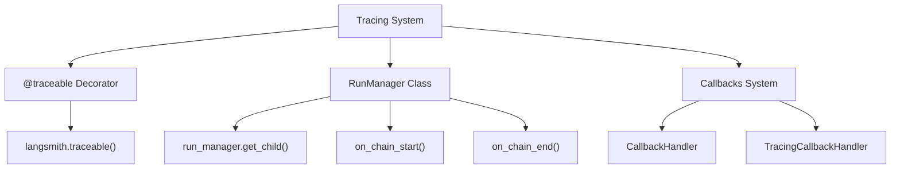
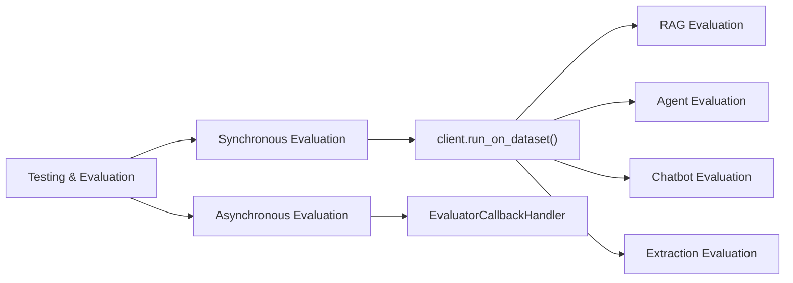
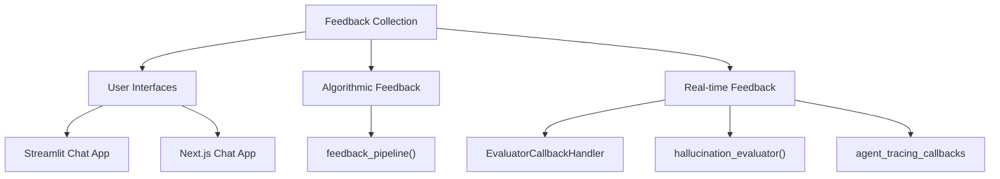
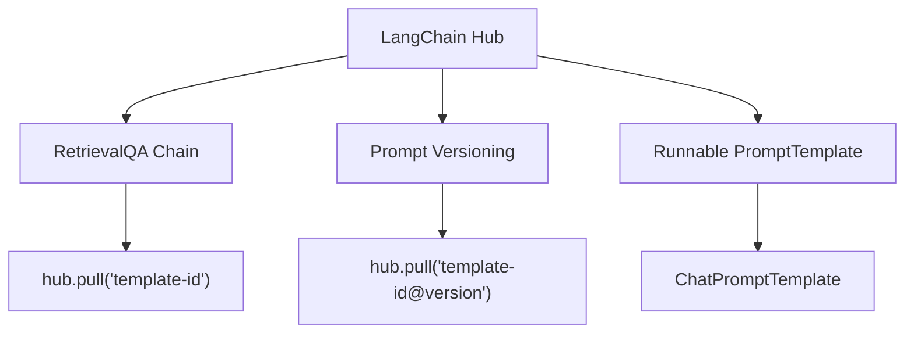
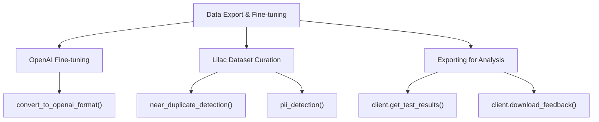

<!-- source: DeepWiki mcp.deepwiki.com · repo langchain-ai/langsmith-cookbook · page 1.1 Core Capabilities · fetched 2026-10-26 -->

# Core Capabilities

<details>
<summary>Relevant source files</summary>

The following files were used as context for generating this wiki page:

- [README.md](README.md)
- [feedback-examples/README.md](feedback-examples/README.md)
- [feedback-examples/streamlit-realtime-feedback/img/hallucination_feedback.gif](feedback-examples/streamlit-realtime-feedback/img/hallucination_feedback.gif)
- [hub-examples/README.md](hub-examples/README.md)
- [introduction/langsmith_introduction.ipynb](introduction/langsmith_introduction.ipynb)
- [introduction/online_evaluation.ipynb](introduction/online_evaluation.ipynb)
- [introduction/summarization.ipynb](introduction/summarization.ipynb)
- [testing-examples/README.md](testing-examples/README.md)
- [testing-examples/rag_eval/online_eval.ipynb](testing-examples/rag_eval/online_eval.ipynb)
- [testing-examples/rag_eval/rag.ipynb](testing-examples/rag_eval/rag.ipynb)
- [tracing-examples/README.md](tracing-examples/README.md)
- [typescript-testing-examples/README.md](typescript-testing-examples/README.md)

</details>


This document provides an overview of the core capabilities of LangSmith, a platform for debugging, evaluating, testing, and improving LLM applications. These capabilities include tracing, testing & evaluation, feedback collection, LangChain Hub integration, and data export & fine-tuning. For practical guidance on setting up and running the examples in this cookbook, see [Getting Started](#1.2).

## System Architecture Overview

Diagram: LangSmith Platform Architecture

```mermaid
graph TB
    LangSmith["LangSmith Platform"] --> Tracing["Tracing"]
    LangSmith --> Evaluation["Testing & Evaluation"]
    LangSmith --> Feedback["Feedback Collection"]
    LangSmith --> Hub["LangChain Hub"]
    LangSmith --> DataExport["Data Export & Fine-tuning"]
    
    Tracing --> REST_API["REST API"]
    Tracing --> TraceableDecorator["@traceable Decorator"]
    Tracing --> RunNaming["Run Naming"]
    
    Evaluation --> RagEval["RAG Evaluation"]
    Evaluation --> AgentEval["Agent Evaluation"]
    Evaluation --> ChatbotEval["Chatbot Evaluation"]
    Evaluation --> ExtractionEval["Extraction Evaluation"]
    Evaluation --> MultimodalEval["Multimodal Evaluation"]
    
    Feedback --> UserFeedback["User Feedback UI"]
    Feedback --> AlgoFeedback["Algorithmic Feedback"]
    Feedback --> RealtimeFeedback["Real-time Feedback"]
    
    Hub --> PromptVersioning["Prompt Versioning"]
    Hub --> RunnablePrompt["Runnable PromptTemplate"]
    
    DataExport --> FineTuning["Fine-tuning Export"]
    DataExport --> LilacCuration["Lilac Dataset Curation"]
    DataExport --> CSVExport["CSV Export"]
```



Sources: [README.md](), [introduction/langsmith_introduction.ipynb]()

## Tracing

Tracing is a fundamental capability of LangSmith that allows you to debug and understand your LLM applications by logging execution details and visualizing the execution flow.

Diagram: Tracing System Components



### @traceable Decorator

The `@traceable` decorator allows you to trace applications independent of LangChain. This provides the flexibility to use LangSmith's tracing capabilities with any Python application, not just those built with LangChain.

```python
from langsmith import traceable

@traceable()
def my_function(input_text):
    # Function logic here
    return output
```

### REST API

The REST API enables logging of LLM and chat model runs, including nested runs, directly through HTTP endpoints. This is particularly useful for non-Python applications or when you want to integrate LangSmith with existing workflows. The API specification is available in the LangSmith SDK repository's OpenAPI definition.

### Run Naming

Custom run naming improves UI clarity by allowing you to assign descriptive names to LangSmith chain runs. This feature is valuable for chains, lambda functions, and agents, making it easier to identify and understand complex workflows in the UI.

### Nested Calls within Tools

You can capture nested tool subcalls in a single trace by using `run_manager.get_child()` and passing it to child `callbacks`. This creates a hierarchical view of your application's execution, making it easier to debug complex chains and agents.

Sources:
- [tracing-examples/README.md]()
- [tracing-examples/traceable/tracing_without_langchain.ipynb]()
- [tracing-examples/rest/rest.ipynb]()
- [tracing-examples/runnable-naming/run-naming.ipynb]()
- [tracing-examples/nesting-tools/nest_runs_within_tools.ipynb]()

## Testing & Evaluation

LangSmith provides robust capabilities for testing and evaluating your LLM applications across different application types and use cases.

Diagram: Evaluation Systems Architecture



### RAG Evaluation

LangSmith offers comprehensive tools for evaluating Retrieval Augmented Generation (RAG) systems:

* **Q&A System Correctness**: Evaluate your retrieval-augmented Q&A pipeline end-to-end on a dataset.
* **Dynamic Data**: Evaluate Q&A systems with data that changes over time using evaluators that dereference labels.
* **Fixed Sources**: Evaluate the response component of a RAG pipeline by providing retrieved documents in the dataset.
* **RAGAS Framework**: Evaluate RAG pipelines using metrics for both the generator and retriever (answer correctness, faithfulness, context relevancy, recall and precision).

### Chatbot Evaluation

* **Simulated Users**: Evaluate chat bots using simulated users given specific tasks.
* **Single-turn Evaluation**: Evaluate chatbots within multi-turn conversations by treating each data point as an individual dialogue turn.

### Extraction Evaluation

* **Contract Extraction**: Measure the similarity between extracted structured content and structured labels using LangChain's json evaluators.
* **Exact Match**: Perform deterministic comparison of system output against reference labels.

### Agent Evaluation

* **Intermediate Steps**: Compare the sequence of actions taken by an agent to an expected trajectory to grade effective tool use.
* **Tool Selection**: Evaluate the precision of selected tools, with automated prompt improvement based on failure cases.

### Multimodal Evaluation

Benchmark multimodal models, such as image classification chains, using LangSmith's evaluation tools.

### Evaluation Fundamentals

* **Adding Metrics to Tests**: Apply new evaluators to existing test results without re-running your model using the `compute_test_metrics` utility function.
* **Backtesting**: Benchmark new versions of your production app using real inputs from production runs.
* **Naming Test Projects**: Name your tests with `run_on_dataset(..., project_name='my-project-name')`.
* **Exporting Tests**: Export test results to CSV for external analysis and reporting.

Sources:
- [testing-examples/README.md]()
- [testing-examples/rag_eval/rag.ipynb]()
- [testing-examples/qa-correctness/qa-correctness.ipynb]()
- [testing-examples/dynamic-data/testing_dynamic_data.ipynb]()
- [testing-examples/using-fixed-sources/using_fixed_sources.ipynb]()
- [testing-examples/ragas/ragas.ipynb]()
- [testing-examples/chatbot-simulation/chatbot-simulation.ipynb]()
- [testing-examples/chat-single-turn/chat_evaluation_single_turn.ipynb]()
- [testing-examples/data-extraction/contract-extraction.ipynb]()
- [testing-examples/exact-match/exact_match.ipynb]()
- [testing-examples/agent_steps/evaluating_agents.ipynb]()
- [testing-examples/tool-selection/tool-selection.ipynb]()
- [testing-examples/multimodal/multimodal.ipynb]()
- [testing-examples/evaluate-existing-test-project/evaluate_runs.ipynb]()
- [testing-examples/backtesting/backtesting.ipynb]()
- [testing-examples/naming-test-projects/naming-test-projects.md]()
- [testing-examples/export-test-to-csv/export-test-to-csv.ipynb]()

## Feedback Collection

LangSmith enables you to collect and utilize feedback to improve, monitor, and personalize your LLM applications. This feedback can come from users or be generated algorithmically.

Diagram: Feedback Collection System



### User Feedback Interfaces

* **Streamlit Chat App**: A minimal chat application that captures user feedback and shares traces of the chat application. It comes in two variants:
  * `vanilla_chain.py` - Contains an LLMChain powering the chat application
  * `expression_chain.py` - Contains an equivalent chat chain defined with LangChain expressions

* **Next.js Chat App**: A TypeScript chat application demonstrating tracing and feedback capture, with a deployed demo version available.

### Algorithmic Feedback

Build automated feedback pipelines to generate metrics for monitoring and performance tuning. This lets you evaluate production runs as batch jobs to continuously improve your system.

### Real-time Feedback

* **Async Callback**: Automatically generate feedback metrics for every run using an async callback, enabling real-time evaluation of production runs.
* **RAG Chat Bot Evaluation**: Automatically check for hallucinations in RAG chat bot responses against retrieved documents.
* **LangChain Agents**: Instrument LangChain web-search agents with tracing and human feedback collection.

Sources:
- [feedback-examples/README.md]()
- [feedback-examples/streamlit/README.md]()
- [feedback-examples/streamlit/vanilla_chain.py]()
- [feedback-examples/streamlit/expression_chain.py]()
- [feedback-examples/nextjs/README.md]()
- [feedback-examples/algorithmic-feedback/algorithmic_feedback.ipynb]()
- [feedback-examples/realtime-algorithmic-feedback/realtime_feedback.ipynb]()
- [feedback-examples/streamlit-realtime-feedback/README.md]()
- [feedback-examples/streamlit-agent/README.md]()

## LangChain Hub Integration

LangChain Hub integration allows you to efficiently manage your LLM components, such as prompts and chains.

Diagram: LangChain Hub Integration



### RetrievalQA Chain

Use prompts from the hub in RAG (Retrieval Augmented Generation) pipelines to improve question answering with shared and version-controlled prompt templates.

### Prompt Versioning

Ensure deployment stability by selecting specific prompt versions rather than always using the 'latest' version. This provides consistent behavior in production environments even as prompts are improved.

### Runnable PromptTemplate

Streamline the process of saving prompts to the hub from the playground and integrating them into runnable chains. This allows for easy iteration and sharing of effective prompts across teams.

Sources:
- [hub-examples/README.md]()
- [hub-examples/retrieval-qa-chain/retrieval-qa.ipynb]()
- [hub-examples/retrieval-qa-chain-versioned/prompt-versioning.ipynb]()
- [hub-examples/runnable-prompt/edit-in-playground.ipynb]()

## Data Export & Fine-tuning

LangSmith provides tools for exporting data for analysis and fine-tuning language models.

Diagram: Data Export and Fine-tuning



### OpenAI Fine-Tuning

Convert collected LLM runs to OpenAI's fine-tuning format efficiently. This allows you to take successful interactions from your application and use them to optimize your models.

### Lilac Dataset Curation

Further curate your LangSmith datasets using Lilac to detect near-duplicates, check for PII, and more. This ensures your fine-tuning data is high-quality and compliant with privacy requirements.

### Exporting Data for Analysis

Extract and interpret LangSmith LLM run data, making it ready for various analytical platforms. This includes exporting to CSV and programmatically accessing your test results for custom analysis and visualization.

Sources:
- [fine-tuning-examples/export-to-openai/fine-tuning-on-chat-runs.ipynb]()
- [fine-tuning-examples/lilac/lilac.ipynb]()
- [exploratory-data-analysis/exporting-llm-runs-and-feedback/llm_run_etl.ipynb]()
- [exploratory-data-analysis/lilac/lilac.ipynb]()
- [testing-examples/download-feedback-and-examples/download_example.ipynb]()

---

