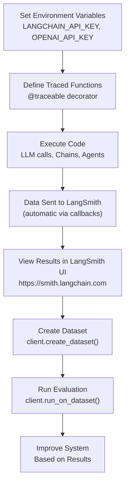

<!-- source: DeepWiki mcp.deepwiki.com · repo langchain-ai/langsmith-cookbook · page 1.2 Getting Started · fetched 2026-10-26 -->

# Getting Started

<details>
<summary>Relevant source files</summary>

The following files were used as context for generating this wiki page:

- [.github/workflows/test-cookbooks.yml](.github/workflows/test-cookbooks.yml)
- [README.md](README.md)
- [_scripts/requirements.txt](_scripts/requirements.txt)
- [_scripts/test-cookbooks.py](_scripts/test-cookbooks.py)
- [introduction/langsmith_introduction.ipynb](introduction/langsmith_introduction.ipynb)
- [introduction/online_evaluation.ipynb](introduction/online_evaluation.ipynb)
- [introduction/summarization.ipynb](introduction/summarization.ipynb)
- [testing-examples/README.md](testing-examples/README.md)
- [testing-examples/rag_eval/online_eval.ipynb](testing-examples/rag_eval/online_eval.ipynb)
- [testing-examples/rag_eval/rag.ipynb](testing-examples/rag_eval/rag.ipynb)
- [tracing-examples/nesting-tools/nest_runs_within_tools.ipynb](tracing-examples/nesting-tools/nest_runs_within_tools.ipynb)

</details>


This guide will help you set up your environment and run examples from the LangSmith Cookbook repository. The cookbook contains practical examples demonstrating how to use LangSmith to trace, debug, evaluate, and improve your LLM applications.

For an overview of the broader LangSmith platform, see the [Overview](#1) and [Core Capabilities](#1.1) pages.

## Architecture Overview

The diagram below shows how the LangSmith platform connects with the code examples in this cookbook:

```mermaid
graph TB
    subgraph "LangSmith Platform"
        Tracing["Tracing"]
        Evaluation["Testing & Evaluation"]
        Feedback["Feedback Collection"]
        Hub["LangChain Hub"]
        Export["Data Export"]
    end
    
    subgraph "Cookbook Code Components"
        TraceableDecorator["@traceable Decorator"]
        RestAPI["REST API"]
        RunNaming["Run Naming"]
        
        DatasetRun["client.run_on_dataset()"]
        EvalCallbacks["EvaluatorCallbackHandler"]
        
        UserFeedback["Feedback UI Components"]
        AlgoFeedback["Algorithmic Feedback"]
        
        HubVersioning["hub.pull() / hub.push()"]
        PromptTemplates["ChatPromptTemplate"]
        
        DataExport["client.list_runs()"]
        CSVExport["get_test_results()"]
    end

    Tracing --> TraceableDecorator
    Tracing --> RestAPI
    Tracing --> RunNaming
    
    Evaluation --> DatasetRun
    Evaluation --> EvalCallbacks
    
    Feedback --> UserFeedback
    Feedback --> AlgoFeedback
    
    Hub --> HubVersioning
    Hub --> PromptTemplates
    
    Export --> DataExport
    Export --> CSVExport
```



Sources: [README.md:1-125]()

## Prerequisites

Before using the examples in this cookbook, you'll need:

1. **LangSmith Account**: Sign up at [smith.langchain.com](https://smith.langchain.com)
2. **API Keys**:
   - LangSmith API key
   - OpenAI API key (for most examples)
   - Additional keys for specific examples (Anthropic, etc.)
3. **Python Environment**: Python 3.8+

## Installation

Install the required packages using pip:

```bash
pip install langchain langchain-community langsmith openai
```

Some examples may require additional packages. The full list of common dependencies can be found in the requirements file.

Sources: [_scripts/requirements.txt:1-19]()

## Environment Configuration

The examples in this repository require several environment variables to be set:

```python
import os

# Required for all examples
os.environ["LANGCHAIN_API_KEY"] = "your-langsmith-api-key"
os.environ["LANGCHAIN_TRACING_V2"] = "true"
os.environ["LANGCHAIN_ENDPOINT"] = "https://api.smith.langchain.com"  # Default API endpoint

# Required for most examples
os.environ["OPENAI_API_KEY"] = "your-openai-api-key"

# Optional - specify a project name (defaults to "default")
os.environ["LANGCHAIN_PROJECT"] = "my-cookbook-project"
```

Each notebook in the cookbook will begin with similar setup code. You can either set these environment variables in your shell or directly in the notebooks.

Sources: [tracing-examples/nesting-tools/nest_runs_within_tools.ipynb:39-52](), [testing-examples/rag_eval/rag.ipynb:183-195]()

## Cookbook Structure

The LangSmith Cookbook is organized by use case:

| Directory | Purpose | Example Files |
|-----------|---------|--------------|
| `tracing-examples/` | Debug and visualize execution | traceable/tracing_without_langchain.ipynb, rest/rest.ipynb |
| `testing-examples/` | Evaluate LLM systems | qa-correctness/qa-correctness.ipynb, rag_eval/rag.ipynb |
| `feedback-examples/` | Collect and utilize feedback | streamlit/, nextjs/, algorithmic-feedback/ |
| `hub-examples/` | LangChain Hub integration | retrieval-qa-chain/, prompt-versioning/ |
| `fine-tuning-examples/` | Export data for tuning | export-to-openai/, lilac/ |
| `optimization/` | Improve prompts and chains | assisted-prompt-bootstrapping/, bootstrap-fewshot/ |
| `_scripts/` | Testing and utility scripts | test-cookbooks.py, requirements.txt |

Sources: [README.md:14-117](), [testing-examples/README.md:1-40]()

## Running Examples

### Running Individual Notebooks

The cookbook examples are provided as Jupyter notebooks. To run a notebook:

1. Clone the repository:
   ```bash
   git clone https://github.com/langchain-ai/langsmith-cookbook.git
   cd langsmith-cookbook
   ```

2. Install the required packages:
   ```bash
   pip install -r _scripts/requirements.txt
   ```

3. Open and run a notebook:
   ```bash
   jupyter notebook tracing-examples/traceable/tracing_without_langchain.ipynb
   ```

### Execution Flow

The diagram below illustrates the typical execution flow when running cookbook examples:



Sources: [tracing-examples/nesting-tools/nest_runs_within_tools.ipynb:60-114](), [testing-examples/rag_eval/rag.ipynb:96-141]()

## Testing the Cookbook

The cookbook includes a testing framework to verify that examples work correctly:

```bash
cd _scripts
python test-cookbooks.py --api-key YOUR_LANGSMITH_API_KEY --project YOUR_PROJECT_NAME
```

This script will:
1. Find all notebooks in the repository
2. Replace placeholder API keys with your actual keys
3. Execute the notebooks
4. Log all traces to your specified LangSmith project

Sources: [.github/workflows/test-cookbooks.yml:8-52](), [_scripts/test-cookbooks.py:32-181]()

## Example: Basic Tracing

Here's a simple example of using LangSmith to trace nested function calls:

```python
import os
from langsmith import traceable
import openai
from langsmith.wrappers import wrap_openai

# Set environment variables
os.environ["LANGCHAIN_API_KEY"] = "your-langsmith-api-key"
os.environ["LANGCHAIN_TRACING_V2"] = "true"
os.environ["OPENAI_API_KEY"] = "your-openai-api-key"

# Wrap the OpenAI client for tracing
client = wrap_openai(openai.Client())

# Create a traced function
@traceable()
def get_answer(question):
    response = client.chat.completions.create(
        model="gpt-3.5-turbo",
        messages=[
            {"role": "system", "content": "You are a helpful assistant."},
            {"role": "user", "content": question}
        ]
    )
    return response.choices[0].message.content

# Call the function
answer = get_answer("What is LangSmith?")
print(answer)
```

After running this code, you can view the execution trace in the LangSmith UI, including:
- The input question
- The API call to OpenAI
- The response
- Execution time statistics

Sources: [tracing-examples/nesting-tools/nest_runs_within_tools.ipynb:96-142](), [testing-examples/rag_eval/online_eval.ipynb:60-91]()

## Next Steps

After getting familiar with the basics, explore these more advanced examples:

- **RAG Evaluation**: Test retrieval-augmented generation pipelines for correctness and relevance
- **Agent Evaluation**: Assess LLM agents' tool selection and reasoning steps
- **Feedback Collection**: Implement user feedback in chat applications
- **Prompt Optimization**: Improve prompts with bootstrapping techniques

For more details on these topics, see the [Testing & Evaluation](#3) and [Feedback Collection](#4) pages.

Sources: [README.md:32-117]()

---

