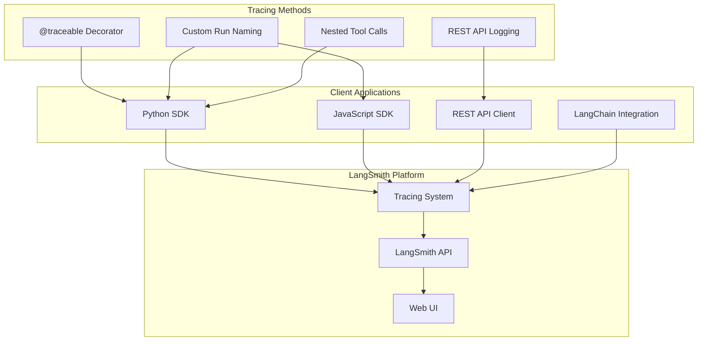
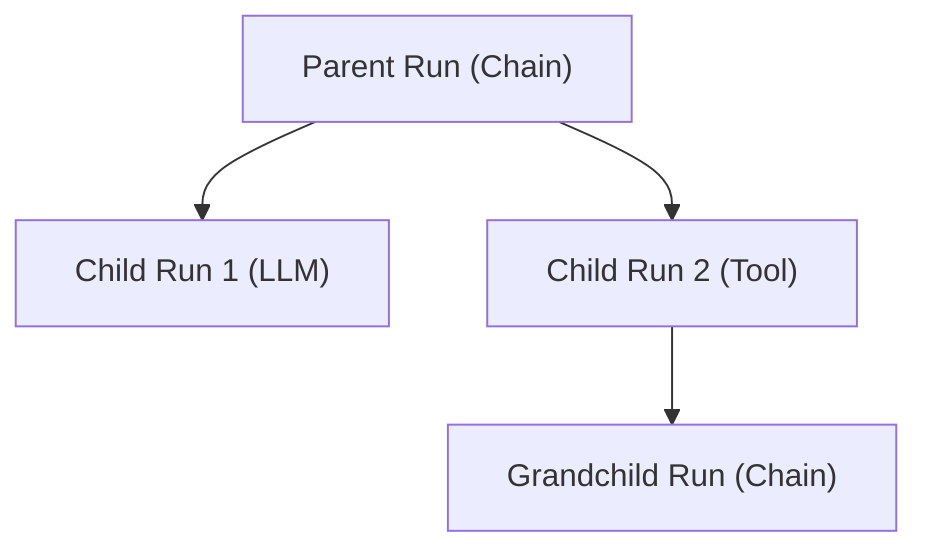
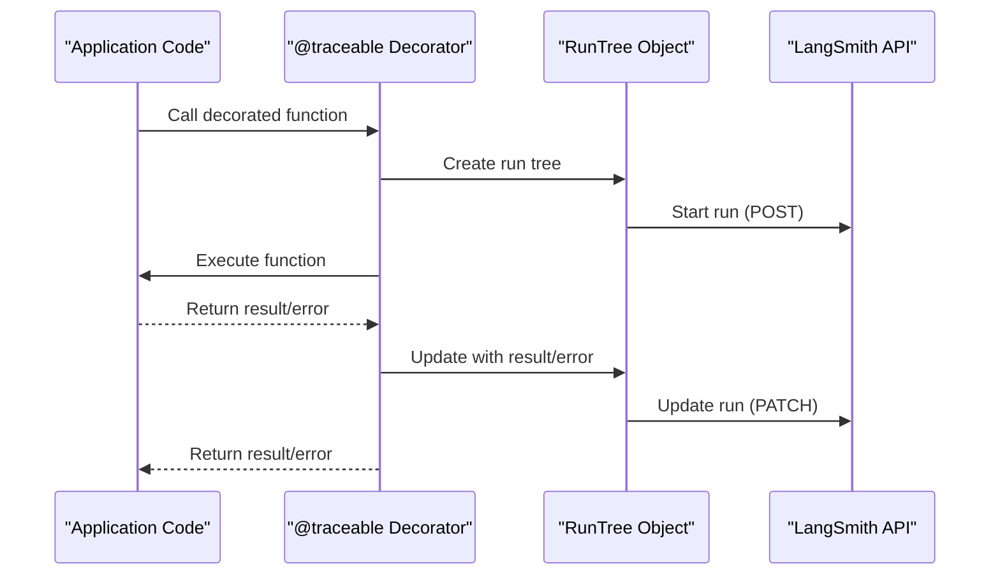
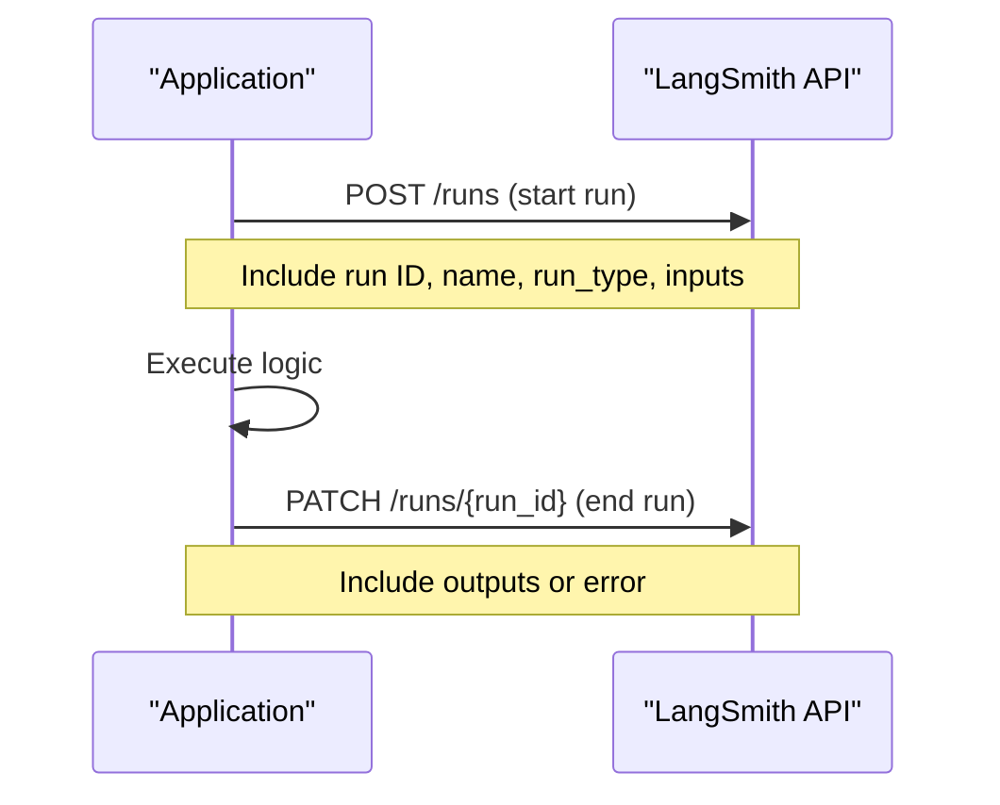
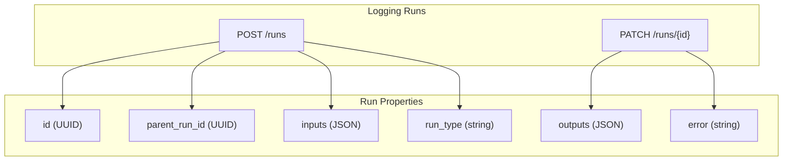
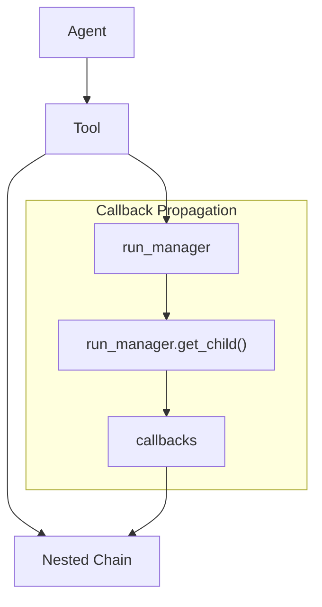
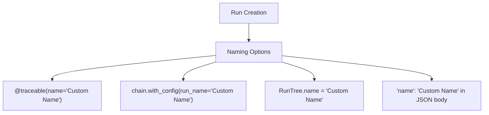
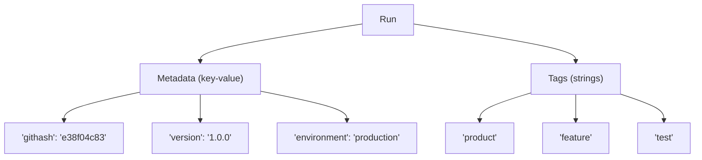
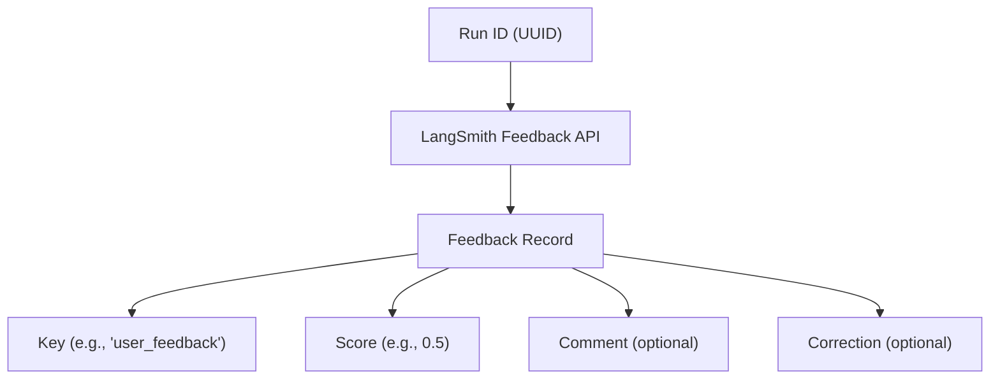
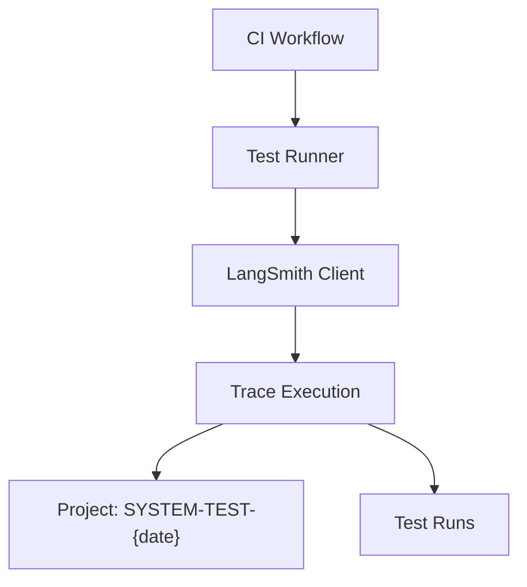

<!-- source: DeepWiki mcp.deepwiki.com · repo langchain-ai/langsmith-cookbook · page 2 Tracing · fetched 2026-10-26 -->

# Tracing

<details>
<summary>Relevant source files</summary>

The following files were used as context for generating this wiki page:

- [.github/workflows/test-cookbooks.yml](.github/workflows/test-cookbooks.yml)
- [_scripts/requirements.txt](_scripts/requirements.txt)
- [_scripts/test-cookbooks.py](_scripts/test-cookbooks.py)
- [feedback-examples/README.md](feedback-examples/README.md)
- [feedback-examples/streamlit-realtime-feedback/img/hallucination_feedback.gif](feedback-examples/streamlit-realtime-feedback/img/hallucination_feedback.gif)
- [hub-examples/README.md](hub-examples/README.md)
- [tracing-examples/README.md](tracing-examples/README.md)
- [tracing-examples/nesting-tools/nest_runs_within_tools.ipynb](tracing-examples/nesting-tools/nest_runs_within_tools.ipynb)
- [tracing-examples/rest/rest.ipynb](tracing-examples/rest/rest.ipynb)
- [tracing-examples/traceable/tracing_without_langchain.ipynb](tracing-examples/traceable/tracing_without_langchain.ipynb)
- [typescript-testing-examples/README.md](typescript-testing-examples/README.md)

</details>


Tracing in LangSmith enables comprehensive logging and visualization of LLM application execution flows. It allows developers to instrument, debug, and monitor their applications by capturing structured logs called "runs" that record inputs, outputs, execution time, and other metadata. This page explains how LangSmith's tracing capabilities work and how to implement them in your applications.

For information about testing and evaluating your LLM applications with LangSmith, see [Testing & Evaluation](#3).

## Tracing Architecture

LangSmith tracing is built around a hierarchical system of "runs" that represent execution spans in an application. These runs form a tree structure that visualizes the flow of execution, making it easier to debug complex applications.



Sources:
- [tracing-examples/README.md]()
- [tracing-examples/traceable/tracing_without_langchain.ipynb]()
- [tracing-examples/rest/rest.ipynb]()

## Core Concepts

### Runs and Run Trees

In LangSmith, a "run" represents a single execution span with the following properties:

- **name**: A descriptive name for the run
- **run_type**: Categorizes the run (e.g., "chain", "llm", "tool")
- **inputs**: The input data for the run
- **outputs**: The output data from the run
- **start_time/end_time**: Timestamps for when the run started and ended
- **error**: Any error information if the run failed
- **tags**: Optional labels for filtering and organizing runs
- **metadata**: Additional structured information about the run

A "run tree" is a hierarchical organization of runs, where child runs represent nested function calls or sub-operations within a parent run.



Sources:
- [tracing-examples/traceable/tracing_without_langchain.ipynb:15-17]()
- [tracing-examples/rest/rest.ipynb:10-17]()

## Tracing Methods

### @traceable Decorator

The `@traceable` decorator provides a simple way to automatically instrument Python functions, handling the creation and management of run trees.



Example usage:

```python
from langsmith.run_helpers import traceable

@traceable(run_type="chain")
def my_function(input_text):
    # Function logic here
    return result
```

The decorator supports various configurations:

- **run_type**: Specifies the type of run (e.g., "chain", "llm")
- **name**: Custom name for the run
- **tags**: List of tags for filtering
- **metadata**: Additional structured information

You can also access the run tree within your function by adding a `run_tree` parameter:

```python
@traceable(run_type="chain")
def my_function(input_text, *, run_tree):
    # Access run_tree.id or other properties
    return result, run_tree.id
```

Sources:
- [tracing-examples/traceable/tracing_without_langchain.ipynb:18-22]()
- [tracing-examples/traceable/tracing_without_langchain.ipynb:85-107]()
- [tracing-examples/traceable/tracing_without_langchain.ipynb:352-373]()

### REST API

The REST API enables tracing for applications written in languages other than Python or JavaScript. It requires making HTTP requests to the LangSmith API.



Basic usage involves two API calls:

1. **POST request** to create the run at the beginning of the function call
2. **PATCH request** to update the run with results at the end

Example REST API usage:

```python
import requests
import uuid
import datetime

run_id = str(uuid.uuid4())

# Start run
requests.post(
    "https://api.smith.langchain.com/runs",
    json={
        "id": run_id,
        "name": "MyRun",
        "run_type": "chain",
        "inputs": {"text": "input"},
        "start_time": datetime.datetime.utcnow().isoformat(),
    },
    headers={"x-api-key": "YOUR_API_KEY"},
)

# Execute logic

# End run
requests.patch(
    f"https://api.smith.langchain.com/runs/{run_id}",
    json={
        "outputs": {"result": "output"},
        "end_time": datetime.datetime.utcnow().isoformat(),
    },
    headers={"x-api-key": "YOUR_API_KEY"},
)
```

Special considerations apply when logging LLM runs for better visualization and token counting:

1. **Chat model format**:
   - Inputs: `{"messages": [{"role": "user", "content": "..."}]}`
   - Outputs: `{"choices": [{"message": {"role": "assistant", "content": "..."}}]}`

2. **Completion model format**:
   - Inputs: `{"prompt": "..."}`
   - Outputs: `{"choices": [{"text": "..."}]}`

Sources:
- [tracing-examples/rest/rest.ipynb:10-29]()
- [tracing-examples/rest/rest.ipynb:54-115]()
- [tracing-examples/rest/rest.ipynb:240-260]()

### Nesting Runs

To create hierarchical run trees, you need to specify parent-child relationships between runs.



When using the REST API, include the `parent_run_id` in the JSON body of child runs:

```python
# Create parent run
parent_run_id = str(uuid.uuid4())
requests.post(
    "https://api.smith.langchain.com/runs",
    json={
        "id": parent_run_id,
        "name": "ParentRun",
        "run_type": "chain",
        "inputs": {"text": "input"},
        "start_time": datetime.datetime.utcnow().isoformat(),
    },
    headers={"x-api-key": "YOUR_API_KEY"},
)

# Create child run
child_run_id = str(uuid.uuid4())
requests.post(
    "https://api.smith.langchain.com/runs",
    json={
        "id": child_run_id,
        "name": "ChildRun",
        "run_type": "llm",
        "parent_run_id": parent_run_id,  # Link to parent
        "inputs": {"prompt": "Hello"},
        "start_time": datetime.datetime.utcnow().isoformat(),
    },
    headers={"x-api-key": "YOUR_API_KEY"},
)
```

When using the `@traceable` decorator, nesting happens automatically when decorated functions call each other.

Sources:
- [tracing-examples/rest/rest.ipynb:448-456]()
- [tracing-examples/rest/rest.ipynb:471-504]()
- [tracing-examples/nesting-tools/nest_runs_within_tools.ipynb:12-18]()

### Nested Tool Calls

For LangChain tools and agents, you need to propagate callbacks to ensure nested calls appear within the correct parent trace.



When implementing custom tools:

1. Accept `callbacks` or `run_manager` in your tool function
2. Use `run_manager.get_child()` to create child callbacks
3. Pass these callbacks to any nested chains or operations

Example with the `@tool` decorator:

```python
@tool
def summarize_tool(url: str, callbacks=None):
    """Summarize a website."""
    text = requests.get(url).text
    summary_chain = create_summary_chain()
    return summary_chain.invoke(
        {"text": text},
        {"callbacks": callbacks},  # Pass callbacks through
    )
```

Example when subclassing `BaseTool`:

```python
def _run(self, url: str, run_manager=None):
    """Use the tool."""
    text = requests.get(url).text
    callbacks = run_manager.get_child() if run_manager else None
    return self.summary_chain.invoke(
        {"text": text},
        {"callbacks": callbacks},  # Pass callbacks through
    )
```

Sources:
- [tracing-examples/nesting-tools/nest_runs_within_tools.ipynb:12-18]()
- [tracing-examples/nesting-tools/nest_runs_within_tools.ipynb:60-101]()
- [tracing-examples/nesting-tools/nest_runs_within_tools.ipynb:109-183]()

## Additional Features

### Run Naming

Custom run names improve readability and debugging by providing descriptive labels for each run.



In Python with the `@traceable` decorator:

```python
@traceable(name="My Custom Run", run_type="chain")
def my_function():
    pass
```

With LangChain runnables:

```python
chain = (prompt | llm | output_parser).with_config(run_name="Custom Chain")
```

With the REST API:

```python
requests.post(
    "https://api.smith.langchain.com/runs",
    json={
        "id": run_id,
        "name": "Custom Name",  # Specify name here
        "run_type": "chain",
        # other fields
    },
    headers={"x-api-key": "YOUR_API_KEY"},
)
```

Sources:
- [tracing-examples/README.md:12]()
- [tracing-examples/traceable/tracing_without_langchain.ipynb:352-361]()
- [tracing-examples/nesting-tools/nest_runs_within_tools.ipynb:97]()

### Metadata and Tags

Adding metadata and tags helps organize and filter runs in the LangSmith UI.



Example with the `@traceable` decorator:

```python
@traceable(
    run_type="chain",
    tags=["production", "feature-x"],
    metadata={"version": "1.0.0", "environment": "production"}
)
def my_function():
    pass
```

Example with the REST API:

```python
requests.post(
    "https://api.smith.langchain.com/runs",
    json={
        "id": run_id,
        "name": "MyRun",
        "run_type": "chain",
        "tags": ["production", "feature-x"],
        "extra": {
            "metadata": {"version": "1.0.0", "environment": "production"}
        },
        # other fields
    },
    headers={"x-api-key": "YOUR_API_KEY"},
)
```

Sources:
- [tracing-examples/traceable/tracing_without_langchain.ipynb:352-383]()
- [tracing-examples/rest/rest.ipynb:171-193]()
- [tracing-examples/rest/rest.ipynb:217-230]()

### Feedback Integration

You can associate user feedback with runs to track performance and improve your application.



Example of logging feedback:

```python
from langsmith import Client

client = Client()

# Get run ID from a traceable function
result, run_id = my_traceable_function(input)

# Log feedback
client.create_feedback(
    run_id,
    "user_feedback",
    score=0.8,
    comment="Good response, but could be more concise",
    correction={"improved_response": "Better version here"}
)
```

Sources:
- [tracing-examples/traceable/tracing_without_langchain.ipynb:292-335]()
- [feedback-examples/README.md:7]()

## Integration with Continuous Integration

LangSmith tracing can be integrated into continuous integration workflows to monitor application behavior during testing.



The GitHub workflow configuration illustrates this integration:

```yaml
- name: Test nbs
  working-directory: _scripts
  run: python test-cookbooks.py --api-key $LANGSMITH_API_KEY --hub-api-key $LANGCHAINHUB_API_KEY --hub-handle infra-guy --project SYSTEM-TEST-$(date +'%Y-%m-%d')
  env:
    LANGSMITH_API_KEY: ${{ secrets.LANGSMITH_API_KEY }}
    LANGCHAINHUB_API_KEY: ${{ secrets.LANGCHAINHUB_API_KEY }}
    OPENAI_API_KEY: ${{ secrets.OPENAI_API_KEY }}
    ANTHROPIC_API_KEY: ${{ secrets.ANTHROPIC_API_KEY }}
    PYDEVD_DISABLE_FILE_VALIDATION: 1
```

Sources:
- [.github/workflows/test-cookbooks.yml:21-29]()
- [_scripts/test-cookbooks.py:154]()

## Conclusion

LangSmith's tracing capabilities provide powerful tools for logging, visualizing, and debugging LLM application execution. By using the `@traceable` decorator, REST API, or other integration methods, you can gain valuable insights into your application's behavior and performance.

The tracing system works with any LLM application, regardless of whether it uses LangChain or other frameworks, making it a versatile tool for development and monitoring.

---

