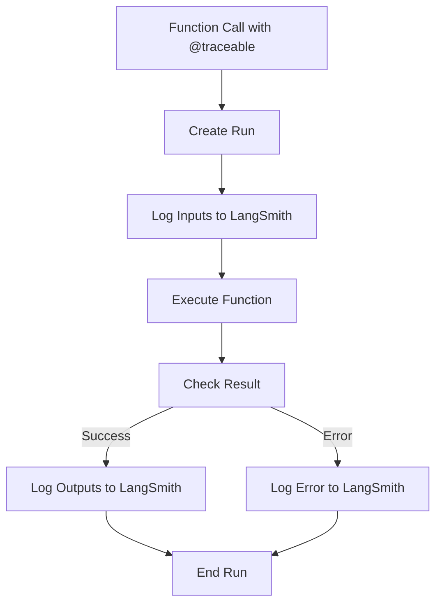
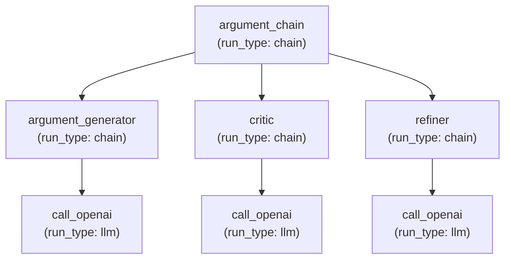
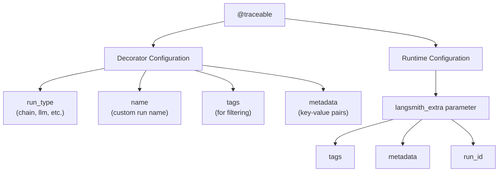

<!-- source: DeepWiki mcp.deepwiki.com · repo langchain-ai/langsmith-cookbook · page 2.1 @traceable Decorator · fetched 2026-10-26 -->

# @traceable Decorator

<details>
<summary>Relevant source files</summary>

The following files were used as context for generating this wiki page:

- [testing-examples/dynamic-data/testing_dynamic_data.ipynb](testing-examples/dynamic-data/testing_dynamic_data.ipynb)
- [tracing-examples/rest/rest.ipynb](tracing-examples/rest/rest.ipynb)
- [tracing-examples/runnable-naming/run-naming.ipynb](tracing-examples/runnable-naming/run-naming.ipynb)
- [tracing-examples/traceable/tracing_without_langchain.ipynb](tracing-examples/traceable/tracing_without_langchain.ipynb)

</details>


The `@traceable` decorator is a core component of the LangSmith platform that allows you to instrument any LLM application, independent of LangChain. It provides debugging, evaluation, and monitoring capabilities by creating structured logs of function calls in your application, which are then visualized in the LangSmith platform.

For other tracing methods in LangSmith, see [REST API](#2.2) for HTTP-based tracing or [Run Naming and Nested Calls](#2.3) for customizing run names and managing complex traces.

## How It Works

The `@traceable` decorator creates a run tree for each function invocation. It captures function inputs, execution details, outputs or errors, and sends this information to LangSmith for visualization and analysis.

### Tracing Flow Diagram



Sources: [tracing-examples/traceable/tracing_without_langchain.ipynb:86-91]()

## Basic Usage

To use the `@traceable` decorator, import it from the `langsmith.run_helpers` module and apply it to any function you want to trace:

```python
from langsmith.run_helpers import traceable

@traceable(run_type="chain")
def my_function(input_data):
    # Function implementation
    return result
```

The `run_type` parameter specifies the type of run, with common values being:

- `"chain"`: For general-purpose functions
- `"llm"`: For LLM or chat model calls
- `"retriever"`: For retrieval operations
- `"tool"`: For tool invocations

Sources: [tracing-examples/traceable/tracing_without_langchain.ipynb:102-123](), [tracing-examples/traceable/tracing_without_langchain.ipynb:124-140]()

### Example Run Tree

Here's how a sample application's run tree might look when multiple traced functions are called:



Sources: [tracing-examples/traceable/tracing_without_langchain.ipynb:189-193]()

## Advanced Features

### Accessing the Run Tree Object

You can access the run tree inside a traced function by adding a `run_tree` parameter to the function signature:

```python
@traceable(run_type="chain")
def my_function(input_data, *, run_tree):
    # Use the run tree
    run_id = run_tree.id
    # Function implementation
    return result, run_id
```

This allows you to:
- Access the run ID for later reference
- Create feedback associated with the run
- Pass the run ID to other systems or processes

Sources: [tracing-examples/traceable/tracing_without_langchain.ipynb:262-268]()

### Adding User Feedback

With the run ID, you can add user feedback to a run after it's completed:

```python
from langsmith import Client

client = Client()
client.create_feedback(
    run_id,
    "user_feedback",
    score=0.5,
    correction={"generation": "Better response"}
)
```

Sources: [tracing-examples/traceable/tracing_without_langchain.ipynb:311-317](), [tracing-examples/traceable/tracing_without_langchain.ipynb:329-335]()

### Configuration Options

The `@traceable` decorator supports various configuration options to customize how your functions are traced:



Sources: [tracing-examples/traceable/tracing_without_langchain.ipynb:374-383](), [tracing-examples/traceable/tracing_without_langchain.ipynb:411-422]()

#### Decorator Configuration

You can configure the decorator when you define it:

```python
@traceable(
    run_type="chain",
    name="My Custom Run Name",
    tags=["production", "v1.0"],
    metadata={"model": "gpt-4", "temperature": 0.7}
)
def my_function(input_data):
    # Function implementation
    return result
```

Sources: [tracing-examples/traceable/tracing_without_langchain.ipynb:374-383]()

#### Runtime Configuration

You can also configure tracing at runtime using the `langsmith_extra` parameter:

```python
result = my_function(
    input_data,
    langsmith_extra={
        "tags": ["experimental"],
        "metadata": {"user_id": "12345"},
        "run_id": specific_uuid  # Manually specify the run ID
    }
)
```

Sources: [tracing-examples/traceable/tracing_without_langchain.ipynb:411-422]()

## Example: Tracing a Multi-Function Application

Here's a complete example of tracing a multi-function argument generation application:

```python
from langsmith.run_helpers import traceable
from openai import OpenAI

openai_client = OpenAI()

@traceable(run_type="llm")
def call_openai(messages, model="gpt-3.5-turbo", temperature=0.0):
    return openai_client.chat.completions.create(
        model=model,
        messages=messages,
        temperature=temperature,
    )

@traceable(run_type="chain")
def argument_generator(query, additional_description=""):
    return (
        call_openai([
            {"role": "system", "content": f"You are a debater making an argument on a topic.{additional_description}"},
            {"role": "user", "content": f"The discussion topic is {query}"},
        ])
        .choices[0]
        .message.content
    )

@traceable(run_type="chain")
def critic(argument):
    return (
        call_openai([
            {"role": "system", "content": "You are a critic. What criticism do you have?"},
            {"role": "system", "content": argument},
        ])
        .choices[0]
        .message.content
    )

@traceable(run_type="chain")
def argument_chain(query, additional_description=""):
    argument = argument_generator(query, additional_description)
    criticism = critic(argument)
    return refiner(query, additional_description, argument, criticism)
```

Sources: [tracing-examples/traceable/tracing_without_langchain.ipynb:102-194]()

## Best Practices

1. **Use descriptive run names**: Choose names that clearly describe the function's purpose.
2. **Add tags for filtering**: Use tags to categorize runs based on environment, version, or other relevant criteria.
3. **Include relevant metadata**: Add metadata that provides context for the run.
4. **Create a clean hierarchy**: Structure your code so the run tree forms a clean hierarchy that mirrors your application's logical flow.
5. **Store run IDs when needed**: If you need to reference the run later, store its ID at the time of creation.
6. **Add user feedback**: Collect and associate user feedback with runs to measure and improve quality.

Sources: [tracing-examples/traceable/tracing_without_langchain.ipynb:361-367](), [tracing-examples/traceable/tracing_without_langchain.ipynb:374-383]()

## Use Cases

The `@traceable` decorator is valuable in various scenarios:

1. **Debugging**: Trace function calls to identify where errors occur.
2. **Performance monitoring**: Monitor execution time of different parts of your application.
3. **Quality assurance**: Collect user feedback on generated content.
4. **A/B testing**: Compare different versions of your application with version tags.
5. **Auditing**: Keep a record of all LLM interactions for compliance or review.

Sources: [tracing-examples/traceable/tracing_without_langchain.ipynb:12-32]()

## Conclusion

The `@traceable` decorator provides a simple yet powerful way to instrument your LLM applications without requiring you to adopt any particular framework. By adding it to your functions, you can gain valuable insights into how your application behaves and identify areas for improvement. The decorator automatically creates and manages run trees, logs inputs and outputs, and sends this information to LangSmith for visualization and analysis.

---

