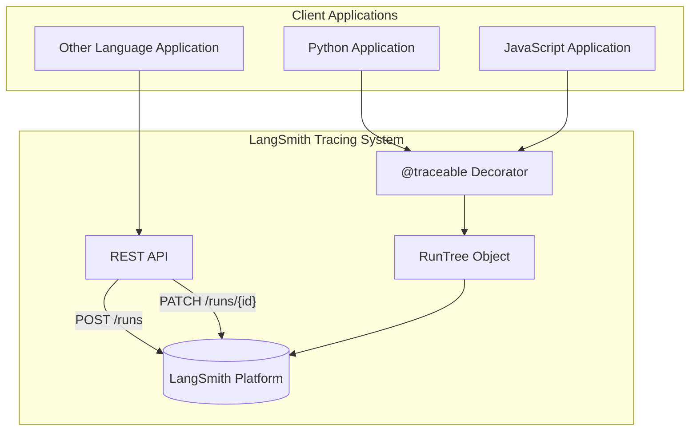
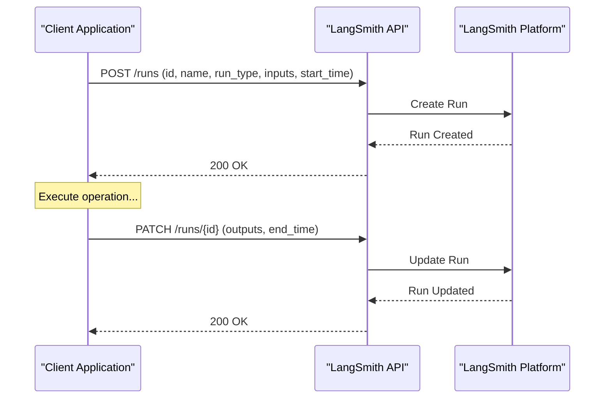
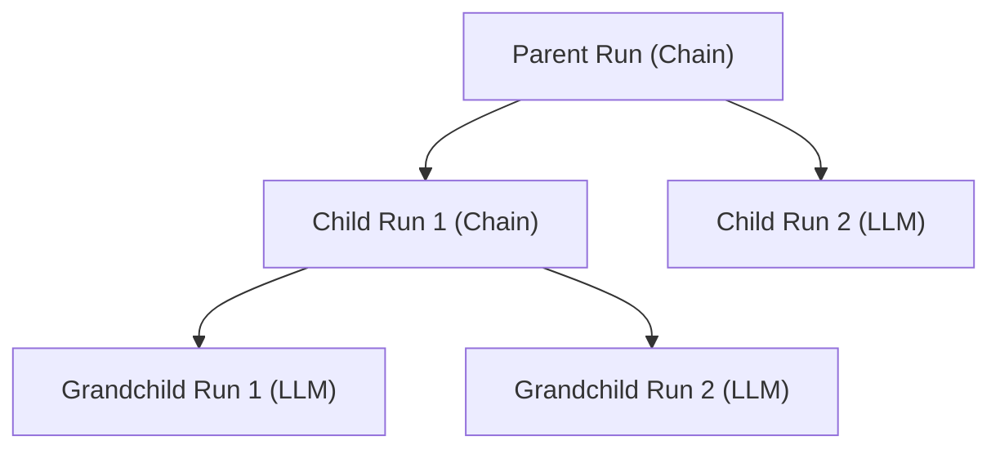
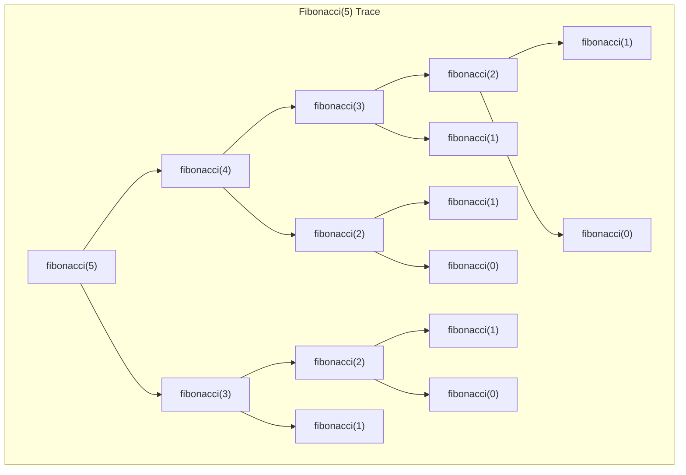

<!-- source: DeepWiki mcp.deepwiki.com · repo langchain-ai/langsmith-cookbook · page 2.2 REST API · fetched 2026-10-26 -->

# REST API

<details>
<summary>Relevant source files</summary>

The following files were used as context for generating this wiki page:

- [README.md](README.md)
- [testing-examples/README.md](testing-examples/README.md)
- [tracing-examples/rest/rest.ipynb](tracing-examples/rest/rest.ipynb)
- [tracing-examples/traceable/tracing_without_langchain.ipynb](tracing-examples/traceable/tracing_without_langchain.ipynb)

</details>


The LangSmith REST API provides a language-agnostic way to instrument and monitor your LLM applications by logging runs to the LangSmith platform. This page explains how to use the REST API to log and trace function execution, chat model interactions, and nested operations in your applications without requiring the Python or JavaScript SDKs. For information about using the `@traceable` decorator for Python applications, see [@traceable Decorator](#2.1).

## Overview

LangSmith tracing is built on "runs," which are analogous to traces and spans in OpenTelemetry. Each run represents a unit of work (such as a function call) with associated inputs, outputs, metadata, and timing information. The REST API allows you to create, update, and organize these runs to build comprehensive traces of your application's execution flow.



Sources: [tracing-examples/rest/rest.ipynb:9-31]()

## Basic Workflow

The basic workflow for logging runs via the REST API involves:

1. Creating a run at the start of the operation with a POST request
2. Updating the run at the end of the operation with a PATCH request

This two-step approach ensures that runs appear in LangSmith in a timely manner, even for long-running operations.



Sources: [tracing-examples/rest/rest.ipynb:49-116]()

## Authentication

All requests to the LangSmith API require authentication using an API key. The key is passed in the `x-api-key` HTTP header.

```
headers={"x-api-key": "your_langsmith_api_key"}
```

Sources: [tracing-examples/rest/rest.ipynb:92-104]()

## Creating and Updating Runs

### Creating a Run

To create a run, send a POST request to the `/runs` endpoint with the following required fields:

| Field    | Type   | Description                                    |
|----------|--------|------------------------------------------------|
| name     | string | Descriptive name for the run                   |
| run_type | string | Type of run (e.g., "chain", "llm")             |
| inputs   | object | Input values provided to the operation         |

Additional optional fields include:

| Field              | Type           | Description                                      |
|--------------------|----------------|--------------------------------------------------|
| id                 | string (UUID)  | Custom ID for the run (auto-generated if not provided) |
| start_time         | string (ISO)   | UTC timestamp when the run started               |
| end_time           | string (ISO)   | UTC timestamp when the run completed             |
| outputs            | object         | Output values produced by the operation          |
| error              | string         | Error message if the run failed                  |
| parent_run_id      | string (UUID)  | ID of the parent run (for nested runs)           |
| tags               | array[string]  | Tags for filtering and organization              |
| extra              | object         | Additional metadata about the run                |
| events             | array[object]  | Events that occurred during the run              |
| session_name       | string         | The project name (defaults to "default")         |

Sources: [tracing-examples/rest/rest.ipynb:131-155]()

### Updating a Run

To update a run, send a PATCH request to the `/runs/{run_id}` endpoint with fields to update, which typically include:

| Field      | Type           | Description                                 |
|------------|----------------|---------------------------------------------|
| outputs    | object         | Output values produced by the operation     |
| end_time   | string (ISO)   | UTC timestamp when the run completed        |
| error      | string         | Error message if the run failed             |
| events     | array[object]  | Events that occurred during the run         |

Sources: [tracing-examples/rest/rest.ipynb:107-115]()

## Run Types and Formatting

### Chain Runs

Chain runs are versatile and can represent any function or operation in your application. They are the most common run type.

```json
{
  "id": "550e8400-e29b-41d4-a716-446655440000",
  "name": "MyChainRun",
  "run_type": "chain",
  "inputs": {"text": "Example input"},
  "start_time": "2023-04-12T12:00:00Z",
  "tags": ["example", "chain-run"],
  "extra": {
    "metadata": {"version": "1.0.0"}
  }
}
```

Sources: [tracing-examples/rest/rest.ipynb:162-208]()

### LLM Runs

LLM runs have special formatting that enables LangSmith to track token usage and render chat or completion messages in a more readable format.

#### Chat Model Format

For chat models, use the following format:

```json
{
  "inputs": {
    "messages": [{"role": "user", "content": "What's the weather in SF?"}],
    "model": "gpt-4",
    "temperature": 0.0
  },
  "outputs": {
    "choices": [{
      "message": {
        "role": "assistant",
        "content": "The weather in San Francisco is currently foggy."
      },
      "finish_reason": "stop"
    }]
  }
}
```

For function calling, you can include `functions` in the inputs and `function_call` in the response message:

Sources: [tracing-examples/rest/rest.ipynb:284-349]()

#### Completion Model Format

For completion models, use this format:

```json
{
  "inputs": {
    "prompt": "Tell me a fact about space",
    "engine": "text-davinci-003",
    "temperature": 0.0
  },
  "outputs": {
    "choices": [{
      "text": "Space is completely silent because there is no air to carry sound waves.",
      "index": 0,
      "finish_reason": "stop"
    }]
  }
}
```

Sources: [tracing-examples/rest/rest.ipynb:396-430]()

## Working with Nested Runs

For complex applications, you can create hierarchical traces by nesting runs. To create a child run, include the `parent_run_id` field in your POST request.



### Example: Creating a Child Run

```json
{
  "id": "child-run-id",
  "name": "ChildOperation",
  "run_type": "chain",
  "parent_run_id": "parent-run-id",
  "inputs": {"parameter": "value"},
  "start_time": "2023-04-12T12:01:00Z"
}
```

Sources: [tracing-examples/rest/rest.ipynb:450-540]()

## Helper Classes

You can simplify integration by creating helper classes to manage the REST API interactions. Here's an example `RunLogger` class that handles run creation and updates:

```python
class RunLogger:
    def post_run(self, data: dict, name: str, run_id: str, parent_run_id: Optional[str] = None) -> None:
        requests.post(
            "https://api.smith.langchain.com/runs",
            json={
                "id": run_id,
                "name": name,
                "run_type": "chain",
                "parent_run_id": parent_run_id,
                "inputs": data,
                "start_time": datetime.datetime.utcnow().isoformat(),
                "session_name": project_name,
            },
            headers={"x-api-key": api_key},
        )

    def patch_run(self, run_id: str, output: Optional[dict] = None, error: Optional[str] = None) -> None:
        requests.patch(
            f"https://api.smith.langchain.com/runs/{run_id}",
            json={
                "error": error,
                "outputs": output,
                "end_time": datetime.datetime.utcnow().isoformat(),
            },
            headers={"x-api-key": api_key},
        )
```

Sources: [tracing-examples/rest/rest.ipynb:471-500]()

## Single Request Option

If you want to reduce the number of requests to LangSmith, you can log runs in a single POST request by including the outputs, error, and end_time fields in the initial request:

```json
{
  "name": "CompletedRun",
  "run_type": "chain",
  "inputs": {"parameter": "value"},
  "outputs": {"result": "output value"},
  "start_time": "2023-04-12T12:00:00Z",
  "end_time": "2023-04-12T12:00:01Z"
}
```

This approach is simpler but doesn't provide real-time visibility for long-running operations.

Sources: [tracing-examples/rest/rest.ipynb:631-682]()

## Best Practices

1. **Use meaningful run names**: Choose descriptive names that help identify what each run represents.

2. **Add tags and metadata**: Include tags and metadata to make it easier to filter and search for runs in the LangSmith UI.

3. **Handle errors properly**: When an operation fails, update the run with the error message to make debugging easier.

4. **Use run types appropriately**: Use "chain" for general operations and "llm" specifically for LLM interactions to leverage LangSmith's specialized visualizations.

5. **Consider latency requirements**: Use the two-request approach for real-time visibility on long-running operations, or the single-request approach for simpler, shorter operations.

Sources: [tracing-examples/rest/rest.ipynb:690-695]()

## Integration Example: Recursive Function

This example demonstrates how to trace a recursive function (fibonacci) using the REST API:



Each function call is traced as a run, with parent-child relationships maintained through the `parent_run_id` field. The resulting trace provides a complete visualization of the recursive execution flow, making it easier to debug complex operations.

Sources: [tracing-examples/rest/rest.ipynb:508-575]()

## Conclusion

The LangSmith REST API provides a flexible, language-agnostic way to instrument your LLM applications for monitoring, debugging, and evaluation. By following the patterns outlined in this guide, you can create comprehensive traces of your application's execution, whether you're working with simple chains, LLM interactions, or complex nested operations.

Sources: [tracing-examples/rest/rest.ipynb:690-695]()

---

