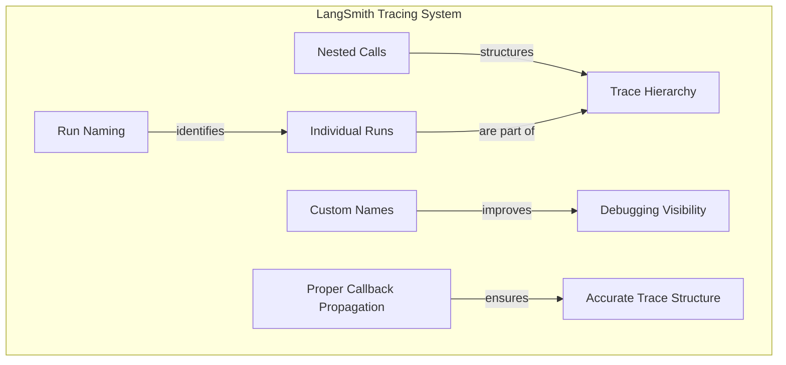
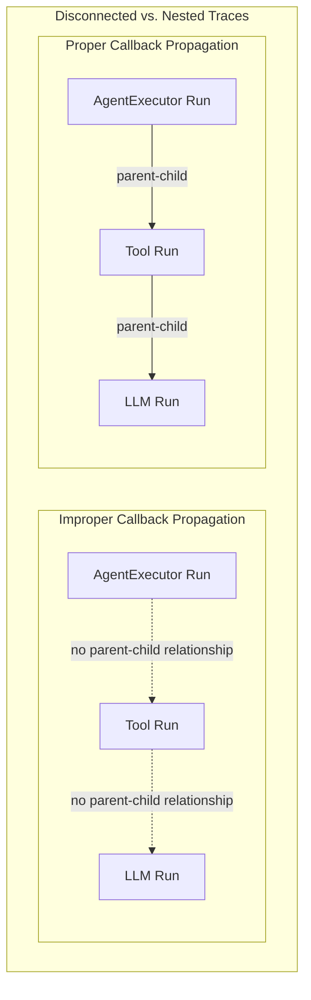
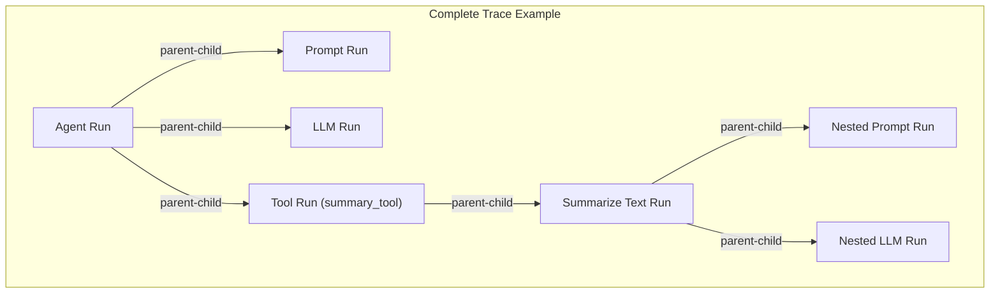

<!-- source: DeepWiki mcp.deepwiki.com · repo langchain-ai/langsmith-cookbook · page 2.3 Run Naming and Nested Calls · fetched 2026-10-26 -->

# Run Naming and Nested Calls

<details>
<summary>Relevant source files</summary>

The following files were used as context for generating this wiki page:

- [.github/workflows/test-cookbooks.yml](.github/workflows/test-cookbooks.yml)
- [_scripts/requirements.txt](_scripts/requirements.txt)
- [_scripts/test-cookbooks.py](_scripts/test-cookbooks.py)
- [testing-examples/dynamic-data/testing_dynamic_data.ipynb](testing-examples/dynamic-data/testing_dynamic_data.ipynb)
- [tracing-examples/nesting-tools/nest_runs_within_tools.ipynb](tracing-examples/nesting-tools/nest_runs_within_tools.ipynb)
- [tracing-examples/runnable-naming/run-naming.ipynb](tracing-examples/runnable-naming/run-naming.ipynb)

</details>


This page explains how to customize run names and properly structure nested calls within LangSmith traces. Run names help you identify and query specific components in your traces, while properly nested calls ensure that your trace hierarchy reflects the actual execution flow of your application.

## Overview of Run Naming and Nested Calls

In LangSmith, every traced run receives a name that identifies it in the UI and can be used to query specific runs. By default, most components receive automatically generated names, but you can customize these names for greater clarity.

Additionally, when your application contains nested components (like an agent calling a tool that uses an LLM), proper callback propagation ensures these appear as a hierarchical trace rather than separate, disconnected traces.



Sources: [tracing-examples/runnable-naming/run-naming.ipynb:8-17](), [tracing-examples/nesting-tools/nest_runs_within_tools.ipynb:9-18]()

## Run Naming

### Default Naming Behavior

By default, LangSmith assigns names to runs based on the class name of the invoked object. For example, a chain created from a `RunnableSequence` class will be named "RunnableSequence" in the trace.

### Customizing Run Names

To customize the name of a run, use the `with_config()` method with the `run_name` parameter:

```mermaid
graph LR
    subgraph "Run Naming Process"
        Runnable["Runnable Object"] -->|"with_config({\"run_name\": \"Custom Name\"})"| NamedRunnable["Named Runnable"]
        NamedRunnable -->|invoke/run| Trace["Trace with Custom Name"]
    end
```

Sources: [tracing-examples/runnable-naming/run-naming.ipynb:11-16]()

#### Supported Components

Not all components support custom naming. Currently, only these types support it:
- Chains
- General runnables
- RunnableLambdas

Components that don't support custom naming include:
- LLMs
- Chat models
- Prompts
- Retrievers

Sources: [tracing-examples/runnable-naming/run-naming.ipynb:15-16]()

### Examples of Run Naming

#### Simple Chain Example

```mermaid
graph TD
    subgraph "Simple Chain Naming"
        PromptTemplate["PromptTemplate"] -->|pipe| ChatModel["ChatOpenAI"]
        ChatModel -->|"with_config({\"run_name\": \"StringReverse\"})"| NamedChain["Named Chain"]
        NamedChain -->|invoke| Trace["Trace with name 'StringReverse'"]
    end
```

This example demonstrates how to customize the name of a simple chain that reverses a string. The chain itself receives the custom name "StringReverse".

Sources: [tracing-examples/runnable-naming/run-naming.ipynb:98-110]()

#### Runnable Lambda Example

For functions wrapped as RunnableLambdas, the default name is the function name, but you can customize it with `with_config`:

```mermaid
graph TD
    subgraph "RunnableLambda Naming"
        Function["reverse_and_concat()"] -->|wrapped as| RunnableLambda["RunnableLambda"]
        RunnableLambda -->|default name| DefaultTrace["Trace with name 'reverse_and_concat'"]
        RunnableLambda -->|"with_config({\"run_name\": \"LambdaReverse\"})"| CustomNamedLambda["Custom Named Lambda"]
        CustomNamedLambda -->|invoke| CustomTrace["Trace with name 'LambdaReverse'"]
    end
```

Sources: [tracing-examples/runnable-naming/run-naming.ipynb:176-179](), [tracing-examples/runnable-naming/run-naming.ipynb:278-285]()

#### Agent Example

Agent executors can also be given custom names:

```mermaid
graph TD
    subgraph "Agent Naming"
        Agent["Agent Executor"] -->|"with_config({\"run_name\": \"File Agent\"})"| NamedAgent["Named Agent"]
        NamedAgent -->|invoke| Trace["Trace with name 'File Agent'"]
    end
```

Sources: [tracing-examples/runnable-naming/run-naming.ipynb:399-404]()

## Nested Calls

When your application contains nested components (for example, a tool that calls an LLM), you need to ensure proper callback propagation to maintain the hierarchical structure of your traces.

### The Problem of Disconnected Traces

Without proper callback propagation, nested calls appear as separate, disconnected traces in LangSmith rather than as children of their parent run.



Sources: [tracing-examples/nesting-tools/nest_runs_within_tools.ipynb:12-18]()

### Implementation Approaches

#### Using the @tool Decorator

When using the `@tool` decorator, include a `callbacks` parameter in your function and pass it to any nested components:

```mermaid
graph TD
    subgraph "@tool Decorator Approach"
        ToolFunction["@tool function(callbacks=None)"] -->|"includes callbacks parameter"| NestedChain["summary_chain.invoke()"]
        NestedChain -->|"passes {\"callbacks\": callbacks}"| ProperTrace["Properly Nested Trace"]
    end
```

Sources: [tracing-examples/nesting-tools/nest_runs_within_tools.ipynb:87-101]()

#### Subclassing BaseTool

When subclassing `BaseTool`, use the `run_manager` parameter in your `_run` method:

```mermaid
graph TD
    subgraph "BaseTool Subclass Approach"
        BaseTool["CustomSummarizer class"] -->|"_run(run_manager=None)"| GetCallbacks["callbacks = run_manager.get_child()"]
        GetCallbacks -->|"passes {\"callbacks\": callbacks}"| NestedChain["summary_chain.invoke()"]
        NestedChain --> ProperTrace["Properly Nested Trace"]
    end
```

Sources: [tracing-examples/nesting-tools/nest_runs_within_tools.ipynb:151-182]()

## Practical Application

### Querying Runs by Name

Custom run names make it easy to query for specific runs using the LangSmith client:

```
client.list_runs(project_name="your_project", filter='eq(name, "StringReverse")')
```

This is particularly useful when you want to analyze the performance of specific components across multiple executions.

Sources: [tracing-examples/runnable-naming/run-naming.ipynb:166]()

### Complete Trace Example

When properly implemented, a trace with nested calls will show a hierarchical structure:



Sources: [tracing-examples/nesting-tools/nest_runs_within_tools.ipynb:297-299]()

## Best Practices

1. **Use meaningful run names** to make traces more intelligible at a glance
2. **Always propagate callbacks** when implementing custom tools or components
3. **Check trace structure** in the LangSmith UI to ensure proper nesting
4. **Use run names for filtering** when analyzing run performance
5. **Apply naming conventions** consistently across your application for easier tracking

## Troubleshooting

If you notice that your traces are not properly nested, check that:

1. Your custom tool correctly accepts and passes the `callbacks` parameter
2. When subclassing `BaseTool`, you're using `run_manager.get_child()` to obtain the child callbacks
3. LangChain version is up-to-date (naming behavior may vary in older versions)

Sources: [tracing-examples/nesting-tools/nest_runs_within_tools.ipynb:310-314]()

---

