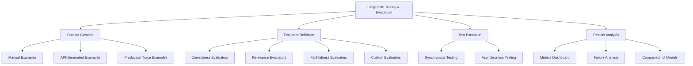
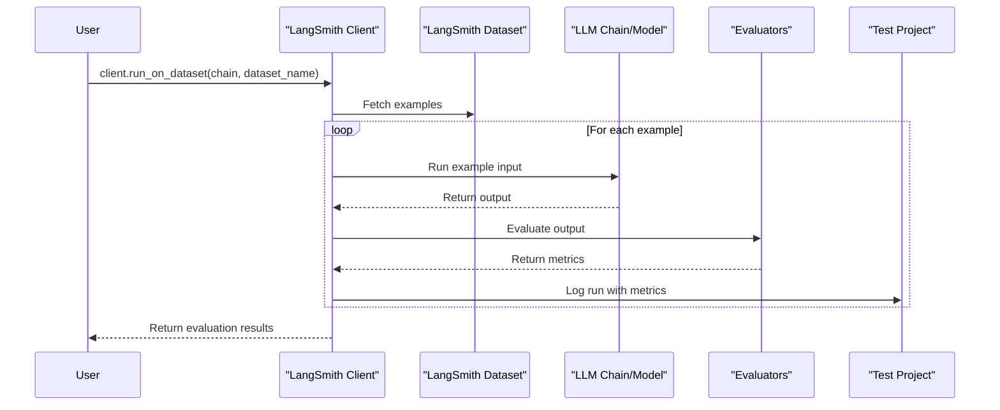
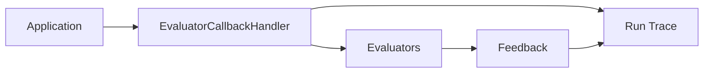
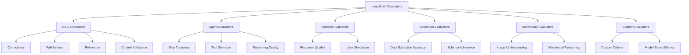
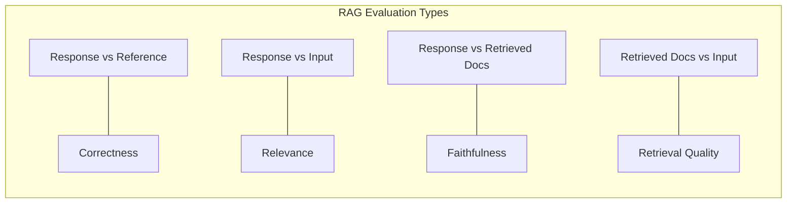
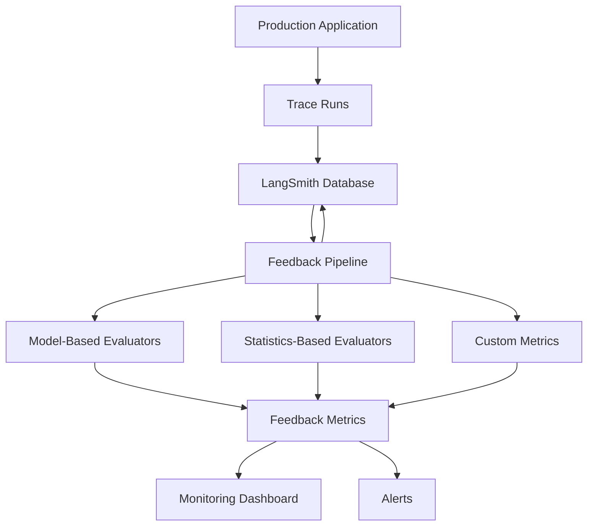
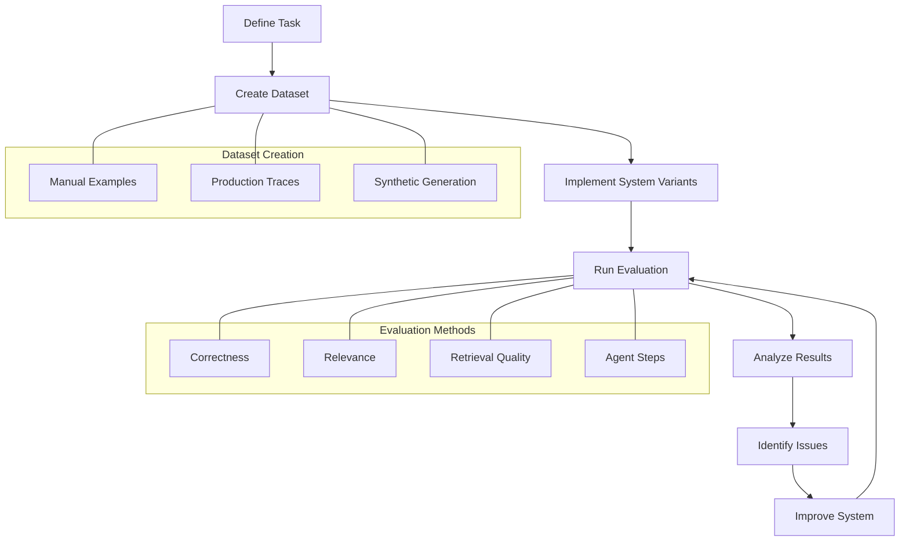

<!-- source: DeepWiki mcp.deepwiki.com · repo langchain-ai/langsmith-cookbook · page 3 Testing & Evaluation · fetched 2026-10-26 -->

# Testing & Evaluation

<details>
<summary>Relevant source files</summary>

The following files were used as context for generating this wiki page:

- [README.md](README.md)
- [feedback-examples/algorithmic-feedback/algorithmic_feedback.ipynb](feedback-examples/algorithmic-feedback/algorithmic_feedback.ipynb)
- [introduction/langsmith_introduction.ipynb](introduction/langsmith_introduction.ipynb)
- [introduction/online_evaluation.ipynb](introduction/online_evaluation.ipynb)
- [introduction/summarization.ipynb](introduction/summarization.ipynb)
- [testing-examples/README.md](testing-examples/README.md)
- [testing-examples/comparing-runs/comparing-qa.ipynb](testing-examples/comparing-runs/comparing-qa.ipynb)
- [testing-examples/qa-correctness/qa-correctness.ipynb](testing-examples/qa-correctness/qa-correctness.ipynb)
- [testing-examples/rag_eval/online_eval.ipynb](testing-examples/rag_eval/online_eval.ipynb)
- [testing-examples/rag_eval/rag.ipynb](testing-examples/rag_eval/rag.ipynb)

</details>


Testing and evaluation are critical components of developing robust LLM-powered applications. LangSmith provides comprehensive tools for benchmarking, debugging, and improving your LLM systems across various use cases including RAG (Retrieval Augmented Generation), agents, chatbots, and more. This page covers the core testing and evaluation capabilities in LangSmith and how to implement effective evaluation pipelines.

For information about feedback collection, see [Feedback Collection](#4). For running specific evaluation types like RAG evaluations, see [RAG Evaluation](#3.1).

## Core Concepts

Testing and evaluation in LangSmith involves several key components:

1. **Datasets** - Collections of examples (inputs/outputs) used for benchmarking
2. **Evaluators** - Components that assess output quality based on specific criteria
3. **Testing Methods** - Approaches for running evaluations (synchronous or asynchronous)
4. **Evaluation Types** - Specialized evaluations for different LLM applications (RAG, agents, etc.)



Sources: [README.md:16-71](), [testing-examples/README.md:1-40]()

## Evaluation Architecture

LangSmith supports two primary evaluation approaches:

### 1. Synchronous Evaluation

The `client.run_on_dataset()` method executes a chain or model against a dataset and records the results. This is the most common approach for offline testing.



Example usage:

```python
from langsmith import Client

client = Client()
results = client.run_on_dataset(
    dataset_name="My Test Dataset",
    llm_or_chain=my_chain,
    evaluation=my_evaluators,
    project_name="My Test Project"
)
```

### 2. Asynchronous Evaluation

Using the `EvaluatorCallbackHandler` to evaluate outputs in real-time as they're generated:



Sources: [README.md:31-35](), [feedback-examples/algorithmic-feedback/algorithmic_feedback.ipynb:7-27]()

## Creating Datasets for Evaluation

LangSmith datasets are collections of examples used to test your models and chains. There are several ways to create datasets:

1. Manually via the LangSmith UI
2. Programmatically via the client API
3. By converting existing traces/runs

```python
from langsmith import Client

client = Client()
dataset = client.create_dataset("RAG Test Dataset")

# Add examples to the dataset
for question, answer in examples:
    client.create_example(
        inputs={"question": question},
        outputs={"answer": answer},
        dataset_id=dataset.id
    )
```

Sources: [testing-examples/qa-correctness/qa-correctness.ipynb:85-103](), [testing-examples/comparing-runs/comparing-qa.ipynb:118-159]()

## Evaluation Types

LangSmith supports various evaluation types tailored to different LLM applications:



Sources: [README.md:36-74](), [testing-examples/README.md:8-33]()

### RAG Evaluation

RAG systems combine retrieval with generation and require specialized evaluation approaches that measure both components:



LangSmith can evaluate four critical aspects of RAG systems:

1. **Response vs. reference answer**: How correct is the answer compared to ground truth?
2. **Response vs. input**: How relevant is the response to the query?
3. **Response vs. retrieved docs**: How faithful is the response to the retrieved context?
4. **Retrieved docs vs. input**: How well does the retriever work for the query?

Example RAG evaluation:

```python
from langsmith import Client

client = Client()
results = client.run_on_dataset(
    dataset_name="RAG Test Dataset",
    llm_or_chain=rag_chain,
    evaluation=[
        "correctness",    # Compare to reference
        "faithfulness",   # Check hallucinations
        "relevance"       # Assess answer relevance
    ]
)
```

Sources: [testing-examples/rag_eval/rag.ipynb:16-29](), [testing-examples/qa-correctness/qa-correctness.ipynb:22-32]()

### Agent Evaluation

Agent evaluation focuses on assessing the reasoning steps, tool selection, and overall performance of agent systems:

```python
from langsmith import Client

client = Client()
results = client.run_on_dataset(
    dataset_name="Agent Test Dataset",
    llm_or_chain=agent,
    evaluation=[
        "trajectory",  # Assess step sequence
        "tool_selection",  # Evaluate tool choices
        "reasoning"  # Review reasoning quality
    ]
)
```

Sources: [README.md:58-62](), [testing-examples/README.md:25-28]()

### Chatbot Evaluation

Chatbot evaluation can include both single-turn assessments and multi-turn conversation simulations:

```python
from langsmith import Client

client = Client()
results = client.run_on_dataset(
    dataset_name="Chatbot Test Dataset",
    llm_or_chain=chatbot,
    evaluation=["response_quality", "helpfulness"]
)
```

Sources: [README.md:48-51](), [testing-examples/README.md:15-18]()

### Data Extraction Evaluation

For structured data extraction tasks, LangSmith provides specialized evaluators:

```python
from langsmith import Client

client = Client()
results = client.run_on_dataset(
    dataset_name="Extraction Test Dataset",
    llm_or_chain=extraction_chain,
    evaluation=["json_structure", "extraction_accuracy"]
)
```

Sources: [README.md:53-57](), [testing-examples/README.md:21-23]()

## Evaluators

LangSmith supports three types of evaluators:

1. **String Evaluators**: Compare string outputs (exact match, regex, etc.)
2. **LLM-assisted Evaluators**: Use language models to evaluate outputs
3. **Custom Evaluators**: User-defined functions for specialized evaluation

### String-Based Evaluators

Simple evaluators that perform deterministic comparisons:

```python
from langchain.evaluation import ExactMatchStringEvaluator, RegexMatchStringEvaluator

exact_match = ExactMatchStringEvaluator()
regex_match = RegexMatchStringEvaluator(regex=r"\d{3}-\d{2}-\d{4}")
```

### LLM-Assisted Evaluators

These evaluators use language models to assess outputs:

```python
from langchain.evaluation import load_evaluator
from langchain_openai import ChatOpenAI

# Correctness evaluator
correctness = load_evaluator("correctness", llm=ChatOpenAI())

# Criteria evaluator with custom rubric
criteria_evaluator = load_evaluator(
    "criteria",
    criteria={
        "relevance": "Is the response relevant to the query?",
        "accuracy": "Does the response contain factual errors?",
        "helpfulness": "Is the response helpful?"
    },
    llm=ChatOpenAI()
)
```

### Custom Evaluators

For specialized needs, you can create custom evaluation functions:

```python
def my_custom_evaluator(run, example):
    prediction = run.outputs["output"]
    reference = example.outputs["answer"]
    # Custom evaluation logic
    score = compute_custom_score(prediction, reference)
    return {"key": "custom_metric", "score": score}
```

Sources: [testing-examples/qa-correctness/qa-correctness.ipynb:339-377](), [feedback-examples/algorithmic-feedback/algorithmic_feedback.ipynb:200-226]()

## Running Evaluations

### Synchronous Evaluation with Client

The most common approach is using the `run_on_dataset` method:

```python
from langsmith import Client

client = Client()
evaluation_results = client.run_on_dataset(
    dataset_name="My Test Dataset",
    llm_or_chain=my_chain,
    evaluation=[
        "correctness",
        "relevance",
        {"name": "custom", "func": my_custom_evaluator}
    ],
    project_name="My Test Project",
    metadata={"version": "v1.0"}
)
```

### Asynchronous Evaluation with Callbacks

For real-time evaluation during production:

```python
from langchain.callbacks import EvaluatorCallbackHandler
from langchain.evaluation import load_evaluator

evaluator = load_evaluator("correctness")
callback = EvaluatorCallbackHandler(evaluators=[evaluator])

# Use callback with chain
response = chain.invoke(inputs, callbacks=[callback])
```

Sources: [README.md:31-35](), [feedback-examples/algorithmic-feedback/algorithmic_feedback.ipynb:108-117]()

## Algorithmic Feedback

Beyond standard testing, LangSmith supports creating automated feedback pipelines to monitor production systems:



Example of setting up an algorithmic feedback pipeline:

```python
from langsmith import Client
from langchain_core.runnables import RunnableLambda

def compute_feedback(run):
    # Extract data from the run
    if "input" not in run.inputs:
        return
    
    text = run.inputs["input"]
    response = run.outputs["output"]
    
    # Compute metrics and log as feedback
    client.create_feedback(
        run.id,
        key="relevance_score",
        score=compute_relevance(text, response),
        feedback_source_type="model"
    )

# Process runs from a project
runs = client.list_runs(project_name="Production Project")
RunnableLambda(compute_feedback).batch(runs, {"max_concurrency": 10})
```

Sources: [feedback-examples/algorithmic-feedback/algorithmic_feedback.ipynb:7-27](), [feedback-examples/algorithmic-feedback/algorithmic_feedback.ipynb:154-226]()

## Testing Fundamentals

### Creating a Test Project

Test projects organize your evaluation results:

```python
from langsmith import Client

client = Client()
results = client.run_on_dataset(
    dataset_name="My Dataset",
    llm_or_chain=my_chain,
    evaluation=["correctness"],
    project_name="My Test Project"  # Creates or uses existing project
)
```

### Naming Test Projects

For better organization, use descriptive project names:

```python
from langsmith import Client

client = Client()
results = client.run_on_dataset(
    dataset_name="RAG Dataset",
    llm_or_chain=rag_chain,
    evaluation=["correctness", "faithfulness"],
    project_name="rag-evaluation-2023-11-15"  # Date-based naming
)
```

### Exporting Test Results

Export results for external analysis:

```python
from langsmith import Client

client = Client()
test_results = client.get_test_results(project_name="My Test Project")
test_results.to_csv("test_results.csv")
```

### Adding Metrics to Existing Tests

You can apply new evaluators to existing test runs:

```python
from langsmith import Client

client = Client()
client.compute_test_metrics(
    project_name="My Test Project",
    evaluators=["new_evaluator"],
)
```

Sources: [testing-examples/README.md:35-40](), [README.md:69-74]()

## Common Evaluation Workflows



### Comparing Multiple Implementations

A common workflow is comparing different versions of a system:

```python
from langsmith import Client

client = Client()

# Evaluate first variant
results_v1 = client.run_on_dataset(
    dataset_name="Test Dataset",
    llm_or_chain=chain_v1,
    evaluation=["correctness"],
    project_name="comparison-test-v1"
)

# Evaluate second variant
results_v2 = client.run_on_dataset(
    dataset_name="Test Dataset",
    llm_or_chain=chain_v2,
    evaluation=["correctness"],
    project_name="comparison-test-v2"
)

# Compare results in the LangSmith UI
```

Sources: [testing-examples/comparing-runs/comparing-qa.ipynb:8-31]()

## Best Practices

1. **Create comprehensive datasets** that cover a wide range of inputs
2. **Use multiple evaluation metrics** to get a holistic view of performance
3. **Test component by component** before testing the entire system
4. **Compare different implementations** to identify the best approach
5. **Conduct regular regression testing** when making changes
6. **Implement automated evaluation** for continuous monitoring
7. **Use both quantitative metrics and qualitative feedback**

Sources: [testing-examples/qa-correctness/qa-correctness.ipynb:22-32](), [testing-examples/README.md:1-7]()

## Conclusion

LangSmith's testing and evaluation capabilities provide a robust framework for developing, improving, and monitoring LLM-powered applications. By creating appropriate datasets, selecting relevant evaluators, and implementing systematic testing workflows, you can ensure your systems perform reliably and meet quality standards.

For specific evaluation approaches for different application types, refer to the specialized sections in this documentation, including [RAG Evaluation](#3.1), [Agent Evaluation](#3.2), and [Chatbot Evaluation](#3.3).

---

