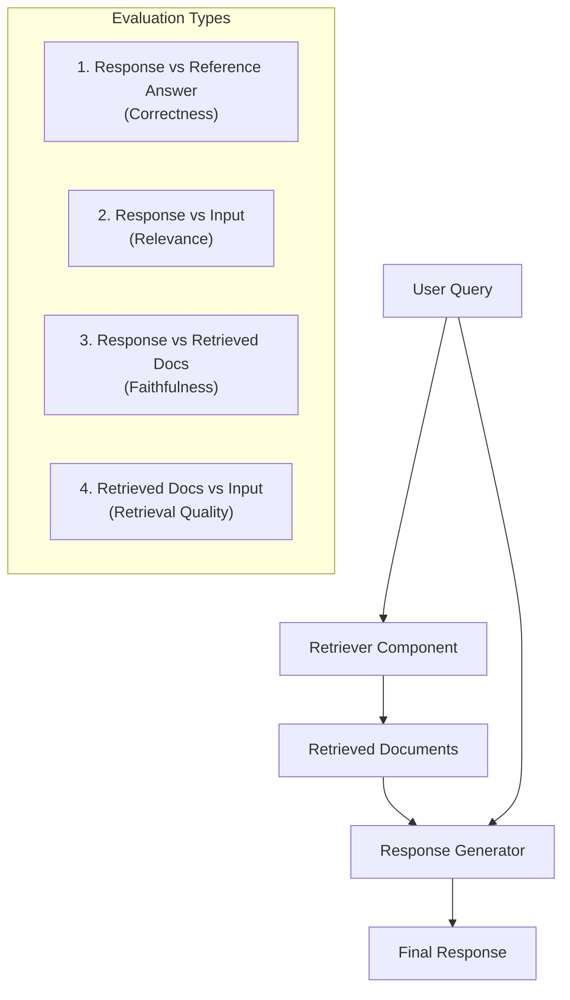
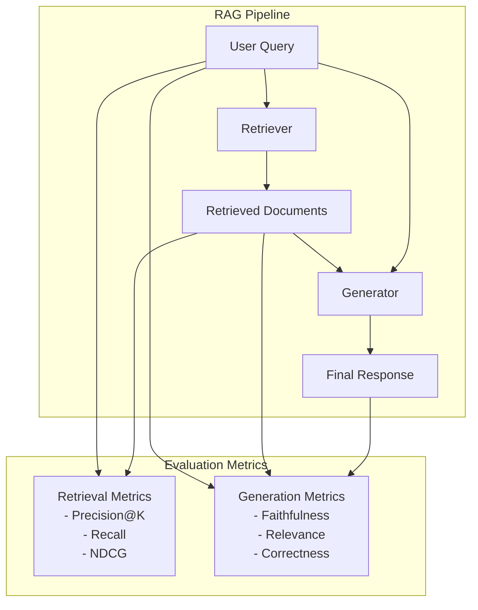
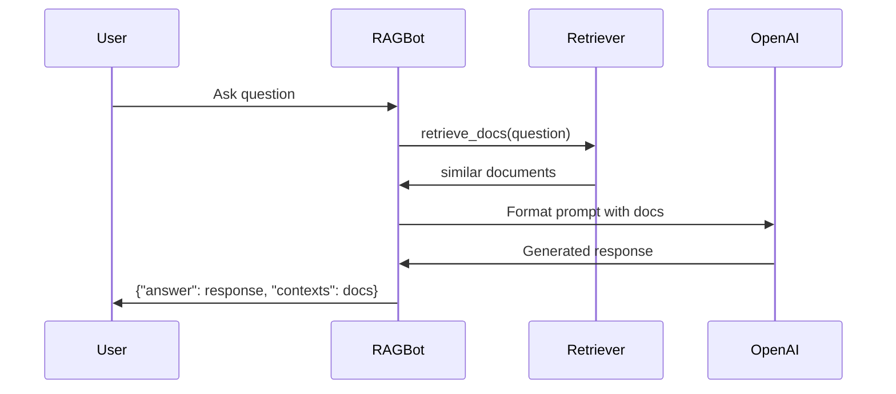
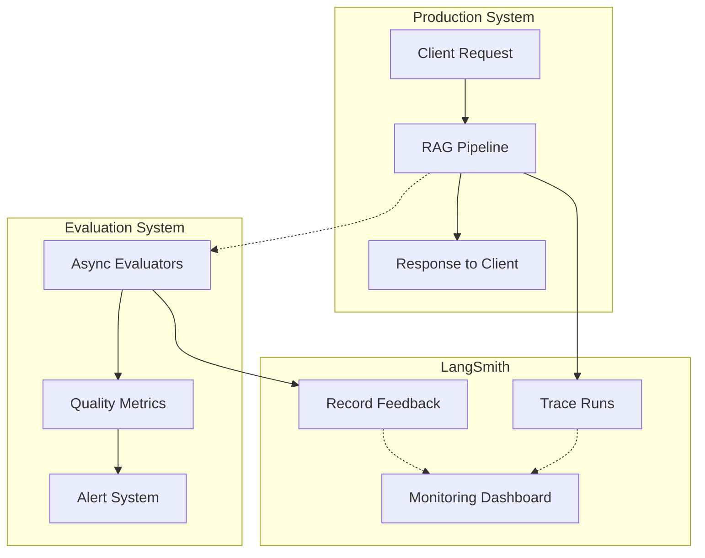

<!-- source: DeepWiki mcp.deepwiki.com · repo langchain-ai/langsmith-cookbook · page 3.1 RAG Evaluation · fetched 2026-10-26 -->

# RAG Evaluation

<details>
<summary>Relevant source files</summary>

The following files were used as context for generating this wiki page:

- [feedback-examples/realtime-algorithmic-feedback/img/feedback_result.png](feedback-examples/realtime-algorithmic-feedback/img/feedback_result.png)
- [feedback-examples/realtime-algorithmic-feedback/realtime_feedback.ipynb](feedback-examples/realtime-algorithmic-feedback/realtime_feedback.ipynb)
- [feedback-examples/streamlit-realtime-feedback/README.md](feedback-examples/streamlit-realtime-feedback/README.md)
- [introduction/langsmith_introduction.ipynb](introduction/langsmith_introduction.ipynb)
- [introduction/online_evaluation.ipynb](introduction/online_evaluation.ipynb)
- [introduction/summarization.ipynb](introduction/summarization.ipynb)
- [testing-examples/download-feedback-and-examples/download_example.ipynb](testing-examples/download-feedback-and-examples/download_example.ipynb)
- [testing-examples/export-test-to-csv/export-test-to-csv.ipynb](testing-examples/export-test-to-csv/export-test-to-csv.ipynb)
- [testing-examples/movie-demo/optimization.ipynb](testing-examples/movie-demo/optimization.ipynb)
- [testing-examples/movie-demo/prompt_iteration.ipynb](testing-examples/movie-demo/prompt_iteration.ipynb)
- [testing-examples/rag_eval/online_eval.ipynb](testing-examples/rag_eval/online_eval.ipynb)
- [testing-examples/rag_eval/rag.ipynb](testing-examples/rag_eval/rag.ipynb)
- [testing-examples/using-fixed-sources/using_fixed_sources.ipynb](testing-examples/using-fixed-sources/using_fixed_sources.ipynb)

</details>


Retrieval Augmented Generation (RAG) is a popular approach for building applications with large language models (LLMs). This guide covers comprehensive strategies for evaluating RAG systems using LangSmith, focusing on measuring the quality and accuracy of both retrieved information and generated responses. For information about general evaluation methodologies, see [Testing & Evaluation](#3).

## What is RAG Evaluation?

RAG evaluation is the systematic assessment of how well a retrieval-augmented generation system performs. It involves measuring both the retrieval component (finding relevant documents) and the generation component (producing accurate, coherent responses based on retrieved information). Effective evaluation is critical because RAG systems can fail in multiple ways - retrieving irrelevant documents, ignoring retrieved context, or hallucinating information.



Sources: [testing-examples/rag_eval/rag.ipynb:16-22]()

## Types of RAG Evaluation

LangSmith supports four primary types of RAG evaluation, each measuring a different aspect of the system:

1. **Response vs Reference Answer**: Compares the model's answer against a ground-truth label to measure correctness
2. **Response vs Input**: Evaluates how well the generated response addresses the user's query (relevance, helpfulness)
3. **Response vs Retrieved Docs**: Assesses whether the response is faithful to the retrieved context (avoiding hallucinations)
4. **Retrieved Docs vs Input**: Measures the quality and relevance of the retrieval component

The following diagram illustrates these evaluation types within the RAG pipeline:



Sources: [testing-examples/rag_eval/rag.ipynb:15-25](), [testing-examples/rag_eval/rag.ipynb:26-30]()

## Building a RAG Pipeline for Evaluation

Before evaluation, you need a RAG pipeline. The following example demonstrates how to build a simple RAG system using LangSmith for tracing:



The implementation includes a `RagBot` class with two key methods:
- `retrieve_docs`: Obtains relevant documents for a query
- `get_answer`: Generates an answer based on retrieved documents

Sources: [testing-examples/rag_eval/rag.ipynb:99-142](), [testing-examples/rag_eval/rag.ipynb:26-30]()

## Creating Evaluation Datasets

To evaluate a RAG system, you need a dataset of examples. The examples should include:

- Input questions
- Expected answers (for correctness evaluation)
- Optional metadata

Here's how to create a dataset in LangSmith:

```python
# Create examples
inputs = ["How can I make the output of my LCEL chain a string?", ...]
outputs = ["Use StrOutputParser. from langchain_openai import...", ...]

# Create dataset
dataset = client.create_dataset(dataset_name="RAG_test_LCEL")
client.create_examples(
    inputs=[{"question": q} for q in inputs],
    outputs=[{"answer": a} for a in outputs],
    dataset_id=dataset.id,
)
```

Sources: [testing-examples/rag_eval/rag.ipynb:183-233]()

## Implementing Evaluators

Evaluators measure specific aspects of your RAG system. Here are examples of common evaluators:

### 1. Correctness Evaluator

Compares the model's response to a reference answer:

```python
def correct_label(run, example) -> dict:
    score = run.outputs.get("output") == example.outputs.get("label")
    return {"score": int(score)}
```

### 2. Faithfulness Evaluator

Checks if the response accurately represents information from the retrieved documents:

```python
class FaithfulnessEvaluator(RunEvaluator):
    def __init__(self):
        self.evaluator = load_evaluator(
            "labeled_score_string",
            criteria={
                "faithfulness": """
Score 1: The answer directly contradicts the information provided in the reference docs.
Score 10: The answer perfectly aligns with and is fully entailed by the reference docs.
"""
            },
            normalize_by=10,
        )

    def evaluate_run(self, run, example=None):
        # Extract retrieval results
        retrieve_docs_run = [run for run in run.child_runs if run.name == "RetrieveDocs"][0]
        docs_string = f'Reference docs:\n{retrieve_docs_run.outputs["documents"]}'
        
        # Evaluate faithfulness
        result = self.evaluator.evaluate_strings(
            input=run.inputs["query"],
            prediction=run.outputs["output"],
            reference=docs_string,
        )
        return EvaluationResult(key="faithfulness", **result)
```

Sources: [feedback-examples/streamlit-realtime-feedback/README.md:92-127]()

### 3. Relevance Evaluator

Assesses how well the response addresses the user's question:

```python
class RelevanceEvaluator(RunEvaluator):
    def __init__(self):
        self.evaluator = load_evaluator("score_string", criteria="relevance", normalize_by=10)
        
    def evaluate_run(self, run, example=None):
        result = self.evaluator.evaluate_strings(
            input=run.inputs["query"],
            prediction=run.outputs["output"]
        )
        return EvaluationResult(key="relevance", **result)
```

Sources: [feedback-examples/streamlit-realtime-feedback/README.md:58-81]()

## Running Evaluations

LangSmith provides two primary ways to run evaluations:

### 1. Batch Evaluation

Evaluates a system against a dataset all at once:

```python
from langsmith.evaluation import evaluate

results = evaluate(
    lambda inputs: rag_bot.get_answer(inputs["question"]),
    data="RAG_test_LCEL",
    evaluators=[correct_label],
    experiment_prefix="RAG Evaluation"
)
```

Sources: [testing-examples/rag_eval/rag.ipynb:188-218]()

### 2. Real-time Evaluation

Attaches evaluators as callbacks to provide continuous feedback:

```python
from langchain_core.tracers import EvaluatorCallbackHandler

evaluator = FaithfulnessEvaluator()
feedback_callback = EvaluatorCallbackHandler(evaluators=[evaluator])

# Use in chain
chain.invoke(input_dict, {"callbacks": [feedback_callback]})
```

Sources: [feedback-examples/realtime-algorithmic-feedback/realtime_feedback.ipynb:167-173](), [feedback-examples/streamlit-realtime-feedback/README.md:143-151]()

## Advanced RAG Evaluation Techniques

### Evaluating Individual Components

For more precise analysis, you can evaluate retrieval and generation components separately:

```mermaid
flowchart LR
    subgraph "Component Isolation"
        direction TB
        R["Retriever Evaluation"]
        G["Generator Evaluation"]
    end
    
    subgraph "Test Data"
        direction TB
        Q["Questions"]
        F["Fixed Source Documents"]
        A["Expected Answers"]
    end
    
    Q --> R
    Q --> G
    F --> G
    R -.-> "Retrieval Metrics"
    G -.-> "Generation Metrics"
    A -.-> "Generation Metrics"
```

To evaluate the response generator in isolation:
1. Create a dataset with queries and *fixed* retrieved documents
2. Evaluate only the generation component using these fixed documents
3. Measure faithfulness and correctness

Sources: [testing-examples/using-fixed-sources/using_fixed_sources.ipynb:15-21](), [testing-examples/using-fixed-sources/using_fixed_sources.ipynb:51-66]()

### Online Evaluation 

Monitor your RAG system's performance in production:



Online evaluation allows you to:
- Detect hallucinations in real-time
- Monitor system quality without impacting user experience
- Collect example cases for further training and improvement

Sources: [testing-examples/rag_eval/online_eval.ipynb:8-16](), [feedback-examples/streamlit-realtime-feedback/README.md:6-10]()

## Analyzing Evaluation Results

After running evaluations, analyze the results to identify patterns and improve your system:

1. **Review metrics across examples**: Identify where your system performs well or struggles
2. **Identify common failure modes**: Look for patterns in low-scoring examples
3. **Iterate on components**: Use findings to improve retrieval strategies or prompt engineering
4. **Export feedback for further analysis**: Download data for custom analysis

```python
# Download evaluation results
from langsmith import Client
client = Client()

# Get all runs with feedback
runs = client.list_runs(
    project_name="my_rag_project",
    filter=f"has_feedback:true"
)

# Extract feedback and examples
feedback_data = []
for run in runs:
    feedback = client.list_feedback(run_ids=[run.id])
    feedback_data.append({
        "query": run.inputs.get("question"),
        "response": run.outputs.get("output"),
        "faithfulness_score": next((f.score for f in feedback if f.key == "faithfulness"), None),
        "correctness_score": next((f.score for f in feedback if f.key == "correctness"), None)
    })
```

Sources: [testing-examples/download-feedback-and-examples/download_example.ipynb:175-203]()

## Best Practices for RAG Evaluation

1. **Use multiple evaluation metrics**: Combine correctness, faithfulness, and relevance metrics
2. **Isolate components**: Evaluate retrieval and generation separately for targeted improvements
3. **Include challenging examples**: Add examples where:
   - Reference documents contain conflicting information
   - Queries require synthesizing multiple documents
   - The system should acknowledge lack of information
4. **Implement real-time evaluation**: Use callbacks for continuous monitoring
5. **Combine automatic and human evaluation**: Automatic metrics provide scale, while human feedback provides nuance

Sources: [testing-examples/rag_eval/rag.ipynb:15-25](), [feedback-examples/streamlit-realtime-feedback/README.md:6-11](), [testing-examples/using-fixed-sources/using_fixed_sources.ipynb:9-21]()

## Summary

Effective RAG evaluation requires measuring multiple aspects of system performance. LangSmith provides tools for comprehensive evaluation including:

- Multiple evaluation types addressing different failure modes
- Support for both batch and real-time evaluation
- Customizable evaluators for specific metrics
- Tools for analyzing results and iterating on system components

By implementing structured evaluation practices, you can build more reliable and accurate RAG systems that properly leverage retrieved information and minimize hallucinations.

---

