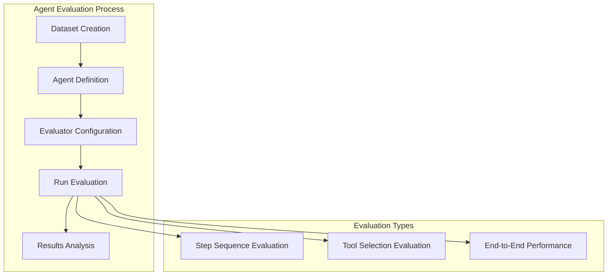
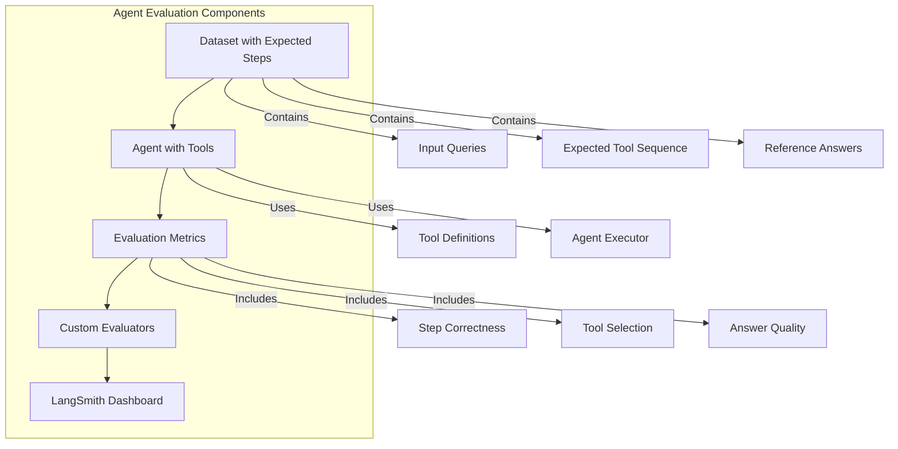
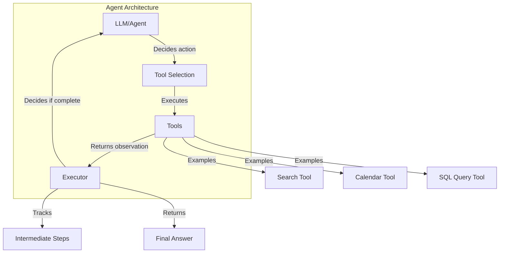
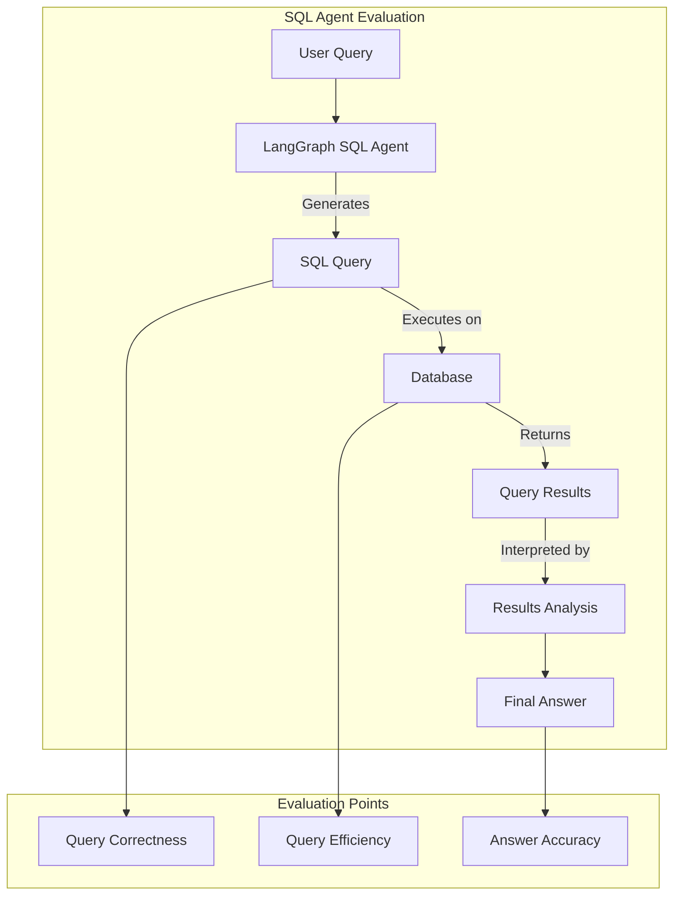

<!-- source: DeepWiki mcp.deepwiki.com · repo langchain-ai/langsmith-cookbook · page 3.2 Agent Evaluation · fetched 2026-10-26 -->

# Agent Evaluation

<details>
<summary>Relevant source files</summary>

The following files were used as context for generating this wiki page:

- [testing-examples/agent-evals-with-langgraph/langgraph_sql_agent_eval.ipynb](testing-examples/agent-evals-with-langgraph/langgraph_sql_agent_eval.ipynb)
- [testing-examples/agent_steps/evaluating_agents.ipynb](testing-examples/agent_steps/evaluating_agents.ipynb)
- [testing-examples/chat-single-turn/chat_evaluation_single_turn.ipynb](testing-examples/chat-single-turn/chat_evaluation_single_turn.ipynb)
- [testing-examples/data-extraction/contract-extraction.ipynb](testing-examples/data-extraction/contract-extraction.ipynb)
- [testing-examples/data-extraction/img/contract-extraction-dataset.png](testing-examples/data-extraction/img/contract-extraction-dataset.png)

</details>


This page provides a comprehensive guide to evaluating LLM agents using LangSmith. Agent evaluation differs from standard LLM evaluations because it focuses on assessing both the final outputs and the decision-making process of agents. For information about evaluating RAG systems, see [RAG Evaluation](#3.1), and for evaluating chatbots, refer to [Chatbot Evaluation](#3.3).

## Overview

Agent evaluation in LangSmith enables developers to assess how well agents make decisions, select appropriate tools, and execute their problem-solving process. Unlike simpler evaluations that only examine input-output pairs, agent evaluation analyzes the entire trajectory of an agent's execution.



Sources: [testing-examples/agent_steps/evaluating_agents.ipynb:7-24]()

## Key Components

Agent evaluation involves several key components that work together to provide comprehensive insights into agent performance:



Sources: [testing-examples/agent_steps/evaluating_agents.ipynb:57-64](), [testing-examples/agent_steps/evaluating_agents.ipynb:135-145]()

## Preparing a Dataset

Creating an effective evaluation dataset is the first step in the agent evaluation process. The dataset should include:

1. Input queries for the agent to solve
2. Expected sequences of actions/tools the agent should use
3. Reference answers for evaluating the final output

```python
questions = [
    (
        "Why was was a $10 calculator app one of the best-rated Nintendo Switch games?",
        {
            "reference": "It became an internet meme due to its high price point.",
            "expected_steps": ["duck_duck_go"],
        },
    ),
    (
        "What's my first meeting on Friday?",
        {
            "reference": 'Your first meeting is 8:30 AM for "Team Standup"',
            "expected_steps": ["check_calendar"],
        },
    ),
]
```

Sources: [testing-examples/agent_steps/evaluating_agents.ipynb:72-127]()

## Defining the Agent

For agent evaluation, you need to create an agent with access to specific tools. The agent should be configured to return intermediate steps for evaluation.

### Components of an Agent



Sources: [testing-examples/agent_steps/evaluating_agents.ipynb:134-207]()

The code for defining an agent typically includes:

1. Tool definitions
2. Agent creation with access to tools
3. Executor configuration with `return_intermediate_steps=True`

## Creating Custom Evaluators

To evaluate agent performance, you can create custom evaluators that analyze the agent's trajectory and compare it to expected steps.

```python
def intermediate_step_correctness(run: Run, example: Optional[Example] = None) -> dict:
    # Extract the sequence of tool calls from the run
    intermediate_steps = run.outputs.get("intermediate_steps") or []
    trajectory = [action.tool for action, _ in intermediate_steps]
    
    # Compare with expected trajectory from dataset
    expected_trajectory = example.outputs["expected_steps"]
    score = int(trajectory == expected_trajectory)
    
    return {"key": "Intermediate steps correctness", "score": score}
```

Sources: [testing-examples/agent_steps/evaluating_agents.ipynb:213-250]()

### Types of Agent Evaluators

| Evaluator Type | Description | Best For |
|----------------|-------------|----------|
| Step Sequence | Compares the sequence of tools used against an expected sequence | Workflows with predetermined optimal paths |
| Tool Selection | Evaluates whether appropriate tools were selected for the task | General problem-solving agents |
| End-to-End | Assesses final answer quality regardless of steps taken | Applications where only the final result matters |
| Trajectory Evaluation | Uses an LLM to grade the quality of the agent's reasoning | Complex reasoning tasks |

Sources: [testing-examples/agent_steps/evaluating_agents.ipynb:307-312]()

## Running Evaluations

Once your dataset, agent, and evaluators are ready, you can run the evaluation using LangSmith's `evaluate` function:

```python
from langsmith.evaluation import LangChainStringEvaluator, evaluate

results = evaluate(
    agent,
    data=dataset_name,
    evaluators=[intermediate_step_correctness, qa_evaluator],
    experiment_prefix="Agent Eval Example",
)
```

Sources: [testing-examples/agent_steps/evaluating_agents.ipynb:252-300]()

## LangGraph SQL Agents

LangGraph provides specialized tools for building and evaluating SQL agents. SQL agents require specific evaluation techniques to assess their ability to:

1. Generate valid SQL queries
2. Execute queries against a database
3. Interpret query results accurately
4. Respond to user questions based on database information



Sources: [testing-examples/agent-evals-with-langgraph/langgraph_sql_agent_eval.ipynb:7-20](), [testing-examples/agent-evals-with-langgraph/langgraph_sql_agent_eval.ipynb:63-69]()

### Setting Up a SQL Agent

Setting up a SQL agent involves:

1. Connecting to a database
2. Defining SQL tools for the agent
3. Creating an agent executor with appropriate configuration

```python
db = SQLDatabase.from_uri("sqlite:///Chinook.db")
```

Sources: [testing-examples/agent-evals-with-langgraph/langgraph_sql_agent_eval.ipynb:127-133]()

## Best Practices

### Dataset Design

When creating datasets for agent evaluation:

1. Include diverse queries that test different agent capabilities
2. Define explicit expected steps for each query
3. Provide comprehensive reference answers for end-to-end evaluation
4. Include edge cases to test agent robustness

### Evaluation Metrics Selection

Select appropriate evaluation metrics based on your application:

1. For workflow agents, emphasize step sequence correctness
2. For exploratory agents, focus on appropriate tool selection
3. For customer-facing applications, prioritize end-to-end answer quality

### Interpreting Results

When analyzing agent evaluation results:

1. Look for patterns in tool selection errors
2. Identify queries where the agent deviates from expected steps
3. Compare end-to-end performance against step correctness
4. Use LangSmith's visualization tools to examine problematic trajectories

## Conclusion

Agent evaluation is a critical step in developing reliable AI assistants. By evaluating both the final answers and the decision-making process, you can identify and address issues in agent reasoning, tool selection, and execution. LangSmith provides the infrastructure and tools needed to perform comprehensive agent evaluations and visualize results for actionable insights.

---

