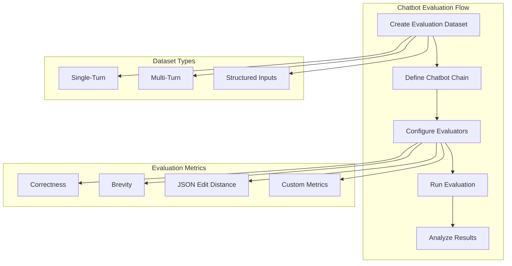
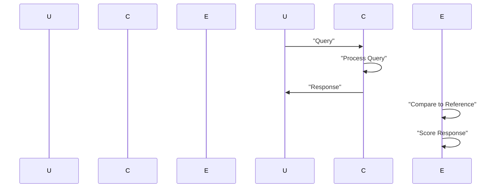
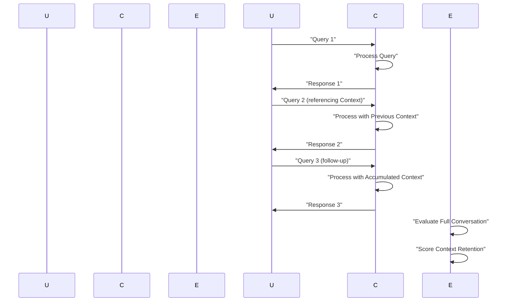
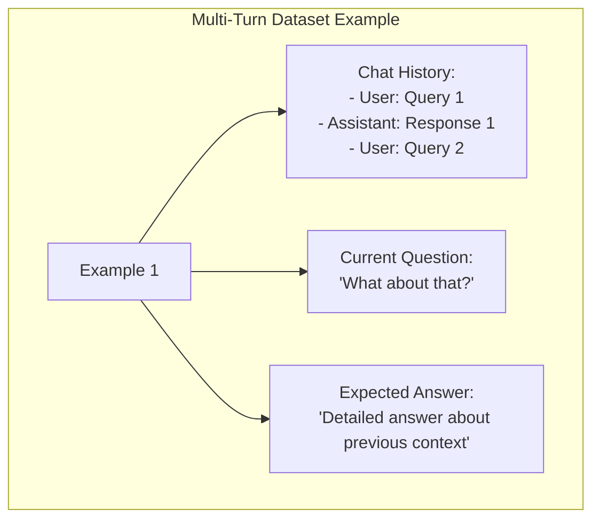
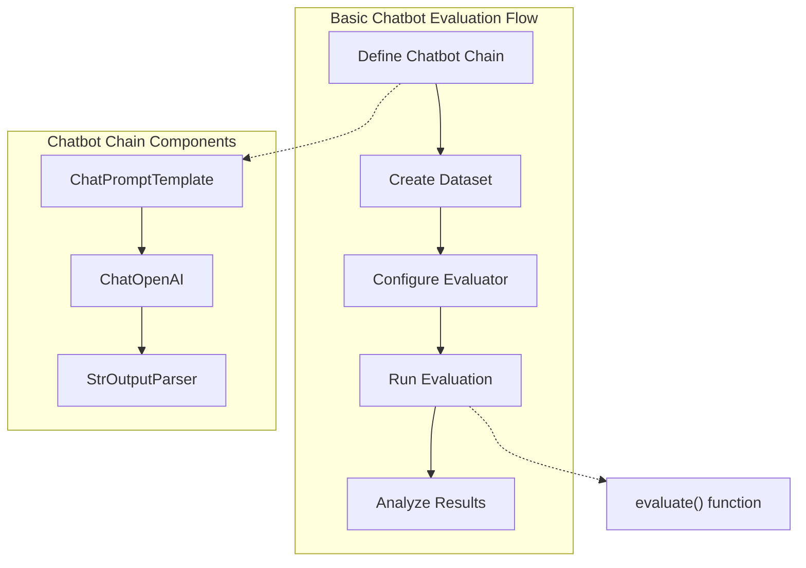
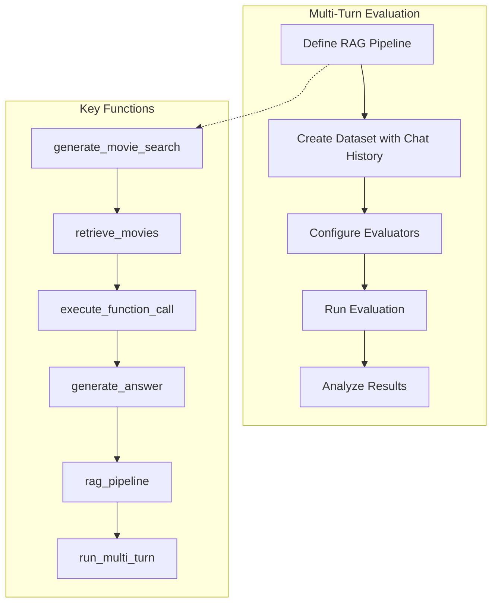
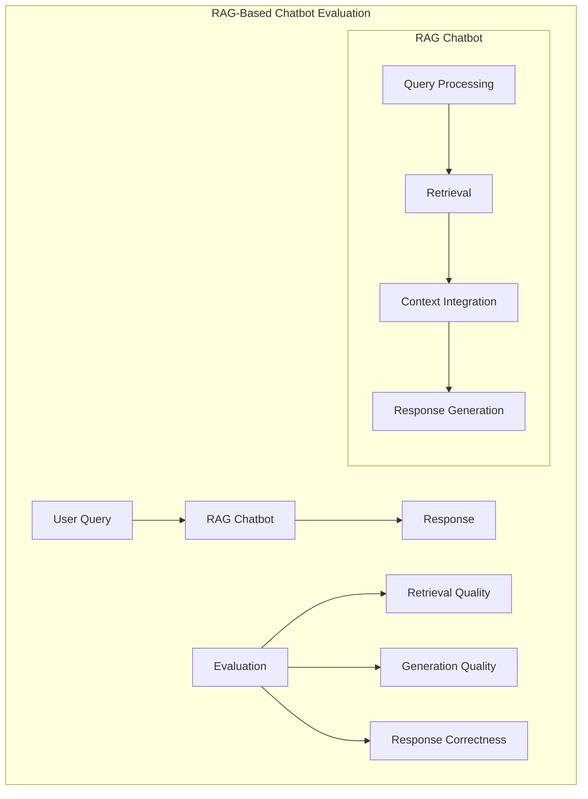
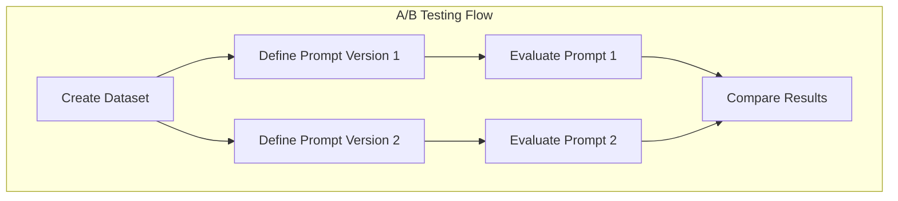
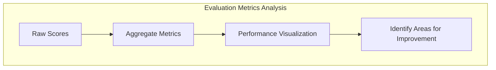
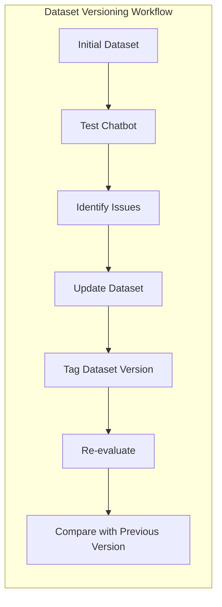

<!-- source: DeepWiki mcp.deepwiki.com · repo langchain-ai/langsmith-cookbook · page 3.3 Chatbot Evaluation · fetched 2026-10-26 -->

# Chatbot Evaluation

<details>
<summary>Relevant source files</summary>

The following files were used as context for generating this wiki page:

- [testing-examples/agent_steps/evaluating_agents.ipynb](testing-examples/agent_steps/evaluating_agents.ipynb)
- [testing-examples/chat-single-turn/chat_evaluation_single_turn.ipynb](testing-examples/chat-single-turn/chat_evaluation_single_turn.ipynb)
- [testing-examples/data-extraction/contract-extraction.ipynb](testing-examples/data-extraction/contract-extraction.ipynb)
- [testing-examples/data-extraction/img/contract-extraction-dataset.png](testing-examples/data-extraction/img/contract-extraction-dataset.png)
- [testing-examples/export-test-to-csv/export-test-to-csv.ipynb](testing-examples/export-test-to-csv/export-test-to-csv.ipynb)
- [testing-examples/movie-demo/optimization.ipynb](testing-examples/movie-demo/optimization.ipynb)
- [testing-examples/movie-demo/prompt_iteration.ipynb](testing-examples/movie-demo/prompt_iteration.ipynb)

</details>


This document provides guidance on evaluating chat-based language model applications using LangSmith. It covers methods for assessing both single-turn and multi-turn conversations, creating appropriate datasets, implementing effective evaluators, and interpreting evaluation results. For information about evaluating agents with tools, see [Agent Evaluation](#3.2).

## Overview of Chatbot Evaluation

Chatbot evaluation in LangSmith involves assessing the quality of conversational interactions. This evaluation can focus on various aspects including response correctness, helpfulness, consistency across multiple turns, handling of context, and more.



Sources: [testing-examples/chat-single-turn/chat_evaluation_single_turn.ipynb:8-19](), [testing-examples/movie-demo/prompt_iteration.ipynb:8-28]()

## Types of Chatbot Evaluation

### Single-Turn Evaluation

Single-turn evaluation focuses on assessing individual question-answer pairs without the complexity of conversation history. This approach works well for simple chatbots or for isolating specific response characteristics.



Sources: [testing-examples/chat-single-turn/chat_evaluation_single_turn.ipynb:8-19](), [testing-examples/chat-single-turn/chat_evaluation_single_turn.ipynb:82-107]()

### Multi-Turn Evaluation

Multi-turn evaluation assesses the chatbot's ability to maintain context across multiple conversation turns. This approach is crucial for evaluating more realistic conversational scenarios.



Sources: [testing-examples/movie-demo/prompt_iteration.ipynb:362-448]()

## Creating Evaluation Datasets

### Single-Turn Datasets

For single-turn evaluations, datasets consist of individual query-response pairs. Each example contains a user query and an expected response.

```python
# Example of a simple dataset structure
examples = [
    {
        "inputs": {"question": "What's the main difference?"},
        "outputs": {"expected": "The main structural differences include..."}
    }
]
```

Sources: [testing-examples/chat-single-turn/chat_evaluation_single_turn.ipynb:82-187]()

### Multi-Turn Datasets

Multi-turn datasets include conversation history for each example, allowing evaluation of context retention across multiple turns.



Sources: [testing-examples/movie-demo/prompt_iteration.ipynb:370-448]()

### Structured Input Datasets

For more complex scenarios, datasets can include structured inputs like user preferences, historical interactions, or other metadata to evaluate how well the chatbot utilizes this information.

Sources: [testing-examples/movie-demo/prompt_iteration.ipynb:669-779]()

## Evaluation Methods

### Correctness Evaluators

Correctness evaluators assess whether the chatbot's responses align with expected answers. These can range from simple string matching to more sophisticated semantic comparisons.

```python
# Example of a simple correctness evaluator
def correct_label(run, example) -> dict:
    score = run.outputs.get("output") == example.outputs.get("label")
    return {"score": int(score)}
```

Sources: [testing-examples/movie-demo/prompt_iteration.ipynb:190-196]()

### Response Quality Evaluators

Quality evaluators assess characteristics like brevity, helpfulness, or other qualitative aspects of responses.

```python
# Example of a brevity evaluator
def brevity(run, example) -> dict:
    convo = run.outputs.get("output")
    for turn in convo:
        if len(turn) > 200:
            return {"score": 0}
    return {"score": 1}
```

Sources: [testing-examples/movie-demo/prompt_iteration.ipynb:638-644]()

### Custom LLM-Based Evaluators

LangSmith supports using LLMs themselves as evaluators for more nuanced assessments of chatbot responses.

```python
# Example of using LangChain's evaluator
correctness_evaluator = LangChainStringEvaluator(
    "labeled_score_string",
    config={"criteria": "correctness", "normalize_by": 10},
    prepare_data=format_evaluator_inputs,
)
```

Sources: [testing-examples/chat-single-turn/chat_evaluation_single_turn.ipynb:316-320]()

## Implementation Examples

### Basic Chatbot Evaluation

The following example demonstrates how to evaluate a simple chatbot using LangSmith:



Sources: [testing-examples/chat-single-turn/chat_evaluation_single_turn.ipynb:222-237](), [testing-examples/chat-single-turn/chat_evaluation_single_turn.ipynb:293-328]()

### Multi-Turn Chatbot Evaluation

For multi-turn scenarios, we need to handle conversation history and evaluate context retention:



Sources: [testing-examples/movie-demo/prompt_iteration.ipynb:457-587](), [testing-examples/movie-demo/prompt_iteration.ipynb:637-656]()

## Advanced Chatbot Evaluation Techniques

### Evaluating with External Knowledge

For chatbots that incorporate external knowledge (like RAG systems), evaluations should assess both the retrieval and generation components.



Sources: [testing-examples/movie-demo/prompt_iteration.ipynb:468-536]()

### A/B Testing Different Prompts

LangSmith enables comparison of different prompting strategies to determine which leads to better performance:



Sources: [testing-examples/movie-demo/prompt_iteration.ipynb:108-136](), [testing-examples/movie-demo/prompt_iteration.ipynb:146-272]()

## Interpreting Evaluation Results

LangSmith provides visualization tools to analyze evaluation results, enabling identification of patterns, strengths, and weaknesses in chatbot performance.

### Metrics Dashboard



Sources: [testing-examples/movie-demo/prompt_iteration.ipynb:73-84]()

### Dataset Versioning and Iteration

LangSmith supports versioning datasets, which is valuable for tracking improvements over time as you refine your chatbot.



Sources: [testing-examples/movie-demo/prompt_iteration.ipynb:894-1062]()

## Summary

Effective chatbot evaluation requires appropriate datasets, relevant metrics, and systematic analysis. LangSmith provides a comprehensive framework for evaluating both simple and complex chatbots, enabling iterative improvement and optimization.

1. Create datasets that match your evaluation goals (single-turn, multi-turn, or structured)
2. Define appropriate evaluators that measure the aspects of performance you care about
3. Run evaluations systematically to track performance over time
4. Use results to identify and address weaknesses in your chatbot

Sources: [testing-examples/chat-single-turn/chat_evaluation_single_turn.ipynb:336-340](), [testing-examples/movie-demo/prompt_iteration.ipynb:362-448]()

---

