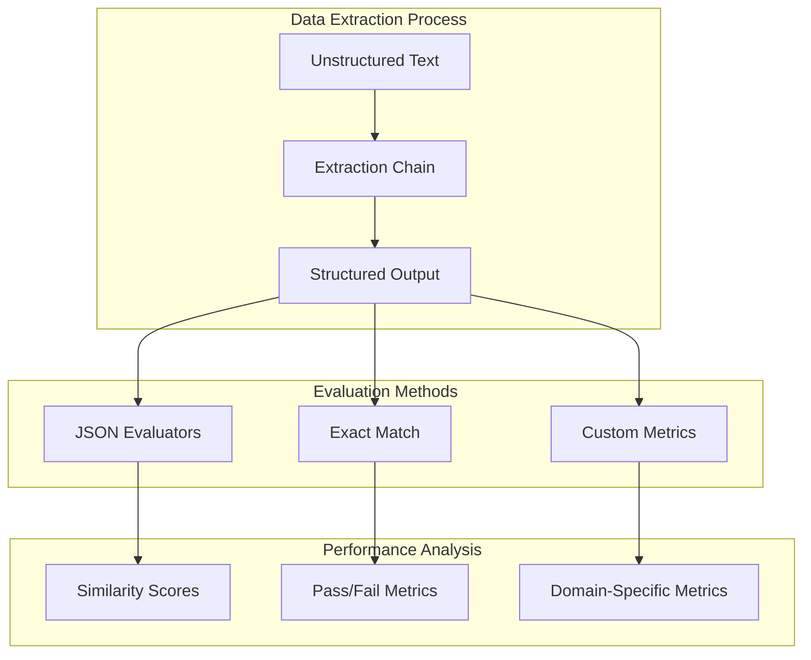
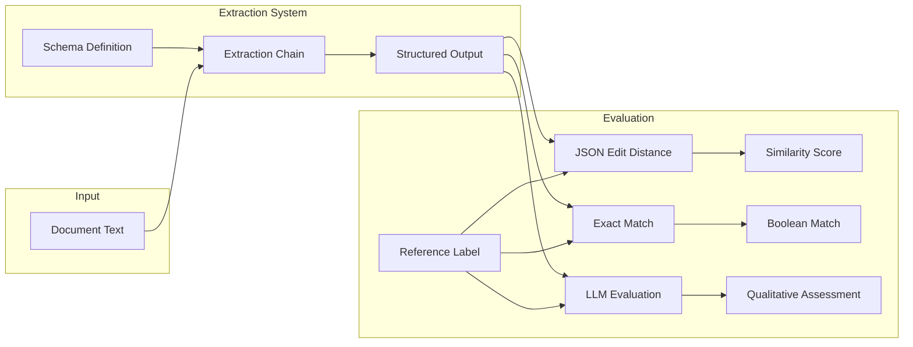
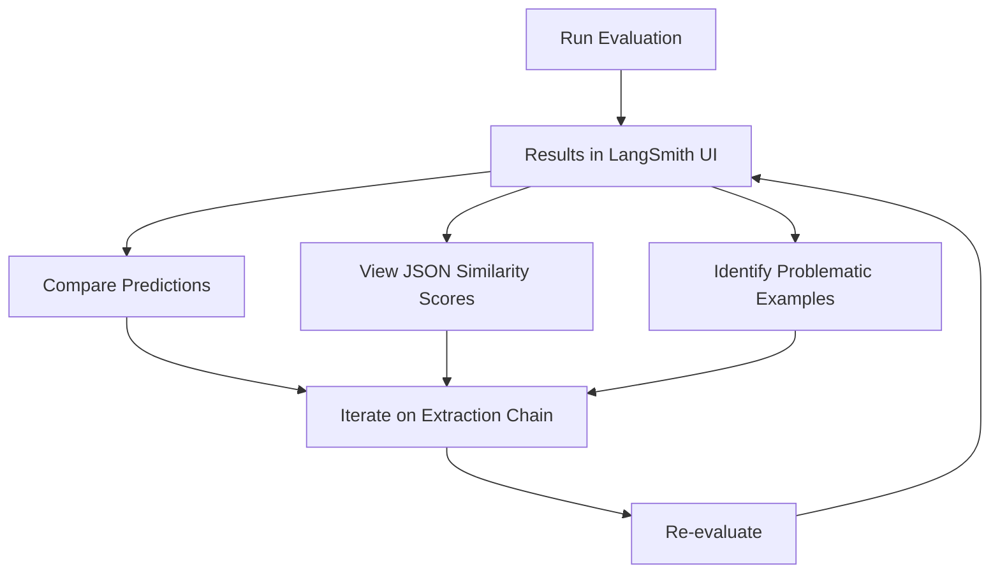
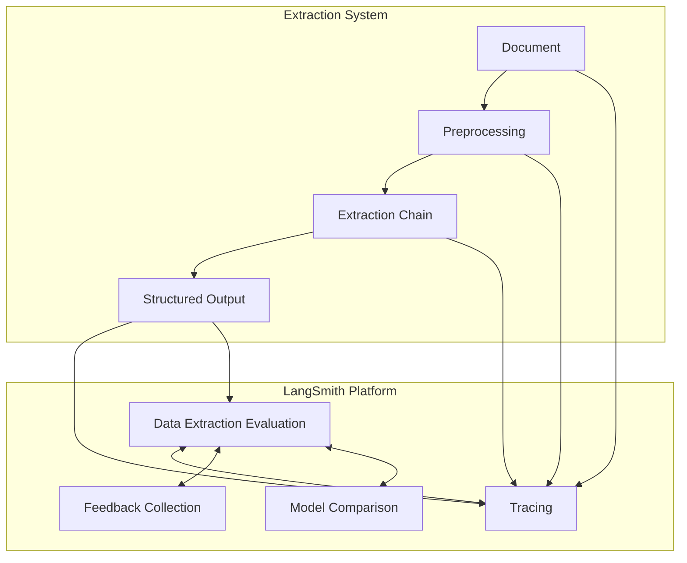

<!-- source: DeepWiki mcp.deepwiki.com · repo langchain-ai/langsmith-cookbook · page 3.4 Data Extraction Evaluation · fetched 2026-10-26 -->

# Data Extraction Evaluation

<details>
<summary>Relevant source files</summary>

The following files were used as context for generating this wiki page:

- [README.md](README.md)
- [testing-examples/README.md](testing-examples/README.md)
- [testing-examples/agent_steps/evaluating_agents.ipynb](testing-examples/agent_steps/evaluating_agents.ipynb)
- [testing-examples/chat-single-turn/chat_evaluation_single_turn.ipynb](testing-examples/chat-single-turn/chat_evaluation_single_turn.ipynb)
- [testing-examples/data-extraction/contract-extraction.ipynb](testing-examples/data-extraction/contract-extraction.ipynb)
- [testing-examples/data-extraction/img/contract-extraction-dataset.png](testing-examples/data-extraction/img/contract-extraction-dataset.png)

</details>


## Purpose and Scope

This page explains how to evaluate data extraction tasks using LangSmith. Data extraction is the process of converting unstructured text into structured formats like JSON or other schema-defined objects. This document focuses on techniques to measure the accuracy and completeness of extraction chains, particularly when using large language models (LLMs) to convert text into structured data.

For evaluating other types of systems such as RAG pipelines, see [RAG Evaluation](#3.1), or for agent-based systems, see [Agent Evaluation](#3.2).

Sources: [README.md:55-56](), [testing-examples/README.md:20-23]()

## Overview of Data Extraction Evaluation

Data extraction is a cornerstone of many LLM applications, including:
- Extracting structured database fields from documents
- Deriving API parameters from natural language
- Building knowledge graphs
- Contract analysis and parsing
- Form filling and parameter extraction

Evaluating extraction chains presents unique challenges because the output is structured data rather than free-form text. Traditional NLP metrics like BLEU or ROUGE aren't suitable for comparing structured objects.



Sources: [testing-examples/data-extraction/contract-extraction.ipynb:8-16]()

## Evaluation Methods

### JSON Edit Distance Evaluation

The primary method for evaluating extraction tasks is to measure the similarity between the extracted structured content and structured reference labels. LangChain's JSON evaluators are particularly useful for this purpose.

The JSON edit distance evaluator:
1. Standardizes the extracted entities
2. Determines a normalized string edit distance between the canonical versions
3. Provides a fast way to check similarity without requiring an LLM

This is especially useful for comparing complex nested structures like contract details, where exact matching might be too strict.

### Exact Match Evaluation

For cases where precision is critical, exact match evaluation can be used to perform deterministic comparison between system output and reference labels. This is suitable when:
- The schema is rigid and well-defined
- There is only one correct way to represent the data
- You need to ensure 100% accuracy in critical fields

### LLM-based Evaluators

For more nuanced evaluation, LLM-based evaluators can assess the semantic correctness of extracted data, even when the structure varies slightly from the reference.



Sources: [testing-examples/data-extraction/contract-extraction.ipynb:172-175]()

## Implementation Example: Contract Extraction

Let's walk through an implementation of data extraction evaluation using a contract extraction example:

### 1. Define Schema with Pydantic

First, define a schema that represents the structure you want to extract:

```python
class Address(BaseModel):
    street: str
    city: str
    state: str
    zip_code: str
    country: Optional[str]

class Party(BaseModel):
    name: str
    address: Address
    type: Optional[str]

class Section(BaseModel):
    title: str
    content: str

class Contract(BaseModel):
    document_title: str
    exhibit_number: Optional[str]
    effective_date: str
    parties: List[Party]
    sections: List[Section]
```

### 2. Create Extraction Chain

Then, create an extraction chain that converts unstructured text into the defined schema:

```python
extraction_subchain = create_extraction_chain(
    Contract.schema(),
    llm=AnthropicFunctions(model="claude-2.1", max_tokens=20_000),
    prompt=contract_prompt,
)

# Prepare the chain with input/output mapping
chain = (
    (lambda x: {"input": x["context"]})
    | extraction_subchain
    | (lambda x: {"output": x["text"]})
)
```

### 3. Evaluate with JSON Edit Distance

Finally, evaluate the extraction chain using the JSON edit distance evaluator:

```python
res = evaluate(
    chain.invoke,
    data=dataset_name,
    evaluators=[LangChainStringEvaluator("json_edit_distance")],
    max_concurrency=2,
)
```

Sources: [testing-examples/data-extraction/contract-extraction.ipynb:97-128](), [testing-examples/data-extraction/contract-extraction.ipynb:145-164](), [testing-examples/data-extraction/contract-extraction.ipynb:232-240]()

## Creating Datasets for Extraction Evaluation

To properly evaluate data extraction systems, you need a dataset with:

1. Input documents containing unstructured text
2. Reference outputs with the correctly structured data

LangSmith provides tools to:
- Create and manage these datasets
- Clone public datasets as starting points
- Import existing datasets with labeled examples

Here's an example of creating an extraction evaluation dataset:

```python
from langsmith import Client

dataset_url = "https://smith.langchain.com/public/08ab7912-006e-4c00-a973-0f833e74907b/d"
dataset_name = "Contract Extraction"

client = Client()
client.clone_public_dataset(dataset_url)
```

Sources: [testing-examples/data-extraction/contract-extraction.ipynb:67-76]()

## Visualizing and Analyzing Results

After running an evaluation, LangSmith displays the extraction results alongside the reference labels, making it easy to:

1. Compare extracted structures with expected outputs
2. Identify common extraction errors
3. Analyze specific fields that frequently cause issues
4. Track performance across different models or prompt versions



Sources: [testing-examples/data-extraction/contract-extraction.ipynb:247-248]()

## Advanced Techniques

### Custom Evaluators for Specific Fields

For domain-specific extraction tasks, you might want to focus on certain critical fields. Custom evaluators can be created to:

1. Check specific nested fields in complex structures
2. Apply different scoring methods to different field types
3. Implement domain-specific validation rules

Similar to how agent step evaluators work, custom extraction evaluators can be built to evaluate specific parts of the extraction process:

```python
def field_correctness(run: Run, example: Optional[Example] = None) -> dict:
    if run.outputs is None:
        raise ValueError("Run outputs cannot be None")
    
    extracted_data = run.outputs.get("output", {})
    reference_data = example.outputs.get("reference", {})
    
    # Check critical field accuracy
    critical_fields = ["document_title", "effective_date"]
    score = sum(extracted_data.get(field) == reference_data.get(field) 
                for field in critical_fields) / len(critical_fields)
    
    return {"key": "Critical fields correctness", "score": score}
```

Sources: [testing-examples/agent_steps/evaluating_agents.ipynb:224-250]()

### Combining Multiple Evaluators

To get a comprehensive view of extraction performance, combine multiple evaluators:

```python
results = evaluate(
    chain.invoke,
    data=dataset_name,
    evaluators=[
        LangChainStringEvaluator("json_edit_distance"),
        field_correctness,
        LangChainStringEvaluator("exact_match")
    ],
    max_concurrency=2,
)
```

This approach provides multiple perspectives on extraction quality, from overall structure similarity to field-specific accuracy.

Sources: [testing-examples/agent_steps/evaluating_agents.ipynb:267-300]()

## Integration with LangSmith Tracing

Data extraction evaluation integrates with LangSmith's tracing capabilities, allowing you to:

1. Visualize the entire extraction process
2. Debug extraction errors by examining intermediate steps
3. Compare different extraction approaches side-by-side
4. Collect feedback on extraction results for continuous improvement



Sources: [README.md:24-31]()

## Best Practices

When evaluating data extraction systems:

1. **Design your schema carefully**: Make sure it captures all necessary information while remaining as simple as possible.

2. **Use diverse test examples**: Include edge cases, different document formats, and varying complexity levels.

3. **Start with exact match for simple fields**: For fields like dates, IDs, or codes, exact matching is usually appropriate.

4. **Use similarity metrics for complex fields**: For longer text fields or nested structures, JSON edit distance or other similarity metrics are more suitable.

5. **Consider field importance**: Not all fields are equally important. Weight your evaluation to prioritize critical information.

6. **Iterate based on failure analysis**: Examine failed extractions to identify patterns and improve your extraction chain.

7. **Compare multiple models**: Test different LLMs and prompting strategies to find the best approach for your specific extraction task.

Sources: [testing-examples/data-extraction/contract-extraction.ipynb:247-254]()

## Conclusion

Data extraction evaluation is a critical component for developing reliable information extraction systems using LLMs. By using LangSmith's evaluation tools, particularly the JSON edit distance evaluator and custom metrics, you can systematically measure and improve your extraction chains' performance.

The key to successful extraction evaluation is designing appropriate schemas, creating comprehensive test datasets, and using the right mix of evaluation metrics for your specific use case.

Sources: [testing-examples/data-extraction/contract-extraction.ipynb:255-259]()

---

