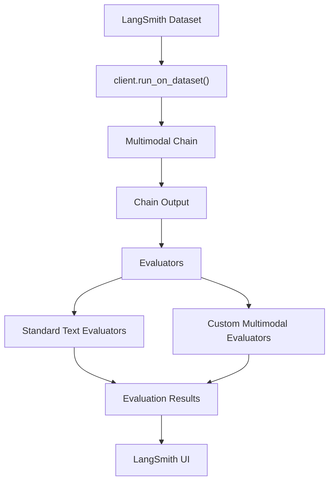
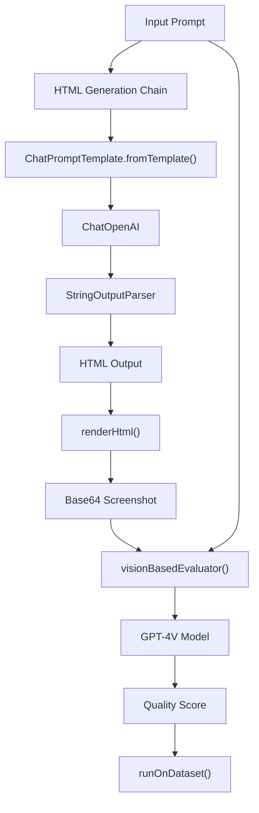

<!-- source: DeepWiki mcp.deepwiki.com · repo langchain-ai/langsmith-cookbook · page 3.5 Multimodal Evaluation · fetched 2026-10-26 -->

# Multimodal Evaluation

<details>
<summary>Relevant source files</summary>

The following files were used as context for generating this wiki page:

- [README.md](README.md)
- [testing-examples/README.md](testing-examples/README.md)
- [typescript-testing-examples/vision-evals/deno.json](typescript-testing-examples/vision-evals/deno.json)
- [typescript-testing-examples/vision-evals/deno.lock](typescript-testing-examples/vision-evals/deno.lock)
- [typescript-testing-examples/vision-evals/img/test_run.png](typescript-testing-examples/vision-evals/img/test_run.png)
- [typescript-testing-examples/vision-evals/vision-evals.ipynb](typescript-testing-examples/vision-evals/vision-evals.ipynb)

</details>


Multimodal evaluation in LangSmith refers to the assessment of chains and models that process or generate multiple types of data (modalities), such as text, images, audio, or video. This page describes how to evaluate LLM applications that work with multiple modalities, with a focus on vision-based evaluation methodologies.

## Overview

Traditional evaluation methods primarily focus on text inputs and outputs. However, modern LLM applications increasingly work with multiple modalities. Multimodal evaluation in LangSmith enables you to:

- Benchmark multimodal chains like image classifiers against reference outputs
- Assess the quality of generated visual content
- Evaluate how well models understand and respond to multimodal inputs
- Compare different model versions on multimodal tasks

Sources: [README.md:63-66](), [testing-examples/README.md:30-32]()

## Architecture and Components

Multimodal evaluation extends LangSmith's core evaluation framework with specialized components to handle different data types:

Diagram: Multimodal Evaluation Architecture



Sources: [README.md:63-66](), [testing-examples/README.md:30-32]()

## JavaScript/TypeScript Implementation

LangSmith provides support for evaluating multimodal outputs in JavaScript/TypeScript applications. The primary example demonstrates evaluating visual outputs using GPT-4 with vision capabilities.

Diagram: Vision-based Evaluation Flow in TypeScript



The implementation involves:

1. **Chain Setup**: A chain that generates HTML based on text prompts using `ChatPromptTemplate`, `ChatOpenAI`, and `StringOutputParser`.

2. **Rendering**: Using Puppeteer (a headless browser) to render the HTML and capture screenshots:
   ```javascript
   async function renderHtml(html) {
     const browser = await puppeteer.launch();
     const page = await browser.newPage();
     await page.setContent(html);
     const screenshot = await page.screenshot({ encoding: "base64" });
     await browser.close();
     return screenshot;
   }
   ```

3. **Custom Evaluation**: Creating a custom evaluator that implements the `DynamicRunEvaluatorParams` interface:
   ```javascript
   const visionBasedEvaluator = async (
     { run, example, input, prediction, reference }, 
     options: { config: RunnableConfig }
   ) => {
     // Render HTML to image
     const imageBase64 = await renderHtml(prediction.output);
     
     // Set up vision model
     const visionModel = new ChatOpenAI({
       modelName: "gpt-4-vision-preview",
       temperature: 0,
       maxTokens: 2000,
     });
     
     // Create evaluation prompt with text and image
     const chainInputMessage = new HumanMessage({
       content: [
         { type: "text", text: "Evaluation prompt..." },
         { type: "image_url", image_url: { url: `data:image/jpeg;base64,${imageBase64}` } }
       ]
     });
     
     // Get and return evaluation score
     const response = await visionModel.invoke([chainInputMessage], options.config);
     const score = parseInt(response, 10);
     
     return {
       key: "visual_generation_quality",
       score: score / 10,
       comment: response,
     };
   };
   ```

4. **Integration with LangSmith**: Running the evaluation using datasets:
   ```javascript
   const finalResults = await runOnDataset(chain, datasetName, {
     evaluationConfig: {
       customEvaluators: [visionBasedEvaluator]
     },
   });
   ```

Sources: [typescript-testing-examples/vision-evals/vision-evals.ipynb:71-78](), [typescript-testing-examples/vision-evals/vision-evals.ipynb:123-137](), [typescript-testing-examples/vision-evals/vision-evals.ipynb:259-312](), [typescript-testing-examples/vision-evals/vision-evals.ipynb:346-352]()

## Python Implementation

For Python-based multimodal evaluation, LangSmith provides functionality to benchmark multimodal image classification chains. The process follows a similar flow to the TypeScript implementation but uses Python libraries and interfaces.

To evaluate multimodal models in Python:

1. Create a dataset with appropriate multimodal inputs and reference outputs
2. Set up your multimodal chain (e.g., an image classification chain)
3. Configure custom evaluators for multimodal assessment
4. Run the evaluation using `client.run_on_dataset()`
5. Analyze the results in the LangSmith UI

Sources: [README.md:63-66](), [testing-examples/README.md:30-32]()

## Best Practices

When implementing multimodal evaluation in LangSmith, consider these best practices:

1. **Define Clear Evaluation Criteria**
   - Determine specific aspects of multimodal outputs to evaluate
   - Create focused prompts for vision models (as shown in the TypeScript example)

2. **Create Diverse Test Cases**
   - Include a variety of inputs that test different capabilities
   - Consider edge cases and potential failure modes

3. **Use Custom Evaluators Appropriately**
   - Implement the `DynamicRunEvaluatorParams` interface for TypeScript evaluators
   - Return structured results with normalized scores (0-1 range)
   - Include meaningful comments to explain scores

4. **Optimize Resource Usage**
   - Multimodal evaluation can be resource-intensive
   - Consider batching evaluations to manage resources efficiently

5. **Implement Iterative Improvement**
   - Use evaluation results to identify weaknesses
   - Re-evaluate after making improvements to track progress

Sources: [typescript-testing-examples/vision-evals/vision-evals.ipynb:254-313]()

## Limitations and Considerations

While multimodal evaluation in LangSmith is powerful, be aware of these limitations:

1. **Subjectivity in Visual Evaluation**
   - Visual quality assessment involves subjective judgments
   - Different evaluators may produce different scores for the same output

2. **Resource Requirements**
   - Vision models like GPT-4V typically have higher latency and cost
   - Rendering processes using tools like Puppeteer add overhead

3. **Tool Limitations**
   - Headless browsers may have limitations in rendering complex visual elements
   - Some multimodal aspects may be challenging to evaluate automatically

Sources: [typescript-testing-examples/vision-evals/vision-evals.ipynb:7-22](), [typescript-testing-examples/vision-evals/vision-evals.ipynb:173-176]()

## Related Resources

For more information on other types of evaluation in LangSmith, see:
- [RAG Evaluation](#3.1) for evaluating retrieval-augmented generation systems
- [Agent Evaluation](#3.2) for evaluating LLM agents that use tools
- [Data Extraction Evaluation](#3.4) for evaluating structured data extraction

Sources: [README.md:34-73]()

---

