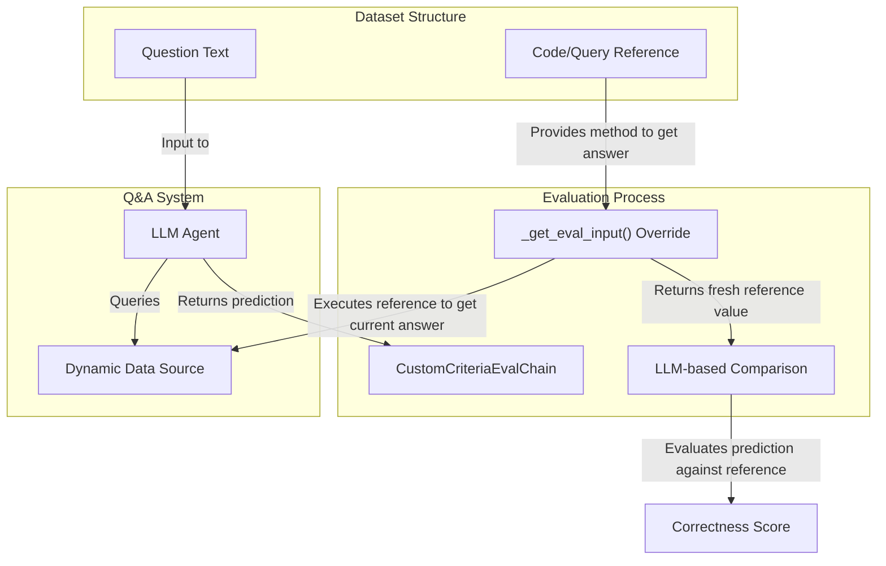
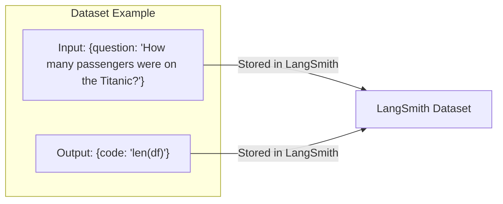
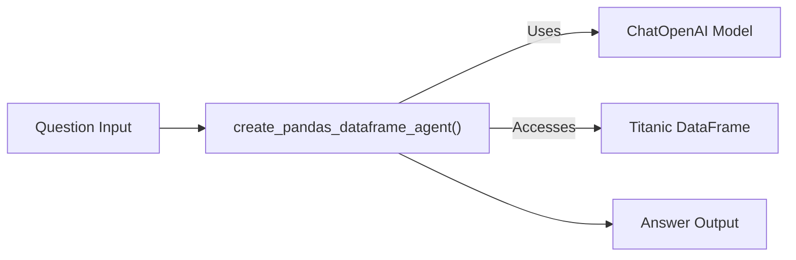
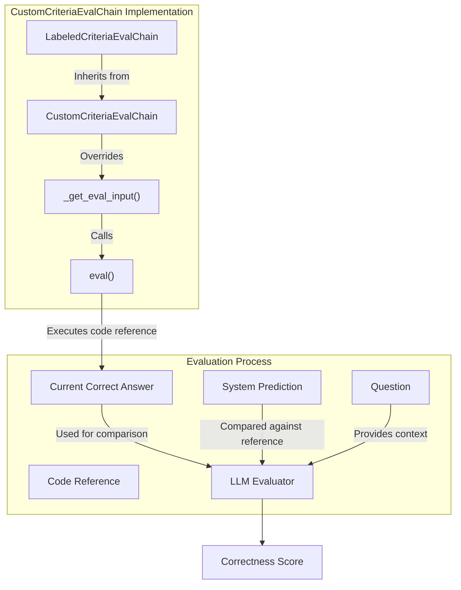
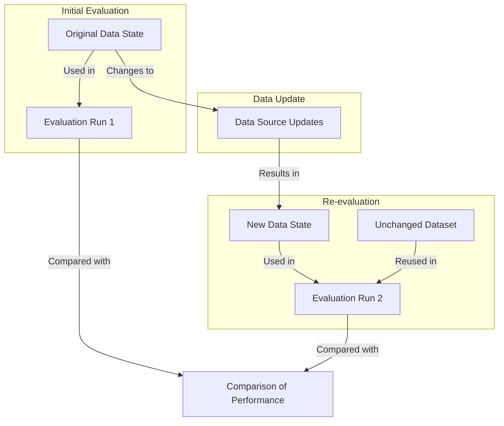

<!-- source: DeepWiki mcp.deepwiki.com · repo langchain-ai/langsmith-cookbook · page 3.6 Dynamic Data Evaluation · fetched 2026-10-26 -->

# Dynamic Data Evaluation

<details>
<summary>Relevant source files</summary>

The following files were used as context for generating this wiki page:

- [README.md](README.md)
- [testing-examples/README.md](testing-examples/README.md)
- [testing-examples/dynamic-data/testing_dynamic_data.ipynb](testing-examples/dynamic-data/testing_dynamic_data.ipynb)
- [tracing-examples/runnable-naming/run-naming.ipynb](tracing-examples/runnable-naming/run-naming.ipynb)

</details>


## Purpose and Overview

This document covers techniques for evaluating LLM systems that interact with data sources that change over time. Unlike static evaluations where reference answers remain constant, dynamic data evaluation focuses on testing systems where the correct answer might change based on evolving underlying data. The primary example explored is a Q&A system querying a database where values update regularly.

This guide demonstrates how to implement a reference-based evaluation approach using LangSmith's custom evaluator capabilities. For information about general evaluation methodologies, see [Testing & Evaluation](#3).

Sources: [testing-examples/dynamic-data/testing_dynamic_data.ipynb:8-23](), [README.md:44]()

## The Challenge of Dynamic Data

When building applications that interact with real-time databases, APIs, or other dynamic data sources, traditional evaluation approaches face significant limitations:

1. **Static labels become outdated** - Directly storing expected answers as dataset labels will quickly become incorrect when the underlying data changes
2. **Continual manual updating** is unsustainable - Updating expected outputs by hand for each evaluation run is impractical
3. **Comparison difficulty** - It's challenging to meaningfully compare model versions if they're querying different data states

The solution is to use indirection - storing references to data retrieval methods rather than static answers. This approach enables an evaluator to dynamically fetch the correct answer at evaluation time.

Sources: [testing-examples/dynamic-data/testing_dynamic_data.ipynb:8-23](), [testing-examples/dynamic-data/testing_dynamic_data.ipynb:70-78]()

## Solution Architecture

The dynamic data evaluation system consists of four key components working together:



The key architectural pattern is the indirection mechanism:

1. Instead of storing static answers in the dataset, we store **executable references** (such as code snippets or API requests)
2. The custom evaluator retrieves the correct answer at evaluation time by executing the reference
3. This allows the evaluation to remain accurate even as the underlying data changes
4. The same dataset can be reused across evaluation runs at different times

Sources: [testing-examples/dynamic-data/testing_dynamic_data.ipynb:70-78](), [testing-examples/dynamic-data/testing_dynamic_data.ipynb:226-233]()

## Implementation Details

### 1. Dataset Creation with Code References

The dataset creation process stores questions paired with code references rather than direct answers:



For example, instead of storing "891" as the answer to "How many passengers were on the Titanic?", we store the code `len(df)` which will retrieve the correct count regardless of changes to the dataframe.

This approach is implemented by:
1. Creating a list of question-code pairs
2. Using the LangSmith Client to create a dataset
3. Uploading examples with the questions as inputs and code snippets as outputs

The question-code pairs are structured as tuples following this pattern:
```
("How many passengers survived?", "df['Survived'].sum()")
```

Sources: [testing-examples/dynamic-data/testing_dynamic_data.ipynb:90-113](), [testing-examples/dynamic-data/testing_dynamic_data.ipynb:134-149]()

### 2. The Q&A System

The system being evaluated is a LangChain pandas dataframe agent that answers questions about the Titanic dataset:



The Q&A system is implemented with a simple prediction function that creates a new agent for each query.

Sources: [testing-examples/dynamic-data/testing_dynamic_data.ipynb:161-196]()

### 3. Custom Criteria Evaluator

The heart of the dynamic data evaluation approach is the `CustomCriteriaEvalChain` class that inherits from LangChain's `LabeledCriteriaEvalChain`:



The key method override in `CustomCriteriaEvalChain` is:

```python
def _get_eval_input(self, prediction: str, reference: Optional[str], input: Optional[str]) -> dict:
    # Get base dictionary from parent class
    raw = super()._get_eval_input(prediction, reference, input)
    # Evaluate the code reference to get current correct answer
    raw["reference"] = eval(raw["reference"])
    return raw
```

This customization allows the evaluator to dynamically execute the code reference at evaluation time, ensuring that the comparison uses the latest data.

Sources: [testing-examples/dynamic-data/testing_dynamic_data.ipynb:226-263](), [testing-examples/dynamic-data/testing_dynamic_data.ipynb:306-324]()

### 4. Running the Evaluation

To run the evaluation, the system:

1. Creates a base LangChain string evaluator with the custom criteria chain
2. Defines a `prepare_inputs` function to extract the required data from runs and examples
3. Wraps this in a `LangChainStringEvaluator` that can be used with LangSmith's evaluation API
4. Calls `evaluate()` to run the prediction function on the dataset with the custom evaluator

The evaluation produces correctness scores for each Q&A pair, comparing the system's predictions against the dynamically retrieved reference answers.

Sources: [testing-examples/dynamic-data/testing_dynamic_data.ipynb:306-336]()

## Re-evaluation Process

A key advantage of this approach is the ability to re-evaluate the system after data changes without modifying the dataset:



When the underlying data changes, the same dataset (with code references) is reused. The custom evaluator executes those references against the new data state, retrieving the current correct answers.

This enables consistent evaluation and meaningful comparison between test runs at different points in time, even as the underlying data evolves.

Sources: [testing-examples/dynamic-data/testing_dynamic_data.ipynb:352-368](), [testing-examples/dynamic-data/testing_dynamic_data.ipynb:373-424]()

## Implementation Considerations and Trade-offs

### Security Considerations

The reference execution approach requires careful handling:

- **Security risk**: Using `eval()` on stored code references can pose security risks if the dataset contains malicious code
- **Safe environments**: This approach should only be used in controlled environments with trusted data
- **Alternative methods**: In production systems, consider using more restricted reference mechanisms like API request templates rather than arbitrary code execution

### Alternative Approaches

Other methods for handling dynamic data evaluation include:

1. **Freezing data versions**: Creating snapshots of data for evaluation purposes
2. **Query comparison**: Evaluating the query generation rather than the final answer
3. **Synthetic datasets**: Using fabricated data with known answers that don't change

Each approach has different trade-offs in terms of:
- Accuracy of evaluation
- Engineering complexity
- Security considerations
- Ability to test end-to-end system behavior

Sources: [testing-examples/dynamic-data/testing_dynamic_data.ipynb:472-477]()

## Conclusion

Dynamic data evaluation through reference-based approaches provides a powerful way to maintain accurate evaluation of systems that interact with changing data sources. By implementing a custom evaluator that resolves references at evaluation time, you can create more sustainable testing processes that don't require constant dataset updates.

The `CustomCriteriaEvalChain` implementation demonstrated in this document offers a practical solution for Q&A systems, but the same principles can be applied to other types of dynamic data interactions using different reference resolution mechanisms.

Sources: [testing-examples/dynamic-data/testing_dynamic_data.ipynb:466-481]()

---

