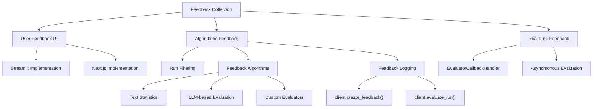
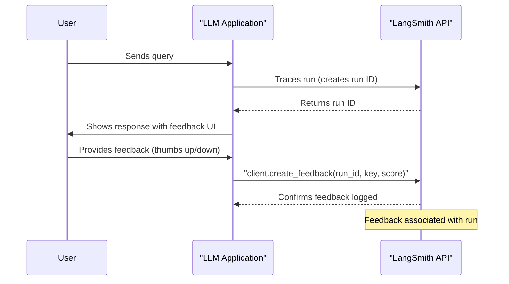
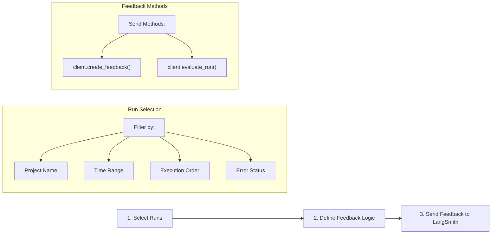
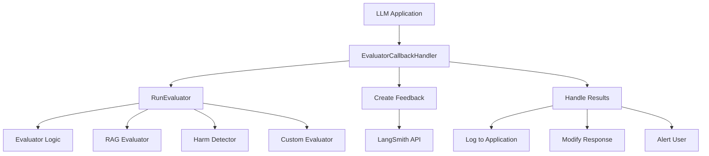
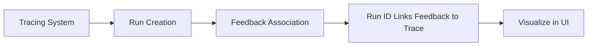

<!-- source: DeepWiki mcp.deepwiki.com · repo langchain-ai/langsmith-cookbook · page 4 Feedback Collection · fetched 2026-10-26 -->

# Feedback Collection

<details>
<summary>Relevant source files</summary>

The following files were used as context for generating this wiki page:

- [feedback-examples/README.md](feedback-examples/README.md)
- [feedback-examples/algorithmic-feedback/algorithmic_feedback.ipynb](feedback-examples/algorithmic-feedback/algorithmic_feedback.ipynb)
- [feedback-examples/streamlit-realtime-feedback/img/hallucination_feedback.gif](feedback-examples/streamlit-realtime-feedback/img/hallucination_feedback.gif)
- [hub-examples/README.md](hub-examples/README.md)
- [testing-examples/comparing-runs/comparing-qa.ipynb](testing-examples/comparing-runs/comparing-qa.ipynb)
- [testing-examples/qa-correctness/qa-correctness.ipynb](testing-examples/qa-correctness/qa-correctness.ipynb)
- [tracing-examples/README.md](tracing-examples/README.md)
- [typescript-testing-examples/README.md](typescript-testing-examples/README.md)

</details>


This page provides an overview of feedback collection methods in LangSmith for improving LLM applications. Feedback collection allows you to gather and analyze performance data about your LLM applications from multiple sources, enabling continuous improvement and quality monitoring.

For information about comprehensive evaluation strategies, see [Testing & Evaluation](#3).

## Overview

LangSmith offers three primary approaches to feedback collection:

1. **User Feedback UIs**: Collect explicit feedback from end users interacting with your application
2. **Algorithmic Feedback**: Automate quality metrics and evaluations of your application's outputs
3. **Real-time Feedback**: Apply evaluations during execution for immediate quality insights

Feedback in LangSmith is associated with specific runs and can be used for monitoring, debugging, and improvement of LLM applications.

### Feedback Collection Architecture



Sources:
- [feedback-examples/README.md:1-17]()
- [feedback-examples/algorithmic-feedback/algorithmic_feedback.ipynb:7-27]()

## User Feedback UIs

User feedback allows end users to provide explicit assessments of your application's responses. This feedback can be captured through UI elements like thumbs up/down buttons or rating scales.

### Implementation Flow



LangSmith-cookbook contains examples of implementing user feedback in both Streamlit and Next.js applications. These examples demonstrate how to:

1. Integrate user feedback collection into chat interfaces
2. Associate feedback with specific LangSmith runs
3. Configure feedback keys and scores

For detailed implementation, check the Streamlit and Next.js examples in the cookbook.

Sources:
- [feedback-examples/README.md:9-14]()

## Algorithmic Feedback

Algorithmic feedback involves automatically evaluating outputs from your LLM applications using predefined metrics or evaluation logic. This approach allows for scaling evaluations across many runs without requiring human intervention.

### Algorithmic Feedback Pipeline



The algorithmic feedback pipeline consists of three main steps:

1. **Select Runs**: Identify which runs to evaluate using filtering criteria
2. **Define Feedback Logic**: Create algorithms or use evaluators to calculate metrics
3. **Send Feedback to LangSmith**: Log the evaluation results as feedback

### Example Feedback Algorithms

LangSmith-cookbook demonstrates three types of algorithmic feedback:

1. **Text Statistics**: Simple readability and complexity metrics
2. **AI-assisted Feedback**: Using LLMs to score outputs on multiple dimensions
3. **LangChain Evaluators**: Off-the-shelf evaluators from the LangChain library

#### Text Statistics Example

```python
def compute_stats(run: Run) -> None:
    text = run.inputs["input"]
    metrics = {fn: getattr(textstat, fn)(text) for fn in [
        "flesch_reading_ease",
        "flesch_kincaid_grade",
        "smog_index",
        "coleman_liau_index",
        "automated_readability_index",
    ]}
    for key, value in metrics.items():
        client.create_feedback(
            run.id,
            key=key,
            score=value,
            feedback_source_type="model",
        )
```

#### AI-assisted Feedback Example

AI-assisted feedback uses an LLM to evaluate outputs along dimensions like relevance, difficulty, verbosity, and specificity:

```python
def evaluate_run(run: Run) -> None:
    result = chain.invoke({
        "question": run.inputs["input"][:3000],
        "prediction": run.outputs["output"][:3000],
    })
    for feedback_key, value in result.items():
        score = int(value) / 5
        client.create_feedback(
            run.id,
            key=feedback_key,
            score=score,
            source_run_id=cb.traced_runs[0].id,
            feedback_source_type="model",
        )
```

#### LangChain Evaluators Example

You can also create custom evaluators by extending the `RunEvaluator` class:

```python
class CompletenessEvaluator(ls_evaluation.RunEvaluator):
    def __init__(self):
        criteria_description = "Does the answer provide sufficient and complete information..."
        self.evaluator = evaluation.load_evaluator("criteria", criteria={"completeness": criteria_description})

    def evaluate_run(self, run: Run, example: Optional[Example] = None) -> ls_evaluation.EvaluationResult:
        # Evaluation logic here
        return ls_evaluation.EvaluationResult(key="completeness", evaluator_info={...}, **result)
```

Sources:
- [feedback-examples/algorithmic-feedback/algorithmic_feedback.ipynb:7-27]()
- [feedback-examples/algorithmic-feedback/algorithmic_feedback.ipynb:106-143]()
- [feedback-examples/algorithmic-feedback/algorithmic_feedback.ipynb:200-226]()
- [feedback-examples/algorithmic-feedback/algorithmic_feedback.ipynb:284-363]()
- [feedback-examples/algorithmic-feedback/algorithmic_feedback.ipynb:440-476]()
- [feedback-examples/algorithmic-feedback/algorithmic_feedback.ipynb:502-504]()

## Real-time Feedback

Real-time feedback extends algorithmic feedback by applying evaluations during application execution, enabling immediate insights into response quality. This approach is particularly valuable for detecting issues like hallucinations or harmful content in production systems.

### Real-time Feedback Implementation



The `EvaluatorCallbackHandler` class integrates with the LangChain callbacks system to:

1. Intercept runs as they happen
2. Apply evaluators to those runs
3. Log the results as feedback
4. Optionally trigger actions based on evaluation results

Real-time feedback examples in the cookbook demonstrate:
- Checking RAG responses for hallucinations
- Evaluating chat bot responses for quality
- Applying evaluations during agent execution

Sources:
- [feedback-examples/README.md:15-16]()

## Feedback Data Structure

Feedback in LangSmith follows a consistent structure:

| Field | Description | Type |
|-------|-------------|------|
| `run_id` | ID of the run being evaluated | UUID |
| `key` | Name of the feedback metric | String |
| `score` | Numeric score (optional) | Float/Int/Boolean/Null |
| `value` | Text value (optional) | String |
| `comment` | Additional comment (optional) | String |
| `correction` | Suggested correction (optional) | Object |
| `feedback_source_type` | Source of feedback (e.g., "human", "model") | String |
| `source_run_id` | ID of run that generated feedback (for LLM evaluations) | UUID |

When logging feedback, only `run_id` and `key` are required. The `score` is typically used for quantitative metrics, while `value` can provide qualitative feedback.

Sources:
- [feedback-examples/algorithmic-feedback/algorithmic_feedback.ipynb:218-226]()
- [feedback-examples/algorithmic-feedback/algorithmic_feedback.ipynb:352-358]()
- [testing-examples/qa-correctness/qa-correctness.ipynb:388-395]()

## Integration with Other LangSmith Components

Feedback collection in LangSmith integrates with other components of the platform:

### Integration with Tracing



Feedback is associated with traced runs, allowing you to see the full context of what led to specific feedback.

### Integration with Evaluation

Feedback can serve as input for more comprehensive evaluations, such as:
- Comparing different model versions
- Analyzing performance trends
- Identifying patterns in feedback

### Integration with Data Export

Feedback data can be exported for:
- Fine-tuning LLMs
- Building datasets for testing
- External analysis in tools like Python or Jupyter

Sources:
- [testing-examples/comparing-runs/comparing-qa.ipynb:81-104]()
- [testing-examples/qa-correctness/qa-correctness.ipynb:79-91]()

## Conclusion

LangSmith's feedback collection system provides a comprehensive framework for gathering, processing, and analyzing feedback on LLM applications. By combining user feedback, algorithmic evaluation, and real-time monitoring, you can continuously improve your applications and ensure high-quality outputs.

The flexibility of the system allows for customization to specific use cases, while integration with other LangSmith components enables a complete evaluation and improvement pipeline.

---

