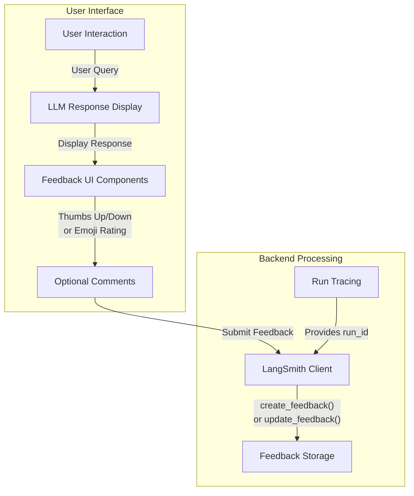
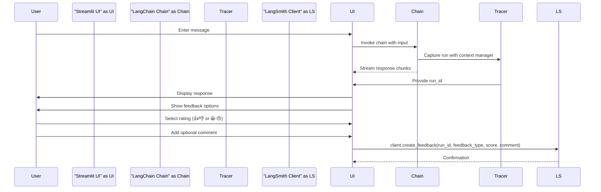
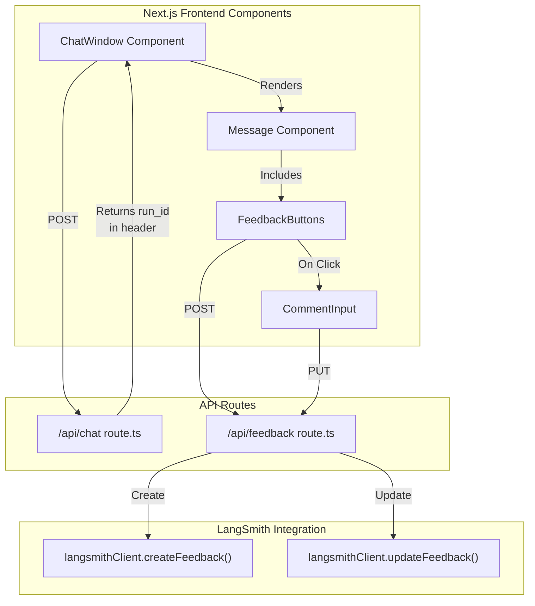
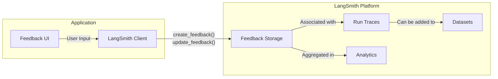

<!-- source: DeepWiki mcp.deepwiki.com · repo langchain-ai/langsmith-cookbook · page 4.1 User Feedback UIs · fetched 2026-10-26 -->

# User Feedback UIs

Relevant source files

The following files were used as context for generating this wiki page:

- [feedback-examples/nextjs/README.md](feedback-examples/nextjs/README.md)
- [feedback-examples/streamlit/README.md](feedback-examples/streamlit/README.md)
- [feedback-examples/streamlit/main.py](feedback-examples/streamlit/main.py)
- [feedback-examples/streamlit/requirements.txt](feedback-examples/streamlit/requirements.txt)
- [tracing-examples/show-trace-url-streamlit/README.md](tracing-examples/show-trace-url-streamlit/README.md)

## Purpose and Scope

This document describes the implementation of user interface components for collecting feedback on LLM responses. It covers how to integrate feedback collection mechanisms into chat applications built with different frameworks, specifically focused on thumbs up/down ratings and comment collection. The document explores implementations in Streamlit and Next.js frameworks, demonstrating how to capture user feedback and link it with LangSmith runs for analysis and improvement of LLM applications.

For information about implementing algorithmic feedback rather than user-provided feedback, see [Algorithmic Feedback](#4.2).

## Overview of User Feedback UIs

User feedback interfaces serve as critical components in LLM applications, enabling direct user input on the quality and relevance of AI-generated responses. These feedback mechanisms provide valuable signals that can be used for:

- Identifying high-quality examples for fine-tuning datasets
- Monitoring model performance in production
- Creating personalized user experiences
- Improving application observability
- Gathering corrections that can be used as ground truth

### Feedback Collection Flow

Sources: [feedback-examples/streamlit/README.md:16-17](https://github.com/langchain-ai/langsmith-cookbook/blob/main/feedback-examples/streamlit/README.md#L16-L17), [feedback-examples/nextjs/README.md:12](https://github.com/langchain-ai/langsmith-cookbook/blob/main/feedback-examples/nextjs/README.md#L12)

## Common Implementation Components

Both Streamlit and Next.js implementations share these core components:

1. **LLM Chain**: A LangChain chain that processes user input and generates responses
2. **Tracing**: Capturing the run ID to associate feedback with specific interactions
3. **Feedback UI**: UI components for thumbs up/down ratings and optional comments
4. **LangSmith Integration**: Using the LangSmith client to create and store feedback

### Feedback Data Structure

| Component | Description | Implementation |
|-----------|-------------|----------------|
| `run_id` | Unique identifier for the LLM run | Captured from tracing context |
| `feedback_type` | Category of feedback (e.g., "thumbs 👍") | Determined by UI selection |
| `score` | Numerical rating (0-1) | Mapped from user selection |
| `comment` | Optional text explanation | User-provided text input |

Sources: [feedback-examples/streamlit/main.py:84-121](https://github.com/langchain-ai/langsmith-cookbook/blob/main/feedback-examples/streamlit/main.py#L84-L121), [feedback-examples/nextjs/README.md:182-186](https://github.com/langchain-ai/langsmith-cookbook/blob/main/feedback-examples/nextjs/README.md#L182-L186)

## Streamlit Implementation

The Streamlit implementation provides a Python-based approach to collecting user feedback in a chat interface.

### Key Components

1. **Chat Interface**: Uses Streamlit's chat elements to render messages
2. **Feedback Component**: Uses `streamlit_feedback` component for UI
3. **Run Tracing**: Uses `collect_runs()` context manager to get the run ID
4. **LangSmith Client**: Creates feedback records in LangSmith

### Implementation Details

The Streamlit implementation allows users to choose between two feedback types:
- **Thumbs**: Simple 👍/👎 ratings (mapped to 1.0/0.0 scores)
- **Faces**: Emoji scale from 😀 to 😞 (mapped to scores from 1.0 to 0.0)

The implementation uses LangChain's expression language for constructing the chain and handles streaming responses by updating a placeholder element.

Key code sections include:
- Setting up the feedback UI component: [feedback-examples/streamlit/main.py:84-89](https://github.com/langchain-ai/langsmith-cookbook/blob/main/feedback-examples/streamlit/main.py#L84-L89)
- Mapping UI selections to numeric scores: [feedback-examples/streamlit/main.py:91-97](https://github.com/langchain-ai/langsmith-cookbook/blob/main/feedback-examples/streamlit/main.py#L91-L97)
- Creating feedback in LangSmith: [feedback-examples/streamlit/main.py:110-115](https://github.com/langchain-ai/langsmith-cookbook/blob/main/feedback-examples/streamlit/main.py#L110-L115)

Sources: [feedback-examples/streamlit/main.py:74-121](https://github.com/langchain-ai/langsmith-cookbook/blob/main/feedback-examples/streamlit/main.py#L74-L121), [feedback-examples/streamlit/README.md:84-219](https://github.com/langchain-ai/langsmith-cookbook/blob/main/feedback-examples/streamlit/README.md#L84-L219)

## Next.js Implementation

The Next.js implementation provides a TypeScript-based approach for collecting user feedback in a serverless environment.

### Key Components

1. **Chat API Route**: Processes user messages and returns LLM responses
2. **Feedback API Route**: Handles creation and updating of feedback records
3. **Frontend Components**: Renders chat interface and feedback buttons

### Implementation Details

The Next.js implementation provides API routes for both chat processing and feedback handling. It has separate endpoints for creating new feedback and updating existing feedback with comments.

Notable aspects include:
- Extracting the run ID from response headers: [feedback-examples/nextjs/README.md:120-121](https://github.com/langchain-ai/langsmith-cookbook/blob/main/feedback-examples/nextjs/README.md#L120-L121)
- Split API routes for feedback: One for POST (create) and one for PUT (update)
- Different handling for positive vs. negative feedback (comments vs. corrections)

Sources: [feedback-examples/nextjs/README.md:32-144](https://github.com/langchain-ai/langsmith-cookbook/blob/main/feedback-examples/nextjs/README.md#L32-L144), [feedback-examples/nextjs/README.md:166-214](https://github.com/langchain-ai/langsmith-cookbook/blob/main/feedback-examples/nextjs/README.md#L166-L214)

## Integration with LangSmith

Both implementations integrate with LangSmith to store and analyze feedback. This integration enables:

1. Viewing aggregated feedback metrics in the LangSmith UI
2. Filtering runs by feedback scores
3. Adding high-quality examples to datasets
4. Analyzing feedback patterns to identify areas for improvement

### Viewing Feedback in LangSmith

After feedback is collected, it can be viewed in the LangSmith UI:
1. Navigate to the project containing your feedback runs
2. Use the feedback filters to see positive or negative feedback
3. View individual runs to see detailed feedback and comments
4. Add examples with feedback to datasets for model fine-tuning

Sources: [feedback-examples/streamlit/README.md:61-88](https://github.com/langchain-ai/langsmith-cookbook/blob/main/feedback-examples/streamlit/README.md#L61-L88)

## Best Practices

When implementing user feedback UIs, consider the following best practices:

1. **Keep feedback options simple**: Use intuitive rating systems like thumbs up/down or emoji scales
2. **Make feedback optional**: Don't require users to provide feedback on every interaction
3. **Allow for comments**: Give users the option to explain their ratings
4. **Associate feedback with specific runs**: Always link feedback to the specific LLM interaction
5. **Provide visual confirmation**: Let users know their feedback has been recorded
6. **Consider real-time updates**: Update your models or response strategies based on feedback

## Framework-specific Considerations

| Framework | Advantages | Implementation Notes |
|-----------|------------|----------------------|
| Streamlit | Simple Python implementation, built-in state management | Uses `streamlit_feedback` component and `collect_runs()` context manager |
| Next.js   | Production-ready, serverless, scalable | Requires separate API routes, handles streaming with TextDecoder |

Sources: [feedback-examples/streamlit/README.md:226-235](https://github.com/langchain-ai/langsmith-cookbook/blob/main/feedback-examples/streamlit/README.md#L226-L235), [feedback-examples/nextjs/README.md:218-231](https://github.com/langchain-ai/langsmith-cookbook/blob/main/feedback-examples/nextjs/README.md#L218-L231)

---

