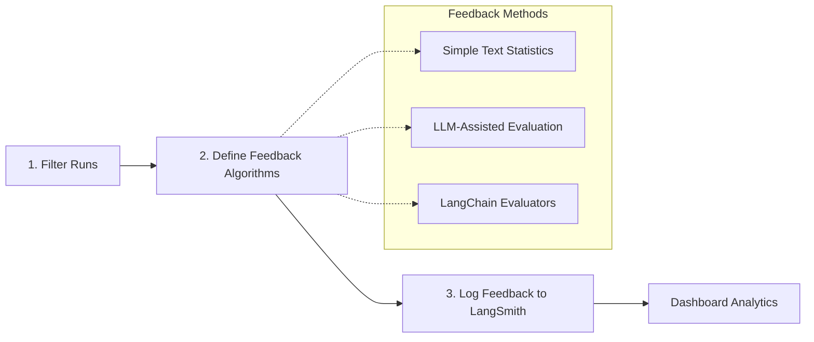
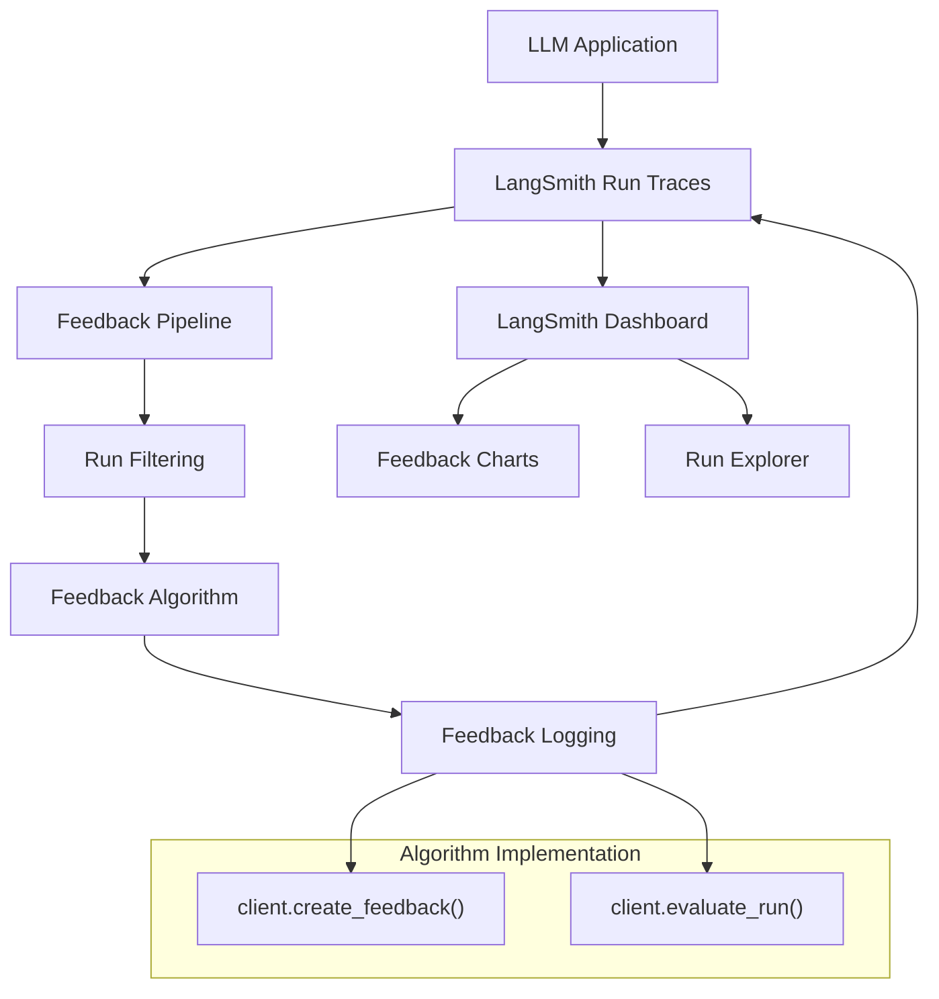
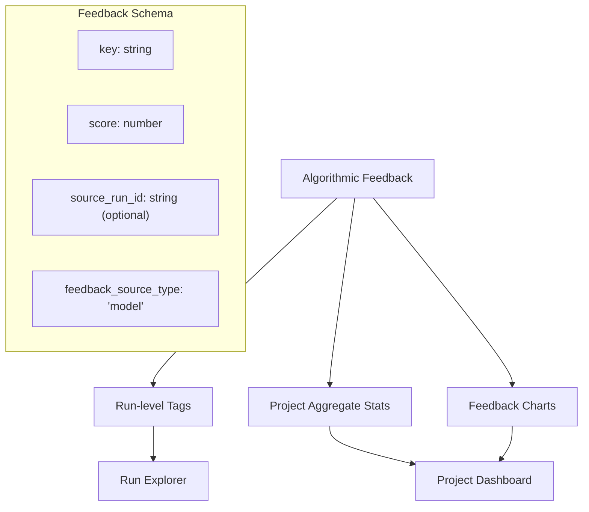

<!-- source: DeepWiki mcp.deepwiki.com · repo langchain-ai/langsmith-cookbook · page 4.2 Algorithmic Feedback · fetched 2026-10-26 -->

# Algorithmic Feedback

<details>
<summary>Relevant source files</summary>

The following files were used as context for generating this wiki page:

- [README.md](README.md)
- [feedback-examples/algorithmic-feedback/algorithmic_feedback.ipynb](feedback-examples/algorithmic-feedback/algorithmic_feedback.ipynb)
- [testing-examples/README.md](testing-examples/README.md)
- [testing-examples/comparing-runs/comparing-qa.ipynb](testing-examples/comparing-runs/comparing-qa.ipynb)
- [testing-examples/qa-correctness/qa-correctness.ipynb](testing-examples/qa-correctness/qa-correctness.ipynb)

</details>


Algorithmic feedback is an automated method of generating and logging quantitative metrics and evaluations for LLM runs in LangSmith. Unlike user feedback which requires human intervention, algorithmic feedback pipelines use programmatically defined metrics to enable scalable monitoring and continuous improvement of LLM applications.

For information about collecting manual feedback from users, see [User Feedback UIs](#4.1). For real-time automatic feedback during execution, see [Real-time Feedback](#4.3).

## Overview

Algorithmic feedback enables you to monitor your LLM applications with consistent metrics and advanced evaluations directly from the LangSmith dashboard. By setting up automated feedback pipelines, you can track important metrics over time, identify problematic patterns in production data, and curate datasets for fine-tuning.

The process consists of three main steps:



Sources: [feedback-examples/algorithmic-feedback/algorithmic_feedback.ipynb:11-27]()

## System Architecture

The algorithmic feedback system integrates with LangSmith's run tracking infrastructure to add post-execution metrics to your application traces:



Sources: [feedback-examples/algorithmic-feedback/algorithmic_feedback.ipynb:7-27]()

## Implementation Steps

### 1. Filtering Runs

The first step is to identify which runs you want to evaluate. You can filter runs based on:

- Project name
- Time range (e.g., runs since midnight)
- Run properties or tags
- Error state
- Execution order

```python
midnight = datetime.utcnow().replace(hour=0, minute=0, second=0, microsecond=0)

runs = list(
    client.list_runs(
        project_name=project_name, 
        execution_order=1,
        start_time=midnight, 
        errors=False
    )
)
```

Sources: [feedback-examples/algorithmic-feedback/algorithmic_feedback.ipynb:107-136]()

### 2. Defining Feedback Algorithms

After selecting runs, you need to define algorithms to generate the feedback metrics. The repository demonstrates three main approaches:

#### Simple Text Statistics

Use libraries like `textstat` to generate readability and complexity metrics for input text:

```python
def compute_stats(run: Run) -> None:
    if "input" not in run.inputs:
        return
    text = run.inputs["input"]
    metrics = {
        "flesch_reading_ease": textstat.flesch_reading_ease(text),
        "flesch_kincaid_grade": textstat.flesch_kincaid_grade(text),
        "smog_index": textstat.smog_index(text),
        # Additional metrics...
    }
    for key, value in metrics.items():
        client.create_feedback(
            run.id,
            key=key,
            score=value,
            feedback_source_type="model",
        )
```

Sources: [feedback-examples/algorithmic-feedback/algorithmic_feedback.ipynb:142-225]()

#### LLM-Assisted Evaluation

Use an LLM to score runs based on specific criteria. This example uses a prompt from the Hub that instructs the LLM to evaluate user questions and model responses on various dimensions:

```python
def evaluate_run(run: Run) -> None:
    if "input" not in run.inputs or "output" not in run.outputs:
        return
    
    with collect_runs() as cb:
        result = chain.invoke(
            {
                "question": run.inputs["input"][:3000],
                "prediction": run.outputs["output"][:3000],
            },
        )
        
        for feedback_key, value in result.items():
            score = int(value) / 5
            client.create_feedback(
                run.id,
                key=feedback_key,
                score=score,
                source_run_id=cb.traced_runs[0].id,
                feedback_source_type="model",
            )
```

Sources: [feedback-examples/algorithmic-feedback/algorithmic_feedback.ipynb:252-363]()

#### LangChain Evaluators

Leverage built-in LangChain evaluators for common assessment tasks like completeness, relevance, or helpfulness:

```python
class CompletenessEvaluator(ls_evaluation.RunEvaluator):
    def __init__(self):
        criteria_description = (
            "Does the answer provide sufficient and complete information"
            "to fully address all aspects of the question (Y)?"
            " Or does it lack important details (N)?"
        )
        self.evaluator = evaluation.load_evaluator(
            "criteria", criteria={"completeness": criteria_description}
        )

    def evaluate_run(
        self, run: Run, example: Optional[Example] = None
    ) -> ls_evaluation.EvaluationResult:
        # Implementation...
```

Sources: [feedback-examples/algorithmic-feedback/algorithmic_feedback.ipynb:423-475]()

### 3. Logging Feedback

You have two options for logging feedback to LangSmith:

1. **Direct method**: Using `client.create_feedback()` to log individual metrics
2. **Evaluation wrapper**: Using `client.evaluate_run()` which evaluates and logs metrics in one call

```python
# Option 1: Direct method
client.create_feedback(
    run.id,
    key="completeness",
    score=0.8,
    feedback_source_type="model"
)

# Option 2: Evaluation wrapper
evaluator = CompletenessEvaluator()
client.evaluate_run(run, evaluator)
```

For batch processing, you can use LangChain's `RunnableLambda` to concurrently process multiple runs:

```python
wrapped_function = RunnableLambda(lambda run: client.evaluate_run(run, evaluator))
_ = wrapped_function.batch(runs, {"max_concurrency": 10}, return_exceptions=True)
```

Sources: [feedback-examples/algorithmic-feedback/algorithmic_feedback.ipynb:476-505]()

## Viewing Feedback in LangSmith

After logging feedback, you can view metrics in the LangSmith dashboard. The feedback will appear:

1. As tags on individual runs
2. In aggregate statistics for the project
3. In visual charts showing metric distributions

This enables monitoring trends and identifying outliers in your application's performance.



Sources: [feedback-examples/algorithmic-feedback/algorithmic_feedback.ipynb:404-415]()

## Use Cases

### Performance Monitoring

Algorithmic feedback enables continuous monitoring of LLM application performance in production. By applying metrics to production runs, you can track:

- Input complexity
- Output quality
- Response relevance
- Model "hallucinations"

### Data Curation for Fine-tuning

The metrics generated can help select high-quality examples for fine-tuning datasets:

- Identify examples where the model performs well/poorly
- Tag examples with difficulty or complexity measures
- Filter examples based on specific criteria

### Comparative Analysis

Algorithmic feedback can help compare different versions of your application:

- Compare different prompts on the same inputs
- Evaluate different models with consistent metrics
- Track performance changes after updates

Sources: [testing-examples/comparing-runs/comparing-qa.ipynb:8-25](), [feedback-examples/algorithmic-feedback/algorithmic_feedback.ipynb:519-521]()

## Best Practices

1. **Define appropriate metrics**: Choose metrics that align with your application's goals and requirements
2. **Batch processing**: Use concurrency for efficiency when processing large numbers of runs
3. **Incremental evaluation**: Consider implementing scheduling to evaluate recent runs on a regular basis
4. **Cost management**: For LLM-assisted evaluations, balance thoroughness with compute/API costs
5. **Feedback validation**: Periodically review the algorithmic feedback against human judgment to ensure alignment

Sources: [feedback-examples/algorithmic-feedback/algorithmic_feedback.ipynb:519-521]()

## Code Implementation References

The primary implementation example can be found in the algorithmic feedback notebook:

- Filter and select runs: [feedback-examples/algorithmic-feedback/algorithmic_feedback.ipynb:128-135]()
- Text statistics implementation: [feedback-examples/algorithmic-feedback/algorithmic_feedback.ipynb:200-226]()
- LLM-assisted evaluator: [feedback-examples/algorithmic-feedback/algorithmic_feedback.ipynb:333-363]()
- LangChain evaluator: [feedback-examples/algorithmic-feedback/algorithmic_feedback.ipynb:445-475]()
- Batch processing: [feedback-examples/algorithmic-feedback/algorithmic_feedback.ipynb:498-503]()

Additional examples of comparing system outputs are available in:
- Pairwise comparison evaluations: [testing-examples/comparing-runs/comparing-qa.ipynb:696-806]()
- Q&A correctness evaluation: [testing-examples/qa-correctness/qa-correctness.ipynb:389-396]()

## Conclusion

Algorithmic feedback provides a powerful mechanism for automating evaluations of your LLM applications at scale. By implementing feedback pipelines, you can continuously monitor performance, identify areas for improvement, and build more robust AI systems.

The flexibility of algorithmic feedback allows you to apply simple statistical metrics, sophisticated LLM-based evaluations, or custom algorithms tailored to your specific use case.

---

