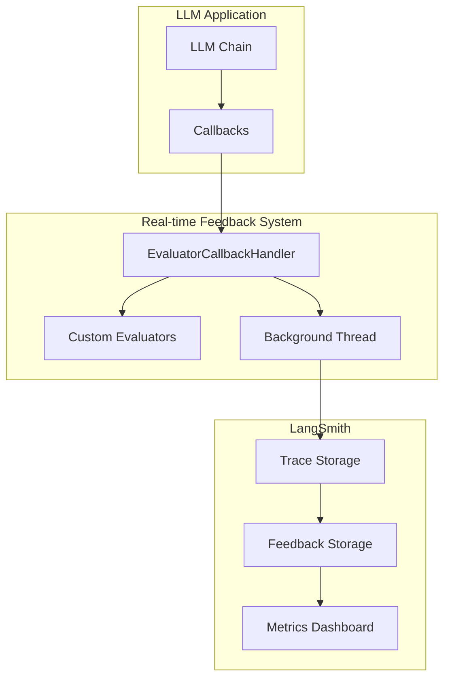
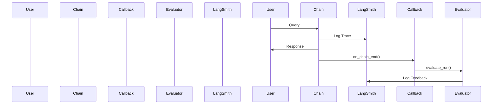
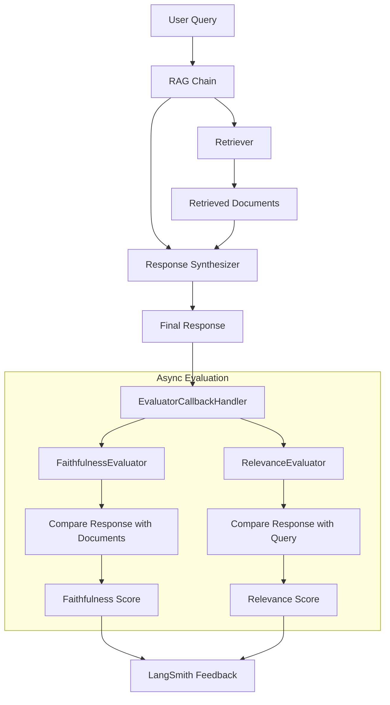

<!-- source: DeepWiki mcp.deepwiki.com · repo langchain-ai/langsmith-cookbook · page 4.3 Real-time Feedback · fetched 2026-10-26 -->

# Real-time Feedback

<details>
<summary>Relevant source files</summary>

The following files were used as context for generating this wiki page:

- [feedback-examples/README.md](feedback-examples/README.md)
- [feedback-examples/realtime-algorithmic-feedback/img/feedback_result.png](feedback-examples/realtime-algorithmic-feedback/img/feedback_result.png)
- [feedback-examples/realtime-algorithmic-feedback/realtime_feedback.ipynb](feedback-examples/realtime-algorithmic-feedback/realtime_feedback.ipynb)
- [feedback-examples/streamlit-realtime-feedback/README.md](feedback-examples/streamlit-realtime-feedback/README.md)
- [feedback-examples/streamlit-realtime-feedback/img/hallucination_feedback.gif](feedback-examples/streamlit-realtime-feedback/img/hallucination_feedback.gif)
- [hub-examples/README.md](hub-examples/README.md)
- [testing-examples/download-feedback-and-examples/download_example.ipynb](testing-examples/download-feedback-and-examples/download_example.ipynb)
- [testing-examples/using-fixed-sources/using_fixed_sources.ipynb](testing-examples/using-fixed-sources/using_fixed_sources.ipynb)
- [tracing-examples/README.md](tracing-examples/README.md)
- [typescript-testing-examples/README.md](typescript-testing-examples/README.md)

</details>


Real-time Feedback in LangSmith enables automated evaluation of your LLM application outputs as they are generated. This system allows you to attach evaluators as callbacks to your chains, which automatically generate feedback metrics for each trace without blocking the main execution flow. This is particularly valuable for production deployments where you need continuous quality monitoring without impacting user experience.

For information on collecting user feedback through UI components, see [User Feedback UIs](#4.1). For algorithmic feedback that isn't real-time, see [Algorithmic Feedback](#4.2).

Sources: [feedback-examples/realtime-algorithmic-feedback/realtime_feedback.ipynb:7-23]()

## Overview

Real-time Feedback works by executing evaluators asynchronously whenever a trace completes. This approach produces metrics that can be viewed directly in the LangSmith UI or analyzed programmatically to detect quality issues in your deployed systems.



**Real-time Feedback System Architecture**

Sources: [feedback-examples/realtime-algorithmic-feedback/realtime_feedback.ipynb:1-23](), [feedback-examples/streamlit-realtime-feedback/README.md:1-15]()

## Key Components

The real-time feedback system consists of two primary components:

1. **Custom Evaluators** - Classes that implement the `RunEvaluator` interface to define evaluation logic
2. **EvaluatorCallbackHandler** - A callback handler that executes evaluators in background threads

```mermaid
classDiagram
    class "RunEvaluator" {
        +evaluate_run(run, example) EvaluationResult
    }
    
    class "HelpfulnessEvaluator" {
        -evaluator
        +evaluate_run(run, example) EvaluationResult
    }
    
    class "FaithfulnessEvaluator" {
        -evaluator
        +evaluate_run(run, example) EvaluationResult
    }
    
    class "RelevanceEvaluator" {
        -evaluator
        +evaluate_run(run, example) EvaluationResult
    }
    
    class "EvaluatorCallbackHandler" {
        -evaluators: List[RunEvaluator]
        +on_chain_end() void
    }
    
    RunEvaluator <|-- HelpfulnessEvaluator
    RunEvaluator <|-- FaithfulnessEvaluator
    RunEvaluator <|-- RelevanceEvaluator
    EvaluatorCallbackHandler --> RunEvaluator
```

**Real-time Feedback Component Hierarchy**

Sources: [feedback-examples/realtime-algorithmic-feedback/realtime_feedback.ipynb:93-115](), [feedback-examples/streamlit-realtime-feedback/README.md:57-127]()

## Implementation Steps

### 1. Define Feedback Logic

The first step is to create a custom evaluator by implementing the `RunEvaluator` interface. This evaluator defines how to score runs based on their inputs and outputs.

Key parts of a custom evaluator:

- Inherits from `RunEvaluator`
- Implements `evaluate_run` method that takes a run and an optional example
- Returns an `EvaluationResult` with a key, score, and optional comment

The example below shows how to reference the `HelpfulnessEvaluator` from the cookbook that wraps a LangChain scoring evaluator:

Sources: [feedback-examples/realtime-algorithmic-feedback/realtime_feedback.ipynb:93-115]()

### 2. Include in Callbacks

After defining the evaluator, create an `EvaluatorCallbackHandler` instance with your evaluator(s) and include it in your chain's callbacks.

The `EvaluatorCallbackHandler` runs the evaluators in separate threads to avoid blocking the main execution flow, ensuring your application remains responsive.

Sources: [feedback-examples/realtime-algorithmic-feedback/realtime_feedback.ipynb:169-173]()

### 3. Execute Your Chain

When you execute your chain with the callback handler, the evaluators will automatically run after each trace completes.

Sources: [feedback-examples/realtime-algorithmic-feedback/realtime_feedback.ipynb:190-193]()

## Use Cases

### Basic Helpfulness Evaluation

The simplest use case is evaluating the helpfulness of LLM responses. This can help detect quality degradation in your applications.



**Basic Helpfulness Evaluation Flow**

Sources: [feedback-examples/realtime-algorithmic-feedback/realtime_feedback.ipynb:190-204]()

### RAG Hallucination Detection

A more advanced use case is detecting hallucinations in RAG systems by evaluating faithfulness to retrieved documents and relevance to user queries.



**RAG Hallucination Detection System**

Sources: [feedback-examples/streamlit-realtime-feedback/README.md:1-16](), [feedback-examples/streamlit-realtime-feedback/README.md:57-127]()

## Monitoring and Analysis

Once evaluation is complete, you can view the feedback in the LangSmith UI. The feedback is attached to the corresponding trace and includes:

- The feedback key (e.g., "helpfulness")
- A numeric score (typically normalized to a 0-1 range)
- A comment explaining the reasoning (if available)

This feedback can be used to:

1. Create dashboards to monitor application quality
2. Set up alerts for quality degradation
3. Identify specific examples for further analysis
4. Quantify the impact of model or prompt changes

Sources: [feedback-examples/realtime-algorithmic-feedback/realtime_feedback.ipynb:211-214]()

## Advanced Implementation Examples

### Custom Evaluators for RAG

For RAG applications, you can implement specialized evaluators:

1. **RelevanceEvaluator**: Assesses how well the response addresses the user query
2. **FaithfulnessEvaluator**: Checks if the response accurately reflects the retrieved documents

These evaluators help catch issues such as:
- The model ignoring retrieved documents in favor of its pretrained knowledge
- The model being overly influenced by misleading content in retrieved documents
- The model generating information not present in the retrieved documents

Sources: [feedback-examples/streamlit-realtime-feedback/README.md:57-127]()

### Non-blocking Evaluation Architecture

The key feature of real-time feedback is its non-blocking nature. The evaluators run in background threads, ensuring:

1. User experience is not degraded by evaluation overhead
2. Evaluation errors don't impact the main application
3. Lengthy evaluations can complete asynchronously

This is particularly important for production deployments where performance is critical.

Sources: [feedback-examples/streamlit-realtime-feedback/README.md:143-154]()

## Conclusion

Real-time Feedback provides a powerful mechanism for monitoring the quality of LLM applications in production. By automatically evaluating each response as it's generated, you can maintain visibility into system performance without impacting user experience.

Key benefits include:
- Immediate quality feedback without additional latency
- Automated metrics collection for monitoring dashboards
- Early detection of quality issues before they impact users
- Actionable insights for debugging and improvement

This approach is especially valuable for applications like RAG systems where hallucinations and factual accuracy are critical concerns.

Sources: [feedback-examples/realtime-algorithmic-feedback/realtime_feedback.ipynb:211-214](), [feedback-examples/streamlit-realtime-feedback/README.md:156-159]()

---

