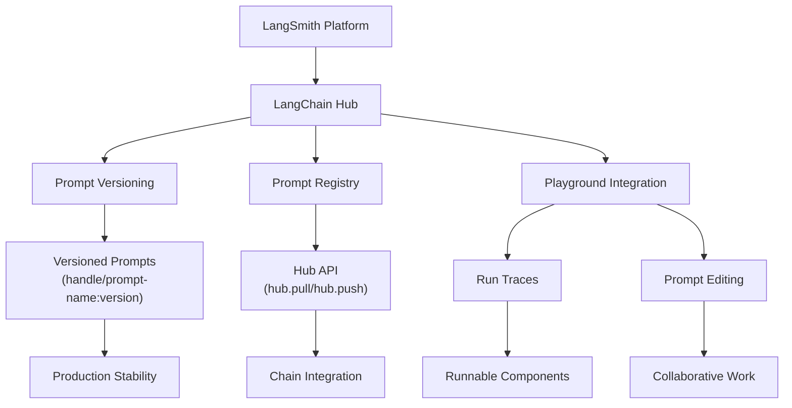
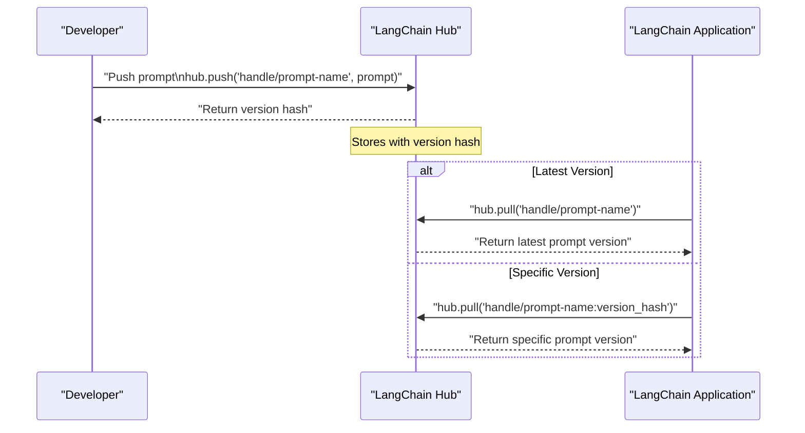
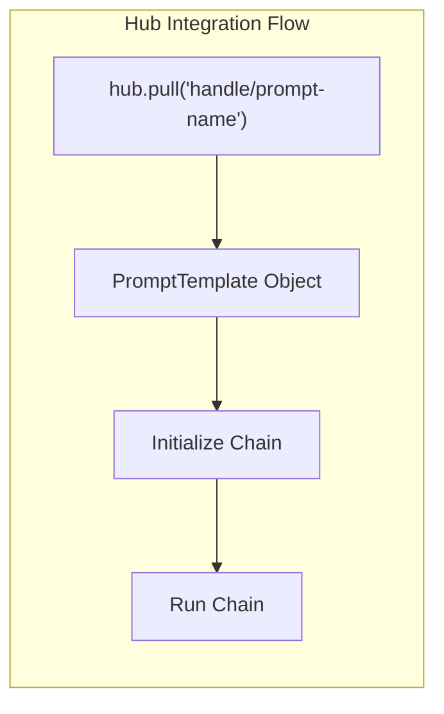
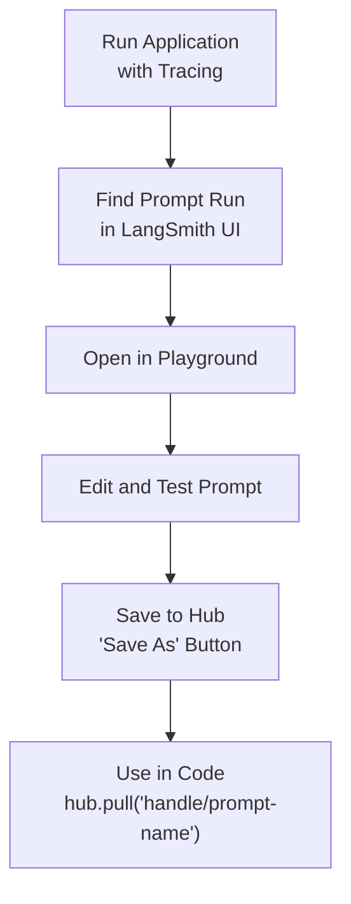
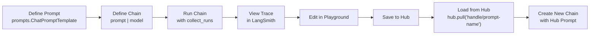

<!-- source: DeepWiki mcp.deepwiki.com · repo langchain-ai/langsmith-cookbook · page 5 LangChain Hub Integration · fetched 2026-10-26 -->

# LangChain Hub Integration

<details>
<summary>Relevant source files</summary>

The following files were used as context for generating this wiki page:

- [README.md](README.md)
- [hub-examples/retrieval-qa-chain-versioned/prompt-versioning.ipynb](hub-examples/retrieval-qa-chain-versioned/prompt-versioning.ipynb)
- [hub-examples/retrieval-qa-chain/retrieval-qa.ipynb](hub-examples/retrieval-qa-chain/retrieval-qa.ipynb)
- [hub-examples/runnable-prompt/edit-in-playground.ipynb](hub-examples/runnable-prompt/edit-in-playground.ipynb)
- [testing-examples/README.md](testing-examples/README.md)

</details>


## Purpose and Scope

The LangChain Hub integration provides capabilities for managing, versioning, and sharing prompts and other LLM artifacts within the LangSmith ecosystem. This document explains how to leverage the Hub for prompt management and versioning to ensure consistent LLM application behavior across development and production environments.

The Hub acts as a central registry for your prompts, making it easier to collaborate with team members, track changes over time, and integrate established prompts into your LangChain applications.



Sources: [README.md:24-30](), [hub-examples/retrieval-qa-chain/retrieval-qa.ipynb:7-15]()

## Core Concepts

### Prompt Registry

The Hub serves as a centralized registry where prompts can be stored, shared, and reused across different applications. Each prompt is stored under a namespace following the pattern `<handle>/<prompt-name>`, where `handle` is your user identifier in the LangSmith platform.

| Component | Description | Example |
|-----------|-------------|---------|
| Handle | Your LangSmith user identifier | `rlm` |
| Prompt Name | Unique identifier for the prompt | `rag-prompt` |
| Full Reference | Complete identifier to access the prompt | `rlm/rag-prompt` |

Sources: [hub-examples/retrieval-qa-chain/retrieval-qa.ipynb:26-30](), [hub-examples/retrieval-qa-chain-versioned/prompt-versioning.ipynb:14-24]()

### Versioning System

Every time you save a prompt to the Hub, it creates a new version with a unique hash. This versioning system allows you to track changes over time and reference specific versions for stability in production environments.



Sources: [hub-examples/retrieval-qa-chain-versioned/prompt-versioning.ipynb:64-67]()

### Playground Integration

The Hub integrates with the LangSmith playground, allowing you to visualize, edit, and test prompts directly in the browser. This feature is particularly useful for collaborative prompt engineering among team members with different technical backgrounds.

| Feature | Description |
|---------|-------------|
| Run Tracing | Captures prompt usage in applications for debugging |
| Prompt Editing | Allows direct modification of prompts in the UI |
| Saving to Hub | Allows saving modified prompts directly to the Hub |
| Testing | Allows testing prompts with different inputs and models |

Sources: [hub-examples/runnable-prompt/edit-in-playground.ipynb:8-20]()

## Usage Workflows

### Loading Prompts from Hub

To use a prompt from the Hub in your application, use the `hub.pull()` method:



For production environments, it's recommended to use a specific version:

```python
from langchain import hub

# Load latest version (development)
prompt = hub.pull("handle/prompt-name")

# Load specific version (production)
prompt = hub.pull("handle/prompt-name:version_hash")
```

Sources: [hub-examples/retrieval-qa-chain/retrieval-qa.ipynb:106-113](), [hub-examples/retrieval-qa-chain-versioned/prompt-versioning.ipynb:77-83]()

### Saving Prompts to Hub

After developing or modifying a prompt, you can save it to the Hub using `hub.push()`:

```python
from langchain import hub

# Save a prompt to the Hub
hub.push("handle/prompt-name", prompt)
```

This creates a new version of the prompt, allowing you to track changes over time.

Sources: [hub-examples/retrieval-qa-chain/retrieval-qa.ipynb:256-257]()

### Using the Playground

The LangSmith playground allows you to visualize and edit prompts from your application runs:

1. Run your application with appropriate tracing
2. Find the `ChatPromptTemplate` run in your traces
3. Open it in the playground
4. Edit and test the prompt
5. Save it to the Hub for later use



Sources: [hub-examples/runnable-prompt/edit-in-playground.ipynb:125-159]()

## Integration Patterns

### RetrievalQA Chain Integration

This example demonstrates using a Hub prompt with a RetrievalQA chain:

```python
from langchain import hub
from langchain.chains import RetrievalQA

# Load prompt from Hub
prompt = hub.pull("handle/rag-prompt")

# Initialize chain with the prompt
qa_chain = RetrievalQA.from_chain_type(
    llm,
    retriever=vectorstore.as_retriever(),
    chain_type_kwargs={"prompt": prompt}
)

# Run the chain
result = qa_chain({"query": question})
```

This pattern allows you to centralize your prompt management and easily update prompts without changing your application code.

Sources: [hub-examples/retrieval-qa-chain/retrieval-qa.ipynb:183-188](), [hub-examples/retrieval-qa-chain-versioned/prompt-versioning.ipynb:135-144]()

### Runnable PromptTemplates

Using the LangChain Expression Language (LCEL) with Hub integration enables a streamlined workflow for prompt management and experimentation:



Example code:

```python
from langchain import prompts, chat_models, hub, callbacks

# Define chain with prompt
prompt = prompts.ChatPromptTemplate.from_messages([
    ("system", "System instruction"),
    ("human", "{input}")
])
chain = prompt | chat_models.ChatModel()

# Run with tracing
with callbacks.collect_runs() as cb:
    chain.invoke({"input": "User query"})
    
# Later, load from Hub
prompt = hub.pull("handle/prompt-name")
chain = prompt | chat_models.ChatModel()
```

This pattern is particularly useful for iterative prompt development and collaboration with non-technical team members.

Sources: [hub-examples/runnable-prompt/edit-in-playground.ipynb:58-92](), [hub-examples/runnable-prompt/edit-in-playground.ipynb:171-184]()

## Best Practices

### Production Stability

For production deployments, always use specific prompt versions rather than the "latest" version:

```python
# Development (gets latest version)
prompt = hub.pull("handle/rag-prompt")

# Production (gets specific, tested version)
prompt = hub.pull("handle/rag-prompt:c9839f14")
```

This ensures consistent behavior regardless of subsequent prompt updates.

Sources: [hub-examples/retrieval-qa-chain-versioned/prompt-versioning.ipynb:16-24]()

### Collaborative Workflow

The Hub enables a collaborative workflow for prompt engineering:

1. Technical team members build application structure and integration
2. Non-technical members can edit and refine prompts in the playground
3. Changes are versioned and can be selectively incorporated
4. Production systems use pinned versions for stability

This separation of concerns allows domain experts to contribute to prompt engineering without requiring deep technical knowledge.

Sources: [hub-examples/runnable-prompt/edit-in-playground.ipynb:8-20]()

## API Reference

| Method | Purpose | Example |
|--------|---------|---------|
| `hub.pull(repo_id)` | Load a prompt from the Hub | `hub.pull("handle/prompt-name")` |
| `hub.pull(repo_id:version)` | Load a specific version | `hub.pull("handle/prompt-name:c9839f14")` |
| `hub.push(repo_id, prompt)` | Save a prompt to the Hub | `hub.push("handle/prompt-name", prompt)` |

Sources: [hub-examples/retrieval-qa-chain/retrieval-qa.ipynb:106-113](), [hub-examples/retrieval-qa-chain/retrieval-qa.ipynb:256-257](), [hub-examples/retrieval-qa-chain-versioned/prompt-versioning.ipynb:77-83]()

---

