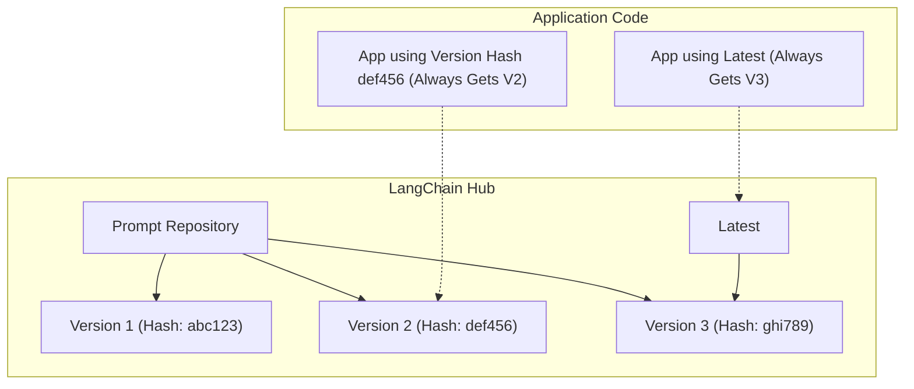
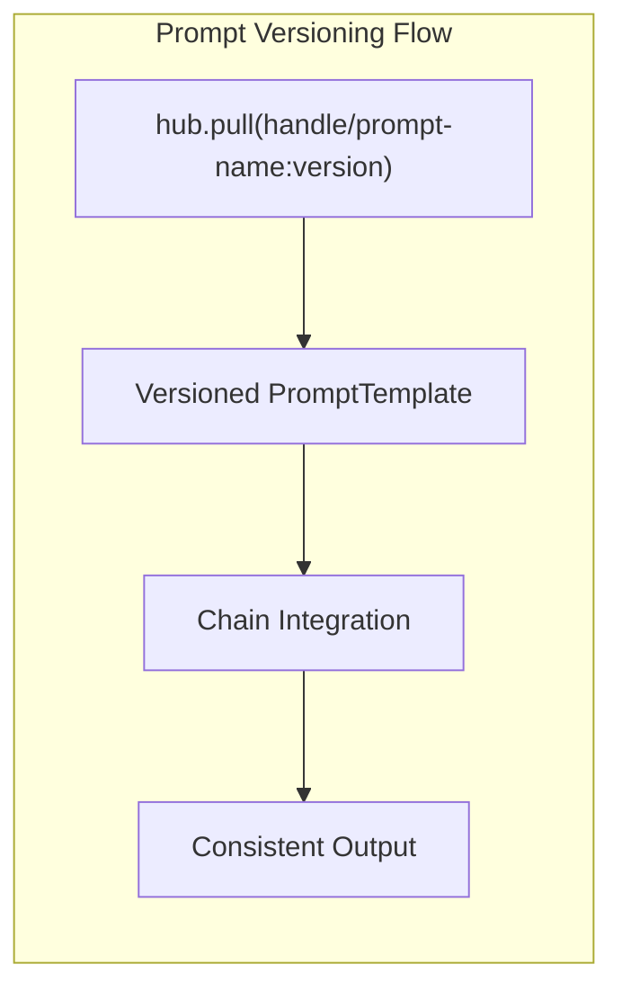
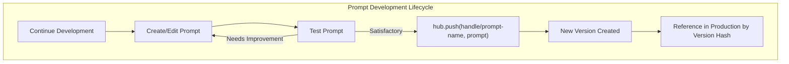
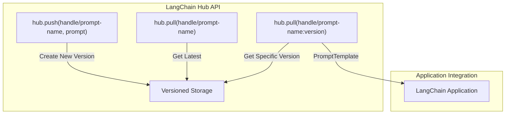

<!-- source: DeepWiki mcp.deepwiki.com · repo langchain-ai/langsmith-cookbook · page 5.1 Prompt Versioning · fetched 2026-10-26 -->

# Prompt Versioning

<details>
<summary>Relevant source files</summary>

The following files were used as context for generating this wiki page:

- [README.md](README.md)
- [hub-examples/retrieval-qa-chain-versioned/prompt-versioning.ipynb](hub-examples/retrieval-qa-chain-versioned/prompt-versioning.ipynb)
- [hub-examples/retrieval-qa-chain/retrieval-qa.ipynb](hub-examples/retrieval-qa-chain/retrieval-qa.ipynb)
- [hub-examples/runnable-prompt/edit-in-playground.ipynb](hub-examples/runnable-prompt/edit-in-playground.ipynb)
- [testing-examples/README.md](testing-examples/README.md)

</details>


## Purpose and Overview

Prompt Versioning is a key feature of LangChain Hub that enables you to pin specific versions of prompts for use in your applications. When deploying LLM applications to production, relying on the "latest" version of a prompt can introduce unpredictable behaviors if the prompt is updated. Prompt Versioning addresses this by allowing you to reference specific, immutable versions of prompts using commit hashes, providing stability and reproducibility in production environments.

For information about using prompts from the Hub in RAG pipelines, see [Retrieval QA Chain](#5.2). For details on integrating Hub prompts into chains, see [Runnable PromptTemplate](#5.3).

Sources: [hub-examples/retrieval-qa-chain-versioned/prompt-versioning.ipynb:6-24](), [README.md:28-30]()

## Versioning Model

Each time a prompt is saved to LangChain Hub, it creates a new version with a unique commit hash. This hash-based versioning system allows precise referencing of specific prompt versions, similar to Git's commit-based versioning.



By default, when you pull a prompt from the Hub without specifying a version, you get the latest version. However, for production use, it's recommended to specify a version hash to ensure consistency even if the prompt is updated in the Hub.

Sources: [hub-examples/retrieval-qa-chain-versioned/prompt-versioning.ipynb:64-67](), [hub-examples/retrieval-qa-chain-versioned/prompt-versioning.ipynb:15-24]()

## Implementation

### Pulling a Specific Prompt Version

To use a specific version of a prompt, append the version hash to the prompt ID using a colon separator:

```python
from langchain import hub

# Load a specific version using the commit hash
prompt = hub.pull("username/prompt-name:commit_hash")
```

In production code, you should always specify a version hash rather than using the default latest version. This ensures your application behavior remains consistent even if the prompt is updated by your team.

Sources: [hub-examples/retrieval-qa-chain-versioned/prompt-versioning.ipynb:70-83]()

### Integration with Chains

After loading a versioned prompt, you can use it in your LangChain chains just like any other prompt:



The versioned prompt becomes a component in your chain, ensuring that your chain's behavior remains consistent regardless of changes to the prompt repository.

Sources: [hub-examples/retrieval-qa-chain-versioned/prompt-versioning.ipynb:125-145]()

## Version Management

### Creating New Versions

Each time you push a prompt to the Hub, a new version is created with a unique commit hash. You can view all versions of a prompt in the Hub interface under the "commits" tab.



When you create a new version, the previous versions remain accessible via their commit hashes, allowing you to maintain backward compatibility or roll back to previous versions if needed.

Sources: [hub-examples/retrieval-qa-chain-versioned/prompt-versioning.ipynb:187-192](), [hub-examples/retrieval-qa-chain/retrieval-qa.ipynb:229-324]()

### Playground Integration

LangChain Hub includes a playground interface where you can interactively test and edit prompts. Changes made in the playground can be saved as new versions, enabling collaborative prompt development without directly editing code.

When a satisfactory prompt version is created, you can reference it by hash in your production code, maintaining the separation between development experimentation and stable production environments.

Sources: [hub-examples/runnable-prompt/edit-in-playground.ipynb:8-24](), [hub-examples/runnable-prompt/edit-in-playground.ipynb:124-160]()

## Best Practices

1. **Always specify version hashes in production code** - This ensures consistency even if the "latest" version changes.

2. **Document which prompt versions are used in which environments** - Keep track of which version hashes are deployed to production, staging, and development environments.

3. **Test prompt changes thoroughly before creating new versions** - Once a version is created, it cannot be modified, so ensure it works as expected before pushing.

4. **Use meaningful commit messages when pushing new versions** - This helps team members understand what changes were made in each version.

5. **Consider using branch-like namespaces for major prompt variations** - For significantly different prompt approaches, consider using separate prompt repositories rather than just different versions.

```
Table: Prompt Version Management Strategies

| Environment | Strategy                                      | Example                                 |
|-------------|-------------------------------------------------|----------------------------------------|
| Development | Use latest or specific test versions            | hub.pull("username/prompt:latest")     |
| Staging     | Use specific versions slated for production     | hub.pull("username/prompt:abc123def")  |
| Production  | Always use specific, well-tested version hashes | hub.pull("username/prompt:fd98e7b2")   |
```

Sources: [hub-examples/retrieval-qa-chain-versioned/prompt-versioning.ipynb:18-24](), [hub-examples/retrieval-qa-chain-versioned/prompt-versioning.ipynb:187-192]()

## Technical Architecture

Prompt versioning in LangChain Hub leverages a hash-based immutable storage system. When you push a prompt to the Hub, it:

1. Generates a unique hash for the prompt content
2. Stores the prompt with this hash identifier 
3. Updates the "latest" pointer to reference this new version

When pulling a prompt, you're either retrieving the version pointed to by "latest" or a specific immutable version identified by its hash.



This architecture ensures that once a prompt version is created, it remains unchanged and accessible via its hash indefinitely, allowing for reliable reference in production systems.

Sources: [hub-examples/retrieval-qa-chain/retrieval-qa.ipynb:229-332](), [hub-examples/retrieval-qa-chain-versioned/prompt-versioning.ipynb:64-83]()

## Conclusion

Prompt versioning provides stability and reproducibility for LLM applications by allowing precise referencing of prompt versions. By using specific version hashes in production code, you can ensure consistent behavior even as prompts evolve during development. This version-controlled approach to prompt management is a critical best practice for production-grade LLM applications, enabling safe iteration while maintaining stability.

Sources: [hub-examples/retrieval-qa-chain-versioned/prompt-versioning.ipynb:187-192]()

---

