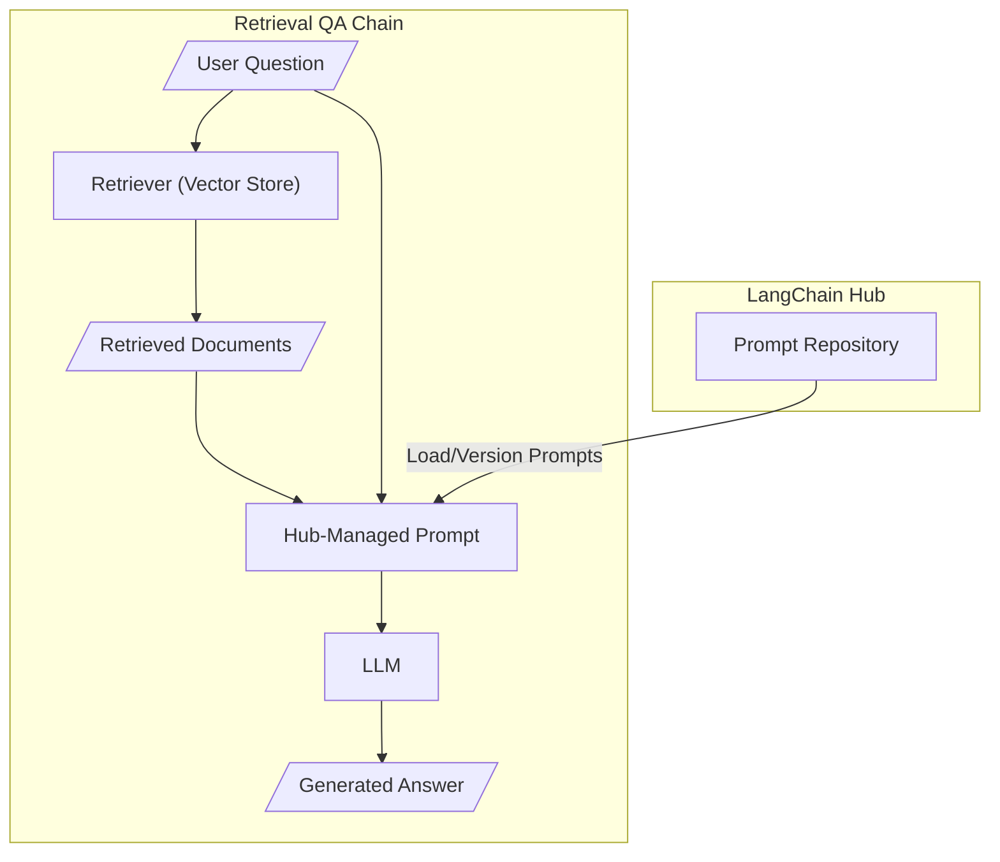
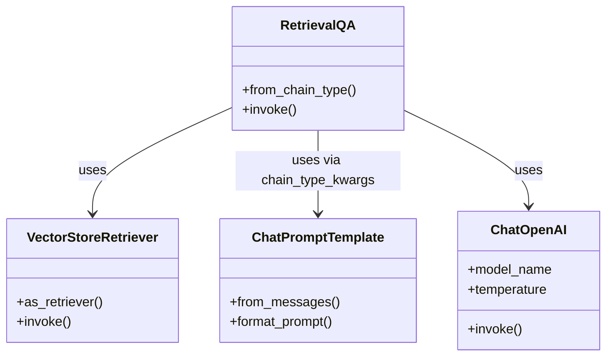
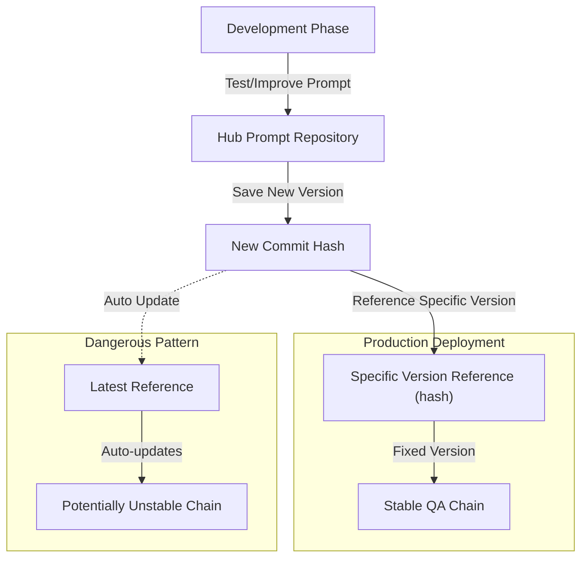
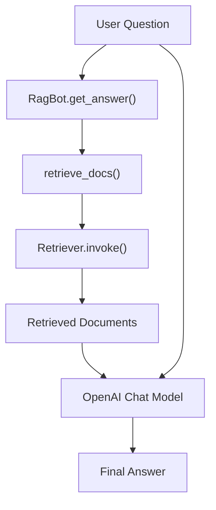

<!-- source: DeepWiki mcp.deepwiki.com · repo langchain-ai/langsmith-cookbook · page 5.2 Retrieval QA Chain · fetched 2026-10-26 -->

# Retrieval QA Chain

<details>
<summary>Relevant source files</summary>

The following files were used as context for generating this wiki page:

- [hub-examples/retrieval-qa-chain-versioned/prompt-versioning.ipynb](hub-examples/retrieval-qa-chain-versioned/prompt-versioning.ipynb)
- [hub-examples/retrieval-qa-chain/retrieval-qa.ipynb](hub-examples/retrieval-qa-chain/retrieval-qa.ipynb)
- [hub-examples/runnable-prompt/edit-in-playground.ipynb](hub-examples/runnable-prompt/edit-in-playground.ipynb)
- [introduction/langsmith_introduction.ipynb](introduction/langsmith_introduction.ipynb)
- [introduction/online_evaluation.ipynb](introduction/online_evaluation.ipynb)
- [introduction/summarization.ipynb](introduction/summarization.ipynb)
- [testing-examples/rag_eval/online_eval.ipynb](testing-examples/rag_eval/online_eval.ipynb)
- [testing-examples/rag_eval/rag.ipynb](testing-examples/rag_eval/rag.ipynb)

</details>


This page describes the Retrieval QA Chain component within the LangSmith ecosystem, which enables building question-answering systems that combine language models with document retrieval. This component allows developers to create systems that answer questions based on a corpus of documents by retrieving relevant context and generating targeted responses.

For information about broader RAG evaluation strategies, see [RAG Evaluation](#3.1).

## Overview

A Retrieval QA Chain combines a retriever component (typically a vector store) with an LLM to create a system that can answer questions based on retrieved documents. The LangChain Hub integrates with this functionality by allowing you to manage and version prompts used in these chains.



Sources: 
- [hub-examples/retrieval-qa-chain/retrieval-qa.ipynb:8-200]()
- [testing-examples/rag_eval/rag.ipynb:11-30]()

## Key Components

A Retrieval QA Chain consists of the following components:

1. **Retriever**: Responsible for fetching relevant documents based on the input query
2. **Prompt Template**: Structures how the query and retrieved documents are presented to the LLM
3. **LLM**: Generates the final answer based on the prompt and retrieved information

The integration with LangChain Hub enables versioning and management of prompt templates, which are crucial for the chain's performance and behavior.



Sources:
- [hub-examples/retrieval-qa-chain/retrieval-qa.ipynb:175-190]()
- [testing-examples/rag_eval/rag.ipynb:100-142]()

## Setting Up a Retrieval QA Chain

### 1. Loading a Prompt from the Hub

The first step is to load the prompt from the LangChain Hub:

```python
from langchain import hub

# Loads the latest version
prompt = hub.pull("rlm/rag-prompt", api_url="https://api.hub.langchain.com")

# To load a specific version, specify the version hash
# prompt = hub.pull("rlm/rag-prompt:50442af1")
```

Sources:
- [hub-examples/retrieval-qa-chain/retrieval-qa.ipynb:106-113]()

### 2. Preparing the Retriever

Next, set up a vector store with your documents and create a retriever:

```python
from langchain_community.document_loaders import WebBaseLoader
from langchain_community.vectorstores import Chroma
from langchain_text_splitters import RecursiveCharacterTextSplitter
from langchain_openai import ChatOpenAI, OpenAIEmbeddings

# Load and split documents
loader = WebBaseLoader("https://some-url.com")
data = loader.load()
text_splitter = RecursiveCharacterTextSplitter(chunk_size=500, chunk_overlap=0)
splits = text_splitter.split_documents(data)

# Create vector store and retriever
vectorstore = Chroma.from_documents(documents=splits, embedding=OpenAIEmbeddings())
retriever = vectorstore.as_retriever()
```

Sources:
- [hub-examples/retrieval-qa-chain/retrieval-qa.ipynb:148-162]()
- [testing-examples/rag_eval/rag.ipynb:58-82]()

### 3. Initializing the Chain

Once you have your prompt and retriever, you can initialize the QA chain:

```python
from langchain.chains import RetrievalQA
from langchain_openai import ChatOpenAI

llm = ChatOpenAI(model_name="gpt-3.5-turbo", temperature=0)
qa_chain = RetrievalQA.from_chain_type(
    llm, 
    retriever=vectorstore.as_retriever(), 
    chain_type_kwargs={"prompt": prompt}
)
```

Sources:
- [hub-examples/retrieval-qa-chain/retrieval-qa.ipynb:182-188]()
- [hub-examples/retrieval-qa-chain-versioned/prompt-versioning.ipynb:134-145]()

### 4. Running the Chain

With the chain initialized, you can now run it with a query:

```python
question = "What are the approaches to Task Decomposition?"
result = qa_chain.invoke({"query": question})
answer = result["result"]
```

Sources:
- [hub-examples/retrieval-qa-chain/retrieval-qa.ipynb:219-221]()
- [hub-examples/retrieval-qa-chain-versioned/prompt-versioning.ipynb:160-181]()

## Versioning with LangChain Hub

For production deployments, it's recommended to use specific prompt versions rather than the latest version to ensure consistency.



### Specifying a Version

When loading a prompt from the hub, you can specify a particular version:

```python
# Load a specific version by hash
prompt = hub.pull("handle/rag-prompt:c9839f14", api_url="https://api.hub.langchain.com")
```

This ensures your production systems maintain consistent behavior even as new prompt versions are added to the hub.

Sources:
- [hub-examples/retrieval-qa-chain-versioned/prompt-versioning.ipynb:73-83]()
- [hub-examples/retrieval-qa-chain-versioned/prompt-versioning.ipynb:16-24]()

### Committing New Versions

After refining a prompt, you can commit it to the hub to create a new version:

```python
handle = "your-handle"
hub.push(f"{handle}/rag-prompt", prompt)  # Creates a new version with a unique hash
```

Sources:
- [hub-examples/retrieval-qa-chain/retrieval-qa.ipynb:257]()
- [hub-examples/retrieval-qa-chain/retrieval-qa.ipynb:316]()

## Alternative Implementation: Using LCEL and Runnable Prompts

An alternative to the traditional RetrievalQA chain is using LangChain Expression Language (LCEL) with runnable PromptTemplates:



This implementation uses the `traceable` decorator and provides more flexibility in how the components are connected.

```python
class RagBot:
    def __init__(self, retriever, model: str = "gpt-4-0125-preview"):
        self._retriever = retriever
        self._client = wrap_openai(openai.Client())
        self._model = model

    @traceable()
    def retrieve_docs(self, question):
        return self._retriever.invoke(question)

    @traceable()
    def get_answer(self, question: str):
        similar = self.retrieve_docs(question)
        response = self._client.chat.completions.create(
            model=self._model,
            messages=[
                {
                    "role": "system",
                    "content": "You are a helpful AI assistant. Use the following docs to answer the question.\\n\\n"
                    f"## Docs\\n\\n{similar}",
                },
                {"role": "user", "content": question},
            ],
        )

        return {
            "answer": response.choices[0].message.content,
            "contexts": [str(doc) for doc in similar],
        }
```

Sources:
- [testing-examples/rag_eval/rag.ipynb:100-142]()
- [hub-examples/runnable-prompt/edit-in-playground.ipynb:73-84]()

## Interactive Prompt Editing with the Hub Playground

The LangChain Hub provides a playground interface to edit and test prompts directly in the browser without writing code:

1. Run a traced chain with a prompt
2. Open the prompt run in the playground
3. Edit and test the prompt with different inputs
4. Save the updated prompt to the hub

This is especially useful for collaborative teams where non-technical members need to edit prompts.

Sources:
- [hub-examples/runnable-prompt/edit-in-playground.ipynb:124-160]()
- [hub-examples/runnable-prompt/edit-in-playground.ipynb:8-24]()

## Conclusion

The Retrieval QA Chain is a powerful component in the LangSmith ecosystem for building question-answering systems. By leveraging the LangChain Hub for prompt management and versioning, you can create robust, maintainable QA applications with consistent behavior.

Key benefits include:
- Centralized prompt management
- Version control for prompts
- Easy collaboration through the playground
- Consistent production deployments through version pinning

For evaluation of your Retrieval QA systems, refer to the RAG Evaluation documentation which covers methods for assessing retrieval quality, response relevance, and faithfulness.

---

