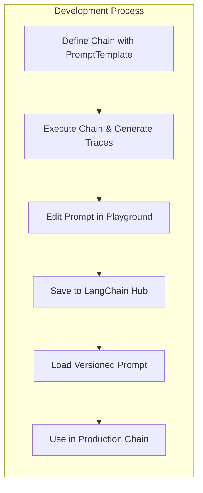
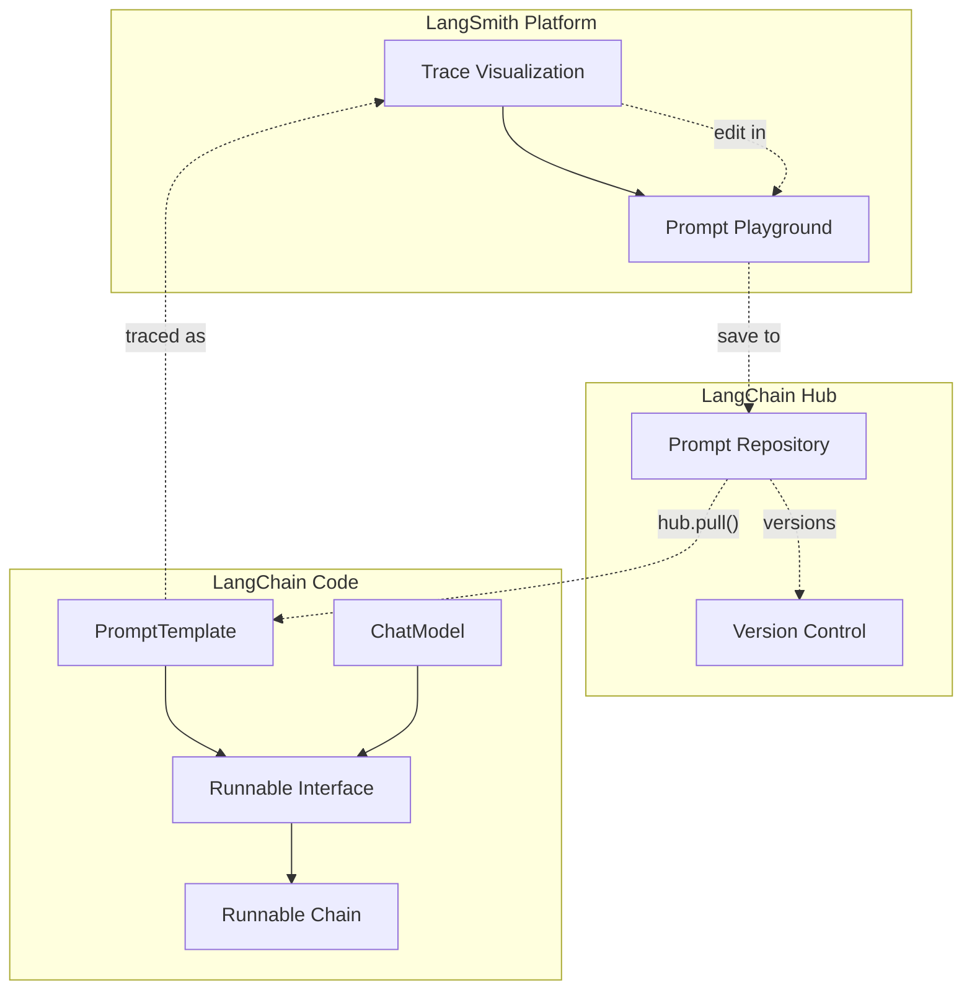

<!-- source: DeepWiki mcp.deepwiki.com · repo langchain-ai/langsmith-cookbook · page 5.3 Runnable PromptTemplate · fetched 2026-10-26 -->

# Runnable PromptTemplate

<details>
<summary>Relevant source files</summary>

The following files were used as context for generating this wiki page:

- [README.md](README.md)
- [hub-examples/retrieval-qa-chain-versioned/prompt-versioning.ipynb](hub-examples/retrieval-qa-chain-versioned/prompt-versioning.ipynb)
- [hub-examples/retrieval-qa-chain/retrieval-qa.ipynb](hub-examples/retrieval-qa-chain/retrieval-qa.ipynb)
- [hub-examples/runnable-prompt/edit-in-playground.ipynb](hub-examples/runnable-prompt/edit-in-playground.ipynb)
- [testing-examples/README.md](testing-examples/README.md)

</details>


Runnable PromptTemplate is a feature that enables seamless integration between the LangChain Hub prompt repository and LangChain's Runnable interface. It allows developers to define, trace, edit, save, version, and reuse prompts in their LLM applications with minimal code. This page focuses on the workflow and implementation of using Runnable PromptTemplate in your LLM applications. For information about prompt versioning specifically, see [Prompt Versioning](#5.1), and for retrieval QA chains using hub prompts, see [Retrieval QA Chain](#5.2).

## Key Concepts

Runnable PromptTemplate combines two powerful capabilities:

1. **LangChain Runnables** - A composable interface that enables chaining components together using the pipe (`|`) operator
2. **LangChain Hub** - A centralized registry for managing and versioning LLM artifacts, primarily prompts

When building chains using LangChain's runnable interface, each component (including prompt templates) is assigned its own run span in LangSmith traces. This separation enables direct interaction with prompts in the LangSmith playground, where you can:
- Experiment with different prompt variations
- Run the prompt with different models
- Save and version prompts to the hub
- Share prompts with team members

Sources: [hub-examples/runnable-prompt/edit-in-playground.ipynb:9-21]()

## Workflow Architecture



Sources: [hub-examples/runnable-prompt/edit-in-playground.ipynb:9-24](), [hub-examples/runnable-prompt/edit-in-playground.ipynb:58-230]()

## System Component Relationships



Sources: [hub-examples/runnable-prompt/edit-in-playground.ipynb:58-69](), [hub-examples/retrieval-qa-chain/retrieval-qa.ipynb:92-114]()

## Implementation

### Prerequisites

Before using Runnable PromptTemplate, you'll need:

1. A LangSmith account with an API key
2. The `langchain` and `langchainhub` packages
3. Environment variables properly configured

```
LANGCHAIN_ENDPOINT="https://api.smith.langchain.com"
LANGCHAIN_API_KEY="your_api_key"
LANGCHAIN_HUB_API_URL="https://api.hub.langchain.com"
LANGCHAIN_HUB_API_KEY="your_api_key"
```

Sources: [hub-examples/runnable-prompt/edit-in-playground.ipynb:22-52]()

### Defining a Chain with Runnable PromptTemplate

A chain using Runnable PromptTemplate is created by combining a prompt template with a model using the pipe operator (`|`):

```python
from langchain import prompts, chat_models

prompt = prompts.ChatPromptTemplate.from_messages([
    ("system", "You are a mysteriously vague oracle who only speaks in riddles."),
    ("human", "{input}"),
])

chain = prompt | chat_models.ChatAnthropic(model="claude-2", temperature=1.0)
```

The pipe syntax converts the prompt and chat model into a `RunnableSequence` for easy composition.

Sources: [hub-examples/runnable-prompt/edit-in-playground.ipynb:74-83](), [hub-examples/runnable-prompt/edit-in-playground.ipynb:88-95]()

### Tracing and Accessing the Playground

When you run your chain with tracing enabled, you can access the prompt in the LangSmith playground:

```python
from langchain import callbacks

with callbacks.collect_runs() as cb:
    for chunk in chain.stream({"input": "What is the GIL?"}):
        print(chunk.content, end="", flush=True)
    run_id = cb.traced_runs[0].id
```

After execution, you can find the `ChatPromptTemplate` child run in LangSmith and select "Open in Playground" to edit it interactively.

Sources: [hub-examples/runnable-prompt/edit-in-playground.ipynb:97-117](), [hub-examples/runnable-prompt/edit-in-playground.ipynb:124-146]()

### Prompt Playground Workflow

The LangSmith Playground provides an interface where you can:

1. Edit prompt messages directly
2. Test against different models
3. See outputs in real-time
4. Save the modified prompt to the Hub

When satisfied with your prompt, click "Save as" to save it to the Hub with a specific name.

Sources: [hub-examples/runnable-prompt/edit-in-playground.ipynb:149-162]()

### Loading Prompts from the Hub

Once saved to the Hub, prompts can be easily loaded into your application:

```python
from langchain import hub

prompt = hub.pull("your_handle/prompt_name", api_url="https://api.hub.langchain.com")
chain = prompt | chat_models.ChatAnthropic(model="claude-2", temperature=1.0)
```

For production applications, it's recommended to specify a specific version using the version hash to ensure consistency:

```python
prompt = hub.pull("your_handle/prompt_name:version_hash")
```

Sources: [hub-examples/runnable-prompt/edit-in-playground.ipynb:166-184](), [hub-examples/retrieval-qa-chain-versioned/prompt-versioning.ipynb:64-84]()

## Benefits and Use Cases

### Benefits

| Benefit | Description |
|---------|-------------|
| **Collaborative Prompt Engineering** | Non-technical team members can edit prompts in the playground without touching code |
| **Version Control** | Track changes to prompts over time with commit hashes |
| **Rapid Iteration** | Quickly test and modify prompts without redeploying code |
| **Consistent Deployment** | Use specific prompt versions in production for reliability |
| **Centralized Management** | Store all prompts in one location for team access |

### Common Use Cases

1. **Prompt Optimization**: Iteratively improve prompts through direct playground editing
2. **Cross-discipline Collaboration**: Allow prompt engineering specialists to optimize prompts independently from code
3. **A/B Testing**: Test different prompt versions by loading specific commits
4. **Production Stability**: Lock production systems to specific prompt versions while allowing experimentation

Sources: [hub-examples/runnable-prompt/edit-in-playground.ipynb:224-230](), [hub-examples/retrieval-qa-chain-versioned/prompt-versioning.ipynb:7-25]()

## Integration with Other LangSmith Components

Runnable PromptTemplate works with the broader LangSmith ecosystem:

1. **LangSmith Tracing**: Each prompt execution is recorded in LangSmith for debugging
2. **LangChain Hub**: Stores versioned prompts for reuse
3. **LangSmith Playground**: Provides an interactive environment for prompt editing
4. **Feedback Collection**: Prompts saved from the playground can be evaluated using LangSmith's feedback and evaluation tools

The process creates a complete feedback loop where prompts can be traced, edited, tested, and evaluated continuously.

Sources: [README.md:24-30](), [README.md:32-37]()

---

