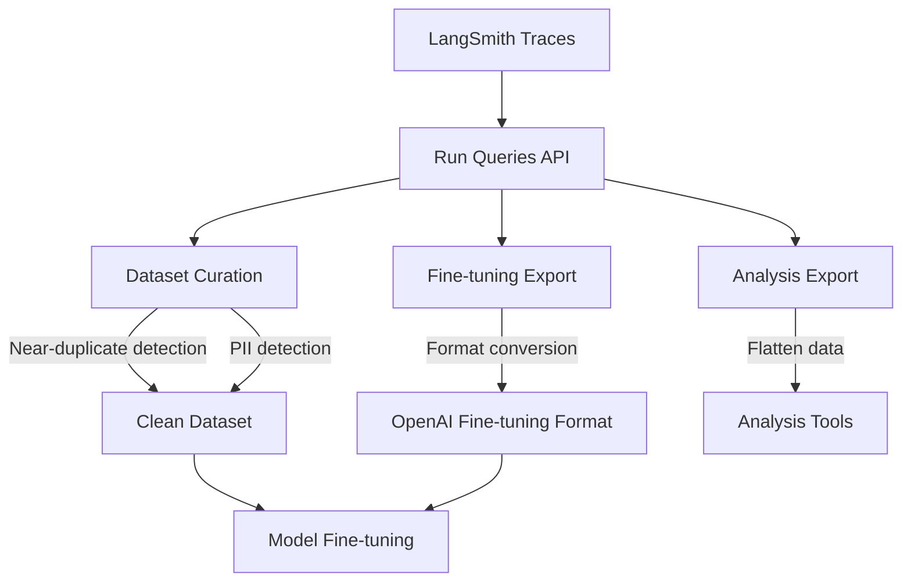
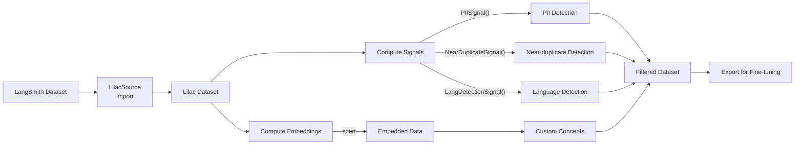
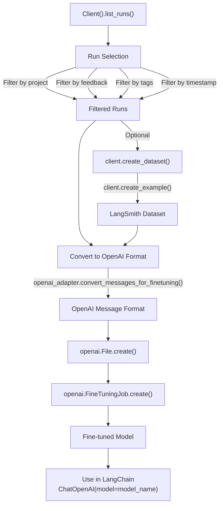
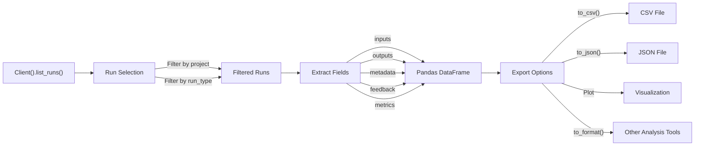
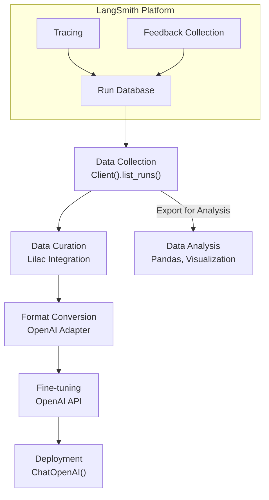

<!-- source: DeepWiki mcp.deepwiki.com · repo langchain-ai/langsmith-cookbook · page 6 Data Export & Fine-tuning · fetched 2026-10-26 -->

# Data Export & Fine-tuning

<details>
<summary>Relevant source files</summary>

The following files were used as context for generating this wiki page:

- [exploratory-data-analysis/README.md](exploratory-data-analysis/README.md)
- [exploratory-data-analysis/exporting-llm-runs-and-feedback/llm_run_etl.ipynb](exploratory-data-analysis/exporting-llm-runs-and-feedback/llm_run_etl.ipynb)
- [exploratory-data-analysis/lilac/lilac.ipynb](exploratory-data-analysis/lilac/lilac.ipynb)
- [fine-tuning-examples/README.md](fine-tuning-examples/README.md)
- [fine-tuning-examples/export-to-openai/fine-tuning-on-chat-runs.ipynb](fine-tuning-examples/export-to-openai/fine-tuning-on-chat-runs.ipynb)
- [fine-tuning-examples/lilac/img/workflow.png](fine-tuning-examples/lilac/img/workflow.png)
- [fine-tuning-examples/lilac/lilac.ipynb](fine-tuning-examples/lilac/lilac.ipynb)
- [fine-tuning-examples/lilac/rag.jsonl](fine-tuning-examples/lilac/rag.jsonl)

</details>


This page describes the capabilities in LangSmith for exporting run data and using it for model fine-tuning. LangSmith provides features for exporting traced data in formats suitable for analysis, dataset curation, and fine-tuning language models. These capabilities enable you to leverage your application usage data to improve model performance and create more tailored models.

For information about prompt optimization techniques that don't involve fine-tuning, see [Prompt Optimization](#7).

## Overview

LangSmith offers several key capabilities for data export and fine-tuning:

1. **Dataset Curation** - Tools for filtering, analyzing, and cleaning datasets before fine-tuning
2. **Fine-tuning Export** - Converting trace data to formats suitable for model fine-tuning
3. **Analysis Export** - Exporting run data for visualization and analysis



Sources:
- [fine-tuning-examples/README.md]()
- [exploratory-data-analysis/README.md]()

## Dataset Curation with Lilac

LangSmith integrates with [Lilac](https://github.com/lilacai/lilac), an open-source tool for data analysis and curation. This integration allows you to clean and prepare your LangSmith datasets for fine-tuning by detecting near-duplicates, personal identifiable information (PII), and other data quality issues.

### Key Dataset Curation Capabilities

- **PII Detection**: Identify and filter out examples containing sensitive personal information
- **Near-duplicate Detection**: Find and remove redundant examples to improve dataset diversity
- **Language Detection**: Detect and filter by language
- **Semantic Search**: Search for similar examples using embedding-based similarity
- **Custom Concepts**: Define and apply custom concepts for dataset organization



Sources:
- [exploratory-data-analysis/lilac/lilac.ipynb]()
- [fine-tuning-examples/lilac/lilac.ipynb:10-25]()

### Lilac Dataset Curation Workflow

1. **Create a LangSmith Dataset**: First, create a dataset of runs from LangSmith that you want to analyze and clean.

2. **Import into Lilac**: Load the LangSmith dataset into Lilac using the `LangSmithSource`.

3. **Apply Signals**: Compute signals to detect PII, near-duplicates, and language.

4. **Filter and Export**: Filter the dataset based on signal results and export for fine-tuning.

The following code pattern is commonly used for these steps:

```python
# Create LangSmith dataset
client = Client()
dataset_name = "your-dataset-name"
ds = client.create_dataset(dataset_name)

# Import into Lilac
import lilac as ll
data_source = ll.sources.langsmith.LangSmithSource(dataset_name=dataset_name)
config = ll.DatasetConfig(namespace="local", name=dataset_name, source=data_source)
dataset = ll.create_dataset(config)

# Apply signals
dataset.compute_signal(ll.PIISignal(), "question")
dataset.compute_signal(ll.NearDuplicateSignal(), "question")
dataset.compute_signal(ll.LangDetectionSignal(), "question")

# Filter and export
df = dataset.to_pandas(["question", "output", "question.pii", "question.near_dup"])
df["contains_pii"] = df["question.pii"].apply(lambda x: bool([v for l in x.values() for v in l]))
df["cluster_id"] = df["question.near_dup"].apply(lambda x: x["cluster_id"])
filtered_df = df[(~df["contains_pii"])].drop_duplicates(subset="cluster_id", keep="first")
```

Sources:
- [fine-tuning-examples/lilac/lilac.ipynb:94-99]()
- [fine-tuning-examples/lilac/lilac.ipynb:159-173]()
- [fine-tuning-examples/lilac/lilac.ipynb:276-282]()
- [fine-tuning-examples/lilac/lilac.ipynb:394-424]()

## Fine-tuning with OpenAI

LangSmith makes it easy to export your traced runs for fine-tuning language models. The process involves querying runs from LangSmith, converting them to the appropriate format, and submitting them to the fine-tuning service.

### OpenAI Fine-tuning Workflow



Sources:
- [fine-tuning-examples/export-to-openai/fine-tuning-on-chat-runs.ipynb:14-19]()
- [fine-tuning-examples/export-to-openai/fine-tuning-on-chat-runs.ipynb:41-44]()
- [fine-tuning-examples/export-to-openai/fine-tuning-on-chat-runs.ipynb:75-78]()
- [fine-tuning-examples/export-to-openai/fine-tuning-on-chat-runs.ipynb:394-414]()
- [fine-tuning-examples/export-to-openai/fine-tuning-on-chat-runs.ipynb:441-445]()
- [fine-tuning-examples/export-to-openai/fine-tuning-on-chat-runs.ipynb:483-496]()
- [fine-tuning-examples/export-to-openai/fine-tuning-on-chat-runs.ipynb:529-583]()

### Key Steps for OpenAI Fine-tuning

1. **Query Runs**: Use the LangSmith client to query runs based on criteria such as project, time range, tags, or feedback scores.

2. **Convert Format**: Transform the LangSmith run data into the format expected by OpenAI's fine-tuning API.

3. **Create Fine-tuning Job**: Upload the formatted data and create a fine-tuning job.

4. **Use Fine-tuned Model**: Integrate the fine-tuned model into your LangChain application.

The following pattern demonstrates the basic workflow:

```python
from langsmith import Client
from datetime import datetime, timedelta
from langchain.adapters import openai as openai_adapter
import openai

# Query runs
client = Client()
runs = client.list_runs(
    project_name="your-project",
    run_type="llm",
    error=False,
)

# Convert to OpenAI format
def convert_messages(example):
    messages = load.load(example.inputs)["messages"]
    message_chunk = load.load(example.outputs)["generations"][0]["message"]
    return {"messages": messages + [message_chunk]}

messages = [convert_messages(example) for example in client.list_examples(dataset_name="your-dataset")]
finetuning_messages = openai_adapter.convert_messages_for_finetuning(messages)

# Create fine-tuning job
training_file = openai.File.create(file=my_file, purpose="fine-tune")
job = openai.FineTuningJob.create(
    training_file=training_file.id,
    model="gpt-3.5-turbo",
)

# Use fine-tuned model
from langchain import chat_models
model = chat_models.ChatOpenAI(model=job.fine_tuned_model)
```

Sources:
- [fine-tuning-examples/export-to-openai/fine-tuning-on-chat-runs.ipynb:49-67]()
- [fine-tuning-examples/export-to-openai/fine-tuning-on-chat-runs.ipynb:441-496]()
- [fine-tuning-examples/export-to-openai/fine-tuning-on-chat-runs.ipynb:529-583]()
- [fine-tuning-examples/export-to-openai/fine-tuning-on-chat-runs.ipynb:602-618]()

## Exporting Data for Analysis

In addition to fine-tuning, LangSmith enables you to export run data for analysis and visualization. This capability helps you understand model performance, identify patterns, and make data-driven decisions.



Sources:
- [exploratory-data-analysis/exporting-llm-runs-and-feedback/llm_run_etl.ipynb:8-22]()
- [exploratory-data-analysis/exporting-llm-runs-and-feedback/llm_run_etl.ipynb:71-90]()
- [exploratory-data-analysis/exporting-llm-runs-and-feedback/llm_run_etl.ipynb:258-282]()

### Data Export Workflow

1. **Query Runs**: Use the LangSmith client to query runs that you want to analyze.

2. **Extract and Flatten Data**: Extract relevant fields and flatten nested structures into a tabular format.

3. **Add Feedback**: Optionally, retrieve and associate feedback with runs.

4. **Export or Analyze**: Export the data to a file or analyze it directly using tools like pandas.

Here's an example pattern for exporting LLM runs to a pandas DataFrame:

```python
import pandas as pd
from langsmith import Client
from datetime import datetime, timedelta

# Query runs
client = Client()
start_time = datetime.utcnow() - timedelta(days=7)
runs = list(
    client.list_runs(
        project_name="your-project",
        run_type="llm",
        start_time=start_time,
    )
)

# Convert to DataFrame
df = pd.DataFrame(
    [
        {
            "name": run.name,
            "model": run.extra["invocation_params"]["model"],
            **run.inputs,
            **(run.outputs or {}),
            "error": run.error,
            "latency": (run.end_time - run.start_time).total_seconds() if run.end_time else None,
            "prompt_tokens": run.prompt_tokens,
            "completion_tokens": run.completion_tokens,
            "total_tokens": run.total_tokens,
        }
        for run in runs
    ],
    index=[run.id for run in runs],
)

# Export to CSV
df.to_csv("llm_runs.csv")
```

Sources:
- [exploratory-data-analysis/exporting-llm-runs-and-feedback/llm_run_etl.ipynb:71-90]()
- [exploratory-data-analysis/exporting-llm-runs-and-feedback/llm_run_etl.ipynb:258-282]()
- [exploratory-data-analysis/exporting-llm-runs-and-feedback/llm_run_etl.ipynb:463-485]()

### Working with Feedback

You can also include feedback data in your exports:

```python
# Function to get feedback from root runs
def get_root_feedback(run):
    root_run = get_root(run)
    return get_feedback(root_run)

# Include feedback in DataFrame
df = pd.DataFrame(
    [
        {
            "model": run.extra["invocation_params"]["model"],
            **stringify_inputs(run.inputs),
            **stringify_outputs(run.outputs),
            **get_root_feedback(run),
            "latency": (run.end_time - run.start_time).total_seconds() if run.end_time else None,
            "prompt_tokens": run.prompt_tokens,
            "completion_tokens": run.completion_tokens,
            "total_tokens": run.total_tokens,
        }
        for run in runs
    ],
    index=[run.id for run in runs],
)
```

Sources:
- [exploratory-data-analysis/exporting-llm-runs-and-feedback/llm_run_etl.ipynb:497-531]()
- [exploratory-data-analysis/exporting-llm-runs-and-feedback/llm_run_etl.ipynb:539-558]()

## Putting It All Together

The overall data export and fine-tuning workflow typically involves these stages:

1. **Data Collection**: Gather LLM runs and associated feedback from LangSmith
2. **Data Curation**: Clean and filter the data using tools like Lilac
3. **Format Conversion**: Transform the data into the appropriate format for fine-tuning
4. **Fine-tuning**: Create and train a fine-tuned model
5. **Deployment**: Use the fine-tuned model in your application



Sources:
- All files analyzed in this document

By leveraging these data export and fine-tuning capabilities, you can transform your LangSmith trace data into valuable assets for improving model performance and gaining insights into your application's behavior.

---

