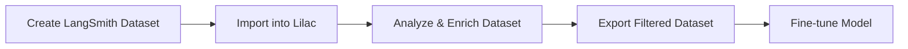
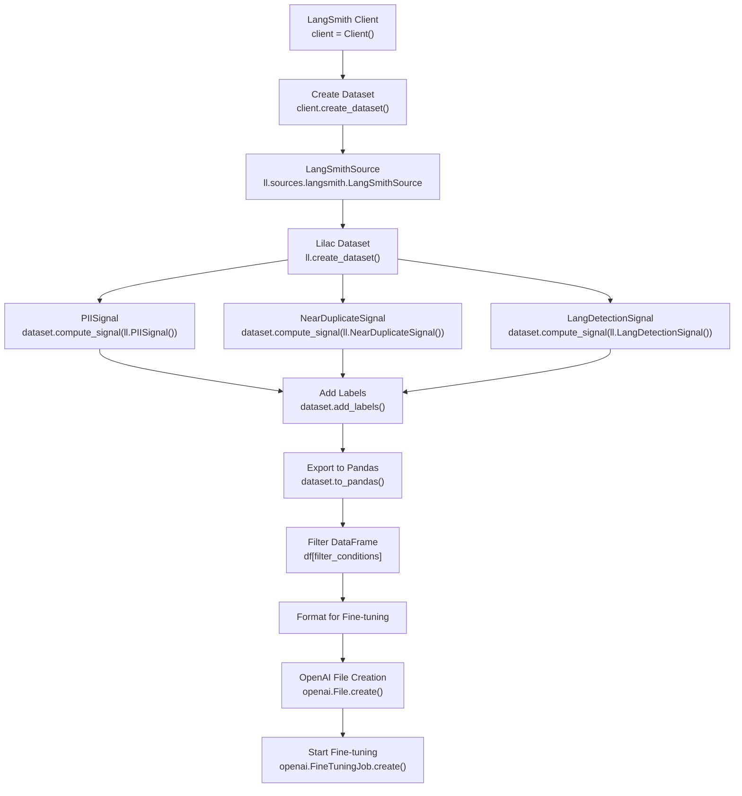
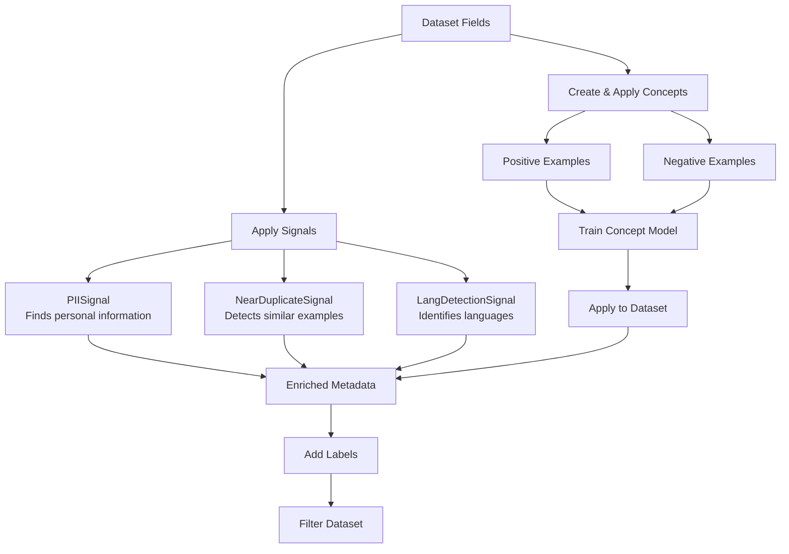

<!-- source: DeepWiki mcp.deepwiki.com · repo langchain-ai/langsmith-cookbook · page 6.1 Lilac Dataset Curation · fetched 2026-10-26 -->

# Lilac Dataset Curation

<details>
<summary>Relevant source files</summary>

The following files were used as context for generating this wiki page:

- [exploratory-data-analysis/README.md](exploratory-data-analysis/README.md)
- [exploratory-data-analysis/exporting-llm-runs-and-feedback/llm_run_etl.ipynb](exploratory-data-analysis/exporting-llm-runs-and-feedback/llm_run_etl.ipynb)
- [exploratory-data-analysis/lilac/lilac.ipynb](exploratory-data-analysis/lilac/lilac.ipynb)
- [fine-tuning-examples/README.md](fine-tuning-examples/README.md)
- [fine-tuning-examples/export-to-openai/fine-tuning-on-chat-runs.ipynb](fine-tuning-examples/export-to-openai/fine-tuning-on-chat-runs.ipynb)
- [fine-tuning-examples/lilac/img/workflow.png](fine-tuning-examples/lilac/img/workflow.png)
- [fine-tuning-examples/lilac/lilac.ipynb](fine-tuning-examples/lilac/lilac.ipynb)
- [fine-tuning-examples/lilac/rag.jsonl](fine-tuning-examples/lilac/rag.jsonl)

</details>


Lilac Dataset Curation is a system that helps analyze, structure, and clean unstructured data from LangSmith for fine-tuning language models. It focuses on detecting near-duplicates, identifying personally identifiable information (PII), analyzing content language, and generally preparing high-quality datasets for model training.

For related systems, see [OpenAI Fine-tuning](#6.2) for actual fine-tuning implementation and [Exporting Data for Analysis](#6.3) for other data export methods.

## Workflow Overview

The Lilac dataset curation process follows this high-level workflow:



Sources:
- fine-tuning-examples/lilac/lilac.ipynb
- exploratory-data-analysis/lilac/lilac.ipynb

## End-to-End Pipeline

This diagram illustrates the complete pipeline with specific code entities:



Sources:
- fine-tuning-examples/lilac/lilac.ipynb
- exploratory-data-analysis/lilac/lilac.ipynb

## Setup

To use Lilac with LangSmith, you need to install the following packages:

```
pip install -U "lilac[pii]" langdetect sentence-transformers langsmith
```

For fine-tuning with OpenAI, you'll also need the OpenAI package:

```
pip install -U openai
```

Sources:
- fine-tuning-examples/lilac/lilac.ipynb:39-40

## Creating a LangSmith Dataset

First, you need a dataset to analyze. You can create one directly from LangSmith runs:

```python
from langsmith import Client

client = Client()
dataset_name = "your-dataset-name"
ds = client.create_dataset(dataset_name)

# Add examples from a JSONL file
with open("data.jsonl", "r") as f:
    for line in f:
        data = json.loads(line)
        client.create_example(inputs=data["inputs"], outputs=data["outputs"], dataset_id=ds.id)
```

Sources:
- fine-tuning-examples/lilac/lilac.ipynb:73-98

## Importing into Lilac

Once you have a LangSmith dataset, you can import it into Lilac:

```python
import lilac as ll

# Set up data source
data_source = ll.sources.langsmith.LangSmithSource(
    dataset_name=dataset_name,
)

# Create dataset configuration
config = ll.DatasetConfig(
    namespace="local",
    name=dataset_name,
    source=data_source,
)

# Create the dataset in Lilac
dataset = ll.create_dataset(config)

# Start the Lilac server for UI access
ll.start_server()
```

Sources:
- fine-tuning-examples/lilac/lilac.ipynb:159-173

## Analyzing & Enriching Datasets

Lilac provides powerful tools for dataset analysis and enrichment:



Sources:
- fine-tuning-examples/lilac/lilac.ipynb
- exploratory-data-analysis/lilac/lilac.ipynb

### Signals

Signals are functions applied to dataset fields to generate structured metadata. Key signals include:

| Signal | Purpose | When to Use |
|--------|---------|-------------|
| `PIISignal` | Detects personally identifiable information | To find and remove sensitive data |
| `NearDuplicateSignal` | Identifies similar examples using min-hash LSH | To remove redundant examples |
| `LangDetectionSignal` | Identifies the language of text | To filter by language |

Here's how to apply signals:

```python
# Apply signals to specific fields
dataset.compute_signal(ll.PIISignal(), "question")
dataset.compute_signal(ll.PIISignal(), "output")
dataset.compute_signal(ll.NearDuplicateSignal(), "question")
dataset.compute_signal(ll.NearDuplicateSignal(), "output")
dataset.compute_signal(ll.LangDetectionSignal(), "question")
dataset.compute_signal(ll.LangDetectionSignal(), "output")
```

Sources:
- fine-tuning-examples/lilac/lilac.ipynb:277-339

### Concepts

Concepts are fuzzy clusters defined through examples. They help categorize data based on semantic meaning rather than exact rules.

```python
# Create a concept for 'prompt injection'
positive_examples = ["ignore all previous instructions", "instruction change"]
negative_examples = ["What is the weather?", "Tell me about dogs"]

examples = [
    ll.concepts.ExampleIn(label=True, text=txt)
    for txt in positive_examples
] + [
    ll.concepts.ExampleIn(label=False, text=txt)
    for txt in negative_examples
]

db = ll.DiskConceptDB()
db.create(namespace="local", name="prompt-injection")
concept = db.edit(
    "local", "prompt-injection", ll.concepts.ConceptUpdate(insert=examples)
)
```

Sources:
- exploratory-data-analysis/lilac/lilac.ipynb:599-639

### Labels

Labels help organize and filter datasets. You can add labels programmatically based on signal results:

```python
# Add labels to non-English content
dataset.add_labels(
    "not_english", filters=[("question.lang_detection", "not_equal", "en")]
)
```

Sources:
- fine-tuning-examples/lilac/lilac.ipynb:358-360

## Filtering the Dataset

After enrichment, filter the dataset to remove unwanted examples:

```python
# Convert to pandas DataFrame for filtering
df = dataset.to_pandas([
    "question",
    "chat_history",
    "context",
    "output",
    "question.pii",
    "question.near_dup",
    "user_score",
    "not_english",
])

# Flatten the DataFrame for easier filtering
df["cluster_id"] = df["question.near_dup"].apply(lambda x: x["cluster_id"])
df["contains_pii"] = df["question.pii"].apply(
    lambda x: bool([v for l in x.values() for v in l])
)
df["not_english"] = df["not_english"].apply(
    lambda x: x is not None and x.get("label") == "true"
)

# Apply filters
filtered_df = df[
    (~df["contains_pii"]) &                # Remove examples with PII
    (df["user_score"] != "0.0") &          # Keep only positively rated examples
    (~df["output"].isna())                 # Remove examples without output
]

# Keep only one example from each near-duplicate cluster
filtered_df = filtered_df.drop_duplicates(subset="cluster_id", keep="first")
```

Sources:
- fine-tuning-examples/lilac/lilac.ipynb:394-423

## Exporting for Fine-tuning

Finally, prepare the filtered dataset for fine-tuning:

```python
# Convert to OpenAI's fine-tuning format
def create_messages(row):
    chat_history = json.loads(row.chat_history or "[]") or []
    messages = [
        {"role": "system", "content": "Helpfully answer the questions."}
    ]
    for i, msg in enumerate(chat_history):
        role = "assistant" if i % 2 == 0 else "user"
        messages.append({"role": role, "content": str(msg["content"])})
    messages.append({"role": "user", "content": row.question})
    messages.append({"role": "assistant", "content": row.output})
    return messages

messages = filtered_df.apply(create_messages, axis=1).tolist()

# Write to JSONL file for fine-tuning
import io
my_file = io.BytesIO()
for m in messages:
    my_file.write((json.dumps({"messages": m}) + "\n").encode("utf-8"))

my_file.seek(0)
training_file = openai.File.create(file=my_file, purpose="fine-tune")
```

Sources:
- fine-tuning-examples/lilac/lilac.ipynb:551-602

## Advanced Lilac Features

### Semantic Search

Lilac supports semantic search to find examples based on meaning rather than exact text matches:

```python
query = ll.SemanticSearch(path="question", query="Ignore instructions", embedding="sbert")
results = dataset.select_rows(["question", "output"], searches=[query], limit=10)
```

Sources:
- exploratory-data-analysis/lilac/lilac.ipynb:576-578

### Concept Search

After defining a concept, you can search for examples that match it:

```python
query = ll.ConceptSearch(
    concept_namespace="local",
    concept_name="prompt-injection",
    embedding="sbert",
    path="question",
)
results = dataset.select_rows(["question"], searches=[query], limit=30)
```

Sources:
- exploratory-data-analysis/lilac/lilac.ipynb:947-956

## Accessing the Lilac UI

Lilac provides a web interface for visually exploring and analyzing datasets. After starting the server with `ll.start_server()`, you can access the UI at `http://localhost:5432` to:

- Explore dataset statistics
- View signal results
- Create and apply concepts
- Add manual labels
- Preview filtered results

Sources:
- fine-tuning-examples/lilac/lilac.ipynb:172-173
- exploratory-data-analysis/lilac/lilac.ipynb:205-232

## Using the Fine-tuned Model

After fine-tuning is complete, you can use the model in your LangChain applications:

```python
from langchain_core.prompts import ChatPromptTemplate
from langchain_openai import ChatOpenAI

model = ChatOpenAI(
    model=job.fine_tuned_model,
    temperature=1,
)
prompt = ChatPromptTemplate.from_messages(
    [("system", "Helpfully answer the questions."), ("user", "{input}")]
)
chain = prompt | model
response = chain.invoke({"input": "What's LangChain Expression Language?"}).content
```

Sources:
- fine-tuning-examples/lilac/lilac.ipynb:647-673

---

