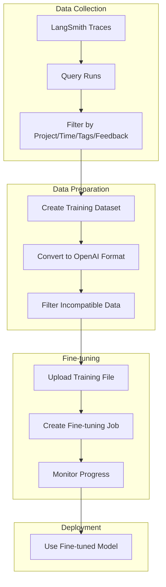
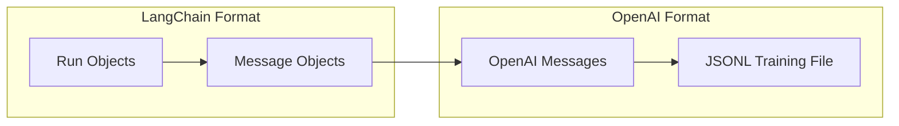
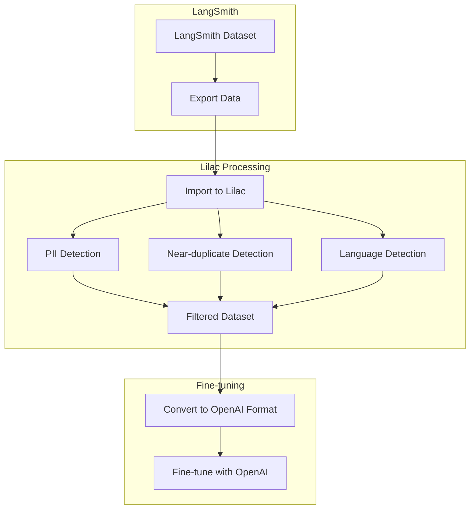

<!-- source: DeepWiki mcp.deepwiki.com · repo langchain-ai/langsmith-cookbook · page 6.2 OpenAI Fine-tuning · fetched 2026-10-26 -->

# OpenAI Fine-tuning

<details>
<summary>Relevant source files</summary>

The following files were used as context for generating this wiki page:

- [exploratory-data-analysis/README.md](exploratory-data-analysis/README.md)
- [exploratory-data-analysis/exporting-llm-runs-and-feedback/llm_run_etl.ipynb](exploratory-data-analysis/exporting-llm-runs-and-feedback/llm_run_etl.ipynb)
- [exploratory-data-analysis/lilac/lilac.ipynb](exploratory-data-analysis/lilac/lilac.ipynb)
- [fine-tuning-examples/README.md](fine-tuning-examples/README.md)
- [fine-tuning-examples/export-to-openai/fine-tuning-on-chat-runs.ipynb](fine-tuning-examples/export-to-openai/fine-tuning-on-chat-runs.ipynb)
- [fine-tuning-examples/lilac/img/workflow.png](fine-tuning-examples/lilac/img/workflow.png)
- [fine-tuning-examples/lilac/lilac.ipynb](fine-tuning-examples/lilac/lilac.ipynb)
- [fine-tuning-examples/lilac/rag.jsonl](fine-tuning-examples/lilac/rag.jsonl)

</details>


This document provides a technical guide for converting LangSmith runs to OpenAI's fine-tuning format. It explains how to leverage trace data captured from your LLM applications to create training datasets for fine-tuning OpenAI models. For dataset curation using Lilac before fine-tuning, see [Lilac Dataset Curation](#6.1).

## Overview

LangSmith allows you to capture run traces from your LLM applications in production or beta environments. These traces contain valuable data that can be used to fine-tune models to better match your specific use cases. The process involves querying relevant runs, preparing the data in the expected format, and submitting it to OpenAI's fine-tuning API.

### Fine-tuning Workflow



Sources:
- [fine-tuning-examples/export-to-openai/fine-tuning-on-chat-runs.ipynb:8-19]()

## Querying Runs

The first step is to query relevant runs from LangSmith that you want to use for fine-tuning. You can filter runs by project, time range, run type, tags, and feedback.

### Basic Query by Project and Run Type

```python
# List all LLM runs for a specific project
runs = client.list_runs(
    project_name="default",
    run_type="llm",
    error=False,
)
```

Sources:
- [fine-tuning-examples/export-to-openai/fine-tuning-on-chat-runs.ipynb:57-67]()

### Filtering by Feedback

Feedback can be used to identify high-quality runs for fine-tuning:

```python
# Filter runs with positive feedback
runs = client.list_runs(
    project_name="default",
    execution_order=1,
    filter='and(eq(feedback_key, "user_click"), eq(feedback_score, 1))',
    error=False,
)
```

Sources:
- [fine-tuning-examples/export-to-openai/fine-tuning-on-chat-runs.ipynb:114-125]()

### Filtering by Tags

Tags can organize runs by task, component, or test variant:

```python
# Filter runs by a specific tag
runs = client.list_runs(
    execution_order=1,
    filter=f'has(tags, "{unique_tag}")',
)
```

Sources:
- [fine-tuning-examples/export-to-openai/fine-tuning-on-chat-runs.ipynb:254-262]()

### Filtering by Run Name

You can filter by run name to narrow your search by the LLM class:

```python
# List all runs sent to a "ChatAnthropic" LLM
runs = client.list_runs(
    project_name="default",
    run_type="llm",
    filter='eq(name, "ChatAnthropic")',
    error=False,
)
```

Sources:
- [fine-tuning-examples/export-to-openai/fine-tuning-on-chat-runs.ipynb:290-295]()

## Creating a Training Dataset

Creating a LangSmith dataset to track the data used for fine-tuning is recommended. This helps with tracking and reusing the training data.

```python
dataset = client.create_dataset(
    dataset_name="Fine-Tuning Dataset Example",
    description=f"Chat logs taken from project {project_name} for fine-tuning",
    data_type="chat",
)
for run in runs:
    if "messages" not in run.inputs or not run.outputs:
        # Filter out non chat runs
        continue
    try:
        # Create an example from the run
        client.create_example_from_run(
            dataset_id=dataset.id,
            run=run,
        )
    except:
        # Duplicate inputs raise an exception
        pass
```

Sources:
- [fine-tuning-examples/export-to-openai/fine-tuning-on-chat-runs.ipynb:407-433]()

## Converting to OpenAI Format

LangChain provides adapters to convert LangChain message objects to OpenAI's fine-tuning format.



### Loading Messages

First, load the messages from the examples:

```python
def convert_messages(example: schemas.Example) -> dict:
    messages = load.load(example.inputs)["messages"]
    message_chunk = load.load(example.outputs)["generations"][0]["message"]
    return {"messages": messages + [message_chunk]}

messages = [
    convert_messages(example)
    for example in client.list_examples(dataset_name="Fine-Tuning Dataset Example")
]
```

Sources:
- [fine-tuning-examples/export-to-openai/fine-tuning-on-chat-runs.ipynb:458-474]()

### Converting to OpenAI Format

Use the OpenAI adapter to convert the messages:

```python
from langchain.adapters import openai as openai_adapter

finetuning_messages = openai_adapter.convert_messages_for_finetuning(messages)
```

Sources:
- [fine-tuning-examples/export-to-openai/fine-tuning-on-chat-runs.ipynb:493-495]()

## Fine-tuning with OpenAI API

### Preparing the Training File

Create a JSONL file with the formatted messages, filtering out incompatible data (like function_call arguments):

```python
my_file = io.BytesIO()
for group in finetuning_messages:
    if any(["function_call" in message for message in group]):
        continue
    my_file.write((json.dumps({"messages": group}) + "\n").encode("utf-8"))

my_file.seek(0)
```

Sources:
- [fine-tuning-examples/export-to-openai/fine-tuning-on-chat-runs.ipynb:529-535]()

### Uploading the Training File

Upload the file to OpenAI and wait for processing:

```python
training_file = openai.File.create(file=my_file, purpose="fine-tune")

# Wait while the file is processed
status = openai.File.retrieve(training_file.id).status
start_time = time.time()
while status != "processed":
    print(f"Status=[{status}]... {time.time() - start_time:.2f}s", end="\r", flush=True)
    time.sleep(5)
    status = openai.File.retrieve(training_file.id).status
```

Sources:
- [fine-tuning-examples/export-to-openai/fine-tuning-on-chat-runs.ipynb:536-545]()

### Creating a Fine-tuning Job

Create and monitor the fine-tuning job:

```python
job = openai.FineTuningJob.create(
    training_file=training_file.id,
    model="gpt-3.5-turbo",
)

# Monitor the job status
status = openai.FineTuningJob.retrieve(job.id).status
start_time = time.time()
while status != "succeeded":
    print(f"Status=[{status}]... {time.time() - start_time:.2f}s", end="\r", flush=True)
    time.sleep(5)
    job = openai.FineTuningJob.retrieve(job.id)
    status = job.status
```

Sources:
- [fine-tuning-examples/export-to-openai/fine-tuning-on-chat-runs.ipynb:571-583]()

## Using the Fine-tuned Model

Once fine-tuning completes, you can use the model within LangChain:

```python
from langchain import chat_models, prompts

model_name = job.fine_tuned_model
# Example: ft:gpt-3.5-turbo-0613:personal::5mty86jblapsed
model = chat_models.ChatOpenAI(model=model_name)
chain.invoke({"input": "Who are you designed to assist?"})
```

Sources:
- [fine-tuning-examples/export-to-openai/fine-tuning-on-chat-runs.ipynb:614-617]()

## Advanced Data Curation with Lilac

Before fine-tuning, you can use Lilac (an open-source tool) to curate your dataset by detecting PII, finding near-duplicates, and analyzing language.



### Detecting PII

Lilac can identify personally identifiable information in your dataset:

```python
dataset.compute_signal(ll.PIISignal(), "question")
dataset.compute_signal(ll.PIISignal(), "output")
```

Sources:
- [fine-tuning-examples/lilac/lilac.ipynb:277-278]()

### Finding Near-duplicates

Near-duplicate detection helps remove redundant examples:

```python
dataset.compute_signal(ll.NearDuplicateSignal(), "question")
dataset.compute_signal(ll.NearDuplicateSignal(), "output")
```

Sources:
- [fine-tuning-examples/lilac/lilac.ipynb:281-282]()

### Language Detection

Identify examples in different languages:

```python
dataset.compute_signal(ll.LangDetectionSignal(), "question")
dataset.compute_signal(ll.LangDetectionSignal(), "output")
```

Sources:
- [fine-tuning-examples/lilac/lilac.ipynb:338-339]()

### Filtering the Dataset

After applying Lilac signals, filter the dataset:

```python
# Flatten the dataframe
df["cluster_id"] = df["question.near_dup"].apply(lambda x: x["cluster_id"])
df["contains_pii"] = df["question.pii"].apply(
    lambda x: bool([v for l in x.values() for v in l])
)
df["not_english"] = df["not_english"].apply(
    lambda x: x is not None and x.get("label") == "true"
)

# Filter rows
df = df[(~df["contains_pii"]) & (df["user_score"] != "0.0") & (~df["output"].isna())]
# Drop duplicate cluster IDs
df = df.drop_duplicates(subset="cluster_id", keep="first")
```

Sources:
- [fine-tuning-examples/lilac/lilac.ipynb:410-423]()

## End-to-end Example Workflow

Here's a complete workflow for fine-tuning an OpenAI model with LangSmith data:

1. Query relevant runs from LangSmith
2. Create a training dataset to track the data
3. Apply Lilac for data curation (optional)
4. Convert runs to OpenAI's fine-tuning format
5. Upload the training file to OpenAI
6. Create and monitor a fine-tuning job
7. Use the fine-tuned model in your application

## Conclusion

By leveraging LangSmith's run traces and the workflow described in this document, you can create high-quality training datasets for fine-tuning OpenAI models. The fine-tuned models will be better adapted to your specific use cases, improving the performance of your LLM applications.

Sources:
- [fine-tuning-examples/export-to-openai/fine-tuning-on-chat-runs.ipynb:625-630]()
- [fine-tuning-examples/lilac/lilac.ipynb:681-684]()

---

