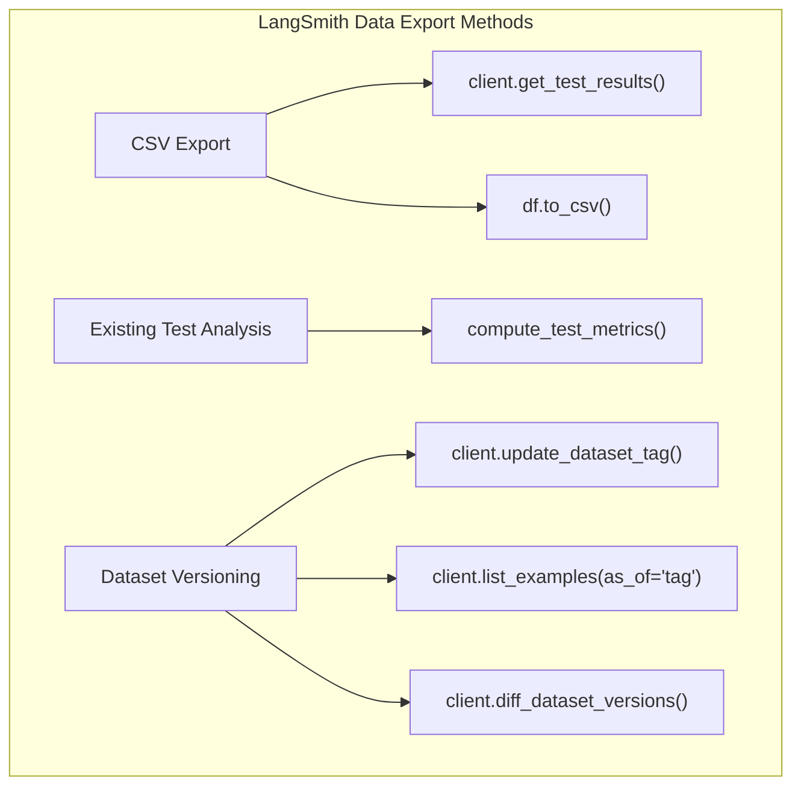
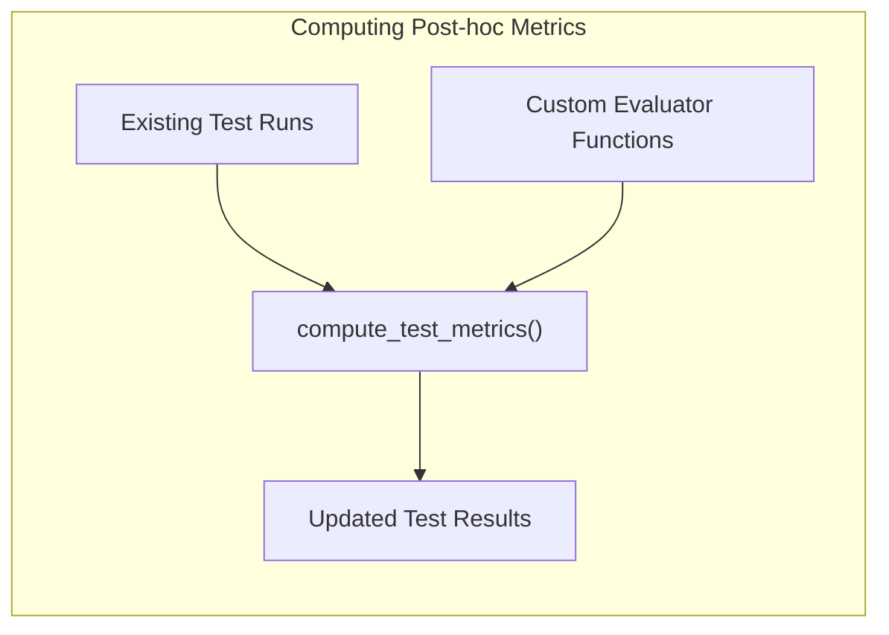
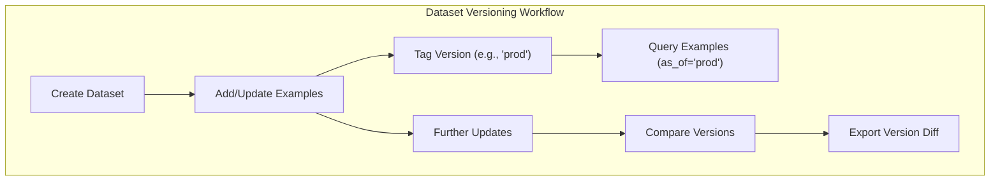
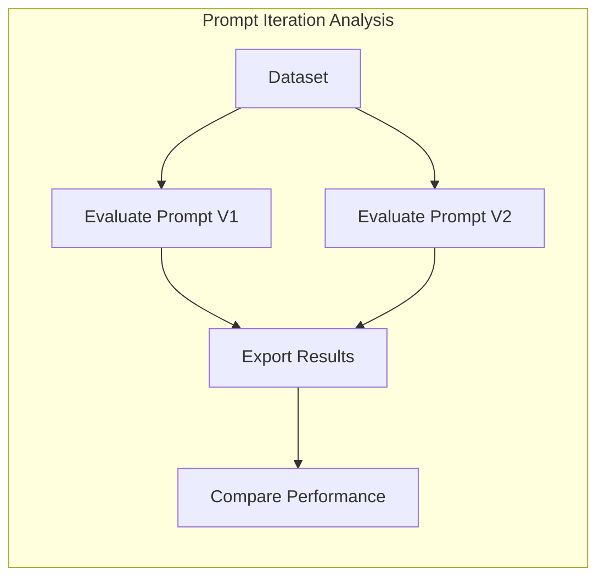

<!-- source: DeepWiki mcp.deepwiki.com · repo langchain-ai/langsmith-cookbook · page 6.3 Exporting Data for Analysis · fetched 2026-10-26 -->

# Exporting Data for Analysis

<details>
<summary>Relevant source files</summary>

The following files were used as context for generating this wiki page:

- [testing-examples/evaluate-existing-test-project/evaluate_runs.ipynb](testing-examples/evaluate-existing-test-project/evaluate_runs.ipynb)
- [testing-examples/export-test-to-csv/export-test-to-csv.ipynb](testing-examples/export-test-to-csv/export-test-to-csv.ipynb)
- [testing-examples/movie-demo/optimization.ipynb](testing-examples/movie-demo/optimization.ipynb)
- [testing-examples/movie-demo/prompt_iteration.ipynb](testing-examples/movie-demo/prompt_iteration.ipynb)

</details>


## Purpose and Scope

This document covers methods for exporting and analyzing LangSmith data, enabling you to perform custom analysis, generate visualizations, and share results with stakeholders. It describes tools and techniques for extracting run history, feedback, and test results for downstream analysis. For information on exporting data specifically for fine-tuning, see [OpenAI Fine-tuning](#6.2).

## Export Methods Overview

LangSmith provides several methods for exporting your data for analysis:



Sources: [testing-examples/export-test-to-csv/export-test-to-csv.ipynb:7-26]()

## Exporting Test Results to CSV

The simplest way to export test data is using the `get_test_results` method, which returns your test results as a Pandas DataFrame that can be saved as a CSV file.

```python
# Basic CSV export 
df = client.get_test_results(project_name="My Project")
df.to_csv("results.csv", index=False)
```

This method exports all test run information including:
- Input values
- Output values
- Reference values from examples
- Feedback scores
- Execution time
- Error messages (if any)
- Run IDs

The exported CSV will have columns like:
- `reference.<field>` - Expected outputs from test examples
- `input.<field>` - Input values provided to the model or chain
- `outputs.<field>` - Actual model/chain outputs
- `feedback.<evaluator_name>` - Feedback scores from evaluators
- `execution_time` - Runtime in seconds
- `error` - Any error messages
- `id` - Unique run identifier

Sources: [testing-examples/export-test-to-csv/export-test-to-csv.ipynb:164-176]()

## Computing Metrics on Existing Tests

A powerful feature of LangSmith is the ability to compute additional metrics on existing test runs without re-running your models, which is useful when:

- You've developed a new evaluator and want to apply it to past runs
- You want to try different evaluation criteria on the same set of results
- You're refining your evaluation methodology



To compute metrics on existing test results:

```python
from langsmith.beta import compute_test_metrics

def my_custom_evaluator(run, example):
    score = run.outputs["output"] == example.outputs["expected"]
    return {"key": "exact_match", "score": score}

# Apply to an existing test project
compute_test_metrics(
    "my-test-project-name", 
    evaluators=[my_custom_evaluator]
)
```

This approach allows you to iteratively develop your evaluation criteria without the time and cost of re-running expensive model calls.

Sources: [testing-examples/evaluate-existing-test-project/evaluate_runs.ipynb:9-32](), [testing-examples/evaluate-existing-test-project/evaluate_runs.ipynb:129-160]()

## Dataset Versioning for Analysis

LangSmith's dataset versioning system allows you to track changes to your datasets over time and refer to specific dataset states, which is valuable when:

- Comparing model performance across different dataset versions
- Establishing reproducible benchmarks
- Tracking dataset evolution



### Tagging and Querying Dataset Versions

Every time an example is created, updated, or deleted, a new dataset version is automatically saved. You can tag specific versions with semantic names:

```python
# Tag the current version as "prod"
client.update_dataset_tag(
    dataset_name="my_dataset", 
    as_of=datetime.datetime.now(tz=datetime.timezone.utc),
    tag="prod"
)

# Query examples from the "prod" version
examples = list(client.list_examples(
    dataset_name="my_dataset",
    as_of="prod"
))
```

### Comparing Dataset Versions

You can also compare different dataset versions to see what changed:

```python
# Compare the "prod" version to the latest version
diff = client.diff_dataset_versions(
    dataset_name="my_dataset",
    from_version="prod",
    to_version="latest"
)
# Returns information about added, modified, and removed examples
```

This versioning system ensures you can maintain stable evaluation benchmarks while continuing to improve your dataset.

Sources: [testing-examples/movie-demo/prompt_iteration.ipynb:881-1069]()

## Exporting Structured Data

LangSmith allows you to export various data structures for analysis:

### Multi-turn Conversations

For multi-turn conversation data, you can export the inputs and outputs for each turn:

```python
# Exporting multi-turn conversations
multi_turn_inputs, multi_turn_outputs = zip(
    *[
        ({"queries": queries}, {"answers": answers})
        for queries, answers in conversation_examples
    ]
)
```

### Structured Inputs and Metadata

For complex data with structured inputs and metadata:

```python
# Creating examples with structured inputs and metadata
client.create_example(
    inputs={
        "user_preferences": ["Comedy", "Romance"],
        "watch_history": ["Friends", "The Big Bang Theory"],
        "search_query": "Need a light-hearted movie"
    },
    outputs={"answer": recommendation_text},
    dataset_id=dataset.id,
    metadata={"note": "This is a free-form note", "cohort_number": 3}
)
```

The metadata fields are particularly useful for filtering and grouping data during analysis.

Sources: [testing-examples/movie-demo/prompt_iteration.ipynb:434-448](), [testing-examples/movie-demo/prompt_iteration.ipynb:762-779]()

## Analysis Workflow Examples

Here are common workflows for analyzing exported LangSmith data:

### Evaluating Prompt Versions



### Tracking Metrics Over Time

Track how metrics evolve as you iterate on your model:

| Prompt Version | Correctness Score | Response Time | Notes |
|----------------|-------------------|---------------|-------|
| v1             | 0.75              | 1.2s          | Initial prompt |
| v2             | 0.82              | 1.3s          | Added examples |
| v3             | 0.89              | 1.5s          | More detailed instructions |

### Error Analysis

Export failed runs for detailed error analysis:

```python
# Filter for runs that received low scores
low_score_runs = client.list_runs(
    project_name="my_project",
    filter='and(exists(feedback.correctness), lt(feedback.correctness, 0.5))'
)
```

Sources: [testing-examples/movie-demo/prompt_iteration.ipynb:145-273]()

## Best Practices

1. **Consistent Schema**: Maintain consistent input/output schemas to simplify analysis

2. **Meaningful Metadata**: Add metadata to test runs that can be used for filtering and grouping

3. **Version Tagging**: Use semantic tags (`prod`, `dev`, `v1.2`, etc.) for dataset versions

4. **Regular Exports**: Schedule regular exports of your test results for long-term tracking

5. **Export Format Selection**:
   - Use CSV for simple tabular analysis
   - Use JSON for preserving nested data structures
   - Use Pandas DataFrames for immediate analysis in Python

Sources: [testing-examples/export-test-to-csv/export-test-to-csv.ipynb:211-221]()

## Export Data for External Tools

The exported data can be used with various external tools:

| Tool Type | Examples | Use Cases |
|-----------|----------|-----------|
| Data Visualization | Matplotlib, Plotly, Tableau | Performance trend visualization |
| Statistical Analysis | SciPy, R, SPSS | Statistical significance testing |
| BI Platforms | Power BI, Looker | Dashboard creation |
| Spreadsheets | Excel, Google Sheets | Ad-hoc analysis and reporting |

These external tools enable more sophisticated analysis than what's available in the LangSmith UI, allowing you to create custom visualizations and reports for stakeholders.

Sources: [testing-examples/export-test-to-csv/export-test-to-csv.ipynb:211-221]()

---

