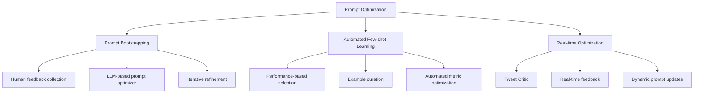
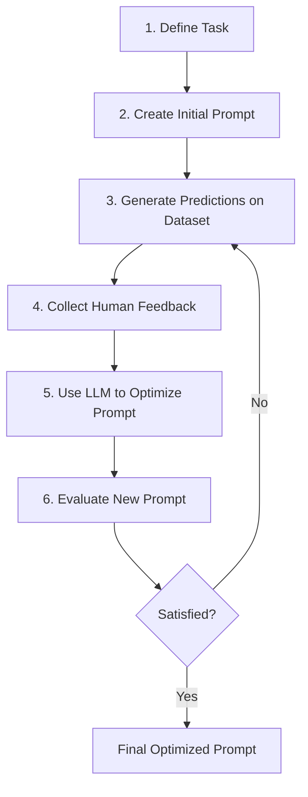
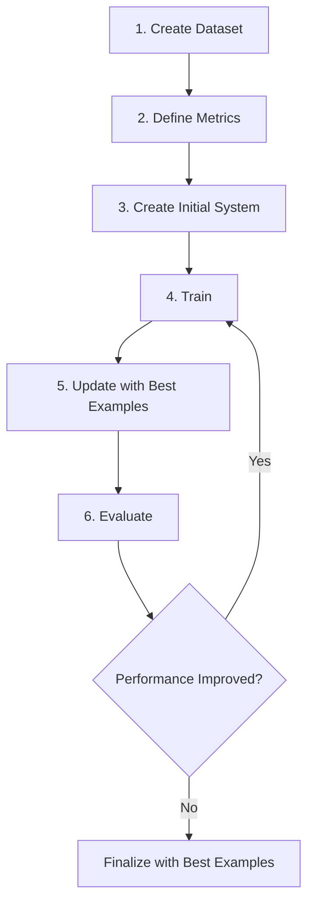
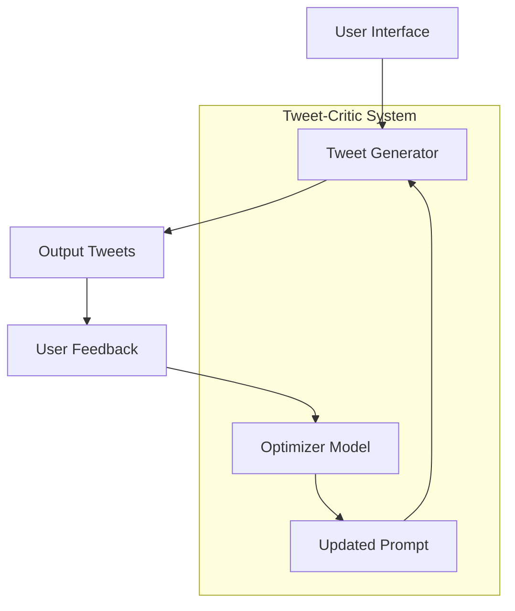
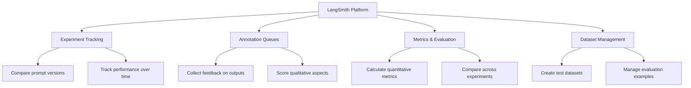

<!-- source: DeepWiki mcp.deepwiki.com · repo langchain-ai/langsmith-cookbook · page 7 Prompt Optimization · fetched 2026-10-26 -->

# Prompt Optimization

Relevant source files

The following files were used as context for generating this wiki page:

- [.github/workflows/link-check.yml](.github/workflows/link-check.yml)
- [.gitmodules](.gitmodules)
- [optimization/README.md](optimization/README.md)
- [optimization/assisted-prompt-bootstrapping/assisted-prompt-engineering.ipynb](optimization/assisted-prompt-bootstrapping/assisted-prompt-engineering.ipynb)
- [optimization/assisted-prompt-bootstrapping/elvis-bot.ipynb](optimization/assisted-prompt-bootstrapping/elvis-bot.ipynb)
- [optimization/assisted-prompt-bootstrapping/img/prompt-bootstrapping.png](optimization/assisted-prompt-bootstrapping/img/prompt-bootstrapping.png)
- [optimization/assisted-prompt-bootstrapping/img/queue.png](optimization/assisted-prompt-bootstrapping/img/queue.png)
- [optimization/bootstrap-fewshot/bootstrap-few-shot.ipynb](optimization/bootstrap-fewshot/bootstrap-few-shot.ipynb)

Prompt optimization is the process of systematically improving LLM prompts to achieve better performance on specific tasks. This page describes methods for enhancing prompt effectiveness using LangSmith for feedback collection, evaluation, and iterative improvement. 

For more details about evaluating specific system types, see [Testing & Evaluation](#3), and for information about fine-tuning models using exported data, see [Data Export & Fine-tuning](#6).

## Overview

Prompt optimization addresses the challenge of crafting effective prompts by leveraging systematic techniques to iterate and improve prompts over time. Rather than manual trial and error, these approaches use structured feedback loops, metrics, and automated selection methods to enhance performance.

The LangSmith cookbook demonstrates three main approaches to prompt optimization:

Sources: [optimization/README.md:1-11]()

## Prompt Bootstrapping with Human Feedback

Prompt bootstrapping is an iterative approach that combines human feedback with an LLM-powered prompt optimizer to progressively improve prompts. This method is particularly valuable for tasks where metrics are difficult to define or where subjective quality is important.

### Process Flow

The process involves:

1. **Define Task**: Clearly specify the task the prompt should accomplish
2. **Create Initial Prompt**: Generate a starting prompt, potentially using a meta-prompt
3. **Generate Predictions**: Run the prompt against a dataset
4. **Collect Human Feedback**: Gather qualitative and quantitative feedback through annotation queues
5. **Optimize the Prompt**: Use an LLM to incorporate feedback and refine the prompt
6. **Iterate**: Continue the process until performance reaches desired levels

### Implementation

The prompt bootstrapping implementation uses several key components:

1. **Meta-prompt for initial generation**: The system uses a meta-prompt ([wfh/metaprompt](https://smith.langchain.com/hub/wfh/metaprompt)) from LangChain Hub to generate the first version of the prompt

2. **Annotation queue for feedback**: Human feedback is collected through LangSmith's annotation queues, where evaluators can:
   - Provide freeform comments
   - Assign quantitative scores
   - Highlight specific issues or strengths

3. **Optimizer prompt for refinement**: An optimizer prompt ([wfh/optimizerprompt](https://smith.langchain.com/hub/wfh/optimizerprompt)) interprets feedback and generates an improved prompt version

#### Code Structure

The prompt bootstrapping implementation involves:

- Creating a dataset for testing prompt variations
- Running the model with the current prompt on that dataset
- Adding the runs to an annotation queue for feedback
- Formatting the feedback for the optimizer
- Generating and evaluating an improved prompt

Sources: [optimization/assisted-prompt-bootstrapping/assisted-prompt-engineering.ipynb:4-560]()

## Automated Few-shot Prompt Bootstrapping

Few-shot learning allows LLMs to learn from examples in the prompt. The automated few-shot bootstrapping process curates the most effective examples based on performance metrics, reducing the need for manual example engineering.

### Process Flow

### Implementation

The few-shot bootstrapping implementation follows these key steps:

1. **Dataset Creation**: Build or identify a dataset with inputs and ground truth outputs
2. **Metric Definition**: Create evaluators to measure performance (e.g., exact match)
3. **System Setup**: Establish the initial system without few-shot examples
4. **Iteration**:
   - Test examples to identify those that lead to correct predictions
   - Incorporate these examples into the prompt
   - Measure performance improvement
   - Retain the most effective examples

#### Example Selection Algorithm

The algorithm dynamically selects examples based on their effectiveness:

1. Start with an empty set of examples
2. For each potential example:
   - Test if adding it improves performance on validation data
   - Include examples that lead to performance gains
3. Evaluate performance on a held-out dataset
4. Iterate to find the optimal set of examples

This approach efficiently discovers the most informative few-shot examples for a specific task, avoiding the manual work of example selection.

Sources: [optimization/bootstrap-fewshot/bootstrap-few-shot.ipynb:8-464]()

## Real-time Prompt Optimization

The Tweet Critic system demonstrates real-time prompt optimization based on user feedback and dialogue, leveraging few-shot learning and a separate "optimizer" model to dynamically improve a tweet-generating system.

### Architecture

The system includes:

1. **Tweet Generator**: A prompt-based system that creates tweets about content
2. **Feedback Mechanism**: Interface for collecting user reactions to generated content
3. **Optimizer Model**: A separate LLM that uses feedback to refine the prompt
4. **Dynamic Updates**: Real-time prompt improvements based on ongoing feedback

This approach allows for continuous optimization in production systems, where the prompt evolves based on actual user interactions.

Sources: [optimization/README.md:11-12](), [.gitmodules:1-5]()

## LangSmith Integration for Prompt Optimization

LangSmith provides several critical capabilities that facilitate prompt optimization:

### Key Components

### Workflow Integration

LangSmith enhances prompt optimization through:

1. **Dataset Creation and Management**: Organize test cases and evaluation examples
2. **Run Tracking**: Log each run with inputs, outputs, and intermediate steps
3. **Annotation Queues**: Collect structured feedback on model outputs
4. **Experiment Comparison**: Evaluate different prompt versions side by side
5. **Metrics Computation**: Calculate performance metrics across runs

### Code Examples

The prompt optimization implementations in the cookbook use the LangSmith client to:

- Create and manage datasets
- Execute runs against datasets
- Create annotation queues
- Collect and structure feedback
- Compare performance across iterations

Sources: [optimization/assisted-prompt-bootstrapping/assisted-prompt-engineering.ipynb:28-57](), [optimization/bootstrap-fewshot/bootstrap-few-shot.ipynb:25-102]()

## Practical Applications

Each prompt optimization method is suited to different use cases:

| Method | Best For | Example Use Case |
|--------|----------|-----------------|
| Prompt Bootstrapping | Tasks with subjective quality metrics | Content generation, creative writing, style transfer |
| Few-shot Learning | Tasks with clear right/wrong answers | Classification, extraction, logical reasoning |
| Real-time Optimization | Production systems with user feedback | Customer-facing generators, personalized content |

### Example Application: Academic Tweet Generator

The prompt bootstrapping example demonstrates optimizing a prompt for generating tweets about academic papers:

1. **Initial Prompt**: Generated using a meta-prompt
2. **Dataset**: Academic paper abstracts from ArXiv
3. **Feedback Collection**: Human evaluators score tweets (0-4) and provide comments
4. **Prompt Refinement**: LLM optimizer incorporates feedback to create an improved prompt
5. **Iteration**: Process repeats until tweet quality satisfies requirements

This example shows how subjective qualities like "engaging but not gimmicky" can be improved through structured feedback.

Sources: [optimization/assisted-prompt-bootstrapping/assisted-prompt-engineering.ipynb:8-20](), [optimization/assisted-prompt-bootstrapping/elvis-bot.ipynb:1-50]()

### Example Application: Natural Language Inference

The few-shot bootstrapping example shows optimizing a prompt for logical entailment:

1. **Task**: Determine if a hypothesis logically follows from a premise
2. **Metric**: Exact match with ground truth (yes/no)
3. **Optimization**: Identifying examples that improve performance
4. **Results**: Significant accuracy improvement through example selection

This application demonstrates how automated example selection can improve performance on tasks with clear evaluation metrics.

Sources: [optimization/bootstrap-fewshot/bootstrap-few-shot.ipynb:8-22]()

## Best Practices

When implementing prompt optimization strategies, consider the following best practices:

1. **Clear Task Definition**: Precisely define what success looks like
2. **Representative Datasets**: Create test sets that cover diverse cases
3. **Meaningful Metrics**: Choose metrics that align with actual goals
4. **Structured Feedback**: Design feedback collection to capture specific aspects
5. **Iterative Approach**: Plan for multiple rounds of optimization
6. **Evaluation Separation**: Test on held-out data not used during optimization

The prompt optimization approaches in the LangSmith cookbook provide frameworks for implementing these best practices in a systematic way.

Sources: [optimization/assisted-prompt-bootstrapping/assisted-prompt-engineering.ipynb:503-504](), [optimization/bootstrap-fewshot/bootstrap-few-shot.ipynb:270-299]()

---

