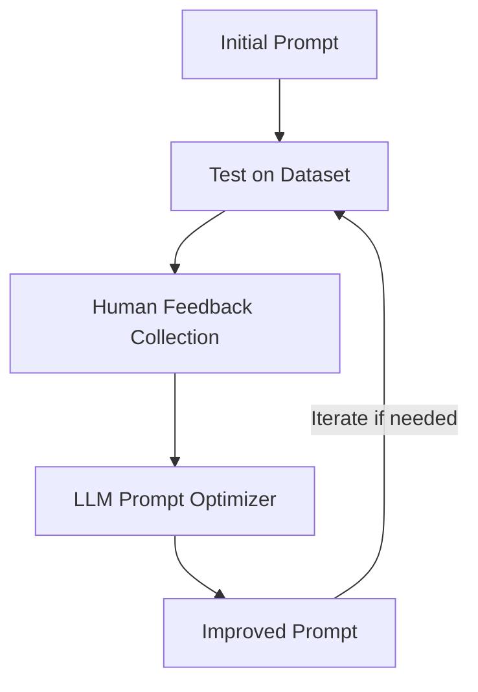
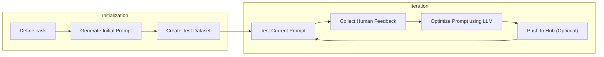
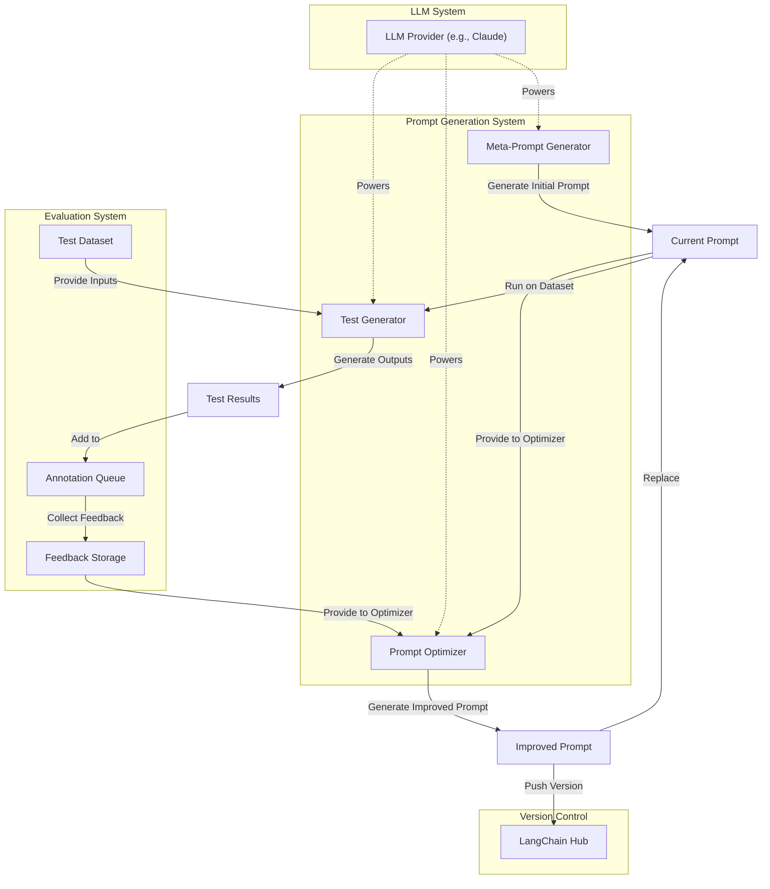
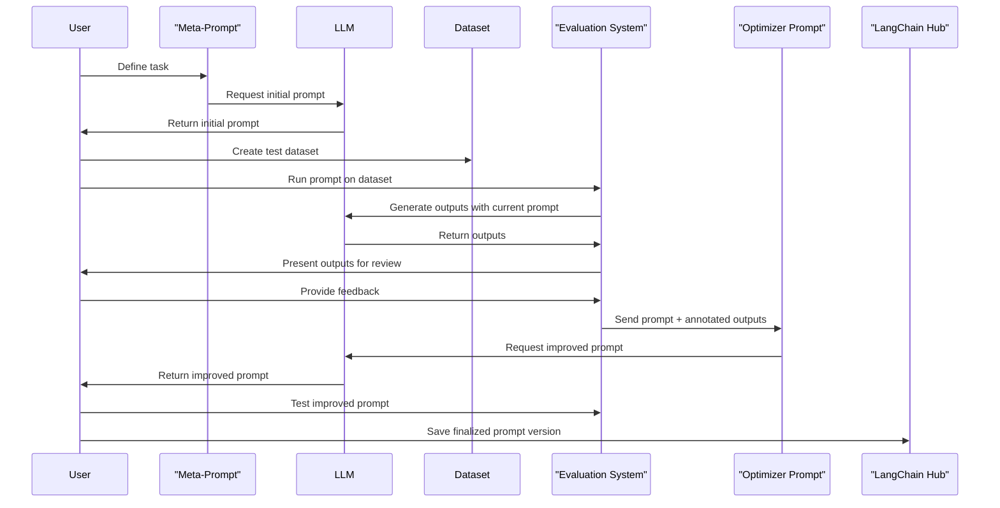

<!-- source: DeepWiki mcp.deepwiki.com · repo langchain-ai/langsmith-cookbook · page 7.1 Prompt Bootstrapping · fetched 2026-10-26 -->

# Prompt Bootstrapping

<details>
<summary>Relevant source files</summary>

The following files were used as context for generating this wiki page:

- [.gitmodules](.gitmodules)
- [README.md](README.md)
- [optimization/assisted-prompt-bootstrapping/assisted-prompt-engineering.ipynb](optimization/assisted-prompt-bootstrapping/assisted-prompt-engineering.ipynb)
- [optimization/assisted-prompt-bootstrapping/elvis-bot.ipynb](optimization/assisted-prompt-bootstrapping/elvis-bot.ipynb)
- [testing-examples/README.md](testing-examples/README.md)

</details>


This page explains the prompt bootstrapping technique - an iterative approach for optimizing prompts through human feedback and LLM-assisted prompt engineering. Prompt bootstrapping helps solve the "cold start problem" of prompt engineering by leveraging LLMs themselves to progressively improve prompts based on evaluation of real examples.

For related techniques, see [Automated Few-shot Prompt Bootstrapping](#7.2) and [Iterative Prompt Optimization (Tweet Critic)](#7.3).

## Overview of Prompt Bootstrapping

Prompt bootstrapping is a technique that combines human feedback and LLM capabilities to iteratively refine prompts. Unlike manual prompt engineering, which relies solely on human intuition, prompt bootstrapping uses an LLM as a "prompt optimizer" that analyzes human feedback on outputs and generates improved prompts.

This approach is particularly valuable for tasks where:
- Quality metrics are subjective and difficult to quantify
- The initial prompt quality is poor or mediocre
- Human feedback can meaningfully guide improvements
- The task requires nuanced understanding of style or tone



Sources: [optimization/assisted-prompt-bootstrapping/assisted-prompt-engineering.ipynb:8-19]()

## The Prompt Bootstrapping Process

Prompt bootstrapping follows a systematic process that leverages both human expertise and LLM capabilities:



### Step 1: Task Definition and Initial Prompt Generation

The process begins by clearly defining the task and generating an initial prompt. Rather than creating this prompt manually, a meta-prompt can be used to generate a starting prompt.

In the example implementation, a meta-prompt from LangChain Hub (`wfh/metaprompt`) is used to generate the initial prompt based on a task description.

Sources: [optimization/assisted-prompt-bootstrapping/assisted-prompt-engineering.ipynb:64-147]()

### Step 2: Dataset Creation

A dataset of representative examples is needed to test the prompt. This can be created manually or programmatically based on the task requirements.

In the example implementation, a dataset of academic papers from ArXiv is created to test a tweet generation prompt.

Sources: [optimization/assisted-prompt-bootstrapping/assisted-prompt-engineering.ipynb:161-194]()

### Step 3: Testing and Evaluation

The current prompt is tested against the dataset to generate outputs that will be evaluated.

Sources: [optimization/assisted-prompt-bootstrapping/assisted-prompt-engineering.ipynb:200-259]()

### Step 4: Feedback Collection

Human feedback is collected on the outputs. This feedback can include:
- Numerical scores (e.g., quality ratings from 0-4)
- Free-form comments explaining what works and what doesn't
- Suggestions for improvement

LangSmith's annotation queue functionality makes this process straightforward.

Sources: [optimization/assisted-prompt-bootstrapping/assisted-prompt-engineering.ipynb:266-311]()

### Step 5: Prompt Optimization

The collected feedback is formatted and passed to an "optimizer prompt" (e.g., `wfh/optimizerprompt` from LangChain Hub). This prompt analyzes the feedback and generates an improved version of the original prompt.

Sources: [optimization/assisted-prompt-bootstrapping/assisted-prompt-engineering.ipynb:320-492]()

### Step 6: Iteration

The process repeats from Step 3 with the improved prompt until the results are satisfactory. Multiple iterations may be needed to achieve the desired quality.

Sources: [optimization/assisted-prompt-bootstrapping/assisted-prompt-engineering.ipynb:499-669]()

### Step 7: Versioning (Optional)

Once satisfied with the prompt, it can be pushed to a hub for versioning and reuse.

Sources: [optimization/assisted-prompt-bootstrapping/assisted-prompt-engineering.ipynb:674-701]()

## System Architecture

The following diagram illustrates the components involved in the prompt bootstrapping process and how they interact:



Sources: [optimization/assisted-prompt-bootstrapping/assisted-prompt-engineering.ipynb:26-57](), [optimization/assisted-prompt-bootstrapping/assisted-prompt-engineering.ipynb:329-405]()

## Implementation with LangSmith

The core components used in the implementation are:

| Component | Purpose | Code Implementation |
|-----------|---------|---------------------|
| Meta-Prompt | Generates initial prompt | `wfh/metaprompt` from LangChain Hub |
| Test Dataset | Provides examples for testing | Created using ArXiv API or custom data |
| Annotation Queue | Facilitates human feedback collection | `client.create_annotation_queue()` |
| Feedback Formatter | Structures feedback for optimizer | Custom functions to format feedback |
| Optimizer Prompt | Generates improved prompt | `wfh/optimizerprompt` from LangChain Hub |
| LangChain Hub | Stores and versions prompts | `hub.push()` for saving prompts |

### Key Functions and Objects

The implementation uses several key functions to facilitate the prompt bootstrapping process:

1. **Meta-Prompt Invoker**: Creates the initial prompt based on task description
   ```python
   meta_prompter = prompt | llm | StrOutputParser() | get_instructions
   ```

2. **Tweet Generator**: Applies the current prompt to generate outputs
   ```python
   tweet_generator = create_tweet_generator(recommended_prompt)
   ```

3. **Dataset Runner**: Tests the prompt on the dataset
   ```python
   client.run_on_dataset(dataset_name=ds_name, llm_or_chain_factory=tweet_generator)
   ```

4. **Feedback Formatter**: Prepares feedback for the optimizer
   ```python
   formatted_feedback = get_formatted_feedback(res["project_name"])
   ```

5. **Prompt Optimizer**: Generates improved prompt based on feedback
   ```python
   optimizer = optimizer_prompt | llm | StrOutputParser() | extract_new_prompt
   ```

6. **Hub Pusher**: Saves the optimized prompt to LangChain Hub
   ```python
   hub.push("wfh/academic-tweet-generator", PromptTemplate.from_template(new_prompt))
   ```

Sources: [optimization/assisted-prompt-bootstrapping/assisted-prompt-engineering.ipynb:75-98](), [optimization/assisted-prompt-bootstrapping/assisted-prompt-engineering.ipynb:213-232](), [optimization/assisted-prompt-bootstrapping/assisted-prompt-engineering.ipynb:330-404]()

## Data Flow Diagram

The following diagram shows how data flows through the system during the prompt bootstrapping process:



Sources: [optimization/assisted-prompt-bootstrapping/assisted-prompt-engineering.ipynb:8-19](), [optimization/assisted-prompt-bootstrapping/assisted-prompt-engineering.ipynb:64-147](), [optimization/assisted-prompt-bootstrapping/assisted-prompt-engineering.ipynb:200-259](), [optimization/assisted-prompt-bootstrapping/assisted-prompt-engineering.ipynb:266-311](), [optimization/assisted-prompt-bootstrapping/assisted-prompt-engineering.ipynb:320-492]()

## Example Applications

### Tweet Generation for Academic Papers

The primary example demonstrates using prompt bootstrapping to create a tweet generator for academic papers. The process starts with a generic prompt and iteratively refines it based on human feedback to produce more engaging and informative tweets.

Sources: [optimization/assisted-prompt-bootstrapping/assisted-prompt-engineering.ipynb:64-70](), [optimization/assisted-prompt-bootstrapping/assisted-prompt-engineering.ipynb:161-194]()

### Style Transfer (Elvis-Bot)

The Elvis-bot example extends the prompt bootstrapping approach to generate outputs in the style of a specific persona. It shows how this technique can be used to mimic writing styles by iteratively refining prompts based on feedback.

Sources: [README.md:105-107]()

### Real-time Prompt Optimization (Tweet Critic)

The Tweet Critic example demonstrates real-time prompt optimization based on user feedback and dialog. This application showcases a more dynamic implementation of prompt bootstrapping in a Streamlit app.

Sources: [README.md:108](), [.gitmodules:1-4]()

## Best Practices

### For Effective Feedback

When providing feedback for prompt optimization:

1. **Be specific** about what works and what doesn't
2. **Highlight patterns** across multiple examples
3. **Suggest improvements** rather than just pointing out problems
4. **Balance positive and negative** feedback
5. **Consider diversity** of use cases and input types

### For Prompt Optimization

When implementing the prompt bootstrapping process:

1. **Start simple** with a basic prompt before optimization
2. **Create diverse datasets** that cover a range of scenarios
3. **Iterate multiple times** rather than expecting perfection immediately
4. **Maintain version history** of prompts to track improvements
5. **Check for regression** on previously successful examples
6. **Consider manual adjustments** to the LLM-suggested prompts if needed

## Integration with Other LangSmith Features

Prompt bootstrapping can be integrated with other LangSmith features:

1. **LangChain Hub** for prompt versioning and sharing
2. **Dataset management** for organizing test cases
3. **Evaluation metrics** for quantitative assessment alongside qualitative feedback
4. **Tracing** for detailed analysis of LLM behavior with different prompts
5. **Feedback collection** through annotation queues

Sources: [optimization/assisted-prompt-bootstrapping/assisted-prompt-engineering.ipynb:674-701]()

## Summary

Prompt bootstrapping provides a systematic approach to prompt engineering that leverages both human expertise and LLM capabilities. By following an iterative process of testing, feedback, and optimization, it can produce high-quality prompts that achieve desired outcomes.

Key advantages of this approach include:
- Overcoming the "cold start problem" in prompt engineering
- Systematically incorporating human feedback
- Leveraging LLMs' ability to understand and implement feedback
- Creating prompts that can be versioned and reused

The approach is particularly valuable for tasks requiring nuanced understanding of style, tone, and subjective quality criteria.

---

