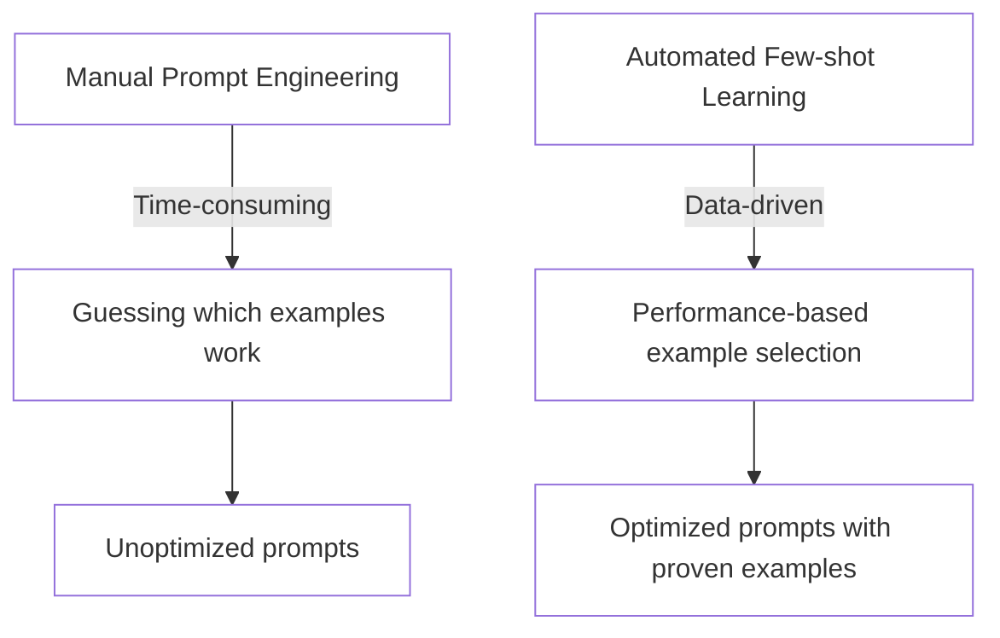
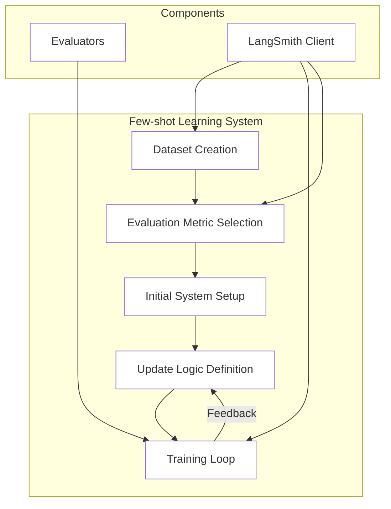
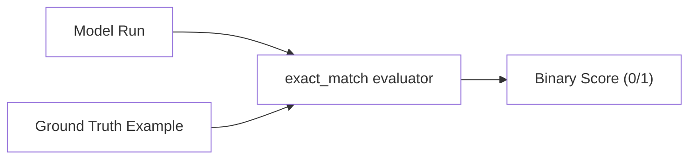
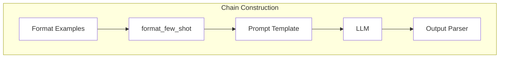
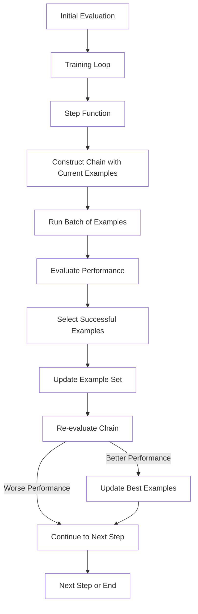

<!-- source: DeepWiki mcp.deepwiki.com · repo langchain-ai/langsmith-cookbook · page 7.2 Few-shot Learning · fetched 2026-10-26 -->

# Few-shot Learning

<details>
<summary>Relevant source files</summary>

The following files were used as context for generating this wiki page:

- [.github/workflows/link-check.yml](.github/workflows/link-check.yml)
- [README.md](README.md)
- [optimization/README.md](optimization/README.md)
- [optimization/assisted-prompt-bootstrapping/img/prompt-bootstrapping.png](optimization/assisted-prompt-bootstrapping/img/prompt-bootstrapping.png)
- [optimization/assisted-prompt-bootstrapping/img/queue.png](optimization/assisted-prompt-bootstrapping/img/queue.png)
- [optimization/bootstrap-fewshot/bootstrap-few-shot.ipynb](optimization/bootstrap-fewshot/bootstrap-few-shot.ipynb)
- [testing-examples/README.md](testing-examples/README.md)

</details>


This page documents the automated few-shot prompt bootstrapping techniques in LangSmith that help optimize Language Learning Model (LLM) performance based on performance metrics. Few-shot learning is an important optimization technique that automatically identifies and incorporates the most informative examples to guide LLM responses, reducing the need for manual example engineering.

For related prompt optimization techniques, see [Prompt Bootstrapping](#7.1) and [Tweet Critic](#7.3).

## What is Few-shot Learning?

Few-shot learning in the context of LLMs refers to providing a small number of example inputs and outputs to guide the model toward producing the desired behavior. Instead of manually selecting examples, LangSmith enables automated selection and optimization of examples based on their demonstrated performance metrics.

The key advantage of automated few-shot learning is replacing guesswork with data-driven selection of examples that demonstrably improve model performance.



Sources: [optimization/bootstrap-fewshot/bootstrap-few-shot.ipynb:7-21]()

## Architecture Overview

The automated few-shot learning system in LangSmith follows this architecture:



Sources: [optimization/bootstrap-fewshot/bootstrap-few-shot.ipynb:7-21](), [optimization/bootstrap-fewshot/bootstrap-few-shot.ipynb:286-424]()

## Implementation Process

### 1. Dataset Preparation

The system requires multiple datasets:
- Training dataset: Source of potential few-shot examples
- Development/validation dataset: For testing example effectiveness
- Test dataset: For final evaluation of the optimized system

In the example implementation, the system uses entailment tasks from the SCONE dataset, where the model must determine if a hypothesis can be logically concluded from a premise.

Sources: [optimization/bootstrap-fewshot/bootstrap-few-shot.ipynb:64-100]()

### 2. Evaluation Metric Setup

A key component is defining a clear evaluation metric to optimize for. The system uses an `exact_match` evaluator that compares the model's prediction with the ground truth label:



Sources: [optimization/bootstrap-fewshot/bootstrap-few-shot.ipynb:115-150]()

### 3. Chain Construction with Few-shot Examples

The system needs to define:
1. How to format few-shot examples
2. How to incorporate them into the prompt
3. How to construct a chain that can be updated with different examples



Sources: [optimization/bootstrap-fewshot/bootstrap-few-shot.ipynb:301-349](), [optimization/bootstrap-fewshot/bootstrap-few-shot.ipynb:160-198]()

### 4. Training Loop Implementation

The training loop is the core of the automated few-shot learning process:



Sources: [optimization/bootstrap-fewshot/bootstrap-few-shot.ipynb:358-463]()

## Automated Example Selection

The system uses an evolutionary algorithm approach to select the best examples. The core ideas are:

1. Try variations of example sets
2. Measure performance of each variation
3. Keep the best-performing set and iterate

Key parameters in this process:
- `bootstrap_k`: Number of examples to bootstrap in each step
- `k`: Total number of examples to include in the final set
- `steps`: Number of training iterations

The algorithm:
1. Starts with an empty set or an initial set of examples
2. In each step, tries to add new examples that improve performance
3. Evaluates the updated example set using the validation dataset
4. Keeps the best-performing example set for the next iteration

Sources: [optimization/bootstrap-fewshot/bootstrap-few-shot.ipynb:358-463]()

## Code Implementation Walkthrough

The implementation follows these key components:

### Example Formatting

```python
def format_example(example: dict):
    # Format a single example for few-shot learning
    inputs = example["input"]
    outputs = example["output"]
    return f"""
Context: {inputs['context']}
Question: {inputs['question']}
Reasoning: {outputs['reasoning']}
Answer: {outputs['is_entailed']}
"""

def format_few_shot(input_: dict, examples: Optional[List[dict]] = None):
    # Add formatted examples to the input
    if examples:
        input_["examples"] = (
            "--".join(format_example(e) for i, e in enumerate(examples)) + "--"
        )
    return input_
```

Sources: [optimization/bootstrap-fewshot/bootstrap-few-shot.ipynb:307-337]()

### Chain Construction

```python
def create_chain(examples: Optional[List] = None, llm=None):
    # Create a chain with the specified few-shot examples
    llm = llm or ChatOpenAI(model="gpt-3.5-turbo")
    chain = (
        RunnableLambda(format_few_shot).bind(examples=examples)
        | prompt
        | llm
        | StrOutputParser()
        | parse
    ).with_config(tags=["to_train"])
    return chain
```

Sources: [optimization/bootstrap-fewshot/bootstrap-few-shot.ipynb:339-349]()

### Training Step Function

```python
def step(
    construct_chain,
    train_examples,
    eval_config,
    examples=None,
    bootstrap_k: int = 8,
):
    collected = examples.copy() if examples else []
    random.shuffle(train_examples)
    train_examples = train_examples.copy()
    
    while train_examples:
        if len(collected) >= bootstrap_k:
            break
        train_batch = [
            train_examples.pop() for _ in range(bootstrap_k - len(collected))
        ]
        chain = construct_chain([e for e in collected if e["id"] != example.id])
        with collect_runs() as cb:
            chain.batch([e.inputs for e in train_batch])
        evaluator = eval_config.custom_evaluators[0]
        for run, example in zip(cb.traced_runs, train_batch):
            metric = evaluator.evaluate_run(run, example)
            score = metric.score
            # Check if success
            if score:
                collected.append(
                    {
                        "input": example.inputs,
                        "output": run.outputs,
                        "id": example.id,
                    }
                )
    return collected
```

Sources: [optimization/bootstrap-fewshot/bootstrap-few-shot.ipynb:372-405]()

## Performance Evaluation

To evaluate the effectiveness of different sets of few-shot examples, LangSmith provides several capabilities:

1. Creating test projects to compare different example sets
2. Computing and comparing metrics across test runs
3. Visualizing performance improvements

The example implementation shows these steps:

```python
def eval(eval_dataset, chain, eval_config, step_n) -> float:
    """Compute the metrics on the validation dataset."""
    dev_results = client.run_on_dataset(
        dataset_name=eval_dataset,
        llm_or_chain_factory=chain,
        evaluation=eval_config,
        verbose=True,
        concurrency_level=8,
        project_metadata={
            "step": step_n,
        },
    )
    df = dev_results.to_dataframe()
    feedback_key = [c for c in df.columns if c.startswith("feedback.")][0]
    # Assume single metric rn ha
    return df[feedback_key].mean()
```

Sources: [optimization/bootstrap-fewshot/bootstrap-few-shot.ipynb:407-424]()

## Best Practices and Tips

1. **Dataset Quality**: Ensure your dataset contains diverse, high-quality examples that cover the range of cases you want the model to handle.

2. **Evaluation Metrics**: Choose evaluation metrics that directly measure the aspects of performance you care about most.

3. **Example Formatting**: How you format the few-shot examples significantly impacts their effectiveness. Consistent formatting that matches the task structure is crucial.

4. **Number of Examples**: Test different values for how many examples to include. Too few may not provide enough guidance, while too many can confuse the model or create token limit issues.

5. **Iterative Refinement**: The few-shot examples found through automation can be further refined manually based on error analysis.

Sources: [optimization/bootstrap-fewshot/bootstrap-few-shot.ipynb:7-21](), [optimization/bootstrap-fewshot/bootstrap-few-shot.ipynb:286-464]()

## Conclusion

Automated few-shot prompt bootstrapping in LangSmith provides a systematic, data-driven approach to optimize LLM performance. By automatically selecting the most effective examples and evaluating their impact, this approach removes much of the guesswork from prompt engineering, resulting in more reliable and high-performing LLM systems.

The approach demonstrated in this document can be applied to many different tasks beyond just entailment, making it a versatile optimization technique in the LLM toolbox.

Sources: [README.md:105-109](), [optimization/README.md:11-12](), [optimization/bootstrap-fewshot/bootstrap-few-shot.ipynb]()

---

