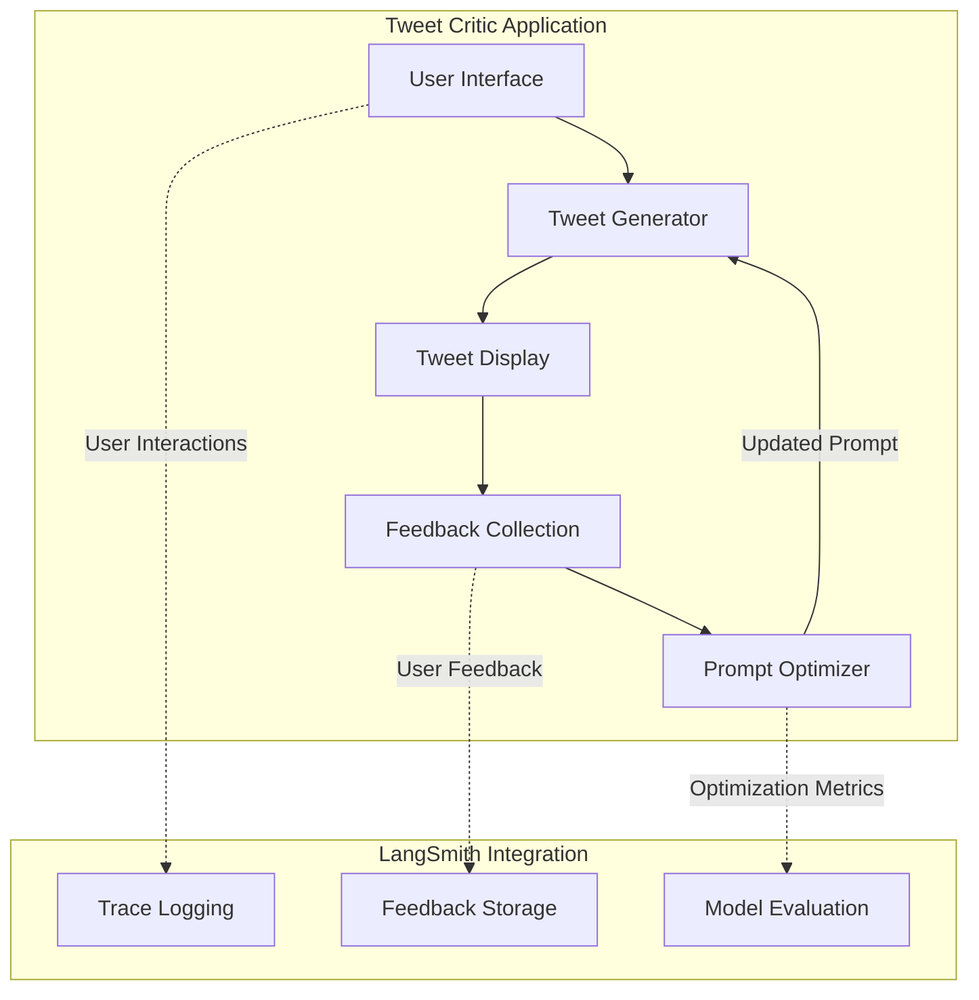
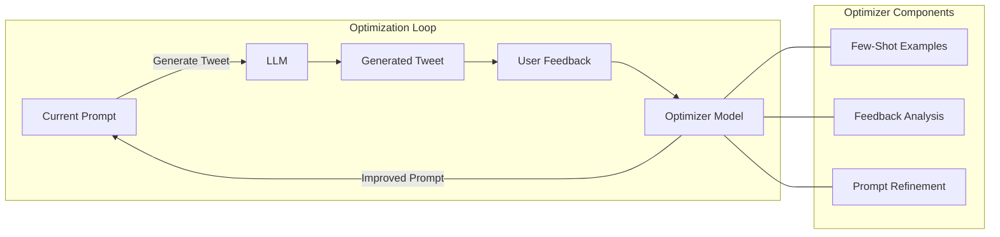
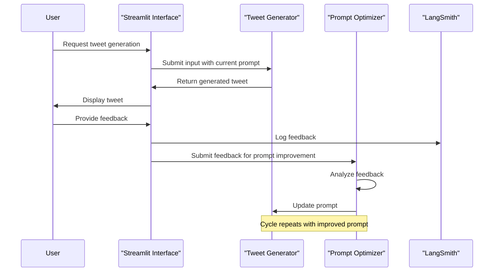
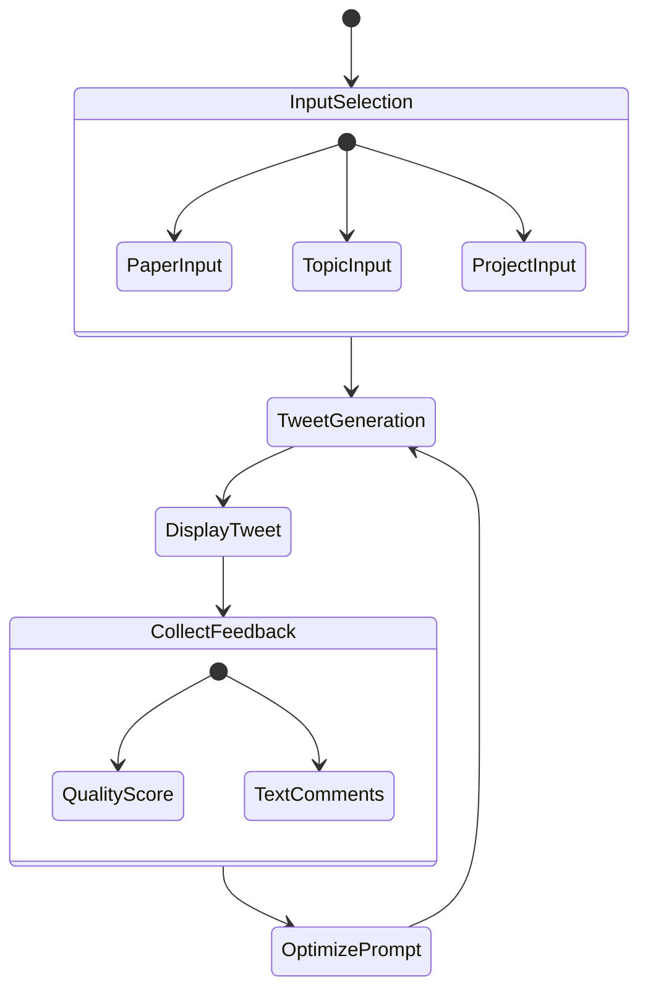
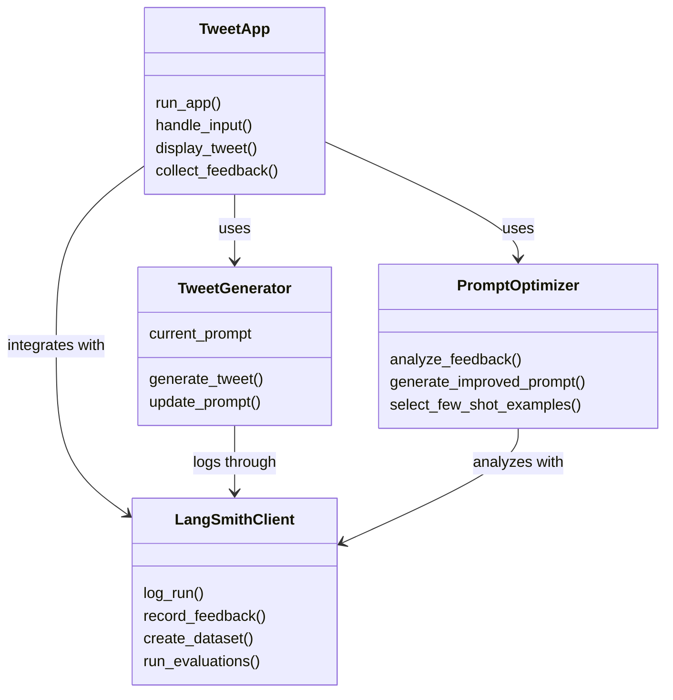

<!-- source: DeepWiki mcp.deepwiki.com · repo langchain-ai/langsmith-cookbook · page 7.3 Tweet Critic · fetched 2026-10-26 -->

# Tweet Critic

Relevant source files

The following files were used as context for generating this wiki page:

- [.gitmodules](.gitmodules)
- [README.md](README.md)
- [optimization/assisted-prompt-bootstrapping/assisted-prompt-engineering.ipynb](optimization/assisted-prompt-bootstrapping/assisted-prompt-engineering.ipynb)
- [optimization/assisted-prompt-bootstrapping/elvis-bot.ipynb](optimization/assisted-prompt-bootstrapping/elvis-bot.ipynb)
- [testing-examples/README.md](testing-examples/README.md)

Tweet Critic is a Streamlit application that demonstrates real-time prompt optimization based on user feedback and dialog. It leverages few-shot learning and a separate "optimizer" model to dynamically improve a tweet-generating system over time. Unlike the more structured [Prompt Bootstrapping](#7.1) approach, Tweet Critic focuses on real-time interactive optimization.

## System Overview

Tweet Critic provides an interactive interface where users can generate tweets, provide feedback on them, and see prompt improvements in real-time. The system continually evolves its prompt strategy based on user interactions, creating a dynamic optimization loop that enhances tweet quality based on specific user preferences.

Sources: [README.md:107-108](), [.gitmodules:1-4]()

## Core Components

The Tweet Critic system consists of several key components that work together to enable interactive prompt optimization:

### Tweet Generator

The tweet generator produces tweets based on the current prompt. It accepts input (such as academic papers, topics, or project descriptions) and generates a tweet formatted according to the system's current prompt instructions.

### Feedback Collector

This component captures user feedback on generated tweets. Feedback can include subjective scoring and free-form text comments, which are used to guide prompt improvements.

### Prompt Optimizer

The prompt optimizer analyzes feedback and updates the tweet generation prompt in real-time. It identifies patterns in user preferences and modifies the prompt accordingly, resulting in increasingly better tweet generations.

Sources: [README.md:107-108](), [optimization/assisted-prompt-bootstrapping/assisted-prompt-engineering.ipynb:8-19]()

## Working Principles

### Real-Time Optimization Flow

Unlike batch-oriented approaches to prompt engineering, Tweet Critic implements a real-time optimization flow:

1. **Initial Prompt Generation**: The system starts with a base prompt for generating tweets
2. **Tweet Generation**: The LLM generates tweets based on the current prompt
3. **User Feedback Collection**: Users provide feedback on tweet quality
4. **Prompt Optimization**: The optimizer model analyzes feedback and improves the prompt
5. **Iterative Improvement**: The cycle repeats with the improved prompt, leading to better tweets

### Few-Shot Learning Approach

Tweet Critic uses few-shot learning techniques to help the optimizer model understand user preferences:

1. Previous successful tweets (those receiving positive feedback) are used as examples
2. The optimizer model incorporates these examples into its analysis
3. As more feedback is collected, the few-shot examples become more refined

This approach allows the system to adapt to specific user preferences over time without requiring large amounts of training data.

Sources: [README.md:107-108](), [optimization/assisted-prompt-bootstrapping/assisted-prompt-engineering.ipynb:64-72](), [optimization/assisted-prompt-bootstrapping/assisted-prompt-engineering.ipynb:382-387]()

## LangSmith Integration

Tweet Critic leverages LangSmith for tracing, feedback collection, and optimization analysis. This integration provides several key capabilities:

### Tracing and Monitoring

- Each tweet generation is traced in LangSmith
- The system performance can be monitored over time
- All prompt iterations are tracked for analysis

### Feedback Management

- User feedback is stored in LangSmith
- Feedback is structured for easy analysis by the optimizer
- Historical feedback helps inform future prompt improvements

### Example Management

Tweet Critic uses LangSmith to manage examples and datasets:

| Component | LangSmith Feature | Purpose |
|-----------|-------------------|---------|
| Tweet Generator | Run tracing | Track tweet generation performance |
| User Feedback | Feedback API | Collect and store user opinions |
| Prompt Optimizer | Dataset API | Store examples of good/bad tweets |
| Optimization Loop | Test projects | Compare prompt versions |

Sources: [optimization/assisted-prompt-bootstrapping/assisted-prompt-engineering.ipynb:277-301](), [optimization/assisted-prompt-bootstrapping/assisted-prompt-engineering.ipynb:52-56]()

## Implementation Details

### User Interface Flow

The Streamlit application provides an intuitive interface that allows users to:

1. Enter or select input content (such as academic papers)
2. Generate tweets based on that content
3. View the generated tweets
4. Provide feedback on tweet quality
5. See improved tweets as the system optimizes

### Technical Architecture

The Tweet Critic implementation is built on several key technologies:

1. **Streamlit**: Provides the web interface for user interaction
2. **LangChain**: Manages the chains for tweet generation and prompt optimization
3. **LangSmith**: Handles tracing, feedback collection, and optimization analysis
4. **LLM Services**: Provides the language models for generation and optimization

#### Key Components Relationship

Sources: [README.md:107-108](), [optimization/assisted-prompt-bootstrapping/assisted-prompt-engineering.ipynb:21-30](), [optimization/assisted-prompt-bootstrapping/assisted-prompt-engineering.ipynb:213-233]()

## Differences from Prompt Bootstrapping

While Tweet Critic shares some similarities with the [Prompt Bootstrapping](#7.1) approach, there are key differences:

| Feature | Tweet Critic | Prompt Bootstrapping |
|---------|-------------|----------------------|
| Optimization Timing | Real-time, interactive | Batch processing |
| User Interaction | Continuous dialog | Periodic review |
| Example Source | Generated during usage | Pre-selected examples |
| Feedback Loop | Immediate application | Applied between iterations |
| Primary Use Case | Individual customization | Dataset-wide improvement |

Sources: [README.md:107-108](), [optimization/assisted-prompt-bootstrapping/assisted-prompt-engineering.ipynb:8-19]()

## Use Cases

Tweet Critic is particularly well-suited for several use cases:

1. **Academic Paper Promotion**: Generating engaging tweets about research findings
2. **Project Announcements**: Creating compelling social media content for project launches
3. **Content Marketing**: Developing tweet strategies for content promotion
4. **Personalized Communication**: Adapting to individual communication styles and preferences

The system's ability to continuously improve based on feedback makes it particularly valuable for cases where personal style and subjective preferences play a significant role in determining content quality.

Sources: [optimization/assisted-prompt-bootstrapping/assisted-prompt-engineering.ipynb:64-69](), [optimization/assisted-prompt-bootstrapping/assisted-prompt-engineering.ipynb:153-154]()

## Conclusion

Tweet Critic represents an innovative approach to prompt optimization that leverages real-time user feedback to continuously improve tweet generation. By combining a streamlined user interface with sophisticated prompt optimization techniques, it demonstrates how LLM systems can be iteratively refined to better match user preferences and requirements.

The integration with LangSmith provides robust tracing and feedback mechanisms, enabling a transparent optimization process that can be monitored and analyzed over time. This combination of interactive design and technical sophistication makes Tweet Critic a powerful example of how prompt engineering can be approached as an interactive, user-driven process.

Sources: [README.md:107-108](), [.gitmodules:1-4]()

---

