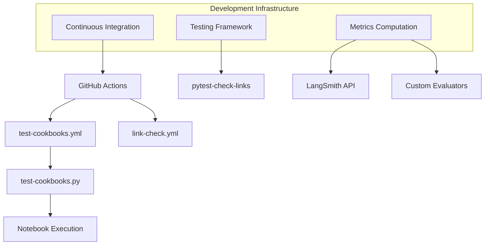
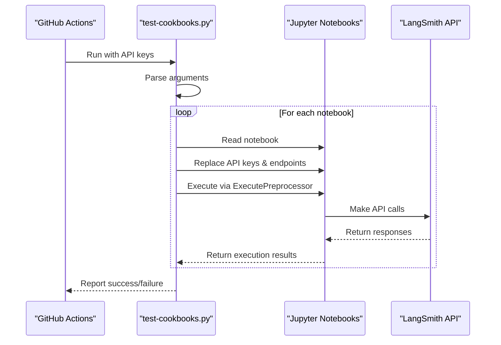
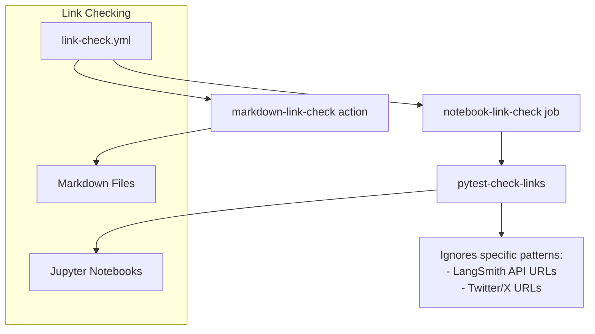
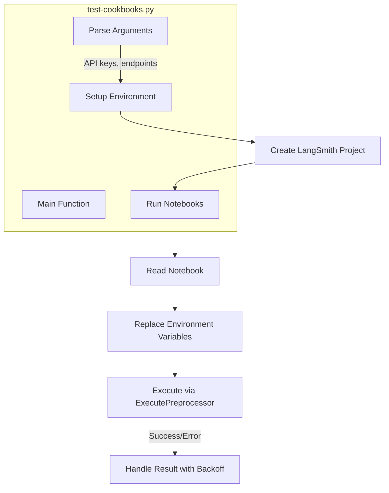
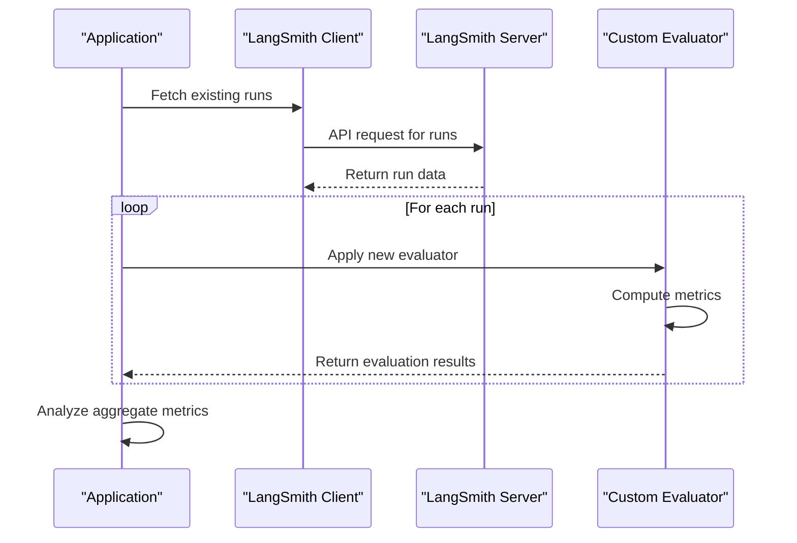
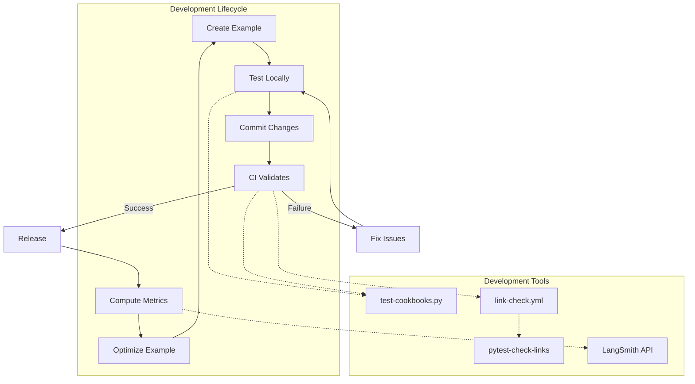

<!-- source: DeepWiki mcp.deepwiki.com · repo langchain-ai/langsmith-cookbook · page 8 Development Tools · fetched 2026-10-26 -->

# Development Tools

<details>
<summary>Relevant source files</summary>

The following files were used as context for generating this wiki page:

- [.github/workflows/link-check.yml](.github/workflows/link-check.yml)
- [.github/workflows/test-cookbooks.yml](.github/workflows/test-cookbooks.yml)
- [_scripts/requirements.txt](_scripts/requirements.txt)
- [_scripts/test-cookbooks.py](_scripts/test-cookbooks.py)
- [optimization/README.md](optimization/README.md)
- [optimization/assisted-prompt-bootstrapping/img/prompt-bootstrapping.png](optimization/assisted-prompt-bootstrapping/img/prompt-bootstrapping.png)
- [optimization/assisted-prompt-bootstrapping/img/queue.png](optimization/assisted-prompt-bootstrapping/img/queue.png)
- [optimization/bootstrap-fewshot/bootstrap-few-shot.ipynb](optimization/bootstrap-fewshot/bootstrap-few-shot.ipynb)
- [tracing-examples/nesting-tools/nest_runs_within_tools.ipynb](tracing-examples/nesting-tools/nest_runs_within_tools.ipynb)

</details>


This document provides an overview of the development tools and practices used within the LangSmith Cookbook repository. These tools ensure code quality, test the example notebooks, and help maintain the repository. The focus is on continuous integration workflows, testing frameworks, and techniques for computing metrics on existing tests.

## Overview of Development Infrastructure

The LangSmith Cookbook repository uses several development tools to ensure the quality and correctness of the examples it provides. These tools are essential for maintaining the codebase and ensuring that all examples work correctly with the latest versions of LangSmith and related dependencies.



Sources: [.github/workflows/test-cookbooks.yml](), [.github/workflows/link-check.yml](), [_scripts/test-cookbooks.py]()

## Continuous Integration

The repository uses GitHub Actions for continuous integration, with two primary workflows:

1. **Notebook Testing** - Executes all example notebooks to ensure they run without errors
2. **Link Checking** - Verifies that all links in markdown files and notebooks are valid

### Notebook Testing Workflow

The notebook testing workflow runs daily and on-demand to validate that all example notebooks execute correctly. It uses a custom Python script that:

1. Takes command-line arguments for API keys and endpoints
2. Replaces placeholder API keys and endpoints in the notebooks
3. Executes each notebook and collects the results



The workflow is defined in [.github/workflows/test-cookbooks.yml]() and has two jobs:

1. `test-cookbooks` - Tests notebooks against the public LangSmith API
2. `test-cookbooks-self-hosted` - Tests notebooks against a self-hosted LangSmith instance

Both jobs install the required dependencies from [_scripts/requirements.txt]() and execute the testing script with the appropriate API keys and endpoints.

Sources: [.github/workflows/test-cookbooks.yml:1-52](), [_scripts/test-cookbooks.py:1-181]()

### Link Checking Workflow

The link checking workflow ensures that all links in the repository are valid. It uses two different approaches:

1. **Markdown Files** - Uses the `github-action-markdown-link-check` action
2. **Jupyter Notebooks** - Uses a custom Pytest setup with the `pytest-check-links` plugin



The workflow can be run on-demand and ignores certain URL patterns that might be unreliable in automated testing, such as LangSmith API URLs and Twitter/X URLs.

Sources: [.github/workflows/link-check.yml:1-44]()

## Testing with Pytest

The repository uses Pytest for testing, particularly for validating links in notebooks. The link checking system combines GitHub Actions with Pytest and the `pytest-check-links` plugin.

The Pytest command used in the workflow is:

```
pytest -o python_files=non_python_only --check-links --ignore="*.py" -k .ipynb --check-links-ignore "https://(api|web)\.smith\.langchain\.com/.*" --check-links-ignore "https://x.com/*" --check-links-ignore "https://twitter.com/*"
```

This command:
1. Only checks non-Python files (`-o python_files=non_python_only`)
2. Specifically targets notebook files (`-k .ipynb`)
3. Ignores LangSmith API URLs and social media URLs that might be unreliable for testing

Sources: [.github/workflows/link-check.yml:41-43]()

## Notebook Testing Script

The `test-cookbooks.py` script is the core tool for testing notebooks. It handles:

1. Reading notebooks and replacing API keys and endpoint variables
2. Setting up execution environment variables
3. Running notebooks with timeout and error handling
4. Creating projects in LangSmith if they don't exist



The script uses a backoff mechanism for retrying notebook execution in case of failures, with exponential backoff up to a maximum number of attempts.

Sources: [_scripts/test-cookbooks.py:32-104](), [_scripts/test-cookbooks.py:159-181]()

## Computing Metrics on Existing Tests

While there isn't a specific file in the provided context that directly shows computing metrics on existing tests, this capability is a core feature of LangSmith. The process generally involves:

1. Fetching existing test runs from the LangSmith API
2. Applying new evaluators to those runs without re-running the models
3. Computing and analyzing metrics based on the evaluation results

This approach is demonstrated in notebooks like [optimization/bootstrap-fewshot/bootstrap-few-shot.ipynb](), which shows how to:

1. Create custom evaluators with `@run_evaluator` decorator
2. Apply evaluators to existing runs
3. Analyze the results to optimize prompt performance



This capability is particularly useful for:
- A/B testing different prompts or model configurations
- Applying new evaluation criteria to historical data
- Optimizing systems based on retrospective analysis

Sources: [optimization/bootstrap-fewshot/bootstrap-few-shot.ipynb:121-150]()

## Putting It All Together

The development tools in the LangSmith Cookbook work together to ensure a reliable and high-quality collection of examples:



The continuous integration workflows and testing tools ensure that examples work correctly before they're released, while the metrics computation capabilities allow for ongoing optimization of the examples over time.

Sources: [.github/workflows/test-cookbooks.yml](), [.github/workflows/link-check.yml](), [_scripts/test-cookbooks.py]()

## Conclusion

The development tools used in the LangSmith Cookbook provide a robust framework for ensuring the quality and reliability of the example notebooks. They automate the testing process, verify link integrity, and enable continuous improvement through metrics computation and analysis.

These tools are essential for maintaining the cookbook as a reliable resource for developers working with LangSmith and related technologies.

---

