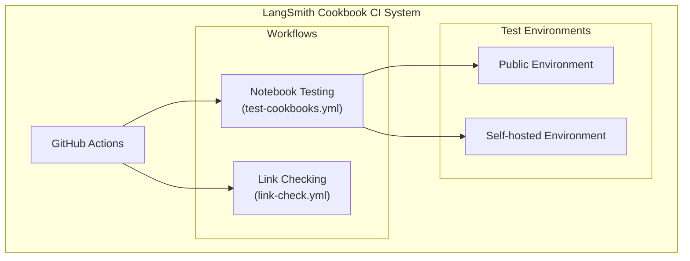
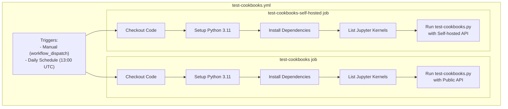
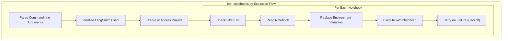
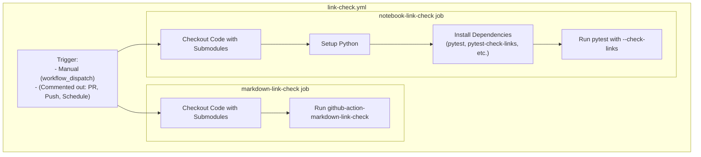

<!-- source: DeepWiki mcp.deepwiki.com · repo langchain-ai/langsmith-cookbook · page 8.1 Continuous Integration · fetched 2026-10-26 -->

# Continuous Integration

<details>
<summary>Relevant source files</summary>

The following files were used as context for generating this wiki page:

- [.github/workflows/link-check.yml](.github/workflows/link-check.yml)
- [.github/workflows/test-cookbooks.yml](.github/workflows/test-cookbooks.yml)
- [_scripts/requirements.txt](_scripts/requirements.txt)
- [_scripts/test-cookbooks.py](_scripts/test-cookbooks.py)
- [optimization/README.md](optimization/README.md)
- [optimization/assisted-prompt-bootstrapping/img/prompt-bootstrapping.png](optimization/assisted-prompt-bootstrapping/img/prompt-bootstrapping.png)
- [optimization/assisted-prompt-bootstrapping/img/queue.png](optimization/assisted-prompt-bootstrapping/img/queue.png)
- [optimization/bootstrap-fewshot/bootstrap-few-shot.ipynb](optimization/bootstrap-fewshot/bootstrap-few-shot.ipynb)
- [tracing-examples/nesting-tools/nest_runs_within_tools.ipynb](tracing-examples/nesting-tools/nest_runs_within_tools.ipynb)

</details>


This page documents the continuous integration (CI) workflows used in the LangSmith Cookbook repository to ensure code quality, maintainability, and functional correctness. The CI system automatically tests notebooks and checks for broken links, helping to maintain a high-quality codebase and documentation.

For information about testing your own applications with pytest, see [Testing with Pytest](#8.2).

## Overview of CI Workflows

The LangSmith Cookbook repository uses GitHub Actions for its CI pipelines. There are two primary workflows:

1. **Notebook Testing** - Runs and validates the functionality of Jupyter notebooks
2. **Link Checking** - Verifies that links in documentation and notebooks are valid



Sources: [.github/workflows/test-cookbooks.yml:1-52](), [.github/workflows/link-check.yml:1-44]()

## Notebook Testing Workflow

The notebook testing workflow ensures that all cookbook examples run successfully and continue to work as expected when APIs or dependencies are updated.

### Workflow Configuration

The notebook testing workflow is defined in `test-cookbooks.yml` and consists of two jobs:

1. **test-cookbooks** - Tests notebooks with the public LangSmith API
2. **test-cookbooks-self-hosted** - Tests notebooks with a self-hosted LangSmith instance



Sources: [.github/workflows/test-cookbooks.yml:1-52]()

### Test Script Functionality

The core testing functionality is implemented in `test-cookbooks.py`, which:

1. Accepts API keys and configuration as command-line arguments
2. Processes notebooks using `nbconvert`
3. Replaces environment variables and API keys in the notebooks
4. Executes each notebook and captures results
5. Implements retry logic with exponential backoff for handling failures



Sources: [_scripts/test-cookbooks.py:1-182]()

The script uses regular expressions to find and replace sensitive information in notebooks, such as API keys:

- `LANGCHAIN_API_KEY` (for LangSmith)
- `LANGCHAIN_HUB_API_KEY` (for LangChain Hub)
- `OPENAI_API_KEY` (for OpenAI services)
- `LANGCHAIN_ENDPOINT` (for LangSmith host URL)
- `LANGCHAIN_PROJECT` (for LangSmith project name)

Each notebook is executed with a timeout of 1000 seconds, and failures trigger a retry mechanism with exponential backoff (starting at 1 second and doubling up to a maximum of 10 seconds).

## Link Checking Workflow

The link checking workflow ensures that all documentation links remain valid, preventing dead links that would degrade the user experience.

### Workflow Configuration

The link checking workflow is defined in `link-check.yml` and consists of two jobs:

1. **markdown-link-check** - Checks links in Markdown files
2. **notebook-link-check** - Checks links in Jupyter notebooks



Sources: [.github/workflows/link-check.yml:1-44]()

The notebook link checker uses pytest with the `pytest-check-links` plugin to validate links. It ignores certain patterns to avoid false positives, such as LangSmith API URLs, Twitter/X links, and other frequently changing endpoints.

## Filtering and Excluded Notebooks

Not all notebooks are included in the automated testing. The `test-cookbooks.py` script maintains a filter list of notebooks to exclude from testing:

```python
filter_list = {
    "llm_run_etl.ipynb",
    "lilac.ipynb",
    "fine-tuning-on-chat-runs.ipynb",
    "vision-evals.ipynb",
    "contract-extraction.ipynb",
    "LangSmith_TS_Demo-Traceable.ipynb",
    "multimodal.ipynb",
    "tool-selection.ipynb",
}
```

These notebooks may be excluded because they:
- Require special credentials or services
- Take too long to execute in a CI environment
- Have non-deterministic outputs
- Use proprietary or demonstration-only code

Sources: [_scripts/test-cookbooks.py:12-21]()

## Dependencies and Environment

The test script requires several Python dependencies, defined in `_scripts/requirements.txt`:

| Category | Packages |
|----------|----------|
| Notebook Execution | nbformat, nbconvert |
| LangChain | langchain, langchain_experimental, langchain_openai, langsmith, langchainhub |
| LLM Backends | openai, anthropic |
| Data Management | pandas, chromadb, tiktoken |
| Text Processing | html2text, textstat |
| Utilities | tabulate, jupyter, duckduckgo-search, rapidfuzz |

Sources: [_scripts/requirements.txt:1-19]()

## Testing Process Example

To illustrate how testing actually works in the repository, here's a practical example of the flow for testing a typical notebook like the nested tool calls example:

1. The CI workflow triggers (manually or via schedule)
2. The `test-cookbooks.py` script runs
3. For `nest_runs_within_tools.ipynb`:
   - The script reads the notebook
   - Replaces the API keys with environment variables from CI secrets
   - Executes the notebook cells sequentially
   - Captures outputs and handles any errors
   - Reports success or failure

This ensures that examples like nested tool calls continue to function properly when APIs or dependencies change.

Sources: [tracing-examples/nesting-tools/nest_runs_within_tools.ipynb:1-339]()

## Summary

The continuous integration system in the LangSmith Cookbook repository ensures that:

1. Notebooks remain functional and up-to-date with the latest API changes
2. Documentation links are valid and accessible
3. Examples work in both public and self-hosted LangSmith environments

This infrastructure helps maintain the quality and reliability of the cookbook examples, making them more valuable for users learning how to use LangSmith effectively.

---

