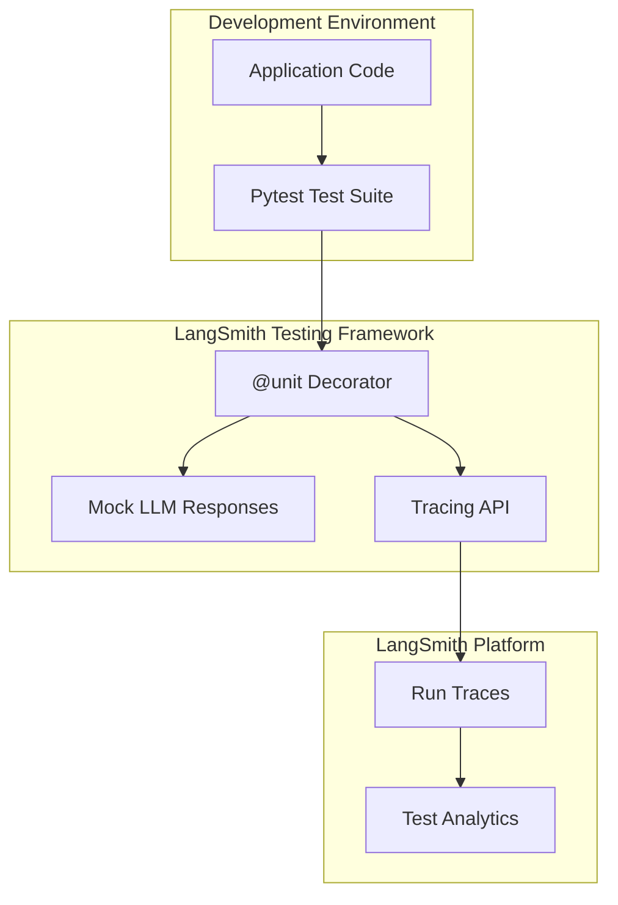
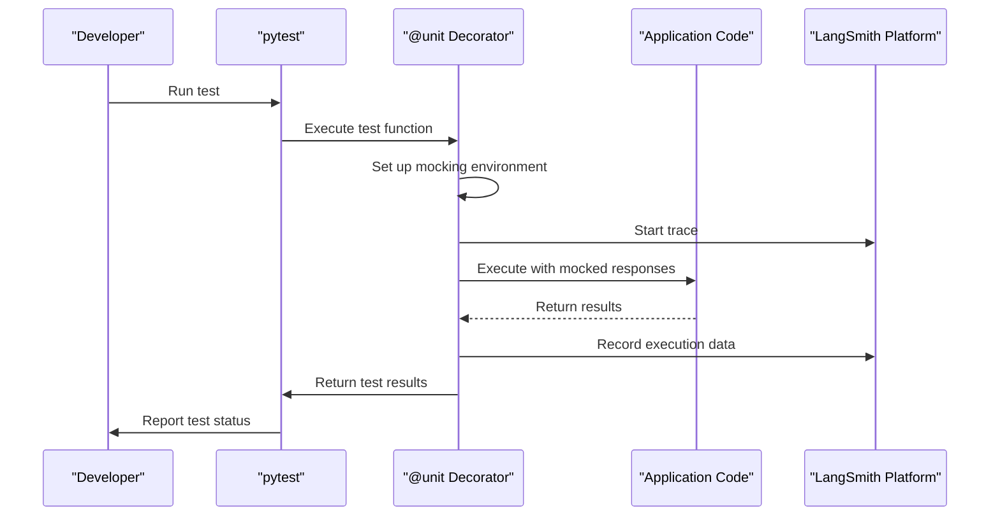

<!-- source: DeepWiki mcp.deepwiki.com · repo langchain-ai/langsmith-cookbook · page 8.2 Testing with Pytest · fetched 2026-10-26 -->

# Testing with Pytest

<details>
<summary>Relevant source files</summary>

The following files were used as context for generating this wiki page:

- [.github/workflows/test-cookbooks.yml](.github/workflows/test-cookbooks.yml)
- [_scripts/requirements.txt](_scripts/requirements.txt)
- [_scripts/test-cookbooks.py](_scripts/test-cookbooks.py)
- [testing-examples/pytest-ut/README.md](testing-examples/pytest-ut/README.md)
- [testing-examples/pytest/README.md](testing-examples/pytest/README.md)
- [tracing-examples/nesting-tools/nest_runs_within_tools.ipynb](tracing-examples/nesting-tools/nest_runs_within_tools.ipynb)

</details>


This page explains how to use Pytest with LangSmith for unit testing LLM applications. We'll cover how to set up Pytest configurations, create effective unit tests using LangSmith's `@unit` decorator, and integrate these tests into continuous integration workflows.

For information on computing metrics on existing test runs without re-executing models, see [Computing Metrics on Existing Tests](#8.3).

## Overview

Testing LLM applications presents unique challenges that traditional testing frameworks don't fully address. LangSmith provides specialized testing capabilities that integrate well with Pytest, allowing developers to:

- Create deterministic tests for otherwise non-deterministic LLM outputs
- Mock LLM responses for faster, more reliable tests
- Trace execution paths for debugging
- Integrate with CI/CD workflows
- Generate detailed test reports

The following diagram illustrates how Pytest fits into the LangSmith testing ecosystem:



Sources: [testing-examples/pytest/README.md:1-4](), [testing-examples/pytest-ut/README.md:1-4]()

## Setting Up Pytest for LangSmith

To use Pytest with LangSmith, you need to install the required dependencies and configure your environment properly.

### Installation

First, ensure you have the necessary packages installed:

```bash
pip install pytest langsmith langchain
```

### Environment Configuration

Configure your environment variables for LangSmith:

```python
import os

os.environ["LANGSMITH_API_KEY"] = "<your-langsmith-api-key>"
os.environ["LANGCHAIN_TRACING_V2"] = "true"
os.environ["LANGCHAIN_PROJECT"] = "pytest-examples"
```

Sources: [.github/workflows/test-cookbooks.yml:23-29]()

## Using the @unit Decorator

LangSmith provides a `@unit` decorator that simplifies testing LLM applications by allowing you to mock LLM responses. This ensures deterministic and reproducible test results without making actual API calls.

### Basic Test Structure

Here's the basic structure of a test using the `@unit` decorator:

```python
from langsmith.decorators import unit
import pytest

@unit
def test_simple_llm_chain():
    # Set up your LLM chain or agent
    from langchain_openai import ChatOpenAI
    from langchain_core.prompts import ChatPromptTemplate
    
    llm = ChatOpenAI()
    prompt = ChatPromptTemplate.from_template("Tell me about {topic}")
    chain = prompt | llm
    
    # Mock the LLM response
    unit.mock_response(llm, "This is a mocked response about the requested topic.")
    
    # Run your chain and make assertions
    result = chain.invoke({"topic": "testing"})
    assert "response" in result.content.lower()
```

### Execution Flow

The following sequence diagram illustrates how a test runs with the `@unit` decorator:



Sources: [testing-examples/pytest-ut/README.md:1-4]()

## Testing Different LLM Application Types

### Testing RAG Applications

When testing Retrieval-Augmented Generation (RAG) systems, you can mock both the retriever and the LLM:

```python
@unit
def test_rag_system():
    # Set up RAG system
    retriever = setup_vector_store_retriever()
    llm = ChatOpenAI()
    rag_chain = setup_rag_chain(retriever, llm)
    
    # Mock retriever to return specific documents
    unit.mock_response(
        retriever, 
        [Document(page_content="Mocked document content")]
    )
    
    # Mock LLM to return specific answer
    unit.mock_response(
        llm,
        "Answer based on the retrieved documents."
    )
    
    # Test the RAG system
    result = rag_chain.invoke({"query": "test question"})
    assert "answer" in result.lower()
```

### Testing Agents

For agents that use tools, you can mock both the LLM and the tool executions:

```python
@unit
def test_agent_with_tools():
    # Set up agent
    agent = setup_agent_with_tools()
    
    # Mock agent planning and tool execution
    unit.mock_response(agent.llm, {"thoughts": "I'll use the calculator", "action": "calculator"})
    unit.mock_response(agent.tools["calculator"], "42")
    
    # Test the agent
    result = agent.invoke({"input": "What is 6 * 7?"})
    assert "42" in result
```

Sources: [tracing-examples/nesting-tools/nest_runs_within_tools.ipynb:87-101](), [tracing-examples/nesting-tools/nest_runs_within_tools.ipynb:151-182]()

## Continuous Integration with Pytest

Integrating LangSmith-based Pytest tests into your CI pipeline ensures that your LLM applications are tested automatically on every code change.

### GitHub Actions Configuration

The LangSmith Cookbook repository uses GitHub Actions to test notebooks. Here's a similar configuration adapted for Pytest:

```yaml
name: Run Pytest Tests
on:
  push:
    branches: [ main ]
  pull_request:
    branches: [ main ]

jobs:
  test:
    runs-on: ubuntu-latest
    steps:
      - uses: actions/checkout@v3
      - name: Set up Python
        uses: actions/setup-python@v4
        with:
          python-version: '3.11'
      - name: Install dependencies
        run: |
          python -m pip install --upgrade pip
          pip install pytest langsmith langchain
          if [ -f requirements.txt ]; then pip install -r requirements.txt; fi
      - name: Test with pytest
        run: |
          pytest tests/
        env:
          LANGSMITH_API_KEY: ${{ secrets.LANGSMITH_API_KEY }}
          LANGCHAIN_TRACING_V2: 'true'
          LANGCHAIN_PROJECT: 'CI-Tests'
```

Sources: [.github/workflows/test-cookbooks.yml:1-52]()

## Best Practices

When testing LLM applications with Pytest and LangSmith, consider these best practices:

| Practice | Description |
|----------|-------------|
| **Mock all external calls** | Use the `@unit` decorator to mock all LLM and external API calls for deterministic tests |
| **Test edge cases** | Include tests for edge cases like empty inputs, long inputs, and unusual prompts |
| **Test error handling** | Ensure your application handles errors gracefully when LLMs or tools fail |
| **Create regression tests** | Add tests for any bugs you fix to prevent them from recurring |
| **Use descriptive test names** | Name tests clearly to indicate what functionality they're testing |
| **Separate unit and integration tests** | Keep fast unit tests separate from slower integration tests |
| **Create test fixtures** | Use Pytest fixtures to set up common test environments |

## Understanding Test Results in LangSmith

When you run tests with the `@unit` decorator, each test execution is captured in LangSmith. You can review these traces to understand:

1. The exact inputs provided to each component
2. The mocked responses that were returned
3. The execution flow of your application
4. Any errors or unexpected behaviors

This visibility helps quickly identify issues in your LLM application logic.

## Conclusion

Pytest combined with LangSmith's `@unit` decorator provides a powerful framework for testing LLM applications. By allowing you to mock LLM responses and tool executions, it enables deterministic testing of otherwise non-deterministic systems. The integration with LangSmith's tracing capabilities further helps in debugging and analyzing test results.

For more information on analyzing existing test results without re-running models, see [Computing Metrics on Existing Tests](#8.3).

Sources: [testing-examples/pytest/README.md:1-4](), [testing-examples/pytest-ut/README.md:1-4](), [.github/workflows/test-cookbooks.yml:1-52](), [_scripts/test-cookbooks.py:1-182]()

---

