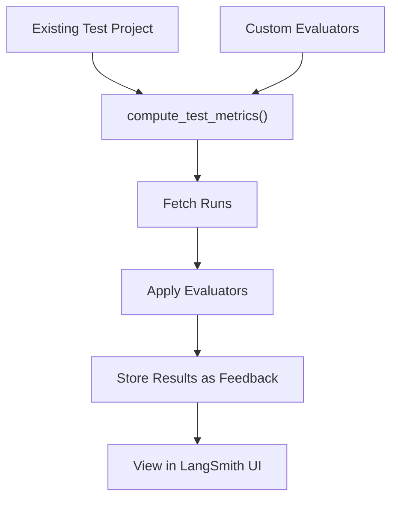
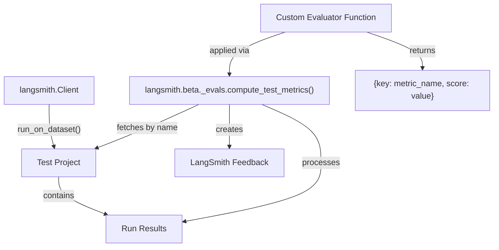
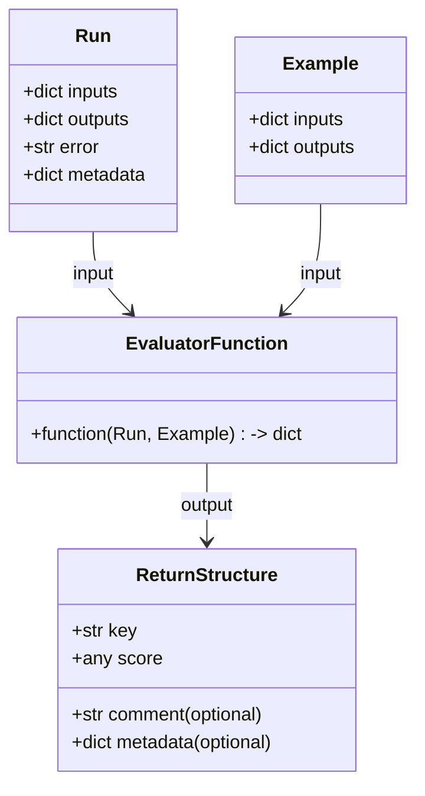

<!-- source: DeepWiki mcp.deepwiki.com · repo langchain-ai/langsmith-cookbook · page 8.3 Computing Metrics on Existing Tests · fetched 2026-10-26 -->

# Computing Metrics on Existing Tests

<details>
<summary>Relevant source files</summary>

The following files were used as context for generating this wiki page:

- [README.md](README.md)
- [testing-examples/README.md](testing-examples/README.md)
- [testing-examples/evaluate-existing-test-project/evaluate_runs.ipynb](testing-examples/evaluate-existing-test-project/evaluate_runs.ipynb)

</details>


This document explains how to compute new evaluation metrics on existing test results in LangSmith without re-running your models. For information about running tests initially, see [Testing & Evaluation](#3).

## Purpose and Benefits

LangSmith lets you add new evaluation metrics to previously run tests, providing several advantages:

- Retroactively apply new evaluators to historical test data
- Compare different metrics across the same test runs
- Save computation costs by not re-running expensive model inferences
- Experiment with different evaluation criteria on consistent outputs

## System Overview

The `compute_test_metrics` utility function allows you to apply evaluator functions to test runs that have already been completed. This lets you backfill metrics as you develop new evaluation criteria.

### Workflow Diagram



Sources: [testing-examples/evaluate-existing-test-project/evaluate_runs.ipynb:24-61](), [testing-examples/evaluate-existing-test-project/evaluate_runs.ipynb:130-160]()

## How It Works

The `compute_test_metrics` function from the `langsmith.beta._evals` module:

1. Retrieves all runs from the specified test project
2. For each run, retrieves the corresponding example from the dataset
3. Applies each provided evaluator to the run-example pair
4. Stores the evaluation results as feedback in LangSmith

### Component Interaction Diagram



Sources: [testing-examples/evaluate-existing-test-project/evaluate_runs.ipynb:147-160]()

## Implementation Requirements

To use this feature, you need:

1. A completed test project in LangSmith (result of `run_on_dataset`)
2. One or more evaluator functions
3. LangSmith SDK version ≥ 0.1.31

## Creating Custom Evaluators

An evaluator function must:

1. Accept a `Run` and an `Example` as parameters
2. Return a dictionary with at least a `key` and a `score`

### Evaluator Function Structure



Sources: [testing-examples/evaluate-existing-test-project/evaluate_runs.ipynb:151-155]()

### Example: Exact Match Evaluator

Here's an example of a simple exact match evaluator that checks if the model output matches the expected output:

```python
def exact_match(run: Run, example: Example):
    expected = example.outputs["output"]
    predicted = run.outputs["output"]
    return {"key": "exact_match", "score": predicted == expected}
```

This evaluator:
- Extracts the expected output from the example
- Extracts the actual output from the run
- Returns a boolean score indicating whether they match exactly

Sources: [testing-examples/evaluate-existing-test-project/evaluate_runs.ipynb:151-155]()

## Usage Example

The basic usage pattern is as follows:

1. Import the necessary function
2. Define your evaluator(s)
3. Apply them to an existing test project

```python
from langsmith.beta._evals import compute_test_metrics
from langsmith.schemas import Example, Run

# Define your evaluator
def my_evaluator(run: Run, example: Example):
    # Evaluation logic here
    return {"key": "metric_name", "score": score_value}

# Apply to existing test project
compute_test_metrics("my-test-project-name", evaluators=[my_evaluator])
```

Sources: [testing-examples/evaluate-existing-test-project/evaluate_runs.ipynb:147-160]()

## Best Practices

- **Use descriptive metric names**: Choose clear, descriptive keys for your metrics to make them easily identifiable in the UI
- **Handle edge cases**: Ensure your evaluators can handle potential errors or missing data
- **Group related metrics**: When applying multiple related metrics, use a consistent prefix in the key names
- **Include context**: Add optional `comment` or `metadata` fields for more detailed feedback
- **Limit computation**: For large test projects, avoid overly complex evaluators that might time out

## Limitations

- `compute_test_metrics` is currently in beta and its API might change
- Evaluators can only access data available in the run and example objects
- Very large test projects may time out if evaluators are computationally expensive
- The function processes examples sequentially, not in parallel

Sources: [testing-examples/evaluate-existing-test-project/evaluate_runs.ipynb:142-144]()

## Integration with LangSmith UI

After running `compute_test_metrics`, the new metrics appear in the LangSmith UI alongside other metrics for that test project. You can view them in:

1. The datasets page
2. The specific test project's comparison view
3. The evaluations section for individual examples

## Conclusion

Computing metrics on existing tests is a powerful way to add new evaluations to historical test results without incurring the cost of re-running models. This allows for more flexible, iterative evaluation processes when developing LLM applications.

Sources: [testing-examples/evaluate-existing-test-project/evaluate_runs.ipynb:168-172]()