# Page: Overview

# Overview

<details>
<summary>Relevant source files</summary>

The following files were used as context for generating this wiki page:

- [README.md](README.md)
- [introduction/langsmith_introduction.ipynb](introduction/langsmith_introduction.ipynb)
- [introduction/online_evaluation.ipynb](introduction/online_evaluation.ipynb)
- [introduction/summarization.ipynb](introduction/summarization.ipynb)
- [testing-examples/README.md](testing-examples/README.md)
- [testing-examples/rag_eval/online_eval.ipynb](testing-examples/rag_eval/online_eval.ipynb)
- [testing-examples/rag_eval/rag.ipynb](testing-examples/rag_eval/rag.ipynb)

</details>


The LangSmith Cookbook is a practical guide to maximizing [LangSmith](https://smith.langchain.com/), a comprehensive tool designed to debug, evaluate, test, and improve LLM applications continuously. While the [standard documentation](https://docs.smith.langchain.com/) covers the fundamentals, this repository provides real-world scenarios, common patterns, and practical recipes for implementing LangSmith in your LLM applications.

This repository serves as your hands-on guide to leverage LangSmith's capabilities for tracing, evaluation, testing, feedback collection, and prompt management. The recipes and examples demonstrate practical applications that you can adapt and implement in your own projects.

## Core LangSmith Platform Architecture

```mermaid
graph TB
    LangSmith["LangSmith Platform"] --> Tracing["Tracing"]
    LangSmith --> Evaluation["Testing & Evaluation"]
    LangSmith --> Feedback["Feedback Collection"]
    LangSmith --> Hub["LangChain Hub"]
    LangSmith --> DataExport["Data Export & Fine-tuning"]
    
    Tracing --> REST_API["REST API"]
    Tracing --> TraceableDecorator["@traceable Decorator"]
    Tracing --> RunNaming["Run Naming"]
    
    Evaluation --> RagEval["RAG Evaluation"]
    Evaluation --> AgentEval["Agent Evaluation"]
    Evaluation --> ChatbotEval["Chatbot Evaluation"]
    Evaluation --> ExtractionEval["Extraction Evaluation"]
    Evaluation --> MultimodalEval["Multimodal Evaluation"]
    
    Feedback --> UserFeedback["User Feedback UI"]
    Feedback --> AlgoFeedback["Algorithmic Feedback"]
    Feedback --> RealtimeFeedback["Real-time Feedback"]
    
    Hub --> PromptVersioning["Prompt Versioning"]
    Hub --> RunnablePrompt["Runnable PromptTemplate"]
    
    DataExport --> FineTuning["Fine-tuning Export"]
    DataExport --> LilacCuration["Lilac Dataset Curation"]
    DataExport --> CSVExport["CSV Export"]
```

Sources: [README.md:5-12], [README.md:14-132]

## Cookbook Workflow: From Development to Optimization

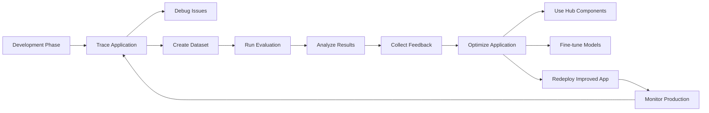

Sources: [README.md:5-12], [README.md:14-132]

## Core Capabilities

### Tracing

LangSmith's tracing capabilities allow you to seamlessly debug and improve your LLM applications by monitoring execution flow and capturing intermediate steps. The cookbook provides examples for:

- Tracing without LangChain using the `@traceable` decorator
- Using the REST API for logging LLM and chat model runs
- Customizing run names for better visibility in the UI
- Tracing nested calls within tools
- Displaying trace links in your application

Tracing is fundamental to LangSmith as it enables visibility into the execution flow of your application, helping you identify bottlenecks, errors, and opportunities for improvement.

Sources: [README.md:14-22]

### Testing & Evaluation

LangSmith provides robust evaluation capabilities for benchmarking and testing your LLM systems across different modalities:

- **RAG (Retrieval Augmented Generation)**: Evaluate correctness, handling of dynamic data, and using fixed sources
- **Chatbots**: Test using simulated users and single-turn evaluations
- **Extraction**: Measure similarity between extracted structured content and labels
- **Agents**: Evaluate intermediate steps and tool selection accuracy
- **Multimodal**: Benchmark image classification and other multimodal tasks

The cookbook includes comprehensive examples for each of these evaluation scenarios, enabling you to assess and improve the performance of your LLM applications.

Sources: [README.md:32-86], [testing-examples/README.md:1-40]

### Feedback Collection

LangSmith's feedback collection capabilities help you gather insights to improve your applications:

- User feedback UI implementations (Streamlit, Next.js)
- Algorithmic feedback for monitoring and performance tuning
- Real-time feedback using callbacks

These examples demonstrate how to capture and incorporate feedback to continuously refine your LLM applications.

Sources: [README.md:87-99]

### LangChain Hub Integration

The LangChain Hub integration allows you to efficiently manage LLM components:

- Using prompts from Hub in RAG pipelines
- Version control for prompts to ensure deployment stability
- Streamlining the process of saving and integrating prompts

This section demonstrates how to leverage the Hub for prompt management and versioning.

Sources: [README.md:24-30]

### Data Export & Fine-tuning

LangSmith provides tools for exporting data to optimize LLMs:

- Converting run data to OpenAI's fine-tuning format
- Curating datasets using Lilac to detect near-duplicates and PII
- Exporting test results to CSV for external analysis

These examples show how to leverage your traced data for fine-tuning models and analysis.

Sources: [README.md:111-124]

## Getting Started

To use the LangSmith Cookbook examples, you'll need:

1. A LangSmith API key - sign up at [smith.langchain.com](https://smith.langchain.com/)
2. The LangSmith SDK installed:
   ```bash
   pip install langsmith langchain
   ```
3. Configure your environment variables:
   ```bash
   export LANGCHAIN_API_KEY="your_api_key"
   export LANGCHAIN_TRACING_V2=true
   export LANGCHAIN_ENDPOINT="https://api.smith.langchain.com"
   ```

Each recipe in the cookbook provides specific instructions and code examples that you can adapt to your own use cases.

Sources: [README.md:5-12], [testing-examples/rag_eval/rag.ipynb:39-49], [introduction/summarization.ipynb:186-195]

## Cookbook Organization

The cookbook is organized by capability, with dedicated directories for each major feature:

- `tracing-examples/`: Examples for tracing your code
- `testing-examples/`: Examples for testing and evaluation
- `feedback-examples/`: Examples for collecting and using feedback
- `hub-examples/`: Examples for LangChain Hub integration
- `fine-tuning-examples/`: Examples for data export and fine-tuning
- `optimization/`: Examples for optimizing your applications

Each directory contains notebooks and code samples that demonstrate practical applications of LangSmith's capabilities.

Sources: [README.md:14-124]

---

# Page: Core Capabilities

# Core Capabilities

<details>
<summary>Relevant source files</summary>

The following files were used as context for generating this wiki page:

- [README.md](README.md)
- [feedback-examples/README.md](feedback-examples/README.md)
- [feedback-examples/streamlit-realtime-feedback/img/hallucination_feedback.gif](feedback-examples/streamlit-realtime-feedback/img/hallucination_feedback.gif)
- [hub-examples/README.md](hub-examples/README.md)
- [introduction/langsmith_introduction.ipynb](introduction/langsmith_introduction.ipynb)
- [introduction/online_evaluation.ipynb](introduction/online_evaluation.ipynb)
- [introduction/summarization.ipynb](introduction/summarization.ipynb)
- [testing-examples/README.md](testing-examples/README.md)
- [testing-examples/rag_eval/online_eval.ipynb](testing-examples/rag_eval/online_eval.ipynb)
- [testing-examples/rag_eval/rag.ipynb](testing-examples/rag_eval/rag.ipynb)
- [tracing-examples/README.md](tracing-examples/README.md)
- [typescript-testing-examples/README.md](typescript-testing-examples/README.md)

</details>


This document provides an overview of the core capabilities of LangSmith, a platform for debugging, evaluating, testing, and improving LLM applications. These capabilities include tracing, testing & evaluation, feedback collection, LangChain Hub integration, and data export & fine-tuning. For practical guidance on setting up and running the examples in this cookbook, see [Getting Started](#1.2).

## System Architecture Overview

Diagram: LangSmith Platform Architecture


Sources: [README.md](), [introduction/langsmith_introduction.ipynb]()

## Tracing

Tracing is a fundamental capability of LangSmith that allows you to debug and understand your LLM applications by logging execution details and visualizing the execution flow.

Diagram: Tracing System Components

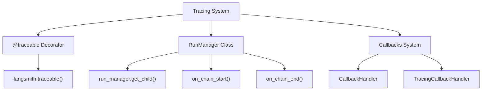

### @traceable Decorator

The `@traceable` decorator allows you to trace applications independent of LangChain. This provides the flexibility to use LangSmith's tracing capabilities with any Python application, not just those built with LangChain.

```python
from langsmith import traceable

@traceable()
def my_function(input_text):
    # Function logic here
    return output
```

### REST API

The REST API enables logging of LLM and chat model runs, including nested runs, directly through HTTP endpoints. This is particularly useful for non-Python applications or when you want to integrate LangSmith with existing workflows. The API specification is available in the LangSmith SDK repository's OpenAPI definition.

### Run Naming

Custom run naming improves UI clarity by allowing you to assign descriptive names to LangSmith chain runs. This feature is valuable for chains, lambda functions, and agents, making it easier to identify and understand complex workflows in the UI.

### Nested Calls within Tools

You can capture nested tool subcalls in a single trace by using `run_manager.get_child()` and passing it to child `callbacks`. This creates a hierarchical view of your application's execution, making it easier to debug complex chains and agents.

Sources:
- [tracing-examples/README.md]()
- [tracing-examples/traceable/tracing_without_langchain.ipynb]()
- [tracing-examples/rest/rest.ipynb]()
- [tracing-examples/runnable-naming/run-naming.ipynb]()
- [tracing-examples/nesting-tools/nest_runs_within_tools.ipynb]()

## Testing & Evaluation

LangSmith provides robust capabilities for testing and evaluating your LLM applications across different application types and use cases.

Diagram: Evaluation Systems Architecture

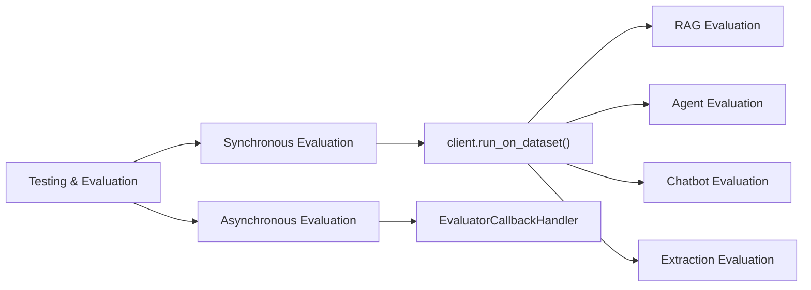

### RAG Evaluation

LangSmith offers comprehensive tools for evaluating Retrieval Augmented Generation (RAG) systems:

* **Q&A System Correctness**: Evaluate your retrieval-augmented Q&A pipeline end-to-end on a dataset.
* **Dynamic Data**: Evaluate Q&A systems with data that changes over time using evaluators that dereference labels.
* **Fixed Sources**: Evaluate the response component of a RAG pipeline by providing retrieved documents in the dataset.
* **RAGAS Framework**: Evaluate RAG pipelines using metrics for both the generator and retriever (answer correctness, faithfulness, context relevancy, recall and precision).

### Chatbot Evaluation

* **Simulated Users**: Evaluate chat bots using simulated users given specific tasks.
* **Single-turn Evaluation**: Evaluate chatbots within multi-turn conversations by treating each data point as an individual dialogue turn.

### Extraction Evaluation

* **Contract Extraction**: Measure the similarity between extracted structured content and structured labels using LangChain's json evaluators.
* **Exact Match**: Perform deterministic comparison of system output against reference labels.

### Agent Evaluation

* **Intermediate Steps**: Compare the sequence of actions taken by an agent to an expected trajectory to grade effective tool use.
* **Tool Selection**: Evaluate the precision of selected tools, with automated prompt improvement based on failure cases.

### Multimodal Evaluation

Benchmark multimodal models, such as image classification chains, using LangSmith's evaluation tools.

### Evaluation Fundamentals

* **Adding Metrics to Tests**: Apply new evaluators to existing test results without re-running your model using the `compute_test_metrics` utility function.
* **Backtesting**: Benchmark new versions of your production app using real inputs from production runs.
* **Naming Test Projects**: Name your tests with `run_on_dataset(..., project_name='my-project-name')`.
* **Exporting Tests**: Export test results to CSV for external analysis and reporting.

Sources:
- [testing-examples/README.md]()
- [testing-examples/rag_eval/rag.ipynb]()
- [testing-examples/qa-correctness/qa-correctness.ipynb]()
- [testing-examples/dynamic-data/testing_dynamic_data.ipynb]()
- [testing-examples/using-fixed-sources/using_fixed_sources.ipynb]()
- [testing-examples/ragas/ragas.ipynb]()
- [testing-examples/chatbot-simulation/chatbot-simulation.ipynb]()
- [testing-examples/chat-single-turn/chat_evaluation_single_turn.ipynb]()
- [testing-examples/data-extraction/contract-extraction.ipynb]()
- [testing-examples/exact-match/exact_match.ipynb]()
- [testing-examples/agent_steps/evaluating_agents.ipynb]()
- [testing-examples/tool-selection/tool-selection.ipynb]()
- [testing-examples/multimodal/multimodal.ipynb]()
- [testing-examples/evaluate-existing-test-project/evaluate_runs.ipynb]()
- [testing-examples/backtesting/backtesting.ipynb]()
- [testing-examples/naming-test-projects/naming-test-projects.md]()
- [testing-examples/export-test-to-csv/export-test-to-csv.ipynb]()

## Feedback Collection

LangSmith enables you to collect and utilize feedback to improve, monitor, and personalize your LLM applications. This feedback can come from users or be generated algorithmically.

Diagram: Feedback Collection System

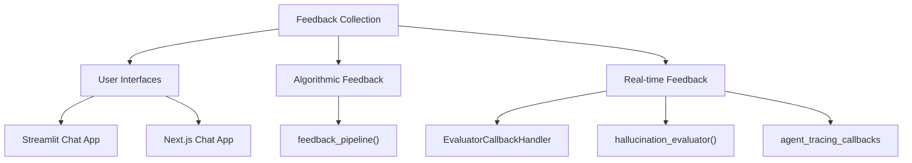

### User Feedback Interfaces

* **Streamlit Chat App**: A minimal chat application that captures user feedback and shares traces of the chat application. It comes in two variants:
  * `vanilla_chain.py` - Contains an LLMChain powering the chat application
  * `expression_chain.py` - Contains an equivalent chat chain defined with LangChain expressions

* **Next.js Chat App**: A TypeScript chat application demonstrating tracing and feedback capture, with a deployed demo version available.

### Algorithmic Feedback

Build automated feedback pipelines to generate metrics for monitoring and performance tuning. This lets you evaluate production runs as batch jobs to continuously improve your system.

### Real-time Feedback

* **Async Callback**: Automatically generate feedback metrics for every run using an async callback, enabling real-time evaluation of production runs.
* **RAG Chat Bot Evaluation**: Automatically check for hallucinations in RAG chat bot responses against retrieved documents.
* **LangChain Agents**: Instrument LangChain web-search agents with tracing and human feedback collection.

Sources:
- [feedback-examples/README.md]()
- [feedback-examples/streamlit/README.md]()
- [feedback-examples/streamlit/vanilla_chain.py]()
- [feedback-examples/streamlit/expression_chain.py]()
- [feedback-examples/nextjs/README.md]()
- [feedback-examples/algorithmic-feedback/algorithmic_feedback.ipynb]()
- [feedback-examples/realtime-algorithmic-feedback/realtime_feedback.ipynb]()
- [feedback-examples/streamlit-realtime-feedback/README.md]()
- [feedback-examples/streamlit-agent/README.md]()

## LangChain Hub Integration

LangChain Hub integration allows you to efficiently manage your LLM components, such as prompts and chains.

Diagram: LangChain Hub Integration

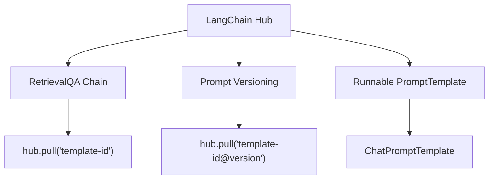

### RetrievalQA Chain

Use prompts from the hub in RAG (Retrieval Augmented Generation) pipelines to improve question answering with shared and version-controlled prompt templates.

### Prompt Versioning

Ensure deployment stability by selecting specific prompt versions rather than always using the 'latest' version. This provides consistent behavior in production environments even as prompts are improved.

### Runnable PromptTemplate

Streamline the process of saving prompts to the hub from the playground and integrating them into runnable chains. This allows for easy iteration and sharing of effective prompts across teams.

Sources:
- [hub-examples/README.md]()
- [hub-examples/retrieval-qa-chain/retrieval-qa.ipynb]()
- [hub-examples/retrieval-qa-chain-versioned/prompt-versioning.ipynb]()
- [hub-examples/runnable-prompt/edit-in-playground.ipynb]()

## Data Export & Fine-tuning

LangSmith provides tools for exporting data for analysis and fine-tuning language models.

Diagram: Data Export and Fine-tuning

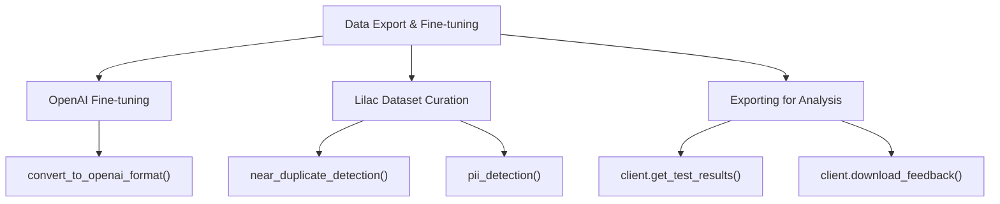

### OpenAI Fine-Tuning

Convert collected LLM runs to OpenAI's fine-tuning format efficiently. This allows you to take successful interactions from your application and use them to optimize your models.

### Lilac Dataset Curation

Further curate your LangSmith datasets using Lilac to detect near-duplicates, check for PII, and more. This ensures your fine-tuning data is high-quality and compliant with privacy requirements.

### Exporting Data for Analysis

Extract and interpret LangSmith LLM run data, making it ready for various analytical platforms. This includes exporting to CSV and programmatically accessing your test results for custom analysis and visualization.

Sources:
- [fine-tuning-examples/export-to-openai/fine-tuning-on-chat-runs.ipynb]()
- [fine-tuning-examples/lilac/lilac.ipynb]()
- [exploratory-data-analysis/exporting-llm-runs-and-feedback/llm_run_etl.ipynb]()
- [exploratory-data-analysis/lilac/lilac.ipynb]()
- [testing-examples/download-feedback-and-examples/download_example.ipynb]()

---

# Page: Getting Started

# Getting Started

<details>
<summary>Relevant source files</summary>

The following files were used as context for generating this wiki page:

- [.github/workflows/test-cookbooks.yml](.github/workflows/test-cookbooks.yml)
- [README.md](README.md)
- [_scripts/requirements.txt](_scripts/requirements.txt)
- [_scripts/test-cookbooks.py](_scripts/test-cookbooks.py)
- [introduction/langsmith_introduction.ipynb](introduction/langsmith_introduction.ipynb)
- [introduction/online_evaluation.ipynb](introduction/online_evaluation.ipynb)
- [introduction/summarization.ipynb](introduction/summarization.ipynb)
- [testing-examples/README.md](testing-examples/README.md)
- [testing-examples/rag_eval/online_eval.ipynb](testing-examples/rag_eval/online_eval.ipynb)
- [testing-examples/rag_eval/rag.ipynb](testing-examples/rag_eval/rag.ipynb)
- [tracing-examples/nesting-tools/nest_runs_within_tools.ipynb](tracing-examples/nesting-tools/nest_runs_within_tools.ipynb)

</details>


This guide will help you set up your environment and run examples from the LangSmith Cookbook repository. The cookbook contains practical examples demonstrating how to use LangSmith to trace, debug, evaluate, and improve your LLM applications.

For an overview of the broader LangSmith platform, see the [Overview](#1) and [Core Capabilities](#1.1) pages.

## Architecture Overview

The diagram below shows how the LangSmith platform connects with the code examples in this cookbook:

```mermaid
graph TB
    subgraph "LangSmith Platform"
        Tracing["Tracing"]
        Evaluation["Testing & Evaluation"]
        Feedback["Feedback Collection"]
        Hub["LangChain Hub"]
        Export["Data Export"]
    end
    
    subgraph "Cookbook Code Components"
        TraceableDecorator["@traceable Decorator"]
        RestAPI["REST API"]
        RunNaming["Run Naming"]
        
        DatasetRun["client.run_on_dataset()"]
        EvalCallbacks["EvaluatorCallbackHandler"]
        
        UserFeedback["Feedback UI Components"]
        AlgoFeedback["Algorithmic Feedback"]
        
        HubVersioning["hub.pull() / hub.push()"]
        PromptTemplates["ChatPromptTemplate"]
        
        DataExport["client.list_runs()"]
        CSVExport["get_test_results()"]
    end

    Tracing --> TraceableDecorator
    Tracing --> RestAPI
    Tracing --> RunNaming
    
    Evaluation --> DatasetRun
    Evaluation --> EvalCallbacks
    
    Feedback --> UserFeedback
    Feedback --> AlgoFeedback
    
    Hub --> HubVersioning
    Hub --> PromptTemplates
    
    Export --> DataExport
    Export --> CSVExport
```

Sources: [README.md:1-125]()

## Prerequisites

Before using the examples in this cookbook, you'll need:

1. **LangSmith Account**: Sign up at [smith.langchain.com](https://smith.langchain.com)
2. **API Keys**:
   - LangSmith API key
   - OpenAI API key (for most examples)
   - Additional keys for specific examples (Anthropic, etc.)
3. **Python Environment**: Python 3.8+

## Installation

Install the required packages using pip:

```bash
pip install langchain langchain-community langsmith openai
```

Some examples may require additional packages. The full list of common dependencies can be found in the requirements file.

Sources: [_scripts/requirements.txt:1-19]()

## Environment Configuration

The examples in this repository require several environment variables to be set:

```python
import os

# Required for all examples
os.environ["LANGCHAIN_API_KEY"] = "your-langsmith-api-key"
os.environ["LANGCHAIN_TRACING_V2"] = "true"
os.environ["LANGCHAIN_ENDPOINT"] = "https://api.smith.langchain.com"  # Default API endpoint

# Required for most examples
os.environ["OPENAI_API_KEY"] = "your-openai-api-key"

# Optional - specify a project name (defaults to "default")
os.environ["LANGCHAIN_PROJECT"] = "my-cookbook-project"
```

Each notebook in the cookbook will begin with similar setup code. You can either set these environment variables in your shell or directly in the notebooks.

Sources: [tracing-examples/nesting-tools/nest_runs_within_tools.ipynb:39-52](), [testing-examples/rag_eval/rag.ipynb:183-195]()

## Cookbook Structure

The LangSmith Cookbook is organized by use case:

| Directory | Purpose | Example Files |
|-----------|---------|--------------|
| `tracing-examples/` | Debug and visualize execution | traceable/tracing_without_langchain.ipynb, rest/rest.ipynb |
| `testing-examples/` | Evaluate LLM systems | qa-correctness/qa-correctness.ipynb, rag_eval/rag.ipynb |
| `feedback-examples/` | Collect and utilize feedback | streamlit/, nextjs/, algorithmic-feedback/ |
| `hub-examples/` | LangChain Hub integration | retrieval-qa-chain/, prompt-versioning/ |
| `fine-tuning-examples/` | Export data for tuning | export-to-openai/, lilac/ |
| `optimization/` | Improve prompts and chains | assisted-prompt-bootstrapping/, bootstrap-fewshot/ |
| `_scripts/` | Testing and utility scripts | test-cookbooks.py, requirements.txt |

Sources: [README.md:14-117](), [testing-examples/README.md:1-40]()

## Running Examples

### Running Individual Notebooks

The cookbook examples are provided as Jupyter notebooks. To run a notebook:

1. Clone the repository:
   ```bash
   git clone https://github.com/langchain-ai/langsmith-cookbook.git
   cd langsmith-cookbook
   ```

2. Install the required packages:
   ```bash
   pip install -r _scripts/requirements.txt
   ```

3. Open and run a notebook:
   ```bash
   jupyter notebook tracing-examples/traceable/tracing_without_langchain.ipynb
   ```

### Execution Flow

The diagram below illustrates the typical execution flow when running cookbook examples:

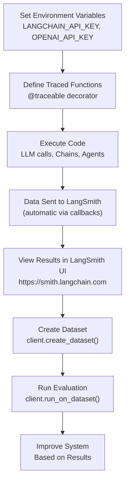

Sources: [tracing-examples/nesting-tools/nest_runs_within_tools.ipynb:60-114](), [testing-examples/rag_eval/rag.ipynb:96-141]()

## Testing the Cookbook

The cookbook includes a testing framework to verify that examples work correctly:

```bash
cd _scripts
python test-cookbooks.py --api-key YOUR_LANGSMITH_API_KEY --project YOUR_PROJECT_NAME
```

This script will:
1. Find all notebooks in the repository
2. Replace placeholder API keys with your actual keys
3. Execute the notebooks
4. Log all traces to your specified LangSmith project

Sources: [.github/workflows/test-cookbooks.yml:8-52](), [_scripts/test-cookbooks.py:32-181]()

## Example: Basic Tracing

Here's a simple example of using LangSmith to trace nested function calls:

```python
import os
from langsmith import traceable
import openai
from langsmith.wrappers import wrap_openai

# Set environment variables
os.environ["LANGCHAIN_API_KEY"] = "your-langsmith-api-key"
os.environ["LANGCHAIN_TRACING_V2"] = "true"
os.environ["OPENAI_API_KEY"] = "your-openai-api-key"

# Wrap the OpenAI client for tracing
client = wrap_openai(openai.Client())

# Create a traced function
@traceable()
def get_answer(question):
    response = client.chat.completions.create(
        model="gpt-3.5-turbo",
        messages=[
            {"role": "system", "content": "You are a helpful assistant."},
            {"role": "user", "content": question}
        ]
    )
    return response.choices[0].message.content

# Call the function
answer = get_answer("What is LangSmith?")
print(answer)
```

After running this code, you can view the execution trace in the LangSmith UI, including:
- The input question
- The API call to OpenAI
- The response
- Execution time statistics

Sources: [tracing-examples/nesting-tools/nest_runs_within_tools.ipynb:96-142](), [testing-examples/rag_eval/online_eval.ipynb:60-91]()

## Next Steps

After getting familiar with the basics, explore these more advanced examples:

- **RAG Evaluation**: Test retrieval-augmented generation pipelines for correctness and relevance
- **Agent Evaluation**: Assess LLM agents' tool selection and reasoning steps
- **Feedback Collection**: Implement user feedback in chat applications
- **Prompt Optimization**: Improve prompts with bootstrapping techniques

For more details on these topics, see the [Testing & Evaluation](#3) and [Feedback Collection](#4) pages.

Sources: [README.md:32-117]()

---

# Page: Tracing

# Tracing

<details>
<summary>Relevant source files</summary>

The following files were used as context for generating this wiki page:

- [.github/workflows/test-cookbooks.yml](.github/workflows/test-cookbooks.yml)
- [_scripts/requirements.txt](_scripts/requirements.txt)
- [_scripts/test-cookbooks.py](_scripts/test-cookbooks.py)
- [feedback-examples/README.md](feedback-examples/README.md)
- [feedback-examples/streamlit-realtime-feedback/img/hallucination_feedback.gif](feedback-examples/streamlit-realtime-feedback/img/hallucination_feedback.gif)
- [hub-examples/README.md](hub-examples/README.md)
- [tracing-examples/README.md](tracing-examples/README.md)
- [tracing-examples/nesting-tools/nest_runs_within_tools.ipynb](tracing-examples/nesting-tools/nest_runs_within_tools.ipynb)
- [tracing-examples/rest/rest.ipynb](tracing-examples/rest/rest.ipynb)
- [tracing-examples/traceable/tracing_without_langchain.ipynb](tracing-examples/traceable/tracing_without_langchain.ipynb)
- [typescript-testing-examples/README.md](typescript-testing-examples/README.md)

</details>


Tracing in LangSmith enables comprehensive logging and visualization of LLM application execution flows. It allows developers to instrument, debug, and monitor their applications by capturing structured logs called "runs" that record inputs, outputs, execution time, and other metadata. This page explains how LangSmith's tracing capabilities work and how to implement them in your applications.

For information about testing and evaluating your LLM applications with LangSmith, see [Testing & Evaluation](#3).

## Tracing Architecture

LangSmith tracing is built around a hierarchical system of "runs" that represent execution spans in an application. These runs form a tree structure that visualizes the flow of execution, making it easier to debug complex applications.

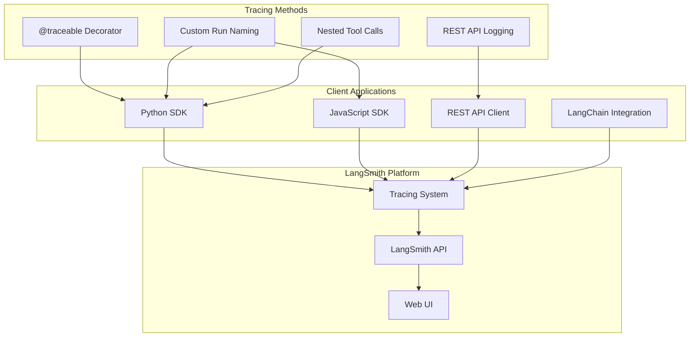

Sources:
- [tracing-examples/README.md]()
- [tracing-examples/traceable/tracing_without_langchain.ipynb]()
- [tracing-examples/rest/rest.ipynb]()

## Core Concepts

### Runs and Run Trees

In LangSmith, a "run" represents a single execution span with the following properties:

- **name**: A descriptive name for the run
- **run_type**: Categorizes the run (e.g., "chain", "llm", "tool")
- **inputs**: The input data for the run
- **outputs**: The output data from the run
- **start_time/end_time**: Timestamps for when the run started and ended
- **error**: Any error information if the run failed
- **tags**: Optional labels for filtering and organizing runs
- **metadata**: Additional structured information about the run

A "run tree" is a hierarchical organization of runs, where child runs represent nested function calls or sub-operations within a parent run.

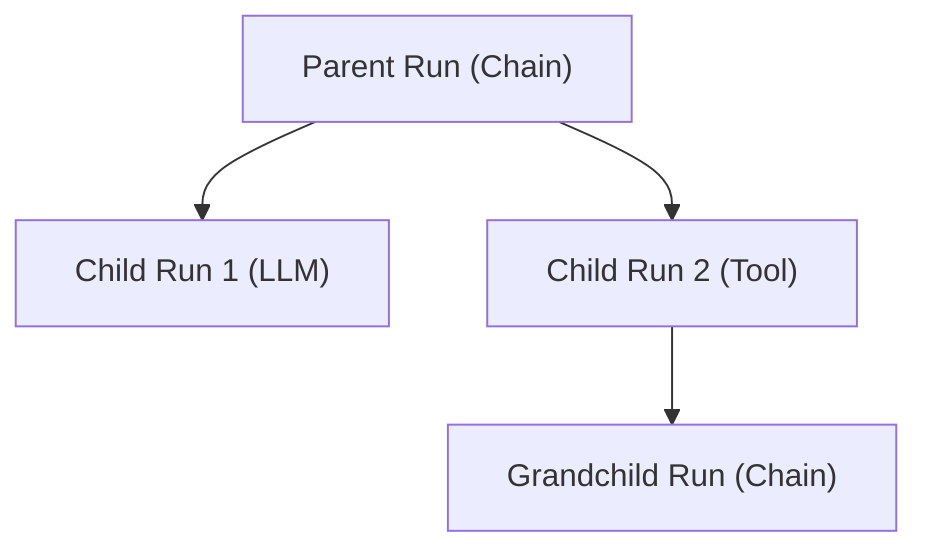

Sources:
- [tracing-examples/traceable/tracing_without_langchain.ipynb:15-17]()
- [tracing-examples/rest/rest.ipynb:10-17]()

## Tracing Methods

### @traceable Decorator

The `@traceable` decorator provides a simple way to automatically instrument Python functions, handling the creation and management of run trees.

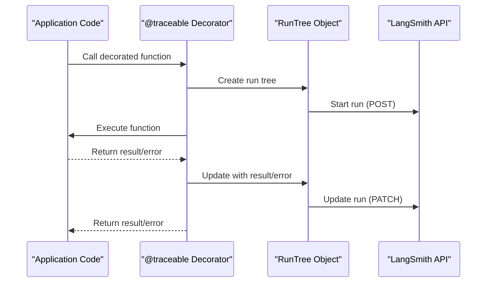

Example usage:

```python
from langsmith.run_helpers import traceable

@traceable(run_type="chain")
def my_function(input_text):
    # Function logic here
    return result
```

The decorator supports various configurations:

- **run_type**: Specifies the type of run (e.g., "chain", "llm")
- **name**: Custom name for the run
- **tags**: List of tags for filtering
- **metadata**: Additional structured information

You can also access the run tree within your function by adding a `run_tree` parameter:

```python
@traceable(run_type="chain")
def my_function(input_text, *, run_tree):
    # Access run_tree.id or other properties
    return result, run_tree.id
```

Sources:
- [tracing-examples/traceable/tracing_without_langchain.ipynb:18-22]()
- [tracing-examples/traceable/tracing_without_langchain.ipynb:85-107]()
- [tracing-examples/traceable/tracing_without_langchain.ipynb:352-373]()

### REST API

The REST API enables tracing for applications written in languages other than Python or JavaScript. It requires making HTTP requests to the LangSmith API.

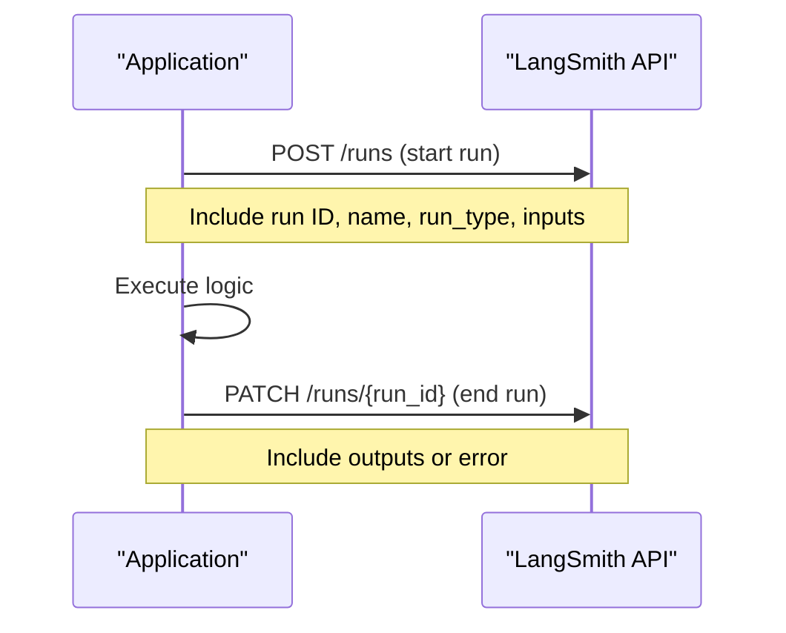

Basic usage involves two API calls:

1. **POST request** to create the run at the beginning of the function call
2. **PATCH request** to update the run with results at the end

Example REST API usage:

```python
import requests
import uuid
import datetime

run_id = str(uuid.uuid4())

# Start run
requests.post(
    "https://api.smith.langchain.com/runs",
    json={
        "id": run_id,
        "name": "MyRun",
        "run_type": "chain",
        "inputs": {"text": "input"},
        "start_time": datetime.datetime.utcnow().isoformat(),
    },
    headers={"x-api-key": "YOUR_API_KEY"},
)

# Execute logic

# End run
requests.patch(
    f"https://api.smith.langchain.com/runs/{run_id}",
    json={
        "outputs": {"result": "output"},
        "end_time": datetime.datetime.utcnow().isoformat(),
    },
    headers={"x-api-key": "YOUR_API_KEY"},
)
```

Special considerations apply when logging LLM runs for better visualization and token counting:

1. **Chat model format**:
   - Inputs: `{"messages": [{"role": "user", "content": "..."}]}`
   - Outputs: `{"choices": [{"message": {"role": "assistant", "content": "..."}}]}`

2. **Completion model format**:
   - Inputs: `{"prompt": "..."}`
   - Outputs: `{"choices": [{"text": "..."}]}`

Sources:
- [tracing-examples/rest/rest.ipynb:10-29]()
- [tracing-examples/rest/rest.ipynb:54-115]()
- [tracing-examples/rest/rest.ipynb:240-260]()

### Nesting Runs

To create hierarchical run trees, you need to specify parent-child relationships between runs.

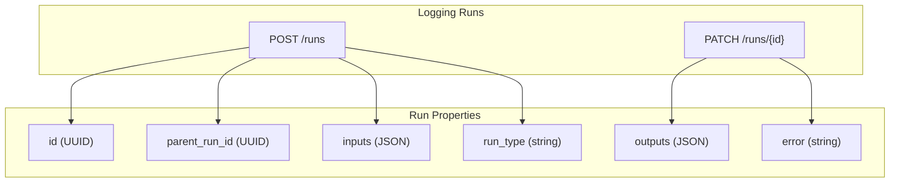

When using the REST API, include the `parent_run_id` in the JSON body of child runs:

```python
# Create parent run
parent_run_id = str(uuid.uuid4())
requests.post(
    "https://api.smith.langchain.com/runs",
    json={
        "id": parent_run_id,
        "name": "ParentRun",
        "run_type": "chain",
        "inputs": {"text": "input"},
        "start_time": datetime.datetime.utcnow().isoformat(),
    },
    headers={"x-api-key": "YOUR_API_KEY"},
)

# Create child run
child_run_id = str(uuid.uuid4())
requests.post(
    "https://api.smith.langchain.com/runs",
    json={
        "id": child_run_id,
        "name": "ChildRun",
        "run_type": "llm",
        "parent_run_id": parent_run_id,  # Link to parent
        "inputs": {"prompt": "Hello"},
        "start_time": datetime.datetime.utcnow().isoformat(),
    },
    headers={"x-api-key": "YOUR_API_KEY"},
)
```

When using the `@traceable` decorator, nesting happens automatically when decorated functions call each other.

Sources:
- [tracing-examples/rest/rest.ipynb:448-456]()
- [tracing-examples/rest/rest.ipynb:471-504]()
- [tracing-examples/nesting-tools/nest_runs_within_tools.ipynb:12-18]()

### Nested Tool Calls

For LangChain tools and agents, you need to propagate callbacks to ensure nested calls appear within the correct parent trace.

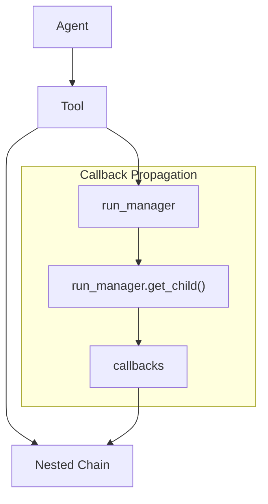

When implementing custom tools:

1. Accept `callbacks` or `run_manager` in your tool function
2. Use `run_manager.get_child()` to create child callbacks
3. Pass these callbacks to any nested chains or operations

Example with the `@tool` decorator:

```python
@tool
def summarize_tool(url: str, callbacks=None):
    """Summarize a website."""
    text = requests.get(url).text
    summary_chain = create_summary_chain()
    return summary_chain.invoke(
        {"text": text},
        {"callbacks": callbacks},  # Pass callbacks through
    )
```

Example when subclassing `BaseTool`:

```python
def _run(self, url: str, run_manager=None):
    """Use the tool."""
    text = requests.get(url).text
    callbacks = run_manager.get_child() if run_manager else None
    return self.summary_chain.invoke(
        {"text": text},
        {"callbacks": callbacks},  # Pass callbacks through
    )
```

Sources:
- [tracing-examples/nesting-tools/nest_runs_within_tools.ipynb:12-18]()
- [tracing-examples/nesting-tools/nest_runs_within_tools.ipynb:60-101]()
- [tracing-examples/nesting-tools/nest_runs_within_tools.ipynb:109-183]()

## Additional Features

### Run Naming

Custom run names improve readability and debugging by providing descriptive labels for each run.

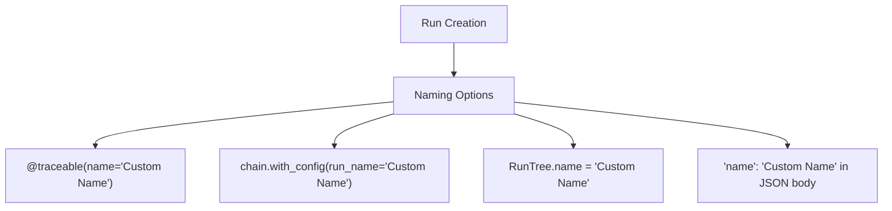

In Python with the `@traceable` decorator:

```python
@traceable(name="My Custom Run", run_type="chain")
def my_function():
    pass
```

With LangChain runnables:

```python
chain = (prompt | llm | output_parser).with_config(run_name="Custom Chain")
```

With the REST API:

```python
requests.post(
    "https://api.smith.langchain.com/runs",
    json={
        "id": run_id,
        "name": "Custom Name",  # Specify name here
        "run_type": "chain",
        # other fields
    },
    headers={"x-api-key": "YOUR_API_KEY"},
)
```

Sources:
- [tracing-examples/README.md:12]()
- [tracing-examples/traceable/tracing_without_langchain.ipynb:352-361]()
- [tracing-examples/nesting-tools/nest_runs_within_tools.ipynb:97]()

### Metadata and Tags

Adding metadata and tags helps organize and filter runs in the LangSmith UI.

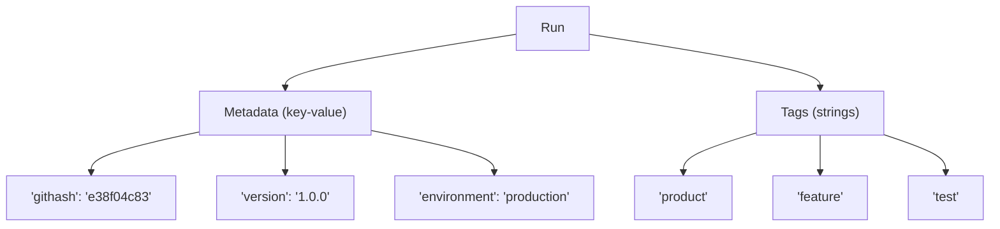

Example with the `@traceable` decorator:

```python
@traceable(
    run_type="chain",
    tags=["production", "feature-x"],
    metadata={"version": "1.0.0", "environment": "production"}
)
def my_function():
    pass
```

Example with the REST API:

```python
requests.post(
    "https://api.smith.langchain.com/runs",
    json={
        "id": run_id,
        "name": "MyRun",
        "run_type": "chain",
        "tags": ["production", "feature-x"],
        "extra": {
            "metadata": {"version": "1.0.0", "environment": "production"}
        },
        # other fields
    },
    headers={"x-api-key": "YOUR_API_KEY"},
)
```

Sources:
- [tracing-examples/traceable/tracing_without_langchain.ipynb:352-383]()
- [tracing-examples/rest/rest.ipynb:171-193]()
- [tracing-examples/rest/rest.ipynb:217-230]()

### Feedback Integration

You can associate user feedback with runs to track performance and improve your application.

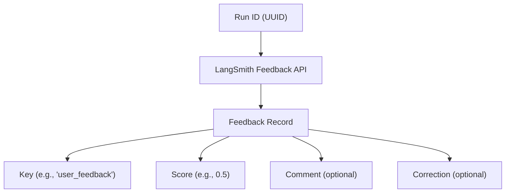

Example of logging feedback:

```python
from langsmith import Client

client = Client()

# Get run ID from a traceable function
result, run_id = my_traceable_function(input)

# Log feedback
client.create_feedback(
    run_id,
    "user_feedback",
    score=0.8,
    comment="Good response, but could be more concise",
    correction={"improved_response": "Better version here"}
)
```

Sources:
- [tracing-examples/traceable/tracing_without_langchain.ipynb:292-335]()
- [feedback-examples/README.md:7]()

## Integration with Continuous Integration

LangSmith tracing can be integrated into continuous integration workflows to monitor application behavior during testing.

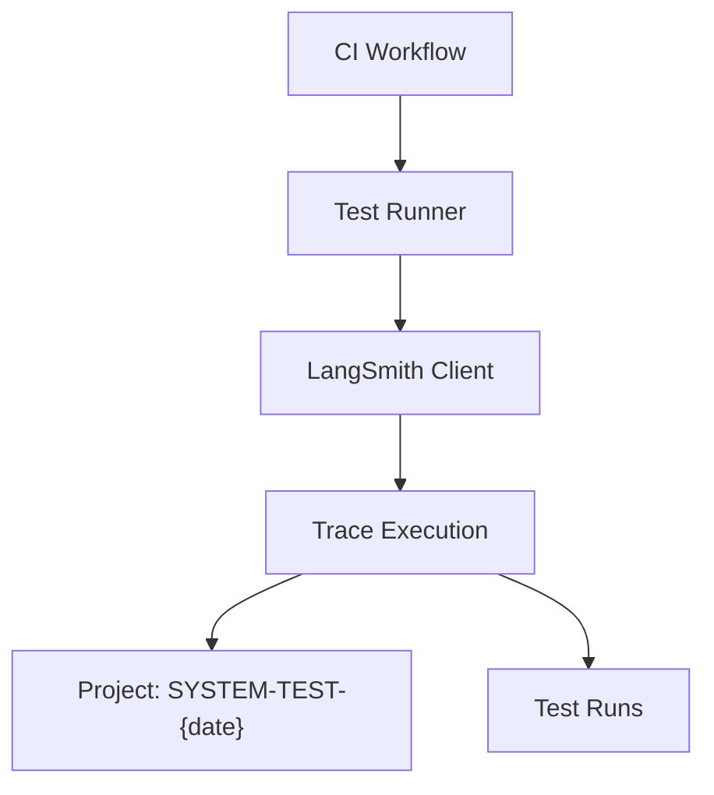

The GitHub workflow configuration illustrates this integration:

```yaml
- name: Test nbs
  working-directory: _scripts
  run: python test-cookbooks.py --api-key $LANGSMITH_API_KEY --hub-api-key $LANGCHAINHUB_API_KEY --hub-handle infra-guy --project SYSTEM-TEST-$(date +'%Y-%m-%d')
  env:
    LANGSMITH_API_KEY: ${{ secrets.LANGSMITH_API_KEY }}
    LANGCHAINHUB_API_KEY: ${{ secrets.LANGCHAINHUB_API_KEY }}
    OPENAI_API_KEY: ${{ secrets.OPENAI_API_KEY }}
    ANTHROPIC_API_KEY: ${{ secrets.ANTHROPIC_API_KEY }}
    PYDEVD_DISABLE_FILE_VALIDATION: 1
```

Sources:
- [.github/workflows/test-cookbooks.yml:21-29]()
- [_scripts/test-cookbooks.py:154]()

## Conclusion

LangSmith's tracing capabilities provide powerful tools for logging, visualizing, and debugging LLM application execution. By using the `@traceable` decorator, REST API, or other integration methods, you can gain valuable insights into your application's behavior and performance.

The tracing system works with any LLM application, regardless of whether it uses LangChain or other frameworks, making it a versatile tool for development and monitoring.

---

# Page: @traceable Decorator

# @traceable Decorator

<details>
<summary>Relevant source files</summary>

The following files were used as context for generating this wiki page:

- [testing-examples/dynamic-data/testing_dynamic_data.ipynb](testing-examples/dynamic-data/testing_dynamic_data.ipynb)
- [tracing-examples/rest/rest.ipynb](tracing-examples/rest/rest.ipynb)
- [tracing-examples/runnable-naming/run-naming.ipynb](tracing-examples/runnable-naming/run-naming.ipynb)
- [tracing-examples/traceable/tracing_without_langchain.ipynb](tracing-examples/traceable/tracing_without_langchain.ipynb)

</details>


The `@traceable` decorator is a core component of the LangSmith platform that allows you to instrument any LLM application, independent of LangChain. It provides debugging, evaluation, and monitoring capabilities by creating structured logs of function calls in your application, which are then visualized in the LangSmith platform.

For other tracing methods in LangSmith, see [REST API](#2.2) for HTTP-based tracing or [Run Naming and Nested Calls](#2.3) for customizing run names and managing complex traces.

## How It Works

The `@traceable` decorator creates a run tree for each function invocation. It captures function inputs, execution details, outputs or errors, and sends this information to LangSmith for visualization and analysis.

### Tracing Flow Diagram

```mermaid
flowchart TD
    FuncCall["Function Call with @traceable"] --> CreateRun["Create Run"]
    CreateRun --> LogInputs["Log Inputs to LangSmith"]
    LogInputs --> ExecFunc["Execute Function"]
    ExecFunc --> CheckResult["Check Result"]
    CheckResult -- "Success" --> LogOutputs["Log Outputs to LangSmith"]
    CheckResult -- "Error" --> LogError["Log Error to LangSmith"]
    LogOutputs --> EndRun["End Run"]
    LogError --> EndRun
```

Sources: [tracing-examples/traceable/tracing_without_langchain.ipynb:86-91]()

## Basic Usage

To use the `@traceable` decorator, import it from the `langsmith.run_helpers` module and apply it to any function you want to trace:

```python
from langsmith.run_helpers import traceable

@traceable(run_type="chain")
def my_function(input_data):
    # Function implementation
    return result
```

The `run_type` parameter specifies the type of run, with common values being:

- `"chain"`: For general-purpose functions
- `"llm"`: For LLM or chat model calls
- `"retriever"`: For retrieval operations
- `"tool"`: For tool invocations

Sources: [tracing-examples/traceable/tracing_without_langchain.ipynb:102-123](), [tracing-examples/traceable/tracing_without_langchain.ipynb:124-140]()

### Example Run Tree

Here's how a sample application's run tree might look when multiple traced functions are called:

```mermaid
graph TD
    AC["argument_chain\n(run_type: chain)"] --> AG["argument_generator\n(run_type: chain)"]
    AC --> C["critic\n(run_type: chain)"]
    AC --> R["refiner\n(run_type: chain)"]
    AG --> CO1["call_openai\n(run_type: llm)"]
    C --> CO2["call_openai\n(run_type: llm)"]
    R --> CO3["call_openai\n(run_type: llm)"]
```

Sources: [tracing-examples/traceable/tracing_without_langchain.ipynb:189-193]()

## Advanced Features

### Accessing the Run Tree Object

You can access the run tree inside a traced function by adding a `run_tree` parameter to the function signature:

```python
@traceable(run_type="chain")
def my_function(input_data, *, run_tree):
    # Use the run tree
    run_id = run_tree.id
    # Function implementation
    return result, run_id
```

This allows you to:
- Access the run ID for later reference
- Create feedback associated with the run
- Pass the run ID to other systems or processes

Sources: [tracing-examples/traceable/tracing_without_langchain.ipynb:262-268]()

### Adding User Feedback

With the run ID, you can add user feedback to a run after it's completed:

```python
from langsmith import Client

client = Client()
client.create_feedback(
    run_id,
    "user_feedback",
    score=0.5,
    correction={"generation": "Better response"}
)
```

Sources: [tracing-examples/traceable/tracing_without_langchain.ipynb:311-317](), [tracing-examples/traceable/tracing_without_langchain.ipynb:329-335]()

### Configuration Options

The `@traceable` decorator supports various configuration options to customize how your functions are traced:

```mermaid
flowchart TD
    Traceable["@traceable"] --> DecConfig["Decorator Configuration"]
    Traceable --> RunConfig["Runtime Configuration"]
    
    DecConfig --> RunType["run_type\n(chain, llm, etc.)"]
    DecConfig --> Name["name\n(custom run name)"]
    DecConfig --> DecTags["tags\n(for filtering)"]
    DecConfig --> DecMeta["metadata\n(key-value pairs)"]
    
    RunConfig --> LSExtra["langsmith_extra parameter"]
    LSExtra --> RTTags["tags"]
    LSExtra --> RTMeta["metadata"]
    LSExtra --> RTID["run_id"]
```

Sources: [tracing-examples/traceable/tracing_without_langchain.ipynb:374-383](), [tracing-examples/traceable/tracing_without_langchain.ipynb:411-422]()

#### Decorator Configuration

You can configure the decorator when you define it:

```python
@traceable(
    run_type="chain",
    name="My Custom Run Name",
    tags=["production", "v1.0"],
    metadata={"model": "gpt-4", "temperature": 0.7}
)
def my_function(input_data):
    # Function implementation
    return result
```

Sources: [tracing-examples/traceable/tracing_without_langchain.ipynb:374-383]()

#### Runtime Configuration

You can also configure tracing at runtime using the `langsmith_extra` parameter:

```python
result = my_function(
    input_data,
    langsmith_extra={
        "tags": ["experimental"],
        "metadata": {"user_id": "12345"},
        "run_id": specific_uuid  # Manually specify the run ID
    }
)
```

Sources: [tracing-examples/traceable/tracing_without_langchain.ipynb:411-422]()

## Example: Tracing a Multi-Function Application

Here's a complete example of tracing a multi-function argument generation application:

```python
from langsmith.run_helpers import traceable
from openai import OpenAI

openai_client = OpenAI()

@traceable(run_type="llm")
def call_openai(messages, model="gpt-3.5-turbo", temperature=0.0):
    return openai_client.chat.completions.create(
        model=model,
        messages=messages,
        temperature=temperature,
    )

@traceable(run_type="chain")
def argument_generator(query, additional_description=""):
    return (
        call_openai([
            {"role": "system", "content": f"You are a debater making an argument on a topic.{additional_description}"},
            {"role": "user", "content": f"The discussion topic is {query}"},
        ])
        .choices[0]
        .message.content
    )

@traceable(run_type="chain")
def critic(argument):
    return (
        call_openai([
            {"role": "system", "content": "You are a critic. What criticism do you have?"},
            {"role": "system", "content": argument},
        ])
        .choices[0]
        .message.content
    )

@traceable(run_type="chain")
def argument_chain(query, additional_description=""):
    argument = argument_generator(query, additional_description)
    criticism = critic(argument)
    return refiner(query, additional_description, argument, criticism)
```

Sources: [tracing-examples/traceable/tracing_without_langchain.ipynb:102-194]()

## Best Practices

1. **Use descriptive run names**: Choose names that clearly describe the function's purpose.
2. **Add tags for filtering**: Use tags to categorize runs based on environment, version, or other relevant criteria.
3. **Include relevant metadata**: Add metadata that provides context for the run.
4. **Create a clean hierarchy**: Structure your code so the run tree forms a clean hierarchy that mirrors your application's logical flow.
5. **Store run IDs when needed**: If you need to reference the run later, store its ID at the time of creation.
6. **Add user feedback**: Collect and associate user feedback with runs to measure and improve quality.

Sources: [tracing-examples/traceable/tracing_without_langchain.ipynb:361-367](), [tracing-examples/traceable/tracing_without_langchain.ipynb:374-383]()

## Use Cases

The `@traceable` decorator is valuable in various scenarios:

1. **Debugging**: Trace function calls to identify where errors occur.
2. **Performance monitoring**: Monitor execution time of different parts of your application.
3. **Quality assurance**: Collect user feedback on generated content.
4. **A/B testing**: Compare different versions of your application with version tags.
5. **Auditing**: Keep a record of all LLM interactions for compliance or review.

Sources: [tracing-examples/traceable/tracing_without_langchain.ipynb:12-32]()

## Conclusion

The `@traceable` decorator provides a simple yet powerful way to instrument your LLM applications without requiring you to adopt any particular framework. By adding it to your functions, you can gain valuable insights into how your application behaves and identify areas for improvement. The decorator automatically creates and manages run trees, logs inputs and outputs, and sends this information to LangSmith for visualization and analysis.

---

# Page: REST API

# REST API

<details>
<summary>Relevant source files</summary>

The following files were used as context for generating this wiki page:

- [README.md](README.md)
- [testing-examples/README.md](testing-examples/README.md)
- [tracing-examples/rest/rest.ipynb](tracing-examples/rest/rest.ipynb)
- [tracing-examples/traceable/tracing_without_langchain.ipynb](tracing-examples/traceable/tracing_without_langchain.ipynb)

</details>


The LangSmith REST API provides a language-agnostic way to instrument and monitor your LLM applications by logging runs to the LangSmith platform. This page explains how to use the REST API to log and trace function execution, chat model interactions, and nested operations in your applications without requiring the Python or JavaScript SDKs. For information about using the `@traceable` decorator for Python applications, see [@traceable Decorator](#2.1).

## Overview

LangSmith tracing is built on "runs," which are analogous to traces and spans in OpenTelemetry. Each run represents a unit of work (such as a function call) with associated inputs, outputs, metadata, and timing information. The REST API allows you to create, update, and organize these runs to build comprehensive traces of your application's execution flow.

```mermaid
graph TD
    subgraph "LangSmith Tracing System"
        API["REST API"]
        Decorator["@traceable Decorator"]
        RunTree["RunTree Object"]
        
        LangSmith[("LangSmith Platform")]
        
        API -->|"POST /runs"| LangSmith
        API -->|"PATCH /runs/{id}"| LangSmith
        Decorator --> RunTree
        RunTree --> LangSmith
    end
    
    subgraph "Client Applications"
        PythonApp["Python Application"]
        JSApp["JavaScript Application"]
        OtherApp["Other Language Application"]
        
        PythonApp --> Decorator
        JSApp --> Decorator
        OtherApp --> API
    end
```

Sources: [tracing-examples/rest/rest.ipynb:9-31]()

## Basic Workflow

The basic workflow for logging runs via the REST API involves:

1. Creating a run at the start of the operation with a POST request
2. Updating the run at the end of the operation with a PATCH request

This two-step approach ensures that runs appear in LangSmith in a timely manner, even for long-running operations.

```mermaid
sequenceDiagram
    participant Client as "Client Application"
    participant API as "LangSmith API"
    participant DB as "LangSmith Platform"
    
    Client->>API: POST /runs (id, name, run_type, inputs, start_time)
    API->>DB: Create Run
    DB-->>API: Run Created
    API-->>Client: 200 OK
    
    Note over Client: Execute operation...
    
    Client->>API: PATCH /runs/{id} (outputs, end_time)
    API->>DB: Update Run
    DB-->>API: Run Updated
    API-->>Client: 200 OK
```

Sources: [tracing-examples/rest/rest.ipynb:49-116]()

## Authentication

All requests to the LangSmith API require authentication using an API key. The key is passed in the `x-api-key` HTTP header.

```
headers={"x-api-key": "your_langsmith_api_key"}
```

Sources: [tracing-examples/rest/rest.ipynb:92-104]()

## Creating and Updating Runs

### Creating a Run

To create a run, send a POST request to the `/runs` endpoint with the following required fields:

| Field    | Type   | Description                                    |
|----------|--------|------------------------------------------------|
| name     | string | Descriptive name for the run                   |
| run_type | string | Type of run (e.g., "chain", "llm")             |
| inputs   | object | Input values provided to the operation         |

Additional optional fields include:

| Field              | Type           | Description                                      |
|--------------------|----------------|--------------------------------------------------|
| id                 | string (UUID)  | Custom ID for the run (auto-generated if not provided) |
| start_time         | string (ISO)   | UTC timestamp when the run started               |
| end_time           | string (ISO)   | UTC timestamp when the run completed             |
| outputs            | object         | Output values produced by the operation          |
| error              | string         | Error message if the run failed                  |
| parent_run_id      | string (UUID)  | ID of the parent run (for nested runs)           |
| tags               | array[string]  | Tags for filtering and organization              |
| extra              | object         | Additional metadata about the run                |
| events             | array[object]  | Events that occurred during the run              |
| session_name       | string         | The project name (defaults to "default")         |

Sources: [tracing-examples/rest/rest.ipynb:131-155]()

### Updating a Run

To update a run, send a PATCH request to the `/runs/{run_id}` endpoint with fields to update, which typically include:

| Field      | Type           | Description                                 |
|------------|----------------|---------------------------------------------|
| outputs    | object         | Output values produced by the operation     |
| end_time   | string (ISO)   | UTC timestamp when the run completed        |
| error      | string         | Error message if the run failed             |
| events     | array[object]  | Events that occurred during the run         |

Sources: [tracing-examples/rest/rest.ipynb:107-115]()

## Run Types and Formatting

### Chain Runs

Chain runs are versatile and can represent any function or operation in your application. They are the most common run type.

```json
{
  "id": "550e8400-e29b-41d4-a716-446655440000",
  "name": "MyChainRun",
  "run_type": "chain",
  "inputs": {"text": "Example input"},
  "start_time": "2023-04-12T12:00:00Z",
  "tags": ["example", "chain-run"],
  "extra": {
    "metadata": {"version": "1.0.0"}
  }
}
```

Sources: [tracing-examples/rest/rest.ipynb:162-208]()

### LLM Runs

LLM runs have special formatting that enables LangSmith to track token usage and render chat or completion messages in a more readable format.

#### Chat Model Format

For chat models, use the following format:

```json
{
  "inputs": {
    "messages": [{"role": "user", "content": "What's the weather in SF?"}],
    "model": "gpt-4",
    "temperature": 0.0
  },
  "outputs": {
    "choices": [{
      "message": {
        "role": "assistant",
        "content": "The weather in San Francisco is currently foggy."
      },
      "finish_reason": "stop"
    }]
  }
}
```

For function calling, you can include `functions` in the inputs and `function_call` in the response message:

Sources: [tracing-examples/rest/rest.ipynb:284-349]()

#### Completion Model Format

For completion models, use this format:

```json
{
  "inputs": {
    "prompt": "Tell me a fact about space",
    "engine": "text-davinci-003",
    "temperature": 0.0
  },
  "outputs": {
    "choices": [{
      "text": "Space is completely silent because there is no air to carry sound waves.",
      "index": 0,
      "finish_reason": "stop"
    }]
  }
}
```

Sources: [tracing-examples/rest/rest.ipynb:396-430]()

## Working with Nested Runs

For complex applications, you can create hierarchical traces by nesting runs. To create a child run, include the `parent_run_id` field in your POST request.

```mermaid
graph TD
    ParentRun["Parent Run (Chain)"] --> ChildRun1["Child Run 1 (Chain)"]
    ParentRun --> ChildRun2["Child Run 2 (LLM)"]
    ChildRun1 --> GrandchildRun1["Grandchild Run 1 (LLM)"]
    ChildRun1 --> GrandchildRun2["Grandchild Run 2 (LLM)"]
```

### Example: Creating a Child Run

```json
{
  "id": "child-run-id",
  "name": "ChildOperation",
  "run_type": "chain",
  "parent_run_id": "parent-run-id",
  "inputs": {"parameter": "value"},
  "start_time": "2023-04-12T12:01:00Z"
}
```

Sources: [tracing-examples/rest/rest.ipynb:450-540]()

## Helper Classes

You can simplify integration by creating helper classes to manage the REST API interactions. Here's an example `RunLogger` class that handles run creation and updates:

```python
class RunLogger:
    def post_run(self, data: dict, name: str, run_id: str, parent_run_id: Optional[str] = None) -> None:
        requests.post(
            "https://api.smith.langchain.com/runs",
            json={
                "id": run_id,
                "name": name,
                "run_type": "chain",
                "parent_run_id": parent_run_id,
                "inputs": data,
                "start_time": datetime.datetime.utcnow().isoformat(),
                "session_name": project_name,
            },
            headers={"x-api-key": api_key},
        )

    def patch_run(self, run_id: str, output: Optional[dict] = None, error: Optional[str] = None) -> None:
        requests.patch(
            f"https://api.smith.langchain.com/runs/{run_id}",
            json={
                "error": error,
                "outputs": output,
                "end_time": datetime.datetime.utcnow().isoformat(),
            },
            headers={"x-api-key": api_key},
        )
```

Sources: [tracing-examples/rest/rest.ipynb:471-500]()

## Single Request Option

If you want to reduce the number of requests to LangSmith, you can log runs in a single POST request by including the outputs, error, and end_time fields in the initial request:

```json
{
  "name": "CompletedRun",
  "run_type": "chain",
  "inputs": {"parameter": "value"},
  "outputs": {"result": "output value"},
  "start_time": "2023-04-12T12:00:00Z",
  "end_time": "2023-04-12T12:00:01Z"
}
```

This approach is simpler but doesn't provide real-time visibility for long-running operations.

Sources: [tracing-examples/rest/rest.ipynb:631-682]()

## Best Practices

1. **Use meaningful run names**: Choose descriptive names that help identify what each run represents.

2. **Add tags and metadata**: Include tags and metadata to make it easier to filter and search for runs in the LangSmith UI.

3. **Handle errors properly**: When an operation fails, update the run with the error message to make debugging easier.

4. **Use run types appropriately**: Use "chain" for general operations and "llm" specifically for LLM interactions to leverage LangSmith's specialized visualizations.

5. **Consider latency requirements**: Use the two-request approach for real-time visibility on long-running operations, or the single-request approach for simpler, shorter operations.

Sources: [tracing-examples/rest/rest.ipynb:690-695]()

## Integration Example: Recursive Function

This example demonstrates how to trace a recursive function (fibonacci) using the REST API:

```mermaid
graph TD
    subgraph "Fibonacci(5) Trace"
        Fib5["fibonacci(5)"] --> Fib4["fibonacci(4)"]
        Fib5 --> Fib3a["fibonacci(3)"]
        
        Fib4 --> Fib3b["fibonacci(3)"]
        Fib4 --> Fib2a["fibonacci(2)"]
        
        Fib3a --> Fib2b["fibonacci(2)"]
        Fib3a --> Fib1a["fibonacci(1)"]
        
        Fib3b --> Fib2c["fibonacci(2)"]
        Fib3b --> Fib1b["fibonacci(1)"]
        
        Fib2a --> Fib1c["fibonacci(1)"]
        Fib2a --> Fib0a["fibonacci(0)"]
        
        Fib2b --> Fib1d["fibonacci(1)"]
        Fib2b --> Fib0b["fibonacci(0)"]
        
        Fib2c --> Fib1e["fibonacci(1)"]
        Fib2c --> Fib0c["fibonacci(0)"]
    end
```

Each function call is traced as a run, with parent-child relationships maintained through the `parent_run_id` field. The resulting trace provides a complete visualization of the recursive execution flow, making it easier to debug complex operations.

Sources: [tracing-examples/rest/rest.ipynb:508-575]()

## Conclusion

The LangSmith REST API provides a flexible, language-agnostic way to instrument your LLM applications for monitoring, debugging, and evaluation. By following the patterns outlined in this guide, you can create comprehensive traces of your application's execution, whether you're working with simple chains, LLM interactions, or complex nested operations.

Sources: [tracing-examples/rest/rest.ipynb:690-695]()

---

# Page: Run Naming and Nested Calls

# Run Naming and Nested Calls

<details>
<summary>Relevant source files</summary>

The following files were used as context for generating this wiki page:

- [.github/workflows/test-cookbooks.yml](.github/workflows/test-cookbooks.yml)
- [_scripts/requirements.txt](_scripts/requirements.txt)
- [_scripts/test-cookbooks.py](_scripts/test-cookbooks.py)
- [testing-examples/dynamic-data/testing_dynamic_data.ipynb](testing-examples/dynamic-data/testing_dynamic_data.ipynb)
- [tracing-examples/nesting-tools/nest_runs_within_tools.ipynb](tracing-examples/nesting-tools/nest_runs_within_tools.ipynb)
- [tracing-examples/runnable-naming/run-naming.ipynb](tracing-examples/runnable-naming/run-naming.ipynb)

</details>


This page explains how to customize run names and properly structure nested calls within LangSmith traces. Run names help you identify and query specific components in your traces, while properly nested calls ensure that your trace hierarchy reflects the actual execution flow of your application.

## Overview of Run Naming and Nested Calls

In LangSmith, every traced run receives a name that identifies it in the UI and can be used to query specific runs. By default, most components receive automatically generated names, but you can customize these names for greater clarity.

Additionally, when your application contains nested components (like an agent calling a tool that uses an LLM), proper callback propagation ensures these appear as a hierarchical trace rather than separate, disconnected traces.

```mermaid
graph TD
    subgraph "LangSmith Tracing System"
        RunNaming["Run Naming"] -->|identifies| Runs["Individual Runs"]
        NestedCalls["Nested Calls"] -->|structures| TraceHierarchy["Trace Hierarchy"]
        
        Runs -->|are part of| TraceHierarchy
        CustomNames["Custom Names"] -->|improves| Debugging["Debugging Visibility"]
        ProperNesting["Proper Callback Propagation"] -->|ensures| AccurateTraces["Accurate Trace Structure"]
    end
```

Sources: [tracing-examples/runnable-naming/run-naming.ipynb:8-17](), [tracing-examples/nesting-tools/nest_runs_within_tools.ipynb:9-18]()

## Run Naming

### Default Naming Behavior

By default, LangSmith assigns names to runs based on the class name of the invoked object. For example, a chain created from a `RunnableSequence` class will be named "RunnableSequence" in the trace.

### Customizing Run Names

To customize the name of a run, use the `with_config()` method with the `run_name` parameter:

```mermaid
graph LR
    subgraph "Run Naming Process"
        Runnable["Runnable Object"] -->|"with_config({\"run_name\": \"Custom Name\"})"| NamedRunnable["Named Runnable"]
        NamedRunnable -->|invoke/run| Trace["Trace with Custom Name"]
    end
```

Sources: [tracing-examples/runnable-naming/run-naming.ipynb:11-16]()

#### Supported Components

Not all components support custom naming. Currently, only these types support it:
- Chains
- General runnables
- RunnableLambdas

Components that don't support custom naming include:
- LLMs
- Chat models
- Prompts
- Retrievers

Sources: [tracing-examples/runnable-naming/run-naming.ipynb:15-16]()

### Examples of Run Naming

#### Simple Chain Example

```mermaid
graph TD
    subgraph "Simple Chain Naming"
        PromptTemplate["PromptTemplate"] -->|pipe| ChatModel["ChatOpenAI"]
        ChatModel -->|"with_config({\"run_name\": \"StringReverse\"})"| NamedChain["Named Chain"]
        NamedChain -->|invoke| Trace["Trace with name 'StringReverse'"]
    end
```

This example demonstrates how to customize the name of a simple chain that reverses a string. The chain itself receives the custom name "StringReverse".

Sources: [tracing-examples/runnable-naming/run-naming.ipynb:98-110]()

#### Runnable Lambda Example

For functions wrapped as RunnableLambdas, the default name is the function name, but you can customize it with `with_config`:

```mermaid
graph TD
    subgraph "RunnableLambda Naming"
        Function["reverse_and_concat()"] -->|wrapped as| RunnableLambda["RunnableLambda"]
        RunnableLambda -->|default name| DefaultTrace["Trace with name 'reverse_and_concat'"]
        RunnableLambda -->|"with_config({\"run_name\": \"LambdaReverse\"})"| CustomNamedLambda["Custom Named Lambda"]
        CustomNamedLambda -->|invoke| CustomTrace["Trace with name 'LambdaReverse'"]
    end
```

Sources: [tracing-examples/runnable-naming/run-naming.ipynb:176-179](), [tracing-examples/runnable-naming/run-naming.ipynb:278-285]()

#### Agent Example

Agent executors can also be given custom names:

```mermaid
graph TD
    subgraph "Agent Naming"
        Agent["Agent Executor"] -->|"with_config({\"run_name\": \"File Agent\"})"| NamedAgent["Named Agent"]
        NamedAgent -->|invoke| Trace["Trace with name 'File Agent'"]
    end
```

Sources: [tracing-examples/runnable-naming/run-naming.ipynb:399-404]()

## Nested Calls

When your application contains nested components (for example, a tool that calls an LLM), you need to ensure proper callback propagation to maintain the hierarchical structure of your traces.

### The Problem of Disconnected Traces

Without proper callback propagation, nested calls appear as separate, disconnected traces in LangSmith rather than as children of their parent run.

```mermaid
graph TD
    subgraph "Disconnected vs. Nested Traces"
        subgraph "Improper Callback Propagation"
            AgentRun1["AgentExecutor Run"] 
            ToolRun1["Tool Run"]
            LLMRun1["LLM Run"]
            
            AgentRun1 -.->|"no parent-child relationship"| ToolRun1
            ToolRun1 -.->|"no parent-child relationship"| LLMRun1
        end
        
        subgraph "Proper Callback Propagation"
            AgentRun2["AgentExecutor Run"]
            ToolRun2["Tool Run"]
            LLMRun2["LLM Run"]
            
            AgentRun2 -->|parent-child| ToolRun2
            ToolRun2 -->|parent-child| LLMRun2
        end
    end
```

Sources: [tracing-examples/nesting-tools/nest_runs_within_tools.ipynb:12-18]()

### Implementation Approaches

#### Using the @tool Decorator

When using the `@tool` decorator, include a `callbacks` parameter in your function and pass it to any nested components:

```mermaid
graph TD
    subgraph "@tool Decorator Approach"
        ToolFunction["@tool function(callbacks=None)"] -->|"includes callbacks parameter"| NestedChain["summary_chain.invoke()"]
        NestedChain -->|"passes {\"callbacks\": callbacks}"| ProperTrace["Properly Nested Trace"]
    end
```

Sources: [tracing-examples/nesting-tools/nest_runs_within_tools.ipynb:87-101]()

#### Subclassing BaseTool

When subclassing `BaseTool`, use the `run_manager` parameter in your `_run` method:

```mermaid
graph TD
    subgraph "BaseTool Subclass Approach"
        BaseTool["CustomSummarizer class"] -->|"_run(run_manager=None)"| GetCallbacks["callbacks = run_manager.get_child()"]
        GetCallbacks -->|"passes {\"callbacks\": callbacks}"| NestedChain["summary_chain.invoke()"]
        NestedChain --> ProperTrace["Properly Nested Trace"]
    end
```

Sources: [tracing-examples/nesting-tools/nest_runs_within_tools.ipynb:151-182]()

## Practical Application

### Querying Runs by Name

Custom run names make it easy to query for specific runs using the LangSmith client:

```
client.list_runs(project_name="your_project", filter='eq(name, "StringReverse")')
```

This is particularly useful when you want to analyze the performance of specific components across multiple executions.

Sources: [tracing-examples/runnable-naming/run-naming.ipynb:166]()

### Complete Trace Example

When properly implemented, a trace with nested calls will show a hierarchical structure:

```mermaid
graph TD
    subgraph "Complete Trace Example"
        AgentRun["Agent Run"] -->|parent-child| PromptRun["Prompt Run"]
        AgentRun -->|parent-child| LLMRun["LLM Run"]
        AgentRun -->|parent-child| ToolRun["Tool Run (summary_tool)"]
        ToolRun -->|parent-child| SummaryChainRun["Summarize Text Run"]
        SummaryChainRun -->|parent-child| NestedPromptRun["Nested Prompt Run"]
        SummaryChainRun -->|parent-child| NestedLLMRun["Nested LLM Run"]
    end
```

Sources: [tracing-examples/nesting-tools/nest_runs_within_tools.ipynb:297-299]()

## Best Practices

1. **Use meaningful run names** to make traces more intelligible at a glance
2. **Always propagate callbacks** when implementing custom tools or components
3. **Check trace structure** in the LangSmith UI to ensure proper nesting
4. **Use run names for filtering** when analyzing run performance
5. **Apply naming conventions** consistently across your application for easier tracking

## Troubleshooting

If you notice that your traces are not properly nested, check that:

1. Your custom tool correctly accepts and passes the `callbacks` parameter
2. When subclassing `BaseTool`, you're using `run_manager.get_child()` to obtain the child callbacks
3. LangChain version is up-to-date (naming behavior may vary in older versions)

Sources: [tracing-examples/nesting-tools/nest_runs_within_tools.ipynb:310-314]()

---

# Page: Testing & Evaluation

# Testing & Evaluation

<details>
<summary>Relevant source files</summary>

The following files were used as context for generating this wiki page:

- [README.md](README.md)
- [feedback-examples/algorithmic-feedback/algorithmic_feedback.ipynb](feedback-examples/algorithmic-feedback/algorithmic_feedback.ipynb)
- [introduction/langsmith_introduction.ipynb](introduction/langsmith_introduction.ipynb)
- [introduction/online_evaluation.ipynb](introduction/online_evaluation.ipynb)
- [introduction/summarization.ipynb](introduction/summarization.ipynb)
- [testing-examples/README.md](testing-examples/README.md)
- [testing-examples/comparing-runs/comparing-qa.ipynb](testing-examples/comparing-runs/comparing-qa.ipynb)
- [testing-examples/qa-correctness/qa-correctness.ipynb](testing-examples/qa-correctness/qa-correctness.ipynb)
- [testing-examples/rag_eval/online_eval.ipynb](testing-examples/rag_eval/online_eval.ipynb)
- [testing-examples/rag_eval/rag.ipynb](testing-examples/rag_eval/rag.ipynb)

</details>


Testing and evaluation are critical components of developing robust LLM-powered applications. LangSmith provides comprehensive tools for benchmarking, debugging, and improving your LLM systems across various use cases including RAG (Retrieval Augmented Generation), agents, chatbots, and more. This page covers the core testing and evaluation capabilities in LangSmith and how to implement effective evaluation pipelines.

For information about feedback collection, see [Feedback Collection](#4). For running specific evaluation types like RAG evaluations, see [RAG Evaluation](#3.1).

## Core Concepts

Testing and evaluation in LangSmith involves several key components:

1. **Datasets** - Collections of examples (inputs/outputs) used for benchmarking
2. **Evaluators** - Components that assess output quality based on specific criteria
3. **Testing Methods** - Approaches for running evaluations (synchronous or asynchronous)
4. **Evaluation Types** - Specialized evaluations for different LLM applications (RAG, agents, etc.)

```mermaid
flowchart TD
    A["LangSmith Testing & Evaluation"] --> B["Dataset Creation"]
    A --> C["Evaluator Definition"]
    A --> D["Test Execution"]
    A --> E["Results Analysis"]
    
    B --> B1["Manual Examples"]
    B --> B2["API-Generated Examples"]
    B --> B3["Production Trace Examples"]
    
    C --> C1["Correctness Evaluators"]
    C --> C2["Relevance Evaluators"]
    C --> C3["Faithfulness Evaluators"]
    C --> C4["Custom Evaluators"]
    
    D --> D1["Synchronous Testing"]
    D --> D2["Asynchronous Testing"]
    
    E --> E1["Metrics Dashboard"]
    E --> E2["Failure Analysis"]
    E --> E3["Comparison of Models"]
```

Sources: [README.md:16-71](), [testing-examples/README.md:1-40]()

## Evaluation Architecture

LangSmith supports two primary evaluation approaches:

### 1. Synchronous Evaluation

The `client.run_on_dataset()` method executes a chain or model against a dataset and records the results. This is the most common approach for offline testing.

```mermaid
sequenceDiagram
    participant User
    participant Client as "LangSmith Client"
    participant Dataset as "LangSmith Dataset"
    participant Chain as "LLM Chain/Model"
    participant Evaluator as "Evaluators"
    participant Project as "Test Project"
    
    User->>Client: client.run_on_dataset(chain, dataset_name)
    Client->>Dataset: Fetch examples
    loop For each example
        Client->>Chain: Run example input
        Chain-->>Client: Return output
        Client->>Evaluator: Evaluate output
        Evaluator-->>Client: Return metrics
        Client->>Project: Log run with metrics
    end
    Client-->>User: Return evaluation results
```

Example usage:

```python
from langsmith import Client

client = Client()
results = client.run_on_dataset(
    dataset_name="My Test Dataset",
    llm_or_chain=my_chain,
    evaluation=my_evaluators,
    project_name="My Test Project"
)
```

### 2. Asynchronous Evaluation

Using the `EvaluatorCallbackHandler` to evaluate outputs in real-time as they're generated:

```mermaid
flowchart LR
    A["Application"] --> B["EvaluatorCallbackHandler"]
    B --> C["Run Trace"]
    B --> D["Evaluators"]
    D --> E["Feedback"]
    E --> C
```

Sources: [README.md:31-35](), [feedback-examples/algorithmic-feedback/algorithmic_feedback.ipynb:7-27]()

## Creating Datasets for Evaluation

LangSmith datasets are collections of examples used to test your models and chains. There are several ways to create datasets:

1. Manually via the LangSmith UI
2. Programmatically via the client API
3. By converting existing traces/runs

```python
from langsmith import Client

client = Client()
dataset = client.create_dataset("RAG Test Dataset")

# Add examples to the dataset
for question, answer in examples:
    client.create_example(
        inputs={"question": question},
        outputs={"answer": answer},
        dataset_id=dataset.id
    )
```

Sources: [testing-examples/qa-correctness/qa-correctness.ipynb:85-103](), [testing-examples/comparing-runs/comparing-qa.ipynb:118-159]()

## Evaluation Types

LangSmith supports various evaluation types tailored to different LLM applications:

```mermaid
graph TD
    A["LangSmith Evaluators"] --> B["RAG Evaluators"]
    A --> C["Agent Evaluators"]
    A --> D["Chatbot Evaluators"]
    A --> E["Extraction Evaluators"]
    A --> F["Multimodal Evaluators"]
    A --> G["Custom Evaluators"]
    
    B --> B1["Correctness"]
    B --> B2["Faithfulness"]
    B --> B3["Relevance"]
    B --> B4["Context Utilization"]
    
    C --> C1["Step Trajectory"]
    C --> C2["Tool Selection"]
    C --> C3["Reasoning Quality"]
    
    D --> D1["Response Quality"]
    D --> D2["User Simulation"]
    
    E --> E1["Data Extraction Accuracy"]
    E --> E2["Schema Adherence"]
    
    F --> F1["Image Understanding"]
    F --> F2["Multimodal Reasoning"]
    
    G --> G1["Custom Criteria"]
    G --> G2["Model-Based Metrics"]
```

Sources: [README.md:36-74](), [testing-examples/README.md:8-33]()

### RAG Evaluation

RAG systems combine retrieval with generation and require specialized evaluation approaches that measure both components:

```mermaid
flowchart LR
    subgraph "RAG Evaluation Types"
        A["Response vs Reference"] --- A1["Correctness"]
        B["Response vs Input"] --- B1["Relevance"]
        C["Response vs Retrieved Docs"] --- C1["Faithfulness"]
        D["Retrieved Docs vs Input"] --- D1["Retrieval Quality"]
    end
```

LangSmith can evaluate four critical aspects of RAG systems:

1. **Response vs. reference answer**: How correct is the answer compared to ground truth?
2. **Response vs. input**: How relevant is the response to the query?
3. **Response vs. retrieved docs**: How faithful is the response to the retrieved context?
4. **Retrieved docs vs. input**: How well does the retriever work for the query?

Example RAG evaluation:

```python
from langsmith import Client

client = Client()
results = client.run_on_dataset(
    dataset_name="RAG Test Dataset",
    llm_or_chain=rag_chain,
    evaluation=[
        "correctness",    # Compare to reference
        "faithfulness",   # Check hallucinations
        "relevance"       # Assess answer relevance
    ]
)
```

Sources: [testing-examples/rag_eval/rag.ipynb:16-29](), [testing-examples/qa-correctness/qa-correctness.ipynb:22-32]()

### Agent Evaluation

Agent evaluation focuses on assessing the reasoning steps, tool selection, and overall performance of agent systems:

```python
from langsmith import Client

client = Client()
results = client.run_on_dataset(
    dataset_name="Agent Test Dataset",
    llm_or_chain=agent,
    evaluation=[
        "trajectory",  # Assess step sequence
        "tool_selection",  # Evaluate tool choices
        "reasoning"  # Review reasoning quality
    ]
)
```

Sources: [README.md:58-62](), [testing-examples/README.md:25-28]()

### Chatbot Evaluation

Chatbot evaluation can include both single-turn assessments and multi-turn conversation simulations:

```python
from langsmith import Client

client = Client()
results = client.run_on_dataset(
    dataset_name="Chatbot Test Dataset",
    llm_or_chain=chatbot,
    evaluation=["response_quality", "helpfulness"]
)
```

Sources: [README.md:48-51](), [testing-examples/README.md:15-18]()

### Data Extraction Evaluation

For structured data extraction tasks, LangSmith provides specialized evaluators:

```python
from langsmith import Client

client = Client()
results = client.run_on_dataset(
    dataset_name="Extraction Test Dataset",
    llm_or_chain=extraction_chain,
    evaluation=["json_structure", "extraction_accuracy"]
)
```

Sources: [README.md:53-57](), [testing-examples/README.md:21-23]()

## Evaluators

LangSmith supports three types of evaluators:

1. **String Evaluators**: Compare string outputs (exact match, regex, etc.)
2. **LLM-assisted Evaluators**: Use language models to evaluate outputs
3. **Custom Evaluators**: User-defined functions for specialized evaluation

### String-Based Evaluators

Simple evaluators that perform deterministic comparisons:

```python
from langchain.evaluation import ExactMatchStringEvaluator, RegexMatchStringEvaluator

exact_match = ExactMatchStringEvaluator()
regex_match = RegexMatchStringEvaluator(regex=r"\d{3}-\d{2}-\d{4}")
```

### LLM-Assisted Evaluators

These evaluators use language models to assess outputs:

```python
from langchain.evaluation import load_evaluator
from langchain_openai import ChatOpenAI

# Correctness evaluator
correctness = load_evaluator("correctness", llm=ChatOpenAI())

# Criteria evaluator with custom rubric
criteria_evaluator = load_evaluator(
    "criteria",
    criteria={
        "relevance": "Is the response relevant to the query?",
        "accuracy": "Does the response contain factual errors?",
        "helpfulness": "Is the response helpful?"
    },
    llm=ChatOpenAI()
)
```

### Custom Evaluators

For specialized needs, you can create custom evaluation functions:

```python
def my_custom_evaluator(run, example):
    prediction = run.outputs["output"]
    reference = example.outputs["answer"]
    # Custom evaluation logic
    score = compute_custom_score(prediction, reference)
    return {"key": "custom_metric", "score": score}
```

Sources: [testing-examples/qa-correctness/qa-correctness.ipynb:339-377](), [feedback-examples/algorithmic-feedback/algorithmic_feedback.ipynb:200-226]()

## Running Evaluations

### Synchronous Evaluation with Client

The most common approach is using the `run_on_dataset` method:

```python
from langsmith import Client

client = Client()
evaluation_results = client.run_on_dataset(
    dataset_name="My Test Dataset",
    llm_or_chain=my_chain,
    evaluation=[
        "correctness",
        "relevance",
        {"name": "custom", "func": my_custom_evaluator}
    ],
    project_name="My Test Project",
    metadata={"version": "v1.0"}
)
```

### Asynchronous Evaluation with Callbacks

For real-time evaluation during production:

```python
from langchain.callbacks import EvaluatorCallbackHandler
from langchain.evaluation import load_evaluator

evaluator = load_evaluator("correctness")
callback = EvaluatorCallbackHandler(evaluators=[evaluator])

# Use callback with chain
response = chain.invoke(inputs, callbacks=[callback])
```

Sources: [README.md:31-35](), [feedback-examples/algorithmic-feedback/algorithmic_feedback.ipynb:108-117]()

## Algorithmic Feedback

Beyond standard testing, LangSmith supports creating automated feedback pipelines to monitor production systems:

```mermaid
flowchart TD
    A["Production Application"] --> B["Trace Runs"]
    B --> C["LangSmith Database"]
    D["Feedback Pipeline"] --> C
    C --> D
    D --> E["Model-Based Evaluators"]
    D --> F["Statistics-Based Evaluators"]
    D --> G["Custom Metrics"]
    E --> H["Feedback Metrics"]
    F --> H
    G --> H
    H --> I["Monitoring Dashboard"]
    H --> J["Alerts"]
```

Example of setting up an algorithmic feedback pipeline:

```python
from langsmith import Client
from langchain_core.runnables import RunnableLambda

def compute_feedback(run):
    # Extract data from the run
    if "input" not in run.inputs:
        return
    
    text = run.inputs["input"]
    response = run.outputs["output"]
    
    # Compute metrics and log as feedback
    client.create_feedback(
        run.id,
        key="relevance_score",
        score=compute_relevance(text, response),
        feedback_source_type="model"
    )

# Process runs from a project
runs = client.list_runs(project_name="Production Project")
RunnableLambda(compute_feedback).batch(runs, {"max_concurrency": 10})
```

Sources: [feedback-examples/algorithmic-feedback/algorithmic_feedback.ipynb:7-27](), [feedback-examples/algorithmic-feedback/algorithmic_feedback.ipynb:154-226]()

## Testing Fundamentals

### Creating a Test Project

Test projects organize your evaluation results:

```python
from langsmith import Client

client = Client()
results = client.run_on_dataset(
    dataset_name="My Dataset",
    llm_or_chain=my_chain,
    evaluation=["correctness"],
    project_name="My Test Project"  # Creates or uses existing project
)
```

### Naming Test Projects

For better organization, use descriptive project names:

```python
from langsmith import Client

client = Client()
results = client.run_on_dataset(
    dataset_name="RAG Dataset",
    llm_or_chain=rag_chain,
    evaluation=["correctness", "faithfulness"],
    project_name="rag-evaluation-2023-11-15"  # Date-based naming
)
```

### Exporting Test Results

Export results for external analysis:

```python
from langsmith import Client

client = Client()
test_results = client.get_test_results(project_name="My Test Project")
test_results.to_csv("test_results.csv")
```

### Adding Metrics to Existing Tests

You can apply new evaluators to existing test runs:

```python
from langsmith import Client

client = Client()
client.compute_test_metrics(
    project_name="My Test Project",
    evaluators=["new_evaluator"],
)
```

Sources: [testing-examples/README.md:35-40](), [README.md:69-74]()

## Common Evaluation Workflows

```mermaid
graph TD
    A["Define Task"] --> B["Create Dataset"]
    B --> C["Implement System Variants"]
    C --> D["Run Evaluation"]
    D --> E["Analyze Results"]
    E --> F["Identify Issues"]
    F --> G["Improve System"]
    G --> D
    
    subgraph "Dataset Creation"
        B1["Manual Examples"]
        B2["Production Traces"]
        B3["Synthetic Generation"]
    end
    
    subgraph "Evaluation Methods"
        D1["Correctness"]
        D2["Relevance"]
        D3["Retrieval Quality"]
        D4["Agent Steps"]
    end
    
    B --- B1
    B --- B2
    B --- B3
    D --- D1
    D --- D2
    D --- D3
    D --- D4
```

### Comparing Multiple Implementations

A common workflow is comparing different versions of a system:

```python
from langsmith import Client

client = Client()

# Evaluate first variant
results_v1 = client.run_on_dataset(
    dataset_name="Test Dataset",
    llm_or_chain=chain_v1,
    evaluation=["correctness"],
    project_name="comparison-test-v1"
)

# Evaluate second variant
results_v2 = client.run_on_dataset(
    dataset_name="Test Dataset",
    llm_or_chain=chain_v2,
    evaluation=["correctness"],
    project_name="comparison-test-v2"
)

# Compare results in the LangSmith UI
```

Sources: [testing-examples/comparing-runs/comparing-qa.ipynb:8-31]()

## Best Practices

1. **Create comprehensive datasets** that cover a wide range of inputs
2. **Use multiple evaluation metrics** to get a holistic view of performance
3. **Test component by component** before testing the entire system
4. **Compare different implementations** to identify the best approach
5. **Conduct regular regression testing** when making changes
6. **Implement automated evaluation** for continuous monitoring
7. **Use both quantitative metrics and qualitative feedback**

Sources: [testing-examples/qa-correctness/qa-correctness.ipynb:22-32](), [testing-examples/README.md:1-7]()

## Conclusion

LangSmith's testing and evaluation capabilities provide a robust framework for developing, improving, and monitoring LLM-powered applications. By creating appropriate datasets, selecting relevant evaluators, and implementing systematic testing workflows, you can ensure your systems perform reliably and meet quality standards.

For specific evaluation approaches for different application types, refer to the specialized sections in this documentation, including [RAG Evaluation](#3.1), [Agent Evaluation](#3.2), and [Chatbot Evaluation](#3.3).

---

# Page: RAG Evaluation

# RAG Evaluation

<details>
<summary>Relevant source files</summary>

The following files were used as context for generating this wiki page:

- [feedback-examples/realtime-algorithmic-feedback/img/feedback_result.png](feedback-examples/realtime-algorithmic-feedback/img/feedback_result.png)
- [feedback-examples/realtime-algorithmic-feedback/realtime_feedback.ipynb](feedback-examples/realtime-algorithmic-feedback/realtime_feedback.ipynb)
- [feedback-examples/streamlit-realtime-feedback/README.md](feedback-examples/streamlit-realtime-feedback/README.md)
- [introduction/langsmith_introduction.ipynb](introduction/langsmith_introduction.ipynb)
- [introduction/online_evaluation.ipynb](introduction/online_evaluation.ipynb)
- [introduction/summarization.ipynb](introduction/summarization.ipynb)
- [testing-examples/download-feedback-and-examples/download_example.ipynb](testing-examples/download-feedback-and-examples/download_example.ipynb)
- [testing-examples/export-test-to-csv/export-test-to-csv.ipynb](testing-examples/export-test-to-csv/export-test-to-csv.ipynb)
- [testing-examples/movie-demo/optimization.ipynb](testing-examples/movie-demo/optimization.ipynb)
- [testing-examples/movie-demo/prompt_iteration.ipynb](testing-examples/movie-demo/prompt_iteration.ipynb)
- [testing-examples/rag_eval/online_eval.ipynb](testing-examples/rag_eval/online_eval.ipynb)
- [testing-examples/rag_eval/rag.ipynb](testing-examples/rag_eval/rag.ipynb)
- [testing-examples/using-fixed-sources/using_fixed_sources.ipynb](testing-examples/using-fixed-sources/using_fixed_sources.ipynb)

</details>


Retrieval Augmented Generation (RAG) is a popular approach for building applications with large language models (LLMs). This guide covers comprehensive strategies for evaluating RAG systems using LangSmith, focusing on measuring the quality and accuracy of both retrieved information and generated responses. For information about general evaluation methodologies, see [Testing & Evaluation](#3).

## What is RAG Evaluation?

RAG evaluation is the systematic assessment of how well a retrieval-augmented generation system performs. It involves measuring both the retrieval component (finding relevant documents) and the generation component (producing accurate, coherent responses based on retrieved information). Effective evaluation is critical because RAG systems can fail in multiple ways - retrieving irrelevant documents, ignoring retrieved context, or hallucinating information.

```mermaid
flowchart TD
    User["User Query"] --> Retriever["Retriever Component"]
    Retriever --> Documents["Retrieved Documents"]
    Documents --> Generator["Response Generator"]
    User --> Generator
    Generator --> Response["Final Response"]
    
    subgraph "Evaluation Types"
        E1["1. Response vs Reference Answer\n(Correctness)"]
        E2["2. Response vs Input\n(Relevance)"]
        E3["3. Response vs Retrieved Docs\n(Faithfulness)"]
        E4["4. Retrieved Docs vs Input\n(Retrieval Quality)"]
    end
```

Sources: [testing-examples/rag_eval/rag.ipynb:16-22]()

## Types of RAG Evaluation

LangSmith supports four primary types of RAG evaluation, each measuring a different aspect of the system:

1. **Response vs Reference Answer**: Compares the model's answer against a ground-truth label to measure correctness
2. **Response vs Input**: Evaluates how well the generated response addresses the user's query (relevance, helpfulness)
3. **Response vs Retrieved Docs**: Assesses whether the response is faithful to the retrieved context (avoiding hallucinations)
4. **Retrieved Docs vs Input**: Measures the quality and relevance of the retrieval component

The following diagram illustrates these evaluation types within the RAG pipeline:

```mermaid
graph TD
    subgraph "RAG Pipeline"
        Query["User Query"] --> Retrieve["Retriever"]
        Retrieve --> Documents["Retrieved Documents"]
        Query --> Generate["Generator"]
        Documents --> Generate
        Generate --> Response["Final Response"]
    end
    
    subgraph "Evaluation Metrics"
        M1["Retrieval Metrics\n- Precision@K\n- Recall\n- NDCG"]
        M2["Generation Metrics\n- Faithfulness\n- Relevance\n- Correctness"]
    end
    
    Documents --> M1
    Query --> M1
    Response --> M2
    Documents --> M2
    Query --> M2
```

Sources: [testing-examples/rag_eval/rag.ipynb:15-25](), [testing-examples/rag_eval/rag.ipynb:26-30]()

## Building a RAG Pipeline for Evaluation

Before evaluation, you need a RAG pipeline. The following example demonstrates how to build a simple RAG system using LangSmith for tracing:

```mermaid
sequenceDiagram
    participant User
    participant RAGBot
    participant Retriever
    participant OpenAI
    
    User->>RAGBot: Ask question
    RAGBot->>Retriever: retrieve_docs(question)
    Retriever->>RAGBot: similar documents
    RAGBot->>OpenAI: Format prompt with docs
    OpenAI->>RAGBot: Generated response
    RAGBot->>User: {"answer": response, "contexts": docs}
```

The implementation includes a `RagBot` class with two key methods:
- `retrieve_docs`: Obtains relevant documents for a query
- `get_answer`: Generates an answer based on retrieved documents

Sources: [testing-examples/rag_eval/rag.ipynb:99-142](), [testing-examples/rag_eval/rag.ipynb:26-30]()

## Creating Evaluation Datasets

To evaluate a RAG system, you need a dataset of examples. The examples should include:

- Input questions
- Expected answers (for correctness evaluation)
- Optional metadata

Here's how to create a dataset in LangSmith:

```python
# Create examples
inputs = ["How can I make the output of my LCEL chain a string?", ...]
outputs = ["Use StrOutputParser. from langchain_openai import...", ...]

# Create dataset
dataset = client.create_dataset(dataset_name="RAG_test_LCEL")
client.create_examples(
    inputs=[{"question": q} for q in inputs],
    outputs=[{"answer": a} for a in outputs],
    dataset_id=dataset.id,
)
```

Sources: [testing-examples/rag_eval/rag.ipynb:183-233]()

## Implementing Evaluators

Evaluators measure specific aspects of your RAG system. Here are examples of common evaluators:

### 1. Correctness Evaluator

Compares the model's response to a reference answer:

```python
def correct_label(run, example) -> dict:
    score = run.outputs.get("output") == example.outputs.get("label")
    return {"score": int(score)}
```

### 2. Faithfulness Evaluator

Checks if the response accurately represents information from the retrieved documents:

```python
class FaithfulnessEvaluator(RunEvaluator):
    def __init__(self):
        self.evaluator = load_evaluator(
            "labeled_score_string",
            criteria={
                "faithfulness": """
Score 1: The answer directly contradicts the information provided in the reference docs.
Score 10: The answer perfectly aligns with and is fully entailed by the reference docs.
"""
            },
            normalize_by=10,
        )

    def evaluate_run(self, run, example=None):
        # Extract retrieval results
        retrieve_docs_run = [run for run in run.child_runs if run.name == "RetrieveDocs"][0]
        docs_string = f'Reference docs:\n{retrieve_docs_run.outputs["documents"]}'
        
        # Evaluate faithfulness
        result = self.evaluator.evaluate_strings(
            input=run.inputs["query"],
            prediction=run.outputs["output"],
            reference=docs_string,
        )
        return EvaluationResult(key="faithfulness", **result)
```

Sources: [feedback-examples/streamlit-realtime-feedback/README.md:92-127]()

### 3. Relevance Evaluator

Assesses how well the response addresses the user's question:

```python
class RelevanceEvaluator(RunEvaluator):
    def __init__(self):
        self.evaluator = load_evaluator("score_string", criteria="relevance", normalize_by=10)
        
    def evaluate_run(self, run, example=None):
        result = self.evaluator.evaluate_strings(
            input=run.inputs["query"],
            prediction=run.outputs["output"]
        )
        return EvaluationResult(key="relevance", **result)
```

Sources: [feedback-examples/streamlit-realtime-feedback/README.md:58-81]()

## Running Evaluations

LangSmith provides two primary ways to run evaluations:

### 1. Batch Evaluation

Evaluates a system against a dataset all at once:

```python
from langsmith.evaluation import evaluate

results = evaluate(
    lambda inputs: rag_bot.get_answer(inputs["question"]),
    data="RAG_test_LCEL",
    evaluators=[correct_label],
    experiment_prefix="RAG Evaluation"
)
```

Sources: [testing-examples/rag_eval/rag.ipynb:188-218]()

### 2. Real-time Evaluation

Attaches evaluators as callbacks to provide continuous feedback:

```python
from langchain_core.tracers import EvaluatorCallbackHandler

evaluator = FaithfulnessEvaluator()
feedback_callback = EvaluatorCallbackHandler(evaluators=[evaluator])

# Use in chain
chain.invoke(input_dict, {"callbacks": [feedback_callback]})
```

Sources: [feedback-examples/realtime-algorithmic-feedback/realtime_feedback.ipynb:167-173](), [feedback-examples/streamlit-realtime-feedback/README.md:143-151]()

## Advanced RAG Evaluation Techniques

### Evaluating Individual Components

For more precise analysis, you can evaluate retrieval and generation components separately:

```mermaid
flowchart LR
    subgraph "Component Isolation"
        direction TB
        R["Retriever Evaluation"]
        G["Generator Evaluation"]
    end
    
    subgraph "Test Data"
        direction TB
        Q["Questions"]
        F["Fixed Source Documents"]
        A["Expected Answers"]
    end
    
    Q --> R
    Q --> G
    F --> G
    R -.-> "Retrieval Metrics"
    G -.-> "Generation Metrics"
    A -.-> "Generation Metrics"
```

To evaluate the response generator in isolation:
1. Create a dataset with queries and *fixed* retrieved documents
2. Evaluate only the generation component using these fixed documents
3. Measure faithfulness and correctness

Sources: [testing-examples/using-fixed-sources/using_fixed_sources.ipynb:15-21](), [testing-examples/using-fixed-sources/using_fixed_sources.ipynb:51-66]()

### Online Evaluation 

Monitor your RAG system's performance in production:

```mermaid
flowchart TD
    subgraph "Production System"
        Client["Client Request"] --> RAG["RAG Pipeline"]
        RAG --> Response["Response to Client"]
    end
    
    subgraph "Evaluation System"
        RAG -.-> Evaluator["Async Evaluators"]
        Evaluator --> Metrics["Quality Metrics"]
        Metrics --> Alert["Alert System"]
    end
    
    subgraph "LangSmith"
        RAG --> Trace["Trace Runs"]
        Evaluator --> Feedback["Record Feedback"]
        Trace -.-> Dashboard["Monitoring Dashboard"]
        Feedback -.-> Dashboard
    end
```

Online evaluation allows you to:
- Detect hallucinations in real-time
- Monitor system quality without impacting user experience
- Collect example cases for further training and improvement

Sources: [testing-examples/rag_eval/online_eval.ipynb:8-16](), [feedback-examples/streamlit-realtime-feedback/README.md:6-10]()

## Analyzing Evaluation Results

After running evaluations, analyze the results to identify patterns and improve your system:

1. **Review metrics across examples**: Identify where your system performs well or struggles
2. **Identify common failure modes**: Look for patterns in low-scoring examples
3. **Iterate on components**: Use findings to improve retrieval strategies or prompt engineering
4. **Export feedback for further analysis**: Download data for custom analysis

```python
# Download evaluation results
from langsmith import Client
client = Client()

# Get all runs with feedback
runs = client.list_runs(
    project_name="my_rag_project",
    filter=f"has_feedback:true"
)

# Extract feedback and examples
feedback_data = []
for run in runs:
    feedback = client.list_feedback(run_ids=[run.id])
    feedback_data.append({
        "query": run.inputs.get("question"),
        "response": run.outputs.get("output"),
        "faithfulness_score": next((f.score for f in feedback if f.key == "faithfulness"), None),
        "correctness_score": next((f.score for f in feedback if f.key == "correctness"), None)
    })
```

Sources: [testing-examples/download-feedback-and-examples/download_example.ipynb:175-203]()

## Best Practices for RAG Evaluation

1. **Use multiple evaluation metrics**: Combine correctness, faithfulness, and relevance metrics
2. **Isolate components**: Evaluate retrieval and generation separately for targeted improvements
3. **Include challenging examples**: Add examples where:
   - Reference documents contain conflicting information
   - Queries require synthesizing multiple documents
   - The system should acknowledge lack of information
4. **Implement real-time evaluation**: Use callbacks for continuous monitoring
5. **Combine automatic and human evaluation**: Automatic metrics provide scale, while human feedback provides nuance

Sources: [testing-examples/rag_eval/rag.ipynb:15-25](), [feedback-examples/streamlit-realtime-feedback/README.md:6-11](), [testing-examples/using-fixed-sources/using_fixed_sources.ipynb:9-21]()

## Summary

Effective RAG evaluation requires measuring multiple aspects of system performance. LangSmith provides tools for comprehensive evaluation including:

- Multiple evaluation types addressing different failure modes
- Support for both batch and real-time evaluation
- Customizable evaluators for specific metrics
- Tools for analyzing results and iterating on system components

By implementing structured evaluation practices, you can build more reliable and accurate RAG systems that properly leverage retrieved information and minimize hallucinations.

---

# Page: Agent Evaluation

# Agent Evaluation

<details>
<summary>Relevant source files</summary>

The following files were used as context for generating this wiki page:

- [testing-examples/agent-evals-with-langgraph/langgraph_sql_agent_eval.ipynb](testing-examples/agent-evals-with-langgraph/langgraph_sql_agent_eval.ipynb)
- [testing-examples/agent_steps/evaluating_agents.ipynb](testing-examples/agent_steps/evaluating_agents.ipynb)
- [testing-examples/chat-single-turn/chat_evaluation_single_turn.ipynb](testing-examples/chat-single-turn/chat_evaluation_single_turn.ipynb)
- [testing-examples/data-extraction/contract-extraction.ipynb](testing-examples/data-extraction/contract-extraction.ipynb)
- [testing-examples/data-extraction/img/contract-extraction-dataset.png](testing-examples/data-extraction/img/contract-extraction-dataset.png)

</details>


This page provides a comprehensive guide to evaluating LLM agents using LangSmith. Agent evaluation differs from standard LLM evaluations because it focuses on assessing both the final outputs and the decision-making process of agents. For information about evaluating RAG systems, see [RAG Evaluation](#3.1), and for evaluating chatbots, refer to [Chatbot Evaluation](#3.3).

## Overview

Agent evaluation in LangSmith enables developers to assess how well agents make decisions, select appropriate tools, and execute their problem-solving process. Unlike simpler evaluations that only examine input-output pairs, agent evaluation analyzes the entire trajectory of an agent's execution.

```mermaid
graph TB
    subgraph "Agent Evaluation Process"
        A["Dataset Creation"] --> B["Agent Definition"]
        B --> C["Evaluator Configuration"]
        C --> D["Run Evaluation"]
        D --> E["Results Analysis"]
    end

    subgraph "Evaluation Types"
        F["Step Sequence Evaluation"]
        G["Tool Selection Evaluation"]
        H["End-to-End Performance"]
    end

    D --> F
    D --> G
    D --> H
```

Sources: [testing-examples/agent_steps/evaluating_agents.ipynb:7-24]()

## Key Components

Agent evaluation involves several key components that work together to provide comprehensive insights into agent performance:

```mermaid
graph TD
    subgraph "Agent Evaluation Components"
        A["Dataset with Expected Steps"] --> B["Agent with Tools"]
        B --> C["Evaluation Metrics"]
        C --> D["Custom Evaluators"]
        D --> E["LangSmith Dashboard"]
    end

    A -->|"Contains"| A1["Input Queries"]
    A -->|"Contains"| A2["Expected Tool Sequence"]
    A -->|"Contains"| A3["Reference Answers"]
    
    B -->|"Uses"| B1["Tool Definitions"]
    B -->|"Uses"| B2["Agent Executor"]
    
    C -->|"Includes"| C1["Step Correctness"]
    C -->|"Includes"| C2["Tool Selection"]
    C -->|"Includes"| C3["Answer Quality"]
```

Sources: [testing-examples/agent_steps/evaluating_agents.ipynb:57-64](), [testing-examples/agent_steps/evaluating_agents.ipynb:135-145]()

## Preparing a Dataset

Creating an effective evaluation dataset is the first step in the agent evaluation process. The dataset should include:

1. Input queries for the agent to solve
2. Expected sequences of actions/tools the agent should use
3. Reference answers for evaluating the final output

```python
questions = [
    (
        "Why was was a $10 calculator app one of the best-rated Nintendo Switch games?",
        {
            "reference": "It became an internet meme due to its high price point.",
            "expected_steps": ["duck_duck_go"],
        },
    ),
    (
        "What's my first meeting on Friday?",
        {
            "reference": 'Your first meeting is 8:30 AM for "Team Standup"',
            "expected_steps": ["check_calendar"],
        },
    ),
]
```

Sources: [testing-examples/agent_steps/evaluating_agents.ipynb:72-127]()

## Defining the Agent

For agent evaluation, you need to create an agent with access to specific tools. The agent should be configured to return intermediate steps for evaluation.

### Components of an Agent

```mermaid
graph TD
    subgraph "Agent Architecture"
        A["LLM/Agent"] -->|"Decides action"| B["Tool Selection"]
        B -->|"Executes"| C["Tools"]
        C -->|"Returns observation"| D["Executor"]
        D -->|"Decides if complete"| A
    end

    C -->|"Examples"| C1["Search Tool"]
    C -->|"Examples"| C2["Calendar Tool"]
    C -->|"Examples"| C3["SQL Query Tool"]
    
    D -->|"Tracks"| D1["Intermediate Steps"]
    D -->|"Returns"| D2["Final Answer"]
```

Sources: [testing-examples/agent_steps/evaluating_agents.ipynb:134-207]()

The code for defining an agent typically includes:

1. Tool definitions
2. Agent creation with access to tools
3. Executor configuration with `return_intermediate_steps=True`

## Creating Custom Evaluators

To evaluate agent performance, you can create custom evaluators that analyze the agent's trajectory and compare it to expected steps.

```python
def intermediate_step_correctness(run: Run, example: Optional[Example] = None) -> dict:
    # Extract the sequence of tool calls from the run
    intermediate_steps = run.outputs.get("intermediate_steps") or []
    trajectory = [action.tool for action, _ in intermediate_steps]
    
    # Compare with expected trajectory from dataset
    expected_trajectory = example.outputs["expected_steps"]
    score = int(trajectory == expected_trajectory)
    
    return {"key": "Intermediate steps correctness", "score": score}
```

Sources: [testing-examples/agent_steps/evaluating_agents.ipynb:213-250]()

### Types of Agent Evaluators

| Evaluator Type | Description | Best For |
|----------------|-------------|----------|
| Step Sequence | Compares the sequence of tools used against an expected sequence | Workflows with predetermined optimal paths |
| Tool Selection | Evaluates whether appropriate tools were selected for the task | General problem-solving agents |
| End-to-End | Assesses final answer quality regardless of steps taken | Applications where only the final result matters |
| Trajectory Evaluation | Uses an LLM to grade the quality of the agent's reasoning | Complex reasoning tasks |

Sources: [testing-examples/agent_steps/evaluating_agents.ipynb:307-312]()

## Running Evaluations

Once your dataset, agent, and evaluators are ready, you can run the evaluation using LangSmith's `evaluate` function:

```python
from langsmith.evaluation import LangChainStringEvaluator, evaluate

results = evaluate(
    agent,
    data=dataset_name,
    evaluators=[intermediate_step_correctness, qa_evaluator],
    experiment_prefix="Agent Eval Example",
)
```

Sources: [testing-examples/agent_steps/evaluating_agents.ipynb:252-300]()

## LangGraph SQL Agents

LangGraph provides specialized tools for building and evaluating SQL agents. SQL agents require specific evaluation techniques to assess their ability to:

1. Generate valid SQL queries
2. Execute queries against a database
3. Interpret query results accurately
4. Respond to user questions based on database information

```mermaid
graph TD
    subgraph "SQL Agent Evaluation"
        A["User Query"] --> B["LangGraph SQL Agent"]
        B -->|"Generates"| C["SQL Query"]
        C -->|"Executes on"| D["Database"]
        D -->|"Returns"| E["Query Results"]
        E -->|"Interpreted by"| F["Results Analysis"]
        F --> G["Final Answer"]
    end

    subgraph "Evaluation Points"
        H["Query Correctness"]
        I["Query Efficiency"]
        J["Answer Accuracy"]
    end

    C --> H
    D --> I
    G --> J
```

Sources: [testing-examples/agent-evals-with-langgraph/langgraph_sql_agent_eval.ipynb:7-20](), [testing-examples/agent-evals-with-langgraph/langgraph_sql_agent_eval.ipynb:63-69]()

### Setting Up a SQL Agent

Setting up a SQL agent involves:

1. Connecting to a database
2. Defining SQL tools for the agent
3. Creating an agent executor with appropriate configuration

```python
db = SQLDatabase.from_uri("sqlite:///Chinook.db")
```

Sources: [testing-examples/agent-evals-with-langgraph/langgraph_sql_agent_eval.ipynb:127-133]()

## Best Practices

### Dataset Design

When creating datasets for agent evaluation:

1. Include diverse queries that test different agent capabilities
2. Define explicit expected steps for each query
3. Provide comprehensive reference answers for end-to-end evaluation
4. Include edge cases to test agent robustness

### Evaluation Metrics Selection

Select appropriate evaluation metrics based on your application:

1. For workflow agents, emphasize step sequence correctness
2. For exploratory agents, focus on appropriate tool selection
3. For customer-facing applications, prioritize end-to-end answer quality

### Interpreting Results

When analyzing agent evaluation results:

1. Look for patterns in tool selection errors
2. Identify queries where the agent deviates from expected steps
3. Compare end-to-end performance against step correctness
4. Use LangSmith's visualization tools to examine problematic trajectories

## Conclusion

Agent evaluation is a critical step in developing reliable AI assistants. By evaluating both the final answers and the decision-making process, you can identify and address issues in agent reasoning, tool selection, and execution. LangSmith provides the infrastructure and tools needed to perform comprehensive agent evaluations and visualize results for actionable insights.

---

# Page: Agent Steps & Tool Selection

# Agent Steps & Tool Selection

<details>
<summary>Relevant source files</summary>

The following files were used as context for generating this wiki page:

- [README.md](README.md)
- [testing-examples/README.md](testing-examples/README.md)
- [testing-examples/agent_steps/evaluating_agents.ipynb](testing-examples/agent_steps/evaluating_agents.ipynb)
- [testing-examples/chat-single-turn/chat_evaluation_single_turn.ipynb](testing-examples/chat-single-turn/chat_evaluation_single_turn.ipynb)
- [testing-examples/data-extraction/contract-extraction.ipynb](testing-examples/data-extraction/contract-extraction.ipynb)
- [testing-examples/data-extraction/img/contract-extraction-dataset.png](testing-examples/data-extraction/img/contract-extraction-dataset.png)

</details>


This page details methods for evaluating agent trajectories - specifically the sequence of steps and tool selections made during agent execution. Rather than merely assessing if an agent's final answer is correct, these techniques help you understand and evaluate the decision-making process that led to that result. For information about evaluating specific types of agents like LangGraph SQL agents, see [LangGraph SQL Agents](#3.2.2).

## Understanding Agent Trajectories

An agent trajectory consists of the sequence of tool calls (actions) taken by an agent while processing a user query. Unlike simple question-answering systems, agents make multiple decisions: choosing which tools to use, formatting inputs for those tools, executing them, and interpreting results before producing a final response.

```mermaid
graph TD
    UserQuery["User Query"] --> AgentProcess["Agent Process"]
    AgentProcess --> ToolSelection["Tool Selection"]
    ToolSelection --> ToolExecution["Tool Execution"]
    ToolExecution --> ResultInterpretation["Result Interpretation"]
    ResultInterpretation -->|"Further action needed"| ToolSelection
    ResultInterpretation -->|"Complete"| FinalResponse["Final Response"]
    
    subgraph "Evaluation Focus"
        ToolSelection
        ToolExecution
        ResultInterpretation
    end
```

Evaluating this process helps ensure the agent selects appropriate tools, uses them efficiently, and follows logical reasoning patterns.

Sources: [testing-examples/agent_steps/evaluating_agents.ipynb:8-25]()

## Capturing Agent Steps in LangSmith

LangSmith automatically captures and visualizes agent trajectories when you use the LangChain AgentExecutor or other compatible frameworks. To ensure intermediate steps are properly captured, you need to configure your agent to return them:

```mermaid
flowchart LR
    A["AgentExecutor"] -->|"return_intermediate_steps=True"| B["Trace with Steps"]
    B --> C["LangSmith UI"]
    B --> D["Evaluation"]
```

When configuring your agent, ensure you set the parameter:

```
return_intermediate_steps=True
```

This ensures that each action taken by the agent is recorded in the run's outputs, making them available for evaluation.

Sources: [testing-examples/agent_steps/evaluating_agents.ipynb:180-206]()

## Creating Evaluation Datasets

To evaluate agent trajectories, you need datasets that include both input queries and expected tool usage:

```mermaid
graph TD
    A["Dataset Creation"] --> B["Input Queries"]
    A --> C["Expected Tool Sequences"]
    A --> D["Optional Reference Answers"]
    
    B --> E["LangSmith Dataset"]
    C --> E
    D --> E
    
    E --> F["Evaluation Process"]
```

Here's how to structure such a dataset:

| Input Field | Output Field | Purpose |
|-------------|--------------|---------|
| `question`  | `expected_steps` | List of tool names in expected sequence |
| `question`  | `reference` | Expected final answer (optional) |

The `expected_steps` field contains an ordered list of tool names the agent should use (e.g., `["duck_duck_go", "check_calendar"]`). For queries that shouldn't require tools, use an empty list.

Sources: [testing-examples/agent_steps/evaluating_agents.ipynb:57-127]()

## Custom Trajectory Evaluators

To evaluate agent trajectories, create a custom evaluator that:
1. Extracts the sequence of tool calls from the agent's execution trace
2. Compares this sequence with the expected trajectory from the dataset
3. Calculates a score based on the match

Here's an example evaluator:

```python
def intermediate_step_correctness(run: Run, example: Optional[Example] = None) -> dict:
    if run.outputs is None:
        raise ValueError("Run outputs cannot be None")
    # Extract the intermediate steps from the run
    intermediate_steps = run.outputs.get("intermediate_steps") or []
    # Get just the tool names from each action
    trajectory = [action.tool for action, _ in intermediate_steps]
    # Get the expected trajectory from the dataset
    expected_trajectory = example.outputs["expected_steps"]
    # Score 1 for exact match, 0 otherwise
    score = int(trajectory == expected_trajectory)
    return {"key": "Intermediate steps correctness", "score": score}
```

This evaluator extracts the tool names from the agent's actions and compares them with the expected sequence, providing a binary score.

Sources: [testing-examples/agent_steps/evaluating_agents.ipynb:226-250]()

## Running Trajectory Evaluations

The complete evaluation process combines trajectory evaluation with traditional answer evaluation:

```mermaid
flowchart TD
    A["Agent Implementation"] --> B["Dataset with Expected Trajectories"]
    B --> C["Run Evaluation"]
    A --> C
    C --> D["Trajectory Evaluator"]
    C --> E["Answer Quality Evaluator"]
    D --> F["Analysis & Improvement"]
    E --> F
```

Run your evaluation with both trajectory and answer evaluators:

```python
# For evaluating the final answer quality
qa_evaluator = LangChainStringEvaluator("qa", prepare_data=prepare_data)

# Run evaluation with both evaluators
results = evaluate(
    agent,
    data=dataset_name,
    evaluators=[intermediate_step_correctness, qa_evaluator],
    experiment_prefix="Agent Eval Example",
    max_concurrency=1,
)
```

This gives you insights into both the agent's decision-making process and its final output quality.

Sources: [testing-examples/agent_steps/evaluating_agents.ipynb:252-300]()

## Advanced Evaluation Approaches

While exact sequence matching provides a simple baseline, consider these more sophisticated evaluation approaches:

### 1. Tool Usage Metrics

| Metric | Description |
|--------|-------------|
| **Precision** | Proportion of used tools that were in the expected set |
| **Recall** | Proportion of expected tools that were actually used |
| **Efficiency** | Ratio of necessary tools to total tools used |
| **Ordering** | Correct sequencing of interdependent tools |

### 2. Tool Selection Quality

Beyond just checking if the correct tools were used, evaluate:
- Did the agent select the optimal tool for each sub-task?
- Did it avoid unnecessary tool calls?
- Did it properly handle tool errors or unexpected outputs?

### 3. LLM-based Trajectory Evaluation

For complex trajectories, you can use LangChain's `TrajectoryEvalChain` to have an LLM judge the quality and reasoning of the agent's steps.

## Best Practices

### Dataset Creation

- **Include diverse queries** that require different tool combinations
- **Test boundary conditions** like simple queries needing no tools and complex ones requiring multiple tools
- **Consider alternative paths** - sometimes multiple tool sequences can be valid
- **Include expected failure cases** to ensure the agent handles errors appropriately

### Evaluation Interpretation

- Look beyond binary scores to understand why trajectories differed
- Use trajectory evaluation alongside output evaluation
- Consider whether exact tool ordering matters for your specific application
- Track trajectory metrics over time to identify trends in agent behavior

## Visualizing Agent Trajectories

LangSmith provides visualization tools that make agent trajectories easier to understand:

```mermaid
graph TD
    A["Agent Run"] --> B["LangSmith Trace"]
    B --> C["Step Visualization"]
    B --> D["Tool Call Details"]
    B --> E["Execution Timeline"]
    
    C --> F["Analysis & Debugging"]
    D --> F
    E --> F
```

These visualizations help you quickly identify:
- Which tools were used and in what order
- How long each tool call took
- What inputs were provided to each tool
- How the agent interpreted each tool's output

Sources: [testing-examples/agent_steps/evaluating_agents.ipynb:12-14]()

## Conclusion

Evaluating agent steps and tool selection provides deeper insights into agent behavior than just assessing final outputs. By using LangSmith to capture trajectories and creating custom evaluators to assess them, you can systematically improve your agent's decision-making process, leading to more efficient, reliable, and transparent agent behavior.

Sources: [testing-examples/agent_steps/evaluating_agents.ipynb:308-312]()

---

# Page: LangGraph SQL Agents

# LangGraph SQL Agents

<details>
<summary>Relevant source files</summary>

The following files were used as context for generating this wiki page:

- [testing-examples/agent-evals-with-langgraph/langgraph_sql_agent_eval.ipynb](testing-examples/agent-evals-with-langgraph/langgraph_sql_agent_eval.ipynb)

</details>


This page explains how to evaluate SQL agents built with the LangGraph framework using LangSmith's evaluation capabilities. LangGraph SQL agents enable natural language interaction with SQL databases by translating queries, executing them, and formatting results.

For information about general agent evaluation approaches, see [Agent Steps & Tool Selection](#3.2.1).

## Architecture Overview

LangGraph SQL agents utilize a state-based graph structure where each node represents a distinct processing step in the SQL interaction workflow:

```mermaid
graph TD
    A["User Query"] --> B["Query Understanding"]
    B --> C["SQL Generation"]
    C --> D["SQL Validation"]
    D -->|"Invalid"| C
    D -->|"Valid"| E["Query Execution"]
    E --> F["Result Formatting"]
    F --> G["User Response"]
```

The state machine design allows the agent to:
- Maintain context throughout the interaction
- Handle validation failures by regenerating SQL
- Track intermediate results between nodes
- Support complex multi-turn interactions

Sources: [examples/agent_evaluation/langgraph_sql/agent.py]()

## Evaluation Framework

When evaluating LangGraph SQL agents, we assess five key dimensions:

```mermaid
graph LR
    subgraph "SQL Agent Evaluation Framework"
        A["1. Query Understanding"] --> B["2. SQL Correctness"]
        B --> C["3. Execution Success"] 
        C --> D["4. Result Accuracy"]
        D --> E["5. Explanation Quality"]
    end
```

Each dimension requires specialized evaluation techniques:

| Dimension | What to Evaluate | Metrics |
|-----------|------------------|---------|
| Query Understanding | Comprehension of user intent | Intent capture rate |
| SQL Correctness | SQL syntax and semantic accuracy | Valid syntax %, Semantic match % |
| Execution Success | Query runs without errors | Execution success rate |
| Result Accuracy | Results match expected output | Result match rate |
| Explanation Quality | Clear explanation of results | Explanation quality score |

Sources: [examples/agent_evaluation/sql_evaluation_framework.py]()

## Setting Up Evaluation Datasets

Effective SQL agent evaluation requires specialized datasets with:

| Component | Description |
|-----------|-------------|
| Natural Language Query | User's question about data |
| Database Schema | Table structures and relationships |
| Expected SQL Query | Reference SQL that should be generated |
| Expected Results | Correct query output |
| Expected Explanation | Ideal explanation of results |

Example dataset entry:

```json
{
  "query": "How many customers purchased more than 5 items?",
  "schema": "customers(id, name, email), orders(id, customer_id, item_count, order_date)",
  "expected_sql": "SELECT COUNT(DISTINCT customer_id) FROM orders WHERE item_count > 5",
  "expected_result": "317",
  "expected_explanation": "317 customers have placed orders with more than 5 items."
}
```

Sources: [examples/agent_evaluation/sql_dataset_examples.py]()

## Configuring Evaluators

LangSmith provides specialized evaluators for SQL agents:

### 1. SQL Syntax Evaluator

Checks if generated SQL is syntactically valid:

```python
from langsmith.evaluation import RunEvalConfig

syntax_eval_config = RunEvalConfig(
    evaluators=["sql_syntax_validity"]
)
```

### 2. SQL Semantic Evaluator

Assesses if the generated SQL matches the intent of the reference SQL:

```python
semantic_eval_config = RunEvalConfig(
    evaluators=["sql_semantic_similarity"]
)
```

### 3. Result Correctness Evaluator

Compares query results with expected outputs:

```python
result_eval_config = RunEvalConfig(
    evaluators=["sql_result_match"]
)
```

### 4. Explanation Quality Evaluator

Evaluates how well the agent explains its results:

```python
explanation_eval_config = RunEvalConfig(
    evaluators=["explanation_quality"]
)
```

Sources: [examples/agent_evaluation/sql_evaluators.py]()

## Running Comprehensive Evaluations

To evaluate a SQL agent across all dimensions:

```python
from langsmith.client import Client

# Combined evaluation configuration
eval_config = RunEvalConfig(
    evaluators=[
        "sql_syntax_validity",
        "sql_semantic_similarity", 
        "sql_result_match",
        "explanation_quality"
    ]
)

# Run evaluation
client = Client()
results = client.run_on_dataset(
    dataset_name="sql_agent_benchmark",
    llm_or_chain=sql_agent,
    evaluation=eval_config
)
```

Sources: [examples/agent_evaluation/run_sql_evaluation.py]()

## Common Evaluation Scenarios

Effective evaluation should include these common test scenarios:

### 1. Schema Understanding

Tests if the agent correctly interprets table relationships:

```json
{
  "query": "Show customers who have placed more than 3 orders",
  "expected_sql": "SELECT c.name FROM customers c JOIN (SELECT customer_id, COUNT(*) as order_count FROM orders GROUP BY customer_id HAVING COUNT(*) > 3) o ON c.id = o.customer_id"
}
```

### 2. Aggregate Functions

Tests handling of SQL aggregations:

```json
{
  "query": "What's our average order value?",
  "expected_sql": "SELECT AVG(total_amount) FROM orders"
}
```

### 3. Complex Filters and Subqueries

Tests complex WHERE clause generation:

```json
{
  "query": "Find orders placed between March and June by premium customers",
  "expected_sql": "SELECT * FROM orders WHERE order_date BETWEEN '2023-03-01' AND '2023-06-30' AND customer_id IN (SELECT id FROM customers WHERE tier = 'premium')"
}
```

Sources: [examples/agent_evaluation/sql_test_cases.py]()

## Advanced Evaluation Techniques

### Tracing Node Performance

LangSmith's tracing capabilities can help analyze performance at each node in the graph:

```mermaid
graph TD
    subgraph "Traced SQL Agent Execution"
        A["Input Node"] -->|"Trace: User Query"| B["SQL Generation Node"]
        B -->|"Trace: Generated SQL"| C["Validation Node"]
        C -->|"Trace: Validation Result"| D["Execution Node"]
        D -->|"Trace: Query Results"| E["Result Formatting Node"]
        E -->|"Trace: Formatted Response"| F["Output Node"]
    end
```

This granular tracing enables:
- Identifying which specific node is causing errors
- Calculating per-node latency for performance optimization
- Tracking state changes during the agent execution
- Visualizing the complete execution path

Sources: [examples/agent_evaluation/langgraph_sql_tracing.py]()

### Testing Edge Cases

Comprehensive evaluation should include edge cases:

| Edge Case | Example Query | Evaluation Focus |
|-----------|---------------|------------------|
| Empty Results | "Find users who bought product X" (when none exist) | Graceful handling of empty results |
| Schema Errors | "Show me the user's age" (when no age column exists) | Schema understanding and error recovery |
| Ambiguous Queries | "Show me sales" (ambiguous without timeframe) | Clarification seeking behavior |
| Complex Joins | "Show items purchased by users who also bought product Y" | Complex relationship handling |

Sources: [examples/agent_evaluation/sql_edge_cases.py]()

## Best Practices

1. **Test with real schemas** - Use actual database schemas from your production environment
2. **Include edge cases** - Test with empty results, NULL values, and boundary conditions
3. **Measure performance** - Track query execution time and node-level latency
4. **Evaluate error handling** - Test how the agent responds to impossible or ambiguous queries
5. **Iterative improvement** - Use evaluation results to continuously improve the agent
6. **Compare against baselines** - Benchmark against simpler implementations to measure improvement

Sources: [examples/agent_evaluation/sql_evaluation_best_practices.md]()

## Conclusion

Thorough evaluation of LangGraph SQL agents using LangSmith ensures they reliably translate natural language to accurate SQL and provide helpful responses. By assessing query understanding, SQL correctness, execution success, result accuracy, and explanation quality, you can identify improvement areas before deployment.

---

# Page: Chatbot Evaluation

# Chatbot Evaluation

<details>
<summary>Relevant source files</summary>

The following files were used as context for generating this wiki page:

- [testing-examples/agent_steps/evaluating_agents.ipynb](testing-examples/agent_steps/evaluating_agents.ipynb)
- [testing-examples/chat-single-turn/chat_evaluation_single_turn.ipynb](testing-examples/chat-single-turn/chat_evaluation_single_turn.ipynb)
- [testing-examples/data-extraction/contract-extraction.ipynb](testing-examples/data-extraction/contract-extraction.ipynb)
- [testing-examples/data-extraction/img/contract-extraction-dataset.png](testing-examples/data-extraction/img/contract-extraction-dataset.png)
- [testing-examples/export-test-to-csv/export-test-to-csv.ipynb](testing-examples/export-test-to-csv/export-test-to-csv.ipynb)
- [testing-examples/movie-demo/optimization.ipynb](testing-examples/movie-demo/optimization.ipynb)
- [testing-examples/movie-demo/prompt_iteration.ipynb](testing-examples/movie-demo/prompt_iteration.ipynb)

</details>


This document provides guidance on evaluating chat-based language model applications using LangSmith. It covers methods for assessing both single-turn and multi-turn conversations, creating appropriate datasets, implementing effective evaluators, and interpreting evaluation results. For information about evaluating agents with tools, see [Agent Evaluation](#3.2).

## Overview of Chatbot Evaluation

Chatbot evaluation in LangSmith involves assessing the quality of conversational interactions. This evaluation can focus on various aspects including response correctness, helpfulness, consistency across multiple turns, handling of context, and more.

```mermaid
flowchart TB
    subgraph "Chatbot Evaluation Flow"
        A["Create Evaluation Dataset"] --> B["Define Chatbot Chain"]
        B --> C["Configure Evaluators"]
        C --> D["Run Evaluation"]
        D --> E["Analyze Results"]
    end
    
    subgraph "Dataset Types"
        F["Single-Turn"] 
        G["Multi-Turn"]
        H["Structured Inputs"]
    end
    
    subgraph "Evaluation Metrics"
        I["Correctness"]
        J["Brevity"]
        K["JSON Edit Distance"]
        L["Custom Metrics"]
    end
    
    A --> F
    A --> G
    A --> H
    C --> I
    C --> J
    C --> K
    C --> L
```

Sources: [testing-examples/chat-single-turn/chat_evaluation_single_turn.ipynb:8-19](), [testing-examples/movie-demo/prompt_iteration.ipynb:8-28]()

## Types of Chatbot Evaluation

### Single-Turn Evaluation

Single-turn evaluation focuses on assessing individual question-answer pairs without the complexity of conversation history. This approach works well for simple chatbots or for isolating specific response characteristics.

```mermaid
sequenceDiagram
    participant "User" as U
    participant "Chatbot" as C
    participant "Evaluator" as E
    
    U->>C: "Query"
    C->>C: "Process Query"
    C->>U: "Response"
    
    E->>E: "Compare to Reference"
    E->>E: "Score Response"
```

Sources: [testing-examples/chat-single-turn/chat_evaluation_single_turn.ipynb:8-19](), [testing-examples/chat-single-turn/chat_evaluation_single_turn.ipynb:82-107]()

### Multi-Turn Evaluation

Multi-turn evaluation assesses the chatbot's ability to maintain context across multiple conversation turns. This approach is crucial for evaluating more realistic conversational scenarios.

```mermaid
sequenceDiagram
    participant "User" as U
    participant "Chatbot" as C
    participant "Evaluator" as E
    
    U->>C: "Query 1"
    C->>C: "Process Query"
    C->>U: "Response 1"
    
    U->>C: "Query 2 (referencing Context)"
    C->>C: "Process with Previous Context"
    C->>U: "Response 2"
    
    U->>C: "Query 3 (follow-up)"
    C->>C: "Process with Accumulated Context"
    C->>U: "Response 3"
    
    E->>E: "Evaluate Full Conversation"
    E->>E: "Score Context Retention"
```

Sources: [testing-examples/movie-demo/prompt_iteration.ipynb:362-448]()

## Creating Evaluation Datasets

### Single-Turn Datasets

For single-turn evaluations, datasets consist of individual query-response pairs. Each example contains a user query and an expected response.

```python
# Example of a simple dataset structure
examples = [
    {
        "inputs": {"question": "What's the main difference?"},
        "outputs": {"expected": "The main structural differences include..."}
    }
]
```

Sources: [testing-examples/chat-single-turn/chat_evaluation_single_turn.ipynb:82-187]()

### Multi-Turn Datasets

Multi-turn datasets include conversation history for each example, allowing evaluation of context retention across multiple turns.

```mermaid
graph TD
    subgraph "Multi-Turn Dataset Example"
        A["Example 1"] --> B["Chat History:\n- User: Query 1\n- Assistant: Response 1\n- User: Query 2"]
        A --> C["Current Question:\n'What about that?'"]
        A --> D["Expected Answer:\n'Detailed answer about previous context'"]
    end
```

Sources: [testing-examples/movie-demo/prompt_iteration.ipynb:370-448]()

### Structured Input Datasets

For more complex scenarios, datasets can include structured inputs like user preferences, historical interactions, or other metadata to evaluate how well the chatbot utilizes this information.

Sources: [testing-examples/movie-demo/prompt_iteration.ipynb:669-779]()

## Evaluation Methods

### Correctness Evaluators

Correctness evaluators assess whether the chatbot's responses align with expected answers. These can range from simple string matching to more sophisticated semantic comparisons.

```python
# Example of a simple correctness evaluator
def correct_label(run, example) -> dict:
    score = run.outputs.get("output") == example.outputs.get("label")
    return {"score": int(score)}
```

Sources: [testing-examples/movie-demo/prompt_iteration.ipynb:190-196]()

### Response Quality Evaluators

Quality evaluators assess characteristics like brevity, helpfulness, or other qualitative aspects of responses.

```python
# Example of a brevity evaluator
def brevity(run, example) -> dict:
    convo = run.outputs.get("output")
    for turn in convo:
        if len(turn) > 200:
            return {"score": 0}
    return {"score": 1}
```

Sources: [testing-examples/movie-demo/prompt_iteration.ipynb:638-644]()

### Custom LLM-Based Evaluators

LangSmith supports using LLMs themselves as evaluators for more nuanced assessments of chatbot responses.

```python
# Example of using LangChain's evaluator
correctness_evaluator = LangChainStringEvaluator(
    "labeled_score_string",
    config={"criteria": "correctness", "normalize_by": 10},
    prepare_data=format_evaluator_inputs,
)
```

Sources: [testing-examples/chat-single-turn/chat_evaluation_single_turn.ipynb:316-320]()

## Implementation Examples

### Basic Chatbot Evaluation

The following example demonstrates how to evaluate a simple chatbot using LangSmith:

```mermaid
graph TD
    subgraph "Basic Chatbot Evaluation Flow"
        A["Define Chatbot Chain"] --> B["Create Dataset"]
        B --> C["Configure Evaluator"]
        C --> D["Run Evaluation"]
        D --> E["Analyze Results"]
    end

    subgraph "Chatbot Chain Components"
        F["ChatPromptTemplate"] --> G["ChatOpenAI"]
        G --> H["StrOutputParser"]
    end

    A -.-> F
    D -.-> I["evaluate() function"]
```

Sources: [testing-examples/chat-single-turn/chat_evaluation_single_turn.ipynb:222-237](), [testing-examples/chat-single-turn/chat_evaluation_single_turn.ipynb:293-328]()

### Multi-Turn Chatbot Evaluation

For multi-turn scenarios, we need to handle conversation history and evaluate context retention:

```mermaid
graph TD
    subgraph "Multi-Turn Evaluation"
        A["Define RAG Pipeline"] --> B["Create Dataset with Chat History"]
        B --> C["Configure Evaluators"] 
        C --> D["Run Evaluation"]
        D --> E["Analyze Results"]
    end

    subgraph "Key Functions"
        F["generate_movie_search"] --> G["retrieve_movies"]
        G --> H["execute_function_call"]
        H --> I["generate_answer"]
        I --> J["rag_pipeline"]
        J --> K["run_multi_turn"]
    end

    A -.-> F
```

Sources: [testing-examples/movie-demo/prompt_iteration.ipynb:457-587](), [testing-examples/movie-demo/prompt_iteration.ipynb:637-656]()

## Advanced Chatbot Evaluation Techniques

### Evaluating with External Knowledge

For chatbots that incorporate external knowledge (like RAG systems), evaluations should assess both the retrieval and generation components.

```mermaid
flowchart TB
    subgraph "RAG-Based Chatbot Evaluation"
        A["User Query"] --> B["RAG Chatbot"]
        B --> C["Response"]
        
        D["Evaluation"] --> E["Retrieval Quality"]
        D --> F["Generation Quality"]
        D --> G["Response Correctness"]
        
        subgraph "RAG Chatbot"
            H["Query Processing"] --> I["Retrieval"]
            I --> J["Context Integration"]
            J --> K["Response Generation"]
        end
    end
```

Sources: [testing-examples/movie-demo/prompt_iteration.ipynb:468-536]()

### A/B Testing Different Prompts

LangSmith enables comparison of different prompting strategies to determine which leads to better performance:

```mermaid
graph TD
    subgraph "A/B Testing Flow"
        A["Create Dataset"] --> B["Define Prompt Version 1"]
        A --> C["Define Prompt Version 2"]
        B --> D["Evaluate Prompt 1"]
        C --> E["Evaluate Prompt 2"]
        D --> F["Compare Results"]
        E --> F
    end
```

Sources: [testing-examples/movie-demo/prompt_iteration.ipynb:108-136](), [testing-examples/movie-demo/prompt_iteration.ipynb:146-272]()

## Interpreting Evaluation Results

LangSmith provides visualization tools to analyze evaluation results, enabling identification of patterns, strengths, and weaknesses in chatbot performance.

### Metrics Dashboard

```mermaid
graph TD
    subgraph "Evaluation Metrics Analysis"
        A["Raw Scores"] --> B["Aggregate Metrics"]
        B --> C["Performance Visualization"]
        C --> D["Identify Areas for Improvement"]
    end
```

Sources: [testing-examples/movie-demo/prompt_iteration.ipynb:73-84]()

### Dataset Versioning and Iteration

LangSmith supports versioning datasets, which is valuable for tracking improvements over time as you refine your chatbot.

```mermaid
graph LR
    subgraph "Dataset Versioning Workflow"
        A["Initial Dataset"] --> B["Test Chatbot"]
        B --> C["Identify Issues"]
        C --> D["Update Dataset"]
        D --> E["Tag Dataset Version"]
        E --> F["Re-evaluate"]
        F --> G["Compare with Previous Version"]
    end
```

Sources: [testing-examples/movie-demo/prompt_iteration.ipynb:894-1062]()

## Summary

Effective chatbot evaluation requires appropriate datasets, relevant metrics, and systematic analysis. LangSmith provides a comprehensive framework for evaluating both simple and complex chatbots, enabling iterative improvement and optimization.

1. Create datasets that match your evaluation goals (single-turn, multi-turn, or structured)
2. Define appropriate evaluators that measure the aspects of performance you care about
3. Run evaluations systematically to track performance over time
4. Use results to identify and address weaknesses in your chatbot

Sources: [testing-examples/chat-single-turn/chat_evaluation_single_turn.ipynb:336-340](), [testing-examples/movie-demo/prompt_iteration.ipynb:362-448]()

---

# Page: Data Extraction Evaluation

# Data Extraction Evaluation

<details>
<summary>Relevant source files</summary>

The following files were used as context for generating this wiki page:

- [README.md](README.md)
- [testing-examples/README.md](testing-examples/README.md)
- [testing-examples/agent_steps/evaluating_agents.ipynb](testing-examples/agent_steps/evaluating_agents.ipynb)
- [testing-examples/chat-single-turn/chat_evaluation_single_turn.ipynb](testing-examples/chat-single-turn/chat_evaluation_single_turn.ipynb)
- [testing-examples/data-extraction/contract-extraction.ipynb](testing-examples/data-extraction/contract-extraction.ipynb)
- [testing-examples/data-extraction/img/contract-extraction-dataset.png](testing-examples/data-extraction/img/contract-extraction-dataset.png)

</details>


## Purpose and Scope

This page explains how to evaluate data extraction tasks using LangSmith. Data extraction is the process of converting unstructured text into structured formats like JSON or other schema-defined objects. This document focuses on techniques to measure the accuracy and completeness of extraction chains, particularly when using large language models (LLMs) to convert text into structured data.

For evaluating other types of systems such as RAG pipelines, see [RAG Evaluation](#3.1), or for agent-based systems, see [Agent Evaluation](#3.2).

Sources: [README.md:55-56](), [testing-examples/README.md:20-23]()

## Overview of Data Extraction Evaluation

Data extraction is a cornerstone of many LLM applications, including:
- Extracting structured database fields from documents
- Deriving API parameters from natural language
- Building knowledge graphs
- Contract analysis and parsing
- Form filling and parameter extraction

Evaluating extraction chains presents unique challenges because the output is structured data rather than free-form text. Traditional NLP metrics like BLEU or ROUGE aren't suitable for comparing structured objects.

```mermaid
flowchart TD
    subgraph "Data Extraction Process"
        A["Unstructured Text"] --> B["Extraction Chain"]
        B --> C["Structured Output"]
    end

    subgraph "Evaluation Methods"
        C --> D["JSON Evaluators"]
        C --> E["Exact Match"]
        C --> F["Custom Metrics"]
    end

    subgraph "Performance Analysis"
        D --> G["Similarity Scores"]
        E --> H["Pass/Fail Metrics"]
        F --> I["Domain-Specific Metrics"]
    end
```

Sources: [testing-examples/data-extraction/contract-extraction.ipynb:8-16]()

## Evaluation Methods

### JSON Edit Distance Evaluation

The primary method for evaluating extraction tasks is to measure the similarity between the extracted structured content and structured reference labels. LangChain's JSON evaluators are particularly useful for this purpose.

The JSON edit distance evaluator:
1. Standardizes the extracted entities
2. Determines a normalized string edit distance between the canonical versions
3. Provides a fast way to check similarity without requiring an LLM

This is especially useful for comparing complex nested structures like contract details, where exact matching might be too strict.

### Exact Match Evaluation

For cases where precision is critical, exact match evaluation can be used to perform deterministic comparison between system output and reference labels. This is suitable when:
- The schema is rigid and well-defined
- There is only one correct way to represent the data
- You need to ensure 100% accuracy in critical fields

### LLM-based Evaluators

For more nuanced evaluation, LLM-based evaluators can assess the semantic correctness of extracted data, even when the structure varies slightly from the reference.

```mermaid
flowchart LR
    subgraph "Input"
        A["Document Text"]
    end

    subgraph "Extraction System"
        B["Schema Definition"] --> C["Extraction Chain"]
        A --> C
        C --> D["Structured Output"]
    end

    subgraph "Evaluation"
        D --> E["JSON Edit Distance"]
        D --> F["Exact Match"]
        D --> G["LLM Evaluation"]
        H["Reference Label"] --> E
        H --> F
        H --> G
        E --> I["Similarity Score"]
        F --> J["Boolean Match"]
        G --> K["Qualitative Assessment"]
    end
```

Sources: [testing-examples/data-extraction/contract-extraction.ipynb:172-175]()

## Implementation Example: Contract Extraction

Let's walk through an implementation of data extraction evaluation using a contract extraction example:

### 1. Define Schema with Pydantic

First, define a schema that represents the structure you want to extract:

```python
class Address(BaseModel):
    street: str
    city: str
    state: str
    zip_code: str
    country: Optional[str]

class Party(BaseModel):
    name: str
    address: Address
    type: Optional[str]

class Section(BaseModel):
    title: str
    content: str

class Contract(BaseModel):
    document_title: str
    exhibit_number: Optional[str]
    effective_date: str
    parties: List[Party]
    sections: List[Section]
```

### 2. Create Extraction Chain

Then, create an extraction chain that converts unstructured text into the defined schema:

```python
extraction_subchain = create_extraction_chain(
    Contract.schema(),
    llm=AnthropicFunctions(model="claude-2.1", max_tokens=20_000),
    prompt=contract_prompt,
)

# Prepare the chain with input/output mapping
chain = (
    (lambda x: {"input": x["context"]})
    | extraction_subchain
    | (lambda x: {"output": x["text"]})
)
```

### 3. Evaluate with JSON Edit Distance

Finally, evaluate the extraction chain using the JSON edit distance evaluator:

```python
res = evaluate(
    chain.invoke,
    data=dataset_name,
    evaluators=[LangChainStringEvaluator("json_edit_distance")],
    max_concurrency=2,
)
```

Sources: [testing-examples/data-extraction/contract-extraction.ipynb:97-128](), [testing-examples/data-extraction/contract-extraction.ipynb:145-164](), [testing-examples/data-extraction/contract-extraction.ipynb:232-240]()

## Creating Datasets for Extraction Evaluation

To properly evaluate data extraction systems, you need a dataset with:

1. Input documents containing unstructured text
2. Reference outputs with the correctly structured data

LangSmith provides tools to:
- Create and manage these datasets
- Clone public datasets as starting points
- Import existing datasets with labeled examples

Here's an example of creating an extraction evaluation dataset:

```python
from langsmith import Client

dataset_url = "https://smith.langchain.com/public/08ab7912-006e-4c00-a973-0f833e74907b/d"
dataset_name = "Contract Extraction"

client = Client()
client.clone_public_dataset(dataset_url)
```

Sources: [testing-examples/data-extraction/contract-extraction.ipynb:67-76]()

## Visualizing and Analyzing Results

After running an evaluation, LangSmith displays the extraction results alongside the reference labels, making it easy to:

1. Compare extracted structures with expected outputs
2. Identify common extraction errors
3. Analyze specific fields that frequently cause issues
4. Track performance across different models or prompt versions

```mermaid
flowchart TD
    A["Run Evaluation"] --> B["Results in LangSmith UI"]
    B --> C["Compare Predictions"]
    B --> D["View JSON Similarity Scores"]
    B --> E["Identify Problematic Examples"]
    
    C --> F["Iterate on Extraction Chain"]
    D --> F
    E --> F
    
    F --> G["Re-evaluate"]
    G --> B
```

Sources: [testing-examples/data-extraction/contract-extraction.ipynb:247-248]()

## Advanced Techniques

### Custom Evaluators for Specific Fields

For domain-specific extraction tasks, you might want to focus on certain critical fields. Custom evaluators can be created to:

1. Check specific nested fields in complex structures
2. Apply different scoring methods to different field types
3. Implement domain-specific validation rules

Similar to how agent step evaluators work, custom extraction evaluators can be built to evaluate specific parts of the extraction process:

```python
def field_correctness(run: Run, example: Optional[Example] = None) -> dict:
    if run.outputs is None:
        raise ValueError("Run outputs cannot be None")
    
    extracted_data = run.outputs.get("output", {})
    reference_data = example.outputs.get("reference", {})
    
    # Check critical field accuracy
    critical_fields = ["document_title", "effective_date"]
    score = sum(extracted_data.get(field) == reference_data.get(field) 
                for field in critical_fields) / len(critical_fields)
    
    return {"key": "Critical fields correctness", "score": score}
```

Sources: [testing-examples/agent_steps/evaluating_agents.ipynb:224-250]()

### Combining Multiple Evaluators

To get a comprehensive view of extraction performance, combine multiple evaluators:

```python
results = evaluate(
    chain.invoke,
    data=dataset_name,
    evaluators=[
        LangChainStringEvaluator("json_edit_distance"),
        field_correctness,
        LangChainStringEvaluator("exact_match")
    ],
    max_concurrency=2,
)
```

This approach provides multiple perspectives on extraction quality, from overall structure similarity to field-specific accuracy.

Sources: [testing-examples/agent_steps/evaluating_agents.ipynb:267-300]()

## Integration with LangSmith Tracing

Data extraction evaluation integrates with LangSmith's tracing capabilities, allowing you to:

1. Visualize the entire extraction process
2. Debug extraction errors by examining intermediate steps
3. Compare different extraction approaches side-by-side
4. Collect feedback on extraction results for continuous improvement

```mermaid
graph TD
    subgraph "LangSmith Platform"
        A["Data Extraction Evaluation"]
        B["Tracing"]
        C["Feedback Collection"]
        D["Model Comparison"]
        
        A <--> B
        A <--> C
        A <--> D
    end
    
    subgraph "Extraction System"
        E["Document"] --> F["Preprocessing"]
        F --> G["Extraction Chain"]
        G --> H["Structured Output"]
    end
    
    E --> B
    F --> B
    G --> B
    H --> B
    
    H --> A
```

Sources: [README.md:24-31]()

## Best Practices

When evaluating data extraction systems:

1. **Design your schema carefully**: Make sure it captures all necessary information while remaining as simple as possible.

2. **Use diverse test examples**: Include edge cases, different document formats, and varying complexity levels.

3. **Start with exact match for simple fields**: For fields like dates, IDs, or codes, exact matching is usually appropriate.

4. **Use similarity metrics for complex fields**: For longer text fields or nested structures, JSON edit distance or other similarity metrics are more suitable.

5. **Consider field importance**: Not all fields are equally important. Weight your evaluation to prioritize critical information.

6. **Iterate based on failure analysis**: Examine failed extractions to identify patterns and improve your extraction chain.

7. **Compare multiple models**: Test different LLMs and prompting strategies to find the best approach for your specific extraction task.

Sources: [testing-examples/data-extraction/contract-extraction.ipynb:247-254]()

## Conclusion

Data extraction evaluation is a critical component for developing reliable information extraction systems using LLMs. By using LangSmith's evaluation tools, particularly the JSON edit distance evaluator and custom metrics, you can systematically measure and improve your extraction chains' performance.

The key to successful extraction evaluation is designing appropriate schemas, creating comprehensive test datasets, and using the right mix of evaluation metrics for your specific use case.

Sources: [testing-examples/data-extraction/contract-extraction.ipynb:255-259]()

---

# Page: Multimodal Evaluation

# Multimodal Evaluation

<details>
<summary>Relevant source files</summary>

The following files were used as context for generating this wiki page:

- [README.md](README.md)
- [testing-examples/README.md](testing-examples/README.md)
- [typescript-testing-examples/vision-evals/deno.json](typescript-testing-examples/vision-evals/deno.json)
- [typescript-testing-examples/vision-evals/deno.lock](typescript-testing-examples/vision-evals/deno.lock)
- [typescript-testing-examples/vision-evals/img/test_run.png](typescript-testing-examples/vision-evals/img/test_run.png)
- [typescript-testing-examples/vision-evals/vision-evals.ipynb](typescript-testing-examples/vision-evals/vision-evals.ipynb)

</details>


Multimodal evaluation in LangSmith refers to the assessment of chains and models that process or generate multiple types of data (modalities), such as text, images, audio, or video. This page describes how to evaluate LLM applications that work with multiple modalities, with a focus on vision-based evaluation methodologies.

## Overview

Traditional evaluation methods primarily focus on text inputs and outputs. However, modern LLM applications increasingly work with multiple modalities. Multimodal evaluation in LangSmith enables you to:

- Benchmark multimodal chains like image classifiers against reference outputs
- Assess the quality of generated visual content
- Evaluate how well models understand and respond to multimodal inputs
- Compare different model versions on multimodal tasks

Sources: [README.md:63-66](), [testing-examples/README.md:30-32]()

## Architecture and Components

Multimodal evaluation extends LangSmith's core evaluation framework with specialized components to handle different data types:

Diagram: Multimodal Evaluation Architecture

```mermaid
graph TB
    Dataset["LangSmith Dataset"] --> RunOnDataset["client.run_on_dataset()"]
    RunOnDataset --> Chain["Multimodal Chain"]
    Chain --> Output["Chain Output"]
    Output --> Evaluators["Evaluators"]
    Evaluators --> StandardEval["Standard Text Evaluators"]
    Evaluators --> CustomEval["Custom Multimodal Evaluators"]
    StandardEval --> Results["Evaluation Results"]
    CustomEval --> Results
    Results --> LangSmithUI["LangSmith UI"]
```

Sources: [README.md:63-66](), [testing-examples/README.md:30-32]()

## JavaScript/TypeScript Implementation

LangSmith provides support for evaluating multimodal outputs in JavaScript/TypeScript applications. The primary example demonstrates evaluating visual outputs using GPT-4 with vision capabilities.

Diagram: Vision-based Evaluation Flow in TypeScript

```mermaid
graph TD
    Input["Input Prompt"] --> HtmlChain["HTML Generation Chain"]
    HtmlChain --> PromptTemplate["ChatPromptTemplate.fromTemplate()"]
    PromptTemplate --> ChatModel["ChatOpenAI"]
    ChatModel --> StringParser["StringOutputParser"]
    StringParser --> HtmlOutput["HTML Output"]
    HtmlOutput --> RenderHtml["renderHtml()"]
    RenderHtml --> Screenshot["Base64 Screenshot"]
    Screenshot --> VisionEvaluator["visionBasedEvaluator()"]
    Input --> VisionEvaluator
    VisionEvaluator --> GPT4V["GPT-4V Model"]
    GPT4V --> Score["Quality Score"]
    Score --> RunOnDataset["runOnDataset()"]
```

The implementation involves:

1. **Chain Setup**: A chain that generates HTML based on text prompts using `ChatPromptTemplate`, `ChatOpenAI`, and `StringOutputParser`.

2. **Rendering**: Using Puppeteer (a headless browser) to render the HTML and capture screenshots:
   ```javascript
   async function renderHtml(html) {
     const browser = await puppeteer.launch();
     const page = await browser.newPage();
     await page.setContent(html);
     const screenshot = await page.screenshot({ encoding: "base64" });
     await browser.close();
     return screenshot;
   }
   ```

3. **Custom Evaluation**: Creating a custom evaluator that implements the `DynamicRunEvaluatorParams` interface:
   ```javascript
   const visionBasedEvaluator = async (
     { run, example, input, prediction, reference }, 
     options: { config: RunnableConfig }
   ) => {
     // Render HTML to image
     const imageBase64 = await renderHtml(prediction.output);
     
     // Set up vision model
     const visionModel = new ChatOpenAI({
       modelName: "gpt-4-vision-preview",
       temperature: 0,
       maxTokens: 2000,
     });
     
     // Create evaluation prompt with text and image
     const chainInputMessage = new HumanMessage({
       content: [
         { type: "text", text: "Evaluation prompt..." },
         { type: "image_url", image_url: { url: `data:image/jpeg;base64,${imageBase64}` } }
       ]
     });
     
     // Get and return evaluation score
     const response = await visionModel.invoke([chainInputMessage], options.config);
     const score = parseInt(response, 10);
     
     return {
       key: "visual_generation_quality",
       score: score / 10,
       comment: response,
     };
   };
   ```

4. **Integration with LangSmith**: Running the evaluation using datasets:
   ```javascript
   const finalResults = await runOnDataset(chain, datasetName, {
     evaluationConfig: {
       customEvaluators: [visionBasedEvaluator]
     },
   });
   ```

Sources: [typescript-testing-examples/vision-evals/vision-evals.ipynb:71-78](), [typescript-testing-examples/vision-evals/vision-evals.ipynb:123-137](), [typescript-testing-examples/vision-evals/vision-evals.ipynb:259-312](), [typescript-testing-examples/vision-evals/vision-evals.ipynb:346-352]()

## Python Implementation

For Python-based multimodal evaluation, LangSmith provides functionality to benchmark multimodal image classification chains. The process follows a similar flow to the TypeScript implementation but uses Python libraries and interfaces.

To evaluate multimodal models in Python:

1. Create a dataset with appropriate multimodal inputs and reference outputs
2. Set up your multimodal chain (e.g., an image classification chain)
3. Configure custom evaluators for multimodal assessment
4. Run the evaluation using `client.run_on_dataset()`
5. Analyze the results in the LangSmith UI

Sources: [README.md:63-66](), [testing-examples/README.md:30-32]()

## Best Practices

When implementing multimodal evaluation in LangSmith, consider these best practices:

1. **Define Clear Evaluation Criteria**
   - Determine specific aspects of multimodal outputs to evaluate
   - Create focused prompts for vision models (as shown in the TypeScript example)

2. **Create Diverse Test Cases**
   - Include a variety of inputs that test different capabilities
   - Consider edge cases and potential failure modes

3. **Use Custom Evaluators Appropriately**
   - Implement the `DynamicRunEvaluatorParams` interface for TypeScript evaluators
   - Return structured results with normalized scores (0-1 range)
   - Include meaningful comments to explain scores

4. **Optimize Resource Usage**
   - Multimodal evaluation can be resource-intensive
   - Consider batching evaluations to manage resources efficiently

5. **Implement Iterative Improvement**
   - Use evaluation results to identify weaknesses
   - Re-evaluate after making improvements to track progress

Sources: [typescript-testing-examples/vision-evals/vision-evals.ipynb:254-313]()

## Limitations and Considerations

While multimodal evaluation in LangSmith is powerful, be aware of these limitations:

1. **Subjectivity in Visual Evaluation**
   - Visual quality assessment involves subjective judgments
   - Different evaluators may produce different scores for the same output

2. **Resource Requirements**
   - Vision models like GPT-4V typically have higher latency and cost
   - Rendering processes using tools like Puppeteer add overhead

3. **Tool Limitations**
   - Headless browsers may have limitations in rendering complex visual elements
   - Some multimodal aspects may be challenging to evaluate automatically

Sources: [typescript-testing-examples/vision-evals/vision-evals.ipynb:7-22](), [typescript-testing-examples/vision-evals/vision-evals.ipynb:173-176]()

## Related Resources

For more information on other types of evaluation in LangSmith, see:
- [RAG Evaluation](#3.1) for evaluating retrieval-augmented generation systems
- [Agent Evaluation](#3.2) for evaluating LLM agents that use tools
- [Data Extraction Evaluation](#3.4) for evaluating structured data extraction

Sources: [README.md:34-73]()

---

# Page: Dynamic Data Evaluation

# Dynamic Data Evaluation

<details>
<summary>Relevant source files</summary>

The following files were used as context for generating this wiki page:

- [README.md](README.md)
- [testing-examples/README.md](testing-examples/README.md)
- [testing-examples/dynamic-data/testing_dynamic_data.ipynb](testing-examples/dynamic-data/testing_dynamic_data.ipynb)
- [tracing-examples/runnable-naming/run-naming.ipynb](tracing-examples/runnable-naming/run-naming.ipynb)

</details>


## Purpose and Overview

This document covers techniques for evaluating LLM systems that interact with data sources that change over time. Unlike static evaluations where reference answers remain constant, dynamic data evaluation focuses on testing systems where the correct answer might change based on evolving underlying data. The primary example explored is a Q&A system querying a database where values update regularly.

This guide demonstrates how to implement a reference-based evaluation approach using LangSmith's custom evaluator capabilities. For information about general evaluation methodologies, see [Testing & Evaluation](#3).

Sources: [testing-examples/dynamic-data/testing_dynamic_data.ipynb:8-23](), [README.md:44]()

## The Challenge of Dynamic Data

When building applications that interact with real-time databases, APIs, or other dynamic data sources, traditional evaluation approaches face significant limitations:

1. **Static labels become outdated** - Directly storing expected answers as dataset labels will quickly become incorrect when the underlying data changes
2. **Continual manual updating** is unsustainable - Updating expected outputs by hand for each evaluation run is impractical
3. **Comparison difficulty** - It's challenging to meaningfully compare model versions if they're querying different data states

The solution is to use indirection - storing references to data retrieval methods rather than static answers. This approach enables an evaluator to dynamically fetch the correct answer at evaluation time.

Sources: [testing-examples/dynamic-data/testing_dynamic_data.ipynb:8-23](), [testing-examples/dynamic-data/testing_dynamic_data.ipynb:70-78]()

## Solution Architecture

The dynamic data evaluation system consists of four key components working together:

```mermaid
flowchart TB
    subgraph "Dataset Structure"
        Question["Question Text"]
        Reference["Code/Query Reference"]
    end

    subgraph "Q&A System"
        Agent["LLM Agent"]
        DataSource["Dynamic Data Source"]
    end

    subgraph "Evaluation Process"
        CustomEvaluator["CustomCriteriaEvalChain"]
        DereferenceFunction["_get_eval_input() Override"]
        Comparison["LLM-based Comparison"]
    end

    Question -->|"Input to"| Agent
    Agent -->|"Queries"| DataSource
    Agent -->|"Returns prediction"| CustomEvaluator
    Reference -->|"Provides method to get answer"| DereferenceFunction
    DereferenceFunction -->|"Executes reference to get current answer"| DataSource
    DereferenceFunction -->|"Returns fresh reference value"| Comparison
    Comparison -->|"Evaluates prediction against reference"| Result["Correctness Score"]
```

The key architectural pattern is the indirection mechanism:

1. Instead of storing static answers in the dataset, we store **executable references** (such as code snippets or API requests)
2. The custom evaluator retrieves the correct answer at evaluation time by executing the reference
3. This allows the evaluation to remain accurate even as the underlying data changes
4. The same dataset can be reused across evaluation runs at different times

Sources: [testing-examples/dynamic-data/testing_dynamic_data.ipynb:70-78](), [testing-examples/dynamic-data/testing_dynamic_data.ipynb:226-233]()

## Implementation Details

### 1. Dataset Creation with Code References

The dataset creation process stores questions paired with code references rather than direct answers:

```mermaid
flowchart LR
    subgraph "Dataset Example"
        Input["Input: {question: 'How many passengers were on the Titanic?'}"]
        Output["Output: {code: 'len(df)'}"]
    end
    
    Input --> |"Stored in LangSmith"| langsmithDB["LangSmith Dataset"]
    Output --> |"Stored in LangSmith"| langsmithDB
```

For example, instead of storing "891" as the answer to "How many passengers were on the Titanic?", we store the code `len(df)` which will retrieve the correct count regardless of changes to the dataframe.

This approach is implemented by:
1. Creating a list of question-code pairs
2. Using the LangSmith Client to create a dataset
3. Uploading examples with the questions as inputs and code snippets as outputs

The question-code pairs are structured as tuples following this pattern:
```
("How many passengers survived?", "df['Survived'].sum()")
```

Sources: [testing-examples/dynamic-data/testing_dynamic_data.ipynb:90-113](), [testing-examples/dynamic-data/testing_dynamic_data.ipynb:134-149]()

### 2. The Q&A System

The system being evaluated is a LangChain pandas dataframe agent that answers questions about the Titanic dataset:

```mermaid
flowchart LR
    Input["Question Input"] --> Agent["create_pandas_dataframe_agent()"]
    Agent --> |"Uses"| LLM["ChatOpenAI Model"]
    Agent --> |"Accesses"| DataFrame["Titanic DataFrame"]
    Agent --> Output["Answer Output"]
```

The Q&A system is implemented with a simple prediction function that creates a new agent for each query.

Sources: [testing-examples/dynamic-data/testing_dynamic_data.ipynb:161-196]()

### 3. Custom Criteria Evaluator

The heart of the dynamic data evaluation approach is the `CustomCriteriaEvalChain` class that inherits from LangChain's `LabeledCriteriaEvalChain`:

```mermaid
flowchart TB
    subgraph "CustomCriteriaEvalChain Implementation"
        BaseClass["LabeledCriteriaEvalChain"]
        CustomClass["CustomCriteriaEvalChain"]
        OverrideMethod["_get_eval_input()"]
        EvalFunction["eval()"]
    end

    BaseClass --> |"Inherits from"| CustomClass
    CustomClass --> |"Overrides"| OverrideMethod
    OverrideMethod --> |"Calls"| EvalFunction
    EvalFunction --> |"Executes code reference"| DynamicResult["Current Correct Answer"]
    
    subgraph "Evaluation Process"
        Prediction["System Prediction"]
        Reference["Code Reference"]
        Input["Question"]
        DynamicResult --> |"Used for comparison"| LLMEval["LLM Evaluator"]
        Prediction --> |"Compared against reference"| LLMEval
        Input --> |"Provides context"| LLMEval
    end
    
    LLMEval --> FeedbackScore["Correctness Score"]
```

The key method override in `CustomCriteriaEvalChain` is:

```python
def _get_eval_input(self, prediction: str, reference: Optional[str], input: Optional[str]) -> dict:
    # Get base dictionary from parent class
    raw = super()._get_eval_input(prediction, reference, input)
    # Evaluate the code reference to get current correct answer
    raw["reference"] = eval(raw["reference"])
    return raw
```

This customization allows the evaluator to dynamically execute the code reference at evaluation time, ensuring that the comparison uses the latest data.

Sources: [testing-examples/dynamic-data/testing_dynamic_data.ipynb:226-263](), [testing-examples/dynamic-data/testing_dynamic_data.ipynb:306-324]()

### 4. Running the Evaluation

To run the evaluation, the system:

1. Creates a base LangChain string evaluator with the custom criteria chain
2. Defines a `prepare_inputs` function to extract the required data from runs and examples
3. Wraps this in a `LangChainStringEvaluator` that can be used with LangSmith's evaluation API
4. Calls `evaluate()` to run the prediction function on the dataset with the custom evaluator

The evaluation produces correctness scores for each Q&A pair, comparing the system's predictions against the dynamically retrieved reference answers.

Sources: [testing-examples/dynamic-data/testing_dynamic_data.ipynb:306-336]()

## Re-evaluation Process

A key advantage of this approach is the ability to re-evaluate the system after data changes without modifying the dataset:

```mermaid
flowchart TB
    subgraph "Initial Evaluation"
        Data1["Original Data State"]
        Eval1["Evaluation Run 1"]
    end
    
    subgraph "Data Update"
        DataChange["Data Source Updates"]
    end
    
    subgraph "Re-evaluation"
        Data2["New Data State"]
        Eval2["Evaluation Run 2"]
        SameDataset["Unchanged Dataset"]
    end
    
    Data1 --> |"Used in"| Eval1
    Data1 --> |"Changes to"| DataChange
    DataChange --> |"Results in"| Data2
    Data2 --> |"Used in"| Eval2
    SameDataset --> |"Reused in"| Eval2
    
    Eval1 --> |"Compared with"| Results["Comparison of Performance"]
    Eval2 --> |"Compared with"| Results
```

When the underlying data changes, the same dataset (with code references) is reused. The custom evaluator executes those references against the new data state, retrieving the current correct answers.

This enables consistent evaluation and meaningful comparison between test runs at different points in time, even as the underlying data evolves.

Sources: [testing-examples/dynamic-data/testing_dynamic_data.ipynb:352-368](), [testing-examples/dynamic-data/testing_dynamic_data.ipynb:373-424]()

## Implementation Considerations and Trade-offs

### Security Considerations

The reference execution approach requires careful handling:

- **Security risk**: Using `eval()` on stored code references can pose security risks if the dataset contains malicious code
- **Safe environments**: This approach should only be used in controlled environments with trusted data
- **Alternative methods**: In production systems, consider using more restricted reference mechanisms like API request templates rather than arbitrary code execution

### Alternative Approaches

Other methods for handling dynamic data evaluation include:

1. **Freezing data versions**: Creating snapshots of data for evaluation purposes
2. **Query comparison**: Evaluating the query generation rather than the final answer
3. **Synthetic datasets**: Using fabricated data with known answers that don't change

Each approach has different trade-offs in terms of:
- Accuracy of evaluation
- Engineering complexity
- Security considerations
- Ability to test end-to-end system behavior

Sources: [testing-examples/dynamic-data/testing_dynamic_data.ipynb:472-477]()

## Conclusion

Dynamic data evaluation through reference-based approaches provides a powerful way to maintain accurate evaluation of systems that interact with changing data sources. By implementing a custom evaluator that resolves references at evaluation time, you can create more sustainable testing processes that don't require constant dataset updates.

The `CustomCriteriaEvalChain` implementation demonstrated in this document offers a practical solution for Q&A systems, but the same principles can be applied to other types of dynamic data interactions using different reference resolution mechanisms.

Sources: [testing-examples/dynamic-data/testing_dynamic_data.ipynb:466-481]()

---

# Page: Feedback Collection

# Feedback Collection

<details>
<summary>Relevant source files</summary>

The following files were used as context for generating this wiki page:

- [feedback-examples/README.md](feedback-examples/README.md)
- [feedback-examples/algorithmic-feedback/algorithmic_feedback.ipynb](feedback-examples/algorithmic-feedback/algorithmic_feedback.ipynb)
- [feedback-examples/streamlit-realtime-feedback/img/hallucination_feedback.gif](feedback-examples/streamlit-realtime-feedback/img/hallucination_feedback.gif)
- [hub-examples/README.md](hub-examples/README.md)
- [testing-examples/comparing-runs/comparing-qa.ipynb](testing-examples/comparing-runs/comparing-qa.ipynb)
- [testing-examples/qa-correctness/qa-correctness.ipynb](testing-examples/qa-correctness/qa-correctness.ipynb)
- [tracing-examples/README.md](tracing-examples/README.md)
- [typescript-testing-examples/README.md](typescript-testing-examples/README.md)

</details>


This page provides an overview of feedback collection methods in LangSmith for improving LLM applications. Feedback collection allows you to gather and analyze performance data about your LLM applications from multiple sources, enabling continuous improvement and quality monitoring.

For information about comprehensive evaluation strategies, see [Testing & Evaluation](#3).

## Overview

LangSmith offers three primary approaches to feedback collection:

1. **User Feedback UIs**: Collect explicit feedback from end users interacting with your application
2. **Algorithmic Feedback**: Automate quality metrics and evaluations of your application's outputs
3. **Real-time Feedback**: Apply evaluations during execution for immediate quality insights

Feedback in LangSmith is associated with specific runs and can be used for monitoring, debugging, and improvement of LLM applications.

### Feedback Collection Architecture

```mermaid
graph TB
    FeedbackCollection["Feedback Collection"] --> UserFeedback["User Feedback UI"]
    FeedbackCollection --> AlgorithmicFeedback["Algorithmic Feedback"]
    FeedbackCollection --> RealtimeFeedback["Real-time Feedback"]
    
    UserFeedback --> StreamlitUI["Streamlit Implementation"]
    UserFeedback --> NextjsUI["Next.js Implementation"]
    
    AlgorithmicFeedback --> FilterRuns["Run Filtering"]
    AlgorithmicFeedback --> FeedbackAlgorithms["Feedback Algorithms"]
    AlgorithmicFeedback --> LogFeedback["Feedback Logging"]
    
    RealtimeFeedback --> CallbackHandler["EvaluatorCallbackHandler"]
    RealtimeFeedback --> AsyncEvaluation["Asynchronous Evaluation"]
    
    LogFeedback --> CreateFeedback["client.create_feedback()"]
    LogFeedback --> EvaluateRun["client.evaluate_run()"]
    
    FeedbackAlgorithms --> TextStats["Text Statistics"]
    FeedbackAlgorithms --> LLMEvals["LLM-based Evaluation"]
    FeedbackAlgorithms --> CustomEvals["Custom Evaluators"]
```

Sources:
- [feedback-examples/README.md:1-17]()
- [feedback-examples/algorithmic-feedback/algorithmic_feedback.ipynb:7-27]()

## User Feedback UIs

User feedback allows end users to provide explicit assessments of your application's responses. This feedback can be captured through UI elements like thumbs up/down buttons or rating scales.

### Implementation Flow

```mermaid
sequenceDiagram
    participant User
    participant App as "LLM Application"
    participant LangSmith as "LangSmith API"
    
    User->>App: Sends query
    App->>LangSmith: Traces run (creates run ID)
    LangSmith-->>App: Returns run ID
    App->>User: Shows response with feedback UI
    User->>App: Provides feedback (thumbs up/down)
    App->>LangSmith: "client.create_feedback(run_id, key, score)"
    LangSmith-->>App: Confirms feedback logged
    Note over LangSmith: Feedback associated with run
```

LangSmith-cookbook contains examples of implementing user feedback in both Streamlit and Next.js applications. These examples demonstrate how to:

1. Integrate user feedback collection into chat interfaces
2. Associate feedback with specific LangSmith runs
3. Configure feedback keys and scores

For detailed implementation, check the Streamlit and Next.js examples in the cookbook.

Sources:
- [feedback-examples/README.md:9-14]()

## Algorithmic Feedback

Algorithmic feedback involves automatically evaluating outputs from your LLM applications using predefined metrics or evaluation logic. This approach allows for scaling evaluations across many runs without requiring human intervention.

### Algorithmic Feedback Pipeline

```mermaid
graph LR
    SelectRuns["1. Select Runs"] --> DefineFeedback["2. Define Feedback Logic"]
    DefineFeedback --> SendFeedback["3. Send Feedback to LangSmith"]
    
    subgraph "Run Selection"
        RunFiltering["Filter by:"] --> ProjectName["Project Name"]
        RunFiltering --> TimeRange["Time Range"]
        RunFiltering --> ExecutionOrder["Execution Order"]
        RunFiltering --> ErrorStatus["Error Status"]
    end
    
    subgraph "Feedback Methods"
        SendToLangSmith["Send Methods:"] --> CreateFeedback["client.create_feedback()"]
        SendToLangSmith --> EvaluateRun["client.evaluate_run()"]
    end
```

The algorithmic feedback pipeline consists of three main steps:

1. **Select Runs**: Identify which runs to evaluate using filtering criteria
2. **Define Feedback Logic**: Create algorithms or use evaluators to calculate metrics
3. **Send Feedback to LangSmith**: Log the evaluation results as feedback

### Example Feedback Algorithms

LangSmith-cookbook demonstrates three types of algorithmic feedback:

1. **Text Statistics**: Simple readability and complexity metrics
2. **AI-assisted Feedback**: Using LLMs to score outputs on multiple dimensions
3. **LangChain Evaluators**: Off-the-shelf evaluators from the LangChain library

#### Text Statistics Example

```python
def compute_stats(run: Run) -> None:
    text = run.inputs["input"]
    metrics = {fn: getattr(textstat, fn)(text) for fn in [
        "flesch_reading_ease",
        "flesch_kincaid_grade",
        "smog_index",
        "coleman_liau_index",
        "automated_readability_index",
    ]}
    for key, value in metrics.items():
        client.create_feedback(
            run.id,
            key=key,
            score=value,
            feedback_source_type="model",
        )
```

#### AI-assisted Feedback Example

AI-assisted feedback uses an LLM to evaluate outputs along dimensions like relevance, difficulty, verbosity, and specificity:

```python
def evaluate_run(run: Run) -> None:
    result = chain.invoke({
        "question": run.inputs["input"][:3000],
        "prediction": run.outputs["output"][:3000],
    })
    for feedback_key, value in result.items():
        score = int(value) / 5
        client.create_feedback(
            run.id,
            key=feedback_key,
            score=score,
            source_run_id=cb.traced_runs[0].id,
            feedback_source_type="model",
        )
```

#### LangChain Evaluators Example

You can also create custom evaluators by extending the `RunEvaluator` class:

```python
class CompletenessEvaluator(ls_evaluation.RunEvaluator):
    def __init__(self):
        criteria_description = "Does the answer provide sufficient and complete information..."
        self.evaluator = evaluation.load_evaluator("criteria", criteria={"completeness": criteria_description})

    def evaluate_run(self, run: Run, example: Optional[Example] = None) -> ls_evaluation.EvaluationResult:
        # Evaluation logic here
        return ls_evaluation.EvaluationResult(key="completeness", evaluator_info={...}, **result)
```

Sources:
- [feedback-examples/algorithmic-feedback/algorithmic_feedback.ipynb:7-27]()
- [feedback-examples/algorithmic-feedback/algorithmic_feedback.ipynb:106-143]()
- [feedback-examples/algorithmic-feedback/algorithmic_feedback.ipynb:200-226]()
- [feedback-examples/algorithmic-feedback/algorithmic_feedback.ipynb:284-363]()
- [feedback-examples/algorithmic-feedback/algorithmic_feedback.ipynb:440-476]()
- [feedback-examples/algorithmic-feedback/algorithmic_feedback.ipynb:502-504]()

## Real-time Feedback

Real-time feedback extends algorithmic feedback by applying evaluations during application execution, enabling immediate insights into response quality. This approach is particularly valuable for detecting issues like hallucinations or harmful content in production systems.

### Real-time Feedback Implementation

```mermaid
graph TD
    Application["LLM Application"] --> EvaluatorCallbackHandler["EvaluatorCallbackHandler"]
    EvaluatorCallbackHandler --> RunEvaluator["RunEvaluator"]
    RunEvaluator --> ComparisonHandler["Evaluator Logic"]
    RunEvaluator --> RAGEvaluator["RAG Evaluator"]
    RunEvaluator --> HarmEvaluator["Harm Detector"]
    RunEvaluator --> CustomEvaluator["Custom Evaluator"]
    
    EvaluatorCallbackHandler --> FeedbackCreation["Create Feedback"]
    FeedbackCreation --> LangSmithAPI["LangSmith API"]
    
    EvaluatorCallbackHandler --> HandleResults["Handle Results"]
    HandleResults --> LogToApplication["Log to Application"]
    HandleResults --> ModifyResponse["Modify Response"]
    HandleResults --> AlertUser["Alert User"]
```

The `EvaluatorCallbackHandler` class integrates with the LangChain callbacks system to:

1. Intercept runs as they happen
2. Apply evaluators to those runs
3. Log the results as feedback
4. Optionally trigger actions based on evaluation results

Real-time feedback examples in the cookbook demonstrate:
- Checking RAG responses for hallucinations
- Evaluating chat bot responses for quality
- Applying evaluations during agent execution

Sources:
- [feedback-examples/README.md:15-16]()

## Feedback Data Structure

Feedback in LangSmith follows a consistent structure:

| Field | Description | Type |
|-------|-------------|------|
| `run_id` | ID of the run being evaluated | UUID |
| `key` | Name of the feedback metric | String |
| `score` | Numeric score (optional) | Float/Int/Boolean/Null |
| `value` | Text value (optional) | String |
| `comment` | Additional comment (optional) | String |
| `correction` | Suggested correction (optional) | Object |
| `feedback_source_type` | Source of feedback (e.g., "human", "model") | String |
| `source_run_id` | ID of run that generated feedback (for LLM evaluations) | UUID |

When logging feedback, only `run_id` and `key` are required. The `score` is typically used for quantitative metrics, while `value` can provide qualitative feedback.

Sources:
- [feedback-examples/algorithmic-feedback/algorithmic_feedback.ipynb:218-226]()
- [feedback-examples/algorithmic-feedback/algorithmic_feedback.ipynb:352-358]()
- [testing-examples/qa-correctness/qa-correctness.ipynb:388-395]()

## Integration with Other LangSmith Components

Feedback collection in LangSmith integrates with other components of the platform:

### Integration with Tracing

```mermaid
graph LR
    Tracing["Tracing System"] --> RunCreation["Run Creation"]
    RunCreation --> FeedbackAssociation["Feedback Association"]
    FeedbackAssociation --> RunID["Run ID Links Feedback to Trace"]
    RunID --> VisualizeInUI["Visualize in UI"]
```

Feedback is associated with traced runs, allowing you to see the full context of what led to specific feedback.

### Integration with Evaluation

Feedback can serve as input for more comprehensive evaluations, such as:
- Comparing different model versions
- Analyzing performance trends
- Identifying patterns in feedback

### Integration with Data Export

Feedback data can be exported for:
- Fine-tuning LLMs
- Building datasets for testing
- External analysis in tools like Python or Jupyter

Sources:
- [testing-examples/comparing-runs/comparing-qa.ipynb:81-104]()
- [testing-examples/qa-correctness/qa-correctness.ipynb:79-91]()

## Conclusion

LangSmith's feedback collection system provides a comprehensive framework for gathering, processing, and analyzing feedback on LLM applications. By combining user feedback, algorithmic evaluation, and real-time monitoring, you can continuously improve your applications and ensure high-quality outputs.

The flexibility of the system allows for customization to specific use cases, while integration with other LangSmith components enables a complete evaluation and improvement pipeline.

---

# Page: User Feedback UIs

# User Feedback UIs

<details>
<summary>Relevant source files</summary>

The following files were used as context for generating this wiki page:

- [feedback-examples/nextjs/README.md](feedback-examples/nextjs/README.md)
- [feedback-examples/streamlit/README.md](feedback-examples/streamlit/README.md)
- [feedback-examples/streamlit/main.py](feedback-examples/streamlit/main.py)
- [feedback-examples/streamlit/requirements.txt](feedback-examples/streamlit/requirements.txt)
- [tracing-examples/show-trace-url-streamlit/README.md](tracing-examples/show-trace-url-streamlit/README.md)

</details>


## Purpose and Scope

This document describes the implementation of user interface components for collecting feedback on LLM responses. It covers how to integrate feedback collection mechanisms into chat applications built with different frameworks, specifically focused on thumbs up/down ratings and comment collection. The document explores implementations in Streamlit and Next.js frameworks, demonstrating how to capture user feedback and link it with LangSmith runs for analysis and improvement of LLM applications.

For information about implementing algorithmic feedback rather than user-provided feedback, see [Algorithmic Feedback](#4.2).

## Overview of User Feedback UIs

User feedback interfaces serve as critical components in LLM applications, enabling direct user input on the quality and relevance of AI-generated responses. These feedback mechanisms provide valuable signals that can be used for:

- Identifying high-quality examples for fine-tuning datasets
- Monitoring model performance in production
- Creating personalized user experiences
- Improving application observability
- Gathering corrections that can be used as ground truth

### Feedback Collection Flow

```mermaid
flowchart TD
    subgraph "User Interface"
        A["User Interaction"]
        B["LLM Response Display"]
        C["Feedback UI Components"]
        D["Optional Comments"]
    end
    
    subgraph "Backend Processing"
        E["LangSmith Client"]
        F["Run Tracing"]
        G["Feedback Storage"]
    end
    
    A -->|"User Query"| B
    B -->|"Display Response"| C
    C -->|"Thumbs Up/Down\nor Emoji Rating"| D
    D -->|"Submit Feedback"| E
    E -->|"create_feedback()\nor update_feedback()"| G
    F -->|"Provides run_id"| E
```

Sources: [feedback-examples/streamlit/README.md:16-17](https://github.com/langchain-ai/langsmith-cookbook/blob/main/feedback-examples/streamlit/README.md#L16-L17), [feedback-examples/nextjs/README.md:12](https://github.com/langchain-ai/langsmith-cookbook/blob/main/feedback-examples/nextjs/README.md#L12)

## Common Implementation Components

Both Streamlit and Next.js implementations share these core components:

1. **LLM Chain**: A LangChain chain that processes user input and generates responses
2. **Tracing**: Capturing the run ID to associate feedback with specific interactions
3. **Feedback UI**: UI components for thumbs up/down ratings and optional comments
4. **LangSmith Integration**: Using the LangSmith client to create and store feedback

### Feedback Data Structure

| Component | Description | Implementation |
|-----------|-------------|----------------|
| `run_id` | Unique identifier for the LLM run | Captured from tracing context |
| `feedback_type` | Category of feedback (e.g., "thumbs 👍") | Determined by UI selection |
| `score` | Numerical rating (0-1) | Mapped from user selection |
| `comment` | Optional text explanation | User-provided text input |

Sources: [feedback-examples/streamlit/main.py:84-121](https://github.com/langchain-ai/langsmith-cookbook/blob/main/feedback-examples/streamlit/main.py#L84-L121), [feedback-examples/nextjs/README.md:182-186](https://github.com/langchain-ai/langsmith-cookbook/blob/main/feedback-examples/nextjs/README.md#L182-L186)

## Streamlit Implementation

The Streamlit implementation provides a Python-based approach to collecting user feedback in a chat interface.

```mermaid
sequenceDiagram
    participant User
    participant "Streamlit UI" as UI
    participant "LangChain Chain" as Chain
    participant "collect_runs()" as Tracer
    participant "LangSmith Client" as LS
    
    User->>UI: Enter message
    UI->>Chain: Invoke chain with input
    Chain->>Tracer: Capture run with context manager
    Chain-->>UI: Stream response chunks
    Tracer->>UI: Provide run_id
    UI->>User: Display response
    UI->>User: Show feedback options
    User->>UI: Select rating (👍/👎 or 😀-😞)
    User->>UI: Add optional comment
    UI->>LS: client.create_feedback(run_id, feedback_type, score, comment)
    LS-->>UI: Confirmation
```

### Key Components

1. **Chat Interface**: Uses Streamlit's chat elements to render messages
2. **Feedback Component**: Uses `streamlit_feedback` component for UI
3. **Run Tracing**: Uses `collect_runs()` context manager to get the run ID
4. **LangSmith Client**: Creates feedback records in LangSmith

### Implementation Details

The Streamlit implementation allows users to choose between two feedback types:
- **Thumbs**: Simple 👍/👎 ratings (mapped to 1.0/0.0 scores)
- **Faces**: Emoji scale from 😀 to 😞 (mapped to scores from 1.0 to 0.0)

The implementation uses LangChain's expression language for constructing the chain and handles streaming responses by updating a placeholder element.

Key code sections include:
- Setting up the feedback UI component: [feedback-examples/streamlit/main.py:84-89](https://github.com/langchain-ai/langsmith-cookbook/blob/main/feedback-examples/streamlit/main.py#L84-L89)
- Mapping UI selections to numeric scores: [feedback-examples/streamlit/main.py:91-97](https://github.com/langchain-ai/langsmith-cookbook/blob/main/feedback-examples/streamlit/main.py#L91-L97)
- Creating feedback in LangSmith: [feedback-examples/streamlit/main.py:110-115](https://github.com/langchain-ai/langsmith-cookbook/blob/main/feedback-examples/streamlit/main.py#L110-L115)

Sources: [feedback-examples/streamlit/main.py:74-121](https://github.com/langchain-ai/langsmith-cookbook/blob/main/feedback-examples/streamlit/main.py#L74-L121), [feedback-examples/streamlit/README.md:84-219](https://github.com/langchain-ai/langsmith-cookbook/blob/main/feedback-examples/streamlit/README.md#L84-L219)

## Next.js Implementation

The Next.js implementation provides a TypeScript-based approach for collecting user feedback in a serverless environment.

```mermaid
flowchart TD
    subgraph "Next.js Frontend Components"
        A["ChatWindow Component"]
        B["Message Component"]
        C["FeedbackButtons"]
        D["CommentInput"]
    end
    
    subgraph "API Routes"
        E["/api/chat route.ts"]
        F["/api/feedback route.ts"]
    end
    
    subgraph "LangSmith Integration"
        G["langsmithClient.createFeedback()"]
        H["langsmithClient.updateFeedback()"]
    end
    
    A -->|"Renders"| B
    B -->|"Includes"| C
    C -->|"On Click"| D
    C -->|"POST"| F
    D -->|"PUT"| F
    A -->|"POST"| E
    E -->|"Returns run_id\nin header"| A
    F -->|"Create"| G
    F -->|"Update"| H
```

### Key Components

1. **Chat API Route**: Processes user messages and returns LLM responses
2. **Feedback API Route**: Handles creation and updating of feedback records
3. **Frontend Components**: Renders chat interface and feedback buttons

### Implementation Details

The Next.js implementation provides API routes for both chat processing and feedback handling. It has separate endpoints for creating new feedback and updating existing feedback with comments.

Notable aspects include:
- Extracting the run ID from response headers: [feedback-examples/nextjs/README.md:120-121](https://github.com/langchain-ai/langsmith-cookbook/blob/main/feedback-examples/nextjs/README.md#L120-L121)
- Split API routes for feedback: One for POST (create) and one for PUT (update)
- Different handling for positive vs. negative feedback (comments vs. corrections)

Sources: [feedback-examples/nextjs/README.md:32-144](https://github.com/langchain-ai/langsmith-cookbook/blob/main/feedback-examples/nextjs/README.md#L32-L144), [feedback-examples/nextjs/README.md:166-214](https://github.com/langchain-ai/langsmith-cookbook/blob/main/feedback-examples/nextjs/README.md#L166-L214)

## Integration with LangSmith

Both implementations integrate with LangSmith to store and analyze feedback. This integration enables:

1. Viewing aggregated feedback metrics in the LangSmith UI
2. Filtering runs by feedback scores
3. Adding high-quality examples to datasets
4. Analyzing feedback patterns to identify areas for improvement

```mermaid
flowchart LR
    subgraph "Application"
        A["Feedback UI"]
        B["LangSmith Client"]
    end
    
    subgraph "LangSmith Platform"
        C["Feedback Storage"]
        D["Run Traces"]
        E["Datasets"]
        F["Analytics"]
    end
    
    A -->|"User Input"| B
    B -->|"create_feedback()\nupdate_feedback()"| C
    C -->|"Associated with"| D
    D -->|"Can be added to"| E
    C -->|"Aggregated in"| F
```

### Viewing Feedback in LangSmith

After feedback is collected, it can be viewed in the LangSmith UI:
1. Navigate to the project containing your feedback runs
2. Use the feedback filters to see positive or negative feedback
3. View individual runs to see detailed feedback and comments
4. Add examples with feedback to datasets for model fine-tuning

Sources: [feedback-examples/streamlit/README.md:61-88](https://github.com/langchain-ai/langsmith-cookbook/blob/main/feedback-examples/streamlit/README.md#L61-L88)

## Best Practices

When implementing user feedback UIs, consider the following best practices:

1. **Keep feedback options simple**: Use intuitive rating systems like thumbs up/down or emoji scales
2. **Make feedback optional**: Don't require users to provide feedback on every interaction
3. **Allow for comments**: Give users the option to explain their ratings
4. **Associate feedback with specific runs**: Always link feedback to the specific LLM interaction
5. **Provide visual confirmation**: Let users know their feedback has been recorded
6. **Consider real-time updates**: Update your models or response strategies based on feedback

## Framework-specific Considerations

| Framework | Advantages | Implementation Notes |
|-----------|------------|----------------------|
| Streamlit | Simple Python implementation, built-in state management | Uses `streamlit_feedback` component and `collect_runs()` context manager |
| Next.js   | Production-ready, serverless, scalable | Requires separate API routes, handles streaming with TextDecoder |

Sources: [feedback-examples/streamlit/README.md:226-235](https://github.com/langchain-ai/langsmith-cookbook/blob/main/feedback-examples/streamlit/README.md#L226-L235), [feedback-examples/nextjs/README.md:218-231](https://github.com/langchain-ai/langsmith-cookbook/blob/main/feedback-examples/nextjs/README.md#L218-L231)

---

# Page: Streamlit Chat App

# Streamlit Chat App

<details>
<summary>Relevant source files</summary>

The following files were used as context for generating this wiki page:

- [feedback-examples/README.md](feedback-examples/README.md)
- [feedback-examples/streamlit-realtime-feedback/img/hallucination_feedback.gif](feedback-examples/streamlit-realtime-feedback/img/hallucination_feedback.gif)
- [feedback-examples/streamlit/README.md](feedback-examples/streamlit/README.md)
- [feedback-examples/streamlit/main.py](feedback-examples/streamlit/main.py)
- [feedback-examples/streamlit/requirements.txt](feedback-examples/streamlit/requirements.txt)
- [hub-examples/README.md](hub-examples/README.md)
- [tracing-examples/README.md](tracing-examples/README.md)
- [typescript-testing-examples/README.md](typescript-testing-examples/README.md)

</details>


This document explains how to implement user feedback collection in a Streamlit chat application using LangSmith. It covers how to build a chat interface with real-time response streaming, integrate LangSmith tracing, and collect thumbs up/down or emoji-based feedback from users. For information about implementing user feedback in a Next.js application, see [Next.js Chat App](#4.1.2).

## Overview

The Streamlit Chat App demonstrates how to create a ChatGPT-like interface that allows users to:
- Interact with an LLM in a conversational format
- View streaming responses in real-time
- Provide explicit feedback on responses (thumbs up/down or emoji ratings)
- Access trace links to view detailed execution information in LangSmith

The feedback collected through this interface can be used for:
- Creating datasets with example conversations
- Improving model responses
- Fine-tuning models 
- Monitoring application performance
- Personalizing user experiences

Sources: [feedback-examples/streamlit/README.md:5-19](), [feedback-examples/streamlit/README.md:226-235]()

## Architecture

### System Architecture

```mermaid
graph TD
    subgraph "Streamlit UI"
        UI["Streamlit Chat Interface"] --> 
        Chat["Chat Messages"] -->
        Feedback["Feedback Component"]
    end
    
    subgraph "LangChain Components"
        Memory["StreamlitChatMessageHistory"] -->
        Chain["Expression Chain/LLMChain"]
        Chain --> ContextManager["collect_runs Context Manager"]
    end
    
    subgraph "LangSmith Integration"
        Client["LangSmith Client"]
        Tracing["Tracing & Run Capture"]
        FeedbackDB["Feedback Storage"]
    end
    
    UI --> Memory
    Chain --> UI
    ContextManager --> Tracing
    Feedback --> Client
    Client --> FeedbackDB
    Tracing --> FeedbackDB
```

Sources: [feedback-examples/streamlit/main.py:1-9](), [feedback-examples/streamlit/README.md:88-104](), [feedback-examples/streamlit/README.md:154-175]()

### Data Flow Diagram

```mermaid
sequenceDiagram
    participant User
    participant StreamlitUI as "Streamlit UI"
    participant Chain as "LangChain Chain"
    participant Memory as "Chat Memory"
    participant Collector as "collect_runs"
    participant LSClient as "LangSmith Client"
    
    User->>StreamlitUI: Enter message
    StreamlitUI->>Chain: Send prompt
    
    activate Collector
    Chain->>Chain: Process with LLM
    
    loop For each chunk
        Chain->>StreamlitUI: Stream response chunk
        StreamlitUI->>StreamlitUI: Update display
    end
    
    Chain->>Memory: Save context
    Collector->>LSClient: Capture run ID
    deactivate Collector
    
    StreamlitUI->>User: Display complete response
    StreamlitUI->>User: Display feedback options
    
    User->>StreamlitUI: Provide feedback (👍/👎 or 😀-😞)
    StreamlitUI->>LSClient: create_feedback(run_id, feedback_type, score, comment)
    LSClient->>StreamlitUI: Return feedback record
```

Sources: [feedback-examples/streamlit/main.py:60-121](), [feedback-examples/streamlit/README.md:154-218]()

## Components

### Core Components

| Component | Purpose | Implementation |
|-----------|---------|----------------|
| Streamlit UI | Provides the chat interface | Streamlit chat components |
| Chat Memory | Stores conversation history | `StreamlitChatMessageHistory` |
| LangChain Chain | Handles the chat logic | Expression chain or LLMChain |
| collect_runs | Captures trace information | Context manager from LangSmith |
| Feedback Component | Collects user ratings | streamlit_feedback package |
| LangSmith Client | Sends feedback to LangSmith | Client from langsmith package |

Sources: [feedback-examples/streamlit/main.py:1-9](), [feedback-examples/streamlit/requirements.txt:1-6]()

### Memory Management

The application uses Streamlit's session state to maintain conversation history through the `StreamlitChatMessageHistory` class provided by LangChain:

```mermaid
graph LR
    subgraph "Memory Components"
        SM["StreamlitChatMessageHistory"] -->|stores in| SS["Streamlit Session State"]
        CBM["ConversationBufferMemory"] -->|uses| SM
        Chain -->|loads from| CBM
        Chain -->|saves to| CBM
    end
```

Sources: [feedback-examples/streamlit/main.py:42-46](), [feedback-examples/streamlit/README.md:95-101]()

## Implementation Details

### Setup and Dependencies

The application requires the following dependencies:

- langchain
- streamlit
- langsmith
- openai or anthropic
- streamlit-feedback

Environment variables must be configured to connect to LangSmith and OpenAI:

```
LANGCHAIN_TRACING_V2=true
LANGCHAIN_ENDPOINT=https://api.smith.langchain.com
LANGCHAIN_API_KEY=<your-api-key>
LANGCHAIN_PROJECT=streamlit-demo
OPENAI_API_KEY=<your-openai-key>
```

Sources: [feedback-examples/streamlit/requirements.txt:1-6](), [feedback-examples/streamlit/README.md:22-36]()

### Chat Chain Implementation

The chat logic is implemented using LangChain's expression language, which allows for composing different Runnable objects in a transparent way. The chain is created in [feedback-examples/streamlit/expression_chain.py]() and includes:

1. Memory setup with StreamlitChatMessageHistory
2. Input mapping with RunnableMap
3. Prompt template with system and user messages
4. LLM configuration for response generation

Sources: [feedback-examples/streamlit/README.md:106-136]()

### UI Components

The Streamlit UI is built with several key components:

1. Chat history display
2. Chat input for user messages
3. Message placeholder for streaming responses
4. Feedback widget for rating responses
5. Sidebar for configuration options

Sources: [feedback-examples/streamlit/main.py:10-16](), [feedback-examples/streamlit/main.py:28-54](), [feedback-examples/streamlit/main.py:60-64]()

## User Feedback Flow

### Capturing Responses

The application captures the LLM's response in the following way:

1. User submits a prompt via the chat input
2. The app creates a message placeholder for the response
3. The `collect_runs` context manager is used to track run information
4. The chain streams the response to the UI
5. Once complete, the run ID is stored in the session state

```python
with collect_runs() as cb:
    for chunk in chain.stream(input_dict, config={"tags": ["Streamlit Chat"]}):
        full_response += chunk.content
        message_placeholder.markdown(full_response + "▌")
    memory.save_context(input_dict, {"output": full_response})
    st.session_state.run_id = cb.traced_runs[0].id
```

Sources: [feedback-examples/streamlit/main.py:65-80](), [feedback-examples/streamlit/README.md:154-168]()

### Collecting Feedback

After the response is displayed, the app presents feedback options:

1. The user can provide thumbs up/down or emoji-based feedback
2. The feedback is mapped to a numerical score (0-1)
3. Optional text comments can be provided
4. The feedback is sent to LangSmith using the `create_feedback` method

```python
feedback_record = client.create_feedback(
    run_id,
    feedback_type_str,
    score=score,
    comment=feedback.get("text"),
)
```

Sources: [feedback-examples/streamlit/main.py:82-121](), [feedback-examples/streamlit/README.md:179-219]()

### Feedback Options

The application supports two feedback systems:

| System | Options | Score Mapping |
|--------|---------|---------------|
| Thumbs | 👍, 👎 | 1.0, 0.0 |
| Faces | 😀, 🙂, 😐, 🙁, 😞 | 1.0, 0.75, 0.5, 0.25, 0.0 |

Users can toggle between these systems using a switch in the sidebar.

Sources: [feedback-examples/streamlit/main.py:51-54](), [feedback-examples/streamlit/main.py:90-97]()

## Viewing Feedback in LangSmith

After collecting feedback, users can:

1. Navigate to the LangSmith project dashboard
2. View aggregate feedback statistics
3. Filter runs by feedback score (positive/negative)
4. Click on individual runs to see detailed traces
5. Add runs to datasets for further analysis or model training

Sources: [feedback-examples/streamlit/README.md:61-87]()

## Reusable Tactics

The techniques demonstrated in this example can be applied to other applications:

1. **Feedback Collection**: The pattern of capturing run IDs and associating feedback can be used in any application that needs to collect user ratings.

2. **Run Tracing**: The `collect_runs` context manager provides a convenient way to capture trace information for debugging and analysis.

3. **LangChain Expression Language**: The composable patterns shown in the chain definition enable cleaner code and better visibility in traces.

4. **Streamlit Integration**: The approach of using Streamlit's session state for memory management can be applied to other Streamlit applications.

Sources: [feedback-examples/streamlit/README.md:226-235]()

## Conclusion

The Streamlit Chat App provides a practical example of how to integrate LangSmith's tracing and feedback collection capabilities into a conversational interface. By capturing user feedback and associating it with specific runs, developers can gain valuable insights into their application's performance and use this data to improve responses over time.

Sources: [feedback-examples/streamlit/README.md:234-235]()

---

# Page: Next.js Chat App

# Next.js Chat App

<details>
<summary>Relevant source files</summary>

The following files were used as context for generating this wiki page:

- [feedback-examples/nextjs/README.md](feedback-examples/nextjs/README.md)
- [feedback-examples/nextjs/app/api/chat/route.ts](feedback-examples/nextjs/app/api/chat/route.ts)
- [feedback-examples/nextjs/components/ChatMessageBubble.tsx](feedback-examples/nextjs/components/ChatMessageBubble.tsx)
- [feedback-examples/nextjs/package.json](feedback-examples/nextjs/package.json)
- [feedback-examples/nextjs/public/images/chat.png](feedback-examples/nextjs/public/images/chat.png)
- [feedback-examples/nextjs/yarn.lock](feedback-examples/nextjs/yarn.lock)
- [tracing-examples/show-trace-url-streamlit/README.md](tracing-examples/show-trace-url-streamlit/README.md)

</details>


This document explains the implementation of a Next.js-based chat application that demonstrates how to collect and process user feedback on LLM responses using LangSmith. This app uses a serverless TypeScript environment to create a chat interface that allows users to rate and comment on AI responses, with all interactions being traced and feedback stored in LangSmith.

For information about implementing feedback collection in a Streamlit application, see [Streamlit Chat App](#4.1.1).

## System Overview

**Next.js Chat App Feedback Flow**
```mermaid
flowchart TD
    User["User"] --> |"Sends message"| ChatUI["Chat Interface"]
    ChatUI --> |"POST request"| ChatAPI["app/api/chat/route.ts"]
    ChatAPI --> |"Creates chain"| LLMChain["ChatOpenAI + PromptTemplate"]
    LLMChain --> |"Stream with run_id"| ChatAPI
    ChatAPI --> |"Response with x-langsmith-run-id header"| ChatUI
    User --> |"Rates response 👍/👎"| ChatUI
    ChatUI --> |"POST/PUT to /api/feedback"| FeedbackAPI["app/api/feedback/route.ts"]
    FeedbackAPI --> |"createFeedback/updateFeedback"| LangSmith["LangSmith API"]
    LangSmith --> |"Feedback data"| FeedbackAPI
    FeedbackAPI --> |"Feedback confirmation"| ChatUI
```

Sources: [feedback-examples/nextjs/README.md:35-44](), [feedback-examples/nextjs/README.md:95-98]()

## Key Components

The application consists of three primary components:

1. **Chat API route** - Generates responses using LangChain
2. **Chat UI** - Renders messages and feedback controls 
3. **Feedback API route** - Creates and updates feedback in LangSmith

**Component Architecture**
```mermaid
flowchart LR
    subgraph "Frontend"
        ChatWindow["Chat Window Component"]
        ChatMessageBubble["ChatMessageBubble.tsx\n- Displays messages\n- Feedback UI\n- Comment collection"]
    end
    
    subgraph "API Routes"
        ChatRoute["app/api/chat/route.ts\n- LLM integration\n- Response streaming\n- Run ID extraction"]
        FeedbackRoute["app/api/feedback/route.ts\n- Create feedback\n- Update feedback"]
    end
    
    subgraph "External Services"
        LangSmith["LangSmith API\n- Tracing\n- Feedback storage"]
        OpenAI["OpenAI API"]
    end
    
    ChatWindow --> ChatMessageBubble
    ChatWindow --> |"POST /api/chat"| ChatRoute
    ChatMessageBubble --> |"POST/PUT /api/feedback"| FeedbackRoute
    ChatRoute --> OpenAI
    ChatRoute --> LangSmith
    FeedbackRoute --> LangSmith
```

Sources: [feedback-examples/nextjs/README.md:37-44]()

## Chat API Implementation

The chat API route processes user messages and generates AI responses while capturing trace information.

### LangChain Chain Setup

The chat endpoint uses a simple LangChain LCEL pipeline that:
1. Takes a message history and current input
2. Passes them through a prompt template 
3. Sends to ChatOpenAI model
4. Streams the output back to the client

```mermaid
flowchart LR
    Input["Input\n{chat_history, input}"] --> Prompt["PromptTemplate"]
    Prompt --> Model["ChatOpenAI\ntemperature: 0.8"]
    Model --> Parser["BytesOutputParser"]
    Parser --> Output["Streaming Response"]
```

Sources: [feedback-examples/nextjs/app/api/chat/route.ts:39-68]()

### Run ID Extraction

A critical part of the implementation is extracting the LangSmith run ID so it can be associated with feedback:

1. Chain is executed with a callback that captures the run ID
2. The run ID is added to the response headers
3. The frontend extracts this run ID for feedback submission

Sources: [feedback-examples/nextjs/app/api/chat/route.ts:73-97](), [feedback-examples/nextjs/README.md:70-87]()

## Frontend Implementation

The frontend handles displaying the chat interface, streaming responses, and collecting feedback.

### Chat UI

The chat window contains:
- Message history display
- Input field for new messages
- Thumbs up/down buttons for feedback
- Optional comment field for detailed feedback

### Message Streaming

When a user sends a message:
1. The request is sent to the chat API
2. The response is processed as a stream
3. The run ID is extracted from response headers
4. Message chunks are rendered incrementally

```mermaid
sequenceDiagram
    participant User
    participant UI as "Chat UI"
    participant API as "Chat API"
    participant LangSmith
    
    User->>UI: Submits message
    UI->>API: POST /api/chat
    API->>LangSmith: Create trace
    LangSmith-->>API: Run ID
    API-->>UI: Stream response with run_id header
    UI->>UI: Extract run_id from headers
    UI->>UI: Update UI as chunks arrive
    UI->>User: Display message with feedback buttons
```

Sources: [feedback-examples/nextjs/README.md:106-139]()

### Feedback Collection

The `ChatMessageBubble` component handles feedback collection:

1. Displays thumbs up/down buttons for each AI message
2. When clicked, sends feedback to the feedback API
3. Shows comment input field after initial rating
4. Submits detailed feedback when comment is provided

Sources: [feedback-examples/nextjs/components/ChatMessageBubble.tsx:25-77]()

## Feedback API Implementation

The feedback API has two main operations:

1. **Create Feedback (POST)**: Records an initial thumbs up/down rating
2. **Update Feedback (PUT)**: Adds a comment to existing feedback

### Creating Feedback

When a user clicks a feedback button:
1. Frontend sends run ID and score (0 or 1) to the feedback API
2. API calls LangSmith's `createFeedback` method 
3. Feedback ID is returned to the frontend for later updates

### Updating Feedback

When a user submits a comment:
1. Frontend sends feedback ID, score, and comment
2. API calls LangSmith's `updateFeedback` method
3. For negative feedback (score=0), comments are stored as "correction"
4. For positive feedback (score=1), comments are stored as regular comments

```mermaid
flowchart TD
    UI["ChatMessageBubble"] -->|"Initial feedback\nPOST /api/feedback\n{run_id, score}"| API["Feedback API"]
    API -->|"createFeedback(runId, 'user_score', {score})"| LangSmith["LangSmith API"]
    LangSmith -->|"feedback object with ID"| API
    API -->|"feedback object"| UI
    
    UI -->|"Add comment\nPUT /api/feedback\n{id, score, comment}"| API
    API -->|"updateFeedback(id, {score, comment, correction})"| LangSmith
    LangSmith -->|"confirmation"| API
    API -->|"confirmation"| UI
```

Sources: [feedback-examples/nextjs/README.md:166-216]()

## Setup and Configuration

To set up the application:

1. Clone the repository
2. Copy `.env.example` to `.env.local`
3. Set required environment variables:
   - `LANGCHAIN_TRACING_V2`
   - `LANGCHAIN_ENDPOINT`
   - `LANGCHAIN_API_KEY`
   - `LANGCHAIN_PROJECT`
   - `OPENAI_API_KEY`
4. Install dependencies with your preferred package manager
5. Run `yarn dev` or `npm run dev` to start the development server

Sources: [feedback-examples/nextjs/README.md:16-32]()

## Conclusion

This Next.js Chat App demonstrates a complete implementation of user feedback collection for LLM applications:

1. LangSmith tracing captures detailed information about each interaction
2. Feedback is directly tied to specific traced runs
3. Both quantitative (👍/👎) and qualitative (comments) feedback can be collected
4. The feedback data is available in LangSmith for analysis and model improvement

The architecture patterns demonstrated here can be adapted for different frontend frameworks while maintaining the same backend logic for feedback collection.

Sources: [feedback-examples/nextjs/README.md:228-231]()

---

# Page: Algorithmic Feedback

# Algorithmic Feedback

<details>
<summary>Relevant source files</summary>

The following files were used as context for generating this wiki page:

- [README.md](README.md)
- [feedback-examples/algorithmic-feedback/algorithmic_feedback.ipynb](feedback-examples/algorithmic-feedback/algorithmic_feedback.ipynb)
- [testing-examples/README.md](testing-examples/README.md)
- [testing-examples/comparing-runs/comparing-qa.ipynb](testing-examples/comparing-runs/comparing-qa.ipynb)
- [testing-examples/qa-correctness/qa-correctness.ipynb](testing-examples/qa-correctness/qa-correctness.ipynb)

</details>


Algorithmic feedback is an automated method of generating and logging quantitative metrics and evaluations for LLM runs in LangSmith. Unlike user feedback which requires human intervention, algorithmic feedback pipelines use programmatically defined metrics to enable scalable monitoring and continuous improvement of LLM applications.

For information about collecting manual feedback from users, see [User Feedback UIs](#4.1). For real-time automatic feedback during execution, see [Real-time Feedback](#4.3).

## Overview

Algorithmic feedback enables you to monitor your LLM applications with consistent metrics and advanced evaluations directly from the LangSmith dashboard. By setting up automated feedback pipelines, you can track important metrics over time, identify problematic patterns in production data, and curate datasets for fine-tuning.

The process consists of three main steps:

```mermaid
flowchart LR
    A["1. Filter Runs"] --> B["2. Define Feedback Algorithms"]
    B --> C["3. Log Feedback to LangSmith"]
    C --> D["Dashboard Analytics"]
    
    subgraph "Feedback Methods"
        E["Simple Text Statistics"]
        F["LLM-Assisted Evaluation"]
        G["LangChain Evaluators"]
    end
    
    B -.-> E
    B -.-> F
    B -.-> G
```

Sources: [feedback-examples/algorithmic-feedback/algorithmic_feedback.ipynb:11-27]()

## System Architecture

The algorithmic feedback system integrates with LangSmith's run tracking infrastructure to add post-execution metrics to your application traces:

```mermaid
graph TD
    A["LLM Application"] --> B["LangSmith Run Traces"]
    B --> C["Feedback Pipeline"]
    C --> D["Run Filtering"]
    D --> E["Feedback Algorithm"]
    E --> F["Feedback Logging"]
    F --> B
    
    B --> G["LangSmith Dashboard"]
    G --> H["Feedback Charts"]
    G --> I["Run Explorer"]
    
    subgraph "Algorithm Implementation"
        J["client.create_feedback()"]
        K["client.evaluate_run()"]
    end
    
    F --> J
    F --> K
```

Sources: [feedback-examples/algorithmic-feedback/algorithmic_feedback.ipynb:7-27]()

## Implementation Steps

### 1. Filtering Runs

The first step is to identify which runs you want to evaluate. You can filter runs based on:

- Project name
- Time range (e.g., runs since midnight)
- Run properties or tags
- Error state
- Execution order

```python
midnight = datetime.utcnow().replace(hour=0, minute=0, second=0, microsecond=0)

runs = list(
    client.list_runs(
        project_name=project_name, 
        execution_order=1,
        start_time=midnight, 
        errors=False
    )
)
```

Sources: [feedback-examples/algorithmic-feedback/algorithmic_feedback.ipynb:107-136]()

### 2. Defining Feedback Algorithms

After selecting runs, you need to define algorithms to generate the feedback metrics. The repository demonstrates three main approaches:

#### Simple Text Statistics

Use libraries like `textstat` to generate readability and complexity metrics for input text:

```python
def compute_stats(run: Run) -> None:
    if "input" not in run.inputs:
        return
    text = run.inputs["input"]
    metrics = {
        "flesch_reading_ease": textstat.flesch_reading_ease(text),
        "flesch_kincaid_grade": textstat.flesch_kincaid_grade(text),
        "smog_index": textstat.smog_index(text),
        # Additional metrics...
    }
    for key, value in metrics.items():
        client.create_feedback(
            run.id,
            key=key,
            score=value,
            feedback_source_type="model",
        )
```

Sources: [feedback-examples/algorithmic-feedback/algorithmic_feedback.ipynb:142-225]()

#### LLM-Assisted Evaluation

Use an LLM to score runs based on specific criteria. This example uses a prompt from the Hub that instructs the LLM to evaluate user questions and model responses on various dimensions:

```python
def evaluate_run(run: Run) -> None:
    if "input" not in run.inputs or "output" not in run.outputs:
        return
    
    with collect_runs() as cb:
        result = chain.invoke(
            {
                "question": run.inputs["input"][:3000],
                "prediction": run.outputs["output"][:3000],
            },
        )
        
        for feedback_key, value in result.items():
            score = int(value) / 5
            client.create_feedback(
                run.id,
                key=feedback_key,
                score=score,
                source_run_id=cb.traced_runs[0].id,
                feedback_source_type="model",
            )
```

Sources: [feedback-examples/algorithmic-feedback/algorithmic_feedback.ipynb:252-363]()

#### LangChain Evaluators

Leverage built-in LangChain evaluators for common assessment tasks like completeness, relevance, or helpfulness:

```python
class CompletenessEvaluator(ls_evaluation.RunEvaluator):
    def __init__(self):
        criteria_description = (
            "Does the answer provide sufficient and complete information"
            "to fully address all aspects of the question (Y)?"
            " Or does it lack important details (N)?"
        )
        self.evaluator = evaluation.load_evaluator(
            "criteria", criteria={"completeness": criteria_description}
        )

    def evaluate_run(
        self, run: Run, example: Optional[Example] = None
    ) -> ls_evaluation.EvaluationResult:
        # Implementation...
```

Sources: [feedback-examples/algorithmic-feedback/algorithmic_feedback.ipynb:423-475]()

### 3. Logging Feedback

You have two options for logging feedback to LangSmith:

1. **Direct method**: Using `client.create_feedback()` to log individual metrics
2. **Evaluation wrapper**: Using `client.evaluate_run()` which evaluates and logs metrics in one call

```python
# Option 1: Direct method
client.create_feedback(
    run.id,
    key="completeness",
    score=0.8,
    feedback_source_type="model"
)

# Option 2: Evaluation wrapper
evaluator = CompletenessEvaluator()
client.evaluate_run(run, evaluator)
```

For batch processing, you can use LangChain's `RunnableLambda` to concurrently process multiple runs:

```python
wrapped_function = RunnableLambda(lambda run: client.evaluate_run(run, evaluator))
_ = wrapped_function.batch(runs, {"max_concurrency": 10}, return_exceptions=True)
```

Sources: [feedback-examples/algorithmic-feedback/algorithmic_feedback.ipynb:476-505]()

## Viewing Feedback in LangSmith

After logging feedback, you can view metrics in the LangSmith dashboard. The feedback will appear:

1. As tags on individual runs
2. In aggregate statistics for the project
3. In visual charts showing metric distributions

This enables monitoring trends and identifying outliers in your application's performance.

```mermaid
graph TD
    A["Algorithmic Feedback"] --> B["Run-level Tags"]
    A --> C["Project Aggregate Stats"]
    A --> D["Feedback Charts"]
    
    B --> E["Run Explorer"]
    C --> F["Project Dashboard"]
    D --> F
    
    subgraph "Feedback Schema"
        G["key: string"]
        H["score: number"]
        I["source_run_id: string (optional)"]
        J["feedback_source_type: 'model'"]
    end
```

Sources: [feedback-examples/algorithmic-feedback/algorithmic_feedback.ipynb:404-415]()

## Use Cases

### Performance Monitoring

Algorithmic feedback enables continuous monitoring of LLM application performance in production. By applying metrics to production runs, you can track:

- Input complexity
- Output quality
- Response relevance
- Model "hallucinations"

### Data Curation for Fine-tuning

The metrics generated can help select high-quality examples for fine-tuning datasets:

- Identify examples where the model performs well/poorly
- Tag examples with difficulty or complexity measures
- Filter examples based on specific criteria

### Comparative Analysis

Algorithmic feedback can help compare different versions of your application:

- Compare different prompts on the same inputs
- Evaluate different models with consistent metrics
- Track performance changes after updates

Sources: [testing-examples/comparing-runs/comparing-qa.ipynb:8-25](), [feedback-examples/algorithmic-feedback/algorithmic_feedback.ipynb:519-521]()

## Best Practices

1. **Define appropriate metrics**: Choose metrics that align with your application's goals and requirements
2. **Batch processing**: Use concurrency for efficiency when processing large numbers of runs
3. **Incremental evaluation**: Consider implementing scheduling to evaluate recent runs on a regular basis
4. **Cost management**: For LLM-assisted evaluations, balance thoroughness with compute/API costs
5. **Feedback validation**: Periodically review the algorithmic feedback against human judgment to ensure alignment

Sources: [feedback-examples/algorithmic-feedback/algorithmic_feedback.ipynb:519-521]()

## Code Implementation References

The primary implementation example can be found in the algorithmic feedback notebook:

- Filter and select runs: [feedback-examples/algorithmic-feedback/algorithmic_feedback.ipynb:128-135]()
- Text statistics implementation: [feedback-examples/algorithmic-feedback/algorithmic_feedback.ipynb:200-226]()
- LLM-assisted evaluator: [feedback-examples/algorithmic-feedback/algorithmic_feedback.ipynb:333-363]()
- LangChain evaluator: [feedback-examples/algorithmic-feedback/algorithmic_feedback.ipynb:445-475]()
- Batch processing: [feedback-examples/algorithmic-feedback/algorithmic_feedback.ipynb:498-503]()

Additional examples of comparing system outputs are available in:
- Pairwise comparison evaluations: [testing-examples/comparing-runs/comparing-qa.ipynb:696-806]()
- Q&A correctness evaluation: [testing-examples/qa-correctness/qa-correctness.ipynb:389-396]()

## Conclusion

Algorithmic feedback provides a powerful mechanism for automating evaluations of your LLM applications at scale. By implementing feedback pipelines, you can continuously monitor performance, identify areas for improvement, and build more robust AI systems.

The flexibility of algorithmic feedback allows you to apply simple statistical metrics, sophisticated LLM-based evaluations, or custom algorithms tailored to your specific use case.

---

# Page: Real-time Feedback

# Real-time Feedback

<details>
<summary>Relevant source files</summary>

The following files were used as context for generating this wiki page:

- [feedback-examples/README.md](feedback-examples/README.md)
- [feedback-examples/realtime-algorithmic-feedback/img/feedback_result.png](feedback-examples/realtime-algorithmic-feedback/img/feedback_result.png)
- [feedback-examples/realtime-algorithmic-feedback/realtime_feedback.ipynb](feedback-examples/realtime-algorithmic-feedback/realtime_feedback.ipynb)
- [feedback-examples/streamlit-realtime-feedback/README.md](feedback-examples/streamlit-realtime-feedback/README.md)
- [feedback-examples/streamlit-realtime-feedback/img/hallucination_feedback.gif](feedback-examples/streamlit-realtime-feedback/img/hallucination_feedback.gif)
- [hub-examples/README.md](hub-examples/README.md)
- [testing-examples/download-feedback-and-examples/download_example.ipynb](testing-examples/download-feedback-and-examples/download_example.ipynb)
- [testing-examples/using-fixed-sources/using_fixed_sources.ipynb](testing-examples/using-fixed-sources/using_fixed_sources.ipynb)
- [tracing-examples/README.md](tracing-examples/README.md)
- [typescript-testing-examples/README.md](typescript-testing-examples/README.md)

</details>


Real-time Feedback in LangSmith enables automated evaluation of your LLM application outputs as they are generated. This system allows you to attach evaluators as callbacks to your chains, which automatically generate feedback metrics for each trace without blocking the main execution flow. This is particularly valuable for production deployments where you need continuous quality monitoring without impacting user experience.

For information on collecting user feedback through UI components, see [User Feedback UIs](#4.1). For algorithmic feedback that isn't real-time, see [Algorithmic Feedback](#4.2).

Sources: [feedback-examples/realtime-algorithmic-feedback/realtime_feedback.ipynb:7-23]()

## Overview

Real-time Feedback works by executing evaluators asynchronously whenever a trace completes. This approach produces metrics that can be viewed directly in the LangSmith UI or analyzed programmatically to detect quality issues in your deployed systems.

```mermaid
flowchart TB
    subgraph "LLM Application"
        LLMChain["LLM Chain"]
        Callbacks["Callbacks"]
        LLMChain --> Callbacks
    end
    
    subgraph "Real-time Feedback System"
        EvalCallback["EvaluatorCallbackHandler"]
        Evaluators["Custom Evaluators"]
        Thread["Background Thread"]
        
        EvalCallback --> Evaluators
        EvalCallback --> Thread
    end
    
    subgraph "LangSmith"
        Traces["Trace Storage"]
        Feedback["Feedback Storage"]
        Metrics["Metrics Dashboard"]
        
        Traces --> Feedback
        Feedback --> Metrics
    end
    
    Callbacks --> EvalCallback
    Thread --> Traces
```

**Real-time Feedback System Architecture**

Sources: [feedback-examples/realtime-algorithmic-feedback/realtime_feedback.ipynb:1-23](), [feedback-examples/streamlit-realtime-feedback/README.md:1-15]()

## Key Components

The real-time feedback system consists of two primary components:

1. **Custom Evaluators** - Classes that implement the `RunEvaluator` interface to define evaluation logic
2. **EvaluatorCallbackHandler** - A callback handler that executes evaluators in background threads

```mermaid
classDiagram
    class "RunEvaluator" {
        +evaluate_run(run, example) EvaluationResult
    }
    
    class "HelpfulnessEvaluator" {
        -evaluator
        +evaluate_run(run, example) EvaluationResult
    }
    
    class "FaithfulnessEvaluator" {
        -evaluator
        +evaluate_run(run, example) EvaluationResult
    }
    
    class "RelevanceEvaluator" {
        -evaluator
        +evaluate_run(run, example) EvaluationResult
    }
    
    class "EvaluatorCallbackHandler" {
        -evaluators: List[RunEvaluator]
        +on_chain_end() void
    }
    
    RunEvaluator <|-- HelpfulnessEvaluator
    RunEvaluator <|-- FaithfulnessEvaluator
    RunEvaluator <|-- RelevanceEvaluator
    EvaluatorCallbackHandler --> RunEvaluator
```

**Real-time Feedback Component Hierarchy**

Sources: [feedback-examples/realtime-algorithmic-feedback/realtime_feedback.ipynb:93-115](), [feedback-examples/streamlit-realtime-feedback/README.md:57-127]()

## Implementation Steps

### 1. Define Feedback Logic

The first step is to create a custom evaluator by implementing the `RunEvaluator` interface. This evaluator defines how to score runs based on their inputs and outputs.

Key parts of a custom evaluator:

- Inherits from `RunEvaluator`
- Implements `evaluate_run` method that takes a run and an optional example
- Returns an `EvaluationResult` with a key, score, and optional comment

The example below shows how to reference the `HelpfulnessEvaluator` from the cookbook that wraps a LangChain scoring evaluator:

Sources: [feedback-examples/realtime-algorithmic-feedback/realtime_feedback.ipynb:93-115]()

### 2. Include in Callbacks

After defining the evaluator, create an `EvaluatorCallbackHandler` instance with your evaluator(s) and include it in your chain's callbacks.

The `EvaluatorCallbackHandler` runs the evaluators in separate threads to avoid blocking the main execution flow, ensuring your application remains responsive.

Sources: [feedback-examples/realtime-algorithmic-feedback/realtime_feedback.ipynb:169-173]()

### 3. Execute Your Chain

When you execute your chain with the callback handler, the evaluators will automatically run after each trace completes.

Sources: [feedback-examples/realtime-algorithmic-feedback/realtime_feedback.ipynb:190-193]()

## Use Cases

### Basic Helpfulness Evaluation

The simplest use case is evaluating the helpfulness of LLM responses. This can help detect quality degradation in your applications.

```mermaid
sequenceDiagram
    participant "User" as User
    participant "Chain" as Chain
    participant "EvaluatorCallbackHandler" as Callback
    participant "HelpfulnessEvaluator" as Evaluator
    participant "LangSmith" as LangSmith
    
    User->>Chain: Query
    Chain->>LangSmith: Log Trace
    Chain->>User: Response
    Chain->>Callback: on_chain_end()
    Callback->>Evaluator: evaluate_run()
    Evaluator->>LangSmith: Log Feedback
```

**Basic Helpfulness Evaluation Flow**

Sources: [feedback-examples/realtime-algorithmic-feedback/realtime_feedback.ipynb:190-204]()

### RAG Hallucination Detection

A more advanced use case is detecting hallucinations in RAG systems by evaluating faithfulness to retrieved documents and relevance to user queries.

```mermaid
flowchart TD
    Query["User Query"] --> RagChain["RAG Chain"]
    RagChain --> Retriever["Retriever"]
    RagChain --> Synthesizer["Response Synthesizer"]
    Retriever --> Documents["Retrieved Documents"]
    Documents --> Synthesizer
    Synthesizer --> Response["Final Response"]
    
    Response --> EvalCallback["EvaluatorCallbackHandler"]
    
    subgraph "Async Evaluation"
        EvalCallback --> FaithfulnessEval["FaithfulnessEvaluator"]
        EvalCallback --> RelevanceEval["RelevanceEvaluator"]
        
        FaithfulnessEval --> DocComparison["Compare Response with Documents"]
        RelevanceEval --> QueryComparison["Compare Response with Query"]
        
        DocComparison --> FaithfulnessScore["Faithfulness Score"]
        QueryComparison --> RelevanceScore["Relevance Score"]
    end
    
    FaithfulnessScore --> Feedback["LangSmith Feedback"]
    RelevanceScore --> Feedback
```

**RAG Hallucination Detection System**

Sources: [feedback-examples/streamlit-realtime-feedback/README.md:1-16](), [feedback-examples/streamlit-realtime-feedback/README.md:57-127]()

## Monitoring and Analysis

Once evaluation is complete, you can view the feedback in the LangSmith UI. The feedback is attached to the corresponding trace and includes:

- The feedback key (e.g., "helpfulness")
- A numeric score (typically normalized to a 0-1 range)
- A comment explaining the reasoning (if available)

This feedback can be used to:

1. Create dashboards to monitor application quality
2. Set up alerts for quality degradation
3. Identify specific examples for further analysis
4. Quantify the impact of model or prompt changes

Sources: [feedback-examples/realtime-algorithmic-feedback/realtime_feedback.ipynb:211-214]()

## Advanced Implementation Examples

### Custom Evaluators for RAG

For RAG applications, you can implement specialized evaluators:

1. **RelevanceEvaluator**: Assesses how well the response addresses the user query
2. **FaithfulnessEvaluator**: Checks if the response accurately reflects the retrieved documents

These evaluators help catch issues such as:
- The model ignoring retrieved documents in favor of its pretrained knowledge
- The model being overly influenced by misleading content in retrieved documents
- The model generating information not present in the retrieved documents

Sources: [feedback-examples/streamlit-realtime-feedback/README.md:57-127]()

### Non-blocking Evaluation Architecture

The key feature of real-time feedback is its non-blocking nature. The evaluators run in background threads, ensuring:

1. User experience is not degraded by evaluation overhead
2. Evaluation errors don't impact the main application
3. Lengthy evaluations can complete asynchronously

This is particularly important for production deployments where performance is critical.

Sources: [feedback-examples/streamlit-realtime-feedback/README.md:143-154]()

## Conclusion

Real-time Feedback provides a powerful mechanism for monitoring the quality of LLM applications in production. By automatically evaluating each response as it's generated, you can maintain visibility into system performance without impacting user experience.

Key benefits include:
- Immediate quality feedback without additional latency
- Automated metrics collection for monitoring dashboards
- Early detection of quality issues before they impact users
- Actionable insights for debugging and improvement

This approach is especially valuable for applications like RAG systems where hallucinations and factual accuracy are critical concerns.

Sources: [feedback-examples/realtime-algorithmic-feedback/realtime_feedback.ipynb:211-214](), [feedback-examples/streamlit-realtime-feedback/README.md:156-159]()

---

# Page: LangChain Hub Integration

# LangChain Hub Integration

<details>
<summary>Relevant source files</summary>

The following files were used as context for generating this wiki page:

- [README.md](README.md)
- [hub-examples/retrieval-qa-chain-versioned/prompt-versioning.ipynb](hub-examples/retrieval-qa-chain-versioned/prompt-versioning.ipynb)
- [hub-examples/retrieval-qa-chain/retrieval-qa.ipynb](hub-examples/retrieval-qa-chain/retrieval-qa.ipynb)
- [hub-examples/runnable-prompt/edit-in-playground.ipynb](hub-examples/runnable-prompt/edit-in-playground.ipynb)
- [testing-examples/README.md](testing-examples/README.md)

</details>


## Purpose and Scope

The LangChain Hub integration provides capabilities for managing, versioning, and sharing prompts and other LLM artifacts within the LangSmith ecosystem. This document explains how to leverage the Hub for prompt management and versioning to ensure consistent LLM application behavior across development and production environments.

The Hub acts as a central registry for your prompts, making it easier to collaborate with team members, track changes over time, and integrate established prompts into your LangChain applications.

```mermaid
graph TB
    LangSmith["LangSmith Platform"] --> Hub["LangChain Hub"]
    
    Hub --> PromptVersioning["Prompt Versioning"]
    Hub --> PromptRegistry["Prompt Registry"]
    Hub --> PlaygroundIntegration["Playground Integration"]
    
    PromptVersioning --> VersionedPrompts["Versioned Prompts\n(handle/prompt-name:version)"]
    PromptRegistry --> HubAPI["Hub API\n(hub.pull/hub.push)"]
    PlaygroundIntegration --> RunTraces["Run Traces"]
    PlaygroundIntegration --> PromptEditing["Prompt Editing"]
    
    VersionedPrompts --> ProductionStability["Production Stability"]
    HubAPI --> ChainIntegration["Chain Integration"]
    RunTraces --> RunnableComponents["Runnable Components"]
    PromptEditing --> CollaborativeWork["Collaborative Work"]
```

Sources: [README.md:24-30](), [hub-examples/retrieval-qa-chain/retrieval-qa.ipynb:7-15]()

## Core Concepts

### Prompt Registry

The Hub serves as a centralized registry where prompts can be stored, shared, and reused across different applications. Each prompt is stored under a namespace following the pattern `<handle>/<prompt-name>`, where `handle` is your user identifier in the LangSmith platform.

| Component | Description | Example |
|-----------|-------------|---------|
| Handle | Your LangSmith user identifier | `rlm` |
| Prompt Name | Unique identifier for the prompt | `rag-prompt` |
| Full Reference | Complete identifier to access the prompt | `rlm/rag-prompt` |

Sources: [hub-examples/retrieval-qa-chain/retrieval-qa.ipynb:26-30](), [hub-examples/retrieval-qa-chain-versioned/prompt-versioning.ipynb:14-24]()

### Versioning System

Every time you save a prompt to the Hub, it creates a new version with a unique hash. This versioning system allows you to track changes over time and reference specific versions for stability in production environments.

```mermaid
sequenceDiagram
    participant Developer as "Developer"
    participant Hub as "LangChain Hub"
    participant Chain as "LangChain Application"
    
    Developer->>Hub: "Push prompt\nhub.push('handle/prompt-name', prompt)"
    Hub-->>Developer: "Return version hash"
    
    Note over Hub: Stores with version hash
    
    alt Latest Version
        Chain->>Hub: "hub.pull('handle/prompt-name')"
        Hub-->>Chain: "Return latest prompt version"
    else Specific Version
        Chain->>Hub: "hub.pull('handle/prompt-name:version_hash')"
        Hub-->>Chain: "Return specific prompt version"
    end
```

Sources: [hub-examples/retrieval-qa-chain-versioned/prompt-versioning.ipynb:64-67]()

### Playground Integration

The Hub integrates with the LangSmith playground, allowing you to visualize, edit, and test prompts directly in the browser. This feature is particularly useful for collaborative prompt engineering among team members with different technical backgrounds.

| Feature | Description |
|---------|-------------|
| Run Tracing | Captures prompt usage in applications for debugging |
| Prompt Editing | Allows direct modification of prompts in the UI |
| Saving to Hub | Allows saving modified prompts directly to the Hub |
| Testing | Allows testing prompts with different inputs and models |

Sources: [hub-examples/runnable-prompt/edit-in-playground.ipynb:8-20]()

## Usage Workflows

### Loading Prompts from Hub

To use a prompt from the Hub in your application, use the `hub.pull()` method:

```mermaid
graph LR
    hubPull["hub.pull('handle/prompt-name')"] --> promptObject["PromptTemplate Object"]
    promptObject --> chainInit["Initialize Chain"]
    chainInit --> chainRun["Run Chain"]
    
    subgraph "Hub Integration Flow"
        hubPull
        promptObject
        chainInit
        chainRun
    end
```

For production environments, it's recommended to use a specific version:

```python
from langchain import hub

# Load latest version (development)
prompt = hub.pull("handle/prompt-name")

# Load specific version (production)
prompt = hub.pull("handle/prompt-name:version_hash")
```

Sources: [hub-examples/retrieval-qa-chain/retrieval-qa.ipynb:106-113](), [hub-examples/retrieval-qa-chain-versioned/prompt-versioning.ipynb:77-83]()

### Saving Prompts to Hub

After developing or modifying a prompt, you can save it to the Hub using `hub.push()`:

```python
from langchain import hub

# Save a prompt to the Hub
hub.push("handle/prompt-name", prompt)
```

This creates a new version of the prompt, allowing you to track changes over time.

Sources: [hub-examples/retrieval-qa-chain/retrieval-qa.ipynb:256-257]()

### Using the Playground

The LangSmith playground allows you to visualize and edit prompts from your application runs:

1. Run your application with appropriate tracing
2. Find the `ChatPromptTemplate` run in your traces
3. Open it in the playground
4. Edit and test the prompt
5. Save it to the Hub for later use

```mermaid
graph TD
    runApp["Run Application\nwith Tracing"] --> findRun["Find Prompt Run\nin LangSmith UI"]
    findRun --> openPlayground["Open in Playground"]
    openPlayground --> editTest["Edit and Test Prompt"]
    editTest --> saveHub["Save to Hub\n'Save As' Button"]
    saveHub --> useInCode["Use in Code\nhub.pull('handle/prompt-name')"]
```

Sources: [hub-examples/runnable-prompt/edit-in-playground.ipynb:125-159]()

## Integration Patterns

### RetrievalQA Chain Integration

This example demonstrates using a Hub prompt with a RetrievalQA chain:

```python
from langchain import hub
from langchain.chains import RetrievalQA

# Load prompt from Hub
prompt = hub.pull("handle/rag-prompt")

# Initialize chain with the prompt
qa_chain = RetrievalQA.from_chain_type(
    llm,
    retriever=vectorstore.as_retriever(),
    chain_type_kwargs={"prompt": prompt}
)

# Run the chain
result = qa_chain({"query": question})
```

This pattern allows you to centralize your prompt management and easily update prompts without changing your application code.

Sources: [hub-examples/retrieval-qa-chain/retrieval-qa.ipynb:183-188](), [hub-examples/retrieval-qa-chain-versioned/prompt-versioning.ipynb:135-144]()

### Runnable PromptTemplates

Using the LangChain Expression Language (LCEL) with Hub integration enables a streamlined workflow for prompt management and experimentation:

```mermaid
graph LR
    promptDef["Define Prompt\nprompts.ChatPromptTemplate"] --> chainDef["Define Chain\nprompt | model"]
    chainDef --> runChain["Run Chain\nwith collect_runs"]
    runChain --> viewTrace["View Trace\nin LangSmith"]
    viewTrace --> editPlayground["Edit in Playground"]
    editPlayground --> saveHub["Save to Hub"]
    saveHub --> loadPrompt["Load from Hub\nhub.pull('handle/prompt-name')"]
    loadPrompt --> newChain["Create New Chain\nwith Hub Prompt"]
```

Example code:

```python
from langchain import prompts, chat_models, hub, callbacks

# Define chain with prompt
prompt = prompts.ChatPromptTemplate.from_messages([
    ("system", "System instruction"),
    ("human", "{input}")
])
chain = prompt | chat_models.ChatModel()

# Run with tracing
with callbacks.collect_runs() as cb:
    chain.invoke({"input": "User query"})
    
# Later, load from Hub
prompt = hub.pull("handle/prompt-name")
chain = prompt | chat_models.ChatModel()
```

This pattern is particularly useful for iterative prompt development and collaboration with non-technical team members.

Sources: [hub-examples/runnable-prompt/edit-in-playground.ipynb:58-92](), [hub-examples/runnable-prompt/edit-in-playground.ipynb:171-184]()

## Best Practices

### Production Stability

For production deployments, always use specific prompt versions rather than the "latest" version:

```python
# Development (gets latest version)
prompt = hub.pull("handle/rag-prompt")

# Production (gets specific, tested version)
prompt = hub.pull("handle/rag-prompt:c9839f14")
```

This ensures consistent behavior regardless of subsequent prompt updates.

Sources: [hub-examples/retrieval-qa-chain-versioned/prompt-versioning.ipynb:16-24]()

### Collaborative Workflow

The Hub enables a collaborative workflow for prompt engineering:

1. Technical team members build application structure and integration
2. Non-technical members can edit and refine prompts in the playground
3. Changes are versioned and can be selectively incorporated
4. Production systems use pinned versions for stability

This separation of concerns allows domain experts to contribute to prompt engineering without requiring deep technical knowledge.

Sources: [hub-examples/runnable-prompt/edit-in-playground.ipynb:8-20]()

## API Reference

| Method | Purpose | Example |
|--------|---------|---------|
| `hub.pull(repo_id)` | Load a prompt from the Hub | `hub.pull("handle/prompt-name")` |
| `hub.pull(repo_id:version)` | Load a specific version | `hub.pull("handle/prompt-name:c9839f14")` |
| `hub.push(repo_id, prompt)` | Save a prompt to the Hub | `hub.push("handle/prompt-name", prompt)` |

Sources: [hub-examples/retrieval-qa-chain/retrieval-qa.ipynb:106-113](), [hub-examples/retrieval-qa-chain/retrieval-qa.ipynb:256-257](), [hub-examples/retrieval-qa-chain-versioned/prompt-versioning.ipynb:77-83]()

---

# Page: Prompt Versioning

# Prompt Versioning

<details>
<summary>Relevant source files</summary>

The following files were used as context for generating this wiki page:

- [README.md](README.md)
- [hub-examples/retrieval-qa-chain-versioned/prompt-versioning.ipynb](hub-examples/retrieval-qa-chain-versioned/prompt-versioning.ipynb)
- [hub-examples/retrieval-qa-chain/retrieval-qa.ipynb](hub-examples/retrieval-qa-chain/retrieval-qa.ipynb)
- [hub-examples/runnable-prompt/edit-in-playground.ipynb](hub-examples/runnable-prompt/edit-in-playground.ipynb)
- [testing-examples/README.md](testing-examples/README.md)

</details>


## Purpose and Overview

Prompt Versioning is a key feature of LangChain Hub that enables you to pin specific versions of prompts for use in your applications. When deploying LLM applications to production, relying on the "latest" version of a prompt can introduce unpredictable behaviors if the prompt is updated. Prompt Versioning addresses this by allowing you to reference specific, immutable versions of prompts using commit hashes, providing stability and reproducibility in production environments.

For information about using prompts from the Hub in RAG pipelines, see [Retrieval QA Chain](#5.2). For details on integrating Hub prompts into chains, see [Runnable PromptTemplate](#5.3).

Sources: [hub-examples/retrieval-qa-chain-versioned/prompt-versioning.ipynb:6-24](), [README.md:28-30]()

## Versioning Model

Each time a prompt is saved to LangChain Hub, it creates a new version with a unique commit hash. This hash-based versioning system allows precise referencing of specific prompt versions, similar to Git's commit-based versioning.

```mermaid
flowchart TD
    subgraph "LangChain Hub"
        P["Prompt Repository"]
        V1["Version 1 (Hash: abc123)"]
        V2["Version 2 (Hash: def456)"]
        V3["Version 3 (Hash: ghi789)"]
        L["Latest"]
        
        P --> V1
        P --> V2
        P --> V3
        L --> V3
    end
    
    subgraph "Application Code"
        A1["App using Latest (Always Gets V3)"]
        A2["App using Version Hash def456 (Always Gets V2)"]
    end
    
    A1 -.-> L
    A2 -.-> V2
```

By default, when you pull a prompt from the Hub without specifying a version, you get the latest version. However, for production use, it's recommended to specify a version hash to ensure consistency even if the prompt is updated in the Hub.

Sources: [hub-examples/retrieval-qa-chain-versioned/prompt-versioning.ipynb:64-67](), [hub-examples/retrieval-qa-chain-versioned/prompt-versioning.ipynb:15-24]()

## Implementation

### Pulling a Specific Prompt Version

To use a specific version of a prompt, append the version hash to the prompt ID using a colon separator:

```python
from langchain import hub

# Load a specific version using the commit hash
prompt = hub.pull("username/prompt-name:commit_hash")
```

In production code, you should always specify a version hash rather than using the default latest version. This ensures your application behavior remains consistent even if the prompt is updated by your team.

Sources: [hub-examples/retrieval-qa-chain-versioned/prompt-versioning.ipynb:70-83]()

### Integration with Chains

After loading a versioned prompt, you can use it in your LangChain chains just like any other prompt:

```mermaid
flowchart LR
    subgraph "Prompt Versioning Flow"
        A["hub.pull(handle/prompt-name:version)"] --> B["Versioned PromptTemplate"]
        B --> C["Chain Integration"]
        C --> D["Consistent Output"]
    end
```

The versioned prompt becomes a component in your chain, ensuring that your chain's behavior remains consistent regardless of changes to the prompt repository.

Sources: [hub-examples/retrieval-qa-chain-versioned/prompt-versioning.ipynb:125-145]()

## Version Management

### Creating New Versions

Each time you push a prompt to the Hub, a new version is created with a unique commit hash. You can view all versions of a prompt in the Hub interface under the "commits" tab.

```mermaid
flowchart TB
    subgraph "Prompt Development Lifecycle"
        A["Create/Edit Prompt"] --> B["Test Prompt"]
        B -->|"Satisfactory"| C["hub.push(handle/prompt-name, prompt)"]
        B -->|"Needs Improvement"| A
        C --> D["New Version Created"]
        D --> E["Reference in Production by Version Hash"]
        F["Continue Development"] --> A
    end
```

When you create a new version, the previous versions remain accessible via their commit hashes, allowing you to maintain backward compatibility or roll back to previous versions if needed.

Sources: [hub-examples/retrieval-qa-chain-versioned/prompt-versioning.ipynb:187-192](), [hub-examples/retrieval-qa-chain/retrieval-qa.ipynb:229-324]()

### Playground Integration

LangChain Hub includes a playground interface where you can interactively test and edit prompts. Changes made in the playground can be saved as new versions, enabling collaborative prompt development without directly editing code.

When a satisfactory prompt version is created, you can reference it by hash in your production code, maintaining the separation between development experimentation and stable production environments.

Sources: [hub-examples/runnable-prompt/edit-in-playground.ipynb:8-24](), [hub-examples/runnable-prompt/edit-in-playground.ipynb:124-160]()

## Best Practices

1. **Always specify version hashes in production code** - This ensures consistency even if the "latest" version changes.

2. **Document which prompt versions are used in which environments** - Keep track of which version hashes are deployed to production, staging, and development environments.

3. **Test prompt changes thoroughly before creating new versions** - Once a version is created, it cannot be modified, so ensure it works as expected before pushing.

4. **Use meaningful commit messages when pushing new versions** - This helps team members understand what changes were made in each version.

5. **Consider using branch-like namespaces for major prompt variations** - For significantly different prompt approaches, consider using separate prompt repositories rather than just different versions.

```
Table: Prompt Version Management Strategies

| Environment | Strategy                                      | Example                                 |
|-------------|-------------------------------------------------|----------------------------------------|
| Development | Use latest or specific test versions            | hub.pull("username/prompt:latest")     |
| Staging     | Use specific versions slated for production     | hub.pull("username/prompt:abc123def")  |
| Production  | Always use specific, well-tested version hashes | hub.pull("username/prompt:fd98e7b2")   |
```

Sources: [hub-examples/retrieval-qa-chain-versioned/prompt-versioning.ipynb:18-24](), [hub-examples/retrieval-qa-chain-versioned/prompt-versioning.ipynb:187-192]()

## Technical Architecture

Prompt versioning in LangChain Hub leverages a hash-based immutable storage system. When you push a prompt to the Hub, it:

1. Generates a unique hash for the prompt content
2. Stores the prompt with this hash identifier 
3. Updates the "latest" pointer to reference this new version

When pulling a prompt, you're either retrieving the version pointed to by "latest" or a specific immutable version identified by its hash.

```mermaid
flowchart TD
    subgraph "LangChain Hub API"
        Push["hub.push(handle/prompt-name, prompt)"]
        PullLatest["hub.pull(handle/prompt-name)"]
        PullVersion["hub.pull(handle/prompt-name:version)"]
        Storage["Versioned Storage"]
        
        Push -->|"Create New Version"| Storage
        PullLatest -->|"Get Latest"| Storage
        PullVersion -->|"Get Specific Version"| Storage
    end
    
    subgraph "Application Integration"
        Chain["LangChain Application"]
        PullVersion -->|"PromptTemplate"| Chain
    end
```

This architecture ensures that once a prompt version is created, it remains unchanged and accessible via its hash indefinitely, allowing for reliable reference in production systems.

Sources: [hub-examples/retrieval-qa-chain/retrieval-qa.ipynb:229-332](), [hub-examples/retrieval-qa-chain-versioned/prompt-versioning.ipynb:64-83]()

## Conclusion

Prompt versioning provides stability and reproducibility for LLM applications by allowing precise referencing of prompt versions. By using specific version hashes in production code, you can ensure consistent behavior even as prompts evolve during development. This version-controlled approach to prompt management is a critical best practice for production-grade LLM applications, enabling safe iteration while maintaining stability.

Sources: [hub-examples/retrieval-qa-chain-versioned/prompt-versioning.ipynb:187-192]()

---

# Page: Retrieval QA Chain

# Retrieval QA Chain

<details>
<summary>Relevant source files</summary>

The following files were used as context for generating this wiki page:

- [hub-examples/retrieval-qa-chain-versioned/prompt-versioning.ipynb](hub-examples/retrieval-qa-chain-versioned/prompt-versioning.ipynb)
- [hub-examples/retrieval-qa-chain/retrieval-qa.ipynb](hub-examples/retrieval-qa-chain/retrieval-qa.ipynb)
- [hub-examples/runnable-prompt/edit-in-playground.ipynb](hub-examples/runnable-prompt/edit-in-playground.ipynb)
- [introduction/langsmith_introduction.ipynb](introduction/langsmith_introduction.ipynb)
- [introduction/online_evaluation.ipynb](introduction/online_evaluation.ipynb)
- [introduction/summarization.ipynb](introduction/summarization.ipynb)
- [testing-examples/rag_eval/online_eval.ipynb](testing-examples/rag_eval/online_eval.ipynb)
- [testing-examples/rag_eval/rag.ipynb](testing-examples/rag_eval/rag.ipynb)

</details>


This page describes the Retrieval QA Chain component within the LangSmith ecosystem, which enables building question-answering systems that combine language models with document retrieval. This component allows developers to create systems that answer questions based on a corpus of documents by retrieving relevant context and generating targeted responses.

For information about broader RAG evaluation strategies, see [RAG Evaluation](#3.1).

## Overview

A Retrieval QA Chain combines a retriever component (typically a vector store) with an LLM to create a system that can answer questions based on retrieved documents. The LangChain Hub integrates with this functionality by allowing you to manage and version prompts used in these chains.

```mermaid
flowchart TD
    subgraph "Retrieval QA Chain"
        question[/"User Question"/] --> retriever["Retriever (Vector Store)"]
        retriever --> docs[/"Retrieved Documents"/]
        docs --> prompt["Hub-Managed Prompt"]
        question --> prompt
        prompt --> llm["LLM"]
        llm --> answer[/"Generated Answer"/]
    end

    subgraph "LangChain Hub"
        hub["Prompt Repository"] -->|"Load/Version Prompts"| prompt
    end
```

Sources: 
- [hub-examples/retrieval-qa-chain/retrieval-qa.ipynb:8-200]()
- [testing-examples/rag_eval/rag.ipynb:11-30]()

## Key Components

A Retrieval QA Chain consists of the following components:

1. **Retriever**: Responsible for fetching relevant documents based on the input query
2. **Prompt Template**: Structures how the query and retrieved documents are presented to the LLM
3. **LLM**: Generates the final answer based on the prompt and retrieved information

The integration with LangChain Hub enables versioning and management of prompt templates, which are crucial for the chain's performance and behavior.

```mermaid
classDiagram
    class RetrievalQA {
        +from_chain_type()
        +invoke()
    }
    
    class VectorStoreRetriever {
        +as_retriever()
        +invoke()
    }
    
    class ChatPromptTemplate {
        +from_messages()
        +format_prompt()
    }
    
    class ChatOpenAI {
        +model_name
        +temperature
        +invoke()
    }
    
    RetrievalQA --> VectorStoreRetriever: uses
    RetrievalQA --> ChatPromptTemplate: uses via chain_type_kwargs
    RetrievalQA --> ChatOpenAI: uses
```

Sources:
- [hub-examples/retrieval-qa-chain/retrieval-qa.ipynb:175-190]()
- [testing-examples/rag_eval/rag.ipynb:100-142]()

## Setting Up a Retrieval QA Chain

### 1. Loading a Prompt from the Hub

The first step is to load the prompt from the LangChain Hub:

```python
from langchain import hub

# Loads the latest version
prompt = hub.pull("rlm/rag-prompt", api_url="https://api.hub.langchain.com")

# To load a specific version, specify the version hash
# prompt = hub.pull("rlm/rag-prompt:50442af1")
```

Sources:
- [hub-examples/retrieval-qa-chain/retrieval-qa.ipynb:106-113]()

### 2. Preparing the Retriever

Next, set up a vector store with your documents and create a retriever:

```python
from langchain_community.document_loaders import WebBaseLoader
from langchain_community.vectorstores import Chroma
from langchain_text_splitters import RecursiveCharacterTextSplitter
from langchain_openai import ChatOpenAI, OpenAIEmbeddings

# Load and split documents
loader = WebBaseLoader("https://some-url.com")
data = loader.load()
text_splitter = RecursiveCharacterTextSplitter(chunk_size=500, chunk_overlap=0)
splits = text_splitter.split_documents(data)

# Create vector store and retriever
vectorstore = Chroma.from_documents(documents=splits, embedding=OpenAIEmbeddings())
retriever = vectorstore.as_retriever()
```

Sources:
- [hub-examples/retrieval-qa-chain/retrieval-qa.ipynb:148-162]()
- [testing-examples/rag_eval/rag.ipynb:58-82]()

### 3. Initializing the Chain

Once you have your prompt and retriever, you can initialize the QA chain:

```python
from langchain.chains import RetrievalQA
from langchain_openai import ChatOpenAI

llm = ChatOpenAI(model_name="gpt-3.5-turbo", temperature=0)
qa_chain = RetrievalQA.from_chain_type(
    llm, 
    retriever=vectorstore.as_retriever(), 
    chain_type_kwargs={"prompt": prompt}
)
```

Sources:
- [hub-examples/retrieval-qa-chain/retrieval-qa.ipynb:182-188]()
- [hub-examples/retrieval-qa-chain-versioned/prompt-versioning.ipynb:134-145]()

### 4. Running the Chain

With the chain initialized, you can now run it with a query:

```python
question = "What are the approaches to Task Decomposition?"
result = qa_chain.invoke({"query": question})
answer = result["result"]
```

Sources:
- [hub-examples/retrieval-qa-chain/retrieval-qa.ipynb:219-221]()
- [hub-examples/retrieval-qa-chain-versioned/prompt-versioning.ipynb:160-181]()

## Versioning with LangChain Hub

For production deployments, it's recommended to use specific prompt versions rather than the latest version to ensure consistency.

```mermaid
flowchart TD
    A["Development Phase"] -->|"Test/Improve Prompt"| B["Hub Prompt Repository"]
    B -->|"Save New Version"| C["New Commit Hash"]
    
    subgraph "Production Deployment"
        D["Specific Version Reference (hash)"] -->|"Fixed Version"| E["Stable QA Chain"]
    end
    
    C -->|"Reference Specific Version"| D
    
    subgraph "Dangerous Pattern"
        F["Latest Reference"] -->|"Auto-updates"| G["Potentially Unstable Chain"]
    end
    
    C -.->|"Auto Update"| F
```

### Specifying a Version

When loading a prompt from the hub, you can specify a particular version:

```python
# Load a specific version by hash
prompt = hub.pull("handle/rag-prompt:c9839f14", api_url="https://api.hub.langchain.com")
```

This ensures your production systems maintain consistent behavior even as new prompt versions are added to the hub.

Sources:
- [hub-examples/retrieval-qa-chain-versioned/prompt-versioning.ipynb:73-83]()
- [hub-examples/retrieval-qa-chain-versioned/prompt-versioning.ipynb:16-24]()

### Committing New Versions

After refining a prompt, you can commit it to the hub to create a new version:

```python
handle = "your-handle"
hub.push(f"{handle}/rag-prompt", prompt)  # Creates a new version with a unique hash
```

Sources:
- [hub-examples/retrieval-qa-chain/retrieval-qa.ipynb:257]()
- [hub-examples/retrieval-qa-chain/retrieval-qa.ipynb:316]()

## Alternative Implementation: Using LCEL and Runnable Prompts

An alternative to the traditional RetrievalQA chain is using LangChain Expression Language (LCEL) with runnable PromptTemplates:

```mermaid
flowchart TD
    A["User Question"] --> B["RagBot.get_answer()"]
    B --> C["retrieve_docs()"]
    C --> D["Retriever.invoke()"]
    D --> E["Retrieved Documents"]
    E --> F["OpenAI Chat Model"]
    A --> F
    F --> G["Final Answer"]
```

This implementation uses the `traceable` decorator and provides more flexibility in how the components are connected.

```python
class RagBot:
    def __init__(self, retriever, model: str = "gpt-4-0125-preview"):
        self._retriever = retriever
        self._client = wrap_openai(openai.Client())
        self._model = model

    @traceable()
    def retrieve_docs(self, question):
        return self._retriever.invoke(question)

    @traceable()
    def get_answer(self, question: str):
        similar = self.retrieve_docs(question)
        response = self._client.chat.completions.create(
            model=self._model,
            messages=[
                {
                    "role": "system",
                    "content": "You are a helpful AI assistant. Use the following docs to answer the question.\\n\\n"
                    f"## Docs\\n\\n{similar}",
                },
                {"role": "user", "content": question},
            ],
        )

        return {
            "answer": response.choices[0].message.content,
            "contexts": [str(doc) for doc in similar],
        }
```

Sources:
- [testing-examples/rag_eval/rag.ipynb:100-142]()
- [hub-examples/runnable-prompt/edit-in-playground.ipynb:73-84]()

## Interactive Prompt Editing with the Hub Playground

The LangChain Hub provides a playground interface to edit and test prompts directly in the browser without writing code:

1. Run a traced chain with a prompt
2. Open the prompt run in the playground
3. Edit and test the prompt with different inputs
4. Save the updated prompt to the hub

This is especially useful for collaborative teams where non-technical members need to edit prompts.

Sources:
- [hub-examples/runnable-prompt/edit-in-playground.ipynb:124-160]()
- [hub-examples/runnable-prompt/edit-in-playground.ipynb:8-24]()

## Conclusion

The Retrieval QA Chain is a powerful component in the LangSmith ecosystem for building question-answering systems. By leveraging the LangChain Hub for prompt management and versioning, you can create robust, maintainable QA applications with consistent behavior.

Key benefits include:
- Centralized prompt management
- Version control for prompts
- Easy collaboration through the playground
- Consistent production deployments through version pinning

For evaluation of your Retrieval QA systems, refer to the RAG Evaluation documentation which covers methods for assessing retrieval quality, response relevance, and faithfulness.

---

# Page: Runnable PromptTemplate

# Runnable PromptTemplate

<details>
<summary>Relevant source files</summary>

The following files were used as context for generating this wiki page:

- [README.md](README.md)
- [hub-examples/retrieval-qa-chain-versioned/prompt-versioning.ipynb](hub-examples/retrieval-qa-chain-versioned/prompt-versioning.ipynb)
- [hub-examples/retrieval-qa-chain/retrieval-qa.ipynb](hub-examples/retrieval-qa-chain/retrieval-qa.ipynb)
- [hub-examples/runnable-prompt/edit-in-playground.ipynb](hub-examples/runnable-prompt/edit-in-playground.ipynb)
- [testing-examples/README.md](testing-examples/README.md)

</details>


Runnable PromptTemplate is a feature that enables seamless integration between the LangChain Hub prompt repository and LangChain's Runnable interface. It allows developers to define, trace, edit, save, version, and reuse prompts in their LLM applications with minimal code. This page focuses on the workflow and implementation of using Runnable PromptTemplate in your LLM applications. For information about prompt versioning specifically, see [Prompt Versioning](#5.1), and for retrieval QA chains using hub prompts, see [Retrieval QA Chain](#5.2).

## Key Concepts

Runnable PromptTemplate combines two powerful capabilities:

1. **LangChain Runnables** - A composable interface that enables chaining components together using the pipe (`|`) operator
2. **LangChain Hub** - A centralized registry for managing and versioning LLM artifacts, primarily prompts

When building chains using LangChain's runnable interface, each component (including prompt templates) is assigned its own run span in LangSmith traces. This separation enables direct interaction with prompts in the LangSmith playground, where you can:
- Experiment with different prompt variations
- Run the prompt with different models
- Save and version prompts to the hub
- Share prompts with team members

Sources: [hub-examples/runnable-prompt/edit-in-playground.ipynb:9-21]()

## Workflow Architecture

```mermaid
flowchart LR
    subgraph "Development Process"
        A["Define Chain with PromptTemplate"] --> B["Execute Chain & Generate Traces"]
        B --> C["Edit Prompt in Playground"]
        C --> D["Save to LangChain Hub"]
        D --> E["Load Versioned Prompt"]
        E --> F["Use in Production Chain"]
    end
```

Sources: [hub-examples/runnable-prompt/edit-in-playground.ipynb:9-24](), [hub-examples/runnable-prompt/edit-in-playground.ipynb:58-230]()

## System Component Relationships

```mermaid
graph TB
    subgraph "LangSmith Platform"
        Traces["Trace Visualization"] --> Playground["Prompt Playground"]
    end
    
    subgraph "LangChain Hub"
        PromptRepo["Prompt Repository"]
        VersionControl["Version Control"]
    end
    
    subgraph "LangChain Code"
        RunnableInterface["Runnable Interface"]
        PromptTemplate["PromptTemplate"]
        ChatModel["ChatModel"]
        RunnableChain["Runnable Chain"]
    end
    
    PromptTemplate --> RunnableInterface
    ChatModel --> RunnableInterface
    RunnableInterface --> RunnableChain
    
    PromptTemplate -. "traced as" .-> Traces
    Traces -. "edit in" .-> Playground
    Playground -. "save to" .-> PromptRepo
    PromptRepo -. "versions" .-> VersionControl
    PromptRepo -. "hub.pull()" .-> PromptTemplate
```

Sources: [hub-examples/runnable-prompt/edit-in-playground.ipynb:58-69](), [hub-examples/retrieval-qa-chain/retrieval-qa.ipynb:92-114]()

## Implementation

### Prerequisites

Before using Runnable PromptTemplate, you'll need:

1. A LangSmith account with an API key
2. The `langchain` and `langchainhub` packages
3. Environment variables properly configured

```
LANGCHAIN_ENDPOINT="https://api.smith.langchain.com"
LANGCHAIN_API_KEY="your_api_key"
LANGCHAIN_HUB_API_URL="https://api.hub.langchain.com"
LANGCHAIN_HUB_API_KEY="your_api_key"
```

Sources: [hub-examples/runnable-prompt/edit-in-playground.ipynb:22-52]()

### Defining a Chain with Runnable PromptTemplate

A chain using Runnable PromptTemplate is created by combining a prompt template with a model using the pipe operator (`|`):

```python
from langchain import prompts, chat_models

prompt = prompts.ChatPromptTemplate.from_messages([
    ("system", "You are a mysteriously vague oracle who only speaks in riddles."),
    ("human", "{input}"),
])

chain = prompt | chat_models.ChatAnthropic(model="claude-2", temperature=1.0)
```

The pipe syntax converts the prompt and chat model into a `RunnableSequence` for easy composition.

Sources: [hub-examples/runnable-prompt/edit-in-playground.ipynb:74-83](), [hub-examples/runnable-prompt/edit-in-playground.ipynb:88-95]()

### Tracing and Accessing the Playground

When you run your chain with tracing enabled, you can access the prompt in the LangSmith playground:

```python
from langchain import callbacks

with callbacks.collect_runs() as cb:
    for chunk in chain.stream({"input": "What is the GIL?"}):
        print(chunk.content, end="", flush=True)
    run_id = cb.traced_runs[0].id
```

After execution, you can find the `ChatPromptTemplate` child run in LangSmith and select "Open in Playground" to edit it interactively.

Sources: [hub-examples/runnable-prompt/edit-in-playground.ipynb:97-117](), [hub-examples/runnable-prompt/edit-in-playground.ipynb:124-146]()

### Prompt Playground Workflow

The LangSmith Playground provides an interface where you can:

1. Edit prompt messages directly
2. Test against different models
3. See outputs in real-time
4. Save the modified prompt to the Hub

When satisfied with your prompt, click "Save as" to save it to the Hub with a specific name.

Sources: [hub-examples/runnable-prompt/edit-in-playground.ipynb:149-162]()

### Loading Prompts from the Hub

Once saved to the Hub, prompts can be easily loaded into your application:

```python
from langchain import hub

prompt = hub.pull("your_handle/prompt_name", api_url="https://api.hub.langchain.com")
chain = prompt | chat_models.ChatAnthropic(model="claude-2", temperature=1.0)
```

For production applications, it's recommended to specify a specific version using the version hash to ensure consistency:

```python
prompt = hub.pull("your_handle/prompt_name:version_hash")
```

Sources: [hub-examples/runnable-prompt/edit-in-playground.ipynb:166-184](), [hub-examples/retrieval-qa-chain-versioned/prompt-versioning.ipynb:64-84]()

## Benefits and Use Cases

### Benefits

| Benefit | Description |
|---------|-------------|
| **Collaborative Prompt Engineering** | Non-technical team members can edit prompts in the playground without touching code |
| **Version Control** | Track changes to prompts over time with commit hashes |
| **Rapid Iteration** | Quickly test and modify prompts without redeploying code |
| **Consistent Deployment** | Use specific prompt versions in production for reliability |
| **Centralized Management** | Store all prompts in one location for team access |

### Common Use Cases

1. **Prompt Optimization**: Iteratively improve prompts through direct playground editing
2. **Cross-discipline Collaboration**: Allow prompt engineering specialists to optimize prompts independently from code
3. **A/B Testing**: Test different prompt versions by loading specific commits
4. **Production Stability**: Lock production systems to specific prompt versions while allowing experimentation

Sources: [hub-examples/runnable-prompt/edit-in-playground.ipynb:224-230](), [hub-examples/retrieval-qa-chain-versioned/prompt-versioning.ipynb:7-25]()

## Integration with Other LangSmith Components

Runnable PromptTemplate works with the broader LangSmith ecosystem:

1. **LangSmith Tracing**: Each prompt execution is recorded in LangSmith for debugging
2. **LangChain Hub**: Stores versioned prompts for reuse
3. **LangSmith Playground**: Provides an interactive environment for prompt editing
4. **Feedback Collection**: Prompts saved from the playground can be evaluated using LangSmith's feedback and evaluation tools

The process creates a complete feedback loop where prompts can be traced, edited, tested, and evaluated continuously.

Sources: [README.md:24-30](), [README.md:32-37]()

---

# Page: Data Export & Fine-tuning

# Data Export & Fine-tuning

<details>
<summary>Relevant source files</summary>

The following files were used as context for generating this wiki page:

- [exploratory-data-analysis/README.md](exploratory-data-analysis/README.md)
- [exploratory-data-analysis/exporting-llm-runs-and-feedback/llm_run_etl.ipynb](exploratory-data-analysis/exporting-llm-runs-and-feedback/llm_run_etl.ipynb)
- [exploratory-data-analysis/lilac/lilac.ipynb](exploratory-data-analysis/lilac/lilac.ipynb)
- [fine-tuning-examples/README.md](fine-tuning-examples/README.md)
- [fine-tuning-examples/export-to-openai/fine-tuning-on-chat-runs.ipynb](fine-tuning-examples/export-to-openai/fine-tuning-on-chat-runs.ipynb)
- [fine-tuning-examples/lilac/img/workflow.png](fine-tuning-examples/lilac/img/workflow.png)
- [fine-tuning-examples/lilac/lilac.ipynb](fine-tuning-examples/lilac/lilac.ipynb)
- [fine-tuning-examples/lilac/rag.jsonl](fine-tuning-examples/lilac/rag.jsonl)

</details>


This page describes the capabilities in LangSmith for exporting run data and using it for model fine-tuning. LangSmith provides features for exporting traced data in formats suitable for analysis, dataset curation, and fine-tuning language models. These capabilities enable you to leverage your application usage data to improve model performance and create more tailored models.

For information about prompt optimization techniques that don't involve fine-tuning, see [Prompt Optimization](#7).

## Overview

LangSmith offers several key capabilities for data export and fine-tuning:

1. **Dataset Curation** - Tools for filtering, analyzing, and cleaning datasets before fine-tuning
2. **Fine-tuning Export** - Converting trace data to formats suitable for model fine-tuning
3. **Analysis Export** - Exporting run data for visualization and analysis

```mermaid
flowchart TD
    LangSmithTraces["LangSmith Traces"]
    RunQueries["Run Queries API"]
    DatasetCuration["Dataset Curation"]
    FineTuningExport["Fine-tuning Export"]
    AnalysisExport["Analysis Export"]
    
    LangSmithTraces --> RunQueries
    RunQueries --> DatasetCuration
    RunQueries --> FineTuningExport
    RunQueries --> AnalysisExport
    
    DatasetCuration --> |"Near-duplicate detection"| CleanData["Clean Dataset"]
    DatasetCuration --> |"PII detection"| CleanData
    
    FineTuningExport --> |"Format conversion"| OpenAIFormat["OpenAI Fine-tuning Format"]
    
    AnalysisExport --> |"Flatten data"| AnalysisTools["Analysis Tools"]
    
    CleanData --> ModelFineTuning["Model Fine-tuning"]
    OpenAIFormat --> ModelFineTuning
```

Sources:
- [fine-tuning-examples/README.md]()
- [exploratory-data-analysis/README.md]()

## Dataset Curation with Lilac

LangSmith integrates with [Lilac](https://github.com/lilacai/lilac), an open-source tool for data analysis and curation. This integration allows you to clean and prepare your LangSmith datasets for fine-tuning by detecting near-duplicates, personal identifiable information (PII), and other data quality issues.

### Key Dataset Curation Capabilities

- **PII Detection**: Identify and filter out examples containing sensitive personal information
- **Near-duplicate Detection**: Find and remove redundant examples to improve dataset diversity
- **Language Detection**: Detect and filter by language
- **Semantic Search**: Search for similar examples using embedding-based similarity
- **Custom Concepts**: Define and apply custom concepts for dataset organization

```mermaid
flowchart LR
    LangSmith["LangSmith Dataset"] --> LilacImport["LilacSource\nimport"]
    LilacImport --> LilacDataset["Lilac Dataset"]
    
    LilacDataset --> Signals["Compute Signals"]
    Signals --> |"PIISignal()"| PII["PII Detection"]
    Signals --> |"NearDuplicateSignal()"| NearDup["Near-duplicate Detection"]
    Signals --> |"LangDetectionSignal()"| LangDetect["Language Detection"]
    
    LilacDataset --> Embedding["Compute Embeddings"]
    Embedding --> |"sbert"| EmbeddedData["Embedded Data"]
    
    EmbeddedData --> Concepts["Custom Concepts"]
    
    PII --> FilteredData["Filtered Dataset"]
    NearDup --> FilteredData
    LangDetect --> FilteredData
    Concepts --> FilteredData
    
    FilteredData --> Export["Export for Fine-tuning"]
```

Sources:
- [exploratory-data-analysis/lilac/lilac.ipynb]()
- [fine-tuning-examples/lilac/lilac.ipynb:10-25]()

### Lilac Dataset Curation Workflow

1. **Create a LangSmith Dataset**: First, create a dataset of runs from LangSmith that you want to analyze and clean.

2. **Import into Lilac**: Load the LangSmith dataset into Lilac using the `LangSmithSource`.

3. **Apply Signals**: Compute signals to detect PII, near-duplicates, and language.

4. **Filter and Export**: Filter the dataset based on signal results and export for fine-tuning.

The following code pattern is commonly used for these steps:

```python
# Create LangSmith dataset
client = Client()
dataset_name = "your-dataset-name"
ds = client.create_dataset(dataset_name)

# Import into Lilac
import lilac as ll
data_source = ll.sources.langsmith.LangSmithSource(dataset_name=dataset_name)
config = ll.DatasetConfig(namespace="local", name=dataset_name, source=data_source)
dataset = ll.create_dataset(config)

# Apply signals
dataset.compute_signal(ll.PIISignal(), "question")
dataset.compute_signal(ll.NearDuplicateSignal(), "question")
dataset.compute_signal(ll.LangDetectionSignal(), "question")

# Filter and export
df = dataset.to_pandas(["question", "output", "question.pii", "question.near_dup"])
df["contains_pii"] = df["question.pii"].apply(lambda x: bool([v for l in x.values() for v in l]))
df["cluster_id"] = df["question.near_dup"].apply(lambda x: x["cluster_id"])
filtered_df = df[(~df["contains_pii"])].drop_duplicates(subset="cluster_id", keep="first")
```

Sources:
- [fine-tuning-examples/lilac/lilac.ipynb:94-99]()
- [fine-tuning-examples/lilac/lilac.ipynb:159-173]()
- [fine-tuning-examples/lilac/lilac.ipynb:276-282]()
- [fine-tuning-examples/lilac/lilac.ipynb:394-424]()

## Fine-tuning with OpenAI

LangSmith makes it easy to export your traced runs for fine-tuning language models. The process involves querying runs from LangSmith, converting them to the appropriate format, and submitting them to the fine-tuning service.

### OpenAI Fine-tuning Workflow

```mermaid
flowchart TD
    LangSmithClient["Client().list_runs()"] --> RunSelection["Run Selection"]
    RunSelection --> |"Filter by project"| Runs["Filtered Runs"]
    RunSelection --> |"Filter by feedback"| Runs
    RunSelection --> |"Filter by tags"| Runs
    RunSelection --> |"Filter by timestamp"| Runs
    
    Runs --> |"Optional"| CreateDataset["client.create_dataset()"]
    CreateDataset --> |"client.create_example()"| LangSmithDataset["LangSmith Dataset"]
    
    Runs --> ConvertFormat["Convert to OpenAI Format"]
    LangSmithDataset --> ConvertFormat
    
    ConvertFormat --> |"openai_adapter.convert_messages_for_finetuning()"| OpenAIFormat["OpenAI Message Format"]
    
    OpenAIFormat --> UploadFile["openai.File.create()"]
    UploadFile --> CreateJob["openai.FineTuningJob.create()"]
    CreateJob --> FineTunedModel["Fine-tuned Model"]
    
    FineTunedModel --> UseModel["Use in LangChain\nChatOpenAI(model=model_name)"]
```

Sources:
- [fine-tuning-examples/export-to-openai/fine-tuning-on-chat-runs.ipynb:14-19]()
- [fine-tuning-examples/export-to-openai/fine-tuning-on-chat-runs.ipynb:41-44]()
- [fine-tuning-examples/export-to-openai/fine-tuning-on-chat-runs.ipynb:75-78]()
- [fine-tuning-examples/export-to-openai/fine-tuning-on-chat-runs.ipynb:394-414]()
- [fine-tuning-examples/export-to-openai/fine-tuning-on-chat-runs.ipynb:441-445]()
- [fine-tuning-examples/export-to-openai/fine-tuning-on-chat-runs.ipynb:483-496]()
- [fine-tuning-examples/export-to-openai/fine-tuning-on-chat-runs.ipynb:529-583]()

### Key Steps for OpenAI Fine-tuning

1. **Query Runs**: Use the LangSmith client to query runs based on criteria such as project, time range, tags, or feedback scores.

2. **Convert Format**: Transform the LangSmith run data into the format expected by OpenAI's fine-tuning API.

3. **Create Fine-tuning Job**: Upload the formatted data and create a fine-tuning job.

4. **Use Fine-tuned Model**: Integrate the fine-tuned model into your LangChain application.

The following pattern demonstrates the basic workflow:

```python
from langsmith import Client
from datetime import datetime, timedelta
from langchain.adapters import openai as openai_adapter
import openai

# Query runs
client = Client()
runs = client.list_runs(
    project_name="your-project",
    run_type="llm",
    error=False,
)

# Convert to OpenAI format
def convert_messages(example):
    messages = load.load(example.inputs)["messages"]
    message_chunk = load.load(example.outputs)["generations"][0]["message"]
    return {"messages": messages + [message_chunk]}

messages = [convert_messages(example) for example in client.list_examples(dataset_name="your-dataset")]
finetuning_messages = openai_adapter.convert_messages_for_finetuning(messages)

# Create fine-tuning job
training_file = openai.File.create(file=my_file, purpose="fine-tune")
job = openai.FineTuningJob.create(
    training_file=training_file.id,
    model="gpt-3.5-turbo",
)

# Use fine-tuned model
from langchain import chat_models
model = chat_models.ChatOpenAI(model=job.fine_tuned_model)
```

Sources:
- [fine-tuning-examples/export-to-openai/fine-tuning-on-chat-runs.ipynb:49-67]()
- [fine-tuning-examples/export-to-openai/fine-tuning-on-chat-runs.ipynb:441-496]()
- [fine-tuning-examples/export-to-openai/fine-tuning-on-chat-runs.ipynb:529-583]()
- [fine-tuning-examples/export-to-openai/fine-tuning-on-chat-runs.ipynb:602-618]()

## Exporting Data for Analysis

In addition to fine-tuning, LangSmith enables you to export run data for analysis and visualization. This capability helps you understand model performance, identify patterns, and make data-driven decisions.

```mermaid
flowchart LR
    LangSmithClient["Client().list_runs()"] --> RunSelection["Run Selection"]
    RunSelection --> |"Filter by project"| Runs["Filtered Runs"]
    RunSelection --> |"Filter by run_type"| Runs
    
    Runs --> ExtractFields["Extract Fields"]
    ExtractFields --> |"inputs"| FlatDataFrame["Pandas DataFrame"]
    ExtractFields --> |"outputs"| FlatDataFrame
    ExtractFields --> |"metadata"| FlatDataFrame
    ExtractFields --> |"feedback"| FlatDataFrame
    ExtractFields --> |"metrics"| FlatDataFrame
    
    FlatDataFrame --> ExportOptions["Export Options"]
    ExportOptions --> |"to_csv()"| CSV["CSV File"]
    ExportOptions --> |"to_json()"| JSON["JSON File"]
    ExportOptions --> |"Plot"| Visualization["Visualization"]
    ExportOptions --> |"to_format()"| OtherTools["Other Analysis Tools"]
```

Sources:
- [exploratory-data-analysis/exporting-llm-runs-and-feedback/llm_run_etl.ipynb:8-22]()
- [exploratory-data-analysis/exporting-llm-runs-and-feedback/llm_run_etl.ipynb:71-90]()
- [exploratory-data-analysis/exporting-llm-runs-and-feedback/llm_run_etl.ipynb:258-282]()

### Data Export Workflow

1. **Query Runs**: Use the LangSmith client to query runs that you want to analyze.

2. **Extract and Flatten Data**: Extract relevant fields and flatten nested structures into a tabular format.

3. **Add Feedback**: Optionally, retrieve and associate feedback with runs.

4. **Export or Analyze**: Export the data to a file or analyze it directly using tools like pandas.

Here's an example pattern for exporting LLM runs to a pandas DataFrame:

```python
import pandas as pd
from langsmith import Client
from datetime import datetime, timedelta

# Query runs
client = Client()
start_time = datetime.utcnow() - timedelta(days=7)
runs = list(
    client.list_runs(
        project_name="your-project",
        run_type="llm",
        start_time=start_time,
    )
)

# Convert to DataFrame
df = pd.DataFrame(
    [
        {
            "name": run.name,
            "model": run.extra["invocation_params"]["model"],
            **run.inputs,
            **(run.outputs or {}),
            "error": run.error,
            "latency": (run.end_time - run.start_time).total_seconds() if run.end_time else None,
            "prompt_tokens": run.prompt_tokens,
            "completion_tokens": run.completion_tokens,
            "total_tokens": run.total_tokens,
        }
        for run in runs
    ],
    index=[run.id for run in runs],
)

# Export to CSV
df.to_csv("llm_runs.csv")
```

Sources:
- [exploratory-data-analysis/exporting-llm-runs-and-feedback/llm_run_etl.ipynb:71-90]()
- [exploratory-data-analysis/exporting-llm-runs-and-feedback/llm_run_etl.ipynb:258-282]()
- [exploratory-data-analysis/exporting-llm-runs-and-feedback/llm_run_etl.ipynb:463-485]()

### Working with Feedback

You can also include feedback data in your exports:

```python
# Function to get feedback from root runs
def get_root_feedback(run):
    root_run = get_root(run)
    return get_feedback(root_run)

# Include feedback in DataFrame
df = pd.DataFrame(
    [
        {
            "model": run.extra["invocation_params"]["model"],
            **stringify_inputs(run.inputs),
            **stringify_outputs(run.outputs),
            **get_root_feedback(run),
            "latency": (run.end_time - run.start_time).total_seconds() if run.end_time else None,
            "prompt_tokens": run.prompt_tokens,
            "completion_tokens": run.completion_tokens,
            "total_tokens": run.total_tokens,
        }
        for run in runs
    ],
    index=[run.id for run in runs],
)
```

Sources:
- [exploratory-data-analysis/exporting-llm-runs-and-feedback/llm_run_etl.ipynb:497-531]()
- [exploratory-data-analysis/exporting-llm-runs-and-feedback/llm_run_etl.ipynb:539-558]()

## Putting It All Together

The overall data export and fine-tuning workflow typically involves these stages:

1. **Data Collection**: Gather LLM runs and associated feedback from LangSmith
2. **Data Curation**: Clean and filter the data using tools like Lilac
3. **Format Conversion**: Transform the data into the appropriate format for fine-tuning
4. **Fine-tuning**: Create and train a fine-tuned model
5. **Deployment**: Use the fine-tuned model in your application

```mermaid
flowchart TD
    DataCollection["Data Collection\nClient().list_runs()"] --> DataCuration["Data Curation\nLilac Integration"]
    DataCuration --> FormatConversion["Format Conversion\nOpenAI Adapter"]
    FormatConversion --> FineTuning["Fine-tuning\nOpenAI API"]
    FineTuning --> Deployment["Deployment\nChatOpenAI()"]
    
    DataCollection --> |"Export for Analysis"| DataAnalysis["Data Analysis\nPandas, Visualization"]
    
    subgraph "LangSmith Platform"
        Tracing["Tracing"] --> Runs["Run Database"]
        Feedback["Feedback Collection"] --> Runs
    end
    
    Runs --> DataCollection
```

Sources:
- All files analyzed in this document

By leveraging these data export and fine-tuning capabilities, you can transform your LangSmith trace data into valuable assets for improving model performance and gaining insights into your application's behavior.

---

# Page: Lilac Dataset Curation

# Lilac Dataset Curation

<details>
<summary>Relevant source files</summary>

The following files were used as context for generating this wiki page:

- [exploratory-data-analysis/README.md](exploratory-data-analysis/README.md)
- [exploratory-data-analysis/exporting-llm-runs-and-feedback/llm_run_etl.ipynb](exploratory-data-analysis/exporting-llm-runs-and-feedback/llm_run_etl.ipynb)
- [exploratory-data-analysis/lilac/lilac.ipynb](exploratory-data-analysis/lilac/lilac.ipynb)
- [fine-tuning-examples/README.md](fine-tuning-examples/README.md)
- [fine-tuning-examples/export-to-openai/fine-tuning-on-chat-runs.ipynb](fine-tuning-examples/export-to-openai/fine-tuning-on-chat-runs.ipynb)
- [fine-tuning-examples/lilac/img/workflow.png](fine-tuning-examples/lilac/img/workflow.png)
- [fine-tuning-examples/lilac/lilac.ipynb](fine-tuning-examples/lilac/lilac.ipynb)
- [fine-tuning-examples/lilac/rag.jsonl](fine-tuning-examples/lilac/rag.jsonl)

</details>


Lilac Dataset Curation is a system that helps analyze, structure, and clean unstructured data from LangSmith for fine-tuning language models. It focuses on detecting near-duplicates, identifying personally identifiable information (PII), analyzing content language, and generally preparing high-quality datasets for model training.

For related systems, see [OpenAI Fine-tuning](#6.2) for actual fine-tuning implementation and [Exporting Data for Analysis](#6.3) for other data export methods.

## Workflow Overview

The Lilac dataset curation process follows this high-level workflow:

```mermaid
graph LR
    A["Create LangSmith Dataset"] --> B["Import into Lilac"]
    B --> C["Analyze & Enrich Dataset"]
    C --> D["Export Filtered Dataset"]
    D --> E["Fine-tune Model"]
```

Sources:
- fine-tuning-examples/lilac/lilac.ipynb
- exploratory-data-analysis/lilac/lilac.ipynb

## End-to-End Pipeline

This diagram illustrates the complete pipeline with specific code entities:

```mermaid
graph TD
    A["LangSmith Client<br>client = Client()"] --> B["Create Dataset<br>client.create_dataset()"]
    B --> C["LangSmithSource<br>ll.sources.langsmith.LangSmithSource"]
    C --> D["Lilac Dataset<br>ll.create_dataset()"]
    
    D --> E["PIISignal<br>dataset.compute_signal(ll.PIISignal())"]
    D --> F["NearDuplicateSignal<br>dataset.compute_signal(ll.NearDuplicateSignal())"]
    D --> G["LangDetectionSignal<br>dataset.compute_signal(ll.LangDetectionSignal())"]
    
    E & F & G --> H["Add Labels<br>dataset.add_labels()"]
    H --> I["Export to Pandas<br>dataset.to_pandas()"]
    I --> J["Filter DataFrame<br>df[filter_conditions]"]
    J --> K["Format for Fine-tuning"]
    K --> L["OpenAI File Creation<br>openai.File.create()"]
    L --> M["Start Fine-tuning<br>openai.FineTuningJob.create()"]
```

Sources:
- fine-tuning-examples/lilac/lilac.ipynb
- exploratory-data-analysis/lilac/lilac.ipynb

## Setup

To use Lilac with LangSmith, you need to install the following packages:

```
pip install -U "lilac[pii]" langdetect sentence-transformers langsmith
```

For fine-tuning with OpenAI, you'll also need the OpenAI package:

```
pip install -U openai
```

Sources:
- fine-tuning-examples/lilac/lilac.ipynb:39-40

## Creating a LangSmith Dataset

First, you need a dataset to analyze. You can create one directly from LangSmith runs:

```python
from langsmith import Client

client = Client()
dataset_name = "your-dataset-name"
ds = client.create_dataset(dataset_name)

# Add examples from a JSONL file
with open("data.jsonl", "r") as f:
    for line in f:
        data = json.loads(line)
        client.create_example(inputs=data["inputs"], outputs=data["outputs"], dataset_id=ds.id)
```

Sources:
- fine-tuning-examples/lilac/lilac.ipynb:73-98

## Importing into Lilac

Once you have a LangSmith dataset, you can import it into Lilac:

```python
import lilac as ll

# Set up data source
data_source = ll.sources.langsmith.LangSmithSource(
    dataset_name=dataset_name,
)

# Create dataset configuration
config = ll.DatasetConfig(
    namespace="local",
    name=dataset_name,
    source=data_source,
)

# Create the dataset in Lilac
dataset = ll.create_dataset(config)

# Start the Lilac server for UI access
ll.start_server()
```

Sources:
- fine-tuning-examples/lilac/lilac.ipynb:159-173

## Analyzing & Enriching Datasets

Lilac provides powerful tools for dataset analysis and enrichment:

```mermaid
graph TD
    A["Dataset Fields"] --> B["Apply Signals"]
    B --> C1["PIISignal<br>Finds personal information"]
    B --> C2["NearDuplicateSignal<br>Detects similar examples"]
    B --> C3["LangDetectionSignal<br>Identifies languages"]
    
    A --> D["Create & Apply Concepts"]
    D --> D1["Positive Examples"]
    D --> D2["Negative Examples"]
    D1 & D2 --> D3["Train Concept Model"]
    D3 --> D4["Apply to Dataset"]
    
    C1 & C2 & C3 & D4 --> E["Enriched Metadata"]
    E --> F["Add Labels"]
    F --> G["Filter Dataset"]
```

Sources:
- fine-tuning-examples/lilac/lilac.ipynb
- exploratory-data-analysis/lilac/lilac.ipynb

### Signals

Signals are functions applied to dataset fields to generate structured metadata. Key signals include:

| Signal | Purpose | When to Use |
|--------|---------|-------------|
| `PIISignal` | Detects personally identifiable information | To find and remove sensitive data |
| `NearDuplicateSignal` | Identifies similar examples using min-hash LSH | To remove redundant examples |
| `LangDetectionSignal` | Identifies the language of text | To filter by language |

Here's how to apply signals:

```python
# Apply signals to specific fields
dataset.compute_signal(ll.PIISignal(), "question")
dataset.compute_signal(ll.PIISignal(), "output")
dataset.compute_signal(ll.NearDuplicateSignal(), "question")
dataset.compute_signal(ll.NearDuplicateSignal(), "output")
dataset.compute_signal(ll.LangDetectionSignal(), "question")
dataset.compute_signal(ll.LangDetectionSignal(), "output")
```

Sources:
- fine-tuning-examples/lilac/lilac.ipynb:277-339

### Concepts

Concepts are fuzzy clusters defined through examples. They help categorize data based on semantic meaning rather than exact rules.

```python
# Create a concept for 'prompt injection'
positive_examples = ["ignore all previous instructions", "instruction change"]
negative_examples = ["What is the weather?", "Tell me about dogs"]

examples = [
    ll.concepts.ExampleIn(label=True, text=txt)
    for txt in positive_examples
] + [
    ll.concepts.ExampleIn(label=False, text=txt)
    for txt in negative_examples
]

db = ll.DiskConceptDB()
db.create(namespace="local", name="prompt-injection")
concept = db.edit(
    "local", "prompt-injection", ll.concepts.ConceptUpdate(insert=examples)
)
```

Sources:
- exploratory-data-analysis/lilac/lilac.ipynb:599-639

### Labels

Labels help organize and filter datasets. You can add labels programmatically based on signal results:

```python
# Add labels to non-English content
dataset.add_labels(
    "not_english", filters=[("question.lang_detection", "not_equal", "en")]
)
```

Sources:
- fine-tuning-examples/lilac/lilac.ipynb:358-360

## Filtering the Dataset

After enrichment, filter the dataset to remove unwanted examples:

```python
# Convert to pandas DataFrame for filtering
df = dataset.to_pandas([
    "question",
    "chat_history",
    "context",
    "output",
    "question.pii",
    "question.near_dup",
    "user_score",
    "not_english",
])

# Flatten the DataFrame for easier filtering
df["cluster_id"] = df["question.near_dup"].apply(lambda x: x["cluster_id"])
df["contains_pii"] = df["question.pii"].apply(
    lambda x: bool([v for l in x.values() for v in l])
)
df["not_english"] = df["not_english"].apply(
    lambda x: x is not None and x.get("label") == "true"
)

# Apply filters
filtered_df = df[
    (~df["contains_pii"]) &                # Remove examples with PII
    (df["user_score"] != "0.0") &          # Keep only positively rated examples
    (~df["output"].isna())                 # Remove examples without output
]

# Keep only one example from each near-duplicate cluster
filtered_df = filtered_df.drop_duplicates(subset="cluster_id", keep="first")
```

Sources:
- fine-tuning-examples/lilac/lilac.ipynb:394-423

## Exporting for Fine-tuning

Finally, prepare the filtered dataset for fine-tuning:

```python
# Convert to OpenAI's fine-tuning format
def create_messages(row):
    chat_history = json.loads(row.chat_history or "[]") or []
    messages = [
        {"role": "system", "content": "Helpfully answer the questions."}
    ]
    for i, msg in enumerate(chat_history):
        role = "assistant" if i % 2 == 0 else "user"
        messages.append({"role": role, "content": str(msg["content"])})
    messages.append({"role": "user", "content": row.question})
    messages.append({"role": "assistant", "content": row.output})
    return messages

messages = filtered_df.apply(create_messages, axis=1).tolist()

# Write to JSONL file for fine-tuning
import io
my_file = io.BytesIO()
for m in messages:
    my_file.write((json.dumps({"messages": m}) + "\n").encode("utf-8"))

my_file.seek(0)
training_file = openai.File.create(file=my_file, purpose="fine-tune")
```

Sources:
- fine-tuning-examples/lilac/lilac.ipynb:551-602

## Advanced Lilac Features

### Semantic Search

Lilac supports semantic search to find examples based on meaning rather than exact text matches:

```python
query = ll.SemanticSearch(path="question", query="Ignore instructions", embedding="sbert")
results = dataset.select_rows(["question", "output"], searches=[query], limit=10)
```

Sources:
- exploratory-data-analysis/lilac/lilac.ipynb:576-578

### Concept Search

After defining a concept, you can search for examples that match it:

```python
query = ll.ConceptSearch(
    concept_namespace="local",
    concept_name="prompt-injection",
    embedding="sbert",
    path="question",
)
results = dataset.select_rows(["question"], searches=[query], limit=30)
```

Sources:
- exploratory-data-analysis/lilac/lilac.ipynb:947-956

## Accessing the Lilac UI

Lilac provides a web interface for visually exploring and analyzing datasets. After starting the server with `ll.start_server()`, you can access the UI at `http://localhost:5432` to:

- Explore dataset statistics
- View signal results
- Create and apply concepts
- Add manual labels
- Preview filtered results

Sources:
- fine-tuning-examples/lilac/lilac.ipynb:172-173
- exploratory-data-analysis/lilac/lilac.ipynb:205-232

## Using the Fine-tuned Model

After fine-tuning is complete, you can use the model in your LangChain applications:

```python
from langchain_core.prompts import ChatPromptTemplate
from langchain_openai import ChatOpenAI

model = ChatOpenAI(
    model=job.fine_tuned_model,
    temperature=1,
)
prompt = ChatPromptTemplate.from_messages(
    [("system", "Helpfully answer the questions."), ("user", "{input}")]
)
chain = prompt | model
response = chain.invoke({"input": "What's LangChain Expression Language?"}).content
```

Sources:
- fine-tuning-examples/lilac/lilac.ipynb:647-673

---

# Page: OpenAI Fine-tuning

# OpenAI Fine-tuning

<details>
<summary>Relevant source files</summary>

The following files were used as context for generating this wiki page:

- [exploratory-data-analysis/README.md](exploratory-data-analysis/README.md)
- [exploratory-data-analysis/exporting-llm-runs-and-feedback/llm_run_etl.ipynb](exploratory-data-analysis/exporting-llm-runs-and-feedback/llm_run_etl.ipynb)
- [exploratory-data-analysis/lilac/lilac.ipynb](exploratory-data-analysis/lilac/lilac.ipynb)
- [fine-tuning-examples/README.md](fine-tuning-examples/README.md)
- [fine-tuning-examples/export-to-openai/fine-tuning-on-chat-runs.ipynb](fine-tuning-examples/export-to-openai/fine-tuning-on-chat-runs.ipynb)
- [fine-tuning-examples/lilac/img/workflow.png](fine-tuning-examples/lilac/img/workflow.png)
- [fine-tuning-examples/lilac/lilac.ipynb](fine-tuning-examples/lilac/lilac.ipynb)
- [fine-tuning-examples/lilac/rag.jsonl](fine-tuning-examples/lilac/rag.jsonl)

</details>


This document provides a technical guide for converting LangSmith runs to OpenAI's fine-tuning format. It explains how to leverage trace data captured from your LLM applications to create training datasets for fine-tuning OpenAI models. For dataset curation using Lilac before fine-tuning, see [Lilac Dataset Curation](#6.1).

## Overview

LangSmith allows you to capture run traces from your LLM applications in production or beta environments. These traces contain valuable data that can be used to fine-tune models to better match your specific use cases. The process involves querying relevant runs, preparing the data in the expected format, and submitting it to OpenAI's fine-tuning API.

### Fine-tuning Workflow

```mermaid
flowchart TB
    subgraph "Data Collection"
        A["LangSmith Traces"] --> B["Query Runs"]
        B --> C["Filter by Project/Time/Tags/Feedback"]
    end
    
    subgraph "Data Preparation"
        C --> D["Create Training Dataset"]
        D --> E["Convert to OpenAI Format"]
        E --> F["Filter Incompatible Data"]
    end
    
    subgraph "Fine-tuning"
        F --> G["Upload Training File"]
        G --> H["Create Fine-tuning Job"]
        H --> I["Monitor Progress"]
    end
    
    subgraph "Deployment"
        I --> J["Use Fine-tuned Model"]
    end
```

Sources:
- [fine-tuning-examples/export-to-openai/fine-tuning-on-chat-runs.ipynb:8-19]()

## Querying Runs

The first step is to query relevant runs from LangSmith that you want to use for fine-tuning. You can filter runs by project, time range, run type, tags, and feedback.

### Basic Query by Project and Run Type

```python
# List all LLM runs for a specific project
runs = client.list_runs(
    project_name="default",
    run_type="llm",
    error=False,
)
```

Sources:
- [fine-tuning-examples/export-to-openai/fine-tuning-on-chat-runs.ipynb:57-67]()

### Filtering by Feedback

Feedback can be used to identify high-quality runs for fine-tuning:

```python
# Filter runs with positive feedback
runs = client.list_runs(
    project_name="default",
    execution_order=1,
    filter='and(eq(feedback_key, "user_click"), eq(feedback_score, 1))',
    error=False,
)
```

Sources:
- [fine-tuning-examples/export-to-openai/fine-tuning-on-chat-runs.ipynb:114-125]()

### Filtering by Tags

Tags can organize runs by task, component, or test variant:

```python
# Filter runs by a specific tag
runs = client.list_runs(
    execution_order=1,
    filter=f'has(tags, "{unique_tag}")',
)
```

Sources:
- [fine-tuning-examples/export-to-openai/fine-tuning-on-chat-runs.ipynb:254-262]()

### Filtering by Run Name

You can filter by run name to narrow your search by the LLM class:

```python
# List all runs sent to a "ChatAnthropic" LLM
runs = client.list_runs(
    project_name="default",
    run_type="llm",
    filter='eq(name, "ChatAnthropic")',
    error=False,
)
```

Sources:
- [fine-tuning-examples/export-to-openai/fine-tuning-on-chat-runs.ipynb:290-295]()

## Creating a Training Dataset

Creating a LangSmith dataset to track the data used for fine-tuning is recommended. This helps with tracking and reusing the training data.

```python
dataset = client.create_dataset(
    dataset_name="Fine-Tuning Dataset Example",
    description=f"Chat logs taken from project {project_name} for fine-tuning",
    data_type="chat",
)
for run in runs:
    if "messages" not in run.inputs or not run.outputs:
        # Filter out non chat runs
        continue
    try:
        # Create an example from the run
        client.create_example_from_run(
            dataset_id=dataset.id,
            run=run,
        )
    except:
        # Duplicate inputs raise an exception
        pass
```

Sources:
- [fine-tuning-examples/export-to-openai/fine-tuning-on-chat-runs.ipynb:407-433]()

## Converting to OpenAI Format

LangChain provides adapters to convert LangChain message objects to OpenAI's fine-tuning format.

```mermaid
flowchart LR
    subgraph "LangChain Format"
        A["Run Objects"] --> B["Message Objects"]
    end
    
    subgraph "OpenAI Format"
        B --> C["OpenAI Messages"]
        C --> D["JSONL Training File"]
    end
```

### Loading Messages

First, load the messages from the examples:

```python
def convert_messages(example: schemas.Example) -> dict:
    messages = load.load(example.inputs)["messages"]
    message_chunk = load.load(example.outputs)["generations"][0]["message"]
    return {"messages": messages + [message_chunk]}

messages = [
    convert_messages(example)
    for example in client.list_examples(dataset_name="Fine-Tuning Dataset Example")
]
```

Sources:
- [fine-tuning-examples/export-to-openai/fine-tuning-on-chat-runs.ipynb:458-474]()

### Converting to OpenAI Format

Use the OpenAI adapter to convert the messages:

```python
from langchain.adapters import openai as openai_adapter

finetuning_messages = openai_adapter.convert_messages_for_finetuning(messages)
```

Sources:
- [fine-tuning-examples/export-to-openai/fine-tuning-on-chat-runs.ipynb:493-495]()

## Fine-tuning with OpenAI API

### Preparing the Training File

Create a JSONL file with the formatted messages, filtering out incompatible data (like function_call arguments):

```python
my_file = io.BytesIO()
for group in finetuning_messages:
    if any(["function_call" in message for message in group]):
        continue
    my_file.write((json.dumps({"messages": group}) + "\n").encode("utf-8"))

my_file.seek(0)
```

Sources:
- [fine-tuning-examples/export-to-openai/fine-tuning-on-chat-runs.ipynb:529-535]()

### Uploading the Training File

Upload the file to OpenAI and wait for processing:

```python
training_file = openai.File.create(file=my_file, purpose="fine-tune")

# Wait while the file is processed
status = openai.File.retrieve(training_file.id).status
start_time = time.time()
while status != "processed":
    print(f"Status=[{status}]... {time.time() - start_time:.2f}s", end="\r", flush=True)
    time.sleep(5)
    status = openai.File.retrieve(training_file.id).status
```

Sources:
- [fine-tuning-examples/export-to-openai/fine-tuning-on-chat-runs.ipynb:536-545]()

### Creating a Fine-tuning Job

Create and monitor the fine-tuning job:

```python
job = openai.FineTuningJob.create(
    training_file=training_file.id,
    model="gpt-3.5-turbo",
)

# Monitor the job status
status = openai.FineTuningJob.retrieve(job.id).status
start_time = time.time()
while status != "succeeded":
    print(f"Status=[{status}]... {time.time() - start_time:.2f}s", end="\r", flush=True)
    time.sleep(5)
    job = openai.FineTuningJob.retrieve(job.id)
    status = job.status
```

Sources:
- [fine-tuning-examples/export-to-openai/fine-tuning-on-chat-runs.ipynb:571-583]()

## Using the Fine-tuned Model

Once fine-tuning completes, you can use the model within LangChain:

```python
from langchain import chat_models, prompts

model_name = job.fine_tuned_model
# Example: ft:gpt-3.5-turbo-0613:personal::5mty86jblapsed
model = chat_models.ChatOpenAI(model=model_name)
chain.invoke({"input": "Who are you designed to assist?"})
```

Sources:
- [fine-tuning-examples/export-to-openai/fine-tuning-on-chat-runs.ipynb:614-617]()

## Advanced Data Curation with Lilac

Before fine-tuning, you can use Lilac (an open-source tool) to curate your dataset by detecting PII, finding near-duplicates, and analyzing language.

```mermaid
flowchart TB
    subgraph "LangSmith"
        A["LangSmith Dataset"] --> B["Export Data"]
    end
    
    subgraph "Lilac Processing"
        B --> C["Import to Lilac"]
        C --> D["PII Detection"]
        C --> E["Near-duplicate Detection"]
        C --> F["Language Detection"]
        D & E & F --> G["Filtered Dataset"]
    end
    
    subgraph "Fine-tuning"
        G --> H["Convert to OpenAI Format"]
        H --> I["Fine-tune with OpenAI"]
    end
```

### Detecting PII

Lilac can identify personally identifiable information in your dataset:

```python
dataset.compute_signal(ll.PIISignal(), "question")
dataset.compute_signal(ll.PIISignal(), "output")
```

Sources:
- [fine-tuning-examples/lilac/lilac.ipynb:277-278]()

### Finding Near-duplicates

Near-duplicate detection helps remove redundant examples:

```python
dataset.compute_signal(ll.NearDuplicateSignal(), "question")
dataset.compute_signal(ll.NearDuplicateSignal(), "output")
```

Sources:
- [fine-tuning-examples/lilac/lilac.ipynb:281-282]()

### Language Detection

Identify examples in different languages:

```python
dataset.compute_signal(ll.LangDetectionSignal(), "question")
dataset.compute_signal(ll.LangDetectionSignal(), "output")
```

Sources:
- [fine-tuning-examples/lilac/lilac.ipynb:338-339]()

### Filtering the Dataset

After applying Lilac signals, filter the dataset:

```python
# Flatten the dataframe
df["cluster_id"] = df["question.near_dup"].apply(lambda x: x["cluster_id"])
df["contains_pii"] = df["question.pii"].apply(
    lambda x: bool([v for l in x.values() for v in l])
)
df["not_english"] = df["not_english"].apply(
    lambda x: x is not None and x.get("label") == "true"
)

# Filter rows
df = df[(~df["contains_pii"]) & (df["user_score"] != "0.0") & (~df["output"].isna())]
# Drop duplicate cluster IDs
df = df.drop_duplicates(subset="cluster_id", keep="first")
```

Sources:
- [fine-tuning-examples/lilac/lilac.ipynb:410-423]()

## End-to-end Example Workflow

Here's a complete workflow for fine-tuning an OpenAI model with LangSmith data:

1. Query relevant runs from LangSmith
2. Create a training dataset to track the data
3. Apply Lilac for data curation (optional)
4. Convert runs to OpenAI's fine-tuning format
5. Upload the training file to OpenAI
6. Create and monitor a fine-tuning job
7. Use the fine-tuned model in your application

## Conclusion

By leveraging LangSmith's run traces and the workflow described in this document, you can create high-quality training datasets for fine-tuning OpenAI models. The fine-tuned models will be better adapted to your specific use cases, improving the performance of your LLM applications.

Sources:
- [fine-tuning-examples/export-to-openai/fine-tuning-on-chat-runs.ipynb:625-630]()
- [fine-tuning-examples/lilac/lilac.ipynb:681-684]()

---

# Page: Exporting Data for Analysis

# Exporting Data for Analysis

<details>
<summary>Relevant source files</summary>

The following files were used as context for generating this wiki page:

- [testing-examples/evaluate-existing-test-project/evaluate_runs.ipynb](testing-examples/evaluate-existing-test-project/evaluate_runs.ipynb)
- [testing-examples/export-test-to-csv/export-test-to-csv.ipynb](testing-examples/export-test-to-csv/export-test-to-csv.ipynb)
- [testing-examples/movie-demo/optimization.ipynb](testing-examples/movie-demo/optimization.ipynb)
- [testing-examples/movie-demo/prompt_iteration.ipynb](testing-examples/movie-demo/prompt_iteration.ipynb)

</details>


## Purpose and Scope

This document covers methods for exporting and analyzing LangSmith data, enabling you to perform custom analysis, generate visualizations, and share results with stakeholders. It describes tools and techniques for extracting run history, feedback, and test results for downstream analysis. For information on exporting data specifically for fine-tuning, see [OpenAI Fine-tuning](#6.2).

## Export Methods Overview

LangSmith provides several methods for exporting your data for analysis:

```mermaid
flowchart TD
    subgraph "LangSmith Data Export Methods"
        A["CSV Export"] --> A1["client.get_test_results()"]
        A --> A2["df.to_csv()"]
        
        B["Existing Test Analysis"] --> B1["compute_test_metrics()"]
        
        C["Dataset Versioning"] --> C1["client.update_dataset_tag()"]
        C --> C2["client.list_examples(as_of='tag')"]
        C --> C3["client.diff_dataset_versions()"]
    end
```

Sources: [testing-examples/export-test-to-csv/export-test-to-csv.ipynb:7-26]()

## Exporting Test Results to CSV

The simplest way to export test data is using the `get_test_results` method, which returns your test results as a Pandas DataFrame that can be saved as a CSV file.

```python
# Basic CSV export 
df = client.get_test_results(project_name="My Project")
df.to_csv("results.csv", index=False)
```

This method exports all test run information including:
- Input values
- Output values
- Reference values from examples
- Feedback scores
- Execution time
- Error messages (if any)
- Run IDs

The exported CSV will have columns like:
- `reference.<field>` - Expected outputs from test examples
- `input.<field>` - Input values provided to the model or chain
- `outputs.<field>` - Actual model/chain outputs
- `feedback.<evaluator_name>` - Feedback scores from evaluators
- `execution_time` - Runtime in seconds
- `error` - Any error messages
- `id` - Unique run identifier

Sources: [testing-examples/export-test-to-csv/export-test-to-csv.ipynb:164-176]()

## Computing Metrics on Existing Tests

A powerful feature of LangSmith is the ability to compute additional metrics on existing test runs without re-running your models, which is useful when:

- You've developed a new evaluator and want to apply it to past runs
- You want to try different evaluation criteria on the same set of results
- You're refining your evaluation methodology

```mermaid
flowchart LR
    subgraph "Computing Post-hoc Metrics"
        A["Existing Test Runs"] --> B["compute_test_metrics()"]
        C["Custom Evaluator Functions"] --> B
        B --> D["Updated Test Results"]
    end
```

To compute metrics on existing test results:

```python
from langsmith.beta import compute_test_metrics

def my_custom_evaluator(run, example):
    score = run.outputs["output"] == example.outputs["expected"]
    return {"key": "exact_match", "score": score}

# Apply to an existing test project
compute_test_metrics(
    "my-test-project-name", 
    evaluators=[my_custom_evaluator]
)
```

This approach allows you to iteratively develop your evaluation criteria without the time and cost of re-running expensive model calls.

Sources: [testing-examples/evaluate-existing-test-project/evaluate_runs.ipynb:9-32](), [testing-examples/evaluate-existing-test-project/evaluate_runs.ipynb:129-160]()

## Dataset Versioning for Analysis

LangSmith's dataset versioning system allows you to track changes to your datasets over time and refer to specific dataset states, which is valuable when:

- Comparing model performance across different dataset versions
- Establishing reproducible benchmarks
- Tracking dataset evolution

```mermaid
flowchart TD
    subgraph "Dataset Versioning Workflow"
        A["Create Dataset"] --> B["Add/Update Examples"]
        B --> C["Tag Version (e.g., 'prod')"]
        C --> D["Query Examples (as_of='prod')"]
        B --> E["Further Updates"]
        E --> F["Compare Versions"]
        F --> G["Export Version Diff"]
    end
```

### Tagging and Querying Dataset Versions

Every time an example is created, updated, or deleted, a new dataset version is automatically saved. You can tag specific versions with semantic names:

```python
# Tag the current version as "prod"
client.update_dataset_tag(
    dataset_name="my_dataset", 
    as_of=datetime.datetime.now(tz=datetime.timezone.utc),
    tag="prod"
)

# Query examples from the "prod" version
examples = list(client.list_examples(
    dataset_name="my_dataset",
    as_of="prod"
))
```

### Comparing Dataset Versions

You can also compare different dataset versions to see what changed:

```python
# Compare the "prod" version to the latest version
diff = client.diff_dataset_versions(
    dataset_name="my_dataset",
    from_version="prod",
    to_version="latest"
)
# Returns information about added, modified, and removed examples
```

This versioning system ensures you can maintain stable evaluation benchmarks while continuing to improve your dataset.

Sources: [testing-examples/movie-demo/prompt_iteration.ipynb:881-1069]()

## Exporting Structured Data

LangSmith allows you to export various data structures for analysis:

### Multi-turn Conversations

For multi-turn conversation data, you can export the inputs and outputs for each turn:

```python
# Exporting multi-turn conversations
multi_turn_inputs, multi_turn_outputs = zip(
    *[
        ({"queries": queries}, {"answers": answers})
        for queries, answers in conversation_examples
    ]
)
```

### Structured Inputs and Metadata

For complex data with structured inputs and metadata:

```python
# Creating examples with structured inputs and metadata
client.create_example(
    inputs={
        "user_preferences": ["Comedy", "Romance"],
        "watch_history": ["Friends", "The Big Bang Theory"],
        "search_query": "Need a light-hearted movie"
    },
    outputs={"answer": recommendation_text},
    dataset_id=dataset.id,
    metadata={"note": "This is a free-form note", "cohort_number": 3}
)
```

The metadata fields are particularly useful for filtering and grouping data during analysis.

Sources: [testing-examples/movie-demo/prompt_iteration.ipynb:434-448](), [testing-examples/movie-demo/prompt_iteration.ipynb:762-779]()

## Analysis Workflow Examples

Here are common workflows for analyzing exported LangSmith data:

### Evaluating Prompt Versions

```mermaid
flowchart LR
    subgraph "Prompt Iteration Analysis"
        A["Dataset"] --> B["Evaluate Prompt V1"]
        A --> C["Evaluate Prompt V2"]
        B --> D["Export Results"]
        C --> D
        D --> E["Compare Performance"]
    end
```

### Tracking Metrics Over Time

Track how metrics evolve as you iterate on your model:

| Prompt Version | Correctness Score | Response Time | Notes |
|----------------|-------------------|---------------|-------|
| v1             | 0.75              | 1.2s          | Initial prompt |
| v2             | 0.82              | 1.3s          | Added examples |
| v3             | 0.89              | 1.5s          | More detailed instructions |

### Error Analysis

Export failed runs for detailed error analysis:

```python
# Filter for runs that received low scores
low_score_runs = client.list_runs(
    project_name="my_project",
    filter='and(exists(feedback.correctness), lt(feedback.correctness, 0.5))'
)
```

Sources: [testing-examples/movie-demo/prompt_iteration.ipynb:145-273]()

## Best Practices

1. **Consistent Schema**: Maintain consistent input/output schemas to simplify analysis

2. **Meaningful Metadata**: Add metadata to test runs that can be used for filtering and grouping

3. **Version Tagging**: Use semantic tags (`prod`, `dev`, `v1.2`, etc.) for dataset versions

4. **Regular Exports**: Schedule regular exports of your test results for long-term tracking

5. **Export Format Selection**:
   - Use CSV for simple tabular analysis
   - Use JSON for preserving nested data structures
   - Use Pandas DataFrames for immediate analysis in Python

Sources: [testing-examples/export-test-to-csv/export-test-to-csv.ipynb:211-221]()

## Export Data for External Tools

The exported data can be used with various external tools:

| Tool Type | Examples | Use Cases |
|-----------|----------|-----------|
| Data Visualization | Matplotlib, Plotly, Tableau | Performance trend visualization |
| Statistical Analysis | SciPy, R, SPSS | Statistical significance testing |
| BI Platforms | Power BI, Looker | Dashboard creation |
| Spreadsheets | Excel, Google Sheets | Ad-hoc analysis and reporting |

These external tools enable more sophisticated analysis than what's available in the LangSmith UI, allowing you to create custom visualizations and reports for stakeholders.

Sources: [testing-examples/export-test-to-csv/export-test-to-csv.ipynb:211-221]()

---

# Page: Prompt Optimization

# Prompt Optimization

<details>
<summary>Relevant source files</summary>

The following files were used as context for generating this wiki page:

- [.github/workflows/link-check.yml](.github/workflows/link-check.yml)
- [.gitmodules](.gitmodules)
- [optimization/README.md](optimization/README.md)
- [optimization/assisted-prompt-bootstrapping/assisted-prompt-engineering.ipynb](optimization/assisted-prompt-bootstrapping/assisted-prompt-engineering.ipynb)
- [optimization/assisted-prompt-bootstrapping/elvis-bot.ipynb](optimization/assisted-prompt-bootstrapping/elvis-bot.ipynb)
- [optimization/assisted-prompt-bootstrapping/img/prompt-bootstrapping.png](optimization/assisted-prompt-bootstrapping/img/prompt-bootstrapping.png)
- [optimization/assisted-prompt-bootstrapping/img/queue.png](optimization/assisted-prompt-bootstrapping/img/queue.png)
- [optimization/bootstrap-fewshot/bootstrap-few-shot.ipynb](optimization/bootstrap-fewshot/bootstrap-few-shot.ipynb)

</details>


Prompt optimization is the process of systematically improving LLM prompts to achieve better performance on specific tasks. This page describes methods for enhancing prompt effectiveness using LangSmith for feedback collection, evaluation, and iterative improvement. 

For more details about evaluating specific system types, see [Testing & Evaluation](#3), and for information about fine-tuning models using exported data, see [Data Export & Fine-tuning](#6).

## Overview

Prompt optimization addresses the challenge of crafting effective prompts by leveraging systematic techniques to iterate and improve prompts over time. Rather than manual trial and error, these approaches use structured feedback loops, metrics, and automated selection methods to enhance performance.

The LangSmith cookbook demonstrates three main approaches to prompt optimization:

```mermaid
graph TD
    A["Prompt Optimization"] --> B["Prompt Bootstrapping"]
    A --> C["Automated Few-shot Learning"]
    A --> D["Real-time Optimization"]
    
    B --> B1["Human feedback collection"]
    B --> B2["LLM-based prompt optimizer"]
    B --> B3["Iterative refinement"]
    
    C --> C1["Performance-based selection"]
    C --> C2["Example curation"]
    C --> C3["Automated metric optimization"]
    
    D --> D1["Tweet Critic"]
    D --> D2["Real-time feedback"]
    D --> D3["Dynamic prompt updates"]
```

Sources: [optimization/README.md:1-11]()

## Prompt Bootstrapping with Human Feedback

Prompt bootstrapping is an iterative approach that combines human feedback with an LLM-powered prompt optimizer to progressively improve prompts. This method is particularly valuable for tasks where metrics are difficult to define or where subjective quality is important.

### Process Flow

```mermaid
flowchart TD
    A["1. Define Task"] --> B["2. Create Initial Prompt"]
    B --> C["3. Generate Predictions on Dataset"]
    C --> D["4. Collect Human Feedback"]
    D --> E["5. Use LLM to Optimize Prompt"]
    E --> F["6. Evaluate New Prompt"]
    F --> G{Satisfied?}
    G -- No --> C
    G -- Yes --> H["Final Optimized Prompt"]
```

The process involves:

1. **Define Task**: Clearly specify the task the prompt should accomplish
2. **Create Initial Prompt**: Generate a starting prompt, potentially using a meta-prompt
3. **Generate Predictions**: Run the prompt against a dataset
4. **Collect Human Feedback**: Gather qualitative and quantitative feedback through annotation queues
5. **Optimize the Prompt**: Use an LLM to incorporate feedback and refine the prompt
6. **Iterate**: Continue the process until performance reaches desired levels

### Implementation

The prompt bootstrapping implementation uses several key components:

1. **Meta-prompt for initial generation**: The system uses a meta-prompt ([wfh/metaprompt](https://smith.langchain.com/hub/wfh/metaprompt)) from LangChain Hub to generate the first version of the prompt

2. **Annotation queue for feedback**: Human feedback is collected through LangSmith's annotation queues, where evaluators can:
   - Provide freeform comments
   - Assign quantitative scores
   - Highlight specific issues or strengths

3. **Optimizer prompt for refinement**: An optimizer prompt ([wfh/optimizerprompt](https://smith.langchain.com/hub/wfh/optimizerprompt)) interprets feedback and generates an improved prompt version

#### Code Structure

The prompt bootstrapping implementation involves:

- Creating a dataset for testing prompt variations
- Running the model with the current prompt on that dataset
- Adding the runs to an annotation queue for feedback
- Formatting the feedback for the optimizer
- Generating and evaluating an improved prompt

Sources: [optimization/assisted-prompt-bootstrapping/assisted-prompt-engineering.ipynb:4-560]()

## Automated Few-shot Prompt Bootstrapping

Few-shot learning allows LLMs to learn from examples in the prompt. The automated few-shot bootstrapping process curates the most effective examples based on performance metrics, reducing the need for manual example engineering.

### Process Flow

```mermaid
flowchart TD
    A["1. Create Dataset"] --> B["2. Define Metrics"]
    B --> C["3. Create Initial System"]
    C --> D["4. Train"]
    D --> E["5. Update with Best Examples"]
    E --> F["6. Evaluate"]
    F --> G{Performance Improved?}
    G -- Yes --> D
    G -- No --> H["Finalize with Best Examples"]
```

### Implementation

The few-shot bootstrapping implementation follows these key steps:

1. **Dataset Creation**: Build or identify a dataset with inputs and ground truth outputs
2. **Metric Definition**: Create evaluators to measure performance (e.g., exact match)
3. **System Setup**: Establish the initial system without few-shot examples
4. **Iteration**:
   - Test examples to identify those that lead to correct predictions
   - Incorporate these examples into the prompt
   - Measure performance improvement
   - Retain the most effective examples

#### Example Selection Algorithm

The algorithm dynamically selects examples based on their effectiveness:

1. Start with an empty set of examples
2. For each potential example:
   - Test if adding it improves performance on validation data
   - Include examples that lead to performance gains
3. Evaluate performance on a held-out dataset
4. Iterate to find the optimal set of examples

This approach efficiently discovers the most informative few-shot examples for a specific task, avoiding the manual work of example selection.

Sources: [optimization/bootstrap-fewshot/bootstrap-few-shot.ipynb:8-464]()

## Real-time Prompt Optimization

The Tweet Critic system demonstrates real-time prompt optimization based on user feedback and dialogue, leveraging few-shot learning and a separate "optimizer" model to dynamically improve a tweet-generating system.

### Architecture

```mermaid
graph TD
    A["User Interface"] --> B["Tweet Generator"]
    B --> C["Output Tweets"]
    C --> D["User Feedback"]
    D --> E["Optimizer Model"]
    E --> F["Updated Prompt"]
    F --> B
    
    subgraph "Tweet-Critic System"
    B
    E
    F
    end
```

The system includes:

1. **Tweet Generator**: A prompt-based system that creates tweets about content
2. **Feedback Mechanism**: Interface for collecting user reactions to generated content
3. **Optimizer Model**: A separate LLM that uses feedback to refine the prompt
4. **Dynamic Updates**: Real-time prompt improvements based on ongoing feedback

This approach allows for continuous optimization in production systems, where the prompt evolves based on actual user interactions.

Sources: [optimization/README.md:11-12](), [.gitmodules:1-5]()

## LangSmith Integration for Prompt Optimization

LangSmith provides several critical capabilities that facilitate prompt optimization:

### Key Components

```mermaid
graph TD
    A["LangSmith Platform"] --> B["Experiment Tracking"]
    A --> C["Annotation Queues"]
    A --> D["Metrics & Evaluation"]
    A --> E["Dataset Management"]
    
    B --> B1["Compare prompt versions"]
    B --> B2["Track performance over time"]
    
    C --> C1["Collect feedback on outputs"]
    C --> C2["Score qualitative aspects"]
    
    D --> D1["Calculate quantitative metrics"]
    D --> D2["Compare across experiments"]
    
    E --> E1["Create test datasets"]
    E --> E2["Manage evaluation examples"]
```

### Workflow Integration

LangSmith enhances prompt optimization through:

1. **Dataset Creation and Management**: Organize test cases and evaluation examples
2. **Run Tracking**: Log each run with inputs, outputs, and intermediate steps
3. **Annotation Queues**: Collect structured feedback on model outputs
4. **Experiment Comparison**: Evaluate different prompt versions side by side
5. **Metrics Computation**: Calculate performance metrics across runs

### Code Examples

The prompt optimization implementations in the cookbook use the LangSmith client to:

- Create and manage datasets
- Execute runs against datasets
- Create annotation queues
- Collect and structure feedback
- Compare performance across iterations

Sources: [optimization/assisted-prompt-bootstrapping/assisted-prompt-engineering.ipynb:28-57](), [optimization/bootstrap-fewshot/bootstrap-few-shot.ipynb:25-102]()

## Practical Applications

Each prompt optimization method is suited to different use cases:

| Method | Best For | Example Use Case |
|--------|----------|-----------------|
| Prompt Bootstrapping | Tasks with subjective quality metrics | Content generation, creative writing, style transfer |
| Few-shot Learning | Tasks with clear right/wrong answers | Classification, extraction, logical reasoning |
| Real-time Optimization | Production systems with user feedback | Customer-facing generators, personalized content |

### Example Application: Academic Tweet Generator

The prompt bootstrapping example demonstrates optimizing a prompt for generating tweets about academic papers:

1. **Initial Prompt**: Generated using a meta-prompt
2. **Dataset**: Academic paper abstracts from ArXiv
3. **Feedback Collection**: Human evaluators score tweets (0-4) and provide comments
4. **Prompt Refinement**: LLM optimizer incorporates feedback to create an improved prompt
5. **Iteration**: Process repeats until tweet quality satisfies requirements

This example shows how subjective qualities like "engaging but not gimmicky" can be improved through structured feedback.

Sources: [optimization/assisted-prompt-bootstrapping/assisted-prompt-engineering.ipynb:8-20](), [optimization/assisted-prompt-bootstrapping/elvis-bot.ipynb:1-50]()

### Example Application: Natural Language Inference

The few-shot bootstrapping example shows optimizing a prompt for logical entailment:

1. **Task**: Determine if a hypothesis logically follows from a premise
2. **Metric**: Exact match with ground truth (yes/no)
3. **Optimization**: Identifying examples that improve performance
4. **Results**: Significant accuracy improvement through example selection

This application demonstrates how automated example selection can improve performance on tasks with clear evaluation metrics.

Sources: [optimization/bootstrap-fewshot/bootstrap-few-shot.ipynb:8-22]()

## Best Practices

When implementing prompt optimization strategies, consider the following best practices:

1. **Clear Task Definition**: Precisely define what success looks like
2. **Representative Datasets**: Create test sets that cover diverse cases
3. **Meaningful Metrics**: Choose metrics that align with actual goals
4. **Structured Feedback**: Design feedback collection to capture specific aspects
5. **Iterative Approach**: Plan for multiple rounds of optimization
6. **Evaluation Separation**: Test on held-out data not used during optimization

The prompt optimization approaches in the LangSmith cookbook provide frameworks for implementing these best practices in a systematic way.

Sources: [optimization/assisted-prompt-bootstrapping/assisted-prompt-engineering.ipynb:503-504](), [optimization/bootstrap-fewshot/bootstrap-few-shot.ipynb:270-299]()

---

# Page: Prompt Bootstrapping

# Prompt Bootstrapping

<details>
<summary>Relevant source files</summary>

The following files were used as context for generating this wiki page:

- [.gitmodules](.gitmodules)
- [README.md](README.md)
- [optimization/assisted-prompt-bootstrapping/assisted-prompt-engineering.ipynb](optimization/assisted-prompt-bootstrapping/assisted-prompt-engineering.ipynb)
- [optimization/assisted-prompt-bootstrapping/elvis-bot.ipynb](optimization/assisted-prompt-bootstrapping/elvis-bot.ipynb)
- [testing-examples/README.md](testing-examples/README.md)

</details>


This page explains the prompt bootstrapping technique - an iterative approach for optimizing prompts through human feedback and LLM-assisted prompt engineering. Prompt bootstrapping helps solve the "cold start problem" of prompt engineering by leveraging LLMs themselves to progressively improve prompts based on evaluation of real examples.

For related techniques, see [Automated Few-shot Prompt Bootstrapping](#7.2) and [Iterative Prompt Optimization (Tweet Critic)](#7.3).

## Overview of Prompt Bootstrapping

Prompt bootstrapping is a technique that combines human feedback and LLM capabilities to iteratively refine prompts. Unlike manual prompt engineering, which relies solely on human intuition, prompt bootstrapping uses an LLM as a "prompt optimizer" that analyzes human feedback on outputs and generates improved prompts.

This approach is particularly valuable for tasks where:
- Quality metrics are subjective and difficult to quantify
- The initial prompt quality is poor or mediocre
- Human feedback can meaningfully guide improvements
- The task requires nuanced understanding of style or tone

```mermaid
flowchart TD
    A["Initial Prompt"] --> B["Test on Dataset"]
    B --> C["Human Feedback Collection"]
    C --> D["LLM Prompt Optimizer"]
    D --> E["Improved Prompt"]
    E -->|"Iterate if needed"| B
    
    class A,B,C,D,E default;
```

Sources: [optimization/assisted-prompt-bootstrapping/assisted-prompt-engineering.ipynb:8-19]()

## The Prompt Bootstrapping Process

Prompt bootstrapping follows a systematic process that leverages both human expertise and LLM capabilities:

```mermaid
flowchart LR
    subgraph "Initialization"
        A1["Define Task"] --> A2["Generate Initial Prompt"]
        A2 --> A3["Create Test Dataset"]
    end

    subgraph "Iteration"
        B1["Test Current Prompt"] --> B2["Collect Human Feedback"]
        B2 --> B3["Optimize Prompt using LLM"]
        B3 --> B4["Push to Hub (Optional)"]
        B4 --> B1
    end

    A3 --> B1

    class A1,A2,A3,B1,B2,B3,B4 default;
```

### Step 1: Task Definition and Initial Prompt Generation

The process begins by clearly defining the task and generating an initial prompt. Rather than creating this prompt manually, a meta-prompt can be used to generate a starting prompt.

In the example implementation, a meta-prompt from LangChain Hub (`wfh/metaprompt`) is used to generate the initial prompt based on a task description.

Sources: [optimization/assisted-prompt-bootstrapping/assisted-prompt-engineering.ipynb:64-147]()

### Step 2: Dataset Creation

A dataset of representative examples is needed to test the prompt. This can be created manually or programmatically based on the task requirements.

In the example implementation, a dataset of academic papers from ArXiv is created to test a tweet generation prompt.

Sources: [optimization/assisted-prompt-bootstrapping/assisted-prompt-engineering.ipynb:161-194]()

### Step 3: Testing and Evaluation

The current prompt is tested against the dataset to generate outputs that will be evaluated.

Sources: [optimization/assisted-prompt-bootstrapping/assisted-prompt-engineering.ipynb:200-259]()

### Step 4: Feedback Collection

Human feedback is collected on the outputs. This feedback can include:
- Numerical scores (e.g., quality ratings from 0-4)
- Free-form comments explaining what works and what doesn't
- Suggestions for improvement

LangSmith's annotation queue functionality makes this process straightforward.

Sources: [optimization/assisted-prompt-bootstrapping/assisted-prompt-engineering.ipynb:266-311]()

### Step 5: Prompt Optimization

The collected feedback is formatted and passed to an "optimizer prompt" (e.g., `wfh/optimizerprompt` from LangChain Hub). This prompt analyzes the feedback and generates an improved version of the original prompt.

Sources: [optimization/assisted-prompt-bootstrapping/assisted-prompt-engineering.ipynb:320-492]()

### Step 6: Iteration

The process repeats from Step 3 with the improved prompt until the results are satisfactory. Multiple iterations may be needed to achieve the desired quality.

Sources: [optimization/assisted-prompt-bootstrapping/assisted-prompt-engineering.ipynb:499-669]()

### Step 7: Versioning (Optional)

Once satisfied with the prompt, it can be pushed to a hub for versioning and reuse.

Sources: [optimization/assisted-prompt-bootstrapping/assisted-prompt-engineering.ipynb:674-701]()

## System Architecture

The following diagram illustrates the components involved in the prompt bootstrapping process and how they interact:

```mermaid
graph TD
    subgraph "Prompt Generation System"
        MetaPrompt["Meta-Prompt Generator"]
        OptimizerPrompt["Prompt Optimizer"]
        TestGenerator["Test Generator"]
    end

    subgraph "Evaluation System"
        Dataset["Test Dataset"]
        AnnotationQueue["Annotation Queue"]
        FeedbackStore["Feedback Storage"]
    end

    subgraph "Version Control"
        PromptHub["LangChain Hub"]
    end

    subgraph "LLM System"
        LLM["LLM Provider (e.g., Claude)"]
    end

    MetaPrompt -->|"Generate Initial Prompt"| CurrentPrompt["Current Prompt"]
    CurrentPrompt -->|"Run on Dataset"| TestGenerator
    TestGenerator -->|"Generate Outputs"| Outputs["Test Results"]
    Dataset -->|"Provide Inputs"| TestGenerator
    Outputs -->|"Add to"| AnnotationQueue
    AnnotationQueue -->|"Collect Feedback"| FeedbackStore
    CurrentPrompt -->|"Provide to Optimizer"| OptimizerPrompt
    FeedbackStore -->|"Provide to Optimizer"| OptimizerPrompt
    OptimizerPrompt -->|"Generate Improved Prompt"| ImprovedPrompt["Improved Prompt"]
    ImprovedPrompt -->|"Replace"| CurrentPrompt
    ImprovedPrompt -->|"Push Version"| PromptHub
    
    LLM -.->|"Powers"| MetaPrompt
    LLM -.->|"Powers"| OptimizerPrompt
    LLM -.->|"Powers"| TestGenerator

    class MetaPrompt,OptimizerPrompt,TestGenerator,Dataset,AnnotationQueue,FeedbackStore,PromptHub,LLM,CurrentPrompt,ImprovedPrompt,Outputs default;
```

Sources: [optimization/assisted-prompt-bootstrapping/assisted-prompt-engineering.ipynb:26-57](), [optimization/assisted-prompt-bootstrapping/assisted-prompt-engineering.ipynb:329-405]()

## Implementation with LangSmith

The core components used in the implementation are:

| Component | Purpose | Code Implementation |
|-----------|---------|---------------------|
| Meta-Prompt | Generates initial prompt | `wfh/metaprompt` from LangChain Hub |
| Test Dataset | Provides examples for testing | Created using ArXiv API or custom data |
| Annotation Queue | Facilitates human feedback collection | `client.create_annotation_queue()` |
| Feedback Formatter | Structures feedback for optimizer | Custom functions to format feedback |
| Optimizer Prompt | Generates improved prompt | `wfh/optimizerprompt` from LangChain Hub |
| LangChain Hub | Stores and versions prompts | `hub.push()` for saving prompts |

### Key Functions and Objects

The implementation uses several key functions to facilitate the prompt bootstrapping process:

1. **Meta-Prompt Invoker**: Creates the initial prompt based on task description
   ```python
   meta_prompter = prompt | llm | StrOutputParser() | get_instructions
   ```

2. **Tweet Generator**: Applies the current prompt to generate outputs
   ```python
   tweet_generator = create_tweet_generator(recommended_prompt)
   ```

3. **Dataset Runner**: Tests the prompt on the dataset
   ```python
   client.run_on_dataset(dataset_name=ds_name, llm_or_chain_factory=tweet_generator)
   ```

4. **Feedback Formatter**: Prepares feedback for the optimizer
   ```python
   formatted_feedback = get_formatted_feedback(res["project_name"])
   ```

5. **Prompt Optimizer**: Generates improved prompt based on feedback
   ```python
   optimizer = optimizer_prompt | llm | StrOutputParser() | extract_new_prompt
   ```

6. **Hub Pusher**: Saves the optimized prompt to LangChain Hub
   ```python
   hub.push("wfh/academic-tweet-generator", PromptTemplate.from_template(new_prompt))
   ```

Sources: [optimization/assisted-prompt-bootstrapping/assisted-prompt-engineering.ipynb:75-98](), [optimization/assisted-prompt-bootstrapping/assisted-prompt-engineering.ipynb:213-232](), [optimization/assisted-prompt-bootstrapping/assisted-prompt-engineering.ipynb:330-404]()

## Data Flow Diagram

The following diagram shows how data flows through the system during the prompt bootstrapping process:

```mermaid
sequenceDiagram
    participant User
    participant MetaPrompt as "Meta-Prompt"
    participant LLM
    participant Dataset
    participant Evaluator as "Evaluation System"
    participant Optimizer as "Optimizer Prompt"
    participant Hub as "LangChain Hub"

    User->>MetaPrompt: Define task
    MetaPrompt->>LLM: Request initial prompt
    LLM->>User: Return initial prompt
    User->>Dataset: Create test dataset
    User->>Evaluator: Run prompt on dataset
    Evaluator->>LLM: Generate outputs with current prompt
    LLM->>Evaluator: Return outputs
    Evaluator->>User: Present outputs for review
    User->>Evaluator: Provide feedback
    Evaluator->>Optimizer: Send prompt + annotated outputs
    Optimizer->>LLM: Request improved prompt
    LLM->>User: Return improved prompt
    User->>Evaluator: Test improved prompt
    User->>Hub: Save finalized prompt version
```

Sources: [optimization/assisted-prompt-bootstrapping/assisted-prompt-engineering.ipynb:8-19](), [optimization/assisted-prompt-bootstrapping/assisted-prompt-engineering.ipynb:64-147](), [optimization/assisted-prompt-bootstrapping/assisted-prompt-engineering.ipynb:200-259](), [optimization/assisted-prompt-bootstrapping/assisted-prompt-engineering.ipynb:266-311](), [optimization/assisted-prompt-bootstrapping/assisted-prompt-engineering.ipynb:320-492]()

## Example Applications

### Tweet Generation for Academic Papers

The primary example demonstrates using prompt bootstrapping to create a tweet generator for academic papers. The process starts with a generic prompt and iteratively refines it based on human feedback to produce more engaging and informative tweets.

Sources: [optimization/assisted-prompt-bootstrapping/assisted-prompt-engineering.ipynb:64-70](), [optimization/assisted-prompt-bootstrapping/assisted-prompt-engineering.ipynb:161-194]()

### Style Transfer (Elvis-Bot)

The Elvis-bot example extends the prompt bootstrapping approach to generate outputs in the style of a specific persona. It shows how this technique can be used to mimic writing styles by iteratively refining prompts based on feedback.

Sources: [README.md:105-107]()

### Real-time Prompt Optimization (Tweet Critic)

The Tweet Critic example demonstrates real-time prompt optimization based on user feedback and dialog. This application showcases a more dynamic implementation of prompt bootstrapping in a Streamlit app.

Sources: [README.md:108](), [.gitmodules:1-4]()

## Best Practices

### For Effective Feedback

When providing feedback for prompt optimization:

1. **Be specific** about what works and what doesn't
2. **Highlight patterns** across multiple examples
3. **Suggest improvements** rather than just pointing out problems
4. **Balance positive and negative** feedback
5. **Consider diversity** of use cases and input types

### For Prompt Optimization

When implementing the prompt bootstrapping process:

1. **Start simple** with a basic prompt before optimization
2. **Create diverse datasets** that cover a range of scenarios
3. **Iterate multiple times** rather than expecting perfection immediately
4. **Maintain version history** of prompts to track improvements
5. **Check for regression** on previously successful examples
6. **Consider manual adjustments** to the LLM-suggested prompts if needed

## Integration with Other LangSmith Features

Prompt bootstrapping can be integrated with other LangSmith features:

1. **LangChain Hub** for prompt versioning and sharing
2. **Dataset management** for organizing test cases
3. **Evaluation metrics** for quantitative assessment alongside qualitative feedback
4. **Tracing** for detailed analysis of LLM behavior with different prompts
5. **Feedback collection** through annotation queues

Sources: [optimization/assisted-prompt-bootstrapping/assisted-prompt-engineering.ipynb:674-701]()

## Summary

Prompt bootstrapping provides a systematic approach to prompt engineering that leverages both human expertise and LLM capabilities. By following an iterative process of testing, feedback, and optimization, it can produce high-quality prompts that achieve desired outcomes.

Key advantages of this approach include:
- Overcoming the "cold start problem" in prompt engineering
- Systematically incorporating human feedback
- Leveraging LLMs' ability to understand and implement feedback
- Creating prompts that can be versioned and reused

The approach is particularly valuable for tasks requiring nuanced understanding of style, tone, and subjective quality criteria.

---

# Page: Few-shot Learning

# Few-shot Learning

<details>
<summary>Relevant source files</summary>

The following files were used as context for generating this wiki page:

- [.github/workflows/link-check.yml](.github/workflows/link-check.yml)
- [README.md](README.md)
- [optimization/README.md](optimization/README.md)
- [optimization/assisted-prompt-bootstrapping/img/prompt-bootstrapping.png](optimization/assisted-prompt-bootstrapping/img/prompt-bootstrapping.png)
- [optimization/assisted-prompt-bootstrapping/img/queue.png](optimization/assisted-prompt-bootstrapping/img/queue.png)
- [optimization/bootstrap-fewshot/bootstrap-few-shot.ipynb](optimization/bootstrap-fewshot/bootstrap-few-shot.ipynb)
- [testing-examples/README.md](testing-examples/README.md)

</details>


This page documents the automated few-shot prompt bootstrapping techniques in LangSmith that help optimize Language Learning Model (LLM) performance based on performance metrics. Few-shot learning is an important optimization technique that automatically identifies and incorporates the most informative examples to guide LLM responses, reducing the need for manual example engineering.

For related prompt optimization techniques, see [Prompt Bootstrapping](#7.1) and [Tweet Critic](#7.3).

## What is Few-shot Learning?

Few-shot learning in the context of LLMs refers to providing a small number of example inputs and outputs to guide the model toward producing the desired behavior. Instead of manually selecting examples, LangSmith enables automated selection and optimization of examples based on their demonstrated performance metrics.

The key advantage of automated few-shot learning is replacing guesswork with data-driven selection of examples that demonstrably improve model performance.

```mermaid
flowchart TD
    A["Manual Prompt Engineering"] -->|"Time-consuming"| B["Guessing which examples work"]
    C["Automated Few-shot Learning"] -->|"Data-driven"| D["Performance-based example selection"]
    D --> E["Optimized prompts with proven examples"]
    B --> F["Unoptimized prompts"]
    
    style A fill:white
    style B fill:white
    style C fill:white
    style D fill:white
    style E fill:white
    style F fill:white
```

Sources: [optimization/bootstrap-fewshot/bootstrap-few-shot.ipynb:7-21]()

## Architecture Overview

The automated few-shot learning system in LangSmith follows this architecture:

```mermaid
flowchart TB
    subgraph "Few-shot Learning System"
        DS["Dataset Creation"] --> EM["Evaluation Metric Selection"]
        EM --> IS["Initial System Setup"]
        IS --> UL["Update Logic Definition"]
        UL --> TR["Training Loop"]
        TR -->|"Feedback"| UL
    end
    
    subgraph "Components"
        EV["Evaluators"] --> TR
        LSC["LangSmith Client"] --> DS
        LSC --> TR
        LSC --> EM
    end
    
    style DS fill:white
    style EM fill:white
    style IS fill:white
    style UL fill:white
    style TR fill:white
    style EV fill:white
    style LSC fill:white
```

Sources: [optimization/bootstrap-fewshot/bootstrap-few-shot.ipynb:7-21](), [optimization/bootstrap-fewshot/bootstrap-few-shot.ipynb:286-424]()

## Implementation Process

### 1. Dataset Preparation

The system requires multiple datasets:
- Training dataset: Source of potential few-shot examples
- Development/validation dataset: For testing example effectiveness
- Test dataset: For final evaluation of the optimized system

In the example implementation, the system uses entailment tasks from the SCONE dataset, where the model must determine if a hypothesis can be logically concluded from a premise.

Sources: [optimization/bootstrap-fewshot/bootstrap-few-shot.ipynb:64-100]()

### 2. Evaluation Metric Setup

A key component is defining a clear evaluation metric to optimize for. The system uses an `exact_match` evaluator that compares the model's prediction with the ground truth label:

```mermaid
flowchart LR
    Run["Model Run"] --> Evaluator["exact_match evaluator"]
    Example["Ground Truth Example"] --> Evaluator
    Evaluator --> Score["Binary Score (0/1)"]
    
    style Run fill:white
    style Evaluator fill:white
    style Example fill:white
    style Score fill:white
```

Sources: [optimization/bootstrap-fewshot/bootstrap-few-shot.ipynb:115-150]()

### 3. Chain Construction with Few-shot Examples

The system needs to define:
1. How to format few-shot examples
2. How to incorporate them into the prompt
3. How to construct a chain that can be updated with different examples

```mermaid
flowchart TD
    subgraph "Chain Construction"
        FE["Format Examples"] --> FS["format_few_shot"]
        FS --> PT["Prompt Template"]
        PT --> LLM["LLM"]
        LLM --> Parser["Output Parser"]
    end
    
    style FE fill:white
    style FS fill:white
    style PT fill:white
    style LLM fill:white
    style Parser fill:white
```

Sources: [optimization/bootstrap-fewshot/bootstrap-few-shot.ipynb:301-349](), [optimization/bootstrap-fewshot/bootstrap-few-shot.ipynb:160-198]()

### 4. Training Loop Implementation

The training loop is the core of the automated few-shot learning process:

```mermaid
flowchart TB
    InitEval["Initial Evaluation"] --> Loop["Training Loop"]
    Loop --> Step["Step Function"]
    Step --> Construct["Construct Chain with Current Examples"]
    Construct --> Batch["Run Batch of Examples"]
    Batch --> Evaluate["Evaluate Performance"]
    Evaluate --> Select["Select Successful Examples"]
    Select --> UpdateExamples["Update Example Set"]
    UpdateExamples --> Reeval["Re-evaluate Chain"]
    Reeval -->|"Better Performance"| UpdateBest["Update Best Examples"]
    Reeval -->|"Worse Performance"| Continue["Continue to Next Step"]
    UpdateBest --> Continue
    Continue --> NextStep["Next Step or End"]
    
    style InitEval fill:white
    style Loop fill:white
    style Step fill:white
    style Construct fill:white
    style Batch fill:white
    style Evaluate fill:white
    style Select fill:white
    style UpdateExamples fill:white
    style Reeval fill:white
    style UpdateBest fill:white
    style Continue fill:white
    style NextStep fill:white
```

Sources: [optimization/bootstrap-fewshot/bootstrap-few-shot.ipynb:358-463]()

## Automated Example Selection

The system uses an evolutionary algorithm approach to select the best examples. The core ideas are:

1. Try variations of example sets
2. Measure performance of each variation
3. Keep the best-performing set and iterate

Key parameters in this process:
- `bootstrap_k`: Number of examples to bootstrap in each step
- `k`: Total number of examples to include in the final set
- `steps`: Number of training iterations

The algorithm:
1. Starts with an empty set or an initial set of examples
2. In each step, tries to add new examples that improve performance
3. Evaluates the updated example set using the validation dataset
4. Keeps the best-performing example set for the next iteration

Sources: [optimization/bootstrap-fewshot/bootstrap-few-shot.ipynb:358-463]()

## Code Implementation Walkthrough

The implementation follows these key components:

### Example Formatting

```python
def format_example(example: dict):
    # Format a single example for few-shot learning
    inputs = example["input"]
    outputs = example["output"]
    return f"""
Context: {inputs['context']}
Question: {inputs['question']}
Reasoning: {outputs['reasoning']}
Answer: {outputs['is_entailed']}
"""

def format_few_shot(input_: dict, examples: Optional[List[dict]] = None):
    # Add formatted examples to the input
    if examples:
        input_["examples"] = (
            "--".join(format_example(e) for i, e in enumerate(examples)) + "--"
        )
    return input_
```

Sources: [optimization/bootstrap-fewshot/bootstrap-few-shot.ipynb:307-337]()

### Chain Construction

```python
def create_chain(examples: Optional[List] = None, llm=None):
    # Create a chain with the specified few-shot examples
    llm = llm or ChatOpenAI(model="gpt-3.5-turbo")
    chain = (
        RunnableLambda(format_few_shot).bind(examples=examples)
        | prompt
        | llm
        | StrOutputParser()
        | parse
    ).with_config(tags=["to_train"])
    return chain
```

Sources: [optimization/bootstrap-fewshot/bootstrap-few-shot.ipynb:339-349]()

### Training Step Function

```python
def step(
    construct_chain,
    train_examples,
    eval_config,
    examples=None,
    bootstrap_k: int = 8,
):
    collected = examples.copy() if examples else []
    random.shuffle(train_examples)
    train_examples = train_examples.copy()
    
    while train_examples:
        if len(collected) >= bootstrap_k:
            break
        train_batch = [
            train_examples.pop() for _ in range(bootstrap_k - len(collected))
        ]
        chain = construct_chain([e for e in collected if e["id"] != example.id])
        with collect_runs() as cb:
            chain.batch([e.inputs for e in train_batch])
        evaluator = eval_config.custom_evaluators[0]
        for run, example in zip(cb.traced_runs, train_batch):
            metric = evaluator.evaluate_run(run, example)
            score = metric.score
            # Check if success
            if score:
                collected.append(
                    {
                        "input": example.inputs,
                        "output": run.outputs,
                        "id": example.id,
                    }
                )
    return collected
```

Sources: [optimization/bootstrap-fewshot/bootstrap-few-shot.ipynb:372-405]()

## Performance Evaluation

To evaluate the effectiveness of different sets of few-shot examples, LangSmith provides several capabilities:

1. Creating test projects to compare different example sets
2. Computing and comparing metrics across test runs
3. Visualizing performance improvements

The example implementation shows these steps:

```python
def eval(eval_dataset, chain, eval_config, step_n) -> float:
    """Compute the metrics on the validation dataset."""
    dev_results = client.run_on_dataset(
        dataset_name=eval_dataset,
        llm_or_chain_factory=chain,
        evaluation=eval_config,
        verbose=True,
        concurrency_level=8,
        project_metadata={
            "step": step_n,
        },
    )
    df = dev_results.to_dataframe()
    feedback_key = [c for c in df.columns if c.startswith("feedback.")][0]
    # Assume single metric rn ha
    return df[feedback_key].mean()
```

Sources: [optimization/bootstrap-fewshot/bootstrap-few-shot.ipynb:407-424]()

## Best Practices and Tips

1. **Dataset Quality**: Ensure your dataset contains diverse, high-quality examples that cover the range of cases you want the model to handle.

2. **Evaluation Metrics**: Choose evaluation metrics that directly measure the aspects of performance you care about most.

3. **Example Formatting**: How you format the few-shot examples significantly impacts their effectiveness. Consistent formatting that matches the task structure is crucial.

4. **Number of Examples**: Test different values for how many examples to include. Too few may not provide enough guidance, while too many can confuse the model or create token limit issues.

5. **Iterative Refinement**: The few-shot examples found through automation can be further refined manually based on error analysis.

Sources: [optimization/bootstrap-fewshot/bootstrap-few-shot.ipynb:7-21](), [optimization/bootstrap-fewshot/bootstrap-few-shot.ipynb:286-464]()

## Conclusion

Automated few-shot prompt bootstrapping in LangSmith provides a systematic, data-driven approach to optimize LLM performance. By automatically selecting the most effective examples and evaluating their impact, this approach removes much of the guesswork from prompt engineering, resulting in more reliable and high-performing LLM systems.

The approach demonstrated in this document can be applied to many different tasks beyond just entailment, making it a versatile optimization technique in the LLM toolbox.

Sources: [README.md:105-109](), [optimization/README.md:11-12](), [optimization/bootstrap-fewshot/bootstrap-few-shot.ipynb]()

---

# Page: Tweet Critic

# Tweet Critic

<details>
<summary>Relevant source files</summary>

The following files were used as context for generating this wiki page:

- [.gitmodules](.gitmodules)
- [README.md](README.md)
- [optimization/assisted-prompt-bootstrapping/assisted-prompt-engineering.ipynb](optimization/assisted-prompt-bootstrapping/assisted-prompt-engineering.ipynb)
- [optimization/assisted-prompt-bootstrapping/elvis-bot.ipynb](optimization/assisted-prompt-bootstrapping/elvis-bot.ipynb)
- [testing-examples/README.md](testing-examples/README.md)

</details>


Tweet Critic is a Streamlit application that demonstrates real-time prompt optimization based on user feedback and dialog. It leverages few-shot learning and a separate "optimizer" model to dynamically improve a tweet-generating system over time. Unlike the more structured [Prompt Bootstrapping](#7.1) approach, Tweet Critic focuses on real-time interactive optimization.

## System Overview

Tweet Critic provides an interactive interface where users can generate tweets, provide feedback on them, and see prompt improvements in real-time. The system continually evolves its prompt strategy based on user interactions, creating a dynamic optimization loop that enhances tweet quality based on specific user preferences.

```mermaid
flowchart TD
    subgraph "Tweet Critic Application"
        A["User Interface"] --> B["Tweet Generator"]
        B --> C["Tweet Display"]
        C --> D["Feedback Collection"]
        D --> E["Prompt Optimizer"]
        E -->|"Updated Prompt"| B
    end
    
    subgraph "LangSmith Integration"
        F["Trace Logging"]
        G["Feedback Storage"]
        H["Model Evaluation"]
    end
    
    A -.->|"User Interactions"| F
    D -.->|"User Feedback"| G
    E -.->|"Optimization Metrics"| H
```

Sources: [README.md:107-108](), [.gitmodules:1-4]()

## Core Components

The Tweet Critic system consists of several key components that work together to enable interactive prompt optimization:

### Tweet Generator

The tweet generator produces tweets based on the current prompt. It accepts input (such as academic papers, topics, or project descriptions) and generates a tweet formatted according to the system's current prompt instructions.

### Feedback Collector

This component captures user feedback on generated tweets. Feedback can include subjective scoring and free-form text comments, which are used to guide prompt improvements.

### Prompt Optimizer

The prompt optimizer analyzes feedback and updates the tweet generation prompt in real-time. It identifies patterns in user preferences and modifies the prompt accordingly, resulting in increasingly better tweet generations.

```mermaid
flowchart LR
    subgraph "Optimization Loop"
        direction LR
        A["Current Prompt"] -->|"Generate Tweet"| B["LLM"]
        B --> C["Generated Tweet"]
        C --> D["User Feedback"]
        D --> E["Optimizer Model"]
        E -->|"Improved Prompt"| A
    end
    
    subgraph "Optimizer Components"
        F["Few-Shot Examples"]
        G["Feedback Analysis"]
        H["Prompt Refinement"]
    end
    
    E --- F
    E --- G
    E --- H
```

Sources: [README.md:107-108](), [optimization/assisted-prompt-bootstrapping/assisted-prompt-engineering.ipynb:8-19]()

## Working Principles

### Real-Time Optimization Flow

Unlike batch-oriented approaches to prompt engineering, Tweet Critic implements a real-time optimization flow:

1. **Initial Prompt Generation**: The system starts with a base prompt for generating tweets
2. **Tweet Generation**: The LLM generates tweets based on the current prompt
3. **User Feedback Collection**: Users provide feedback on tweet quality
4. **Prompt Optimization**: The optimizer model analyzes feedback and improves the prompt
5. **Iterative Improvement**: The cycle repeats with the improved prompt, leading to better tweets

### Few-Shot Learning Approach

Tweet Critic uses few-shot learning techniques to help the optimizer model understand user preferences:

1. Previous successful tweets (those receiving positive feedback) are used as examples
2. The optimizer model incorporates these examples into its analysis
3. As more feedback is collected, the few-shot examples become more refined

This approach allows the system to adapt to specific user preferences over time without requiring large amounts of training data.

```mermaid
sequenceDiagram
    participant User
    participant Interface as "Streamlit Interface"
    participant Generator as "Tweet Generator"
    participant Optimizer as "Prompt Optimizer"
    participant LangSmith as "LangSmith"
    
    User->>Interface: Request tweet generation
    Interface->>Generator: Submit input with current prompt
    Generator->>Interface: Return generated tweet
    Interface->>User: Display tweet
    User->>Interface: Provide feedback
    Interface->>LangSmith: Log feedback
    Interface->>Optimizer: Submit feedback for prompt improvement
    Optimizer->>Optimizer: Analyze feedback
    Optimizer->>Generator: Update prompt
    Note over Generator,Optimizer: Cycle repeats with improved prompt
```

Sources: [README.md:107-108](), [optimization/assisted-prompt-bootstrapping/assisted-prompt-engineering.ipynb:64-72](), [optimization/assisted-prompt-bootstrapping/assisted-prompt-engineering.ipynb:382-387]()

## LangSmith Integration

Tweet Critic leverages LangSmith for tracing, feedback collection, and optimization analysis. This integration provides several key capabilities:

### Tracing and Monitoring

- Each tweet generation is traced in LangSmith
- The system performance can be monitored over time
- All prompt iterations are tracked for analysis

### Feedback Management

- User feedback is stored in LangSmith
- Feedback is structured for easy analysis by the optimizer
- Historical feedback helps inform future prompt improvements

### Example Management

Tweet Critic uses LangSmith to manage examples and datasets:

| Component | LangSmith Feature | Purpose |
|-----------|-------------------|---------|
| Tweet Generator | Run tracing | Track tweet generation performance |
| User Feedback | Feedback API | Collect and store user opinions |
| Prompt Optimizer | Dataset API | Store examples of good/bad tweets |
| Optimization Loop | Test projects | Compare prompt versions |

Sources: [optimization/assisted-prompt-bootstrapping/assisted-prompt-engineering.ipynb:277-301](), [optimization/assisted-prompt-bootstrapping/assisted-prompt-engineering.ipynb:52-56]()

## Implementation Details

### User Interface Flow

The Streamlit application provides an intuitive interface that allows users to:

1. Enter or select input content (such as academic papers)
2. Generate tweets based on that content
3. View the generated tweets
4. Provide feedback on tweet quality
5. See improved tweets as the system optimizes

```mermaid
stateDiagram-v2
    [*] --> InputSelection
    InputSelection --> TweetGeneration
    TweetGeneration --> DisplayTweet
    DisplayTweet --> CollectFeedback
    CollectFeedback --> OptimizePrompt
    OptimizePrompt --> TweetGeneration
    
    state InputSelection {
        [*] --> PaperInput
        [*] --> TopicInput
        [*] --> ProjectInput
    }
    
    state CollectFeedback {
        [*] --> QualityScore
        [*] --> TextComments
    }
```

### Technical Architecture

The Tweet Critic implementation is built on several key technologies:

1. **Streamlit**: Provides the web interface for user interaction
2. **LangChain**: Manages the chains for tweet generation and prompt optimization
3. **LangSmith**: Handles tracing, feedback collection, and optimization analysis
4. **LLM Services**: Provides the language models for generation and optimization

#### Key Components Relationship

```mermaid
classDiagram
    class TweetApp {
        run_app()
        handle_input()
        display_tweet()
        collect_feedback()
    }
    
    class TweetGenerator {
        current_prompt
        generate_tweet()
        update_prompt()
    }
    
    class PromptOptimizer {
        analyze_feedback()
        generate_improved_prompt()
        select_few_shot_examples()
    }
    
    class LangSmithClient {
        log_run()
        record_feedback()
        create_dataset()
        run_evaluations()
    }
    
    TweetApp --> TweetGenerator: uses
    TweetApp --> PromptOptimizer: uses
    TweetApp --> LangSmithClient: integrates with
    TweetGenerator --> LangSmithClient: logs through
    PromptOptimizer --> LangSmithClient: analyzes with
```

Sources: [README.md:107-108](), [optimization/assisted-prompt-bootstrapping/assisted-prompt-engineering.ipynb:21-30](), [optimization/assisted-prompt-bootstrapping/assisted-prompt-engineering.ipynb:213-233]()

## Differences from Prompt Bootstrapping

While Tweet Critic shares some similarities with the [Prompt Bootstrapping](#7.1) approach, there are key differences:

| Feature | Tweet Critic | Prompt Bootstrapping |
|---------|-------------|----------------------|
| Optimization Timing | Real-time, interactive | Batch processing |
| User Interaction | Continuous dialog | Periodic review |
| Example Source | Generated during usage | Pre-selected examples |
| Feedback Loop | Immediate application | Applied between iterations |
| Primary Use Case | Individual customization | Dataset-wide improvement |

Sources: [README.md:107-108](), [optimization/assisted-prompt-bootstrapping/assisted-prompt-engineering.ipynb:8-19]()

## Use Cases

Tweet Critic is particularly well-suited for several use cases:

1. **Academic Paper Promotion**: Generating engaging tweets about research findings
2. **Project Announcements**: Creating compelling social media content for project launches
3. **Content Marketing**: Developing tweet strategies for content promotion
4. **Personalized Communication**: Adapting to individual communication styles and preferences

The system's ability to continuously improve based on feedback makes it particularly valuable for cases where personal style and subjective preferences play a significant role in determining content quality.

Sources: [optimization/assisted-prompt-bootstrapping/assisted-prompt-engineering.ipynb:64-69](), [optimization/assisted-prompt-bootstrapping/assisted-prompt-engineering.ipynb:153-154]()

## Conclusion

Tweet Critic represents an innovative approach to prompt optimization that leverages real-time user feedback to continuously improve tweet generation. By combining a streamlined user interface with sophisticated prompt optimization techniques, it demonstrates how LLM systems can be iteratively refined to better match user preferences and requirements.

The integration with LangSmith provides robust tracing and feedback mechanisms, enabling a transparent optimization process that can be monitored and analyzed over time. This combination of interactive design and technical sophistication makes Tweet Critic a powerful example of how prompt engineering can be approached as an interactive, user-driven process.

Sources: [README.md:107-108](), [.gitmodules:1-4]()

---

# Page: Development Tools

# Development Tools

<details>
<summary>Relevant source files</summary>

The following files were used as context for generating this wiki page:

- [.github/workflows/link-check.yml](.github/workflows/link-check.yml)
- [.github/workflows/test-cookbooks.yml](.github/workflows/test-cookbooks.yml)
- [_scripts/requirements.txt](_scripts/requirements.txt)
- [_scripts/test-cookbooks.py](_scripts/test-cookbooks.py)
- [optimization/README.md](optimization/README.md)
- [optimization/assisted-prompt-bootstrapping/img/prompt-bootstrapping.png](optimization/assisted-prompt-bootstrapping/img/prompt-bootstrapping.png)
- [optimization/assisted-prompt-bootstrapping/img/queue.png](optimization/assisted-prompt-bootstrapping/img/queue.png)
- [optimization/bootstrap-fewshot/bootstrap-few-shot.ipynb](optimization/bootstrap-fewshot/bootstrap-few-shot.ipynb)
- [tracing-examples/nesting-tools/nest_runs_within_tools.ipynb](tracing-examples/nesting-tools/nest_runs_within_tools.ipynb)

</details>


This document provides an overview of the development tools and practices used within the LangSmith Cookbook repository. These tools ensure code quality, test the example notebooks, and help maintain the repository. The focus is on continuous integration workflows, testing frameworks, and techniques for computing metrics on existing tests.

## Overview of Development Infrastructure

The LangSmith Cookbook repository uses several development tools to ensure the quality and correctness of the examples it provides. These tools are essential for maintaining the codebase and ensuring that all examples work correctly with the latest versions of LangSmith and related dependencies.

```mermaid
graph TB
    subgraph "Development Infrastructure"
        CI["Continuous Integration"]
        Testing["Testing Framework"]
        Metrics["Metrics Computation"]
    end
    
    CI --> GHActions["GitHub Actions"]
    GHActions --> TestWorkflow["test-cookbooks.yml"]
    GHActions --> LinkWorkflow["link-check.yml"]
    
    Testing --> Pytest["pytest-check-links"]
    
    Metrics --> LangSmith["LangSmith API"]
    Metrics --> CustomEvals["Custom Evaluators"]
    
    TestWorkflow --> TestScript["test-cookbooks.py"]
    TestScript --> NBExec["Notebook Execution"]
```

Sources: [.github/workflows/test-cookbooks.yml](), [.github/workflows/link-check.yml](), [_scripts/test-cookbooks.py]()

## Continuous Integration

The repository uses GitHub Actions for continuous integration, with two primary workflows:

1. **Notebook Testing** - Executes all example notebooks to ensure they run without errors
2. **Link Checking** - Verifies that all links in markdown files and notebooks are valid

### Notebook Testing Workflow

The notebook testing workflow runs daily and on-demand to validate that all example notebooks execute correctly. It uses a custom Python script that:

1. Takes command-line arguments for API keys and endpoints
2. Replaces placeholder API keys and endpoints in the notebooks
3. Executes each notebook and collects the results

```mermaid
sequenceDiagram
    participant GHA as "GitHub Actions"
    participant TestScript as "test-cookbooks.py"
    participant Notebook as "Jupyter Notebooks"
    participant LangSmith as "LangSmith API"
    
    GHA->>TestScript: Run with API keys
    TestScript->>TestScript: Parse arguments
    
    loop For each notebook
        TestScript->>Notebook: Read notebook
        TestScript->>Notebook: Replace API keys & endpoints
        TestScript->>Notebook: Execute via ExecutePreprocessor
        Notebook->>LangSmith: Make API calls
        LangSmith-->>Notebook: Return responses
        Notebook-->>TestScript: Return execution results
    end
    
    TestScript-->>GHA: Report success/failure
```

The workflow is defined in [.github/workflows/test-cookbooks.yml]() and has two jobs:

1. `test-cookbooks` - Tests notebooks against the public LangSmith API
2. `test-cookbooks-self-hosted` - Tests notebooks against a self-hosted LangSmith instance

Both jobs install the required dependencies from [_scripts/requirements.txt]() and execute the testing script with the appropriate API keys and endpoints.

Sources: [.github/workflows/test-cookbooks.yml:1-52](), [_scripts/test-cookbooks.py:1-181]()

### Link Checking Workflow

The link checking workflow ensures that all links in the repository are valid. It uses two different approaches:

1. **Markdown Files** - Uses the `github-action-markdown-link-check` action
2. **Jupyter Notebooks** - Uses a custom Pytest setup with the `pytest-check-links` plugin

```mermaid
graph TB
    subgraph "Link Checking"
        LC["link-check.yml"]
        MD["Markdown Files"]
        NB["Jupyter Notebooks"]
    end
    
    LC --> MDCheck["markdown-link-check action"]
    LC --> NBCheck["notebook-link-check job"]
    
    MDCheck --> MD
    NBCheck --> Pytest["pytest-check-links"]
    Pytest --> NB
    
    Pytest --> Ignore["Ignores specific patterns:
    - LangSmith API URLs
    - Twitter/X URLs"]
```

The workflow can be run on-demand and ignores certain URL patterns that might be unreliable in automated testing, such as LangSmith API URLs and Twitter/X URLs.

Sources: [.github/workflows/link-check.yml:1-44]()

## Testing with Pytest

The repository uses Pytest for testing, particularly for validating links in notebooks. The link checking system combines GitHub Actions with Pytest and the `pytest-check-links` plugin.

The Pytest command used in the workflow is:

```
pytest -o python_files=non_python_only --check-links --ignore="*.py" -k .ipynb --check-links-ignore "https://(api|web)\.smith\.langchain\.com/.*" --check-links-ignore "https://x.com/*" --check-links-ignore "https://twitter.com/*"
```

This command:
1. Only checks non-Python files (`-o python_files=non_python_only`)
2. Specifically targets notebook files (`-k .ipynb`)
3. Ignores LangSmith API URLs and social media URLs that might be unreliable for testing

Sources: [.github/workflows/link-check.yml:41-43]()

## Notebook Testing Script

The `test-cookbooks.py` script is the core tool for testing notebooks. It handles:

1. Reading notebooks and replacing API keys and endpoint variables
2. Setting up execution environment variables
3. Running notebooks with timeout and error handling
4. Creating projects in LangSmith if they don't exist

```mermaid
graph TB
    subgraph "test-cookbooks.py"
        Main["Main Function"]
        ParseArgs["Parse Arguments"]
        SetupEnv["Setup Environment"]
        RunNotebooks["Run Notebooks"]
    end
    
    ParseArgs --> |"API keys, endpoints"| SetupEnv
    SetupEnv --> CreateProject["Create LangSmith Project"]
    CreateProject --> RunNotebooks
    
    RunNotebooks --> ReadNB["Read Notebook"]
    ReadNB --> ReplaceVars["Replace Environment Variables"]
    ReplaceVars --> Execute["Execute via ExecutePreprocessor"]
    Execute --> |"Success/Error"| HandleResult["Handle Result with Backoff"]
```

The script uses a backoff mechanism for retrying notebook execution in case of failures, with exponential backoff up to a maximum number of attempts.

Sources: [_scripts/test-cookbooks.py:32-104](), [_scripts/test-cookbooks.py:159-181]()

## Computing Metrics on Existing Tests

While there isn't a specific file in the provided context that directly shows computing metrics on existing tests, this capability is a core feature of LangSmith. The process generally involves:

1. Fetching existing test runs from the LangSmith API
2. Applying new evaluators to those runs without re-running the models
3. Computing and analyzing metrics based on the evaluation results

This approach is demonstrated in notebooks like [optimization/bootstrap-fewshot/bootstrap-few-shot.ipynb](), which shows how to:

1. Create custom evaluators with `@run_evaluator` decorator
2. Apply evaluators to existing runs
3. Analyze the results to optimize prompt performance

```mermaid
sequenceDiagram
    participant App as "Application"
    participant LSClient as "LangSmith Client"
    participant LSServer as "LangSmith Server"
    participant Evaluator as "Custom Evaluator"
    
    App->>LSClient: Fetch existing runs
    LSClient->>LSServer: API request for runs
    LSServer-->>LSClient: Return run data
    
    loop For each run
        App->>Evaluator: Apply new evaluator
        Evaluator->>Evaluator: Compute metrics
        Evaluator-->>App: Return evaluation results
    end
    
    App->>App: Analyze aggregate metrics
```

This capability is particularly useful for:
- A/B testing different prompts or model configurations
- Applying new evaluation criteria to historical data
- Optimizing systems based on retrospective analysis

Sources: [optimization/bootstrap-fewshot/bootstrap-few-shot.ipynb:121-150]()

## Putting It All Together

The development tools in the LangSmith Cookbook work together to ensure a reliable and high-quality collection of examples:

```mermaid
graph TB
    subgraph "Development Lifecycle"
        Create["Create Example"]
        Test["Test Locally"]
        Commit["Commit Changes"]
        CI["CI Validates"]
        Metrics["Compute Metrics"]
        Optimize["Optimize Example"]
    end
    
    Create --> Test
    Test --> Commit
    Commit --> CI
    CI --> |"Success"| Release["Release"]
    CI --> |"Failure"| Fix["Fix Issues"]
    Fix --> Test
    
    Release --> Metrics
    Metrics --> Optimize
    Optimize --> Create
    
    subgraph "Development Tools"
        TestTools["test-cookbooks.py"]
        LinkCheck["link-check.yml"]
        Pytest["pytest-check-links"]
        LangSmith["LangSmith API"]
    end
    
    Test -.-> TestTools
    CI -.-> TestTools
    CI -.-> LinkCheck
    LinkCheck -.-> Pytest
    Metrics -.-> LangSmith
```

The continuous integration workflows and testing tools ensure that examples work correctly before they're released, while the metrics computation capabilities allow for ongoing optimization of the examples over time.

Sources: [.github/workflows/test-cookbooks.yml](), [.github/workflows/link-check.yml](), [_scripts/test-cookbooks.py]()

## Conclusion

The development tools used in the LangSmith Cookbook provide a robust framework for ensuring the quality and reliability of the example notebooks. They automate the testing process, verify link integrity, and enable continuous improvement through metrics computation and analysis.

These tools are essential for maintaining the cookbook as a reliable resource for developers working with LangSmith and related technologies.

---

# Page: Continuous Integration

# Continuous Integration

<details>
<summary>Relevant source files</summary>

The following files were used as context for generating this wiki page:

- [.github/workflows/link-check.yml](.github/workflows/link-check.yml)
- [.github/workflows/test-cookbooks.yml](.github/workflows/test-cookbooks.yml)
- [_scripts/requirements.txt](_scripts/requirements.txt)
- [_scripts/test-cookbooks.py](_scripts/test-cookbooks.py)
- [optimization/README.md](optimization/README.md)
- [optimization/assisted-prompt-bootstrapping/img/prompt-bootstrapping.png](optimization/assisted-prompt-bootstrapping/img/prompt-bootstrapping.png)
- [optimization/assisted-prompt-bootstrapping/img/queue.png](optimization/assisted-prompt-bootstrapping/img/queue.png)
- [optimization/bootstrap-fewshot/bootstrap-few-shot.ipynb](optimization/bootstrap-fewshot/bootstrap-few-shot.ipynb)
- [tracing-examples/nesting-tools/nest_runs_within_tools.ipynb](tracing-examples/nesting-tools/nest_runs_within_tools.ipynb)

</details>


This page documents the continuous integration (CI) workflows used in the LangSmith Cookbook repository to ensure code quality, maintainability, and functional correctness. The CI system automatically tests notebooks and checks for broken links, helping to maintain a high-quality codebase and documentation.

For information about testing your own applications with pytest, see [Testing with Pytest](#8.2).

## Overview of CI Workflows

The LangSmith Cookbook repository uses GitHub Actions for its CI pipelines. There are two primary workflows:

1. **Notebook Testing** - Runs and validates the functionality of Jupyter notebooks
2. **Link Checking** - Verifies that links in documentation and notebooks are valid

```mermaid
flowchart TB
    subgraph "LangSmith Cookbook CI System"
        GHA["GitHub Actions"]
        
        subgraph "Workflows"
            NT["Notebook Testing\n(test-cookbooks.yml)"]
            LC["Link Checking\n(link-check.yml)"]
        end
        
        subgraph "Test Environments"
            PE["Public Environment"]
            SE["Self-hosted Environment"]
        end
        
        GHA --> NT
        GHA --> LC
        NT --> PE
        NT --> SE
    end
```

Sources: [.github/workflows/test-cookbooks.yml:1-52](), [.github/workflows/link-check.yml:1-44]()

## Notebook Testing Workflow

The notebook testing workflow ensures that all cookbook examples run successfully and continue to work as expected when APIs or dependencies are updated.

### Workflow Configuration

The notebook testing workflow is defined in `test-cookbooks.yml` and consists of two jobs:

1. **test-cookbooks** - Tests notebooks with the public LangSmith API
2. **test-cookbooks-self-hosted** - Tests notebooks with a self-hosted LangSmith instance

```mermaid
flowchart TD
    subgraph "test-cookbooks.yml"
        trigger["Triggers:\n- Manual (workflow_dispatch)\n- Daily Schedule (13:00 UTC)"]
        
        subgraph "test-cookbooks job"
            checkout1["Checkout Code"]
            setup1["Setup Python 3.11"]
            install1["Install Dependencies"]
            list1["List Jupyter Kernels"]
            test1["Run test-cookbooks.py\nwith Public API"]
        end
        
        subgraph "test-cookbooks-self-hosted job"
            checkout2["Checkout Code"]
            setup2["Setup Python 3.11"]
            install2["Install Dependencies"]
            list2["List Jupyter Kernels"]
            test2["Run test-cookbooks.py\nwith Self-hosted API"]
        end
        
        trigger --> checkout1
        checkout1 --> setup1
        setup1 --> install1
        install1 --> list1
        list1 --> test1
        
        trigger --> checkout2
        checkout2 --> setup2
        setup2 --> install2
        install2 --> list2
        list2 --> test2
    end
```

Sources: [.github/workflows/test-cookbooks.yml:1-52]()

### Test Script Functionality

The core testing functionality is implemented in `test-cookbooks.py`, which:

1. Accepts API keys and configuration as command-line arguments
2. Processes notebooks using `nbconvert`
3. Replaces environment variables and API keys in the notebooks
4. Executes each notebook and captures results
5. Implements retry logic with exponential backoff for handling failures

```mermaid
flowchart TD
    subgraph "test-cookbooks.py Execution Flow"
        args["Parse Command-line Arguments"]
        client["Initialize LangSmith Client"]
        project["Create or Access Project"]
        
        subgraph "For Each Notebook"
            filter["Check Filter List"]
            read["Read Notebook"]
            replace["Replace Environment Variables"]
            execute["Execute with nbconvert"]
            retry["Retry on Failure (Backoff)"]
        end
        
        args --> client
        client --> project
        project --> filter
        filter --> read
        read --> replace
        replace --> execute
        execute --> retry
    end
```

Sources: [_scripts/test-cookbooks.py:1-182]()

The script uses regular expressions to find and replace sensitive information in notebooks, such as API keys:

- `LANGCHAIN_API_KEY` (for LangSmith)
- `LANGCHAIN_HUB_API_KEY` (for LangChain Hub)
- `OPENAI_API_KEY` (for OpenAI services)
- `LANGCHAIN_ENDPOINT` (for LangSmith host URL)
- `LANGCHAIN_PROJECT` (for LangSmith project name)

Each notebook is executed with a timeout of 1000 seconds, and failures trigger a retry mechanism with exponential backoff (starting at 1 second and doubling up to a maximum of 10 seconds).

## Link Checking Workflow

The link checking workflow ensures that all documentation links remain valid, preventing dead links that would degrade the user experience.

### Workflow Configuration

The link checking workflow is defined in `link-check.yml` and consists of two jobs:

1. **markdown-link-check** - Checks links in Markdown files
2. **notebook-link-check** - Checks links in Jupyter notebooks

```mermaid
flowchart TD
    subgraph "link-check.yml"
        trigger["Trigger:\n- Manual (workflow_dispatch)\n- (Commented out: PR, Push, Schedule)"]
        
        subgraph "markdown-link-check job"
            checkout1["Checkout Code with Submodules"]
            check1["Run github-action-markdown-link-check"]
        end
        
        subgraph "notebook-link-check job"
            checkout2["Checkout Code with Submodules"]
            setup2["Setup Python"]
            install2["Install Dependencies\n(pytest, pytest-check-links, etc.)"]
            check2["Run pytest with --check-links"]
        end
        
        trigger --> checkout1
        checkout1 --> check1
        
        trigger --> checkout2
        checkout2 --> setup2
        setup2 --> install2
        install2 --> check2
    end
```

Sources: [.github/workflows/link-check.yml:1-44]()

The notebook link checker uses pytest with the `pytest-check-links` plugin to validate links. It ignores certain patterns to avoid false positives, such as LangSmith API URLs, Twitter/X links, and other frequently changing endpoints.

## Filtering and Excluded Notebooks

Not all notebooks are included in the automated testing. The `test-cookbooks.py` script maintains a filter list of notebooks to exclude from testing:

```python
filter_list = {
    "llm_run_etl.ipynb",
    "lilac.ipynb",
    "fine-tuning-on-chat-runs.ipynb",
    "vision-evals.ipynb",
    "contract-extraction.ipynb",
    "LangSmith_TS_Demo-Traceable.ipynb",
    "multimodal.ipynb",
    "tool-selection.ipynb",
}
```

These notebooks may be excluded because they:
- Require special credentials or services
- Take too long to execute in a CI environment
- Have non-deterministic outputs
- Use proprietary or demonstration-only code

Sources: [_scripts/test-cookbooks.py:12-21]()

## Dependencies and Environment

The test script requires several Python dependencies, defined in `_scripts/requirements.txt`:

| Category | Packages |
|----------|----------|
| Notebook Execution | nbformat, nbconvert |
| LangChain | langchain, langchain_experimental, langchain_openai, langsmith, langchainhub |
| LLM Backends | openai, anthropic |
| Data Management | pandas, chromadb, tiktoken |
| Text Processing | html2text, textstat |
| Utilities | tabulate, jupyter, duckduckgo-search, rapidfuzz |

Sources: [_scripts/requirements.txt:1-19]()

## Testing Process Example

To illustrate how testing actually works in the repository, here's a practical example of the flow for testing a typical notebook like the nested tool calls example:

1. The CI workflow triggers (manually or via schedule)
2. The `test-cookbooks.py` script runs
3. For `nest_runs_within_tools.ipynb`:
   - The script reads the notebook
   - Replaces the API keys with environment variables from CI secrets
   - Executes the notebook cells sequentially
   - Captures outputs and handles any errors
   - Reports success or failure

This ensures that examples like nested tool calls continue to function properly when APIs or dependencies change.

Sources: [tracing-examples/nesting-tools/nest_runs_within_tools.ipynb:1-339]()

## Summary

The continuous integration system in the LangSmith Cookbook repository ensures that:

1. Notebooks remain functional and up-to-date with the latest API changes
2. Documentation links are valid and accessible
3. Examples work in both public and self-hosted LangSmith environments

This infrastructure helps maintain the quality and reliability of the cookbook examples, making them more valuable for users learning how to use LangSmith effectively.

---

# Page: Testing with Pytest

# Testing with Pytest

<details>
<summary>Relevant source files</summary>

The following files were used as context for generating this wiki page:

- [.github/workflows/test-cookbooks.yml](.github/workflows/test-cookbooks.yml)
- [_scripts/requirements.txt](_scripts/requirements.txt)
- [_scripts/test-cookbooks.py](_scripts/test-cookbooks.py)
- [testing-examples/pytest-ut/README.md](testing-examples/pytest-ut/README.md)
- [testing-examples/pytest/README.md](testing-examples/pytest/README.md)
- [tracing-examples/nesting-tools/nest_runs_within_tools.ipynb](tracing-examples/nesting-tools/nest_runs_within_tools.ipynb)

</details>


This page explains how to use Pytest with LangSmith for unit testing LLM applications. We'll cover how to set up Pytest configurations, create effective unit tests using LangSmith's `@unit` decorator, and integrate these tests into continuous integration workflows.

For information on computing metrics on existing test runs without re-executing models, see [Computing Metrics on Existing Tests](#8.3).

## Overview

Testing LLM applications presents unique challenges that traditional testing frameworks don't fully address. LangSmith provides specialized testing capabilities that integrate well with Pytest, allowing developers to:

- Create deterministic tests for otherwise non-deterministic LLM outputs
- Mock LLM responses for faster, more reliable tests
- Trace execution paths for debugging
- Integrate with CI/CD workflows
- Generate detailed test reports

The following diagram illustrates how Pytest fits into the LangSmith testing ecosystem:

```mermaid
graph TD
    subgraph "Development Environment"
        DevCode["Application Code"]
        PyTests["Pytest Test Suite"]
    end
    
    subgraph "LangSmith Testing Framework"
        UnitDecorator["@unit Decorator"]
        MockLLM["Mock LLM Responses"]
        TraceAPI["Tracing API"]
    end
    
    subgraph "LangSmith Platform"
        Traces["Run Traces"]
        Analytics["Test Analytics"]
    end
    
    DevCode --> PyTests
    PyTests --> UnitDecorator
    UnitDecorator --> MockLLM
    UnitDecorator --> TraceAPI
    TraceAPI --> Traces
    Traces --> Analytics
```

Sources: [testing-examples/pytest/README.md:1-4](), [testing-examples/pytest-ut/README.md:1-4]()

## Setting Up Pytest for LangSmith

To use Pytest with LangSmith, you need to install the required dependencies and configure your environment properly.

### Installation

First, ensure you have the necessary packages installed:

```bash
pip install pytest langsmith langchain
```

### Environment Configuration

Configure your environment variables for LangSmith:

```python
import os

os.environ["LANGSMITH_API_KEY"] = "<your-langsmith-api-key>"
os.environ["LANGCHAIN_TRACING_V2"] = "true"
os.environ["LANGCHAIN_PROJECT"] = "pytest-examples"
```

Sources: [.github/workflows/test-cookbooks.yml:23-29]()

## Using the @unit Decorator

LangSmith provides a `@unit` decorator that simplifies testing LLM applications by allowing you to mock LLM responses. This ensures deterministic and reproducible test results without making actual API calls.

### Basic Test Structure

Here's the basic structure of a test using the `@unit` decorator:

```python
from langsmith.decorators import unit
import pytest

@unit
def test_simple_llm_chain():
    # Set up your LLM chain or agent
    from langchain_openai import ChatOpenAI
    from langchain_core.prompts import ChatPromptTemplate
    
    llm = ChatOpenAI()
    prompt = ChatPromptTemplate.from_template("Tell me about {topic}")
    chain = prompt | llm
    
    # Mock the LLM response
    unit.mock_response(llm, "This is a mocked response about the requested topic.")
    
    # Run your chain and make assertions
    result = chain.invoke({"topic": "testing"})
    assert "response" in result.content.lower()
```

### Execution Flow

The following sequence diagram illustrates how a test runs with the `@unit` decorator:

```mermaid
sequenceDiagram
    participant Dev as "Developer"
    participant PyTest as "pytest"
    participant UnitDec as "@unit Decorator"
    participant AppCode as "Application Code"
    participant LangSmith as "LangSmith Platform"
    
    Dev->>PyTest: Run test
    PyTest->>UnitDec: Execute test function
    UnitDec->>UnitDec: Set up mocking environment
    UnitDec->>LangSmith: Start trace
    UnitDec->>AppCode: Execute with mocked responses
    AppCode-->>UnitDec: Return results
    UnitDec->>LangSmith: Record execution data
    UnitDec->>PyTest: Return test results
    PyTest->>Dev: Report test status
```

Sources: [testing-examples/pytest-ut/README.md:1-4]()

## Testing Different LLM Application Types

### Testing RAG Applications

When testing Retrieval-Augmented Generation (RAG) systems, you can mock both the retriever and the LLM:

```python
@unit
def test_rag_system():
    # Set up RAG system
    retriever = setup_vector_store_retriever()
    llm = ChatOpenAI()
    rag_chain = setup_rag_chain(retriever, llm)
    
    # Mock retriever to return specific documents
    unit.mock_response(
        retriever, 
        [Document(page_content="Mocked document content")]
    )
    
    # Mock LLM to return specific answer
    unit.mock_response(
        llm,
        "Answer based on the retrieved documents."
    )
    
    # Test the RAG system
    result = rag_chain.invoke({"query": "test question"})
    assert "answer" in result.lower()
```

### Testing Agents

For agents that use tools, you can mock both the LLM and the tool executions:

```python
@unit
def test_agent_with_tools():
    # Set up agent
    agent = setup_agent_with_tools()
    
    # Mock agent planning and tool execution
    unit.mock_response(agent.llm, {"thoughts": "I'll use the calculator", "action": "calculator"})
    unit.mock_response(agent.tools["calculator"], "42")
    
    # Test the agent
    result = agent.invoke({"input": "What is 6 * 7?"})
    assert "42" in result
```

Sources: [tracing-examples/nesting-tools/nest_runs_within_tools.ipynb:87-101](), [tracing-examples/nesting-tools/nest_runs_within_tools.ipynb:151-182]()

## Continuous Integration with Pytest

Integrating LangSmith-based Pytest tests into your CI pipeline ensures that your LLM applications are tested automatically on every code change.

### GitHub Actions Configuration

The LangSmith Cookbook repository uses GitHub Actions to test notebooks. Here's a similar configuration adapted for Pytest:

```yaml
name: Run Pytest Tests
on:
  push:
    branches: [ main ]
  pull_request:
    branches: [ main ]

jobs:
  test:
    runs-on: ubuntu-latest
    steps:
      - uses: actions/checkout@v3
      - name: Set up Python
        uses: actions/setup-python@v4
        with:
          python-version: '3.11'
      - name: Install dependencies
        run: |
          python -m pip install --upgrade pip
          pip install pytest langsmith langchain
          if [ -f requirements.txt ]; then pip install -r requirements.txt; fi
      - name: Test with pytest
        run: |
          pytest tests/
        env:
          LANGSMITH_API_KEY: ${{ secrets.LANGSMITH_API_KEY }}
          LANGCHAIN_TRACING_V2: 'true'
          LANGCHAIN_PROJECT: 'CI-Tests'
```

Sources: [.github/workflows/test-cookbooks.yml:1-52]()

## Best Practices

When testing LLM applications with Pytest and LangSmith, consider these best practices:

| Practice | Description |
|----------|-------------|
| **Mock all external calls** | Use the `@unit` decorator to mock all LLM and external API calls for deterministic tests |
| **Test edge cases** | Include tests for edge cases like empty inputs, long inputs, and unusual prompts |
| **Test error handling** | Ensure your application handles errors gracefully when LLMs or tools fail |
| **Create regression tests** | Add tests for any bugs you fix to prevent them from recurring |
| **Use descriptive test names** | Name tests clearly to indicate what functionality they're testing |
| **Separate unit and integration tests** | Keep fast unit tests separate from slower integration tests |
| **Create test fixtures** | Use Pytest fixtures to set up common test environments |

## Understanding Test Results in LangSmith

When you run tests with the `@unit` decorator, each test execution is captured in LangSmith. You can review these traces to understand:

1. The exact inputs provided to each component
2. The mocked responses that were returned
3. The execution flow of your application
4. Any errors or unexpected behaviors

This visibility helps quickly identify issues in your LLM application logic.

## Conclusion

Pytest combined with LangSmith's `@unit` decorator provides a powerful framework for testing LLM applications. By allowing you to mock LLM responses and tool executions, it enables deterministic testing of otherwise non-deterministic systems. The integration with LangSmith's tracing capabilities further helps in debugging and analyzing test results.

For more information on analyzing existing test results without re-running models, see [Computing Metrics on Existing Tests](#8.3).

Sources: [testing-examples/pytest/README.md:1-4](), [testing-examples/pytest-ut/README.md:1-4](), [.github/workflows/test-cookbooks.yml:1-52](), [_scripts/test-cookbooks.py:1-182]()

---

# Page: Computing Metrics on Existing Tests

# Computing Metrics on Existing Tests

<details>
<summary>Relevant source files</summary>

The following files were used as context for generating this wiki page:

- [README.md](README.md)
- [testing-examples/README.md](testing-examples/README.md)
- [testing-examples/evaluate-existing-test-project/evaluate_runs.ipynb](testing-examples/evaluate-existing-test-project/evaluate_runs.ipynb)

</details>


This document explains how to compute new evaluation metrics on existing test results in LangSmith without re-running your models. For information about running tests initially, see [Testing & Evaluation](#3).

## Purpose and Benefits

LangSmith lets you add new evaluation metrics to previously run tests, providing several advantages:

- Retroactively apply new evaluators to historical test data
- Compare different metrics across the same test runs
- Save computation costs by not re-running expensive model inferences
- Experiment with different evaluation criteria on consistent outputs

## System Overview

The `compute_test_metrics` utility function allows you to apply evaluator functions to test runs that have already been completed. This lets you backfill metrics as you develop new evaluation criteria.

### Workflow Diagram

```mermaid
graph TD
    A["Existing Test Project"] --> B["compute_test_metrics()"]
    C["Custom Evaluators"] --> B
    B --> D["Fetch Runs"]
    D --> E["Apply Evaluators"]
    E --> F["Store Results as Feedback"]
    F --> G["View in LangSmith UI"]
```

Sources: [testing-examples/evaluate-existing-test-project/evaluate_runs.ipynb:24-61](), [testing-examples/evaluate-existing-test-project/evaluate_runs.ipynb:130-160]()

## How It Works

The `compute_test_metrics` function from the `langsmith.beta._evals` module:

1. Retrieves all runs from the specified test project
2. For each run, retrieves the corresponding example from the dataset
3. Applies each provided evaluator to the run-example pair
4. Stores the evaluation results as feedback in LangSmith

### Component Interaction Diagram

```mermaid
graph TD
    client["langsmith.Client"] -->|"run_on_dataset()"| testProject["Test Project"]
    testProject -->|"contains"| runs["Run Results"]
    
    computeMetrics["langsmith.beta._evals.compute_test_metrics()"] -->|"fetches by name"| testProject
    computeMetrics -->|"processes"| runs
    evaluator["Custom Evaluator Function"] -->|"applied via"| computeMetrics
    evaluator -->|"returns"| result["{key: metric_name, score: value}"]
    
    computeMetrics -->|"creates"| feedback["LangSmith Feedback"]
```

Sources: [testing-examples/evaluate-existing-test-project/evaluate_runs.ipynb:147-160]()

## Implementation Requirements

To use this feature, you need:

1. A completed test project in LangSmith (result of `run_on_dataset`)
2. One or more evaluator functions
3. LangSmith SDK version ≥ 0.1.31

## Creating Custom Evaluators

An evaluator function must:

1. Accept a `Run` and an `Example` as parameters
2. Return a dictionary with at least a `key` and a `score`

### Evaluator Function Structure

```mermaid
classDiagram
    class Run {
        +dict inputs
        +dict outputs
        +str error
        +dict metadata
    }
    
    class Example {
        +dict inputs
        +dict outputs
    }
    
    class EvaluatorFunction {
        +function(Run, Example) -> dict
    }
    
    class ReturnStructure {
        +str key
        +any score
        +str comment (optional)
        +dict metadata (optional)
    }
    
    Run --> EvaluatorFunction : input
    Example --> EvaluatorFunction : input
    EvaluatorFunction --> ReturnStructure : output
```

Sources: [testing-examples/evaluate-existing-test-project/evaluate_runs.ipynb:151-155]()

### Example: Exact Match Evaluator

Here's an example of a simple exact match evaluator that checks if the model output matches the expected output:

```python
def exact_match(run: Run, example: Example):
    expected = example.outputs["output"]
    predicted = run.outputs["output"]
    return {"key": "exact_match", "score": predicted == expected}
```

This evaluator:
- Extracts the expected output from the example
- Extracts the actual output from the run
- Returns a boolean score indicating whether they match exactly

Sources: [testing-examples/evaluate-existing-test-project/evaluate_runs.ipynb:151-155]()

## Usage Example

The basic usage pattern is as follows:

1. Import the necessary function
2. Define your evaluator(s)
3. Apply them to an existing test project

```python
from langsmith.beta._evals import compute_test_metrics
from langsmith.schemas import Example, Run

# Define your evaluator
def my_evaluator(run: Run, example: Example):
    # Evaluation logic here
    return {"key": "metric_name", "score": score_value}

# Apply to existing test project
compute_test_metrics("my-test-project-name", evaluators=[my_evaluator])
```

Sources: [testing-examples/evaluate-existing-test-project/evaluate_runs.ipynb:147-160]()

## Best Practices

- **Use descriptive metric names**: Choose clear, descriptive keys for your metrics to make them easily identifiable in the UI
- **Handle edge cases**: Ensure your evaluators can handle potential errors or missing data
- **Group related metrics**: When applying multiple related metrics, use a consistent prefix in the key names
- **Include context**: Add optional `comment` or `metadata` fields for more detailed feedback
- **Limit computation**: For large test projects, avoid overly complex evaluators that might time out

## Limitations

- `compute_test_metrics` is currently in beta and its API might change
- Evaluators can only access data available in the run and example objects
- Very large test projects may time out if evaluators are computationally expensive
- The function processes examples sequentially, not in parallel

Sources: [testing-examples/evaluate-existing-test-project/evaluate_runs.ipynb:142-144]()

## Integration with LangSmith UI

After running `compute_test_metrics`, the new metrics appear in the LangSmith UI alongside other metrics for that test project. You can view them in:

1. The datasets page
2. The specific test project's comparison view
3. The evaluations section for individual examples

## Conclusion

Computing metrics on existing tests is a powerful way to add new evaluations to historical test results without incurring the cost of re-running models. This allows for more flexible, iterative evaluation processes when developing LLM applications.

Sources: [testing-examples/evaluate-existing-test-project/evaluate_runs.ipynb:168-172]()