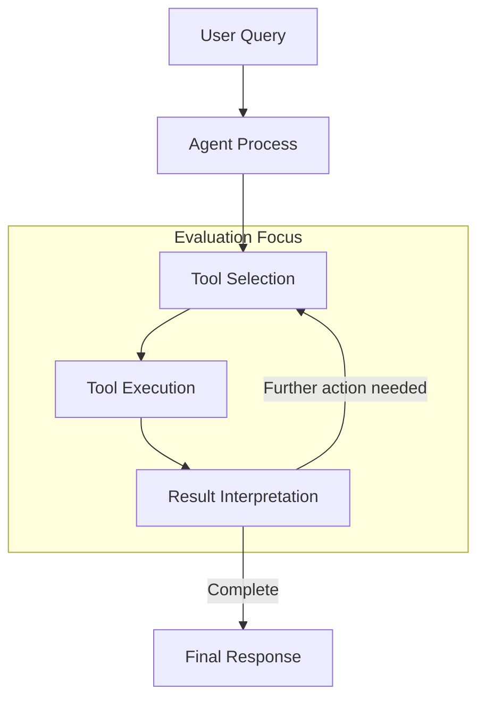
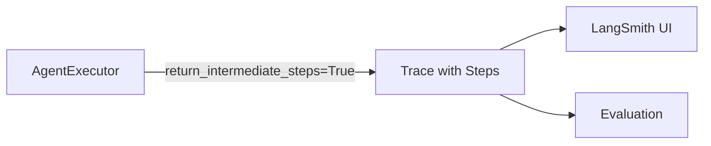
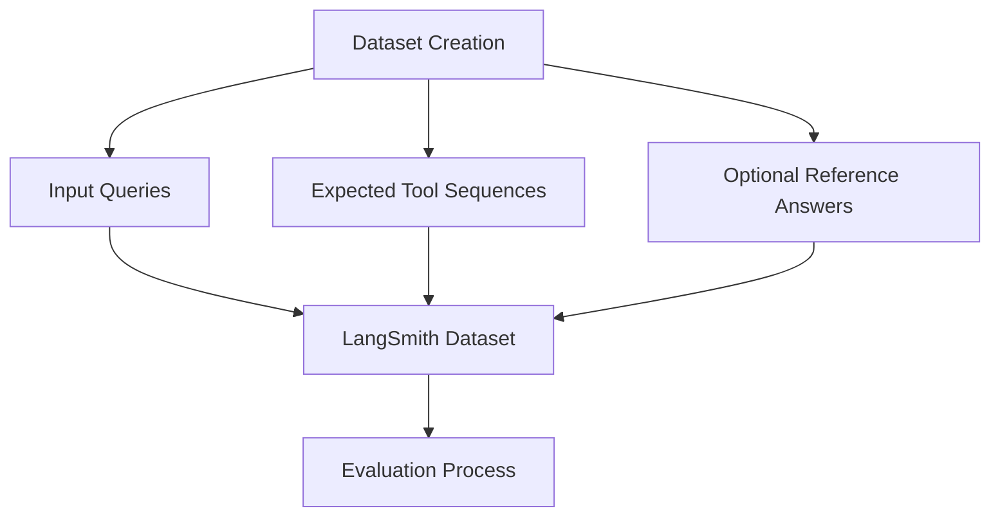
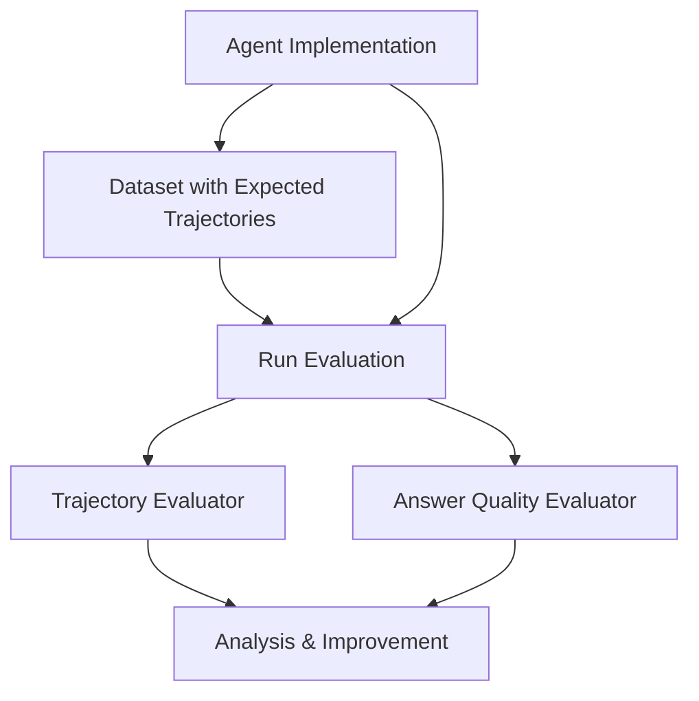
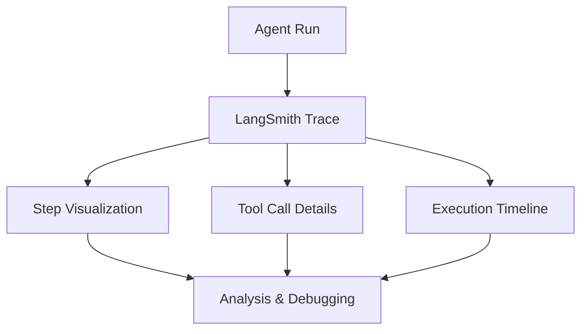

<!-- source: DeepWiki mcp.deepwiki.com · repo langchain-ai/langsmith-cookbook · extra page Agent Steps & Tool Selection · fetched 2026-10-26 -->

# Agent Steps & Tool Selection

<details>
<summary>Relevant source files</summary>

The following files were used as context for generating this wiki page:

- [README.md](README.md)
- [testing-examples/README.md](testing-examples/README.md)
- [testing-examples/agent_steps/evaluating_agents.ipynb](testing-examples/agent_steps/evaluating_agents.ipynb)
- [testing-examples/chat-single-turn/chat_evaluation_single_turn.ipynb](testing-examples/chat-single-turn/chat_evaluation_single_turn.ipynb)
- [testing-examples/data-extraction/contract-extraction.ipynb](testing-examples/data-extraction/contract-extraction.ipynb)
- [testing-examples/data-extraction/img/contract-extraction-dataset.png](testing-examples/data-extraction/img/contract-extraction-dataset.png)

</details>


This page details methods for evaluating agent trajectories - specifically the sequence of steps and tool selections made during agent execution. Rather than merely assessing if an agent's final answer is correct, these techniques help you understand and evaluate the decision-making process that led to that result. For information about evaluating specific types of agents like LangGraph SQL agents, see [LangGraph SQL Agents](#3.2.2).

## Understanding Agent Trajectories

An agent trajectory consists of the sequence of tool calls (actions) taken by an agent while processing a user query. Unlike simple question-answering systems, agents make multiple decisions: choosing which tools to use, formatting inputs for those tools, executing them, and interpreting results before producing a final response.



Evaluating this process helps ensure the agent selects appropriate tools, uses them efficiently, and follows logical reasoning patterns.

Sources: [testing-examples/agent_steps/evaluating_agents.ipynb:8-25]()

## Capturing Agent Steps in LangSmith

LangSmith automatically captures and visualizes agent trajectories when you use the LangChain AgentExecutor or other compatible frameworks. To ensure intermediate steps are properly captured, you need to configure your agent to return them:



When configuring your agent, ensure you set the parameter:

```
return_intermediate_steps=True
```

This ensures that each action taken by the agent is recorded in the run's outputs, making them available for evaluation.

Sources: [testing-examples/agent_steps/evaluating_agents.ipynb:180-206]()

## Creating Evaluation Datasets

To evaluate agent trajectories, you need datasets that include both input queries and expected tool usage:



Here's how to structure such a dataset:

| Input Field | Output Field | Purpose |
|-------------|--------------|---------|
| `question`  | `expected_steps` | List of tool names in expected sequence |
| `question`  | `reference` | Expected final answer (optional) |

The `expected_steps` field contains an ordered list of tool names the agent should use (e.g., `["duck_duck_go", "check_calendar"]`). For queries that shouldn't require tools, use an empty list.

Sources: [testing-examples/agent_steps/evaluating_agents.ipynb:57-127]()

## Custom Trajectory Evaluators

To evaluate agent trajectories, create a custom evaluator that:
1. Extracts the sequence of tool calls from the agent's execution trace
2. Compares this sequence with the expected trajectory from the dataset
3. Calculates a score based on the match

Here's an example evaluator:

```python
def intermediate_step_correctness(run: Run, example: Optional[Example] = None) -> dict:
    if run.outputs is None:
        raise ValueError("Run outputs cannot be None")
    # Extract the intermediate steps from the run
    intermediate_steps = run.outputs.get("intermediate_steps") or []
    # Get just the tool names from each action
    trajectory = [action.tool for action, _ in intermediate_steps]
    # Get the expected trajectory from the dataset
    expected_trajectory = example.outputs["expected_steps"]
    # Score 1 for exact match, 0 otherwise
    score = int(trajectory == expected_trajectory)
    return {"key": "Intermediate steps correctness", "score": score}
```

This evaluator extracts the tool names from the agent's actions and compares them with the expected sequence, providing a binary score.

Sources: [testing-examples/agent_steps/evaluating_agents.ipynb:226-250]()

## Running Trajectory Evaluations

The complete evaluation process combines trajectory evaluation with traditional answer evaluation:



Run your evaluation with both trajectory and answer evaluators:

```python
# For evaluating the final answer quality
qa_evaluator = LangChainStringEvaluator("qa", prepare_data=prepare_data)

# Run evaluation with both evaluators
results = evaluate(
    agent,
    data=dataset_name,
    evaluators=[intermediate_step_correctness, qa_evaluator],
    experiment_prefix="Agent Eval Example",
    max_concurrency=1,
)
```

This gives you insights into both the agent's decision-making process and its final output quality.

Sources: [testing-examples/agent_steps/evaluating_agents.ipynb:252-300]()

## Advanced Evaluation Approaches

While exact sequence matching provides a simple baseline, consider these more sophisticated evaluation approaches:

### 1. Tool Usage Metrics

| Metric | Description |
|--------|-------------|
| **Precision** | Proportion of used tools that were in the expected set |
| **Recall** | Proportion of expected tools that were actually used |
| **Efficiency** | Ratio of necessary tools to total tools used |
| **Ordering** | Correct sequencing of interdependent tools |

### 2. Tool Selection Quality

Beyond just checking if the correct tools were used, evaluate:
- Did the agent select the optimal tool for each sub-task?
- Did it avoid unnecessary tool calls?
- Did it properly handle tool errors or unexpected outputs?

### 3. LLM-based Trajectory Evaluation

For complex trajectories, you can use LangChain's `TrajectoryEvalChain` to have an LLM judge the quality and reasoning of the agent's steps.

## Best Practices

### Dataset Creation

- **Include diverse queries** that require different tool combinations
- **Test boundary conditions** like simple queries needing no tools and complex ones requiring multiple tools
- **Consider alternative paths** - sometimes multiple tool sequences can be valid
- **Include expected failure cases** to ensure the agent handles errors appropriately

### Evaluation Interpretation

- Look beyond binary scores to understand why trajectories differed
- Use trajectory evaluation alongside output evaluation
- Consider whether exact tool ordering matters for your specific application
- Track trajectory metrics over time to identify trends in agent behavior

## Visualizing Agent Trajectories

LangSmith provides visualization tools that make agent trajectories easier to understand:



These visualizations help you quickly identify:
- Which tools were used and in what order
- How long each tool call took
- What inputs were provided to each tool
- How the agent interpreted each tool's output

Sources: [testing-examples/agent_steps/evaluating_agents.ipynb:12-14]()

## Conclusion

Evaluating agent steps and tool selection provides deeper insights into agent behavior than just assessing final outputs. By using LangSmith to capture trajectories and creating custom evaluators to assess them, you can systematically improve your agent's decision-making process, leading to more efficient, reliable, and transparent agent behavior.

Sources: [testing-examples/agent_steps/evaluating_agents.ipynb:308-312]()

---

