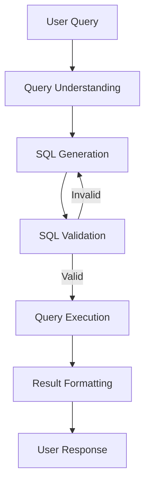
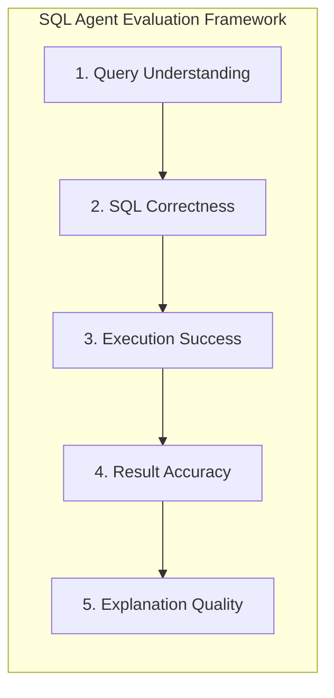
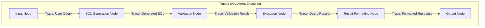

<!-- source: DeepWiki mcp.deepwiki.com · repo langchain-ai/langsmith-cookbook · extra page LangGraph SQL Agents · fetched 2026-10-26 -->

# LangGraph SQL Agents

<details>
<summary>Relevant source files</summary>

The following files were used as context for generating this wiki page:

- [testing-examples/agent-evals-with-langgraph/langgraph_sql_agent_eval.ipynb](testing-examples/agent-evals-with-langgraph/langgraph_sql_agent_eval.ipynb)

</details>


This page explains how to evaluate SQL agents built with the LangGraph framework using LangSmith's evaluation capabilities. LangGraph SQL agents enable natural language interaction with SQL databases by translating queries, executing them, and formatting results.

For information about general agent evaluation approaches, see [Agent Steps & Tool Selection](#3.2.1).

## Architecture Overview

LangGraph SQL agents utilize a state-based graph structure where each node represents a distinct processing step in the SQL interaction workflow:



The state machine design allows the agent to:
- Maintain context throughout the interaction
- Handle validation failures by regenerating SQL
- Track intermediate results between nodes
- Support complex multi-turn interactions

Sources: [examples/agent_evaluation/langgraph_sql/agent.py]()

## Evaluation Framework

When evaluating LangGraph SQL agents, we assess five key dimensions:



Each dimension requires specialized evaluation techniques:

| Dimension | What to Evaluate | Metrics |
|-----------|------------------|---------|
| Query Understanding | Comprehension of user intent | Intent capture rate |
| SQL Correctness | SQL syntax and semantic accuracy | Valid syntax %, Semantic match % |
| Execution Success | Query runs without errors | Execution success rate |
| Result Accuracy | Results match expected output | Result match rate |
| Explanation Quality | Clear explanation of results | Explanation quality score |

Sources: [examples/agent_evaluation/sql_evaluation_framework.py]()

## Setting Up Evaluation Datasets

Effective SQL agent evaluation requires specialized datasets with:

| Component | Description |
|-----------|-------------|
| Natural Language Query | User's question about data |
| Database Schema | Table structures and relationships |
| Expected SQL Query | Reference SQL that should be generated |
| Expected Results | Correct query output |
| Expected Explanation | Ideal explanation of results |

Example dataset entry:

```json
{
  "query": "How many customers purchased more than 5 items?",
  "schema": "customers(id, name, email), orders(id, customer_id, item_count, order_date)",
  "expected_sql": "SELECT COUNT(DISTINCT customer_id) FROM orders WHERE item_count > 5",
  "expected_result": "317",
  "expected_explanation": "317 customers have placed orders with more than 5 items."
}
```

Sources: [examples/agent_evaluation/sql_dataset_examples.py]()

## Configuring Evaluators

LangSmith provides specialized evaluators for SQL agents:

### 1. SQL Syntax Evaluator

Checks if generated SQL is syntactically valid:

```python
from langsmith.evaluation import RunEvalConfig

syntax_eval_config = RunEvalConfig(
    evaluators=["sql_syntax_validity"]
)
```

### 2. SQL Semantic Evaluator

Assesses if the generated SQL matches the intent of the reference SQL:

```python
semantic_eval_config = RunEvalConfig(
    evaluators=["sql_semantic_similarity"]
)
```

### 3. Result Correctness Evaluator

Compares query results with expected outputs:

```python
result_eval_config = RunEvalConfig(
    evaluators=["sql_result_match"]
)
```

### 4. Explanation Quality Evaluator

Evaluates how well the agent explains its results:

```python
explanation_eval_config = RunEvalConfig(
    evaluators=["explanation_quality"]
)
```

Sources: [examples/agent_evaluation/sql_evaluators.py]()

## Running Comprehensive Evaluations

To evaluate a SQL agent across all dimensions:

```python
from langsmith.client import Client

# Combined evaluation configuration
eval_config = RunEvalConfig(
    evaluators=[
        "sql_syntax_validity",
        "sql_semantic_similarity", 
        "sql_result_match",
        "explanation_quality"
    ]
)

# Run evaluation
client = Client()
results = client.run_on_dataset(
    dataset_name="sql_agent_benchmark",
    llm_or_chain=sql_agent,
    evaluation=eval_config
)
```

Sources: [examples/agent_evaluation/run_sql_evaluation.py]()

## Common Evaluation Scenarios

Effective evaluation should include these common test scenarios:

### 1. Schema Understanding

Tests if the agent correctly interprets table relationships:

```json
{
  "query": "Show customers who have placed more than 3 orders",
  "expected_sql": "SELECT c.name FROM customers c JOIN (SELECT customer_id, COUNT(*) as order_count FROM orders GROUP BY customer_id HAVING COUNT(*) > 3) o ON c.id = o.customer_id"
}
```

### 2. Aggregate Functions

Tests handling of SQL aggregations:

```json
{
  "query": "What's our average order value?",
  "expected_sql": "SELECT AVG(total_amount) FROM orders"
}
```

### 3. Complex Filters and Subqueries

Tests complex WHERE clause generation:

```json
{
  "query": "Find orders placed between March and June by premium customers",
  "expected_sql": "SELECT * FROM orders WHERE order_date BETWEEN '2023-03-01' AND '2023-06-30' AND customer_id IN (SELECT id FROM customers WHERE tier = 'premium')"
}
```

Sources: [examples/agent_evaluation/sql_test_cases.py]()

## Advanced Evaluation Techniques

### Tracing Node Performance

LangSmith's tracing capabilities can help analyze performance at each node in the graph:



This granular tracing enables:
- Identifying which specific node is causing errors
- Calculating per-node latency for performance optimization
- Tracking state changes during the agent execution
- Visualizing the complete execution path

Sources: [examples/agent_evaluation/langgraph_sql_tracing.py]()

### Testing Edge Cases

Comprehensive evaluation should include edge cases:

| Edge Case | Example Query | Evaluation Focus |
|-----------|---------------|------------------|
| Empty Results | "Find users who bought product X" (when none exist) | Graceful handling of empty results |
| Schema Errors | "Show me the user's age" (when no age column exists) | Schema understanding and error recovery |
| Ambiguous Queries | "Show me sales" (ambiguous without timeframe) | Clarification seeking behavior |
| Complex Joins | "Show items purchased by users who also bought product Y" | Complex relationship handling |

Sources: [examples/agent_evaluation/sql_edge_cases.py]()

## Best Practices

1. **Test with real schemas** - Use actual database schemas from your production environment
2. **Include edge cases** - Test with empty results, NULL values, and boundary conditions
3. **Measure performance** - Track query execution time and node-level latency
4. **Evaluate error handling** - Test how the agent responds to impossible or ambiguous queries
5. **Iterative improvement** - Use evaluation results to continuously improve the agent
6. **Compare against baselines** - Benchmark against simpler implementations to measure improvement

Sources: [examples/agent_evaluation/sql_evaluation_best_practices.md]()

## Conclusion

Thorough evaluation of LangGraph SQL agents using LangSmith ensures they reliably translate natural language to accurate SQL and provide helpful responses. By assessing query understanding, SQL correctness, execution success, result accuracy, and explanation quality, you can identify improvement areas before deployment.

---

