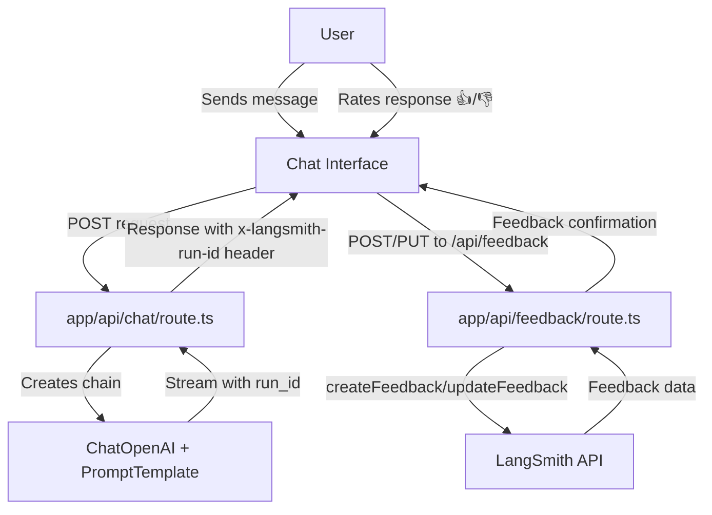
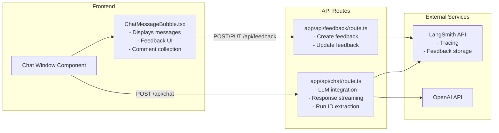
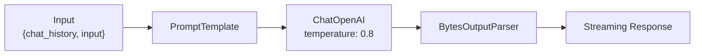
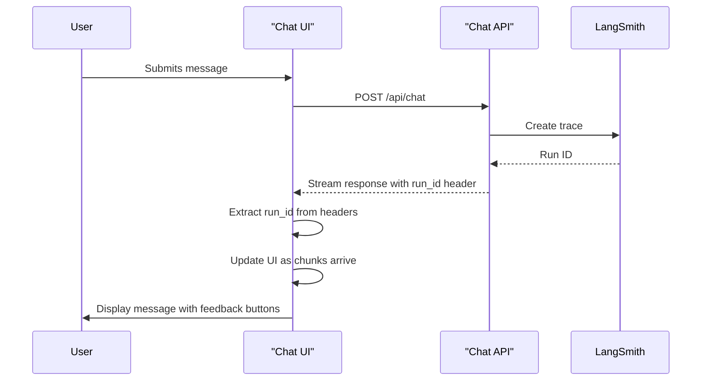
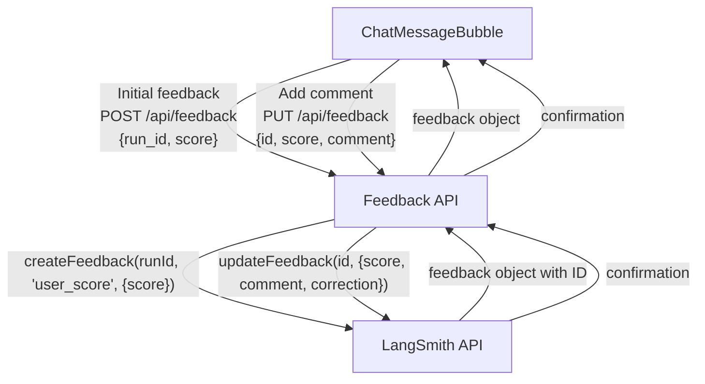

<!-- source: DeepWiki mcp.deepwiki.com · repo langchain-ai/langsmith-cookbook · extra page Next.js Chat App · fetched 2026-10-26 -->

# Next.js Chat App

Relevant source files

The following files were used as context for generating this wiki page:

- [feedback-examples/nextjs/README.md](feedback-examples/nextjs/README.md)
- [feedback-examples/nextjs/app/api/chat/route.ts](feedback-examples/nextjs/app/api/chat/route.ts)
- [feedback-examples/nextjs/components/ChatMessageBubble.tsx](feedback-examples/nextjs/components/ChatMessageBubble.tsx)
- [feedback-examples/nextjs/package.json](feedback-examples/nextjs/package.json)
- [feedback-examples/nextjs/public/images/chat.png](feedback-examples/nextjs/public/images/chat.png)
- [feedback-examples/nextjs/yarn.lock](feedback-examples/nextjs/yarn.lock)
- [tracing-examples/show-trace-url-streamlit/README.md](tracing-examples/show-trace-url-streamlit/README.md)

This document explains the implementation of a Next.js-based chat application that demonstrates how to collect and process user feedback on LLM responses using LangSmith. This app uses a serverless TypeScript environment to create a chat interface that allows users to rate and comment on AI responses, with all interactions being traced and feedback stored in LangSmith.

For information about implementing feedback collection in a Streamlit application, see [Streamlit Chat App](#4.1.1).

## System Overview

**Next.js Chat App Feedback Flow**

Sources: [feedback-examples/nextjs/README.md:35-44](), [feedback-examples/nextjs/README.md:95-98]()

## Key Components

The application consists of three primary components:

1. **Chat API route** - Generates responses using LangChain
2. **Chat UI** - Renders messages and feedback controls 
3. **Feedback API route** - Creates and updates feedback in LangSmith

**Component Architecture**

Sources: [feedback-examples/nextjs/README.md:37-44]()

## Chat API Implementation

The chat API route processes user messages and generates AI responses while capturing trace information.

### LangChain Chain Setup

The chat endpoint uses a simple LangChain LCEL pipeline that:
1. Takes a message history and current input
2. Passes them through a prompt template 
3. Sends to ChatOpenAI model
4. Streams the output back to the client

Sources: [feedback-examples/nextjs/app/api/chat/route.ts:39-68]()

### Run ID Extraction

A critical part of the implementation is extracting the LangSmith run ID so it can be associated with feedback:

1. Chain is executed with a callback that captures the run ID
2. The run ID is added to the response headers
3. The frontend extracts this run ID for feedback submission

Sources: [feedback-examples/nextjs/app/api/chat/route.ts:73-97](), [feedback-examples/nextjs/README.md:70-87]()

## Frontend Implementation

The frontend handles displaying the chat interface, streaming responses, and collecting feedback.

### Chat UI

The chat window contains:
- Message history display
- Input field for new messages
- Thumbs up/down buttons for feedback
- Optional comment field for detailed feedback

### Message Streaming

When a user sends a message:
1. The request is sent to the chat API
2. The response is processed as a stream
3. The run ID is extracted from response headers
4. Message chunks are rendered incrementally

Sources: [feedback-examples/nextjs/README.md:106-139]()

### Feedback Collection

The `ChatMessageBubble` component handles feedback collection:

1. Displays thumbs up/down buttons for each AI message
2. When clicked, sends feedback to the feedback API
3. Shows comment input field after initial rating
4. Submits detailed feedback when comment is provided

Sources: [feedback-examples/nextjs/components/ChatMessageBubble.tsx:25-77]()

## Feedback API Implementation

The feedback API has two main operations:

1. **Create Feedback (POST)**: Records an initial thumbs up/down rating
2. **Update Feedback (PUT)**: Adds a comment to existing feedback

### Creating Feedback

When a user clicks a feedback button:
1. Frontend sends run ID and score (0 or 1) to the feedback API
2. API calls LangSmith's `createFeedback` method 
3. Feedback ID is returned to the frontend for later updates

### Updating Feedback

When a user submits a comment:
1. Frontend sends feedback ID, score, and comment
2. API calls LangSmith's `updateFeedback` method
3. For negative feedback (score=0), comments are stored as "correction"
4. For positive feedback (score=1), comments are stored as regular comments

Sources: [feedback-examples/nextjs/README.md:166-216]()

## Setup and Configuration

To set up the application:

1. Clone the repository
2. Copy `.env.example` to `.env.local`
3. Set required environment variables:
   - `LANGCHAIN_TRACING_V2`
   - `LANGCHAIN_ENDPOINT`
   - `LANGCHAIN_API_KEY`
   - `LANGCHAIN_PROJECT`
   - `OPENAI_API_KEY`
4. Install dependencies with your preferred package manager
5. Run `yarn dev` or `npm run dev` to start the development server

Sources: [feedback-examples/nextjs/README.md:16-32]()

## Conclusion

This Next.js Chat App demonstrates a complete implementation of user feedback collection for LLM applications:

1. LangSmith tracing captures detailed information about each interaction
2. Feedback is directly tied to specific traced runs
3. Both quantitative (👍/👎) and qualitative (comments) feedback can be collected
4. The feedback data is available in LangSmith for analysis and model improvement

The architecture patterns demonstrated here can be adapted for different frontend frameworks while maintaining the same backend logic for feedback collection.

Sources: [feedback-examples/nextjs/README.md:228-231]()

---

