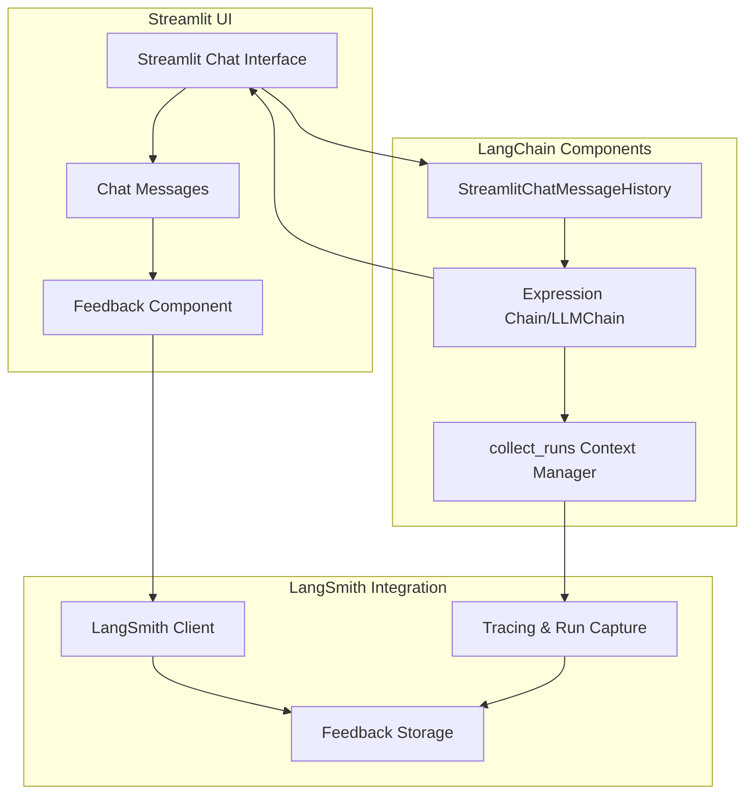
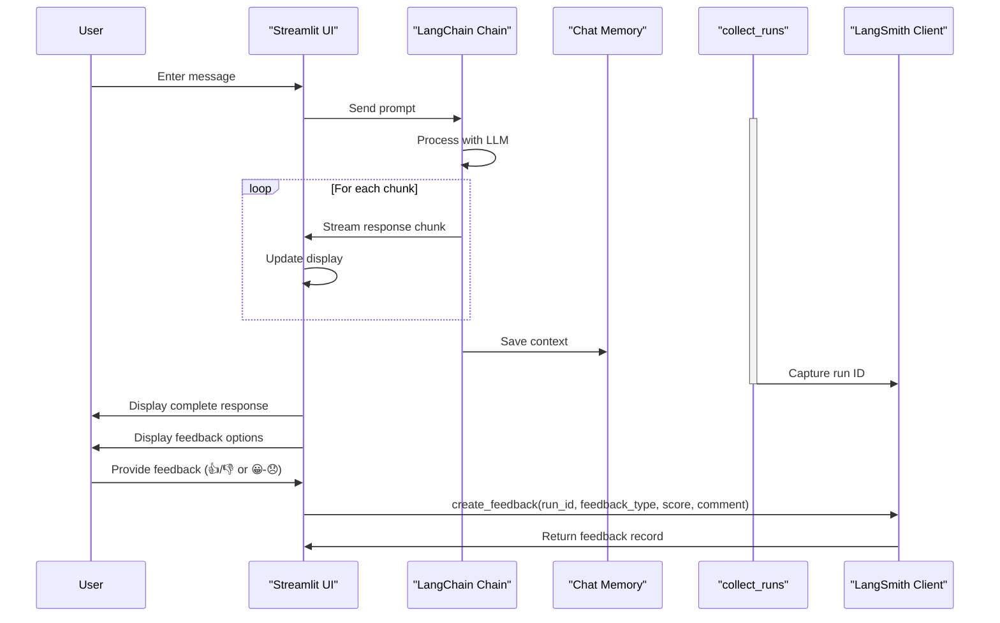
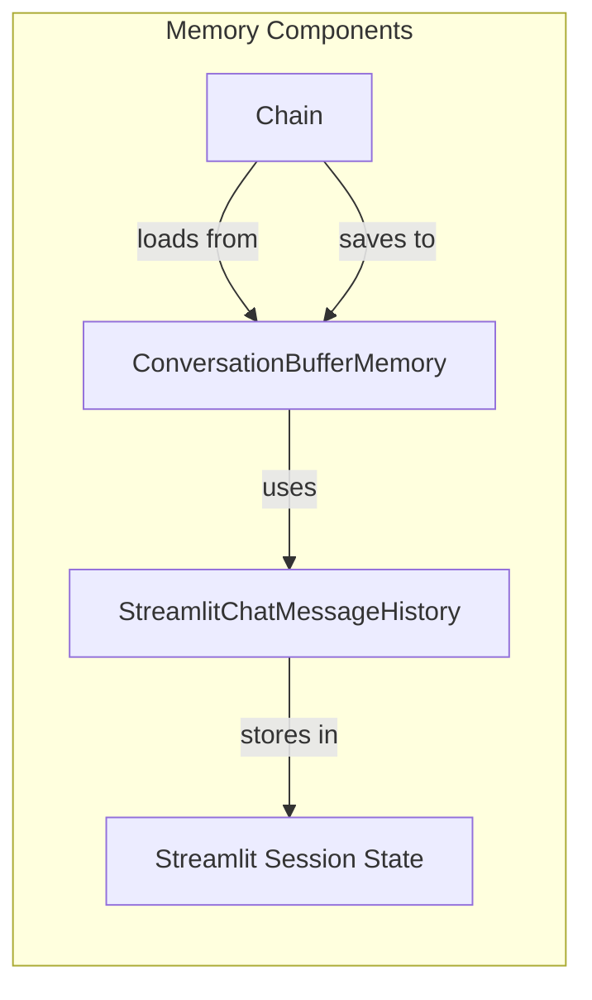

<!-- source: DeepWiki mcp.deepwiki.com · repo langchain-ai/langsmith-cookbook · extra page Streamlit Chat App · fetched 2026-10-26 -->

# Streamlit Chat App

<details>
<summary>Relevant source files</summary>

The following files were used as context for generating this wiki page:

- [feedback-examples/README.md](feedback-examples/README.md)
- [feedback-examples/streamlit-realtime-feedback/img/hallucination_feedback.gif](feedback-examples/streamlit-realtime-feedback/img/hallucination_feedback.gif)
- [feedback-examples/streamlit/README.md](feedback-examples/streamlit/README.md)
- [feedback-examples/streamlit/main.py](feedback-examples/streamlit/main.py)
- [feedback-examples/streamlit/requirements.txt](feedback-examples/streamlit/requirements.txt)
- [hub-examples/README.md](hub-examples/README.md)
- [tracing-examples/README.md](tracing-examples/README.md)
- [typescript-testing-examples/README.md](typescript-testing-examples/README.md)

</details>


This document explains how to implement user feedback collection in a Streamlit chat application using LangSmith. It covers how to build a chat interface with real-time response streaming, integrate LangSmith tracing, and collect thumbs up/down or emoji-based feedback from users. For information about implementing user feedback in a Next.js application, see [Next.js Chat App](#4.1.2).

## Overview

The Streamlit Chat App demonstrates how to create a ChatGPT-like interface that allows users to:
- Interact with an LLM in a conversational format
- View streaming responses in real-time
- Provide explicit feedback on responses (thumbs up/down or emoji ratings)
- Access trace links to view detailed execution information in LangSmith

The feedback collected through this interface can be used for:
- Creating datasets with example conversations
- Improving model responses
- Fine-tuning models 
- Monitoring application performance
- Personalizing user experiences

Sources: [feedback-examples/streamlit/README.md:5-19](), [feedback-examples/streamlit/README.md:226-235]()

## Architecture

### System Architecture



Sources: [feedback-examples/streamlit/main.py:1-9](), [feedback-examples/streamlit/README.md:88-104](), [feedback-examples/streamlit/README.md:154-175]()

### Data Flow Diagram



Sources: [feedback-examples/streamlit/main.py:60-121](), [feedback-examples/streamlit/README.md:154-218]()

## Components

### Core Components

| Component | Purpose | Implementation |
|-----------|---------|----------------|
| Streamlit UI | Provides the chat interface | Streamlit chat components |
| Chat Memory | Stores conversation history | `StreamlitChatMessageHistory` |
| LangChain Chain | Handles the chat logic | Expression chain or LLMChain |
| collect_runs | Captures trace information | Context manager from LangSmith |
| Feedback Component | Collects user ratings | streamlit_feedback package |
| LangSmith Client | Sends feedback to LangSmith | Client from langsmith package |

Sources: [feedback-examples/streamlit/main.py:1-9](), [feedback-examples/streamlit/requirements.txt:1-6]()

### Memory Management

The application uses Streamlit's session state to maintain conversation history through the `StreamlitChatMessageHistory` class provided by LangChain:



Sources: [feedback-examples/streamlit/main.py:42-46](), [feedback-examples/streamlit/README.md:95-101]()

## Implementation Details

### Setup and Dependencies

The application requires the following dependencies:

- langchain
- streamlit
- langsmith
- openai or anthropic
- streamlit-feedback

Environment variables must be configured to connect to LangSmith and OpenAI:

```
LANGCHAIN_TRACING_V2=true
LANGCHAIN_ENDPOINT=https://api.smith.langchain.com
LANGCHAIN_API_KEY=<your-api-key>
LANGCHAIN_PROJECT=streamlit-demo
OPENAI_API_KEY=<your-openai-key>
```

Sources: [feedback-examples/streamlit/requirements.txt:1-6](), [feedback-examples/streamlit/README.md:22-36]()

### Chat Chain Implementation

The chat logic is implemented using LangChain's expression language, which allows for composing different Runnable objects in a transparent way. The chain is created in [feedback-examples/streamlit/expression_chain.py]() and includes:

1. Memory setup with StreamlitChatMessageHistory
2. Input mapping with RunnableMap
3. Prompt template with system and user messages
4. LLM configuration for response generation

Sources: [feedback-examples/streamlit/README.md:106-136]()

### UI Components

The Streamlit UI is built with several key components:

1. Chat history display
2. Chat input for user messages
3. Message placeholder for streaming responses
4. Feedback widget for rating responses
5. Sidebar for configuration options

Sources: [feedback-examples/streamlit/main.py:10-16](), [feedback-examples/streamlit/main.py:28-54](), [feedback-examples/streamlit/main.py:60-64]()

## User Feedback Flow

### Capturing Responses

The application captures the LLM's response in the following way:

1. User submits a prompt via the chat input
2. The app creates a message placeholder for the response
3. The `collect_runs` context manager is used to track run information
4. The chain streams the response to the UI
5. Once complete, the run ID is stored in the session state

```python
with collect_runs() as cb:
    for chunk in chain.stream(input_dict, config={"tags": ["Streamlit Chat"]}):
        full_response += chunk.content
        message_placeholder.markdown(full_response + "▌")
    memory.save_context(input_dict, {"output": full_response})
    st.session_state.run_id = cb.traced_runs[0].id
```

Sources: [feedback-examples/streamlit/main.py:65-80](), [feedback-examples/streamlit/README.md:154-168]()

### Collecting Feedback

After the response is displayed, the app presents feedback options:

1. The user can provide thumbs up/down or emoji-based feedback
2. The feedback is mapped to a numerical score (0-1)
3. Optional text comments can be provided
4. The feedback is sent to LangSmith using the `create_feedback` method

```python
feedback_record = client.create_feedback(
    run_id,
    feedback_type_str,
    score=score,
    comment=feedback.get("text"),
)
```

Sources: [feedback-examples/streamlit/main.py:82-121](), [feedback-examples/streamlit/README.md:179-219]()

### Feedback Options

The application supports two feedback systems:

| System | Options | Score Mapping |
|--------|---------|---------------|
| Thumbs | 👍, 👎 | 1.0, 0.0 |
| Faces | 😀, 🙂, 😐, 🙁, 😞 | 1.0, 0.75, 0.5, 0.25, 0.0 |

Users can toggle between these systems using a switch in the sidebar.

Sources: [feedback-examples/streamlit/main.py:51-54](), [feedback-examples/streamlit/main.py:90-97]()

## Viewing Feedback in LangSmith

After collecting feedback, users can:

1. Navigate to the LangSmith project dashboard
2. View aggregate feedback statistics
3. Filter runs by feedback score (positive/negative)
4. Click on individual runs to see detailed traces
5. Add runs to datasets for further analysis or model training

Sources: [feedback-examples/streamlit/README.md:61-87]()

## Reusable Tactics

The techniques demonstrated in this example can be applied to other applications:

1. **Feedback Collection**: The pattern of capturing run IDs and associating feedback can be used in any application that needs to collect user ratings.

2. **Run Tracing**: The `collect_runs` context manager provides a convenient way to capture trace information for debugging and analysis.

3. **LangChain Expression Language**: The composable patterns shown in the chain definition enable cleaner code and better visibility in traces.

4. **Streamlit Integration**: The approach of using Streamlit's session state for memory management can be applied to other Streamlit applications.

Sources: [feedback-examples/streamlit/README.md:226-235]()

## Conclusion

The Streamlit Chat App provides a practical example of how to integrate LangSmith's tracing and feedback collection capabilities into a conversational interface. By capturing user feedback and associating it with specific runs, developers can gain valuable insights into their application's performance and use this data to improve responses over time.

Sources: [feedback-examples/streamlit/README.md:234-235]()

---

